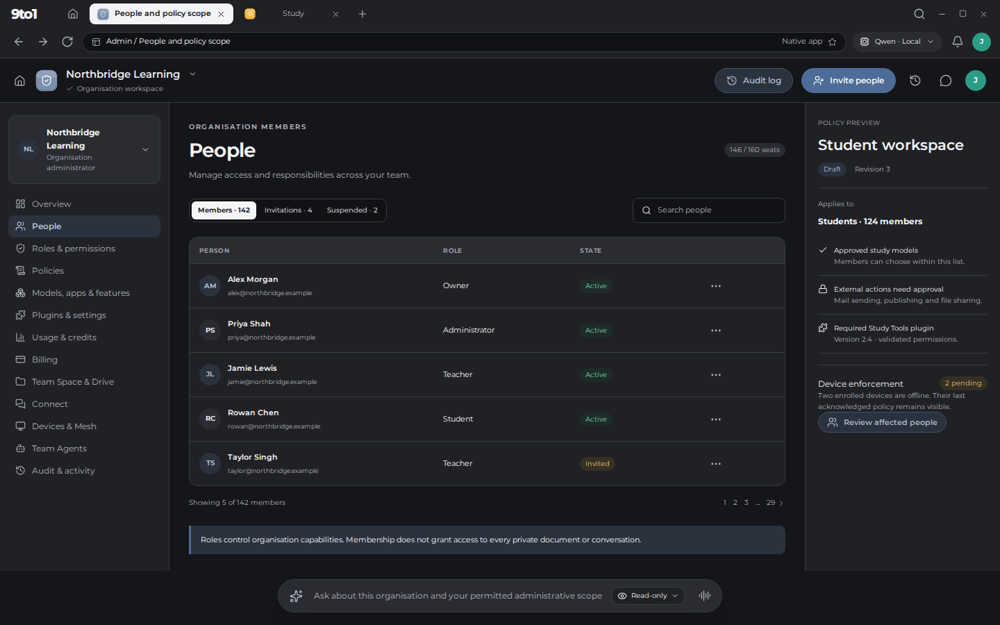

# Admin — organisation scope and policy

Module ID: `admin` · 9to1 Development Specification v3

## Prerequisites

- **CUI, themes and shared interaction system** — Typed UI components, theme tokens/materials, layout, focus, motion, accessibility and shared control states.
- **Account, identity and resource entitlements** — Canonical CAKE account identity, secure sessions, server entitlements and resource allocation state.
- **Permissions, approvals and execution scope** — Effective scoped grants, action approvals, policy intersections, revocation and audit.
- **Models, discovery and universal model routing** — Model discovery/lifecycle, stable provider capabilities, ordered routing and truthful usage/effort metadata.

## Overview

Admin manages organisation users, roles, resources and policies with explicit organisation scope. It shows policy delivery and enforcement state rather than treating a saved policy draft as universally active.

## Layouts & visible states

- **V3-ADMIN-LAY-01** — Keep organisation identity/scope visible above user, role, policy, device and resource controls. Show members/roles in a useful table with concrete status.
- **V3-ADMIN-LAY-02** — Distinguish draft, published, delivered, acknowledged and failed policy states; expose affected scope and current policy source.

## Features & behaviour

- **V3-ADMIN-FEA-01** — Manage membership, role-based capabilities, allowed models/providers, Plugins/MCP, shared resources and per-organisation limits using retained server contracts.
- **V3-ADMIN-FEA-02** — Preserve organisation resource pools/ceilings and the separate Business/Business+ entitlement semantics. Do not conflate seat limits with model/storage allocation.
- **V3-ADMIN-FEA-03** — Policy changes expose an inspectable effect/target set and conflict handling; auditing records who changed what.

## Canonical entities & persistence

- **V3-ADMIN-ENT-01** — Maintain OrganisationID, UserID/membership, RoleID, PolicyID/revision, assigned scope, acknowledgement records and audit event IDs.
- **V3-ADMIN-ENT-02** — Server-authoritative billing/resource state is independent from local draft policy.

## Permissions & recovery

- **V3-ADMIN-PER-01** — Require the actual administrative grant for each operation. Admin views must not expose private personal conversations/memory merely because the user manages an organisation.
- **V3-ADMIN-PER-02** — Failed delivery or offline devices remain visible and retryable without a false enforced status.

## Acceptance checks

- **V3-ADMIN-ACC-01** — Test role restrictions, policy draft→publish→device acknowledgement, revoked membership and mixed delivery outcomes.
- **V3-ADMIN-ACC-02** — Verify personal/org switching cannot leak cross-scope private data.

## Exact mock-up and state map

- **9to1 Admin · People and policy scope** — screen `admin`. Organisation.

## Source clause IDs

ADM-01, ADM-02, ADM-03, ADM-04, ADM-05, ADM-06, ADM-07, ADM-08, ADM-09, ADM-10, ADM-11, ADM-12

## Technical reading map

- Admin — organisation scope and policy — 9to1 Admin; Product role, access and platforms (part 01) — `technical/admin-01.md` (2,374 words; V2-B0547).

Technical clauses retain APIs, data models, platform, recovery, donor and acceptance details. The technical files are part of this module, not optional background reading. Shared prerequisites mean stable service/interface contracts must be available; they do not require every dependent app UI to be complete. Use the named chunk for the relevant subtask or the complete module file for its full retained contract.

# Exact designs and implementation rules

These figures are the exact current atlas compositions. Their stable screen IDs match the Word specification and editable source. Open the atlas for full-size theme and interaction inspection.

## 9to1 Admin · People and policy scope

Screen ID: `admin`. Source: ADM-01–12: organisation identity, people, roles, policies and deployment state.

- Every administrative screen displays the current organisation. Product entitlement does not confer admin privileges.
- People states distinguish invited, active, suspended and removed. Effective permissions include role, policy and object scope.
- Policy changes move through Draft, Validated and Published, then show per-target enforcement. An offline endpoint is not silently compliant.
- Bulk changes preview their scope and report per-item outcomes. Personal accounts and unrelated organisations remain separate.
