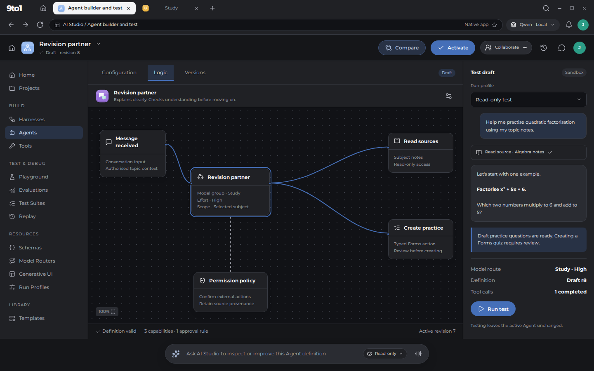
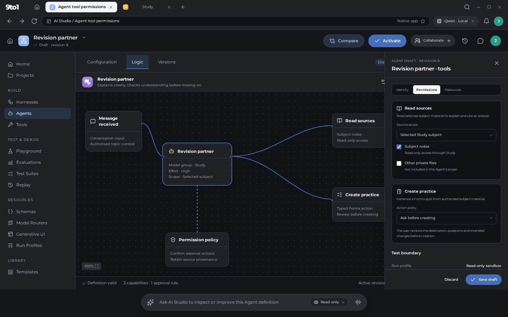

# AI Studio — harnesses, agents and evaluations

Module ID: `ai-studio` · 9to1 Development Specification v3

## Prerequisites

- **CUI, themes and shared interaction system** — Typed UI components, theme tokens/materials, layout, focus, motion, accessibility and shared control states.
- **Node Editor — shared graph framework** — Shared typed graph schemas, editing/validation, draft activation and runtime presentation.
- **Dulche runtime, requests and execution services** — Canonical AI broker, capability-aware routing, durable Task/Runs, action execution and lifecycle.
- **Models, discovery and universal model routing** — Model discovery/lifecycle, stable provider capabilities, ordered routing and truthful usage/effort metadata.
- **Permissions, approvals and execution scope** — Effective scoped grants, action approvals, policy intersections, revocation and audit.

## Overview

AI Studio authors and tests configured AI systems through real typed definitions. Graphs and forms are views of canonical versioned configurations; testing is distinct from activating or granting permissions.

## Layouts & visible states

- **V3-AI-STUDIO-LAY-01** — Organise Home/Projects; Build for Harnesses, Agents and Tools; Test for Playground, Evaluations, Test Suites and Replay; Resources for Schemas, Model Routes, GenUI and Run Profiles; and Templates.
- **V3-AI-STUDIO-LAY-02** — Provide typed graph, property/permission inspector, version/draft state and test results with real inputs/outputs. Tool-permission detail lists exact allowed resources and action consequences.

## Features & behaviour

- **V3-AI-STUDIO-FEA-01** — Build harness/Agent/Specialist and tool/Skill/Plugin/MCP definitions using registered schemas and shared services. Preserve supported node/form equivalence.
- **V3-AI-STUDIO-FEA-02** — Validate schema/types, models, dependencies and permission intersections. Test uses an explicit run profile, model route, inputs and live/mock distinction.
- **V3-AI-STUDIO-FEA-03** — Compare evaluations/test-suite results with provenance and failure detail. Do not equate a passing sample with production activation or independent acceptance.
- **V3-AI-STUDIO-FEA-04** — Training Lab remains the source’s explicitly deferred/undefined release scope; do not invent a complete training backend.

## Canonical entities & persistence

- **V3-AI-STUDIO-ENT-01** — Persist project/definition IDs, schema/configuration revisions, Draft/Active versions, test case/suite IDs, run/evaluation receipts and model/prompt provenance.
- **V3-AI-STUDIO-ENT-02** — Templates copy starter definitions with new identity where appropriate, not credentials or silent grants.

## Permissions & recovery

- **V3-AI-STUDIO-PER-01** — Permission controls narrow capability use; testing a tool cannot authorise unrelated live effects. Live external calls require their actual grants/approval.
- **V3-AI-STUDIO-PER-02** — Invalid drafts preserve the active version. Failed tests and missing tools remain inspectable and retryable without fake success.

## Acceptance checks

- **V3-AI-STUDIO-ACC-01** — Author→validate→test→inspect failure→revise→activate a typed definition with stable identity.
- **V3-AI-STUDIO-ACC-02** — Verify tool-scope denial, live/mock labels, version rollback and matching graph/form representations.

## Exact mock-up and state map

- **AI Studio · Agent builder and test** — screen `ai-studio`. Builder.
- **AI Studio · Agent tool permissions** — screen `ai-studio-permissions`. Agent draft · policy.

## Source clause IDs

UX27-OTHER-013

## Technical reading map

- AI Studio — harnesses, agents and evaluations — AI Studio; Product role (part 01) — `technical/ai-studio-01.md` (2,370 words; V2-B1014, V2-B1015, V2-B1016…).
- AI Studio — harnesses, agents and evaluations — Permission Simulator; Dependency Inspector (part 02) — `technical/ai-studio-02.md` (1,067 words; V2-B1107, V2-B1108, V2-B1109…).

Technical clauses retain APIs, data models, platform, recovery, donor and acceptance details. The technical files are part of this module, not optional background reading. Shared prerequisites mean stable service/interface contracts must be available; they do not require every dependent app UI to be complete. Use the named chunk for the relevant subtask or the complete module file for its full retained contract.

# Retained technical requirements

# AI Studio — harnesses, agents and evaluations — AI Studio; Product role (part 01)

Reading status: active retained clauses, subject to the v3 owner overrides listed in the primary module. Historical process instructions and replaced original wording are stored separately.

### V2-B1014 · v2 lines 4588–4589

AI Studio
Product role

### V2-B1015 · v2 lines 4592–4592

9to1 AI Studio is the advanced authoring, testing, debugging and packaging environment for reusable Dulche systems. It is not a second AI runtime. Dulche owns model/Agent/tool execution; Home owns permissions and the shared Node Graph Framework; Den owns persistent Agent state; AI Studio owns the structured authoring and developer experience over those canonical systems.

### V2-B1016 · v2 lines 4595–4595

AI Studio MUST support both project-backed artifacts and direct editing of canonical Dulche entities. Harnesses and Tool packages are AI Studio projects; Agents are canonical Den-backed Dulche Agents edited directly through Agent Builder rather than duplicated as an AI Studio-only project type.

### V2-B1017 · v2 lines 4598–4598

Navigation and landing page

### V2-B1018 · v2 lines 4601–4601

AI Studio MUST use a clean persistent sidebar organised into Home, Projects, Build, Test & Debug, Resources and Templates. Build MUST expose Harnesses, Agents and Tools. Test & Debug MUST expose Playground, Evaluations, Test Suites and Replay. Resources MUST expose Schemas, Model Routers, Generative UI and Run Profiles.

### V2-B1019 · v2 lines 4604–4604

The landing page MUST provide prominent New Harness, New Agent and New Tool actions plus Recent, Favourites/Pinned, Templates, search and Open/Import where applicable. New Agent opens Agent Builder and creates a canonical Dulche Agent directly in Den. New Harness and New Tool create AI Studio projects.

### V2-B1020 · v2 lines 4607–4607

Projects lists AI Studio project-backed entities such as Harnesses and Tools. Agents appears as a first-class Build destination but resolves to the canonical Dulche Agent registry rather than a duplicate AI Studio project store.

### V2-B1021 · v2 lines 4610–4610

Search, Recent, Favourites and Templates MUST use real persisted metadata/entities and MUST NOT be static mock content.

### V2-B1022 · v2 lines 4613–4613

Project model

### V2-B1023 · v2 lines 4616–4616

Every AI Studio project MUST have stable ProjectID, ProjectType, Name, Version, CreatedAt, ModifiedAt, owner/scope, project files/resources, dependency references, permission metadata and revision history. In the current release scope ProjectType MUST distinguish at least Harness and Tool. Display names are not identities and MAY be duplicated.

### V2-B1024 · v2 lines 4619–4619

AI Studio projects persist independently from the currently running Dulche endpoint. Definitions reference models, Agents, Plugins, Skills, MCP capabilities, schemas, files/context and other dependencies by stable identity/version policy where available. Opening a project MUST NOT automatically execute model/tool work.

### V2-B1025 · v2 lines 4622–4622

Project-backed artifacts MUST support create, open, save, duplicate, rename, history/versioning, validate, test, export/import where applicable, delete/recover and dependency inspection through typed APIs. Build/install/deploy/activate actions remain explicit operations distinct from editing.

### V2-B1026 · v2 lines 4625–4625

Build — Harness Builder

### V2-B1027 · v2 lines 4628–4628

Harness Builder creates runnable, inspectable Dulche-powered AI systems. A new Harness MUST start from a functional selected template or validated baseline rather than an empty non-working shell.

### V2-B1028 · v2 lines 4631–4631

A Harness definition MUST be able to configure model/provider policies, prompts/instructions, context/session handling, tools, persistent Dulche Agents, Dulche Subagents/parallelisation, Skills, Plugins, MCP capabilities, permissions, budgets/limits, checkpoints/recovery, logging/Action Graph, structured outputs, Generative UI and supported APIs/entry points.

### V2-B1029 · v2 lines 4634–4634

Harness Builder MUST distinguish persistent Den-backed Dulche Agents from transient Dulche Subagents. Harnesses MAY invoke both where allowed, but they are separate identity, memory and lifecycle concepts.

### V2-B1030 · v2 lines 4637–4637

Generated/configured Harness source and configuration MUST remain inspectable/editable. Harness Builder MUST NOT lock the user into an opaque private runtime that cannot be reproduced, validated or debugged.

### V2-B1031 · v2 lines 4640–4640

Harness projects MUST support Preview/Test using the same Dulche runtime contracts used by normal execution. Test UI MUST expose the effective model/provider, tools, Agents/Subagents, permissions, selected context, usage/timing, Action Graph, structured errors and outputs.

### V2-B1032 · v2 lines 4643–4643

Harness advanced graph

### V2-B1033 · v2 lines 4646–4646

Harness Builder MAY use the Home-owned Node Graph Framework for advanced orchestration. Supported graph logic may include request/event entry points, routing/classification, conditionals, model selection, Agent invocation, Subagent fan-out/merge, tools, retries, approvals, state and typed outputs.

### V2-B1034 · v2 lines 4649–4649

Basic Harness creation MUST remain possible without graph editing. The graph is an advanced representation over canonical typed Harness behaviour rather than a requirement for every user.

### V2-B1035 · v2 lines 4652–4654

Build — Agent Builder
NOTE: This is now outdated - Agent Builder is now split into Assistant and Specialist Builder
Agent Builder is AI Studio’s direct structured editor for persistent Dulche Agents. It creates and edits the canonical Dulche Agent entity stored in Den; it MUST NOT create a separate incompatible AI Studio-only Agent project or use AI Studio as the Agent runtime host. Closing AI Studio does not stop or delete the Agent.

### V2-B1036 · v2 lines 4657–4657

Agent Builder MUST follow a Workspace-Agents-style structured editing workflow rather than a GPT-style conversational creation wizard. The actual Agent configuration is visible and editable directly from the beginning; AI assistance may modify that configuration through typed Agent/graph APIs but MUST NOT hide the resulting state behind an opaque builder conversation.

### V2-B1037 · v2 lines 4660–4660

The primary editor header MUST provide updated/save state plus Automations, Preview, Share and overflow actions. The Agent’s icon/avatar and name are presented prominently beneath the header.

### V2-B1038 · v2 lines 4663–4663

The default-visible configuration sections MUST be Plugins / Connectors, Skills and Knowledge / Files, followed by a collapsed More Options disclosure and then the directly editable Instructions document.

### V2-B1039 · v2 lines 4666–4666

Plugins / Connectors

### V2-B1040 · v2 lines 4669–4669

Plugins / Connectors lists canonical Dulche Plugins, MCP/external connectors and applicable 9to1 app capability bindings available to the Agent. + Add opens the relevant Dulche capability browser. Entries are stable references; Agent Builder MUST NOT clone Plugin/connector definitions into the Agent.

### V2-B1041 · v2 lines 4672–4672

Skills

### V2-B1042 · v2 lines 4675–4675

Skills lists canonical installed Dulche Skills available to the Agent. + Add selects Skills by stable PackageID/version policy. Missing, incompatible, disabled or unauthorised Skills MUST be visibly diagnosed before activation.

### V2-B1043 · v2 lines 4678–4678

Knowledge / Files

### V2-B1044 · v2 lines 4681–4681

Knowledge / Files contains the Agent’s Den-backed Memory entry plus linked knowledge sources such as Files, folders, Drive documents, 9to1 artifacts and other authorised sources. Sources remain canonical references where possible rather than arbitrary duplicated attachments. Knowledge scope, provenance and permissions must remain inspectable.

### V2-B1045 · v2 lines 4684–4684

More Options

### V2-B1046 · v2 lines 4687–4687

More Options MUST be collapsed by default and contain Availability, Default Model and Quick Actions. The UI MAY remember the user’s local expanded/collapsed preference without changing Agent semantics.

### V2-B1047 · v2 lines 4690–4690

Availability shows a simple primary state such as Global plus a Restrict Access action. Global means Dulche exposes the Agent on every compatible 9to1 surface. Restrict Access opens detailed scope controls for surfaces, Spaces, projects/entities, users/teams or other supported scopes. Availability is separate from permission.

### V2-B1048 · v2 lines 4693–4693

Default Model uses the Universal Model Picker and supports Inherit or an explicit model/model-policy override plus supported reasoning/effort controls. Agent Builder MUST validate capability mismatches before activation.

### V2-B1049 · v2 lines 4696–4696

Quick Actions are named manual Agent entry points with stable QuickActionID, label, optional icon/description, predefined instruction or named graph entry, optional typed InputSchema, context requirements, confirmation policy and order. They cascade wherever the Agent is available, subject to context visibility, and are distinct from Automations.

### V2-B1050 · v2 lines 4699–4699

Instructions and assistant

### V2-B1051 · v2 lines 4702–4702

Instructions are directly editable on the main Agent Builder page as a substantial document. Users can write Role, Responsibilities, boundaries and procedures directly rather than editing an opaque generated prompt.

### V2-B1052 · v2 lines 4705–4705

Agent Builder SHOULD expose a contextual assistant rail with actions such as Test this agent, Add advanced logic and Improve this agent plus an Ask anything input. AI modifications use typed definition/graph APIs and the resulting concrete configuration MUST remain visible.

### V2-B1053 · v2 lines 4708–4708

Agent advanced logic, preview and revisions

### V2-B1054 · v2 lines 4711–4711

Add advanced logic opens the Home Node Graph Framework with the Agent capability profile. Advanced logic MAY define lifecycle hooks, routing, conditional behaviour, Agent-to-Agent delegation, Skill/Plugin/tool invocation, state, retries, approval gates and other authorised behaviour.

### V2-B1055 · v2 lines 4714–4714

Preview runs the current draft definition as an explicitly test-scoped Dulche AgentRun using normal runtime semantics. It MUST NOT silently permit production side effects simply because the Agent is being previewed.

### V2-B1056 · v2 lines 4717–4717

Automations opens/creates canonical Automations associated with the Agent. Scheduling or event-triggering an Agent MUST create a real Automation rather than an Agent-private timer.

### V2-B1057 · v2 lines 4720–4720

Agent definitions MUST have stable AgentID and DefinitionRevision. Draft revisions are validated before activation. Existing AgentRuns retain the definition/model/capability provenance with which they began. Prior valid revisions SHOULD be rollback-capable.

### V2-B1058 · v2 lines 4723–4725

Visual animated-avatar builder
AI Studio MUST provide a visual animated-avatar builder within the existing Agent Builder workflow. It MUST support visually editing the avatar, its animation states, transitions and event-to-animation mappings; previewing activity and conversational reactions; saving and reopening the configuration; and assigning the result to an Agent. Authoring MUST update the canonical Den-backed Dulche Agent and referenced assets rather than creating an incompatible AI Studio-only Agent or runtime.
The builder MUST expose the canonical Dulche Agent presentation fields and referenced assets, including static fallback, activity states, transitions and conversational reaction mappings. Preview MUST simulate presentation events without executing the corresponding real-world task or widening permissions. Equivalent authorised AI Studio/Agent APIs MUST support the visible editing, preview, save, reopen and assign operations with revision-conflict and asset-validation errors. Acceptance MUST cover a saved/reopened coding animation, a joke/laugh reaction and reduced-motion/static fallback on the same Den-backed Agent.

### V2-B1059 · v2 lines 4728–4728

Build — Tool Builder

### V2-B1060 · v2 lines 4731–4731

Tool Builder is the AI Studio builder for reusable Dulche capabilities. Supported first-class output types MUST include Skill, Plugin and MCP. Additional package kinds MAY be added without weakening stable identity, manifest, schema, dependency, permission, validation and version requirements.

### V2-B1061 · v2 lines 4734–4734

Creating a Tool MUST begin with an explicit type-specific template rather than forcing Skill, Plugin and MCP concepts into one generic editor.

### V2-B1062 · v2 lines 4737–4737

Skill Builder

### V2-B1063 · v2 lines 4740–4740

Skill projects MUST support name/icon/description, directly editable instructions/workflows, examples, resources/files, required Plugins/MCP dependencies, supported contexts, declared permissions, version and a real Test Skill action against Dulche.

### V2-B1064 · v2 lines 4743–4743

Skills are primarily declarative and MUST NOT gain arbitrary executable code solely because they are Skills. Executable behaviour must use declared authorised tool/Plugin/MCP dependencies.

### V2-B1065 · v2 lines 4746–4746

Plugin Builder

### V2-B1066 · v2 lines 4749–4749

Plugin projects MUST support versioned manifest editing, actions/tools, typed input/output schemas, permission/risk declarations, external account connections, optional CUI surfaces, dependencies, secure secret references, tests and package/install workflows.

### V2-B1067 · v2 lines 4752–4752

Plugin UI surfaces MUST use approved CUI contracts. Plugin Builder SHOULD provide preview/testing of those surfaces without granting their actions permissions automatically.

### V2-B1068 · v2 lines 4755–4755

MCP Builder

### V2-B1069 · v2 lines 4758–4758

MCP projects MUST support client/server role, transport/process/endpoint definition, capability schemas, tools/resources/prompts where supported, authentication references, permissions, compatibility/versioning, test client/server operation and logs.

### V2-B1070 · v2 lines 4761–4761

MCP Builder MUST support both consuming an MCP server and intentionally exposing approved 9to1 capabilities through server mode without bypassing their original permission model.

### V2-B1071 · v2 lines 4764–4764

Shared builder assistant

### V2-B1072 · v2 lines 4767–4767

Harness Builder, Agent Builder and Tool Builder SHOULD use a consistent contextual builder-assistant pattern. The assistant can test, improve, add advanced logic and perform typed edits against the currently open canonical definition/project.

### V2-B1073 · v2 lines 4770–4770

Natural-language requests such as 'add a GitHub tool and require approval for merge actions' MUST resolve to actual manifest/graph/permission changes that remain directly inspectable rather than only producing explanatory prose.

### V2-B1074 · v2 lines 4773–4773

Test & Debug — Playground

### V2-B1075 · v2 lines 4776–4776

Playground is a developer scratch environment for experimenting with Dulche models, Agents, Skills, Plugins, tools/MCPs, instructions, context and Run Profiles without first creating a project or production Agent.

### V2-B1076 · v2 lines 4779–4779

A Playground run MUST show result content, Generated UI where present, effective model/provider, effective instructions/context, tool/Agent activity, permissions, usage/timing, errors and Action Graph. It SHOULD support Save as Evaluation Case, Save as Test, Open in Agent Builder and Create Harness from this where applicable.

### V2-B1077 · v2 lines 4782–4782

Playground is not a replacement for Spaces: it deliberately exposes technical execution/configuration detail rather than presenting the consumer conversational experience.

### V2-B1078 · v2 lines 4785–4785

Test & Debug — Evaluations

### V2-B1079 · v2 lines 4788–4788

Evaluations measure AI-system quality and behaviour across repeatable cases. Evaluation targets MAY include Dulche Agents/revisions, Harnesses, Skills, Plugins/tools, model/model-router policies and other supported reusable definitions.

### V2-B1080 · v2 lines 4791–4791

Every EvaluationSuite MUST have stable EvalSuiteID, name, target/configuration, Cases, Graders, selected RunProfile/environment, optional baseline and revision metadata.

### V2-B1081 · v2 lines 4794–4794

An EvaluationCase MAY define input, context, expected properties, expected output schema, required actions, forbidden actions, cost/latency limits and scoring/rubric criteria. Cases MUST preserve input/source provenance and target revision.

### V2-B1082 · v2 lines 4797–4797

Supported grader families SHOULD include deterministic exact/schema checks, tool/action assertions, state assertions, rubric/LLM grading, human review and authorised custom Tool/Plugin graders. Results MUST distinguish deterministic facts from model-graded judgements.

### V2-B1083 · v2 lines 4800–4800

Evaluation runs SHOULD support multiple repetitions/seeds where stochastic variation matters and MUST allow comparison against a baseline without pretending one run proves overall quality.

### V2-B1084 · v2 lines 4803–4803

Test & Debug — Test Suites

### V2-B1085 · v2 lines 4806–4806

Test Suites verify deterministic contracts rather than subjective quality. Tests MAY assert expected node/path, expected or forbidden tool/action calls, permission requests, schemas, output types, state transitions, retry behaviour and structured errors.

### V2-B1086 · v2 lines 4809–4809

Tests MUST be runnable manually and through typed/CI-capable APIs. Agent activation, Tool install or Harness deployment MAY require configured mandatory suites to pass.

### V2-B1087 · v2 lines 4812–4812

A failed test MUST preserve the exact target revision, Run Profile, effective dependencies and Action Graph needed to reproduce the failure.

### V2-B1088 · v2 lines 4815–4815

Test & Debug — Replay & Debugger

### V2-B1089 · v2 lines 4818–4818

Replay opens a real previous Dulche request or Agent/Harness/Playground/Automation-triggered AI run and presents its canonical Action Graph/timeline for debugging.

### V2-B1090 · v2 lines 4821–4821

Users MUST be able to branch/replay from a valid node with controlled changes such as different model, Agent revision, instructions, context, tool result, capability availability, permission simulation or Run Profile. The original run/history remains immutable.

### V2-B1091 · v2 lines 4824–4824

Replay MUST use Dulche restart/fork semantics and preserve side-effect safety. Replaying from before a consequential action MUST NOT blindly repeat an externally completed action without idempotency/explicit user-authorised behaviour.

### V2-B1092 · v2 lines 4827–4827

Resources — Schema Builder

### V2-B1093 · v2 lines 4830–4830

Schema Builder creates reusable versioned typed contracts used across AI Studio and Dulche, including Agent/Quick Action inputs, Agent outputs, Plugin actions, MCP capabilities, Automation data, structured model output, Generative UI actions and Harness entry points.

### V2-B1094 · v2 lines 4833–4833

Every reusable schema MUST have stable SchemaID, version/compatibility metadata, field/type/constraint definitions and reverse dependency visibility. The editor SHOULD support both structured visual editing and raw schema/source editing for technical users.

### V2-B1095 · v2 lines 4836–4836

Changing a shared schema MUST show affected dependants and compatibility impact before activation rather than silently breaking consuming Agents/Tools/Harnesses.

### V2-B1096 · v2 lines 4839–4839

Resources — Model Router Builder

### V2-B1097 · v2 lines 4842–4842

Model Router Builder creates reusable Universal Model Picker-compatible routing policies rather than a competing model system. Rules MAY route by modality, task classification, context size, required tools/capabilities, latency, cost budget, privacy/local-only constraints, Agent, surface or other typed request metadata.

### V2-B1098 · v2 lines 4845–4845

Router policies MUST have deterministic precedence and explicit fallback rules. Local/private-to-cloud transitions require the same explicit privacy policy as the Universal Model Picker. The builder SHOULD visualise routes using the shared Node Graph Framework where useful while retaining a simpler rules view.

### V2-B1099 · v2 lines 4848–4848

Resources — Generative UI Builder

### V2-B1100 · v2 lines 4851–4851

Generative UI Builder authors and tests reusable CUI schemas/components/generation envelopes used by Dulche Generative UI, Plugins, Agents, Harnesses and Space sidebar interfaces.

### V2-B1101 · v2 lines 4854–4854

It MUST support component hierarchy, typed state/bindings, approved typed actions, responsive behaviour, accessibility metadata, theming, fallback representation and preview. AI-generative definitions MUST explicitly constrain which components/actions can be generated and MUST NOT permit arbitrary trusted executable code.

### V2-B1102 · v2 lines 4857–4857

Preview SHOULD cover supported desktop/narrow/mobile widths, light/dark themes, reduced motion, keyboard operation and accessibility semantics.

### V2-B1103 · v2 lines 4860–4860

Resources — Run Profiles

### V2-B1104 · v2 lines 4863–4863

Run Profiles are reusable execution-environment overlays such as Development, Test, Local Only, Production, Cheap or Maximum Quality. They let users change execution policy without mutating the underlying Agent/Harness/Tool definition.

### V2-B1105 · v2 lines 4866–4866

A RunProfile MAY define model/fallback policy, budgets, timeouts, logging level, mock/sandbox connectors, permission simulation, concurrency/Subagent limits and network/privacy policy. Profile identity and revision MUST be recorded in runs/evaluations/tests for reproducibility.

### V2-B1106 · v2 lines 4869–4869

Context Inspector

# AI Studio — harnesses, agents and evaluations — Permission Simulator; Dependency Inspector (part 02)

Reading status: active retained clauses, subject to the v3 owner overrides listed in the primary module. Historical process instructions and replaced original wording are stored separately.

### V2-B1107 · v2 lines 4872–4872

Context Inspector is a contextual AI Studio debugging tool showing what the model actually received or would receive for a request/run. It MUST distinguish Agent/Harness instructions, active Skills, Space/context instructions, selected artifacts, retrieved chunks, memory items, tool schemas, summarised context and omitted material.

### V2-B1108 · v2 lines 4875–4875

For each context item, Context Inspector SHOULD show source identity/revision, provenance, full/summarised/retrieved status, token/size estimate where available, retrieval metadata and why it was selected or omitted. It MUST NOT imply that omitted sources were considered by the model.

### V2-B1109 · v2 lines 4878–4878

Permission Simulator

### V2-B1110 · v2 lines 4881–4881

Permission Simulator evaluates effective capabilities for a selected Agent/Harness/request context without executing the consequential action. It MUST show Allowed, Ask or Denied outcomes plus the contributing Agent, surface, Space, project/entity, caller/organisation and Home trust/policy decisions.

### V2-B1111 · v2 lines 4884–4884

The simulator MUST explain the controlling reason for a denial/approval requirement and MUST use the same permission-resolution contracts as real execution. It is a diagnostic surface, not a way to grant permissions.

### V2-B1112 · v2 lines 4887–4887

Dependency Inspector

### V2-B1113 · v2 lines 4890–4890

Dependency Inspector visualises the canonical dependency graph of Agents, Harnesses, Tools, models, Skills, Plugins, MCP capabilities, schemas, knowledge sources, Automations, other Agents and related resources.

### V2-B1114 · v2 lines 4893–4893

It MUST highlight missing dependencies, updates, disabled packages, revoked permission/access, version/schema incompatibility, inaccessible source and dependency cycles. Clicking a dependency SHOULD open/inspect the canonical entity where permitted.

### V2-B1115 · v2 lines 4896–4896

Comparison view

### V2-B1116 · v2 lines 4899–4899

Compare is a reusable contextual view for compatible entities/runs, including Agent revision vs revision, model vs model, Harness run vs run, Eval run vs baseline, Run Profile vs Run Profile and instruction/configuration revisions.

### V2-B1117 · v2 lines 4902–4902

Comparison MAY show side-by-side outputs plus evaluation scores, deterministic test results, tool/action differences, Action Graph differences, latency, tokens/cost, errors, retries, selected context and effective model/provider. Model-quality comparisons SHOULD support multiple repetitions where needed rather than overgeneralising from one stochastic run.

### V2-B1118 · v2 lines 4905–4905

Documentation Generator

### V2-B1119 · v2 lines 4908–4908

Documentation Generator creates human-readable documentation from canonical definitions rather than requiring a separately maintained copy. It MUST be able to derive relevant identity/version, purpose, availability, dependencies, permissions, actions/APIs, schemas, examples, errors and compatibility information.

### V2-B1120 · v2 lines 4911–4911

Supported outputs MAY include Markdown, HTML, Write documents, developer-site documentation or other typed export targets. Regeneration/update MUST reflect the canonical definition and MUST NOT silently overwrite hand-authored material without an explicit merge/replacement workflow.

### V2-B1121 · v2 lines 4914–4914

Templates

### V2-B1122 · v2 lines 4917–4917

Templates MUST be real inspectable versioned starter definitions/projects. Supported template families SHOULD include Harness, Agent, Skill, Plugin, MCP, Evaluation, Test Suite, Schema, Model Router, Generative UI and Run Profile where appropriate.

### V2-B1123 · v2 lines 4920–4920

Instantiating an Agent template creates a new canonical Den-backed Dulche Agent. Instantiating project/resource templates creates new entities with their own stable IDs; template identity/version remains provenance rather than shared mutable state.

### V2-B1124 · v2 lines 4923–4923

Validation, install and deployment boundaries

### V2-B1125 · v2 lines 4926–4926

AI Studio MUST clearly distinguish authoring, validation, test/preview, build/package, install, activate and deploy/run concepts. Building a valid Plugin/Skill/MCP package does not automatically enable it, grant permissions, connect accounts or establish trust. Activating an Agent does not bypass runtime permissions. Deploying/running a Harness does not make its draft edits production state.

### V2-B1126 · v2 lines 4929–4929

All validation MUST use the same canonical Dulche/Home schema, dependency, model-capability, permission and runtime contracts used after activation/install. A preview that succeeds only because it bypassed real contracts is non-conformant.

### V2-B1127 · v2 lines 4932–4932

AI Studio API

### V2-B1128 · v2 lines 4935–4967

9to1.AIStudio.ListProjects();
9to1.AIStudio.CreateProject(type, templateID?);
9to1.AIStudio.OpenProject(projectID);
9to1.AIStudio.ValidateProject(projectID);
9to1.AIStudio.TestProject(projectID, testConfig?);
9to1.AIStudio.ExportProject(projectID, destination);
9to1.AIStudio.Harness.CreateFromTemplate(templateID, config);
9to1.AIStudio.AgentBuilder.Create(definition);
9to1.AIStudio.AgentBuilder.Open(agentID);
9to1.AIStudio.AgentBuilder.UpdateDraft(agentID, patch, expectedRevision?);
9to1.AIStudio.AgentBuilder.Validate(agentID, revision?);
9to1.AIStudio.AgentBuilder.Preview(agentID, input, options?);
9to1.AIStudio.AgentBuilder.Activate(agentID, revision);
9to1.AIStudio.AgentBuilder.Share(agentID, principalID, role);
9to1.AIStudio.ToolBuilder.Create(type, config);
9to1.AIStudio.ToolBuilder.Validate(projectID);
9to1.AIStudio.ToolBuilder.Install(projectID);
9to1.AIStudio.Playground.Run(config, input);
9to1.AIStudio.Evaluations.Create(config);
9to1.AIStudio.Evaluations.Run(evalSuiteID, target, runProfileID?);
9to1.AIStudio.Tests.CreateSuite(config);
9to1.AIStudio.Tests.Run(testSuiteID, target, runProfileID?);
9to1.AIStudio.Replay.Open(runID);
9to1.AIStudio.Replay.RestartFrom(runID, nodeID, overrides?);
9to1.AIStudio.Schemas.Create(schema);
9to1.AIStudio.ModelRouters.Create(policy);
9to1.AIStudio.GenerativeUI.Create(definition);
9to1.AIStudio.RunProfiles.Create(profile);
9to1.AIStudio.ContextInspector.Get(runOrRequestID);
9to1.AIStudio.PermissionSimulator.Evaluate(config);
9to1.AIStudio.Dependencies.Get(entityRef);
9to1.AIStudio.Compare(inputs, options?);
9to1.AIStudio.Documentation.Generate(entityRef, format, options?);

### V2-B1129 · v2 lines 4970–4970

These are minimum canonical entry points. User-visible operations across builders, test/debug tools and resources MUST have equivalent typed APIs under the global API-parity rule.

### V2-B1130 · v2 lines 4973–4973

Failure behaviour

### V2-B1131 · v2 lines 4976–4976

AI Studio MUST return structured failures including ProjectNotFound, AgentNotFound, InvalidDefinition, ValidationFailed, DependencyMissing, DependencyConflict, SchemaIncompatible, ModelCapabilityMismatch, PermissionDenied, PreviewSideEffectDenied, EvaluationTargetUnavailable, GraderUnavailable, TestAssertionFailed, ReplayPointUnavailable, ReplaySideEffectConflict, ContextUnavailable, RunProfileUnavailable, RouterInvalid, DocumentationGenerationFailed and RevisionConflict in addition to the global error contract.

### V2-B1132 · v2 lines 4979–4979

Acceptance requirements

### V2-B1133 · v2 lines 4982–5005

AI Studio is implementation-complete only when acceptance coverage verifies at least:
* Navigation exposes Build, Test & Debug and Resources using the defined surfaces without treating Dulche Agents as duplicate AI Studio projects.
* A Harness can be created from a template, validated and run through the real Dulche runtime with Action Graph visibility.
* Harness advanced graph uses the shared Home Node Graph Framework and remains optional for simple Harnesses.
* Agent Builder directly creates/edits a Den-backed Dulche Agent and preserves the structured Workspace-Agents-style layout including collapsed More Options.
* Tool Builder can create/test/install Skill, Plugin and MCP outputs using their real Dulche contracts.
* Playground can combine model/Agent/Skills/Plugins/context/Run Profile and exposes effective runtime details.
* A Playground result can be saved as an Evaluation Case and deterministic Test where applicable.
* Evaluations support structured cases/graders and distinguish deterministic results from model/human judgements.
* Test Suites assert tool/action/schema/state/permission behaviour and preserve reproducible failing run data.
* Replay opens an actual prior Dulche run and creates a safe branch/new run without mutating the original history.
* Schema Builder exposes dependency impact before activating a breaking shared-schema revision.
* Permission Simulator explains the actual effective permission outcome without executing the action.
* Context Inspector shows included/retrieved/summarised/omitted context truthfully with provenance.
* Model Router policies integrate with Universal Model Picker/fallback privacy rules rather than creating a competing model system.
* Generative UI Builder restricts generated UI to approved CUI components/actions and validates accessibility/responsive behaviour.
* Dependency Inspector detects missing/disabled/incompatible/cyclic dependencies and opens canonical entities.
* Run Profiles alter execution environment/policy without mutating the underlying Agent/Harness/Tool definition.
* Compare can compare compatible revisions/runs/models with outputs plus relevant eval/test/runtime differences.
* Documentation Generator derives documentation from canonical definitions and preserves explicit merge/overwrite semantics.
* Templates create independent entities with template provenance rather than shared mutable copies.
* Authoring, validation, preview/test, install, activation and runtime execution remain separate permissioned lifecycle stages.
* Close/reopen AI Studio preserves projects, drafts and resource state without making AI Studio the runtime owner.
* Core operations across builders and test/debug/resources have equivalent typed API coverage.

### V2-B2321 · v2 lines 13475–13475

### UX27-OTHER-013 — AI Studio builders and test boundaries

### V2-B2322 · v2 lines 13477–13477

**B/D.** Harness, Agent, Tool, Skill, Plugin, MCP, Schema, Router and Generative UI builders operate on typed versioned definitions with clear Draft/Active/Test states. Property forms expose meaningful validation and dependencies, not an arbitrary JSON editor as the sole required user experience. Graph edits and form edits update the same definition.

### V2-B2323 · v2 lines 13479–13479

Playground/evaluation/replay results identify the model, inputs, definition revision, permissions and actual run. Publishing/installing a definition is distinct from testing it. Permission simulation cannot grant live permissions. A generated avatar preview does not imply the Agent is executing the activity shown unless a real event drives it.

# Exact designs and implementation rules

These figures are the exact current atlas compositions. Their stable screen IDs match the Word specification and editable source. Open the atlas for full-size theme and interaction inspection.

## AI Studio · Agent builder and test

Screen ID: `ai-studio`. Source: AI Studio: navigation, Agent Builder, advanced logic, Playground; UX27-OTHER-013.

- The Agent resolves its stable Den identity. Editing configuration does not create a replacement Agent.
- Model, tools, instructions, knowledge and permissions are typed definitions, shared between form and graph views.
- Testing runs the draft under an explicit profile. Test success does not activate or install it.
- Build, Test & Debug and Resources expose distinct destinations. The consumer conversation remains in Spaces.

## AI Studio · Agent tool permissions

Screen ID: `ai-studio-permissions`. Source: AI Studio / Agent Builder and Tool Builder; UX27-OTHER-013; Home / Permission and trust broker.

- Tool policy is part of the versioned Agent draft and uses the same definition as its graph. Draft, active revision and test profile remain distinct.
- The selected source scope and action policy are explicit. A source-reading grant does not authorise Forms creation or access to unrelated private sources.
- Simulation and a successful test cannot grant live permission. Activating a definition remains separate from account-level authorisation.
- Every protected action is checked by its owning app and Home broker. Mandatory action approvals cannot be disabled by this builder.
