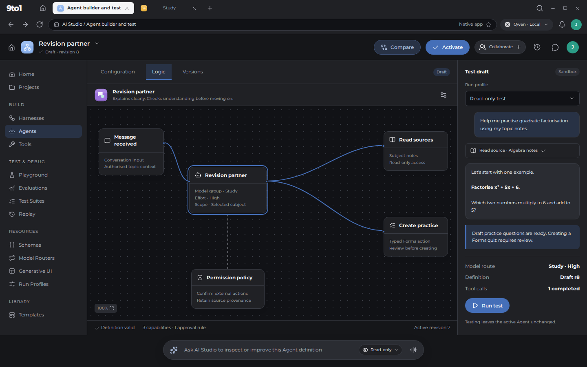
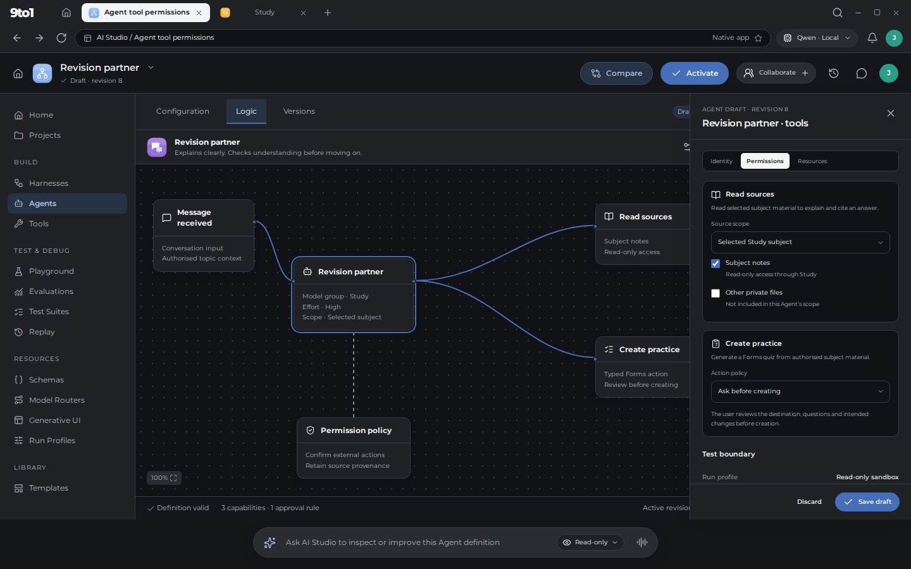

# AI Studio — harnesses, agents and evaluations

Module ID: `ai-studio` · 9to1 Development Specification v3

## Prerequisites

- **CUI, themes and shared interaction system** — Typed UI components, theme tokens/materials, layout, focus, motion, accessibility and shared control states.
- **Node Editor — shared graph framework** — Shared typed graph schemas, editing/validation, draft activation and runtime presentation.
- **Dulche runtime, requests and execution services** — Canonical AI broker, capability-aware routing, durable Task/Runs, action execution and lifecycle.
- **Models, discovery and universal model routing** — Model discovery/lifecycle, stable provider capabilities, ordered routing and truthful usage/effort metadata.
- **Permissions, approvals and execution scope** — Effective scoped grants, action approvals, policy intersections, revocation and audit.

## Overview

AI Studio authors and tests configured AI systems through real typed definitions. Graphs and forms are views of canonical versioned configurations; testing is distinct from activating or granting permissions.

## Layouts & visible states

- **V3-AI-STUDIO-LAY-01** — Organise Home/Projects; Build for Harnesses, Agents and Tools; Test for Playground, Evaluations, Test Suites and Replay; Resources for Schemas, Model Routes, GenUI and Run Profiles; and Templates.
- **V3-AI-STUDIO-LAY-02** — Provide typed graph, property/permission inspector, version/draft state and test results with real inputs/outputs. Tool-permission detail lists exact allowed resources and action consequences.

## Features & behaviour

- **V3-AI-STUDIO-FEA-01** — Build harness/Agent/Specialist and tool/Skill/Plugin/MCP definitions using registered schemas and shared services. Preserve supported node/form equivalence.
- **V3-AI-STUDIO-FEA-02** — Validate schema/types, models, dependencies and permission intersections. Test uses an explicit run profile, model route, inputs and live/mock distinction.
- **V3-AI-STUDIO-FEA-03** — Compare evaluations/test-suite results with provenance and failure detail. Do not equate a passing sample with production activation or independent acceptance.
- **V3-AI-STUDIO-FEA-04** — Training Lab remains the source’s explicitly deferred/undefined release scope; do not invent a complete training backend.

## Canonical entities & persistence

- **V3-AI-STUDIO-ENT-01** — Persist project/definition IDs, schema/configuration revisions, Draft/Active versions, test case/suite IDs, run/evaluation receipts and model/prompt provenance.
- **V3-AI-STUDIO-ENT-02** — Templates copy starter definitions with new identity where appropriate, not credentials or silent grants.

## Permissions & recovery

- **V3-AI-STUDIO-PER-01** — Permission controls narrow capability use; testing a tool cannot authorise unrelated live effects. Live external calls require their actual grants/approval.
- **V3-AI-STUDIO-PER-02** — Invalid drafts preserve the active version. Failed tests and missing tools remain inspectable and retryable without fake success.

## Acceptance checks

- **V3-AI-STUDIO-ACC-01** — Author→validate→test→inspect failure→revise→activate a typed definition with stable identity.
- **V3-AI-STUDIO-ACC-02** — Verify tool-scope denial, live/mock labels, version rollback and matching graph/form representations.

## Exact mock-up and state map

- **AI Studio · Agent builder and test** — screen `ai-studio`. Builder.
- **AI Studio · Agent tool permissions** — screen `ai-studio-permissions`. Agent draft · policy.

## Source clause IDs

UX27-OTHER-013

## Technical reading map

- AI Studio — harnesses, agents and evaluations — AI Studio; Product role (part 01) — `technical/ai-studio-01.md` (2,370 words; V2-B1014, V2-B1015, V2-B1016…).
- AI Studio — harnesses, agents and evaluations — Permission Simulator; Dependency Inspector (part 02) — `technical/ai-studio-02.md` (1,067 words; V2-B1107, V2-B1108, V2-B1109…).

Technical clauses retain APIs, data models, platform, recovery, donor and acceptance details. The technical files are part of this module, not optional background reading. Shared prerequisites mean stable service/interface contracts must be available; they do not require every dependent app UI to be complete. Use the named chunk for the relevant subtask or the complete module file for its full retained contract.

# Exact designs and implementation rules

These figures are the exact current atlas compositions. Their stable screen IDs match the Word specification and editable source. Open the atlas for full-size theme and interaction inspection.

## AI Studio · Agent builder and test

Screen ID: `ai-studio`. Source: AI Studio: navigation, Agent Builder, advanced logic, Playground; UX27-OTHER-013.

- The Agent resolves its stable Den identity. Editing configuration does not create a replacement Agent.
- Model, tools, instructions, knowledge and permissions are typed definitions, shared between form and graph views.
- Testing runs the draft under an explicit profile. Test success does not activate or install it.
- Build, Test & Debug and Resources expose distinct destinations. The consumer conversation remains in Spaces.

## AI Studio · Agent tool permissions

Screen ID: `ai-studio-permissions`. Source: AI Studio / Agent Builder and Tool Builder; UX27-OTHER-013; Home / Permission and trust broker.

- Tool policy is part of the versioned Agent draft and uses the same definition as its graph. Draft, active revision and test profile remain distinct.
- The selected source scope and action policy are explicit. A source-reading grant does not authorise Forms creation or access to unrelated private sources.
- Simulation and a successful test cannot grant live permission. Activating a definition remains separate from account-level authorisation.
- Every protected action is checked by its owning app and Home broker. Mandatory action approvals cannot be disabled by this builder.
