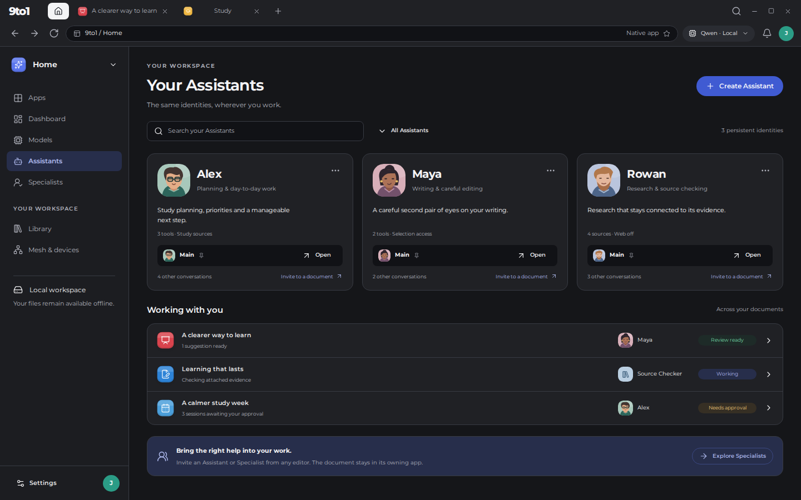
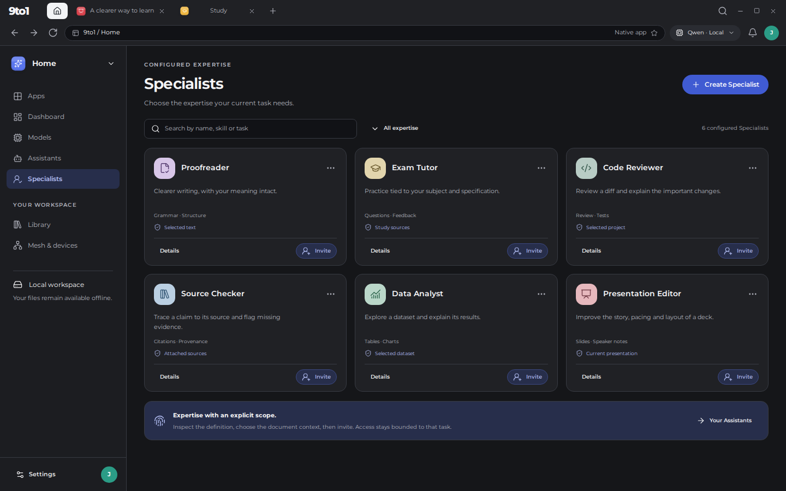
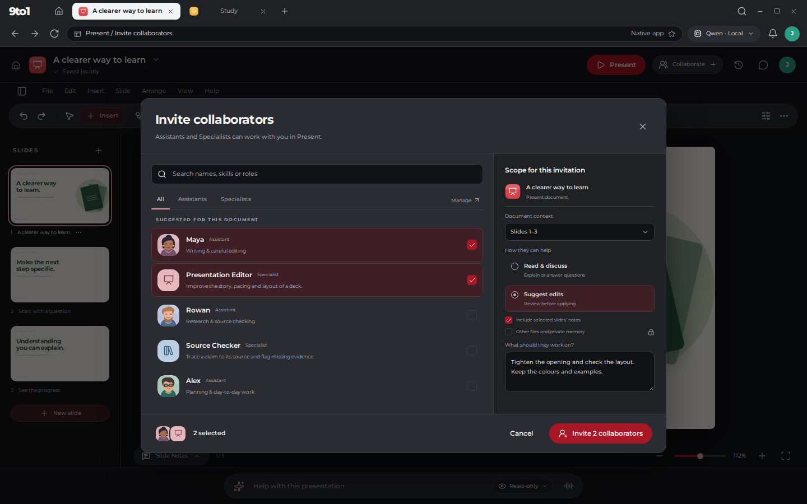
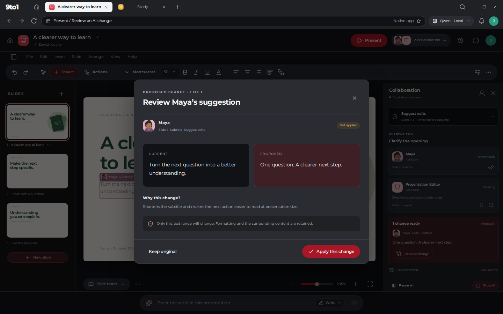

# Global Assistants, Specialists and collaborators

Module ID: `assistants` · 9to1 Development Specification v3

## Prerequisites

- **CUI, themes and shared interaction system** — Typed UI components, theme tokens/materials, layout, focus, motion, accessibility and shared control states.
- **Dulche runtime, requests and execution services** — Canonical AI broker, capability-aware routing, durable Task/Runs, action execution and lifecycle.
- **Den, memory and knowledge banks** — Scoped durable memory, versioned Den records, knowledge-bank provenance and brokered retrieval.
- **Permissions, approvals and execution scope** — Effective scoped grants, action approvals, policy intersections, revocation and audit.

## Overview

Assistants and Specialists are global systems available through Home and editors. Spaces retains their canonical conversation views. Assistants provide persistent personal identities and ongoing work; Specialists provide reusable job-focused expertise and configuration.

Current owner overrides: V3-OWNER-002, V3-RECON-002.

## Layouts & visible states

- **V3-ASSISTANTS-LAY-01** — Home exposes distinct Assistants and Specialists destinations with available/owned identities, creation/configuration and current work. Editor collaborator avatars open identity-aware pickers in the artifact context.
- **V3-ASSISTANTS-LAY-02** — An Assistant has a permanent Main conversation plus additional threads. Do not recreate a new Main identity whenever the user changes host/app.
- **V3-ASSISTANTS-LAY-03** — Review views show proposed semantic artifact changes, contributor identity, scope, selected revision and explicit accept/reject controls.

## Features & behaviour

- **V3-ASSISTANTS-FEA-01** — Preserve identity, instructions, model routing, tools/Skills/Plugins, Files/context, memory policy, budgets, queues, permitted proactivity, Dev handoff, Mini Computer capability and recovery.
- **V3-ASSISTANTS-FEA-02** — Persistent Teams support configured roles, shared work and relevance-gated participation; user-facing messages identify each contributor. Show Assistant–Assistant Chat uses All, Relevant or None without changing actual access rights.
- **V3-ASSISTANTS-FEA-03** — Specialists launch with the correct canonical job/instructions and policies. Discovery/configuration principally belongs in Home and AI Studio; Spaces lists may link there.
- **V3-ASSISTANTS-FEA-04** — Conversation handoff passes explicit authorised context and canonical work references without copying history indiscriminately. Replies from Connect remain in the originating channel/thread.
- **V3-ASSISTANTS-FEA-05** — Adding an editor collaborator produces a scoped participant or proposal relationship to the same artifact; it is not a new document copy or permission escalation.

## Canonical entities & persistence

- **V3-ASSISTANTS-ENT-01** — Keep AssistantID/SpecialistID, configuration revisions, Main ConversationID, other threads, TeamID/membership/roles, Task/Runs and artifact proposal references canonical.
- **V3-ASSISTANTS-ENT-02** — Preserve old Agent compatibility contracts where retained. Renaming or relocating the UI does not delete API capabilities.

## Permissions & recovery

- **V3-ASSISTANTS-PER-01** — Show effective context/write scope and unavailable tools, and require action-specific approval where applicable. A collaborator avatar does not mean unrestricted write authority.
- **V3-ASSISTANTS-PER-02** — Recover queued/background work, partial proposals and thread handoffs without duplicate external effects. Configuration rollback affects future work, not already-sent messages.

## Acceptance checks

- **V3-ASSISTANTS-ACC-01** — Open one Assistant in Home, Spaces and Write; verify identity, Main conversation and configured policy match.
- **V3-ASSISTANTS-ACC-02** — Exercise Specialist selection, persistent Team relevance settings, artifact review/rejection, accepted revision and revoked-source access.

## Exact mock-up and state map

- **Home · Assistants** — screen `home-assistants`. Global identities.
- **Home · Specialists** — screen `home-specialists`. Configured expertise.
- **Present · Invite collaborators** — screen `collaborators-picker`. Assistant & Specialist picker.
- **Present · Review an AI change** — screen `collaboration-review`. Scoped review.

## Source clause IDs

SPUI-154, SPUI-155, SPUI-156, SPUI-157, SPUI-158, SPUI-159, SPUI-160, SPUI-161, SPUI-162, SPUI-163

## Technical reading map

- Global Assistants, Specialists and collaborators — Product definition and global-system boundary; Product category and interaction model (part 01) — `technical/assistants-01.md` (2,379 words; V2-B0063, V2-B0064, V2-B0065…).
- Global Assistants, Specialists and collaborators — Plugins, Connectors, Skills and Knowledge; Agent memory (part 02) — `technical/assistants-02.md` (2,379 words; V2-B1904, V2-B1905, V2-B1906…).
- Global Assistants, Specialists and collaborators — SEPARATE USER-FACING ASSISTANT MESSAGES (OWNER CONFIRMED); “SHOW ASSISTANT-ASSISTANT CHAT” SETTING (OWNER CONFIRMED) (part 03) — `technical/assistants-03.md` (969 words; COMPANION-B0046, COMPANION-B0047, COMPANION-B0048…).

Technical clauses retain APIs, data models, platform, recovery, donor and acceptance details. The technical files are part of this module, not optional background reading. Shared prerequisites mean stable service/interface contracts must be available; they do not require every dependent app UI to be complete. Use the named chunk for the relevant subtask or the complete module file for its full retained contract.

# Retained technical requirements

# Global Assistants, Specialists and collaborators — Product definition and global-system boundary; Product category and interaction model (part 01)

Reading status: active retained clauses, subject to the v3 owner overrides listed in the primary module. Historical process instructions and replaced original wording are stored separately.

### V2-B0063 · v2 lines 236–236

V3 editorial amendment: V3-OWNER-002. Original wording is preserved in the replacement ledger.

Product definition and global-system boundary

### V2-B0064 · v2 lines 237–237

V3 editorial amendment: V3-OWNER-002. Original wording is preserved in the replacement ledger.

Assistants and Specialists are global systems built over the shared conversation and agentic runtime. Home and editors provide direct access without requiring a user to create or enter a Space. Spaces retains canonical Assistant conversation views. Opening an Assistant preserves its own identity and conversation/work state. The current scope does not mandate a separate standalone Assistants package.

### V2-B0065 · v2 lines 238–238

The wrapper exists to reuse the mature Spaces runtime and achieve close feature parity without duplicating the platform. Assistants SHOULD inherit generally useful Spaces capabilities by default unless a capability genuinely makes no sense for an Assistant. Reuse the same conversation runtime, Task/Run system, model/provider routing, tools, files/project access, memory/context infrastructure, permissions, computer-use implementation, Mini Computer runtime, artifacts, checkpoints, steering, subagents, recovery, generative UI, integrations, persistence, search/research, Dev integration and applicable multimodal capabilities. Do not create a second chat engine, task database, tool framework, permission broker, model router, file/project identity system, computer-use stack or artifact format.

### V2-B0066 · v2 lines 239–239

Product category and interaction model

### V2-B0067 · v2 lines 240–240

Assistants should belong to the same broad product category as experiences such as Grok-style custom bots, Dots, Muse-style agents and modern workspace/custom agents. This is a behavioural/product-model reference, not an instruction to copy another product's visual design, branding or proprietary implementation.

### V2-B0068 · v2 lines 241–241

An Assistant is a persistent, named, user-configured AI identity that the user creates once and returns to repeatedly. It is substantially more than a saved prompt, renamed chat, system-prompt textbox, template, one-off agentic Task, Space or delegated subagent. The same Assistant identity can span multiple conversations, Tasks/Runs, projects, scheduled work, memories/context where permitted, artifacts, checkpoints and applicable Mini Computer state. Starting a new conversation does not create a new Assistant, and delegating a worker does not create another personal Assistant.

### V2-B0069 · v2 lines 242–242

The intended experience is: “this is my persistent AI assistant that knows its configured role, can use authorised tools and resources, can continue real work over time, and can proactively help when I have enabled that behaviour” — not “this is a chat with a long system prompt.”

### V2-B0070 · v2 lines 243–243

Assistant configuration and identity

### V2-B0071 · v2 lines 244–244

Each Assistant MUST have a persistent editable configuration and stable identity. Where applicable the configuration includes name, icon/avatar, description, purpose/role, instructions/personality, preferred model or model policy, reasoning/model-routing preferences, allowed tools, connected apps/services, authorised files/projects/knowledge sources, memory behaviour, computer-use permissions, Mini Computer configuration, Dev/project access, proactive-behaviour settings, notification/check-in preferences, schedules/Automations, voice/multimodal preferences and resource/usage limits. These settings must be exposed through polished product UI rather than relying primarily on raw prompt/config files.

### V2-B0072 · v2 lines 245–245

Editing an Assistant's configuration MUST preserve its canonical Assistant identity, appropriate history, valid conversations, Tasks/Runs, memories, permissions and artifacts unless the user explicitly chooses an operation whose documented effect is to remove or reset them. Assistant identity is separate from any individual conversation or task.

### V2-B0073 · v2 lines 246–246

Assistants home and conversation experience

### V2-B0074 · v2 lines 247–247

V3 editorial amendment: V3-OWNER-002. Original wording is preserved in the replacement ledger.

The Assistants system MUST provide a dedicated home/library experience for seeing existing Assistants, creating an Assistant, opening recent Assistants, viewing recent conversations/tasks, seeing whether an Assistant is actively working, configuring an Assistant, inspecting its permissions and connected resources, opening current Tasks, managing proactive behaviour, managing its Mini Computer where applicable, and pausing/disabling/archiving/deleting an Assistant as appropriate. Do not redirect this experience into the normal Spaces application's Space list.

### V2-B0075 · v2 lines 248–248

An Assistant conversation should expose the power of a modern Spaces conversation through Assistant-focused UI. Where authorised, an Assistant can chat naturally, search/research, use tools, create and edit files, work with 9to1 apps, open Dev, perform durable long-running Tasks, create artifacts, use delegated workers, use computer control, operate a Mini Computer, work across connected services, present generative UI, continue through checkpoints, recover after interruption and accept live steering. The product should expose these capabilities naturally without turning the primary experience into a developer console.

### V2-B0076 · v2 lines 249–249

Relationship to Spaces

### V2-B0077 · v2 lines 250–250

V3 editorial amendment: V3-OWNER-002. Original wording is preserved in the replacement ledger.

Spaces remains the general-purpose AI workspace; Assistants is the persistent configured personal-assistant product. They may share underlying components and conversation/work surfaces, but product ownership, identity, proactive controls and Assistant-specific management belong to the global Assistants system exposed through Home and editors, with conversation views also available in Spaces. Users should not need to understand that Spaces infrastructure powers the Assistant.

### V2-B0078 · v2 lines 251–251

V3 editorial amendment: V3-OWNER-002. Original wording is preserved in the replacement ledger.

The Assistants system requires the applicable shared Spaces/runtime services to be installed or available, but that dependency MUST be handled as a product dependency rather than exposing Assistants as a child object inside the Spaces app. Feature parity should stay close: when Spaces gains a generally useful agentic capability, Assistants should normally gain it through the shared runtime rather than a separate reimplementation.

### V2-B0079 · v2 lines 252–252

Proactivity, permissions and Mini Computer

### V2-B0080 · v2 lines 253–253

Assistants may support explicitly configured proactive behaviour that ordinary Spaces conversations do not initiate by default, including check-ins, follow-up on unfinished work, scheduled work, configured event responses, continuing persistent tasks, proactive calls and initiating conversations where supported. The user must be able to understand and configure whether the Assistant may initiate contact, which events/schedules permit it, notification channels, resources it may access and which actions require renewed approval.

### V2-B0081 · v2 lines 254–254

A general authorisation to be proactive is NOT blanket permission to access unrelated files, accounts, computers, cloud services or projects. Assistant actions remain bound by the canonical permission system and agreed scope. Prior authorisation may cover subsequent actions within that scope but does not authorise unrelated spontaneous actions. Computer use and Mini Computer operation MUST use the canonical permission/runtime contracts and required persistent user notices. An Assistant may have its own Mini Computer VM where configured.

### V2-B0082 · v2 lines 255–255

9to1 development workflow

### V2-B0083 · v2 lines 256–256

Assistants is an early current-pass priority partly so it can become genuinely useful for continued authorised 9to1 development. A configured development Assistant MUST be able to retain its developer role/instructions, access the authorised canonical 9to1 project, open Dev directly from its Assistant conversation, use the same Files/Spaces/Dev project identity, create or resume the same durable Task/Run, inspect source, make authorised edits, run builds/tests, inspect diagnostics, show genuine diffs, coordinate delegated workers, create checkpoints, survive conversation/app closure and later resume with the same Assistant/project/task state.

### V2-B0084 · v2 lines 257–257

Include a real Assistant-initiated development acceptance journey: open the authorised 9to1 project in Dev, perform an approved bounded edit/build/test/diff/checkpoint cycle, steer or pause/resume the task, close and reopen the Assistant/task, and confirm that the same canonical project and Task/Run continue without duplicated state or effects. Exercise denied or revoked access without effects outside the grant. Do not substitute sample repositories, simulated tool responses, disconnected project copies or generic Saved-Agent tests.

### V2-B0088 · v2 lines 261–261

V3 editorial amendment: V3-OWNER-002. Original wording is preserved in the replacement ledger.

Do not count Assistants as IMPLEMENTED merely because the Agentic Update runtime exists, Spaces works, Assistant records can be persisted, Saved-Agent tests pass, an Assistant can send text, or a prototype Assistant screen exists. The actual global Assistants system and its end-to-end user workflows must exist in Home, editors and canonical conversation views.

### V2-B0090 · v2 lines 263–263

Smoke verification MUST exercise the actual packaged app, including launch, configured Assistant selection/creation as applicable, genuine conversation, persistence/reopen, shared Spaces-runtime integration, Dev handoff, permissions, at least one genuine authorised development action, steering and clean close/reopen. Extensive verification must then cover the complete Agentic Update contracts, including durable Task/Run persistence, recovery, coordinated workers, Task Dashboard/widget integration, permission enforcement, computer-use notice/control where applicable, Mini Computer operation where applicable, failed-action recovery without duplicated effects, checkpoint/artifact history, correct Assistant identity after restart and supported cross-device/platform behaviour.

### V2-B0091 · v2 lines 264–264

The full pulled-forward Assistants and Specialists scope and legacy migration arrangements in 9to1 Post-Release Updates remain mandatory. Specialists remain a distinct configured product type. A generic agent, delegated worker or Assistant does not revive the retired legacy Agents product/API except through the explicitly retained migration/compatibility arrangements.

### V2-B1870 · v2 lines 10983–10983

Agents

### V2-B1871 · v2 lines 10986–10986

Agents are a first-class Dulche-wide persistent capability layer, not a standalone 9to1 app. Dulche owns the canonical Agent registry, scope/availability resolution, invocation, runs, queues, delegation, capability resolution, lifecycle and recovery. Agent definitions, durable Agent configuration, memory namespaces and relevant persistent run metadata are stored in Den. 9to1 surfaces discover and expose applicable Agents through Dulche.

### V2-B1872 · v2 lines 10989–10989

AI Studio → Agent Builder is the direct structured authoring/editor surface for this Dulche layer. It creates/edits the canonical Den-backed Agent entity. AI Studio is not the runtime host, and closing AI Studio MUST NOT stop, hide or delete an Agent.

### V2-B1873 · v2 lines 10992–10992

Persistent Dulche Agents are distinct from Dulche Subagents. Agents have stable identity, durable configuration/memory/scope and may exist across many runs. Subagents are transient child-execution units created inside a run for delegation/parallelisation.

### V2-B1874 · v2 lines 10995–10995

Canonical Agent identity and Den persistence

### V2-B1875 · v2 lines 10998–10998

Every Agent MUST have stable AgentID independent of name plus versioned DefinitionRevision. The Den-backed Agent entity MUST retain at least name, icon/avatar, description, instructions, availability bindings, default model policy, Plugins/Connectors, Skills, Knowledge/Files references, Quick Actions, memory policy, capability/permission policy, delegation policy, graph reference where present, sharing metadata, revision history and lifecycle state.

### V2-B1876 · v2 lines 11001–11001

Renaming, moving scope or changing icon MUST NOT create another Agent. Agent display names MAY collide; AgentID remains canonical. An Agent definition revision used by an active/historical run MUST remain attributable even after later edits.

### V2-B1877 · v2 lines 11004–11004

Den MUST separate Agent definition/configuration from secrets and device-specific executable state. Connector credentials remain secure references; local executable paths/caches do not become portable Agent secrets merely because the Agent syncs through Den.

### V2-B1878 · v2 lines 11007–11007

Availability scopes and cascading

### V2-B1879 · v2 lines 11010–11010

Dulche MUST support Agent availability scopes including Global, Surface, Space and Project/Entity or equivalent narrower canonical scope bindings. An Agent MAY have multiple compatible bindings when explicitly configured.

### V2-B1880 · v2 lines 11013–11013

Global Agents cascade automatically into every compatible 9to1 surface. Surface-scoped Agents are available only on their declared surfaces. Space-scoped and Project/Entity-scoped Agents appear when the current invocation context matches those scopes. Availability is composed rather than overridden: a narrower scoped Agent supplements applicable broader Agents.

### V2-B1881 · v2 lines 11016–11016

For a context such as Write inside a Study Space/project, the effective visible set is the compatible union of Global Agents, Write-scoped Agents, current-Space Agents and current Project/Entity Agents, subject to access restrictions. Dulche MUST return origin/scope metadata so CUI can group Agents by Global, current surface and contextual scopes rather than present an unexplained flat list.

### V2-B1882 · v2 lines 11019–11019

Global cascading references the same canonical AgentID everywhere; it MUST NOT create per-app copies. Agent definition updates, memory and run history remain attached to the canonical Agent.

### V2-B1883 · v2 lines 11022–11022

Availability versus permission

### V2-B1884 · v2 lines 11025–11025

Agent availability and Agent effective permission are separate concepts. A visible Agent may still have actions disabled in the current invocation context.

### V2-B1885 · v2 lines 11028–11028

Effective permissions/capabilities MUST be no broader than the intersection of the Agent definition/instance policy, current surface capabilities, current Space policy, current project/entity scope, caller/user/organisation policy and Home permission/trust state. A surface/Space cannot grant a capability explicitly denied by the Agent/security policy, and a Global Agent does not gain universal data access merely because it is visible everywhere.

### V2-B1886 · v2 lines 11031–11035

Agent updates — static and reactive animated icons
Agents MUST support both static image icons and animated avatars. Users MUST be able to choose the presentation for each Agent. The animated-avatar concept is a pet/companion-style icon, using the user's Codex pets/Dots comparison as a design reference, rather than being limited to an unrelated looping image.
Animated avatars MUST react to the Agent's actual activity and relevant conversational events. Required examples include the avatar sitting at a computer and coding while the Agent is coding, and laughing in response to a user joke. Task-state transitions and conversational reactions MUST be configurable and previewable. Reactions are presentation events, not permission grants or claims about hidden reasoning. Animation MUST respect the existing reduced-motion controls and provide a static fallback without losing the Agent's accessible identity or readable activity status.
Agent presentation API and acceptance
The canonical Dulche Agent API MUST cover static/animated avatar selection, referenced asset and definition management, animation-state transitions and event/reaction mappings. Use Den-backed stable identities and versioned configuration shared with AI Studio’s visual builder; presentation changes MUST NOT fork the Agent, alter its permissions or leak private content. Verify saved/reopened configuration, static and animated icons, coding activity, joke/laugh reactions, reduced-motion fallback and readable accessible status, including permission-denied and missing-asset recovery. Connect’s Agent-contact contract supplies email, call and text entry points to these same Agents.

### V2-B1887 · v2 lines 11038–11038

Surface integration and Agent picker

### V2-B1888 · v2 lines 11041–11041

Every compatible interactive 9to1 surface SHOULD expose applicable Dulche Agents through the shared AI/Agent picker or a surface-appropriate invocation UI. Apps query Dulche for context-resolved Agents rather than maintaining private Agent registries.

### V2-B1889 · v2 lines 11044–11044

The invocation context MUST be typed and may include SurfaceID, SpaceID, Project/Entity references, ArtifactID, selected ObjectIDs, current semantic context and available typed actions. Dulche filters this context through permissions before supplying it to the Agent.

### V2-B1890 · v2 lines 11047–11047

Surfaces MAY recommend specialist scoped Agents more prominently than generic Global Agents. Recommendation/order MUST NOT change Agent identity or silently select an Agent with broader permissions.

### V2-B1891 · v2 lines 11050–11050

Scoped surface Agents

### V2-B1892 · v2 lines 11053–11053

First-party apps MAY ship/register useful surface-scoped Dulche Agent definitions/bindings. Once registered, they are canonical Dulche Agents rather than hidden app-local assistants and can be inspected/edited where policy permits.

### V2-B1893 · v2 lines 11056–11056

Write MAY expose specialist writing Agents such as Editor, Proofreader, Long-form Writer or user-created writing Agents. A Write-scoped Agent can receive authorised semantic document/selection/style/comment/reference context and Write typed actions without becoming available on unrelated surfaces.

### V2-B1894 · v2 lines 11059–11059

Vision & Voice MAY expose a Podcast Agent or similar specialist Voice Agents. A Podcast Agent can accept typed inputs such as Topic, optional Sources, target Duration and Style, then use the Voice Monologue mode to research/plan/generate/play a coherent long-form podcast. It remains a canonical Dulche Agent scoped to Vision & Voice, not a hardcoded private voice feature.

### V2-B1895 · v2 lines 11062–11062

Agent invocation interfaces

### V2-B1896 · v2 lines 11065–11065

An Agent definition MAY declare a typed InvocationSchema and optional CUI/Generative UI invocation interface. Surfaces SHOULD render the declared inputs rather than force every Agent through a blank chat box.

### V2-B1897 · v2 lines 11068–11068

Invocation UI definitions MUST bind only to declared Agent inputs and approved typed actions; they MUST NOT grant new permissions. Examples include a Voice Podcast form with Topic/Sources/Duration/Style or a Write rewrite form with Tone, Preserve citations and Scope.

### V2-B1898 · v2 lines 11071–11071

Quick Actions

### V2-B1899 · v2 lines 11074–11074

Quick Actions are named manual entry points into a canonical Agent and cascade wherever that Agent is available, subject to each Quick Action's context requirements/visibility rules. They are not separate Agents.

### V2-B1900 · v2 lines 11077–11077

Every QuickAction MUST have stable QuickActionID, AgentID, label, optional icon/description, predefined instruction or named graph entry point, optional typed InputSchema, context requirements, confirmation policy and ordering metadata.

### V2-B1901 · v2 lines 11080–11080

Quick Actions may be context-sensitive. For example, Rewrite selection should appear only where an editable selection exists; a Podcast Agent may expose Make podcast, Continue latest podcast or Create briefing. Invoking one creates a normal canonical AgentRun with standard permissions, Action Graph, side-effect/idempotency controls and run history.

### V2-B1902 · v2 lines 11083–11083

Quick Actions are distinct from Automations. Quick Actions are manually invoked entry points; Automations own recurring, scheduled, event-triggered and condition-triggered execution. An Automation MAY invoke an Agent/Quick Action through the same Dulche APIs.

### V2-B1903 · v2 lines 11086–11086

Default model resolution

# Global Assistants, Specialists and collaborators — Plugins, Connectors, Skills and Knowledge; Agent memory (part 02)

Reading status: active retained clauses, subject to the v3 owner overrides listed in the primary module. Historical process instructions and replaced original wording are stored separately.

### V2-B1904 · v2 lines 11089–11089

An Agent may define Default Model = Inherit or an explicit Universal Model Picker policy. Inherit resolves from the invocation Space/surface/global policy. An explicit Agent default takes precedence over inherited defaults where allowed, while request-specific overrides may take precedence only if Agent/security policy permits.

### V2-B1905 · v2 lines 11092–11092

Dulche MUST capability-check the effective model against the Agent/run requirements such as tools, vision, audio, context or structured output. It MUST not silently cross local/private to cloud boundaries or substitute an explicitly forbidden fallback.

### V2-B1906 · v2 lines 11095–11095

Plugins, Connectors, Skills and Knowledge

### V2-B1907 · v2 lines 11098–11098

Agent capability bindings reference canonical Dulche Plugins/Connectors/MCP capabilities and Skills by stable identity/version policy. They are not copied into the Agent.

### V2-B1908 · v2 lines 11101–11101

Knowledge/Files references point to Den memory and authorised canonical files/folders/artifacts/providers where possible. The Agent may retrieve current source revisions through owning APIs rather than rely on stale copies. Missing/revoked/incompatible sources or packages MUST be represented explicitly.

### V2-B1909 · v2 lines 11104–11104

Agent memory

### V2-B1910 · v2 lines 11107–11107

Each persistent Agent MUST have an Agent-specific Den memory namespace governed by its memory policy. Durable memory is structured semantic/operational state, not simply an unbounded copy of every conversation/tool result.

### V2-B1911 · v2 lines 11110–11110

Memory writes MUST carry scope/provenance and MUST respect personal/team/shared boundaries. A shared Agent MUST NOT silently copy a participant's private personal Den context, private connected-account data or secrets into shared Agent memory.

### V2-B1912 · v2 lines 11113–11113

Agent memory SHOULD support inspection, conflict handling, deduplication, recency/provenance metadata and removal/disable operations. Secrets encountered in tools/results MUST NOT automatically become durable Agent memory.

### V2-B1913 · v2 lines 11116–11116

Tasks, work queues and runs

### V2-B1914 · v2 lines 11119–11119

A persistent Agent MAY maintain a durable work queue in Dulche. Queue items MUST have stable QueueItemID, AgentID, objective, optional TaskID, priority, creator/trigger provenance, dependencies, status and timestamps. Work may arrive from a user, Space/Task, Automation, another authorised Agent or recovery flow.

### V2-B1915 · v2 lines 11122–11122

A Task is user-level work; an Agent is the persistent worker; AgentRun is a specific execution. The relationship MUST remain explicit: a Task/objective may be assigned to an Agent, which creates one or more AgentRuns. Agents are not themselves a second Task or Automation system.

### V2-B1916 · v2 lines 11125–11125

Each AgentRun MUST have stable AgentRunID, AgentID, DefinitionRevision, objective, trigger/source, optional TaskID/QueueItemID, status, start/end timestamps, effective model/capabilities/permissions, ActionGraphID, outputs, blockers, approvals, usage/budget metadata and recovery/checkpoint state where supported.

### V2-B1917 · v2 lines 11128–11128

Run states and controls

### V2-B1918 · v2 lines 11131–11131

Canonical user-facing Agent/run states MUST distinguish at least Idle, Queued, Running, Waiting, Blocked, Paused, Awaiting Approval, Completed, Failed/Error and Disabled as appropriate. Blocked and Awaiting Approval MUST NOT be conflated.

### V2-B1919 · v2 lines 11134–11134

Run controls MUST support Pause/Resume, safe Stop and explicit Cancel where the runtime permits them. Resume continues the same AgentRunID and MUST NOT repeat already-completed consequential actions. Retry of a failed step/run uses idempotency/operation identity to avoid replaying unrelated successful side effects.

### V2-B1920 · v2 lines 11137–11137

Progress UI MUST show truthful objective/current step/known plan progress. It MUST NOT invent a percentage where the Agent cannot estimate completion meaningfully.

### V2-B1921 · v2 lines 11140–11140

Blockers and approvals

### V2-B1922 · v2 lines 11143–11143

Dulche Agent runs MUST create first-class Blocker records for conditions preventing progress, including category, description, time, whether the Agent can self-resolve, required human action and related entities. Agents SHOULD attempt safe recovery of foreseeable recoverable blockers when their contract allows it instead of immediately escalating every failure.

### V2-B1923 · v2 lines 11146–11146

V3 editorial amendment: V3-OWNER-003. Original wording is preserved in the replacement ledger.

Human-required blockers and pending consequential actions MUST surface through relevant invoking surfaces and Home Notifications activity/approval UX. Approval remains a Home permission/action decision; Dulche Agents cannot self-authorise through their own instructions.

### V2-B1924 · v2 lines 11149–11149

Agent-to-Agent delegation

### V2-B1925 · v2 lines 11152–11152

Persistent Agent-to-Agent delegation is a Dulche Agent capability. Delegation MUST retain explicit parent/child AgentRun identities and a typed handoff containing objective, required context references, narrowed capability scope and expected output.

### V2-B1926 · v2 lines 11155–11155

DelegationPolicy MUST be able to constrain allowed persistent Agents/classes, whether Subagents are allowed, maximum concurrency, maximum depth and applicable token/time/cost/tool budgets. A receiving Agent does not automatically inherit all permissions or memory of its parent.

### V2-B1927 · v2 lines 11158–11158

Persistent Agent delegation remains distinct from Dulche Subagents. Subagents are lighter transient child execution primitives inside the runtime; persistent delegated Agents retain their own canonical AgentID, definition and Den memory policy.

### V2-B1928 · v2 lines 11161–11161

Action Graph, outputs and operational visibility

### V2-B1929 · v2 lines 11164–11164

Every AgentRun MUST use the canonical Dulche Action Graph/log/audit pipeline. 9to1 surfaces may render a concise human-readable Activity view and/or the full Action Graph, but they MUST NOT invent a second execution history.

### V2-B1930 · v2 lines 11167–11167

Run outputs MUST be typed references to their canonical owning entities where possible, including Files, documents, Boards, code changes, Planner/Task items, messages, research outputs and other artifacts. Opening an output routes to its owning app/entity rather than copying it into an Agent-only store.

### V2-B1931 · v2 lines 11170–11170

V3 editorial amendment: V3-OWNER-003. Original wording is preserved in the replacement ledger.

Agent runs, blockers, approvals and outputs may be surfaced contextually in Spaces, Agent Builder Preview, Automations that triggered them, Home Notifications activity and the invoking app. No standalone Agents app is required or authoritative.

### V2-B1932 · v2 lines 11173–11173

Lifecycle, recovery and budgets

### V2-B1933 · v2 lines 11176–11176

Long-running/background-capable AgentRuns MUST checkpoint enough state to recover or truthfully fail across app closure, Home/Dulche restart, machine restart where supported, provider disconnect or temporary tool failure. Recovery states SHOULD distinguish Reconnecting, Recovering, Recovered and Cannot recover rather than silently restarting from scratch.

### V2-B1934 · v2 lines 11179–11179

Agents MUST support configured runtime/model/tool/delegation budgets such as maximum runtime, spend/tokens, tool calls, concurrent children or delegation depth where the platform can enforce them. Exceeding a budget produces an explicit blocked/failed/approval state rather than uncontrolled continuation.

### V2-B1935 · v2 lines 11182–11182

Canonical Dulche Agent API

### V2-B1936 · v2 lines 11185–11211

Dulche.Agent.List(context?);
Dulche.Agent.Get(agentID);
Dulche.Agent.ResolveFor(context);
Dulche.Agent.Create(definition);
Dulche.Agent.UpdateDraft(agentID, patch, expectedRevision?);
Dulche.Agent.Validate(agentID, revision?);
Dulche.Agent.Activate(agentID, revision);
Dulche.Agent.GetRevision(agentID, revision);
Dulche.Agent.SetAvailability(agentID, availability);
Dulche.Agent.ListQuickActions(agentID, context?);
Dulche.Agent.Invoke(agentID, input, context);
Dulche.Agent.InvokeQuickAction(agentID, quickActionID, input, context);
Dulche.Agent.Queue.List(agentID);
Dulche.Agent.Queue.Enqueue(agentID, workItem);
Dulche.Agent.Queue.Reorder(agentID, queueItemID, position);
Dulche.Agent.Run.Get(agentRunID);
Dulche.Agent.Run.Pause(agentRunID);
Dulche.Agent.Run.Resume(agentRunID);
Dulche.Agent.Run.Stop(agentRunID);
Dulche.Agent.Run.Cancel(agentRunID);
Dulche.Agent.Run.Retry(agentRunID, options?);
Dulche.Agent.Blocker.List(agentID?);
Dulche.Agent.Blocker.Resolve(blockerID, resolution);
Dulche.Agent.Memory.List(agentID);
Dulche.Agent.Memory.Remove(agentID, memoryID);
Dulche.Agent.Delegate(parentRunID, childAgentID, handoff);
Dulche.Agent.Changes.Subscribe(cursor?);

### V2-B1937 · v2 lines 11214–11214

These are minimum canonical entry points. All Agent Builder and 9to1 surface Agent operations MUST resolve through the same Dulche/Den contracts rather than creating app-private Agent stores or runtimes.

### V2-B1938 · v2 lines 11217–11217

Failure behaviour

### V2-B1939 · v2 lines 11220–11220

Dulche Agents MUST return structured failures including AgentNotFound, DefinitionRevisionUnavailable, AgentDisabled, AgentUnavailableInScope, AgentBusy, AgentRunNotFound, RunNotResumable, RunRecoveryFailed, QueueItemNotFound, CapabilityUnavailable, PermissionDenied, ApprovalRequired, BlockerUnresolved, DelegationDenied, DelegationDepthExceeded, ConcurrencyLimitExceeded, BudgetExceeded, ModelUnavailable, ToolUnavailable, MemoryScopeDenied, QuickActionUnavailable, InvalidInvocationContext and RevisionConflict in addition to the global Dulche error contract.

### V2-B1940 · v2 lines 11223–11223

Acceptance requirements

### V2-B1941 · v2 lines 11226–11245

Dulche Agents is implementation-complete only when acceptance coverage verifies at least:
* An Agent created in AI Studio Agent Builder is stored as a canonical Den-backed Dulche Agent and remains usable after AI Studio closes.
* There is no authoritative standalone Agents app or duplicate Agent database.
* Global Agents appear on every compatible 9to1 surface through Dulche scope resolution without being copied.
* Surface-, Space- and Project/Entity-scoped Agents appear only in matching contexts while applicable broader Agents remain available.
* Agent availability does not grant permissions; effective capability resolution narrows correctly across Agent, surface, Space, caller and Home policy.
* Write can expose/use specialist writing Agents with semantic document context, and Vision & Voice can expose/use a Podcast Agent that drives Monologue mode from typed inputs.
* Quick Actions cascade with their Agent, obey context visibility/input schemas and create normal AgentRuns rather than duplicate Agents.
* Default Model inheritance/explicit override resolves through the Universal Model Picker without violating privacy/fallback restrictions.
* Agent memory persists in the correct Den namespace without silently ingesting private/shared-incompatible context or secrets.
* Task → Agent → AgentRun and Automation → AgentRun relationships remain explicit.
* Agent queues preserve provenance, priorities/dependencies and durable state.
* Blocked and Awaiting Approval states remain distinct and recoverable blockers can be handled autonomously where authorised.
* Pause/Stop/Resume/Retry do not replay completed consequential actions.
* Persistent Agent delegation obeys depth/concurrency/budget limits and does not transfer unrestricted parent permissions.
* Persistent Agents and Dulche Subagents remain distinct in API, logs and UI.
* AgentRun Action Graph is the canonical execution graph and outputs open canonical owning entities.
* Home/Dulche restart can recover supported durable runs or reports Cannot recover truthfully without silently restarting work.
* Agent Builder Preview uses the same Dulche semantics while clearly remaining test-scoped.
* Agent Builder/other surfaces perform Agent operations through the canonical Dulche Agent API.

### V2-B2265 · v2 lines 13334–13340

V3 editorial amendment: V3-OWNER-002. Original wording is preserved in the replacement ledger.

2026-10-09 — APPROVED ASSISTANTS, SPECIALISTS, CONNECT AND INLINE COMMAND REQUIREMENTS
Assistants are persistent configurable conversational identities, distinct from job-defined reusable Specialists. Each Assistant owns multiple persistent conversation threads, with create, rename, switch, search, pin, archive, delete and branch management. Thread history and work context are separate, while Assistant-level memory and permitted cross-thread retrieval are shared. Spaces and Assistants open the same canonical threads and Task/Runs without copying state.
All 9to1 chat services must automatically compact working context while retaining complete original messages and retrievable history, so conversations can continue for months or years without arbitrary message-count caps. Finite model context and resource limitations must be handled honestly; summaries must never replace source history.
Assistants must retain all inherited Agents functionality, with complete feature-parity auditing and user-facing management for identity, instructions, knowledge/files, memory, models, tools/apps, Skills, Quick Actions, permissions, approvals, budgets, queues, delegation, history, background execution, steering, recovery, proactive contact and optional Mini Computer. Support configuration revision history, data lifecycle controls, search, durable artifacts, notifications and concurrent tasks.
Connect is the 9to1 communications app (email, chat and supported calls), not the external integration manager. Assistants and Specialists are selectable addressable contacts. Users can type an Assistant name into an email recipient field or message/call them. Responses stay in the originating channel and thread: email replies to email, chat to chat, calls in calls. The same Assistant identity and authorised work remain accessible in the Assistants system; approvals and notifications may surface separately without moving the primary reply.
Across supported 9to1 composers, @ opens a searchable picker for Assistants, Specialists and supported apps (such as Write and Present). A bare mention is passive and does not execute. An explicitly bounded instruction, for example @Present [Create five slides from this report], is a structured compact INLINE rich-text command, not a separate block editor, card or paragraph. Only that mention and its instruction are specially formatted; surrounding text remains normal, and typing resumes normally after the command. Support multiple commands in one paragraph, wrapping, editing, keyboard accessibility, persistence, copying and canonical identity. Preserve exact boundaries so ordinary text cannot accidentally execute. Commands respect Home permissions, approvals and revocation.
Implement and accept these as complete vertical product features with usable UI, backing behaviour, persistence, integration and real tests, not just architecture or compilation. Preserve existing compliant infrastructure and all earlier specification requirements.

### COMPANION-B0041 · companion lines 287–289

SPUI-154 — PERMANENT MAIN CONVERSATION PER ASSISTANT (OWNER CONFIRMED)
Each persistent Assistant has exactly one auto-created primary conversation named “Main”. It is the Assistant's durable, personal, default conversation, conceptually like the ongoing conversation with a single contact in a messaging app. Selecting that Assistant normally opens Main rather than the last unrelated sub-conversation or an intermediary mandatory dashboard. Main retains its canonical ConversationID, Assistant identity, eligible history and authorised context across application navigation/restarts; creating or switching other chats must not silently recreate, replace, erase or split Main. The “Main” role/identity is permanent. Whether the visible label may be user-renamed while preserving the Main role is NOT YET DECIDED; do not imply a disposable Main.
The Assistant may have multiple ADDITIONAL conversations with their own titles, histories, current work/context and canonical ConversationIDs, used to organise projects and specialised topics. These belong to the same persistent Assistant identity and share only the Assistant-level memories, configured policies, permissions and cross-thread references actually authorised. Main is not an aggregate transcript of every sub-conversation. Preserve existing approved thread operations on eligible non-Main chats (create/rename/search/pin/archive/delete/branch etc) while protecting Main's persistent role.

### COMPANION-B0042 · companion lines 292–293

SPUI-155 — CONVERSATION-TO-CONVERSATION WORK HANDOFF (OWNER CONFIRMED)
A user can plan a project in an Assistant's Main conversation and hand it to another conversation with the SAME Assistant to implement, or hand off from one organised conversation to another. The receiving conversation can be new or existing. The handoff carries a visible, inspectable and permission-filtered package of the agreed goal, scope, accepted plan/constraints, relevant messages/source references, task/run identity, checkpoints, outputs, remaining work and applicable acceptance criteria, to the extent legitimately authorised. Do NOT move/copy entire private histories indiscriminately or duplicate external side effects. Original source messages remain in their original conversation, with traceable references. The same canonical Assistant identity and existing TaskID/RunIDs persist if continuing the same work; creating a new task requires an explicit genuinely separate objective. Workers must apply changed instructions at safe boundaries. Proposed affordance “Hand off to Conversation” is a useful UI label but exact menu placement/visual presentation remains OPEN for review.

### COMPANION-B0043 · companion lines 296–297

SPUI-156 — PERSISTENT ASSISTANT TEAMS (OWNER CONFIRMED)
The Assistants Space adds “Teams”: persistent user-created group chats containing multiple selected, existing persistent Assistants. Teams have stable identity, member roster, conversational history and assigned responsibilities. They are NOT merely a one-off Multi-Agent Chat, a Chat Group/Project organisation container, a single new meta-Assistant, a Specialist catalogue, or the Dulche runtime's disposable subagent group. Existing Assistant identities, personal Main conversations and individually authorised resources remain distinct while they participate in Teams. Users may ask a Team to accomplish an outcome, and different members can undertake different roles and Tasks (e.g. a future job split by speciality), coordinated through the existing durable Tasks/Run and Automation/Planner services. Do not force redundant Assistant/Task records for every member or Team message.

### COMPANION-B0044 · companion lines 300–304

SPUI-157 — CONFIGURABLE TEAM COORDINATION (OWNER CONFIRMED)
Team settings MUST provide a user-selectable coordination mode with BOTH alternatives:
• Automatic Dulche Coordination: Dulche allocates relevant work among eligible members, manages dependencies and execution, and does not require a permanent Assistant leader.
• Designated Assistant Leader: user chooses one eligible Team Assistant as leader/coordinator for assignment and delegation while Dulche still enforces routing, permissions, tasks, durable state, resource limits and safety.
Switching mode does NOT discard TeamID, roster, messages, valid TaskID/RunIDs, outputs or accepted checkpoints; in-flight assignment/ownership changes need truthful transitions and no duplicated work. Whether Automatic is the initial default is still PROPOSED (not explicitly owner-confirmed), as are detailed leader absence/fallback and contested delegation resolution policies. Do not silently hard-code them as decisions.

### COMPANION-B0045 · companion lines 307–308

SPUI-158 — RELEVANCE-GATED SELECTIVE PARTICIPATION (OWNER CONFIRMED)
Dulche decides which Team Assistants should participate and respond in any particular request based on relevant role/expertise, actual eligibility and permissions, necessary dependencies and task context. Membership ALONE does not cause every Assistant to reply or consume model resources. Example: requesting a video should ordinarily engage the video-relevant Assistant, NOT a Programmer unless programming becomes useful for that request. Members can be brought in later if the job develops a genuine dependency; don't require irrelevant acknowledgements. A directed @Assistant mention intentionally addresses that member, but still respects permissions/capability constraints and cannot grant unrelated access. This routing rule applies in BOTH coordination modes. An Assistant omitted from the current discussion may continue independently authorised earlier work; absence of its chat reply does not stop existing work. Model-routing decisions, authorised handoffs and resulting worker actions must remain inspectable with correct provenance rather than fabricated participation.

# Global Assistants, Specialists and collaborators — SEPARATE USER-FACING ASSISTANT MESSAGES (OWNER CONFIRMED); “SHOW ASSISTANT-ASSISTANT CHAT” SETTING (OWNER CONFIRMED) (part 03)

Reading status: active retained clauses, subject to the v3 owner overrides listed in the primary module. Historical process instructions and replaced original wording are stored separately.

### COMPANION-B0046 · companion lines 311–312

SPUI-159 — SEPARATE USER-FACING ASSISTANT MESSAGES (OWNER CONFIRMED)
When participating Team members communicate with the user, show EACH Assistant's genuine messages individually in the persistent Team conversation, with its own avatar/name, canonical AssistantID and message provenance, rather than synthesising a single unified impersonating “Team” response. Several relevant members may respond, but Dulche should avoid repeated, low-value status chatter. The Team UI may include compact real task/activity summaries without replacing message identities. This is OWNER-SELECTED option A (individual Assistant messages); combined/unified and adaptive combined user-facing response designs are NOT the selected default. Note: Assistant-to-Assistant message visibility is a distinct, separately configured setting under SPUI-160.

### COMPANION-B0047 · companion lines 315–320

SPUI-160 — “SHOW ASSISTANT-ASSISTANT CHAT” SETTING (OWNER CONFIRMED)
Each Team provides a user-accessible preference named EXACTLY “Show Assistant-Assistant Chat” with exactly THREE available selectable values:
• All — show all eligible Assistant-to-Assistant conversational messages in the Team chat, including routine exchanges where represented as actual conversation messages.
• Relevant — show Assistant-to-Assistant conversation that makes meaningful contributions, deliberates decisions, resolves dependencies or materially affects the Team's current work, while routine coordination may remain in the inspectable canonical Tasks/Action Graph/activity history.
• None — omit Assistant-to-Assistant conversational exchanges from the normal Team chat display; retain user-directed, individually attributed Assistant messages, significant user-facing requests/approvals and independently inspectable task/action evidence.
This controls USER-FACING VISIBILITY of assistant-to-assistant chat only; it does not disable necessary coordination, rewrite/delete original authoritative history, reduce audit/provenance, or conceal safety/permission events. “All” means eligible actual Assistant-to-Assistant CHAT messages, not hidden model internal reasoning, confidential credentials, unrelated private data or unauthorised logs. Apply permissions/redactions in all modes. A user can change the setting without duplicating task work. Reconcile existing message presentation appropriately on switching, without falsifying history; preserve the preference with canonical, account/team-appropriate state. The initial default among All/Relevant/None is NOT YET OWNER-CONFIRMED; the previous suggestion of Relevant was not selected as a default merely by requesting all options be available.

### COMPANION-B0048 · companion lines 323–324

SPUI-161 — ROLES, SHARED WORK, CONTEXT, SECURITY AND OWNER SERVICES (REQUIREMENT PRESERVATION)
Assistants retain the V2 persistent identity, independent Main/organised conversations, full capability/configuration parity, memory and context policy, direct chats, optional Mini Computer, proactivity, project access and Tools/Plugins/Skills. A Team can assign bounded member responsibilities and support separate canonical child work where genuinely needed, through Dulche/Tasks/Automations rather than parallel invented execution/scheduling or permission services. Preserve explicit Team/project sharing boundaries: Team membership does not automatically reveal each Assistant's unrelated personal conversations, private memory, connected account content or Computer Use authorisations. Team visibility, consent and approvals respect Home/Dulche typed APIs and relevant source owners. Interactions remain appropriately available through Connect and existing cross-app @Assistant invocations without cloning the identity.

### COMPANION-B0049 · companion lines 327–328

V3 editorial amendment: V3-OWNER-002. Original wording is preserved in the replacement ledger.

SPUI-162 — INTERFACE HIERARCHY AND CUI INHERITANCE (OWNER-CONFIRMED SCOPE; VISUAL DETAILS OPEN)
Assistants and Specialists remain global systems available through Home and editors. Spaces retains protected first-party Assistant conversation views on its rail; this placement is not their only access point. Its contextual sidebar/workspace MUST make it natural to reach an Assistant's Main and other chats as well as permanent Teams. Opening an Assistant directly opens Main; opening a Team opens that Team's persistent chat, with readable member attribution. Retain the global Spaces customisable sidebar, collapse/drawer, tab/view, applicable voice, model and tool systems. Suggested expandable per-Assistant conversation lists and visible Teams group are DIRECTIONAL UI proposals from the review, not pixel-level owner approvals. Reuse established CUI Professional/Glow themes rather than introducing a competing style system.

### COMPANION-B0050 · companion lines 331–342

SPUI-163 — ASSISTANTS/TEAMS ACCEPTANCE AND OPEN DECISIONS
Real-runtime acceptance must verify, with actual Assistant and Team objects and canonical IDs:
1. Creating an Assistant provisions ONE durable Main; selecting it after navigating/restarting returns to the SAME Main; secondary threads remain separate; protected Main is not silently destroyed by thread operations.
2. Plan in Main, hand off to a new or existing other thread of SAME Assistant, continue with correct approved plan/TaskID/RunID, preserve origin/history/traceability and avoid duplicated effects.
3. Form a Team from real existing Assistants, keep the Team's identity and conversation across relaunch, distinguish TeamID from AssistantID, Chat Group/Project and TaskID, and preserve individual personal Main histories.
4. Verify both user-selectable coordination modes, authorised leader selection, role-appropriate assignments, accurate dependency handling, switching in flight without lost work or a parallel broker.
5. Request video work from a team with video/programming roles: video-relevant member participates, programmer stays quiet unless genuinely useful; member dynamically joins on a real dependency; direct mention remains scoped/secure.
6. Verify each relevant member's user-facing reply appears as an individually attributed message, no duplicate combined Team impersonation, no fabricated replies from inactive members.
7. Verify “Show Assistant-Assistant Chat” exposes All / Relevant / None exactly, changing the Team chat visibility correctly while preserving auditability, provenance, approvals, security and context separation. Ensure None does not suppress individually attributed messages to the USER or safety-critical approvals.
8. Verify assistant and Team memory isolation, authorisation, task/worker resource limits, history retention, accessible CUI controls, focus/touch, responsive layout and Professional/Glow inheritance; mark untested cases NOT RUN, not VERIFIED.
OPEN BEFORE FINAL UI/BEHAVIOUR LOCK: exact default Show Assistant-Assistant Chat mode; initial Team coordination default; Main label rename policy and preservation UX; handoff picker/confirmation and branching details; permanent-Team conversation organisation beyond primary group chat; member roster editing/conflict and leader absence; which coordination exchanges count as “Relevant” in edge cases; exact pixel layout/controls. These are NOT licence to omit the confirmed fundamentals. No implementation or end-to-end acceptance has been verified in this specification-only review.
END — 13 OCTOBER 2026 ASSISTANTS MAIN + TEAMS OWNER-DECISION AMENDMENT.

### COMPANION-B0051 · companion lines 347–348

13 OCTOBER 2026 — RESEARCH SPACE LIFECYCLE AND UNIVERSAL STEER/QUEUE SEND ACTION
STATUS: OWNER-APPROVED 9TO1 SPACES BEHAVIOURAL/INTERFACE AMENDMENT. Incorporated by reference into the current master V2 via this Spaces companion. Supplements the V2 Research first-party Space definition, canonical Tasks/Runs, state/recovery/approval contracts, shared Space CUI/voice/tab/composer/navigation rules, permissions/privacy, source provenance and acceptance. These are requirements and UI-design directions ONLY, not independently tested or implemented functionality. Research-specific UI proposals not expressly approved remain OPEN rather than automatically normative.

# Exact designs and implementation rules

These figures are the exact current atlas compositions. Their stable screen IDs match the Word specification and editable source. Open the atlas for full-size theme and interaction inspection.

## Home · Assistants

Screen ID: `home-assistants`. Source: Owner revision 28 October: Assistants and Specialists are global identities available from Home and every editor; later steering supersedes Space-only placement; canonical identity, document ownership, Task/Run and permission contracts.

- Home is an independent entry point to persistent Assistants. Editors and Spaces reuse the same canonical Assistant identity, portrait, configuration and permanent Main thread.
- Alex, Maya and Rowan repeat the exact authored portraits already used in Spaces. Their identities do not change when a document, conversation, app or task changes.
- The Working with you list is a cross-app view of canonical tasks and document references, not a second task database. Opening a row returns to the owning app and current revision.
- Assistant configuration, memory and tools remain explicit and scoped. An invitation to collaborate does not expose another Assistant’s private memory or unrelated files.
- This current owner decision supersedes any older statement that access must be confined to an Assistants Space; the existing Space conversations remain valid entry points.

## Home · Specialists

Screen ID: `home-specialists`. Source: Owner revision 28 October: Assistants and Specialists are global identities available from Home and every editor; later steering supersedes Space-only placement; canonical identity, document ownership, Task/Run and permission contracts.

- Specialists are reusable configured expertise with stable definition identities. They remain distinct from persistent Assistants and temporary subagents.
- The same six definitions are available from the current Spaces catalogue and from every editor’s collaborator picker. Scope and capabilities are visible before invitation.
- Invoking a Specialist creates a scoped run/participant under its definition. It does not create a duplicate personal Assistant or a second document.
- Choosing Invite opens a staged context/permission dialog. Merely opening a catalogue, searching or selecting an identity does not run work.
- The identity tile stays recognisable across UI themes. Actual tools, source ACLs, account grants and current document permissions still constrain the effective invitation.

## Present · Invite collaborators

Screen ID: `collaborators-picker`. Source: Owner revision 28 October: Assistants and Specialists are global identities available from Home and every editor; later steering supersedes Space-only placement; canonical identity, document ownership, Task/Run and permission contracts.

- The editor header always exposes the same collaborator entry point. The picker opens over the current app and retains document identity, revision, selection and scroll.
- Assistants and Specialists are searchable in one picker but labelled as different types. The same named portrait/identity appears in Home, the picker, presence and work attribution.
- The invitation explicitly scopes document context, permitted operation mode and optional notes/comments. Other files and private memory are not included by membership.
- Suggest edits is staged here. Work begins only after Invite; applying a proposed change remains a separate review/commit against the current document revision.
- The modal traps focus, supports search/filter and Escape/Cancel, and restores focus to the invoking header control. On narrow screens it becomes one navigable sheet with reachable scope and invite controls.

## Present · Review an AI change

Screen ID: `collaboration-review`. Source: Owner revision 28 October: Assistants and Specialists are global identities available from Home and every editor; later steering supersedes Space-only placement; canonical identity, document ownership, Task/Run and permission contracts.

- The proposal identifies its author, exact slide/object range, current value and proposed value. Opening review does not apply or authorise it.
- Apply this change commits only the displayed operation to the owning document after revision/scope validation, as one undoable transaction.
- Keep original rejects this proposal without stopping unrelated authorised work or discarding the participant’s durable task record.
- Formatting and surrounding content remain unchanged unless the reviewed operation explicitly includes them. A conflict must refresh the proposal instead of silently overwriting another collaborator.
- The local prototype can demonstrate the accepted visual state; it does not claim to implement live provider execution, shared persistence or document-engine acceptance.
