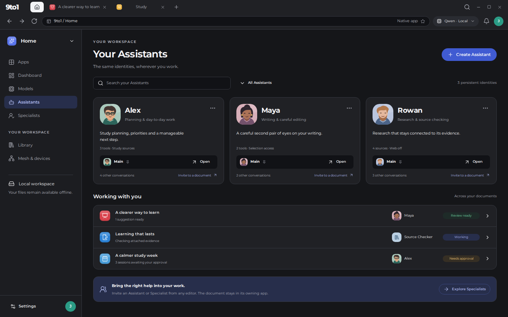
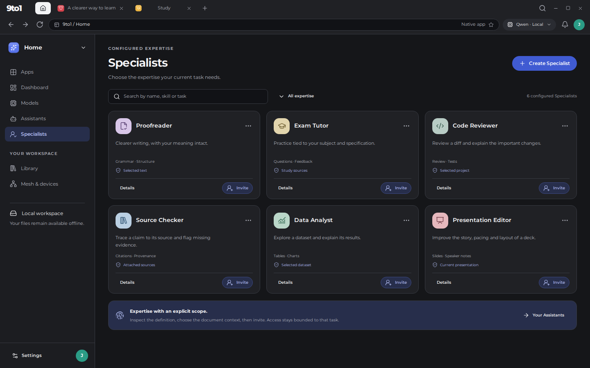
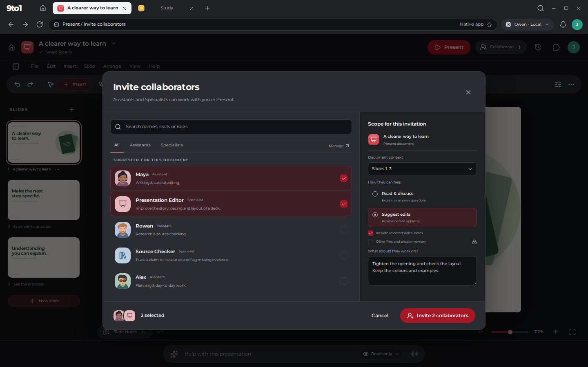
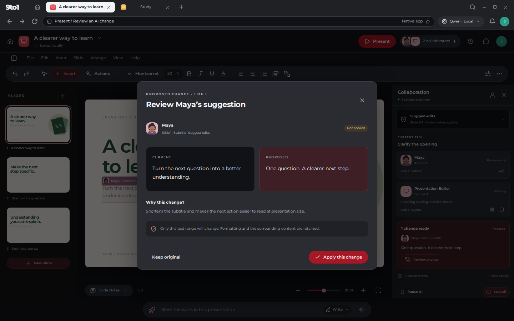

# Global Assistants, Specialists and collaborators

Module ID: `assistants` · 9to1 Development Specification v3

## Prerequisites

- **CUI, themes and shared interaction system** — Typed UI components, theme tokens/materials, layout, focus, motion, accessibility and shared control states.
- **Dulche runtime, requests and execution services** — Canonical AI broker, capability-aware routing, durable Task/Runs, action execution and lifecycle.
- **Den, memory and knowledge banks** — Scoped durable memory, versioned Den records, knowledge-bank provenance and brokered retrieval.
- **Permissions, approvals and execution scope** — Effective scoped grants, action approvals, policy intersections, revocation and audit.

## Overview

Assistants and Specialists are global systems available through Home and editors. Spaces retains their canonical conversation views. Assistants provide persistent personal identities and ongoing work; Specialists provide reusable job-focused expertise and configuration.

Current owner overrides: V3-OWNER-002, V3-RECON-002.

## Layouts & visible states

- **V3-ASSISTANTS-LAY-01** — Home exposes distinct Assistants and Specialists destinations with available/owned identities, creation/configuration and current work. Editor collaborator avatars open identity-aware pickers in the artifact context.
- **V3-ASSISTANTS-LAY-02** — An Assistant has a permanent Main conversation plus additional threads. Do not recreate a new Main identity whenever the user changes host/app.
- **V3-ASSISTANTS-LAY-03** — Review views show proposed semantic artifact changes, contributor identity, scope, selected revision and explicit accept/reject controls.

## Features & behaviour

- **V3-ASSISTANTS-FEA-01** — Preserve identity, instructions, model routing, tools/Skills/Plugins, Files/context, memory policy, budgets, queues, permitted proactivity, Dev handoff, Mini Computer capability and recovery.
- **V3-ASSISTANTS-FEA-02** — Persistent Teams support configured roles, shared work and relevance-gated participation; user-facing messages identify each contributor. Show Assistant–Assistant Chat uses All, Relevant or None without changing actual access rights.
- **V3-ASSISTANTS-FEA-03** — Specialists launch with the correct canonical job/instructions and policies. Discovery/configuration principally belongs in Home and AI Studio; Spaces lists may link there.
- **V3-ASSISTANTS-FEA-04** — Conversation handoff passes explicit authorised context and canonical work references without copying history indiscriminately. Replies from Connect remain in the originating channel/thread.
- **V3-ASSISTANTS-FEA-05** — Adding an editor collaborator produces a scoped participant or proposal relationship to the same artifact; it is not a new document copy or permission escalation.

## Canonical entities & persistence

- **V3-ASSISTANTS-ENT-01** — Keep AssistantID/SpecialistID, configuration revisions, Main ConversationID, other threads, TeamID/membership/roles, Task/Runs and artifact proposal references canonical.
- **V3-ASSISTANTS-ENT-02** — Preserve old Agent compatibility contracts where retained. Renaming or relocating the UI does not delete API capabilities.

## Permissions & recovery

- **V3-ASSISTANTS-PER-01** — Show effective context/write scope and unavailable tools, and require action-specific approval where applicable. A collaborator avatar does not mean unrestricted write authority.
- **V3-ASSISTANTS-PER-02** — Recover queued/background work, partial proposals and thread handoffs without duplicate external effects. Configuration rollback affects future work, not already-sent messages.

## Acceptance checks

- **V3-ASSISTANTS-ACC-01** — Open one Assistant in Home, Spaces and Write; verify identity, Main conversation and configured policy match.
- **V3-ASSISTANTS-ACC-02** — Exercise Specialist selection, persistent Team relevance settings, artifact review/rejection, accepted revision and revoked-source access.

## Exact mock-up and state map

- **Home · Assistants** — screen `home-assistants`. Global identities.
- **Home · Specialists** — screen `home-specialists`. Configured expertise.
- **Present · Invite collaborators** — screen `collaborators-picker`. Assistant & Specialist picker.
- **Present · Review an AI change** — screen `collaboration-review`. Scoped review.

## Source clause IDs

SPUI-154, SPUI-155, SPUI-156, SPUI-157, SPUI-158, SPUI-159, SPUI-160, SPUI-161, SPUI-162, SPUI-163

## Technical reading map

- Global Assistants, Specialists and collaborators — Product definition and global-system boundary; Product category and interaction model (part 01) — `technical/assistants-01.md` (2,379 words; V2-B0063, V2-B0064, V2-B0065…).
- Global Assistants, Specialists and collaborators — Plugins, Connectors, Skills and Knowledge; Agent memory (part 02) — `technical/assistants-02.md` (2,379 words; V2-B1904, V2-B1905, V2-B1906…).
- Global Assistants, Specialists and collaborators — SEPARATE USER-FACING ASSISTANT MESSAGES (OWNER CONFIRMED); “SHOW ASSISTANT-ASSISTANT CHAT” SETTING (OWNER CONFIRMED) (part 03) — `technical/assistants-03.md` (969 words; COMPANION-B0046, COMPANION-B0047, COMPANION-B0048…).

Technical clauses retain APIs, data models, platform, recovery, donor and acceptance details. The technical files are part of this module, not optional background reading. Shared prerequisites mean stable service/interface contracts must be available; they do not require every dependent app UI to be complete. Use the named chunk for the relevant subtask or the complete module file for its full retained contract.

# Exact designs and implementation rules

These figures are the exact current atlas compositions. Their stable screen IDs match the Word specification and editable source. Open the atlas for full-size theme and interaction inspection.

## Home · Assistants

Screen ID: `home-assistants`. Source: Owner revision 28 October: Assistants and Specialists are global identities available from Home and every editor; later steering supersedes Space-only placement; canonical identity, document ownership, Task/Run and permission contracts.

- Home is an independent entry point to persistent Assistants. Editors and Spaces reuse the same canonical Assistant identity, portrait, configuration and permanent Main thread.
- Alex, Maya and Rowan repeat the exact authored portraits already used in Spaces. Their identities do not change when a document, conversation, app or task changes.
- The Working with you list is a cross-app view of canonical tasks and document references, not a second task database. Opening a row returns to the owning app and current revision.
- Assistant configuration, memory and tools remain explicit and scoped. An invitation to collaborate does not expose another Assistant’s private memory or unrelated files.
- This current owner decision supersedes any older statement that access must be confined to an Assistants Space; the existing Space conversations remain valid entry points.

## Home · Specialists

Screen ID: `home-specialists`. Source: Owner revision 28 October: Assistants and Specialists are global identities available from Home and every editor; later steering supersedes Space-only placement; canonical identity, document ownership, Task/Run and permission contracts.

- Specialists are reusable configured expertise with stable definition identities. They remain distinct from persistent Assistants and temporary subagents.
- The same six definitions are available from the current Spaces catalogue and from every editor’s collaborator picker. Scope and capabilities are visible before invitation.
- Invoking a Specialist creates a scoped run/participant under its definition. It does not create a duplicate personal Assistant or a second document.
- Choosing Invite opens a staged context/permission dialog. Merely opening a catalogue, searching or selecting an identity does not run work.
- The identity tile stays recognisable across UI themes. Actual tools, source ACLs, account grants and current document permissions still constrain the effective invitation.

## Present · Invite collaborators

Screen ID: `collaborators-picker`. Source: Owner revision 28 October: Assistants and Specialists are global identities available from Home and every editor; later steering supersedes Space-only placement; canonical identity, document ownership, Task/Run and permission contracts.

- The editor header always exposes the same collaborator entry point. The picker opens over the current app and retains document identity, revision, selection and scroll.
- Assistants and Specialists are searchable in one picker but labelled as different types. The same named portrait/identity appears in Home, the picker, presence and work attribution.
- The invitation explicitly scopes document context, permitted operation mode and optional notes/comments. Other files and private memory are not included by membership.
- Suggest edits is staged here. Work begins only after Invite; applying a proposed change remains a separate review/commit against the current document revision.
- The modal traps focus, supports search/filter and Escape/Cancel, and restores focus to the invoking header control. On narrow screens it becomes one navigable sheet with reachable scope and invite controls.

## Present · Review an AI change

Screen ID: `collaboration-review`. Source: Owner revision 28 October: Assistants and Specialists are global identities available from Home and every editor; later steering supersedes Space-only placement; canonical identity, document ownership, Task/Run and permission contracts.

- The proposal identifies its author, exact slide/object range, current value and proposed value. Opening review does not apply or authorise it.
- Apply this change commits only the displayed operation to the owning document after revision/scope validation, as one undoable transaction.
- Keep original rejects this proposal without stopping unrelated authorised work or discarding the participant’s durable task record.
- Formatting and surrounding content remain unchanged unless the reviewed operation explicitly includes them. A conflict must refresh the proposal instead of silently overwriting another collaborator.
- The local prototype can demonstrate the accepted visual state; it does not claim to implement live provider execution, shared persistence or document-engine acceptance.
