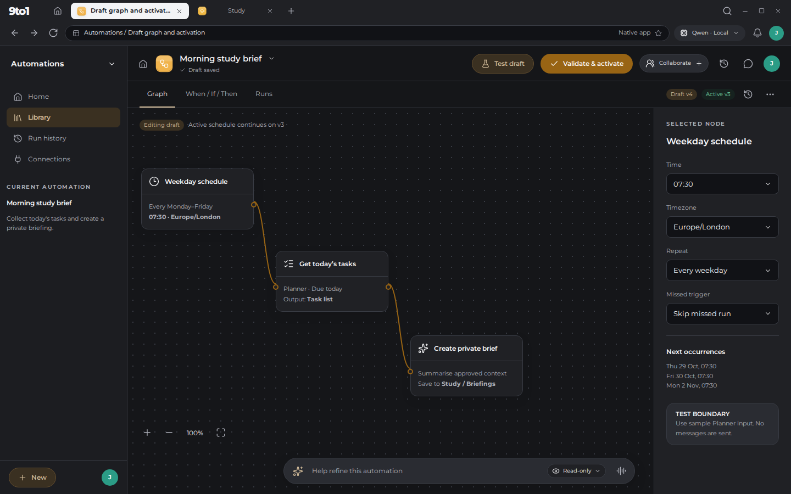
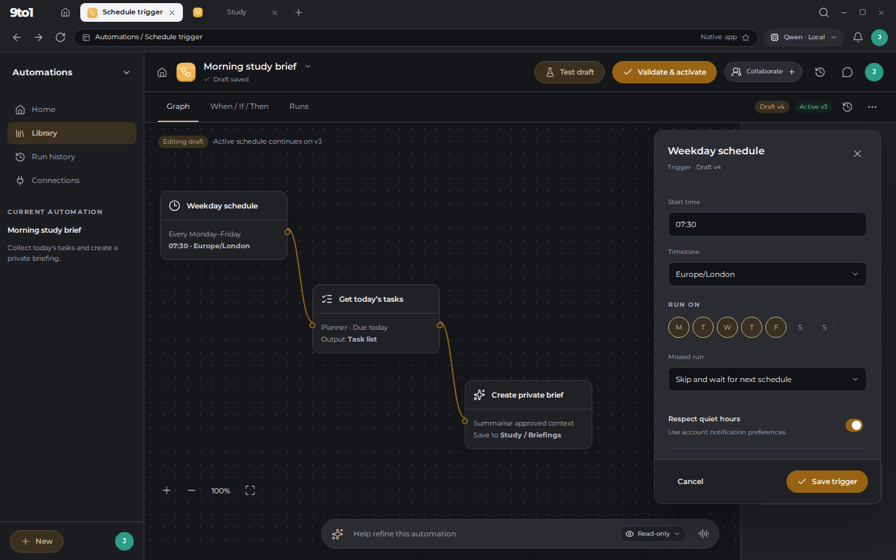

# Automations — graph authoring and durable runs

Module ID: `automations` · 9to1 Development Specification v3

## Prerequisites

- **CUI, themes and shared interaction system** — Typed UI components, theme tokens/materials, layout, focus, motion, accessibility and shared control states.
- **Node Editor — shared graph framework** — Shared typed graph schemas, editing/validation, draft activation and runtime presentation.
- **Dulche runtime, requests and execution services** — Canonical AI broker, capability-aware routing, durable Task/Runs, action execution and lifecycle.
- **Permissions, approvals and execution scope** — Effective scoped grants, action approvals, policy intersections, revocation and audit.
- **Artifacts, local persistence and recovery** — Canonical artifacts, revisions, typed edits, local saves, derived exports, sync and recovery.

## Overview

Automations owns durable workflows, schedules, triggers and execution history through the shared Node Editor. Other apps bind to this owner rather than creating competing hidden schedulers.

## Layouts & visible states

- **V3-AUTOMATIONS-LAY-01** — Provide workflow list/launch, graph editor, node palette, inspector, validation, draft/active status and run history. Runtime highlighting reflects actual execution.
- **V3-AUTOMATIONS-LAY-02** — Nodes expose trigger/condition/action/input/output and error/retry information appropriate to their typed schemas.

## Features & behaviour

- **V3-AUTOMATIONS-FEA-01** — Support source-defined triggers, schedules/timers, conditional branches, parallel work, approvals, retries and typed app/tool actions.
- **V3-AUTOMATIONS-FEA-02** — Validate graph/dependency/policy before activation. Editing a draft does not silently change an active run; activation identifies the new revision.
- **V3-AUTOMATIONS-FEA-03** — Schedule and trigger semantics use canonical clocks/timezones/deduplication, with honest missed/offline-run recovery.
- **V3-AUTOMATIONS-FEA-04** — Space slash commands/sidebar actions and Assistant schedules reference canonical AutomationID/revision rather than duplicating the graph.

## Canonical entities & persistence

- **V3-AUTOMATIONS-ENT-01** — Persist AutomationID, GraphID/nodes/ports, Draft/Active revisions, trigger bindings, schedule state, run IDs, checkpoints and action receipts.
- **V3-AUTOMATIONS-ENT-02** — Keep node view layout separate from execution semantics and retained audit history.

## Permissions & recovery

- **V3-AUTOMATIONS-PER-01** — Every execution inherits effective grants and budget; graph activation cannot bypass external-action approval. Revocation blocks future affected steps.
- **V3-AUTOMATIONS-PER-02** — Retry from safe checkpoints with idempotency and clear partial effects; rollback does not undo external actions already committed.

## Acceptance checks

- **V3-AUTOMATIONS-ACC-01** — Author/validate/activate/run a real workflow, inspect a blocked approval, retry failure and recover after restart.
- **V3-AUTOMATIONS-ACC-02** — Test wrong port types, cycles, missing resources, offline schedule, concurrent trigger deduplication and permission revocation.

## Exact mock-up and state map

- **Automations · Draft graph and activation** — screen `automations`. Node editor.
- **Automations · Schedule trigger** — screen `automation-trigger`. Interaction state.

## Source clause IDs

UX27-AUTO-001, UX27-AUTO-002, UX27-AUTO-003, UX27-AUTO-004, UX27-AUTO-005, UX27-AUTO-006, SECTION-06, UX27-TEST-072, UX27-TEST-073, UX27-TEST-074, UX27-TEST-075

## Technical reading map

- Automations — graph authoring and durable runs — Automations and shared node editing; Home, Library and draft/active distinction (part 01) — `technical/automations-01.md` (560 words; V2-B1648, V2-B1649, V2-B1650…).
- Automations — graph authoring and durable runs — Automations; Product role and execution boundary (part 02) — `technical/automations-02.md` (2,883 words; V2-B1666).
- Automations — graph authoring and durable runs — Automations; Draft versus active graph and UI views (part 03) — `technical/automations-03.md` (291 words; V2-B2752, V2-B2753, V2-B2754…).

Technical clauses retain APIs, data models, platform, recovery, donor and acceptance details. The technical files are part of this module, not optional background reading. Shared prerequisites mean stable service/interface contracts must be available; they do not require every dependent app UI to be complete. Use the named chunk for the relevant subtask or the complete module file for its full retained contract.

# Exact designs and implementation rules

These figures are the exact current atlas compositions. Their stable screen IDs match the Word specification and editable source. Open the atlas for full-size theme and interaction inspection.

## Automations · Draft graph and activation

Screen ID: `automations`. Source: UX27-AUTO-001–006; shared Node Graph Framework.

- Draft and Active revisions remain visibly distinct. Saving/testing a draft does not enable or replace the live schedule.
- Ports show types and compatible targets; selection, panning and editing a field are separate gestures.
- Test uses explicit sample inputs and permissions. A test that performs an external action retains its approval boundary.
- Runs remain pinned to their starting revision. Durable waits survive restart without replaying committed effects.

## Automations · Schedule trigger

Screen ID: `automation-trigger`. Source: Owner revision 28 October; UX27-AUTO-001–006; trigger and draft activation rules.

- Editing a trigger changes the draft revision only. The current active schedule is shown separately until validation and activation.
- Time, timezone, days and missed-run policy are explicit. Daylight-saving transitions resolve using the selected timezone.
- Saving the trigger never activates the automation or performs its downstream external actions.
