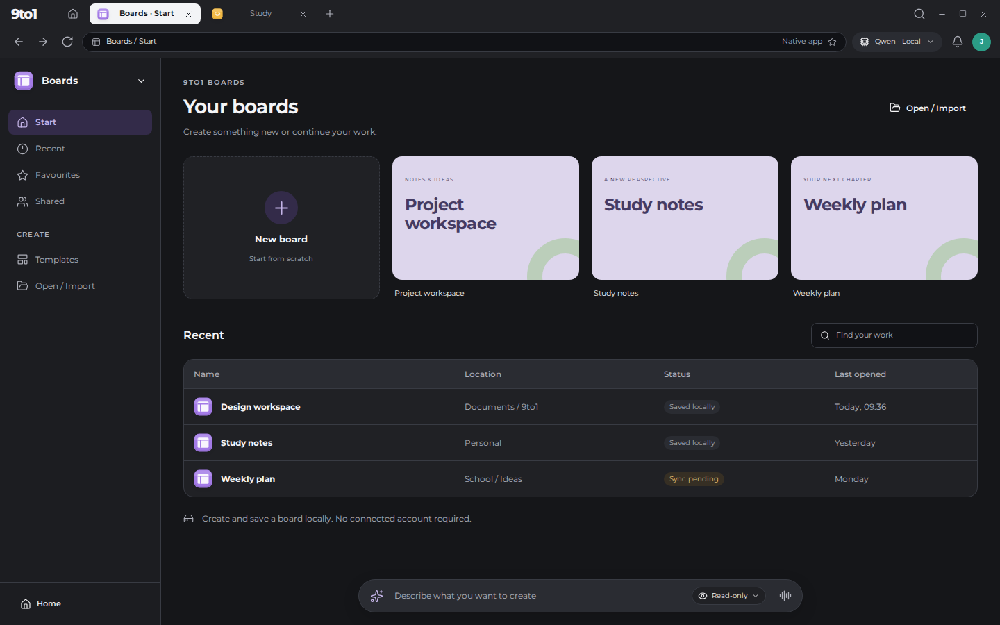
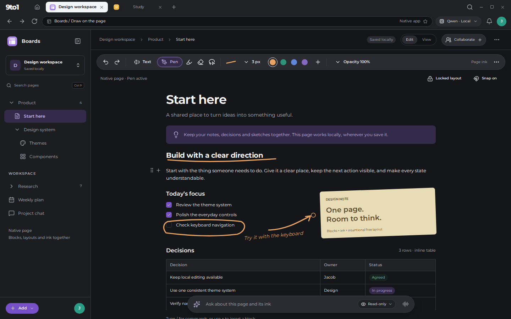
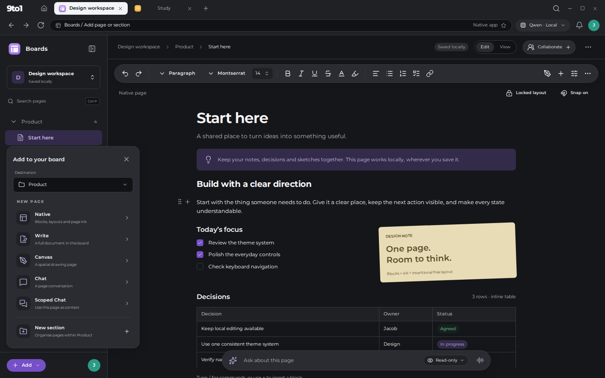
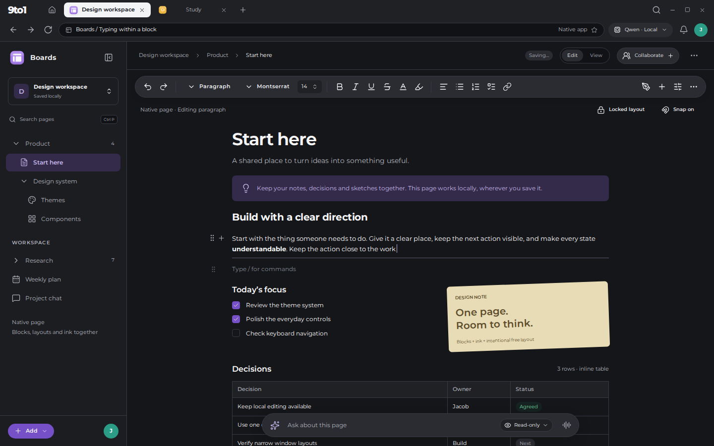
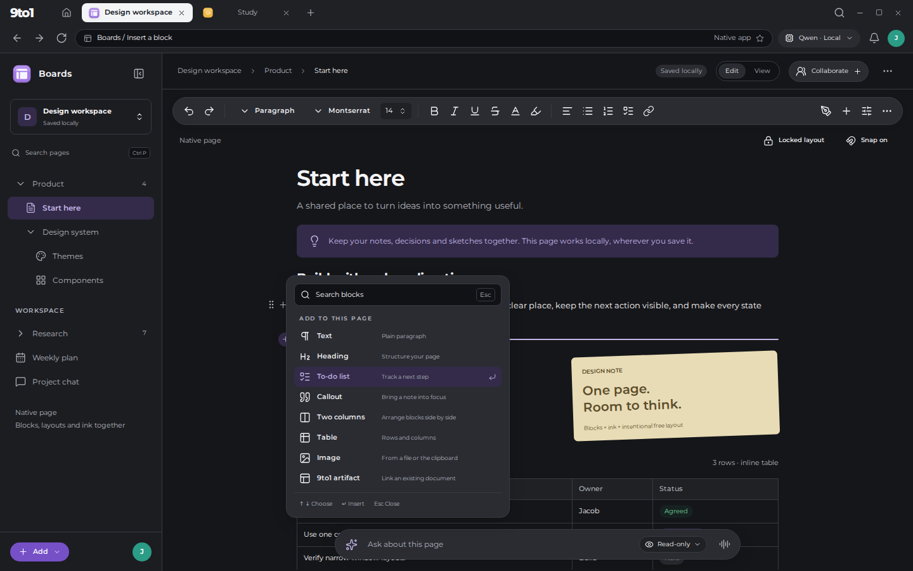
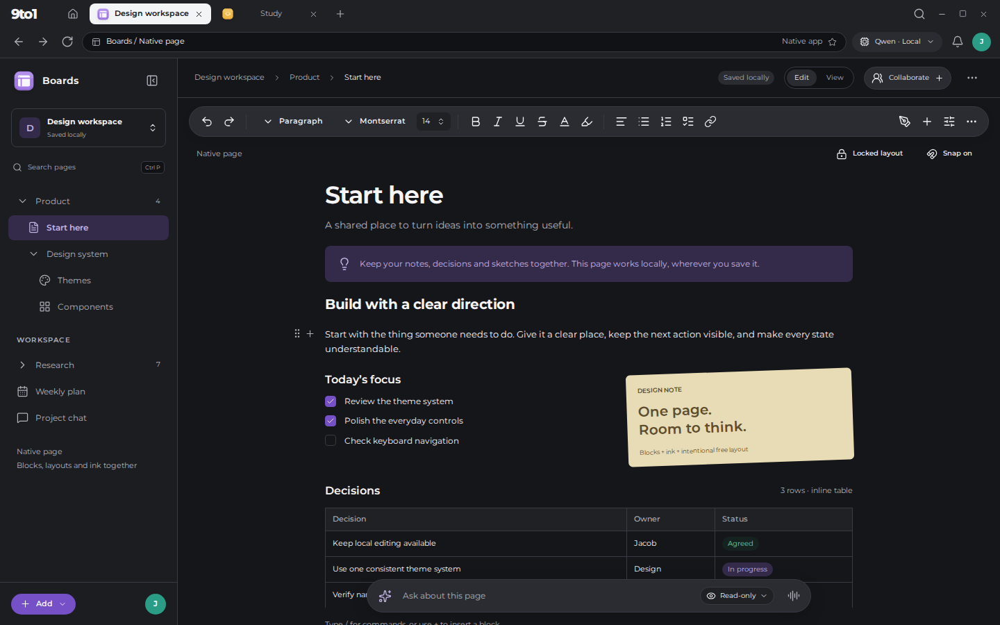
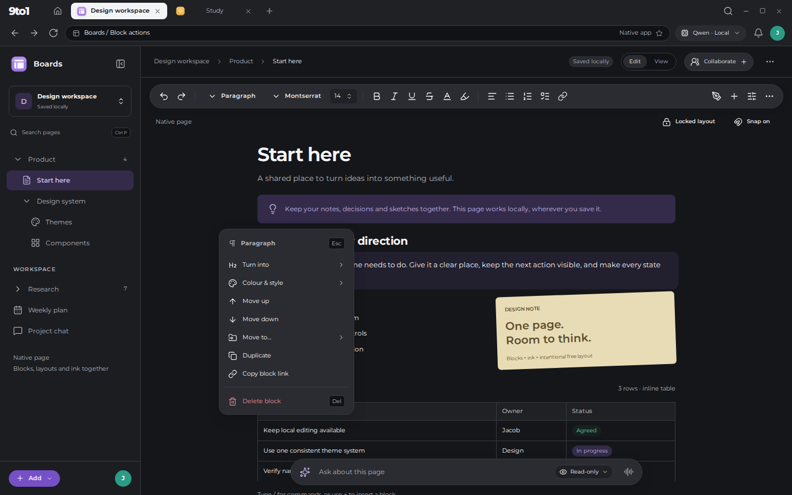
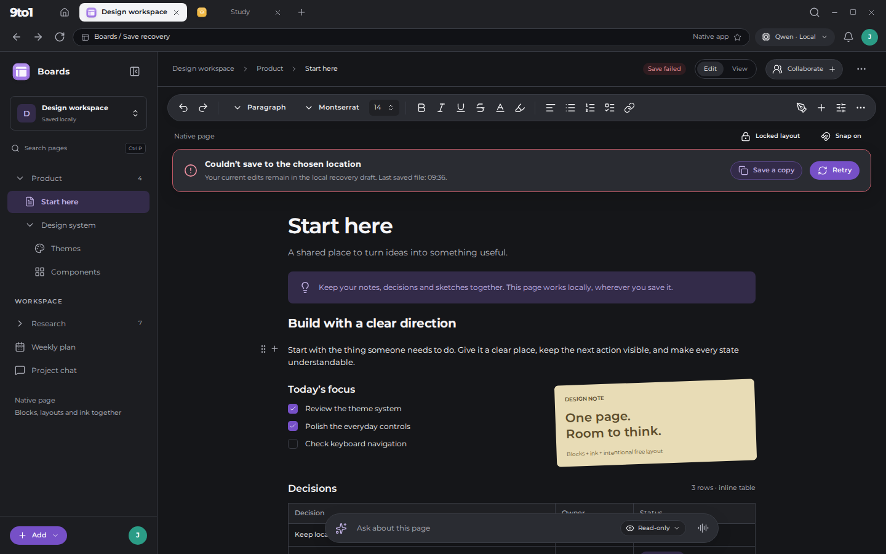
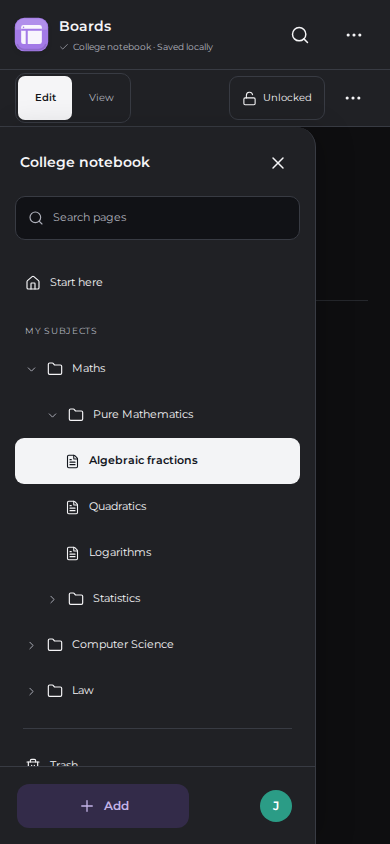

# Boards — seamless pages, blocks and ink

Module ID: `boards` · 9to1 Development Specification v3

## Prerequisites

- **CUI, themes and shared interaction system** — Typed UI components, theme tokens/materials, layout, focus, motion, accessibility and shared control states.
- **Shared productivity engine and canonical embeds** — Real document/object engines, semantic editing, canonical app embedding and donor feature parity.
- **Shared AI controls and artifact collaboration** — Contextual AI bars, shared model/permission controls, global collaborators and typed artifact proposals.
- **Artifacts, local persistence and recovery** — Canonical artifacts, revisions, typed edits, local saves, derived exports, sync and recovery.

## Overview

Boards is a native flexible document workspace combining structured blocks, free placement and ink with nested pages. It must work locally without a Files account or connected cloud provider.

Current owner overrides: V3-OWNER-011.

## Layouts & visible states

- **V3-BOARDS-LAY-01** — Keep a compact board identity/breadcrumb/switcher, nested page tree, bottom Add/avatar and a contextual top floating toolbar. Expose independent Edit/View, Locked and Snap controls.
- **V3-BOARDS-LAY-02** — Represent page creation/type choice, page options, insertion-between-blocks, typing/caret, selected block/drag affordance, free ink and active tool-options states explicitly.
- **V3-BOARDS-LAY-03** — Use a seamless authored surface rather than nesting an unnecessary second app canvas or presenting the page as disconnected generic cards.

## Features & behaviour

- **V3-BOARDS-FEA-01** — Add, rename, nest, reorder, duplicate and remove pages with correct source semantics. Page types embed real canonical app surfaces where supported.
- **V3-BOARDS-FEA-02** — Insert and edit text, lists, media, table/linked blocks, absolute objects and ink with unified selection/undo. Insertion lines and drag grips identify actual block boundaries.
- **V3-BOARDS-FEA-03** — Locked controls constrain movement/layout as defined; View prevents editing; Snap changes manipulation behaviour. Do not collapse all three into one read-only toggle.
- **V3-BOARDS-FEA-04** — Native .9to1board files may live at permitted locations. Local creation and editing must not require sign-in, a mounted Files provider or AI.
- **V3-BOARDS-FEA-05** — Contextual AI and collaborators use typed board/page/block changes with visible review and source ownership.

## Canonical entities & persistence

- **V3-BOARDS-ENT-01** — Persist BoardID, nested PageIDs, block/object/stroke IDs, order/layout coordinates, page type, embed references and revisions.
- **V3-BOARDS-ENT-02** — Store local draft/save and optional external file/sync state separately; embedded source artifacts retain their owning identity.

## Permissions & recovery

- **V3-BOARDS-PER-01** — Detach/remove references without silently deleting the original artifact. Shared-source permission changes show safe placeholders.
- **V3-BOARDS-PER-02** — Recover typed and ink changes after interruption; stale AI edits must not overwrite concurrent page/block changes.

## Acceptance checks

- **V3-BOARDS-ACC-01** — Test local create/open, page Add/type menu, page options, block insertion/typing/drag, pen options and undo/reopen.
- **V3-BOARDS-ACC-02** — Verify Edit/View, Locked and Snap independently, keyboard navigation, canonical embeds and no Files account dependency.

## Exact mock-up and state map

- **Boards · Start** — screen `boards-launch`. Launch.
- **Boards · Draw on the page** — screen `boards-ink`. Page ink.
- **Boards · Add page or section** — screen `boards-add`. Footer Add menu.
- **Boards · Typing within a block** — screen `boards-typing`. Text editing.
- **Boards · Insert a block** — screen `boards-insert`. Insertion catalogue.
- **Boards · Native page** — screen `boards-editor`. Editor.
- **Boards · Block actions** — screen `boards-context`. Selection & menu.
- **Boards · Save recovery** — screen `boards-recovery`. Failure state.
- **Mobile · Boards page drawer** — screen `mobile-boards`. 390 × 844.

## Source clause IDs

UX27-BOARD-001, UX27-BOARD-002, UX27-BOARD-003, UX27-BOARD-004, UX27-BOARD-005, UX27-BOARD-006, UX27-BOARD-007, UX27-BOARD-008, UX27-BOARD-009, UX27-BOARD-010, UX27-BOARD-011, UX27-BOARD-012, UX27-BOARD-013, UX27-BOARD-014, UX27-BOARD-015, UX27-BOARD-016, UX27-BOARD-017, UX27-BOARD-018, UX27-BOARD-019, UX27-BOARD-020, UX27-BOARD-021, UX27-BOARD-022, UX27-BOARD-023, UX27-BOARD-024, UX27-BOARD-025, UX27-BOARD-026, UX27-BOARD-027, UX27-BOARD-028, UX27-BOARD-029, UX27-BOARD-030, UX27-BOARD-031, UX27-BOARD-032, UX27-BOARD-033, UX27-BOARD-034, UX27-BOARD-035, UX27-BOARD-036, UX27-BOARD-037, UX27-BOARD-038, UX27-BOARD-039, UX27-BOARD-040, UX27-BOARD-041, UX27-BOARD-042, UX27-BOARD-043, UX27-BOARD-044, UX27-BOARD-045, UX27-BOARD-046, UX27-BOARD-047, SECTION-02, UX27-TEST-001, UX27-DATAFLOW-001, UX27-TEST-002, UX27-TEST-003, UX27-TEST-004, UX27-TEST-005, UX27-TEST-006, UX27-DATAFLOW-004, UX27-TEST-007, UX27-SHARED-015, UX27-TEST-008, UX27-TEST-009, UX27-DATAFLOW-006, UX27-TEST-010, UX27-SHARED-017, UX27-TEST-011, UX27-SHARED-005, UX27-TEST-012, UX27-TEST-013, UX27-TEST-014, UX27-TEST-015, UX27-TEST-016, UX27-TEST-017, UX27-TEST-018, UX27-TEST-019, UX27-TEST-020, UX27-TEST-021, UX27-TEST-022, UX27-TEST-023, UX27-TEST-024, UX27-TEST-025, UX27-TEST-026, UX27-SHARED-013, UX27-TEST-027, UX27-TEST-028, UX27-SHARED-020, UX27-TEST-029, UX27-TEST-030, UX27-TEST-031, UX27-SHARED-011, UX27-TEST-032, UX27-TEST-033, UX27-TEST-034, UX27-TEST-035, UX27-TEST-036, UX27-TEST-037, UX27-TEST-038, UX27-TEST-039, UX27-TEST-040, UX27-SHARED-012, UX27-TEST-041, UX27-SHARED-018, UX27-TEST-042, UX27-TEST-043, UX27-TEST-044, UX27-TEST-045, UX27-TEST-046, UX27-TEST-047, UX27-TEST-048, UX27-TEST-049

## Technical reading map

- Boards — seamless pages, blocks and ink — Boards — exact shell, navigation and local-first file behaviour; The intended composition (part 01) — `technical/boards-01.md` (2,331 words; V2-B1393, V2-B1394, V2-B1395…).
- Boards — seamless pages, blocks and ink — Backspace/Delete at boundaries; Lists, toggles and nesting (part 02) — `technical/boards-02.md` (2,365 words; V2-B1450, V2-B1451, V2-B1452…).
- Boards — seamless pages, blocks and ink — Compact table interaction, not fifty buttons; Table cell editing and navigation (part 03) — `technical/boards-03.md` (2,387 words; V2-B1502, V2-B1503, V2-B1504…).
- Boards — seamless pages, blocks and ink — Edit and View modes; Locked and Unlocked layout modes (part 04) — `technical/boards-04.md` (2,371 words; V2-B1556, V2-B1557, V2-B1558…).
- Boards — seamless pages, blocks and ink — Embedded artifact ownership and lifecycle; Collaboration and concurrency (part 05) — `technical/boards-05.md` (2,389 words; V2-B1618, V2-B1619, V2-B1620…).
- Boards — seamless pages, blocks and ink — Add page/section chooses the correct destination; Tree focus, expansion and rename (part 06) — `technical/boards-06.md` (2,382 words; V2-B2448, V2-B2449, V2-B2450…).
- Boards — seamless pages, blocks and ink — Merge split and undo without data loss; Image resize crop and missing media (part 07) — `technical/boards-07.md` (550 words; V2-B2603, V2-B2604, V2-B2605…).

Technical clauses retain APIs, data models, platform, recovery, donor and acceptance details. The technical files are part of this module, not optional background reading. Shared prerequisites mean stable service/interface contracts must be available; they do not require every dependent app UI to be complete. Use the named chunk for the relevant subtask or the complete module file for its full retained contract.

# Retained technical requirements

# Boards — seamless pages, blocks and ink — Boards — exact shell, navigation and local-first file behaviour; The intended composition (part 01)

Reading status: active retained clauses, subject to the v3 owner overrides listed in the primary module. Historical process instructions and replaced original wording are stored separately.

### V2-B1393 · v2 lines 6555–6555

## 2. Boards — exact shell, navigation and local-first file behaviour

### V2-B1394 · v2 lines 6557–6557

### UX27-BOARD-001 — The intended composition

### V2-B1395 · v2 lines 6559–6559

**O/B.** The Boards workspace comprises a compact application/board header, a left navigation sidebar, one primary seamless page/editor surface, the retained floating top editing toolbar and the shared bottom AI surface. Put the Boards identity at the top-left. Remove AppFlowy branding from the top-right; upstream attribution belongs in About/licence information, not a donor badge impersonating the product. Keep one clear editable page title and a breadcrumb expressing Board and Page identities without repeating the same title in multiple unrelated fields.

### V2-B1396 · v2 lines 6561–6561

The sidebar has a board switcher/search area, the nested section/page tree, and a fixed bottom footer containing the Add page/section affordance and user/avatar controls. The 25 October instruction moves this Add control to the bottom; it does not remove the top editing toolbar or its separate Insert command. Do not confuse adding a page with inserting a block.

### V2-B1397 · v2 lines 6563–6563

### UX27-BOARD-002 — Geometry defaults, not guessed screenshot measurements

### V2-B1398 · v2 lines 6565–6565

**D.** Unless a recovered approved reference supplies more precise values, start with a 256-unit sidebar, user-resizable from 208 to 360; 32-unit tree rows; 16-unit indentation per depth; an approximately 48-unit fixed footer; and a 20-unit page-tree icon slot. Reserve the disclosure slot even for leaves so labels align. The content surface uses a readable 760-unit flow column by default, expandable through a real page-width preference; its background remains continuous rather than becoming a floating sheet/card.

### V2-B1399 · v2 lines 6567–6567

Keep toolbar clearance above the first content block and AI-bar clearance below the last editable line. These clearances follow actual visible chrome bounds, not an arbitrary permanent blank block. On narrow windows, collapse navigation deliberately and keep an explicit reopen control; do not push the editor off screen.

### V2-B1400 · v2 lines 6569–6569

### UX27-BOARD-003 — New Board without setup prerequisites

### V2-B1401 · v2 lines 6571–6571

**O/B/D.** From the Boards landing page, New Board creates a durable local draft with a stable BoardID and an initial editable Native page, then focuses its title or first content block. A name is editable inline; a file path, Files connection, login, cloud subscription, AI model or browser renderer is not required. Do not show a mandatory “connect Files” wizard, hide Create, or demand a predefined Boards folder.

### V2-B1402 · v2 lines 6573–6573

A simple creation popup may offer optional name/template details, but the default empty-board route must remain immediate and usable. Template content is explicitly chosen, not injected as fake recent work. A shared-core installation/repair requirement is handled by the packaged platform contract; ordinary users must not manually wire internal storage services to create a local board.

### V2-B1403 · v2 lines 6575–6575

### UX27-BOARD-004 — Drafts before Save As

### V2-B1404 · v2 lines 6577–6577

**O/B/D.** An unnamed board is a recoverable local draft, not disposable memory. Allocate canonical identity immediately and persist edits through the normal local owning-storage adapter. Show `Saved locally — draft` only after a durable commit. Keep recoverable drafts in the application’s normal private data area without making that implementation path a user-facing mandatory destination.

### V2-B1405 · v2 lines 6579–6579

Closing and reopening the application restores the draft through Recent/Drafts or session restoration. Cancelling Save As retains the draft, caret, page tree and undo history supported by the engine. A model/account/provider outage cannot erase it. Offer explicit draft deletion through recoverable Trash semantics; do not treat closing a tab as permission to delete a draft.

### V2-B1406 · v2 lines 6581–6581

### UX27-BOARD-005 — Optional editable .9to1board files

### V2-B1407 · v2 lines 6583–6583

**O/B.** File → Save As and its shortcut open the normal permitted location chooser, prefill a reasonable filename, and save an editable `.9to1board` document to the location the user chooses. Desktop, Documents, a different folder, removable media, a mounted network location or an authorised cloud-provider location are all eligible according to actual platform access. The app must not rewrite the chosen destination into a Boards-specific folder.

### V2-B1408 · v2 lines 6585–6585

Save updates the selected file for a file-backed board; for a draft it may open Save As. Save As is not a PNG/PDF export, a pointer requiring an unconnected Files account, or a library-registration operation masquerading as a file. Files indexing, account sync and library organisation remain optional integrations, not prerequisites.

### V2-B1409 · v2 lines 6587–6587

### UX27-BOARD-006 — File contents and portability

### V2-B1410 · v2 lines 6589–6589

**B/D.** The versioned `.9to1board` representation must preserve BoardID, page/section hierarchy, stable PageIDs/BlockIDs, rich text and custom styles, flow/absolute layout, drawing layers and stroke IDs, graph definitions, table formatting, relevant view settings and the supported owned embedded artifacts/assets. Use the existing canonical serializer/container architecture where suitable; do not introduce a second incompatible Boards model just to implement the extension.

### V2-B1411 · v2 lines 6591–6591

BoardOwned content is included or packaged through a documented portable representation. Externally Referenced artifacts retain explicit references, owner identity and permission boundaries; disclose references that will not be available elsewhere. Provide a deliberate “include permitted copies” export when supported, never an unauthorised automatic copy. Credentials, bearer tokens, absolute-path-only assumptions and private account secrets must not be embedded in the document.

### V2-B1412 · v2 lines 6593–6593

### UX27-BOARD-007 — Identity versus file location

### V2-B1413 · v2 lines 6595–6595

**B/D.** Renaming or moving a `.9to1board` file must not generate new logical page/block identities. Save As changes the active storage destination while retaining the board’s logical identity unless the user explicitly requests Save a Copy/Duplicate. A deliberate independent copy receives a new BoardID and remapped owned identifiers according to the canonical duplication contract; external references are retained only as authorised references.

### V2-B1414 · v2 lines 6597–6597

Two separately modified copies with the same logical origin must not be merged merely because their names match. Detect duplicate/conflicting origins and offer an explicit open-as-copy or reconcile path. Opening a moved file repairs its Recent locator without duplicating every page. Never derive BoardID from a folder name or current sidebar position.

### V2-B1415 · v2 lines 6599–6599

### UX27-BOARD-008 — Safe saves, failure and concurrency

### V2-B1416 · v2 lines 6601–6601

**B/D.** Save through a crash-safe transaction/atomic replacement supported by the storage provider. Keep the previous valid file until the new revision is complete and validated. Do not mark Saved on merely starting a write. Disk-full, disconnected removable storage, read-only destinations, revoked access and remote revision conflicts preserve the in-memory edits and a recoverable local journal, expose the exact failed destination, and offer Retry/Save As where appropriate.

### V2-B1417 · v2 lines 6603–6603

An external file change is checked against the loaded revision before overwrite. Preserve both divergent revisions or invoke the domain conflict resolver; never choose by wall-clock timestamp alone. Test failure during serialization and during final replacement, and verify that reopening yields either the old complete revision or the new complete revision, not a partially assembled board.

### V2-B1418 · v2 lines 6605–6605

### UX27-BOARD-009 — Reopen without stale leases

### V2-B1419 · v2 lines 6607–6607

**O/B/D.** Open supports File → Open, a recent item and the platform’s `.9to1board` association. Resolve the durable document locator and current permissions afresh. A one-shot Files/Home acquisition token from the previous process is not the persistent identity of the document and must not be replayed as the only reopen mechanism. Reacquire the necessary narrow handle through the actual local/storage adapter.

### V2-B1420 · v2 lines 6609–6609

Opening a normal local file must not require connecting the Files app. If the OS genuinely requires renewed access, ask for that precise file/location access and preserve the selected board target. A missing file produces Locate/Remove from Recent choices, not a dead restored tab or an unrelated empty board. Restore the last page where still valid, otherwise choose a deterministic existing page and explain unavailable targets.

### V2-B1421 · v2 lines 6611–6611

### UX27-BOARD-010 — Landing page and recent items

### V2-B1422 · v2 lines 6613–6613

**B/D.** The landing page is a distinct board-library experience, not a heading stacked above a live editor. New Board and Open File are visible immediately. Recent cards use actual board names, icons, last-opened/modified state and revision-correct previews. No fake successful provider rows, seeded boards or duplicated Library headings. Searching filters real accessible records and exposes a useful no-results state without clearing the original collection.

### V2-B1423 · v2 lines 6615–6615

A click opens the chosen BoardID directly. The card overflow offers available Rename/Locate/Remove from Recent/Trash actions with distinct semantics. Removing a recent entry is not file deletion. Failed preview generation must not prevent opening a valid board. Long filenames and unavailable external references remain readable and diagnosable.

### V2-B1424 · v2 lines 6617–6617

### UX27-BOARD-011 — Board switcher

### V2-B1425 · v2 lines 6619–6619

**B/D.** The board icon/name control at the top of the sidebar opens an anchored searchable switcher. It shows the current selection, recent/pinned authorised boards, and distinct Create Board/Open File/Manage actions. Choosing a board atomically changes page tree, breadcrumb, title, editor, tool state and AI context to that board; no frame may pair one board’s title with another board’s content.

### V2-B1426 · v2 lines 6621–6621

Retain the former board’s local draft, selected page and scroll state. A pending save/failure is dealt with through the save contract rather than silently discarded. A failed target open leaves the current usable board intact. The switcher is not the bottom Add page/section popup and must not replace it.

### V2-B1427 · v2 lines 6623–6623

### UX27-BOARD-012 — Nested page and section tree

### V2-B1428 · v2 lines 6625–6625

**O/B/D.** Represent sections and pages with stable identities and ordered children. A section is an organisational container; a page remains a content entity and may contain subpages. Do not infer either type from indentation in a string. Rows contain disclosure where applicable, an actual page/section icon, a single label, selected state and context actions available on hover/focus. Full-row hit areas activate pages without requiring a tiny text click; disclosure clicks expand/collapse without opening another page.

### V2-B1429 · v2 lines 6627–6627

Changing a parent preserves the moved page’s descendants, IDs, references and content. Reject ancestry cycles. Collapsing an ancestor does not close or delete its active descendant. Reopening/revealing the active page expands the necessary ancestors. Deep nesting scrolls and remains accessible rather than truncating all labels to nothing.

### V2-B1430 · v2 lines 6629–6629

### UX27-BOARD-013 — Tree keyboard and rename behaviour

### V2-B1431 · v2 lines 6631–6631

**B/D/R.** Up/Down move tree focus among visible rows; Right expands a collapsed container or enters its first child; Left collapses or moves focus to the parent; Home/End reach the first/last visible row. Enter opens the focused page. Arrow focus does not automatically create documents or trigger repeated expensive opens. Type-ahead locates matching visible labels; search can locate unloaded descendants through the index.

### V2-B1432 · v2 lines 6633–6633

Rename is deliberate through F2/context action or the approved inline affordance. Enter commits a nonempty valid title, Escape restores the previous title, and validation keeps focus without changing the stable ID. Update the breadcrumb, tab title and references from the same committed state. Do not interpret a drag or double-click on a disclosure as a rename.

### V2-B1433 · v2 lines 6635–6635

### UX27-BOARD-014 — Fixed bottom Add page/section popup

### V2-B1434 · v2 lines 6637–6637

**O/B/D.** The bottom sidebar Add control replaces the reference’s Templates affordance with Add page/section. Its popup offers New page and New section, plus the canonical page types when New page is selected: Native, Write, Canvas, Chat and Scoped Chat, and other already specified supported types. It exposes the destination (current section/page or root) clearly rather than guessing from a stale selection. Keyboard activation and Escape/outside dismissal work.

### V2-B1435 · v2 lines 6639–6639

After creation, insert exactly one new entity at the chosen destination, reveal it in the tree and focus the appropriate title/editor. The footer remains visible while a long page tree scrolls. User/avatar controls remain in that bottom area as agreed; an avatar must not unexpectedly launch board creation. Template browsing, when supported, stays a separate optional action rather than being the only creation route.

### V2-B1436 · v2 lines 6641–6641

### UX27-BOARD-015 — Page-tree drag, move and Trash

### V2-B1437 · v2 lines 6643–6643

**B/D.** Dragging a page row shows a preview and a visible insertion/parent target. Above/below changes sibling order; an explicit centre/nesting target changes parent. Hover expansion and edge auto-scroll permit moving into a collapsed or off-screen destination. Moving a page into itself or a descendant is invalid and visibly rejected. Escape/outside cancellation leaves the hierarchy unchanged. One successful move is one undo transaction.

### V2-B1438 · v2 lines 6645–6645

The same operation is available through a Move To popup with destination search. Trash removes the selected entity from normal navigation but retains recoverable content and parent/order metadata. Deleting a container shows the impact on descendants. Restore returns to the original parent where possible or a clearly identified recovered location; it does not silently orphan subpages.

### V2-B1439 · v2 lines 6647–6647

### UX27-BOARD-016 — A block is a structured entity, not a tall text field

### V2-B1440 · v2 lines 6649–6649

**O/B.** A Native page stores an ordered, versioned BlockTree. Each paragraph, heading, list item and other structural block has its own stable BlockID and typed payload. Text wrapping, caret painting and empty-state messages are rendering, not extra entities. Do not implement an entire page as one expanding multiline input and decorate it with a six-dot icon. A newline operation must update the block model where specified below, not merely increase the height of that input.

### V2-B1441 · v2 lines 6651–6651

Block identity survives reorder, indentation, formatting and save/reopen. Deleting text does not delete unrelated child blocks or drawing objects. A visible block grip must address the block the pointer actually targets, not whichever block was last focused before scrolling.

### V2-B1442 · v2 lines 6653–6653

### UX27-BOARD-017 — Enter in an ordinary paragraph

### V2-B1443 · v2 lines 6655–6655

**O/B/D.** With a collapsed caret in a paragraph, Enter splits at the caret into two sibling blocks. The prefix stays in the original BlockID; the suffix moves to a newly allocated BlockID immediately after it. The caret enters the new block at offset zero. At the end, this creates an empty following paragraph; at the start, the original becomes empty and the original content moves to the new sibling. Valid inline marks on both parts are preserved. A cross-range selection is deleted through the normal range-edit transaction before the split.

### V2-B1444 · v2 lines 6657–6657

The split, selection transition and insertion form one undoable operation. Undo restores the original text, block tree and caret; Redo restores one new sibling, not another duplicate. The new block must have an independent grip and be reorderable immediately. No giant purple selection edge or fixed-height blank region is permitted as a substitute for block creation.

### V2-B1445 · v2 lines 6659–6659

### UX27-BOARD-018 — Shift+Enter, wrapping and IME

### V2-B1446 · v2 lines 6661–6661

**B/D/R.** Shift+Enter inserts a soft line break inside the current text-capable block without allocating a sibling BlockID. Automatic wrapping changes neither block count nor text content. An IME composition commit must be handled by the text-input/composition contract before structural Enter processing: committing a candidate must not also split a block. On-screen keyboards and accessibility input produce equivalent semantic operations rather than depending only on physical keycodes.

### V2-B1447 · v2 lines 6663–6663

Test English text, non-Latin composition, emoji/grapheme clusters and mixed formatting. Offsets must not split a surrogate pair or grapheme. A generic “newline” event from the framework is insufficient to decide block semantics without its input context.

### V2-B1448 · v2 lines 6665–6665

### UX27-BOARD-019 — Enter behaviour by content type

### V2-B1449 · v2 lines 6667–6667

**B/D.** Use the following explicit defaults unless a more specific canonical block contract applies:

# Boards — seamless pages, blocks and ink — Backspace/Delete at boundaries; Lists, toggles and nesting (part 02)

Reading status: active retained clauses, subject to the v3 owner overrides listed in the primary module. Historical process instructions and replaced original wording are stored separately.

### V2-B1450 · v2 lines 6669–6679

| Context | Enter | Shift+Enter | Empty-block continuation |
|---|---|---|---|
| Paragraph | Split into following paragraph | Soft break in same block | Creates the next editable paragraph |
| Heading H1–H6/custom heading | Split; following block is a paragraph | Soft break in same heading | Leaves an empty paragraph ready for body text |
| Bullet/numbered list | New sibling item at the same depth; numbering recomputes | Soft break in current item | At root, exit to paragraph; nested empty item outdents one level |
| Checklist item | New unchecked sibling; do not inherit checked state | Soft break in current item | Same exit/outdent rule as lists |
| Quote/callout text | Continue that container’s text/block contract | Soft break | Explicit exit command or second empty boundary action leaves the container without losing its children |
| Code block | Insert a code newline with applicable indent | Code newline, unless an explicit editor binding differs | Never silently create a page block for a normal code newline |
| Simple-table cell | Edit the cell’s text/paragraph according to the shared table editor | Soft break in cell | Never insert an outer page block merely by pressing Enter in a cell |
| Page title/rename field | Commit title and focus the intended page editor | No hidden page-tree mutation | Validate an empty title through the title contract |
| Search/slash/menu query | Activate highlighted result when valid | Does not mutate document unexpectedly | No result means no hidden insertion |

### V2-B1451 · v2 lines 6681–6681

Expose an explicit keyboard command to exit code/table/embedded editors to a following page block. Do not globally bind Enter above the active editor and thereby break these exceptions.

### V2-B1452 · v2 lines 6683–6683

### UX27-BOARD-020 — Backspace/Delete at boundaries

### V2-B1453 · v2 lines 6685–6685

**B/D.** Backspace inside text deletes the preceding grapheme/range. At the start of a compatible paragraph, it merges into the preceding text block and places the caret at the join. At the start of a formatted list item, first perform the specified outdent/type transition rather than deleting a parent subtree. Forward Delete at the end uses the corresponding safe merge rule.

### V2-B1454 · v2 lines 6687–6687

Non-text blocks, locked embedded artifacts and incompatible block types must not be silently destroyed by a boundary merge. Select the adjacent non-text block or expose a clear deletion action according to its contract. Preserve nested children, inline marks, references and undo state. A broad key handler that deletes the whole block whenever the caret is at zero fails this requirement.

### V2-B1455 · v2 lines 6689–6689

### UX27-BOARD-021 — Lists, toggles and nesting

### V2-B1456 · v2 lines 6691–6691

**B/D.** Bullets, ordered lists and checklists retain explicit item type, depth, parent and order. Tab/Shift+Tab indent/outdent where a valid parent exists; the command must not insert literal tab characters into ordinary list text. Empty nested-list Enter outdents one level, not all the way to root. Numbering changes after reorder without rewriting item IDs. Completing a checklist toggles its checked state and does not move focus to a different item.

### V2-B1457 · v2 lines 6693–6693

Toggle disclosure expands/collapses its child content without changing that content’s stored existence. Child selection and focus must remain coherent when a parent collapses. Copying/moving a selected parent carries its child subtree; converting a container to a type unable to host children must preserve them through an explicit, reversible restructuring rather than drop them.

### V2-B1458 · v2 lines 6695–6695

### UX27-BOARD-022 — Slash insertion is a real contextual menu

### V2-B1459 · v2 lines 6697–6697

**B/D/R.** In an eligible text block, typing `/` at the defined insertion point opens a searchable block/action catalogue anchored near the caret. Show category headings, recognisable icons, names, short descriptions where useful and keyboard focus. Typing narrows results without losing the text range used for the command. Escape dismisses and leaves ordinary typed content intact unless the user explicitly cancels the command token.

### V2-B1460 · v2 lines 6699–6699

Selecting a block type replaces only the slash-command token/current eligible empty block or inserts at the specified boundary; it does not clear unrelated paragraph content. URLs and code containing slashes must not accidentally open the page insertion menu. Inline + and toolbar Insert use the same registered catalogue and target semantics. Unsupported types are truthfully unavailable, not decorative examples.

### V2-B1461 · v2 lines 6701–6701

### UX27-BOARD-023 — Six-dot grip: click versus drag

### V2-B1462 · v2 lines 6703–6703

**O/B/D/R.** Every eligible block exposes its six-dot grip on hover and keyboard focus, with an accessible “Block actions / move block” affordance. Clicking without a drag opens the block menu. Pointer-down followed by movement beyond the platform drag threshold starts a drag; where no platform threshold is supplied, use a 4-unit logical default. Starting a drag suppresses the click-menu action on release. Text-body drag selects text unless an explicit spatial-move tool is active.

### V2-B1463 · v2 lines 6705–6705

Use a stable hit area of at least 28×28 logical units in compact pointer mode, larger in touch mode. Pointer capture continues the gesture when leaving the glyph’s tiny visual bounds. Show a grab/grabbing cursor and a meaningful preview. An icon with no drag behaviour is a failed feature, not a finished grip.

### V2-B1464 · v2 lines 6707–6707

### UX27-BOARD-024 — Flow-block reordering and drop feedback

### V2-B1465 · v2 lines 6709–6709

**O/B/D.** While dragging a flow block, remove no canonical data until a valid drop commits. Show a translucent preview of the actual selected block/subtree and an insertion line between candidate siblings. Before/after targets are distinct from child/column targets; do not convert to absolute positioning merely because the pointer moved sideways. The source placeholder preserves reasonable layout without expanding to the full window height.

### V2-B1466 · v2 lines 6711–6711

On a valid drop, move the existing IDs and their children once, update ordering, focus/reveal the moved block and save the operation. Invalid targets show unavailable feedback. Escape, pointer cancellation or dropping outside valid targets restores the original order. A drag cancelled after scrolling must not leave duplicated blocks or a stuck capture layer.

### V2-B1467 · v2 lines 6713–6713

### UX27-BOARD-025 — Nesting, columns and drag auto-scroll

### V2-B1468 · v2 lines 6715–6715

**B/D/R.** Child nesting is offered only on types that accept children and must show the intended parent/indentation before drop. Column creation uses a distinct lateral drop zone and preview, rather than guessing from any horizontal pointer motion. The default lateral target band is 24 logical units where space allows; narrow layouts use an explicit Move/Columns menu instead of unreachable zones. Moving content out of a column removes an empty column container only through a reversible structural operation.

### V2-B1469 · v2 lines 6717–6717

Within 32 logical units of a scrollable edge, drag auto-scroll accelerates gradually up to a default 720 logical units/second; it stops when leaving the edge or cancelling. Hovering an eligible collapsed tree/container target for 600 ms may expand it without committing a move. These timings are D defaults. Retain correct target IDs under virtualisation and do not select a recycled row with stale identity.

### V2-B1470 · v2 lines 6719–6719

### UX27-BOARD-026 — Keyboard block movement and multi-selection

### V2-B1471 · v2 lines 6721–6721

**B/D.** The block menu offers Move up, Move down, Move to and permitted indent/outdent operations. Registered keyboard equivalents must be discoverable and must not conflict with active text/IME commands. Escape from ordinary text editing can select the current block; further navigation follows the defined selection model rather than stealing the first Escape from an open popup.

### V2-B1472 · v2 lines 6723–6723

Multi-block selection preserves contiguous or explicit selected BlockIDs. Dragging the selected group maintains its internal order and selected subtrees; do not move a child twice because both it and its ancestor appear in selection. Cut/paste uses the canonical object bundle, preserving supported types and remapping IDs only when copying. Clipboard failure leaves the source intact.

### V2-B1473 · v2 lines 6725–6725

### UX27-BOARD-027 — Block context menu

### V2-B1474 · v2 lines 6727–6727

**B/D/R.** Clicking the grip opens actions for that exact block: supported type conversion, Move To, duplicate, copy link/reference, copy/cut, delete/recover, colour/style and contextual object actions. Show only valid operations or an explicit disabled reason. A page link, image, code block and table must not all expose the same generic text menu.

### V2-B1475 · v2 lines 6729–6729

Duplicate creates new owned identities with equivalent content and legitimate external references; it must not alias a supposedly independent copy onto the original mutable object. Copy link targets the stable block, surviving reorder/rename. Delete is undoable and follows the owning artifact’s deletion policy. A menu opened before a remote revision is revalidated before a consequential mutation.

### V2-B1476 · v2 lines 6731–6731

### UX27-BOARD-028 — Text selection and floating formatting island

### V2-B1477 · v2 lines 6733–6733

**O/B.** Keep the top floating editing toolbar. For text it exposes current Paragraph/H1–H6/custom style; B/I/S/U; font/size where supported; colour/highlight; alignment; lists/checklist; link; Undo/Redo; and Insert through coherent groups. The active style and mixed-format state follow the real caret/selection, not a cached label from a previous block. The toolbar does not become a second document row or scroll offscreen accidentally.

### V2-B1478 · v2 lines 6735–6735

Applying Bold to two selected words changes those words, not the entire block, and retains selection. Converting paragraph to heading preserves text/valid marks and stable identity. A font/colour popup previews only according to the shared transaction policy and Escape restores a staged preview. Routine formatting must not require opening a distant Properties panel.

### V2-B1479 · v2 lines 6737–6737

### UX27-BOARD-029 — Native page, explicit Canvas page and drawing layer

### V2-B1480 · v2 lines 6739–6739

**O/B.** A Native page is the combined flow/spatial page described by V2. Its DrawingLayer is integrated into the same document-space viewport. There must not be an automatically appended “Freeform canvas” section, duplicate empty-state text, independent white scrollbox or “+ Box” diagnostic region below every paragraph. Empty Native pages show an unobtrusive editing hint once, not a second editor application.

### V2-B1481 · v2 lines 6741–6741

A user-created Canvas PageType or deliberately inserted Canvas artifact remains valid and uses its canonical engine. Such content has explicit identity, purpose, bounds and open/edit controls. Removing the unintended panel must not remove the page’s ink layer, legitimate absolute-position blocks or intentional embedded artifacts.

### V2-B1482 · v2 lines 6743–6743

### UX27-BOARD-030 — Edit/View, layout locking and snap are separate

### V2-B1483 · v2 lines 6745–6745

**O/B/D.** Keep three independently understandable concepts: Edit/View controls authoring permission at the surface; Locked/Unlocked controls casual spatial block movement; Snap to grid controls optional spatial snapping. A page can be Edit + Locked with working text editing, flow reorder and pen drawing. View prevents content/ink mutation but may retain explicitly non-persistent graph interaction. Unlocked does not grant permission to edit a read-only board.

### V2-B1484 · v2 lines 6747–6747

Display the persistent Edit/View control in the approved top-right page chrome and keep layout/snap controls discoverable in the editing controls. Do not silently remove them when a different object is selected. Disabled states explain why. Persist layout preference appropriately without confusing it with a server-side permission grant.

### V2-B1485 · v2 lines 6749–6749

### UX27-BOARD-031 — Absolute placement and snap semantics

### V2-B1486 · v2 lines 6751–6751

**B/D.** Unlocked mode permits an explicit Move freely/Place freely gesture to convert a flow block to an Absolute block with document-space X/Y/Width/Height/ZOrder. A normal six-dot flow reorder remains a flow reorder. Converting back to flow is a separate undoable action with a visible insertion location. Relocking preserves absolute coordinates exactly and only disables casual spatial handles.

### V2-B1487 · v2 lines 6753–6753

Snap affects active spatial moves/resizes, not typing, handwriting points or ordinary flow ordering. Use the page’s documented grid spacing and show alignment guides while relevant. Toggling snap off must permit continuous placement; toggling it on must not immediately move every existing object. Store precise coordinates, not rounded screen pixels. Grid visibility and snap enablement are separate settings.

### V2-B1488 · v2 lines 6755–6755

### UX27-BOARD-032 — Selecting the pen must actually enable drawing

### V2-B1489 · v2 lines 6757–6757

**O/B.** Pen selection changes the active authoring tool and its cursor/toolbar state. In Edit mode, pointer-down inside the page begins a real stroke, pointer movement renders it continuously, and pointer-up commits one stroke with a stable ID. Drawing works in both Locked and Unlocked layout modes. A selected pen icon that produces no ink is an acceptance failure, even when unit tests or a separate Rnote demonstration pass.

### V2-B1490 · v2 lines 6759–6759

The pen must operate on the actual routed Boards page using the integrated shared Rnote-derived implementation. Verify with mouse-drawn strokes as a baseline and with an actual supported stylus where available. A missing native library, wrong architecture, unregistered renderer or input handler attached to an unused scene must be diagnosed as an implementation/package failure, not hidden behind successful toolbar selection.

### V2-B1491 · v2 lines 6761–6761

### UX27-BOARD-033 — Stroke coordinates, samples and capture

### V2-B1492 · v2 lines 6763–6763

**B/D.** Convert pointer samples through the current screen-to-page transform at the time of the event, including DPI, viewport origin, scroll, zoom and any relevant page transform. The rendered preview and stored stroke use the same document coordinates. Pointer capture follows the active pointer until release/cancel; crossing a toolbar does not begin drawing on the toolbar or create a long line to the next unrelated pointer event.

### V2-B1493 · v2 lines 6765–6765

Use supported coalesced samples and pressure/tilt metadata without inventing values on unsupported devices. A pointer cancel/lost capture completes or cancels the current stroke under the engine’s documented policy, clears all transient state and never joins the next stroke to the previous one. Pen and mouse IDs are not interchangeable. Test two separated strokes, window exit/re-entry and zoomed drawing for spurious connectors and offsets.

### V2-B1494 · v2 lines 6767–6767

### UX27-BOARD-034 — Pressure, palm rejection and non-stylus fallback

### V2-B1495 · v2 lines 6769–6769

**B/D.** When pressure exists, map it smoothly through the selected brush’s pressure curve within configured width bounds. Where unavailable, use the chosen fixed width; do not make a mouse stroke invisible because its pressure field is zero/missing. Supported tilt and eraser-tip input are capability-negotiated. Surface honest unavailable controls rather than pretending every device supports every pen feature.

### V2-B1496 · v2 lines 6771–6771

An active pen can reject touch contacts identified as palms while preserving intended touch navigation under the selected input mode. Do not discard all touch interaction unconditionally. A “pen-only ink” preference distinguishes drawing from touch pan. Stylus-specific acceptance remains NOT RUN when only synthetic/mouse input was available.

### V2-B1497 · v2 lines 6773–6773

### UX27-BOARD-035 — Pen controls, eraser and undo

### V2-B1498 · v2 lines 6775–6775

**O/B/D.** Drawing context exposes pen/highlighter, eraser, selection/lasso, stroke width and colour through a compact contextual group. Show the active tool and chosen width/colour; changing a control affects subsequent strokes, not every old stroke unless those strokes are explicitly selected. Eraser mode clearly distinguishes whole-stroke and segment erasure if both are supported.

### V2-B1499 · v2 lines 6777–6777

A completed stroke is one undo transaction. Erasing, transforming or recolouring a selected stroke is independently undoable. Clear page/drawing requires an explicit scoped action; it must not be the accidental result of pressing Escape or selecting another tool. Undo/Redo, save/reopen, theme changes and page switches preserve actual editable ink rather than rasterising it into a background image.

### V2-B1500 · v2 lines 6779–6779

### UX27-BOARD-036 — Ink versus text interaction

### V2-B1501 · v2 lines 6781–6781

**B/D.** In text/select mode, ordinary pointer gestures select text or blocks and do not create ink. In Pen mode, pointer input on the page draws rather than unexpectedly selecting a text range; keyboard navigation can still reach tool controls. Switching tools preserves the prior caret/selection as appropriate without committing a phantom stroke. View mode refuses new strokes with clear disabled feedback.

# Boards — seamless pages, blocks and ink — Compact table interaction, not fifty buttons; Table cell editing and navigation (part 03)

Reading status: active retained clauses, subject to the v3 owner overrides listed in the primary module. Historical process instructions and replaced original wording are stored separately.

### V2-B1502 · v2 lines 6783–6783

Page-level ink remains anchored in page coordinates as flow content reflows. Ink deliberately attached to an object uses an explicit attachment relationship and follows that object; the engine must not infer attachment from proximity. Content expansion must not stretch old ink or turn a selection border into a persistent vertical stroke.

### V2-B1503 · v2 lines 6785–6785

### UX27-BOARD-037 — Compact table interaction, not fifty buttons

### V2-B1504 · v2 lines 6787–6787

**O/B.** Selecting a table shows one compact relevant toolbar/context group and ordinary cell/row/column affordances. Do not display every command separately for every row or cell. Row and column actions appear from the corresponding header/grip menu; border/fill/alignment are grouped; rare actions are in overflow. The page remains the main surface rather than a grid of command buttons.

### V2-B1505 · v2 lines 6789–6789

Distinguish simple rich tables from Data-backed database views. Simple tables use the shared table model; database behaviours use canonical Data entities. Both must preserve editability and ownership when embedded in Boards. Selecting a cell must not replace the whole page with a private database editor or leave an unrelated text toolbar pretending to operate on the cell.

### V2-B1506 · v2 lines 6791–6791

### UX27-BOARD-038 — Table cell editing and navigation

### V2-B1507 · v2 lines 6793–6793

**B/D.** A single click selects/focuses the intended cell; typing or the documented activation enters editing. Tab advances to the next cell, Shift+Tab to the previous; at the final editable cell an explicit supported append-row behaviour creates one row, not repeated rows from a held focus event. Arrow keys navigate within text while editing and between cells in cell-selection mode. Escape exits cell editing without losing a committed value or applying a hidden page command.

### V2-B1508 · v2 lines 6795–6795

Range selection uses rectangular cell coordinates with visible bounds. Multi-cell paste previews or validates shape/type effects and preserves incompatible content through a truthful error path. Enter inside a cell follows the table editor’s contract, never the outer Boards paragraph-splitting handler. Leaving the table returns focus to a clear following block location.

### V2-B1509 · v2 lines 6797–6797

### UX27-BOARD-039 — Table structure and formatting

### V2-B1510 · v2 lines 6799–6799

**B/D.** Add/remove/reorder rows and columns by stable identities; resizing provides live feedback and commits once. Merged cells require a rectangular compatible selection. If multiple cells contain content, present a deterministic content-preserving merge policy or a clear choice; never silently erase non-anchor contents merely to imitate a reference product. Split/unmerge restores structure according to the saved operation and remains undoable.

### V2-B1511 · v2 lines 6801–6801

Header row/column styling, borders, fill, alignment and text marks remain distinct from cell values. Table width can fit the flow column, be a chosen width, or scroll horizontally when necessary without forcing the whole page into horizontal scrolling. Reopen must preserve structure, dimensions, styles and values.

### V2-B1512 · v2 lines 6803–6803

### UX27-BOARD-040 — Images and embedded media

### V2-B1513 · v2 lines 6805–6805

**B/D.** Insert from clipboard, permitted file chooser, drag/drop or an authorised reference. Local insertion must not require a Files account. Show actual loading/progress and preserve the source asset. Selection exposes resize/crop/rotate/fit/caption/alt-text/link controls; corner resize preserves aspect ratio by default, with an explicit modifier/control for other behaviour. Cropping is a non-destructive transform until an explicit export/rasterise operation.

### V2-B1514 · v2 lines 6807–6807

Broken/missing referenced media retains its identity and explanatory placeholder, with Locate/Retry where supported, not a fake thumbnail. A media click in Edit selects it; playback/open controls are deliberate and cannot unexpectedly consume a drag intended to move the block.

### V2-B1515 · v2 lines 6809–6809

### UX27-BOARD-041 — Graph expressions and view-safe sliders

### V2-B1516 · v2 lines 6811–6811

**B/D.** A Graph block contains editable ordered expressions/series, axes, range/viewport, styles and variable definitions in the shared graph model. Adding a second expression adds a second plot rather than replacing the first. Syntax/domain errors appear beside the relevant expression while valid plots continue. Slider bounds, steps and defaults are real values with validation; the graph and controls share the same state.

### V2-B1517 · v2 lines 6813–6813

In View, slider exploration is session-local unless an authorised explicit save changes defaults. Reset returns to saved defaults. Editing, undo, copy between supported apps, save/reopen and export retain expressions and variables; a screenshot of a graph is not an editable graph. The observed ability to change a plotted line does not prove all these contracts passed.

### V2-B1518 · v2 lines 6815–6815

### UX27-BOARD-042 — Write and Canvas PageTypes

### V2-B1519 · v2 lines 6817–6817

**B.** Creating a Write/Canvas page creates or attaches the actual canonical owning-app artifact and hosts its registered editing surface inside Boards. Board navigation remains available, but do not add two competing AI bars, duplicate save indicators or external windows solely to obtain normal editing. Open in Write/Canvas addresses the same artifact/revision, not a copied file.

### V2-B1520 · v2 lines 6819–6819

The page type’s source identity and ownership remain inspectable. Deleting the board page must distinguish a BoardOwned artifact from a Referenced artifact and describe cascade impact. A failed engine load preserves the reference and surrounding board, with a scoped recovery state rather than collapsing all of Boards.

### V2-B1521 · v2 lines 6821–6821

### UX27-BOARD-043 — Chat and Scoped Chat pages

### V2-B1522 · v2 lines 6823–6823

**B/D.** A Chat page retains its conversation/Agent identities across rename and tree moves. Its context shows which Board/pages/sources are available and respects current permissions. Scoped Chat is closed-corpus: the containing authorised board plus explicit attached sources is the permitted information set. Missing evidence produces an explicit insufficient-source response, not silent web retrieval or unlabelled general-knowledge substitution.

### V2-B1523 · v2 lines 6825–6825

Source subpages show ingestion Pending/Ready/Failed/Removed states, with retry and permission-aware removal. A Ready badge is set only after the usable indexed revision exists. Source removal prevents later reads without falsifying historic provenance. Text-only workers/models must not claim to have seen source images or screen recordings they cannot process.

### V2-B1524 · v2 lines 6827–6827

### UX27-BOARD-044 — Search, links and navigation restoration

### V2-B1525 · v2 lines 6829–6829

**B/D.** Board search indexes page titles and authorised content incrementally, including unloaded pages. Results show the containing board/page and a relevant snippet; selecting a result opens the correct stable target and reveals the match. Renames and moves preserve links. A copied block link resolves after reorder and can explain a trashed/restricted target without exposing its content.

### V2-B1526 · v2 lines 6831–6831

Back/forward navigates real page selections and restores scroll/caret/view state where safe. Switching between boards or returning from an embedded artifact must not create duplicate untitled pages. Page-tree filtering must not mutate the hierarchy or delete hidden nodes.

### V2-B1527 · v2 lines 6833–6833

### UX27-BOARD-045 — No accidental mutation on open or render

### V2-B1528 · v2 lines 6835–6835

**B/D.** Opening, switching theme, resizing, changing zoom, moving focus, rendering a preview or reading a board must not create new blocks, duplicate onboarding text, change revision unnecessarily or mark content dirty. Local view preferences may persist separately from document changes. Toolbar construction and placeholder rendering are never domain insert operations.

### V2-B1529 · v2 lines 6837–6837

Acceptance must compare canonical state before/after repeated opens and theme switches. A “Freeform canvas” empty-state appearing twice or content added merely because a component mounts is a failed lifecycle contract even when the view remains technically usable.

### V2-B1530 · v2 lines 6839–6839

### UX27-BOARD-046 — Collaboration and external changes

### V2-B1531 · v2 lines 6841–6841

**B.** Independent block/ink/page operations merge through the canonical revision/operation model, retaining deterministic order and stable IDs. Same-object conflicts remain explicit. The UI preserves the user’s active selection and draft while reconciling incoming changes; do not silently replace an editor’s text with a remote snapshot during composition. A permission revocation stops new mutations and preserves recoverable unsaved work according to policy.

### V2-B1532 · v2 lines 6843–6843

Presence/avatar controls represent real participants/status, not decorative fake collaborators. Offline local editing does not require invented cloud participants. Reconnection reconciles operations and exposes failures without replaying already committed actions.

### V2-B1533 · v2 lines 6845–6845

### UX27-BOARD-047 — Boards rejection checklist

### V2-B1534 · v2 lines 6847–6847

**O/B.** Reject the candidate when any of these is observed: Enter only grows a single text field; the six-dot grip cannot move a block; Pen is selected but draws no real stroke; Locked disables all ink; ordinary pages contain an unexplained second canvas; a table exposes a wall of repetitive buttons; Edit/Layout/Snap controls vanish without a legitimate mode reason; popup owners survive unrelated navigation; local creation demands a Files connection; Save As forces a Boards folder; `.9to1board` is not independently reopenable/editable; saved boards fail because a prior process’s lease expired; title/text contrast breaks on theme switch; or block/ink/page state is lost on reopen.

### V2-B1535 · v2 lines 6849–6852

These are mandatory regressions to test through the actual application entry point. A passing unit suite, menu inventory, new source files or a screenshot of the intended layout does not override a failing real journey.
<!-- UX27:END SECTION-02 -->
Boards
Product role and donor contract

### V2-B1536 · v2 lines 6855–6855

9-1 Boards is the flexible visual workspace, note-taking and project-composition app. AppFlowy is the primary donor for applicable workspace/page/database/block behaviours. Boards MUST preserve applicable AppFlowy features, quality-of-life behaviours and non-proprietary block types from the selected donor revision unless a scoped donor-parity exception is recorded.

### V2-B1537 · v2 lines 6858–6858

AppFlowy proprietary AI, AppFlowy account/billing/subscription infrastructure and proprietary paid services are not copied. Only donor functionality available under legally usable source/licensing is eligible for direct source parity. Proprietary AI capabilities are replaced by 9-1/Dulche behaviour; unavailable proprietary services require a documented 9to1-native replacement or explicit non-applicability decision.

### V2-B1538 · v2 lines 6861–6861

The implementation MUST maintain a donor-parity manifest for Boards identifying the selected AppFlowy revision and classifying each applicable user-visible feature/block as Preserve, Replace with 9to1-native equivalent or Not applicable. “Most AppFlowy features” MUST NOT be interpreted as permission to omit unreviewed donor functionality.

### V2-B1539 · v2 lines 6864–6864

Visual shell

### V2-B1540 · v2 lines 6867–6867

Boards MUST use native CUI and a clean, seamless workspace surface. Native Board pages MUST NOT render as a paper/card floating inside another background, and MUST NOT add a persistent page border, shadow or sheet frame around the editable content area. The page/workspace background fills the available content surface continuously.

### V2-B1541 · v2 lines 6870–6872

AppFlowy MUST be the primary interaction, block-editing and navigation-layout reference for Boards; OneNote, Notion and Milanote MAY inform complementary notebook, information-organisation and visual-composition conventions. Boards MUST still use its independent 9to1/CUI design language, not clone donor branding or styling.
Editor presentation and identity: The application shell MUST use compact global chrome with coherent Boards > active Board > active Page breadcrumbs and a single prominent, naturally editable Page title. Board name, Page title, editor placeholder and content heading MUST NOT be redundantly displayed as if they are the same entity (for example repeated "Untitled board" labels). The title MUST look like an integrated editor heading rather than a huge full-width grey form field. Native content MUST begin at a comfortable position below the floating tool island, use a readable central content width without a card frame, and avoid excessive unused vertical or horizontal gaps.
CUI presentation quality: The dark interface MUST establish a clear hierarchy between global app chrome, quieter sidebar, primary editing surface, contextual floating island and bottom AI bar. Sidebar navigation rows, primary commands and utility actions MUST have different visual weights; replacing a page tree with a stack of equally prominent oversized rectangular buttons is non-conformant. Buttons, dropdowns, popovers, focus/hover/pressed/disabled states and pointer cursors MUST be consistent, aligned and accessible. Icons MUST come from validated coherent assets (not missing-glyph boxes or arbitrary placeholder symbols). Use responsive spacing, compact professional controls, appropriate contrast and clean typography under the authoritative CUI tokens; avoid native Avalonia visual leakage.

### V2-B1542 · v2 lines 6875–6875

Landing page

### V2-B1543 · v2 lines 6878–6878

Boards MUST implement the global launch-screen contract. Its landing page uses a board-centric card/grid composition: Create New is immediately available, recent boards are presented as visual cards with title/icon/preview metadata and last-modified state, and the left navigation/sidebar remains available so the user can move directly into an existing board.

### V2-B1544 · v2 lines 6881–6882

The default landing view MUST expose Boards plus a Recent pages/components view. Templates and other discovery/idea surfaces MAY be added only when backed by real persisted/template data. The landing page MUST NOT fabricate recent/sample boards except explicitly labelled onboarding/template content.
Landing-page interaction hierarchy: Present a clear "Your boards" heading and directly available New Board command, a well-spaced responsive Board card/grid with genuinely persisted previews, icon/title and last-modified data, search/filter navigation and real Recent Page entry points. A Board card opens its persisted Board directly. Provide meaningful empty, loading, offline and failure states. Rare utility actions (manual refresh, low-level storage/capability diagnostics and similar) MUST NOT compete visually with primary create/open/navigation actions; locate them contextually.

### V2-B1545 · v2 lines 6885–6885

Sidebar and board switching

### V2-B1546 · v2 lines 6888–6888

The Boards sidebar MUST show the currently selected Board as a dedicated board switcher control above that Board’s page tree. The control contains at least the Board icon and name. Activating it opens the board picker, allowing the user to search/select another Board without leaving the Boards app or opening a separate management screen.

### V2-B1547 · v2 lines 6891–6891

The sidebar page tree is scoped to ActiveBoardID and MUST support nested pages/subpages, selection, add page, rename, reorder/move and delete/recover according to the user’s permissions. Switching Board changes the page tree atomically to the selected Board and MUST NOT mix pages from multiple Boards in the active hierarchy.

### V2-B1548 · v2 lines 6894–6896

ActiveBoardID and ActivePageID are client/window navigation state and are not Board identity. Board/Page identity MUST remain stable across rename, reorder and sidebar position changes.
Sidebar presentation and navigation: The Board switcher MUST occupy a distinct header area above a compact, legible nested Page tree. The tree MUST visually distinguish selected Page, parent/child nesting, disclosure state and available contextual actions, with hover/focus-accessible add-page, rename, move/reorder, duplicate, Trash and recovery workflows wherever supported by the applicable permissions. Single-click page activation, deliberate rename affordances, deterministic drag/drop targets and keyboard alternatives MUST avoid accidental navigation or text edits. The sidebar MUST scroll independently where appropriate, support a useful narrow-window/collapsed state, and never render page management as a flat wall of large generic buttons.
Board/Page hierarchy presentation MUST update atomically on a Board switch: sidebar page tree, breadcrumb, Page title, active editor content, style/selection context and AI context MUST reflect the newly active Board/Page. Page title or icon changes MUST update visible navigation without changing stable identity.

### V2-B1549 · v2 lines 6899–6899

Canonical Board and Page model

### V2-B1550 · v2 lines 6902–6902

Board MUST contain at least BoardID, Name, Icon?, CreatedAt, ModifiedAt, owner/scope, ordered RootPageIDs, settings and revision metadata. BoardID is stable and MUST NOT derive from the Board name or Files path.

### V2-B1551 · v2 lines 6905–6905

BoardPage MUST contain at least PageID, BoardID, ParentPageID?, PageType, Title, Icon?, SortKey, CreatedAt, ModifiedAt, permission metadata, revision and the type-specific content/reference payload. PageID is stable across move, nesting and rename.

### V2-B1552 · v2 lines 6908–6908

In the release-candidate scope, PageType MUST support Native, Write, Canvas, Chat and ScopedChat. Source subpages belonging to Chat/ScopedChat are represented as explicit source entities/subpages under that chat page and are not silently interpreted as ordinary Native pages.

### V2-B1553 · v2 lines 6911–6911

Native Board pages MUST store a versioned BlockTree, page-level DrawingLayer, layout settings and view settings. Write and Canvas pages reference/use their canonical shared-engine artifact model rather than flattening those app behaviours into Boards-specific copies. Chat/ScopedChat pages reference a persistent Agent/chat configuration plus their source collection.

### V2-B1554 · v2 lines 6914–6914

Shared Productivity Engine

### V2-B1555 · v2 lines 6917–6917

Boards MUST use Home’s Shared Productivity Engine. Shared blocks/objects use the same schemas, formatting semantics, renderer/editor and typed actions as their equivalents in Write, Present, Canvas and Spaces. A table, code block, graph, image, drawing or other shared object copied between supported surfaces MUST retain its shared representation rather than being rebuilt as a Boards-only object.

# Boards — seamless pages, blocks and ink — Edit and View modes; Locked and Unlocked layout modes (part 04)

Reading status: active retained clauses, subject to the v3 owner overrides listed in the primary module. Historical process instructions and replaced original wording are stored separately.

### V2-B1556 · v2 lines 6920–6920

Boards MAY add Boards-specific container/layout metadata around a shared object, but MUST NOT fork the shared object payload itself. Cross-app copy/paste uses the versioned ProductivityObjectBundle contract owned by Home.

### V2-B1557 · v2 lines 6923–6923

Edit and View modes

### V2-B1558 · v2 lines 6926–6926

Every Board page surface MUST expose a persistent Edit/View switch in the top-right app/page chrome. Edit and View are authoring modes and are independent from the Locked/Unlocked layout mode defined below.

### V2-B1559 · v2 lines 6929–6929

Edit mode permits mutations allowed by the user’s permissions and exposes authoring controls. View mode blocks document/page mutations while retaining navigation, selection/copy where permitted and explicitly view-safe interactive behaviour.

### V2-B1560 · v2 lines 6932–6932

View mode MAY unlock runtime interactions that are intentionally non-authoring. For example, a Graph block can expose sliders so a viewer can vary values and inspect the resulting graph. Such interaction state is session-local by default and MUST NOT modify the stored document or default graph configuration unless an explicit authorised save action is invoked in Edit mode.

### V2-B1561 · v2 lines 6935–6935

The persistent AI bar remains available in both modes. In View mode it is read-only with respect to Board/page content; an AI-requested mutation MUST require an authorised transition/action under Edit semantics rather than silently bypassing View mode.

### V2-B1562 · v2 lines 6938–6938

Locked and Unlocked layout modes

### V2-B1563 · v2 lines 6941–6941

Native Board pages MUST support a separate LayoutMode with values Locked and Unlocked. LayoutMode controls spatial placement behaviour only; it does not replace Edit/View permissions and it does not disable free drawing.

### V2-B1564 · v2 lines 6944–6944

Locked mode preserves AppFlowy-style block-flow behaviour for flow blocks: blocks participate in the normal ordered document/block tree and are inserted/reordered using the donor-compatible flow layout. Existing absolute-position blocks remain visible at their saved coordinates but their free-position move/resize handles are disabled while Locked.

### V2-B1565 · v2 lines 6947–6947

Unlocked mode retains normal flow editing and additionally permits blocks to be placed/repositioned freely anywhere on the page canvas. A freely positioned block receives Layout = Absolute with X, Y, Width, Height and ZOrder. A normal donor-flow block uses Layout = Flow.

### V2-B1566 · v2 lines 6950–6950

Switching from Unlocked back to Locked MUST NOT snap, reflow, discard or convert Absolute blocks. Their exact stored coordinates and dimensions remain unchanged. Locked mode simply prevents casual spatial repositioning while continuing to allow the block’s content to be edited in Edit mode.

### V2-B1567 · v2 lines 6953–6953

Unlocked drag/drop MAY convert a Flow block to Absolute only through an explicit spatial placement gesture. Converting an Absolute block back to Flow MUST be an explicit action because it changes document layout semantics.

### V2-B1568 · v2 lines 6956–6956

Free drawing and ink

### V2-B1569 · v2 lines 6959–6959

Native Board pages MUST support free drawing directly over the page canvas using the Home Shared Productivity Engine’s Rnote-derived drawing/ink implementation. Ink is stored in the page DrawingLayer using stable stroke/object IDs and MUST remain editable after save/restart.

### V2-B1570 · v2 lines 6962–6962

Drawing MUST work in both Locked and Unlocked layout modes. Layout locking MUST NOT disable pen/eraser/ink editing. View mode remains non-authoring and therefore MUST NOT create/erase strokes.

### V2-B1571 · v2 lines 6965–6965

Drawing coordinates MUST remain anchored to the page/canvas coordinate system so strokes do not drift when surrounding Flow blocks are edited. Where ink is attached/anchored to a specific object, that relationship MUST be explicit in the drawing object rather than inferred from screen pixels.

### V2-B1572 · v2 lines 6968–6968

Floating contextual formatting island

### V2-B1573 · v2 lines 6971–6971

Boards MUST expose a persistent floating contextual tool island near the top of the content surface while in Edit mode. It is app chrome, not document content. Common authoring/formatting controls MUST be directly reachable from this island rather than requiring the block insertion (+) menu.

### V2-B1574 · v2 lines 6974–6974

The island adapts to the active block/object/selection. For text it exposes the applicable style/heading, emphasis, text/paragraph formatting and related controls; for tables, images, drawings and graphs it exposes the relevant object-specific controls. Multi-selection exposes only actions valid for the current common selection.

### V2-B1575 · v2 lines 6977–6977

When no editable object is selected, the island MAY show page-level/default insertion/layout controls. The + menu remains an insertion/discovery surface; it MUST NOT be the sole location for routine formatting of the currently selected content.

### V2-B1576 · v2 lines 6980–6983

In drawing mode the island MUST expose the active Rnote-derived pen/eraser/ink controls. In View mode authoring controls are removed or replaced by view-safe controls while the Edit/View switch remains reachable.
Text-mode tool island composition (October 2026 UI acceptance refinement): The always-accessible floating island MUST include a current text/block-type dropdown whose label reflects the caret/selected block (Paragraph, Heading 1–6 or a selected named custom paragraph/header style). This is a text type selector, not a theme selector. It MUST expose the prominently grouped emphasis controls B (Bold), I (Italic), S (Strikethrough) and U (Underline), plus practical list/checklist, link, relevant text colour/highlight/alignment and paragraph actions, Undo/Redo and an obvious + Insert command according to the applicable donor/shared-engine capabilities. Do not hide routine text-type conversion or B/I/S/U in a generic Properties panel or require the inline + menu for ordinary text formatting.
Text selection and conversion semantics: Clicking or caret-navigating between Paragraph/H1/H2/H3/H4/H5/H6 and custom-style blocks MUST update the displayed text type immediately. Choosing a type MUST genuinely convert the selected eligible block(s), preserving text content, valid inline marks, shared-engine semantics, history and persistence. The B/I/S/U states MUST accurately reflect selection/caret formatting, including mixed selections; applying formatting MUST affect only intended selected text or eligible ranges. Using the island MUST NOT unexpectedly collapse, lose or redirect the editing selection. Focus restoration, keyboard shortcuts, toggle-off, valid disabled/unavailable states and undo/redo MUST be functional and testable, including after scrolling.
Island positioning and accessibility: The island MUST remain visually floating and available during Edit-mode scrolling without obscuring the caret or document content, creating unpredictable layout shifts or jumping on selection changes. Use compact but usable hit targets, meaningful tooltips, consistent grouping/separators, proper hover/focus/selected states, screen-reader labels, keyboard navigation and anchored popover layering. When space is constrained, preserve discoverability of the text-type selector and frequent emphasis/Insert commands with a deliberate adaptive overflow/wrap pattern rather than unlabelled clipped glyphs.

### V2-B1577 · v2 lines 6986–6986

Persistent AI bar

### V2-B1578 · v2 lines 6989–6989

Boards MUST implement the global persistent bottom AI bar. Its semantic context MUST include the active Board, active Page, selected block/object IDs, Edit/View state, LayoutMode and the user-authorised Board/Den context relevant to the request.

### V2-B1579 · v2 lines 6992–6992

AI mutations MUST use 9to1.Boards.* or the owning embedded artifact APIs. Proprietary AppFlowy AI actions MUST NOT be invoked or emulated through hidden donor services. Dulche is the AI runtime and Home remains the shared permission/context broker.

### V2-B1580 · v2 lines 6995–6995

Block system and AppFlowy block parity

### V2-B1581 · v2 lines 6998–6998

Boards MUST include every non-proprietary-AI AppFlowy block type available in the selected legally usable donor revision, with its applicable editing behaviour and quality-of-life interactions, unless the donor-parity manifest records a concrete exception. The implementation MUST NOT maintain a manually shortened hard-coded parity list that silently falls behind the selected donor source.

### V2-B1582 · v2 lines 7001–7001

Boards additionally MUST support built-in Heading 4, Heading 5 and Heading 6 block/text styles, in addition to the donor-compatible heading levels, and MUST support user-defined named header and paragraph styles. Custom styles MUST be stored as versioned style definitions referenced by stable StyleID so renaming a style does not detach existing blocks.

### V2-B1583 · v2 lines 7004–7004

A custom text style definition MUST be capable of specifying the applicable shared text properties including font family/reference, size, weight, emphasis, foreground/background/highlight, paragraph spacing, line spacing, alignment and other supported shared-engine text attributes. Unsupported properties MUST be preserved during cross-app round-tripping.

### V2-B1584 · v2 lines 7007–7009

New shared object/block types registered in Home’s Shared Productivity Engine MUST become available to Boards through the common registry whenever Boards declares support for that type. Boards-specific wrappers MAY supply page/layout controls, but duplicate object engines are non-conformant.
Inline block controls and direct manipulation: Boards MUST retain an inline + add-block affordance AND an inline six-dot/:: block grip, in addition to the persistent floating top toolbar. The inline controls MUST be discoverable on block hover/focus with keyboard-accessible equivalents and adequate target size. Clicking + opens a contextual insert menu positioned at the active block and inserts the chosen block in the intended place; clicking the grip opens a real block context menu, while dragging it reorders Flow blocks or triggers a deliberate permitted spatial-placement gesture according to LayoutMode. Clearly indicate drag state, target location and invalid targets; support edge auto-scroll, predictable pointer/cursor states and prevent hover flicker.
Editor gesture boundaries and keyboard behaviour: Text editing, caret movement, selection, block selection, drag/reorder, absolute positioning and resizing MUST remain distinguishable; editing or selecting text must not accidentally move a block, and ordinary clicking a grip must not start an unintentional drag. Insert menus MUST cover applicable registered/donor-parity blocks rather than a shortened hard-coded demonstration list, and MUST support good search/category discovery, outside-click/Escape dismissal, keyboard focus and valid screen-edge placement. Provide donor-compatible slash insertion, Enter/Backspace block split/merge, lists/checklists, link editing, copy/paste and undo/redo with stable BlockIDs and persisted operations.

### V2-B1585 · v2 lines 7014–7014

Graph block

### V2-B1586 · v2 lines 7017–7017

Boards MUST provide a shared-engine Graph block for mathematical/analytical graphing. A Graph block MUST support multiple simultaneous expressions/series, independently styled plots, points/markers, labelled axes, configurable viewport/domain/range and shaded regions/inequalities.

### V2-B1587 · v2 lines 7020–7020

GraphBlock data MUST include stable GraphID, ordered plot/expression definitions, variables, optional slider definitions, viewport/axes settings and style metadata. Multiple expressions MUST coexist in one graph without being flattened into a rendered image.

### V2-B1588 · v2 lines 7023–7023

A slider definition MUST include VariableID/name, minimum, maximum, step and default value. In Edit mode the author configures slider bounds/defaults. In View mode viewers MAY manipulate enabled sliders; temporary slider values are per-view session unless explicitly saved as new defaults by an authorised Edit action.

### V2-B1589 · v2 lines 7026–7026

Graph blocks MUST support shared-engine copy/paste and remain editable after transfer to another participating surface that declares Graph support. Exporting to static image is a separate explicit operation.

### V2-B1590 · v2 lines 7029–7029

Enhanced image formatting

### V2-B1591 · v2 lines 7032–7032

Image objects in Boards MUST support, at minimum, resize with aspect-ratio control, crop, rotate, fit/fill behaviour, alignment/positioning, caption, alt text/accessibility description and link/reference metadata. Non-destructive image transforms MUST preserve the source asset until the user explicitly exports/rasterises a transformed copy.

### V2-B1592 · v2 lines 7035–7035

Enhanced table formatting

### V2-B1593 · v2 lines 7038–7038

Table objects MUST support add/remove/reorder rows and columns, row/column resize, merge/split where structurally valid, horizontal/vertical cell alignment, text formatting, cell background/fill, borders, header row/column styling and table width/alignment controls. Formatting MUST remain separate from the cell data/value payload so copy/paste and automation can manipulate either deterministically.

### V2-B1594 · v2 lines 7041–7041

Cross-app parity blocks

### V2-B1595 · v2 lines 7044–7044

Boards MUST expose shared-engine blocks/objects that have equivalents in the other productivity surfaces instead of creating incompatible lookalikes. Required cross-app object families include rich text, tables, code, equations, images/media, ink/drawings and Graph. Additional shared-engine object types become eligible through the common registry.

### V2-B1596 · v2 lines 7047–7047

App-specific artifacts MAY be embedded as canonical artifact references. An embedded mutable artifact MUST retain its owning app identity/capabilities and MUST NOT be flattened to a screenshot/static copy except through an explicit static export action.

### V2-B1597 · v2 lines 7050–7050

Write and Canvas page types

### V2-B1598 · v2 lines 7053–7053

Add Page MUST offer Write and Canvas as first-class PageType options alongside Native. Creating a Write page creates/attaches the canonical Write document model inside that Board page and presents Write editing behaviour within the Boards shell. Creating a Canvas page does the equivalent for Canvas.

### V2-B1599 · v2 lines 7056–7056

Write/Canvas Board pages MUST use the same Home Shared Productivity Engine and underlying artifact behaviour as the standalone apps, not a visually similar Boards reimplementation. The Board page is a container/reference to the canonical artifact; edits made inside Boards and edits made through the standalone owning app or Spaces MUST resolve to the same artifact/revision history.

### V2-B1600 · v2 lines 7059–7059

Opening a Write/Canvas page inside Boards MUST NOT launch a second external app window merely to obtain basic editing behaviour. Shared engine capabilities are hosted through Home and rendered in the Boards page surface.

### V2-B1601 · v2 lines 7062–7062

Chat page type

### V2-B1602 · v2 lines 7065–7065

Chat is a first-class Board PageType backed by a persistent 9-1 Agent executed through Dulche. The Agent automatically receives permission-filtered semantic knowledge of the containing Board and its authorised pages/items. It MAY also use the user’s connected apps/integrations and relevant persistent context registered in Dulche Den when the Agent/tool permissions permit those actions.

### V2-B1603 · v2 lines 7068–7068

Chat MUST use typed 9to1 app/integration actions for consequential work. Board membership or Chat context MUST NOT grant implicit access to an external app, tool or Den namespace that the caller/Agent is not otherwise authorised to use.

### V2-B1604 · v2 lines 7071–7071

The Chat page stores a stable AgentID/definition revision plus ChatSession/Conversation references independently from the visual page title. Renaming/moving the page MUST NOT create a new Agent or lose history.

### V2-B1605 · v2 lines 7074–7074

Scoped Chat page type

### V2-B1606 · v2 lines 7077–7077

Scoped Chat is a closed-corpus notebook-style Chat PageType. Its answers MUST be grounded only in the authorised contents of the containing Board plus the explicit source collection attached to that Scoped Chat. It MUST NOT search the public web, invoke external-information retrieval tools or consult unrelated connected-app content to fill evidence gaps.

### V2-B1607 · v2 lines 7080–7080

When the permitted corpus does not contain enough information to support an answer, Scoped Chat MUST report that the available sources do not support the requested point rather than silently answering from general model knowledge. Transformation/reasoning over supplied material remains allowed.

### V2-B1608 · v2 lines 7083–7083

Scoped Chat responses MUST expose source provenance at the Board page/source-object level so the user can navigate back to the material supporting the response.

### V2-B1609 · v2 lines 7088–7088

Chat source subpages

### V2-B1610 · v2 lines 7091–7091

Chat and Scoped Chat MUST support additional source subpages beneath the Chat page. Uploaded source files become stable Source entities with SourceID, display name, source type, content/artifact reference, ingestion/index status, hash/revision metadata and permission state.

### V2-B1611 · v2 lines 7094–7094

Source ingestion MUST be asynchronous/observable for large files and MUST distinguish Pending, Ready, Failed and Removed states. Failed ingestion MUST NOT make the source appear successfully available to the Agent.

### V2-B1612 · v2 lines 7097–7097

For ordinary Chat, uploaded sources supplement Board/authorised connected context. For Scoped Chat, the Board plus explicit source collection defines the maximum information corpus. Removing/revoking a source prevents future reads while preserving audit/history semantics required by Dulche Den.

### V2-B1613 · v2 lines 7100–7100

Data-backed structured items

### V2-B1614 · v2 lines 7103–7103

Boards does not create a second private database engine. Where the AppFlowy donor exposes database-like blocks, records or views, Boards MUST implement the applicable user-facing behaviour by hosting or referencing canonical 9to1 Data artifacts/views through the Shared Productivity Engine and typed Data APIs. A Board item may therefore display and interact with a Data table/range/view while the underlying rows, fields, formulas, permissions and revisions remain owned by Data.

### V2-B1615 · v2 lines 7106–7106

Donor parity still applies to the Boards-facing workflow: applicable filtering, sorting, grouping, view selection, record presentation and related quality-of-life behaviour MUST either map to supported Data capabilities or be recorded as a concrete donor-parity exception. Boards MUST NOT silently fork Data state into an incompatible local database merely to imitate donor UI.

### V2-B1616 · v2 lines 7109–7109

Board document-space coordinates

### V2-B1617 · v2 lines 7112–7112

Persisted Native-page spatial placement MUST use Board document-space coordinates, not CUI's -1000…1000 proportional screen coordinate system. The page content origin is (0,0); X increases to the right and Y increases downward. X, Y, Width and Height MAY be decimal document-space values and MAY extend outside the initial viewport where the page supports panning/free placement.

# Boards — seamless pages, blocks and ink — Embedded artifact ownership and lifecycle; Collaboration and concurrency (part 05)

Reading status: active retained clauses, subject to the v3 owner overrides listed in the primary module. Historical process instructions and replaced original wording are stored separately.

### V2-B1618 · v2 lines 7115–7115

Zoom, DPI scaling, window resizing and panning are view transforms only and MUST NOT rewrite persisted Board coordinates. Absolute blocks and free ink use the same stable document-space basis where applicable so objects/strokes do not drift relative to each other. Conversion into CUI/layout coordinates occurs only at render/input boundaries.

### V2-B1619 · v2 lines 7118–7118

Embedded artifact ownership and lifecycle

### V2-B1620 · v2 lines 7121–7121

Every mutable embedded/hosted app artifact MUST carry explicit ownership semantics independent from its BoardPage reference. At minimum, Boards distinguishes BoardOwned artifacts created as part of that Board page from Referenced artifacts that are independently owned elsewhere. Attaching an existing Write/Canvas/Data/etc. artifact creates a reference and MUST NOT transfer ownership merely because it appears inside Boards.

### V2-B1621 · v2 lines 7124–7124

Deleting or recovering a page follows the referenced artifact's ownership contract. Recoverable deletion of a BoardOwned artifact remains recoverable with its owning page/Board. Permanent purge MAY cascade to BoardOwned artifacts only through an explicit destructive operation whose impact preview names the affected artifacts. Referenced artifacts MUST NOT be deleted by deleting the Board/page. Move, rename, nesting and Board switching never change artifact identity or ownership.

### V2-B1622 · v2 lines 7127–7127

Collaboration and concurrency

### V2-B1623 · v2 lines 7130–7130

Boards collaboration MUST resolve concurrent work at the narrowest stable entity possible. Independent block/object edits and independent ink strokes SHOULD merge without forcing a whole-page conflict. Page-tree operations MUST use deterministic stable ordering/parent semantics so simultaneous moves/inserts do not silently reorder unrelated pages.

### V2-B1624 · v2 lines 7133–7133

Concurrent incompatible edits to the same canonical block/object/artifact MUST surface the owning object's merge/conflict behaviour rather than blind last-write-wins. Presence, remote cursors, selections and transient viewport state are ephemeral collaboration state and MUST NOT be written into canonical Board content. Reconnect/offline replay MUST preserve operation identity so retries cannot duplicate mutations.

### V2-B1625 · v2 lines 7136–7136

Platform capability behaviour

### V2-B1626 · v2 lines 7139–7139

Boards MUST ship useful supported native behaviour on Windows and 9to1-OS and a useful web version under the global web-product contract. All clients operate on the same Board/Page/artifact identities and canonical revisions. Platform capability differences MUST be explicit and queryable rather than silently dropping features.

### V2-B1627 · v2 lines 7142–7142

Browser/native differences may include pen pressure/tilt, OS file drag-and-drop, clipboard richness, filesystem access, windowing and availability of specialised embedded surfaces. When a capability is unavailable, Boards MUST provide the closest useful supported interaction or a clear unsupported-capability state without corrupting or flattening the underlying artifact.

### V2-B1628 · v2 lines 7145–7145

Performance and resource behaviour

### V2-B1629 · v2 lines 7148–7148

Large Boards MUST use incremental/lazy loading and virtualisation. Opening a Board MUST NOT eagerly instantiate every nested page, every off-screen block, every source document or every embedded app surface. Large block lists, Data-backed views and page trees SHOULD virtualise off-screen content while preserving correct selection, search, keyboard navigation and accessibility semantics.

### V2-B1630 · v2 lines 7151–7151

Drawing rendering MUST cull/incrementally render off-screen strokes; previews and embedded-surface caches MUST be bounded and revision-invalidated; Board/search/source indexing MUST update incrementally; and expensive embedded artifacts SHOULD hydrate on demand. Performance acceptance MUST include representative large-Board, large-page, drawing-heavy and collaboration scenarios on the declared supported-platform baseline.

### V2-B1631 · v2 lines 7154–7154

Persistence, history and recovery

### V2-B1632 · v2 lines 7157–7157

Board/page/block edits MUST use revisioned, crash-safe persistence through the owning storage layer. A process/app crash MUST NOT corrupt the entire Board because one page/block write was interrupted. Recovery MUST identify the affected Board/Page and restore the latest consistent revision or surface a structured conflict/recovery state.

### V2-B1633 · v2 lines 7160–7160

Delete semantics for Boards and Pages MUST be recoverable by default unless an explicit permanent-delete/purge action is invoked under the applicable high-risk permission flow. Deleting a Board container MUST NOT silently permanently delete separately owned embedded artifacts without explicit cascade semantics and user-visible impact.

### V2-B1634 · v2 lines 7163–7164

Concurrent edits MUST use revision/conflict semantics rather than blind last-write-wins when the same canonical object is changed by multiple clients/Spaces/Automations.
Visible persistence and startup truthfulness: Autosave/status controls MUST distinguish actual dirty, saving, saved, failed, offline/reconnecting and revision-conflict states; the interface MUST NOT show success while changes are not durably stored. Save status should be subtly integrated with existing page chrome, not an oversized persistent diagnostic/status strip; storage/capabilities diagnostics belong in an appropriate utility surface. During startup, Board switching, reload or shared-engine hydration, render intentional, stable loading/recovery UI rather than a misleading wrong-theme/default-control shell, an unrelated provisional interface or unexplained content flashes. Investigate startup delay/scrolling/editor latency through measurement, and preserve selection/unsaved edits when safe while transitioning.

### V2-B1635 · v2 lines 7167–7167

Boards API

### V2-B1636 · v2 lines 7170–7201

9to1.Boards.ListBoards();
9to1.Boards.GetBoard(boardID);
9to1.Boards.CreateBoard(config);
9to1.Boards.UpdateBoard(boardID, patch);
9to1.Boards.DeleteBoard(boardID);
9to1.Boards.RestoreBoard(boardID);
9to1.Boards.SetActiveBoard(boardID);
9to1.Boards.ListPages(boardID);
9to1.Boards.GetPage(pageID);
9to1.Boards.CreatePage(boardID, pageType, parentPageID?, position?);
9to1.Boards.MovePage(pageID, parentPageID?, position);
9to1.Boards.UpdatePage(pageID, patch);
9to1.Boards.DeletePage(pageID);
9to1.Boards.RestorePage(pageID);
9to1.Boards.SetEditMode(pageID, Edit | View);
9to1.Boards.SetLayoutMode(pageID, Locked | Unlocked);
9to1.Boards.Block.List(pageID);
9to1.Boards.Block.Insert(pageID, block, location);
9to1.Boards.Block.Update(blockID, patch);
9to1.Boards.Block.Move(blockID, location);
9to1.Boards.Block.SetLayout(blockID, Flow | Absolute, layout?);
9to1.Boards.Block.Delete(blockID);
9to1.Boards.Drawing.AddStroke(pageID, stroke);
9to1.Boards.Drawing.UpdateStroke(strokeID, patch);
9to1.Boards.Drawing.DeleteStroke(strokeID);
9to1.Boards.Graph.Create(pageID, graph);
9to1.Boards.Graph.Update(graphID, patch);
9to1.Boards.Graph.SetViewVariable(graphID, variableID, value);
9to1.Boards.Chat.Send(pageID, prompt);
9to1.Boards.Chat.ListSources(pageID);
9to1.Boards.Chat.AddSource(pageID, source);
9to1.Boards.Chat.RemoveSource(pageID, sourceID);

### V2-B1637 · v2 lines 7204–7204

These are minimum canonical entry points, not the exhaustive catalogue. Every additional user-visible Boards operation — including donor-parity actions and contextual-island controls — MUST have an equivalent supported API/domain action under the global API-parity rule. APIs MUST use stable IDs, revision checks where required and structured partial/error results.

### V2-B1638 · v2 lines 7207–7207

Permissions and risk

### V2-B1639 · v2 lines 7210–7210

Read, edit, share/admin, external-action and destructive permissions MUST remain distinct. View mode does not grant edit permission, and Edit mode cannot override an account/object ACL. Chat/AI/tool actions inherit the effective caller/Agent permissions and the global Home permission broker.

### V2-B1640 · v2 lines 7213–7213

Permanent Board/Page purge, destructive bulk actions, permission/share changes and consequential external actions initiated from Chat/AI MUST use the elevated-risk approval rules defined globally. Ordinary text/block edits use normal edit scope but remain audited where performed by automation/AI.

### V2-B1641 · v2 lines 7216–7216

Failure behaviour

### V2-B1642 · v2 lines 7219–7219

Boards MUST return structured failures for BoardNotFound, PageNotFound, BlockNotFound, UnsupportedPageType, UnsupportedBlockType, InvalidLayoutTransition, RevisionConflict, PermissionDenied, SourceIngestionFailed, ScopedChatExternalAccessDenied, DependencyUnavailable and SharedEngineIncompatible, plus the global error contract.

### V2-B1643 · v2 lines 7222–7222

If Home or the Shared Productivity Engine becomes unavailable after Boards has opened, Boards MUST stop new unsafe mutations, preserve already loaded unsaved state for recovery where possible and surface a repair/reconnect state. It MUST NOT silently switch to an incompatible private document engine.

### V2-B1644 · v2 lines 7225–7225

Acceptance requirements

### V2-B1645 · v2 lines 7228–7258

Boards is implementation-complete only when acceptance coverage verifies at least:
* The landing page, Board switcher and nested page sidebar operate on persisted Boards/Pages and survive restart.
* Applicable AppFlowy donor features/block types are accounted for by the donor-parity manifest and tested against the selected donor revision.
* Native pages render on a seamless background with no page-card/sheet frame.
* Locked mode preserves AppFlowy-style flow behaviour; Unlocked mode supports arbitrary block placement; relocking preserves absolute coordinates.
* Rnote-derived drawing works in both Locked and Unlocked layout modes and survives save/restart.
* The floating top contextual island adapts across text, image, table, drawing and graph selections.
* The floating island remains usable during scrolling; its Paragraph/H1–H6/custom-style selector follows the caret, converts actual blocks, preserves content/valid marks and round-trips through undo/redo and restart.
* B/I/S/U applied from the top island changes selected text only without losing caret/selection or editor focus; keyboard shortcuts, active/mixed/disabled states and common lists/link/Insert controls behave correctly.
* Both the persistent + Insert and inline + / six-dot (::) controls insert or reorganise persisted blocks at correct positions; slash commands, context menus, drag/drop and keyboard navigation work without unintended text selection or movement.
* The library, Board switcher, nested Page tree, breadcrumbs and single editable Page title communicate stable Board/Page identities clearly at normal and narrow window sizes, without repeated titles, oversized button stacks or fake content.
* Runtime visual inspection verifies readable CUI hierarchy, valid icon assets (no missing-glyph boxes), clear hover/focus/cursor states, correctly anchored menus, usable scrolling and overflow, no native-styled visual leakage, and no toolbar/AI-bar occlusion.
* Editing/save/reload/restart exercises demonstrate truthful saved/dirty/failure/offline/conflict status and genuine persistence, history and recovery. Screenshots, successful builds and unit tests alone do not establish interaction-quality verification.
* Edit/View switching blocks authoring in View while graph sliders remain usable as non-persistent interactions.
* H1-H6 and named custom header/paragraph styles persist and round-trip.
* Graph blocks render multiple simultaneous plots, shaded regions and interactive slider variables without flattening.
* Enhanced image/table formatting persists and remains script/API-addressable.
* A shared object copied Boards → Write/Present/Canvas/Spaces and back retains equivalent shared schema/formatting.
* Write and Canvas PageTypes edit the same canonical artifact behaviour as their standalone surfaces.
* Chat can reason over Board context and use only authorised Den/app capabilities.
* Scoped Chat cannot search/use external information and reports insufficient source evidence when its Board/source corpus does not support an answer.
* Uploaded Chat source subpages expose correct ingestion state and become/revoke usable context deterministically.
* AI bar mutations use typed actions and cannot mutate Board content in View mode without authorised Edit semantics.
* Crash/restart and revision-conflict tests preserve Board/Page integrity without silent last-write-wins data loss.
* AppFlowy database-like Board items use canonical Data-backed state rather than a second Boards-only database engine.
* Absolute blocks and ink retain stable Board document-space coordinates across zoom, pan, DPI/window changes and restart.
* BoardOwned versus Referenced embedded-artifact deletion/recovery semantics are enforced without accidental cascade deletion.
* Concurrent independent block/ink/page operations merge deterministically while same-object conflicts never fall back to silent last-write-wins.
* Windows, 9to1-OS and web clients capability-negotiate declared differences while preserving the same canonical Board/Page/artifact identities.
* Representative large Boards/pages/Data views/drawing workloads remain responsive through lazy loading, virtualisation, incremental rendering/indexing and bounded caches.
* When Home is absent at process start, Boards refuses normal launch and enters the required Install Home bootstrap flow.

### V2-B2393 · v2 lines 13636–13636

## Boards

### V2-B2394 · v2 lines 13638–13638

### UX27-TEST-001 — Create without Files, account or cloud

### V2-B2395 · v2 lines 13640–13640

**Requirements:** UX27-BOARD-003, UX27-DATAFLOW-001 · **Status:** NOT RUN

### V2-B2396 · v2 lines 13642–13642

**Given:** Disposable profile; no Files connection, accounts, AI provider or designated Boards folder.

### V2-B2397 · v2 lines 13644–13647

**When:**
1. Launch Boards through normal Apps entry.
2. Activate New Board, type a title and a sentence.
3. Close and reopen using the normal application route.

### V2-B2398 · v2 lines 13649–13652

**Then:**
- Create is visible and usable before any connection.
- A stable local board/page is created, edits are durable, and reopening restores them.
- No mandatory folder, cloud or Files-connection dialog appears.

### V2-B2399 · v2 lines 13654–13654

### UX27-TEST-002 — Cancel Save As retains the draft

### V2-B2400 · v2 lines 13656–13656

**Requirements:** UX27-BOARD-004, UX27-BOARD-005 · **Status:** NOT RUN

### V2-B2401 · v2 lines 13658–13658

**Given:** Unnamed local board containing text, ink and a second page.

### V2-B2402 · v2 lines 13660–13663

**When:**
1. Invoke Save As.
2. Browse to a different folder, then cancel.
3. Continue editing; close and reopen the draft.

### V2-B2403 · v2 lines 13665–13668

**Then:**
- No chosen destination is falsely recorded as saved.
- All content remains available with truthful local-draft status.
- Cancelling the chooser neither deletes the draft nor sends the user through Files setup.

### V2-B2404 · v2 lines 13670–13670

### UX27-TEST-003 — Save an editable file outside a Boards folder

### V2-B2405 · v2 lines 13672–13672

**Requirements:** UX27-BOARD-005, UX27-BOARD-006 · **Status:** NOT RUN

### V2-B2406 · v2 lines 13674–13674

**Given:** A mixed board; a permitted arbitrary test folder unrelated to the app library.

### V2-B2407 · v2 lines 13676–13679

**When:**
1. Save As to that folder with extension .9to1board.
2. Inspect the actual written artifact.
3. Close the board and open that file through File Open and the OS association.

### V2-B2408 · v2 lines 13681–13684

**Then:**
- The file exists at the selected location and is an editable document, not an image or account-dependent pointer.
- Page hierarchy, rich blocks, tables, graphs, ink and owned assets round-trip.
- No silent relocation into a special folder occurs.

### V2-B2409 · v2 lines 13686–13686

### UX27-TEST-004 — Moved-file identity and fresh access

### V2-B2410 · v2 lines 13688–13688

**Requirements:** UX27-BOARD-007, UX27-BOARD-009 · **Status:** NOT RUN

### V2-B2411 · v2 lines 13690–13690

**Given:** A saved board with captured BoardID/PageIDs and no connected Files account.

### V2-B2412 · v2 lines 13692–13695

**When:**
1. Close its handles.
2. Move/rename the file using authorised OS operations.
3. Open the new path and restart the app again.

### V2-B2413 · v2 lines 13697–13700

**Then:**
- Logical board/page identities remain consistent.
- A new permitted handle is acquired instead of replaying a prior one-shot lease.
- Recent-location repair does not duplicate pages or create a dead tab.

### V2-B2414 · v2 lines 13702–13702

### UX27-TEST-005 — Save a Copy is an independent document

### V2-B2415 · v2 lines 13704–13704

**Requirements:** UX27-BOARD-007 · **Status:** NOT RUN

### V2-B2416 · v2 lines 13706–13706

**Given:** A saved board with owned objects and one explicitly external reference.

### V2-B2417 · v2 lines 13708–13710

**When:**
1. Use the deliberate Save a Copy/Duplicate action.
2. Edit the copy and reopen both documents.

### V2-B2418 · v2 lines 13712–13715

**Then:**
- Copy ownership/IDs follow the duplication contract without accidentally merging the documents.
- Original content remains unchanged.
- External references remain explicit and access-controlled rather than being secretly copied.

### V2-B2419 · v2 lines 13717–13717

### UX27-TEST-006 — Crash during save preserves a complete revision

### V2-B2420 · v2 lines 13719–13719

**Requirements:** UX27-BOARD-008, UX27-DATAFLOW-004 · **Status:** NOT RUN

### V2-B2421 · v2 lines 13721–13721

**Given:** Disposable board with a known valid file and a second modified revision; controllable storage fault injection.

### V2-B2422 · v2 lines 13723–13726

**When:**
1. Interrupt before final file replacement, then reopen.
2. Repeat around the final commit boundary.
3. Inspect recovery and file integrity.

### V2-B2423 · v2 lines 13728–13731

**Then:**
- The old complete or new complete revision opens, not a partial mixture.
- Unsaved recoverable edits remain available and failure is truthful.
- Saved is never announced merely because serialization began.

### V2-B2424 · v2 lines 13733–13733

### UX27-TEST-007 — Disk-full, read-only and disconnected destination

### V2-B2425 · v2 lines 13735–13735

**Requirements:** UX27-BOARD-008, UX27-SHARED-015 · **Status:** NOT RUN

### V2-B2426 · v2 lines 13737–13737

**Given:** Parameterised authorised failing destination; a board with new unsaved edits.

### V2-B2427 · v2 lines 13739–13742

**When:**
1. Attempt Save to disk-full/read-only/disconnected storage.
2. Choose a different permitted destination via Save As.
3. Reopen and compare content.

### V2-B2428 · v2 lines 13744–13747

**Then:**
- Failure identifies the actual destination and cause; edits remain intact.
- Recovery copy is not labelled as successful sync to the failed destination.
- New destination contains the complete editable revision.

### V2-B2429 · v2 lines 13749–13749

### UX27-TEST-008 — External edit conflict

### V2-B2430 · v2 lines 13751–13751

**Requirements:** UX27-BOARD-008, UX27-BOARD-046 · **Status:** NOT RUN

### V2-B2431 · v2 lines 13753–13753

**Given:** Two authorised editors of one disposable board at the same base revision.

### V2-B2432 · v2 lines 13755–13757

**When:**
1. Edit different and then overlapping content in separate runs.
2. Attempt conflicting saves and inspect reconciliation.

### V2-B2433 · v2 lines 13759–13762

**Then:**
- Revision conflict is detected rather than silently choosing the latest timestamp.
- Both revisions are recoverable; chosen resolution is explicit.
- Undo and references remain coherent after resolution.

### V2-B2434 · v2 lines 13764–13764

### UX27-TEST-009 — Portable content versus external references

### V2-B2435 · v2 lines 13766–13766

**Requirements:** UX27-BOARD-006, UX27-DATAFLOW-006 · **Status:** NOT RUN

### V2-B2436 · v2 lines 13768–13768

**Given:** Board with owned image/ink/embedded content and a private external referenced artifact.

### V2-B2437 · v2 lines 13770–13773

**When:**
1. Save and open the file in a clean authorised profile.
2. Inspect owned content and unavailable external target.
3. Inspect package contents for secrets.

### V2-B2438 · v2 lines 13775–13778

**Then:**
- Owned supported content opens portably.
- External access is requested or marked unavailable without copying private material or deleting the reference.
- No credentials, bearer tokens or absolute-path-only identity are packaged.

### V2-B2439 · v2 lines 13780–13780

### UX27-TEST-010 — Landing, recents and real transitions

### V2-B2440 · v2 lines 13782–13782

**Requirements:** UX27-BOARD-010, UX27-SHARED-017 · **Status:** NOT RUN

### V2-B2441 · v2 lines 13784–13784

**Given:** A fresh profile and another profile with an existing board plus an unavailable recent file.

### V2-B2442 · v2 lines 13786–13789

**When:**
1. Open the landing page in both profiles.
2. Search and open a real recent item.
3. Activate Locate/Remove from Recent for the unavailable item.

### V2-B2443 · v2 lines 13791–13794

**Then:**
- Landing and editing are distinct routed experiences.
- No seeded fake boards or duplicated Library heading.
- Removing a Recent item does not delete the actual document.

### V2-B2444 · v2 lines 13796–13796

### UX27-TEST-011 — Exact agreed shell topology

### V2-B2445 · v2 lines 13798–13798

**Requirements:** UX27-BOARD-001, UX27-BOARD-002, UX27-SHARED-005 · **Status:** NOT RUN

### V2-B2446 · v2 lines 13800–13800

**Given:** Board with enough nested pages to overflow the sidebar.

### V2-B2447 · v2 lines 13802–13805

**When:**
1. Open the board at wide and narrow widths.
2. Scroll the tree.
3. Change theme while retaining the same selected page.

# Boards — seamless pages, blocks and ink — Add page/section chooses the correct destination; Tree focus, expansion and rename (part 06)

Reading status: active retained clauses, subject to the v3 owner overrides listed in the primary module. Historical process instructions and replaced original wording are stored separately.

### V2-B2448 · v2 lines 13807–13810

**Then:**
- Top toolbar stays; Boards identity is top-left; no top-right AppFlowy product badge.
- Add page/section and user controls remain in the fixed bottom area.
- Theme changes do not rearrange this topology or lose page state.

### V2-B2449 · v2 lines 13812–13812

### UX27-TEST-012 — Add page/section chooses the correct destination

### V2-B2450 · v2 lines 13814–13814

**Requirements:** UX27-BOARD-014 · **Status:** NOT RUN

### V2-B2451 · v2 lines 13816–13816

**Given:** A board with a section and a nested page.

### V2-B2452 · v2 lines 13818–13821

**When:**
1. Open bottom Add; choose New section.
2. Open Add again, choose New Native page and an explicit nested destination.
3. Cancel a third creation attempt.

### V2-B2453 · v2 lines 13823–13826

**Then:**
- Exactly one entity is created per confirmed operation at the shown destination.
- Tree reveals it and focus reaches title/editor.
- Cancel creates no hidden node; template browsing is not compulsory.

### V2-B2454 · v2 lines 13828–13828

### UX27-TEST-013 — Tree focus, expansion and rename

### V2-B2455 · v2 lines 13830–13830

**Requirements:** UX27-BOARD-012, UX27-BOARD-013 · **Status:** NOT RUN

### V2-B2456 · v2 lines 13832–13832

**Given:** Three-level tree with stable IDs and an active nested page.

### V2-B2457 · v2 lines 13834–13837

**When:**
1. Navigate with arrows/Home/End.
2. Collapse the active page ancestor without activating another page.
3. Rename a row; test Enter, Escape and invalid input.

### V2-B2458 · v2 lines 13839–13842

**Then:**
- Expansion/focus and activation are distinct.
- Collapse retains the open descendant and its data.
- Committed rename updates all title/breadcrumb views without changing identity; Escape restores it.

### V2-B2459 · v2 lines 13844–13844

### UX27-TEST-014 — Move pages without cycles or orphaning

### V2-B2460 · v2 lines 13846–13846

**Requirements:** UX27-BOARD-015 · **Status:** NOT RUN

### V2-B2461 · v2 lines 13848–13848

**Given:** Nested sections/pages with references and descendants.

### V2-B2462 · v2 lines 13850–13853

**When:**
1. Drag a page above/below a sibling and into a valid parent.
2. Attempt to drop a parent into its own descendant.
3. Undo the valid move and cancel another drag.

### V2-B2463 · v2 lines 13855–13858

**Then:**
- Drop preview predicts the stored destination.
- IDs/content/descendants survive; cycles are rejected visibly.
- Undo/cancel restores structure without extra nodes.

### V2-B2464 · v2 lines 13860–13860

### UX27-TEST-015 — Trash and restore descendants

### V2-B2465 · v2 lines 13862–13862

**Requirements:** UX27-BOARD-015, UX27-DATAFLOW-006 · **Status:** NOT RUN

### V2-B2466 · v2 lines 13864–13864

**Given:** Section containing edited pages and an external reference.

### V2-B2467 · v2 lines 13866–13868

**When:**
1. Trash the section after reviewing impact.
2. Restore it; repeat after its original parent is unavailable.

### V2-B2468 · v2 lines 13870–13873

**Then:**
- Deletion scope is clear and recoverable.
- Descendants retain content and IDs.
- Restore returns to the original or explicitly recovered location; external original artifacts are not deleted by removing a reference.

### V2-B2469 · v2 lines 13875–13875

### UX27-TEST-016 — Board switching is atomic

### V2-B2470 · v2 lines 13877–13877

**Requirements:** UX27-BOARD-011 · **Status:** NOT RUN

### V2-B2471 · v2 lines 13879–13879

**Given:** Two boards with different pages, drafts and model context.

### V2-B2472 · v2 lines 13881–13884

**When:**
1. Switch through the searchable board selector.
2. Switch back.
3. Attempt to open an unavailable target.

### V2-B2473 · v2 lines 13886–13889

**Then:**
- Title, tree, content and context always belong to the same board.
- Each board retains its selected page/draft/scroll state.
- Failed target opening leaves the current usable board intact.

### V2-B2474 · v2 lines 13891–13891

### UX27-TEST-017 — Enter splits in the middle of a paragraph

### V2-B2475 · v2 lines 13893–13893

**Requirements:** UX27-BOARD-016, UX27-BOARD-017 · **Status:** NOT RUN

### V2-B2476 · v2 lines 13895–13895

**Given:** One paragraph ABCDEF with caret between C and D; capture its BlockID.

### V2-B2477 · v2 lines 13897–13901

**When:**
1. Press Enter once.
2. Inspect the two block entities and place the caret in each.
3. Undo and Redo.
4. Save/reopen.

### V2-B2478 · v2 lines 13903–13906

**Then:**
- Original ID holds ABC; one new sibling holds DEF; caret starts at the new sibling.
- Both blocks have functioning independent grips.
- Undo/Redo and reopen preserve exactly the expected structure, not a tall multiline input.

### V2-B2479 · v2 lines 13908–13908

### UX27-TEST-018 — Enter at start, end and with selected text

### V2-B2480 · v2 lines 13910–13910

**Requirements:** UX27-BOARD-017 · **Status:** NOT RUN

### V2-B2481 · v2 lines 13912–13912

**Given:** Parameterised paragraph with caret at start/end or a selected inline range.

### V2-B2482 · v2 lines 13914–13917

**When:**
1. Press Enter in each case.
2. Inspect text, inline marks, IDs and caret.
3. Undo once.

### V2-B2483 · v2 lines 13919–13922

**Then:**
- Start/end follow the declared split policy; selection is deleted and split atomically.
- Rich text survives without duplicate or missing characters.
- One Undo restores the original content/tree/caret.

### V2-B2484 · v2 lines 13924–13924

### UX27-TEST-019 — Shift Enter and wrapping do not create blocks

### V2-B2485 · v2 lines 13926–13926

**Requirements:** UX27-BOARD-018 · **Status:** NOT RUN

### V2-B2486 · v2 lines 13928–13928

**Given:** One paragraph near the flow-column width with a captured BlockID.

### V2-B2487 · v2 lines 13930–13933

**When:**
1. Insert Shift+Enter, then type enough text to wrap.
2. Resize the window.
3. Save/reopen.

### V2-B2488 · v2 lines 13935–13938

**Then:**
- Soft break and wrapping remain in the same BlockID.
- Resizing changes layout only, not model content/block count.
- No giant permanent blank region is inserted.

### V2-B2489 · v2 lines 13940–13940

### UX27-TEST-020 — IME and grapheme-safe splitting

### V2-B2490 · v2 lines 13942–13942

**Requirements:** UX27-BOARD-018 · **Status:** NOT RUN

### V2-B2491 · v2 lines 13944–13944

**Given:** Text containing emoji, combining characters and a supported IME composition.

### V2-B2492 · v2 lines 13946–13949

**When:**
1. Commit an IME candidate with Enter.
2. Perform an intentional structural split afterwards.
3. Undo/Redo and inspect text.

### V2-B2493 · v2 lines 13951–13954

**Then:**
- Composition commit is not also a block split.
- Intended split respects grapheme boundaries and creates the specified structure.
- No corrupted surrogate pairs, duplicate input or accidental loss.

### V2-B2494 · v2 lines 13956–13956

### UX27-TEST-021 — Heading, list and checklist continuation

### V2-B2495 · v2 lines 13958–13958

**Requirements:** UX27-BOARD-019, UX27-BOARD-021 · **Status:** NOT RUN

### V2-B2496 · v2 lines 13960–13960

**Given:** Heading, bullet, numbered list, nested list and checked checklist fixtures.

### V2-B2497 · v2 lines 13962–13964

**When:**
1. Press Enter mid/end and on empty items.
2. Test Shift+Enter and nested empty-item exit.

### V2-B2498 · v2 lines 13966–13969

**Then:**
- Headings continue into paragraphs under the stated default.
- Lists retain appropriate depth/numbering; new checklist item is unchecked.
- Empty root items exit and nested empty items outdent without deleting children.

### V2-B2499 · v2 lines 13971–13971

### UX27-TEST-022 — Code, title and cell Enter stay contextual

### V2-B2500 · v2 lines 13973–13973

**Requirements:** UX27-BOARD-019, UX27-BOARD-038 · **Status:** NOT RUN

### V2-B2501 · v2 lines 13975–13975

**Given:** One code block, page-title field and editable table.

### V2-B2502 · v2 lines 13977–13979

**When:**
1. Use Enter/Shift+Enter in each focused context.
2. Use the explicit exit-to-page command.

### V2-B2503 · v2 lines 13981–13984

**Then:**
- Code Enter creates a code line rather than an outside block.
- Title Enter commits/focuses deliberately.
- Cell editing follows its contract; no accidental outer block or hidden navigation.

### V2-B2504 · v2 lines 13986–13986

### UX27-TEST-023 — Backspace/Delete across structural boundaries

### V2-B2505 · v2 lines 13988–13988

**Requirements:** UX27-BOARD-020 · **Status:** NOT RUN

### V2-B2506 · v2 lines 13990–13990

**Given:** Adjacent compatible paragraphs, nested content and a selected non-text block.

### V2-B2507 · v2 lines 13992–13995

**When:**
1. Backspace at the second paragraph start.
2. Undo; Delete at the first paragraph end.
3. Attempt boundaries around structured/non-text content.

### V2-B2508 · v2 lines 13997–14000

**Then:**
- Compatible text merges preserve marks and intended caret placement.
- Structured content is selected/handled explicitly, not silently flattened or destroyed.
- Undo restores exact IDs/relationships according to the defined operation.

### V2-B2509 · v2 lines 14002–14002

### UX27-TEST-024 — Slash menu inserts only on confirmation

### V2-B2510 · v2 lines 14004–14004

**Requirements:** UX27-BOARD-022 · **Status:** NOT RUN

### V2-B2511 · v2 lines 14006–14006

**Given:** An empty paragraph and a paragraph with existing text.

### V2-B2512 · v2 lines 14008–14011

**When:**
1. Open slash insertion, filter results, navigate by keyboard.
2. Confirm a valid block, then repeat and cancel.
3. Click outside while the menu is open.

### V2-B2513 · v2 lines 14013–14016

**Then:**
- Menu has relevant icon-led choices and current block targeting.
- Confirmation inserts one actual block.
- Cancelling/outside dismissal preserves pre-menu content and does not leave a stuck overlay.

### V2-B2514 · v2 lines 14018–14018

### UX27-TEST-025 — Six-dot click versus actual drag

### V2-B2515 · v2 lines 14020–14020

**Requirements:** UX27-BOARD-023, UX27-BOARD-024 · **Status:** NOT RUN

### V2-B2516 · v2 lines 14022–14022

**Given:** Three flow blocks with recorded IDs/order.

### V2-B2517 · v2 lines 14024–14026

**When:**
1. Click a grip without crossing its drag threshold.
2. Close the menu; drag the grip beyond threshold and drop below another block.

### V2-B2518 · v2 lines 14028–14031

**Then:**
- Click opens that block menu; drag shows a real preview and insertion target.
- Drop changes stored order once and preserves the moved ID/content.
- A decorative six-dot icon or text selection instead of movement fails.

### V2-B2519 · v2 lines 14033–14033

### UX27-TEST-026 — Cancel drag and preserve undo

### V2-B2520 · v2 lines 14035–14035

**Requirements:** UX27-BOARD-024, UX27-SHARED-013 · **Status:** NOT RUN

### V2-B2521 · v2 lines 14037–14037

**Given:** Multi-line block in a page with history.

### V2-B2522 · v2 lines 14039–14041

**When:**
1. Drag across several targets, then press Escape.
2. Repeat with a valid drop and Undo once.

### V2-B2523 · v2 lines 14043–14046

**Then:**
- Cancelled preview causes no persistent reorder.
- Valid movement commits once, with one logical undo step.
- No duplicate blocks or delayed mutation after cancellation.

### V2-B2524 · v2 lines 14048–14048

### UX27-TEST-027 — Nesting and columns have explicit targets

### V2-B2525 · v2 lines 14050–14050

**Requirements:** UX27-BOARD-025 · **Status:** NOT RUN

### V2-B2526 · v2 lines 14052–14052

**Given:** Several compatible flow blocks and a container with children.

### V2-B2527 · v2 lines 14054–14057

**When:**
1. Drag to a sibling insertion target.
2. Drag into the explicit nesting zone.
3. Create an allowed side-by-side column target, then resize its divider.

### V2-B2528 · v2 lines 14059–14062

**Then:**
- Insertion, nesting and column targets are visibly distinct.
- Parent/order/column state match the preview and preserve content.
- No accidental nesting from merely crossing a label.

### V2-B2529 · v2 lines 14064–14064

### UX27-TEST-028 — Drag auto-scroll through virtualised content

### V2-B2530 · v2 lines 14066–14066

**Requirements:** UX27-BOARD-025, UX27-SHARED-020 · **Status:** NOT RUN

### V2-B2531 · v2 lines 14068–14068

**Given:** Large board whose destination is off screen and partially unmaterialised.

### V2-B2532 · v2 lines 14070–14073

**When:**
1. Start a grip drag; hover near the page edge.
2. Navigate to the distant target and drop.
3. Reopen and search for moved content.

### V2-B2533 · v2 lines 14075–14078

**Then:**
- Controlled auto-scroll exposes targets without freezing or losing capture.
- Unrendered blocks are not omitted.
- Correct distant order persists with the same moved BlockID.

### V2-B2534 · v2 lines 14080–14080

### UX27-TEST-029 — Keyboard and multi-block movement

### V2-B2535 · v2 lines 14082–14082

**Requirements:** UX27-BOARD-026 · **Status:** NOT RUN

### V2-B2536 · v2 lines 14084–14084

**Given:** Several adjacent and nested blocks, plus a text selection.

### V2-B2537 · v2 lines 14086–14089

**When:**
1. Select multiple blocks through the documented block-selection mode.
2. Move through a keyboard/context alternative.
3. Repeat in text-edit mode.

### V2-B2538 · v2 lines 14091–14094

**Then:**
- Block movement retains relative order and descendants.
- Keyboard users can perform equivalent movement without a mouse.
- Text-edit arrows/shortcuts do not unexpectedly move blocks.

### V2-B2539 · v2 lines 14096–14096

### UX27-TEST-030 — Block menu targets clicked identity

### V2-B2540 · v2 lines 14098–14098

**Requirements:** UX27-BOARD-027 · **Status:** NOT RUN

### V2-B2541 · v2 lines 14100–14100

**Given:** Different block types; focus initially in another block.

### V2-B2542 · v2 lines 14102–14105

**When:**
1. Open a block context menu after scrolling.
2. Duplicate or convert where supported; Undo.
3. Invoke a disabled action and inspect its reason.

### V2-B2543 · v2 lines 14107–14110

**Then:**
- Commands target the clicked/focused BlockID, not stale selection.
- Conversion is content-preserving or explicitly explains incompatibility.
- Disabled commands do not mutate; menu keyboard/outside dismissal works.

### V2-B2544 · v2 lines 14112–14112

### UX27-TEST-031 — Floating formatting preserves text selection

### V2-B2545 · v2 lines 14114–14114

**Requirements:** UX27-BOARD-028, UX27-SHARED-011 · **Status:** NOT RUN

### V2-B2546 · v2 lines 14116–14116

**Given:** A paragraph with a partial formatted selection.

### V2-B2547 · v2 lines 14118–14120

**When:**
1. Open colour/font/heading controls and apply a change.
2. Undo; move selection to another block and repeat.

### V2-B2548 · v2 lines 14122–14125

**Then:**
- Toolbar focus does not discard or redirect the intended selection.
- Mixed/disabled state reflects real content.
- Exactly selected content changes, stays editable and survives save/reopen.

### V2-B2549 · v2 lines 14127–14127

### UX27-TEST-032 — No accidental embedded freeform app

### V2-B2550 · v2 lines 14129–14129

**Requirements:** UX27-BOARD-029, UX27-BOARD-045 · **Status:** NOT RUN

### V2-B2551 · v2 lines 14131–14131

**Given:** Fresh Native page with text; no intentional Canvas PageType.

### V2-B2552 · v2 lines 14133–14135

**When:**
1. Type, create blocks, revisit the page and restart.
2. Inspect model entities and visual layout.

### V2-B2553 · v2 lines 14137–14140

**Then:**
- One seamless page surface remains.
- No unexplained white Freeform canvas widget, +Box app, repeated empty-state message or duplicate render-created object appears.
- Intentional Canvas pages remain available separately.

### V2-B2554 · v2 lines 14142–14142

### UX27-TEST-033 — Edit View and Locked Unlocked are orthogonal

### V2-B2555 · v2 lines 14144–14144

**Requirements:** UX27-BOARD-030 · **Status:** NOT RUN

### V2-B2556 · v2 lines 14146–14146

**Given:** Page containing flow text, an absolute object and ink.

### V2-B2557 · v2 lines 14148–14150

**When:**
1. Cycle Edit/View and Locked/Unlocked combinations.
2. Attempt text edit, block movement and pen drawing.

### V2-B2558 · v2 lines 14152–14155

**Then:**
- View is read-only.
- Edit plus Locked permits text and ink but prevents unintended layout movement.
- Controls remain visible with meaningful state; locked layout does not silently disable drawing.

### V2-B2559 · v2 lines 14157–14157

### UX27-TEST-034 — Absolute coordinates and snapping

### V2-B2560 · v2 lines 14159–14159

**Requirements:** UX27-BOARD-031 · **Status:** NOT RUN

### V2-B2561 · v2 lines 14161–14161

**Given:** Explicit absolute object plus flow text at non-100% zoom.

### V2-B2562 · v2 lines 14163–14166

**When:**
1. Move/resize with snap on then off.
2. Lock layout; reopen.
3. Explicitly convert between Flow and Absolute where allowed.

### V2-B2563 · v2 lines 14168–14171

**Then:**
- Snapping uses document coordinates and current grid settings.
- Locking preserves geometry and does not flatten absolute content.
- Conversion is deliberate, undoable and distinct from a drag-reorder gesture.

### V2-B2564 · v2 lines 14173–14173

### UX27-TEST-035 — Pen draws on the actual Native page

### V2-B2565 · v2 lines 14175–14175

**Requirements:** UX27-BOARD-032, UX27-BOARD-036 · **Status:** NOT RUN

### V2-B2566 · v2 lines 14177–14177

**Given:** Edit plus Locked; Native page with text; permitted mouse and stylus parameter runs.

### V2-B2567 · v2 lines 14179–14183

**When:**
1. Select Pen.
2. Draw a curved stroke over the actual page, not a separate widget.
3. Switch to text and type.
4. Save/reopen.

### V2-B2568 · v2 lines 14185–14188

**Then:**
- Continuous visible ink follows input and persists as editable strokes.
- Selecting Pen really changes event routing.
- Text remains editable and both content layers reopen correctly.

### V2-B2569 · v2 lines 14190–14190

### UX27-TEST-036 — Ink remains aligned through transforms

### V2-B2570 · v2 lines 14192–14192

**Requirements:** UX27-BOARD-033 · **Status:** NOT RUN

### V2-B2571 · v2 lines 14194–14194

**Given:** A stroke drawn beside a distinctive text block at 125% display scaling.

### V2-B2572 · v2 lines 14196–14199

**When:**
1. Scroll, zoom and resize the window.
2. Draw another stroke.
3. Move the window between supported monitor scales; reopen.

### V2-B2573 · v2 lines 14201–14204

**Then:**
- Stroke coordinates map consistently through page/viewport/display transforms.
- No screen-position drift, jump at start or unexplained offset.
- Existing strokes retain document geometry.

### V2-B2574 · v2 lines 14206–14206

### UX27-TEST-037 — Stroke capture and cancellation

### V2-B2575 · v2 lines 14208–14208

**Requirements:** UX27-BOARD-033, UX27-BOARD-035 · **Status:** NOT RUN

### V2-B2576 · v2 lines 14210–14210

**Given:** Active Pen with a disposable page.

### V2-B2577 · v2 lines 14212–14215

**When:**
1. Draw rapidly across viewport edges; release outside the canvas through supported capture.
2. Simulate cancellation/focus loss.
3. Undo a completed stroke.

### V2-B2578 · v2 lines 14217–14220

**Then:**
- Pointer capture ends cleanly and never leaves drawing stuck.
- Interrupted stroke follows the documented commit/cancel policy.
- One completed stroke is one undo operation, not hundreds of sample-level undos.

### V2-B2579 · v2 lines 14222–14222

### UX27-TEST-038 — Pressure and non-pressure fallback

### V2-B2580 · v2 lines 14224–14224

**Requirements:** UX27-BOARD-034 · **Status:** NOT RUN

### V2-B2581 · v2 lines 14226–14226

**Given:** Supported pressure stylus and a mouse test path, with device capabilities recorded.

### V2-B2582 · v2 lines 14228–14231

**When:**
1. Draw varying-pressure strokes.
2. Repeat with mouse.
3. Place a palm/touch contact during stylus input where supported.

### V2-B2583 · v2 lines 14233–14236

**Then:**
- Pressure affects the configured stroke property when supported.
- Mouse uses a stable fallback and still draws.
- Supported palm filtering prevents unintended content; unsupported hardware is recorded, not falsely passed.

### V2-B2584 · v2 lines 14238–14238

### UX27-TEST-039 — Eraser, colour and brush width

### V2-B2585 · v2 lines 14240–14240

**Requirements:** UX27-BOARD-035 · **Status:** NOT RUN

### V2-B2586 · v2 lines 14242–14242

**Given:** Several strokes of different settings near text blocks.

### V2-B2587 · v2 lines 14244–14247

**When:**
1. Change colour/width and draw new strokes.
2. Erase a selected portion/whole stroke per supported mode.
3. Undo/Redo, save and reopen.

### V2-B2588 · v2 lines 14249–14252

**Then:**
- New settings affect the intended new stroke without unexpectedly recolouring old content.
- Eraser follows its visible mode and does not delete nearby text.
- Restored strokes and settings match the persisted model.

### V2-B2589 · v2 lines 14254–14254

### UX27-TEST-040 — Pen versus selection and panning

### V2-B2590 · v2 lines 14256–14256

**Requirements:** UX27-BOARD-036, UX27-SHARED-012 · **Status:** NOT RUN

### V2-B2591 · v2 lines 14258–14258

**Given:** Native page with selectable text, ink and a scrollable viewport.

### V2-B2592 · v2 lines 14260–14263

**When:**
1. Select text in text mode.
2. Draw in pen mode.
3. Pan/scroll through the documented separate gesture.

### V2-B2593 · v2 lines 14265–14268

**Then:**
- Text selection, ink and panning have deterministic ownership.
- No gesture simultaneously selects text and draws or drags the whole page.
- Mode change releases stale capture and updates cursor/tool state.

### V2-B2594 · v2 lines 14270–14270

### UX27-TEST-041 — Table controls stay compact

### V2-B2595 · v2 lines 14272–14272

**Requirements:** UX27-BOARD-037, UX27-SHARED-018 · **Status:** NOT RUN

### V2-B2596 · v2 lines 14274–14274

**Given:** A 20 by 10 simple table at narrow and wide widths.

### V2-B2597 · v2 lines 14276–14278

**When:**
1. Select no cell, then one cell, then a range.
2. Hover headers/edges and open table overflow.

### V2-B2598 · v2 lines 14280–14283

**Then:**
- Only relevant contextual controls appear.
- No repeated permanent toolbar for every cell or fifty-button command dump.
- All required actions remain reachable with readable labels/shortcuts.

### V2-B2599 · v2 lines 14285–14285

### UX27-TEST-042 — Table edit versus cell selection

### V2-B2600 · v2 lines 14287–14287

**Requirements:** UX27-BOARD-038 · **Status:** NOT RUN

### V2-B2601 · v2 lines 14289–14289

**Given:** Table with mixed text and a selected cell range.

### V2-B2602 · v2 lines 14291–14293

**When:**
1. Use single/double click or documented edit command.
2. Type, Tab/Shift+Tab and arrows in both navigation and text modes.

# Boards — seamless pages, blocks and ink — Merge split and undo without data loss; Image resize crop and missing media (part 07)

Reading status: active retained clauses, subject to the v3 owner overrides listed in the primary module. Historical process instructions and replaced original wording are stored separately.

### V2-B2603 · v2 lines 14295–14298

**Then:**
- Cell navigation and text caret movement are distinct.
- Typing replaces/edits the intended range according to the visible mode.
- Moving out of the last cell follows a declared policy without destroying the page structure.

### V2-B2604 · v2 lines 14300–14300

### UX27-TEST-043 — Merge split and undo without data loss

### V2-B2605 · v2 lines 14302–14302

**Requirements:** UX27-BOARD-039 · **Status:** NOT RUN

### V2-B2606 · v2 lines 14304–14304

**Given:** A table range whose cells all contain distinct content.

### V2-B2607 · v2 lines 14306–14309

**When:**
1. Merge selected cells, reviewing any required content decision.
2. Split the merged region.
3. Undo/Redo and save/reopen.

### V2-B2608 · v2 lines 14311–14314

**Then:**
- No non-anchor content is silently discarded.
- Structure/formatting and text follow the explicit merge policy.
- Undo restores the original cells and their content.

### V2-B2609 · v2 lines 14316–14316

### UX27-TEST-044 — Image resize crop and missing media

### V2-B2610 · v2 lines 14318–14318

**Requirements:** UX27-BOARD-040 · **Status:** NOT RUN

### V2-B2611 · v2 lines 14320–14320

**Given:** Owned image and external referenced media in a Native page.

### V2-B2612 · v2 lines 14322–14325

**When:**
1. Resize with aspect constraints; crop where supported.
2. Undo and reopen.
3. Make the external media unavailable.

### V2-B2613 · v2 lines 14327–14330

**Then:**
- Actual media geometry changes, with appropriate handles and no arbitrary page blank area.
- Owned media remains portable.
- Missing reference is labelled without blocking unrelated text or deleting its locator.

### V2-B2614 · v2 lines 14332–14332

### UX27-TEST-045 — Graph input and view-only sliders

### V2-B2615 · v2 lines 14334–14334

**Requirements:** UX27-BOARD-041 · **Status:** NOT RUN

### V2-B2616 · v2 lines 14336–14336

**Given:** Graph with two expressions and a parameter slider.

### V2-B2617 · v2 lines 14338–14341

**When:**
1. Edit one expression and inspect the plot.
2. Enter invalid syntax.
3. Switch View mode and change an allowed exploratory slider, then reopen.

### V2-B2618 · v2 lines 14343–14346

**Then:**
- Plots correspond to valid canonical expressions; errors are local and precise.
- Multiple expressions remain distinct.
- View-only exploration does not silently overwrite the saved authoring parameters.

### V2-B2619 · v2 lines 14348–14348

### UX27-TEST-046 — Intentional Write and Canvas pages

### V2-B2620 · v2 lines 14350–14350

**Requirements:** UX27-BOARD-042 · **Status:** NOT RUN

### V2-B2621 · v2 lines 14352–14352

**Given:** Board with Native, Write and Canvas PageTypes.

### V2-B2622 · v2 lines 14354–14356

**When:**
1. Switch among page types; edit and save their real content.
2. Return to Native, close and reopen.

### V2-B2623 · v2 lines 14358–14361

**Then:**
- Each PageType activates its actual registered engine, not a static placeholder.
- Embedded ownership and saved content remain coherent.
- Native page is not replaced by the Canvas editor.

### V2-B2624 · v2 lines 14363–14363

### UX27-TEST-047 — Scoped Chat uses current authorised sources

### V2-B2625 · v2 lines 14365–14365

**Requirements:** UX27-BOARD-043 · **Status:** NOT RUN

### V2-B2626 · v2 lines 14367–14367

**Given:** Scoped Chat page with an authorised board source and a revoked source reference.

### V2-B2627 · v2 lines 14369–14370

**When:**
1. Inspect current scope, send through a supported provider, then revoke access and retry.

### V2-B2628 · v2 lines 14372–14375

**Then:**
- The actual admitted request uses current permitted source scope.
- Revoked material is not injected.
- Chat failure preserves page/draft and does not require unrelated cloud setup for local editing.

### V2-B2629 · v2 lines 14377–14377

### UX27-TEST-048 — Search across collapsed and unloaded content

### V2-B2630 · v2 lines 14379–14379

**Requirements:** UX27-BOARD-044, UX27-SHARED-020 · **Status:** NOT RUN

### V2-B2631 · v2 lines 14381–14381

**Given:** Large board with a unique term in a collapsed distant page.

### V2-B2632 · v2 lines 14383–14385

**When:**
1. Search the term.
2. Activate its result and return to the previous page.

### V2-B2633 · v2 lines 14387–14390

**Then:**
- Search includes canonical unloaded content.
- Correct ancestors expand and the target is revealed.
- Previous page context is retained; hidden data is not treated as nonexistent.

### V2-B2634 · v2 lines 14392–14392

### UX27-TEST-049 — Re-render never mutates the document

### V2-B2635 · v2 lines 14394–14394

**Requirements:** UX27-BOARD-045 · **Status:** NOT RUN

### V2-B2636 · v2 lines 14396–14396

**Given:** Board whose model IDs and counts are recorded.

### V2-B2637 · v2 lines 14398–14399

**When:**
1. Repeatedly open tabs, change theme/scale, scroll through virtualisation and restart.

### V2-B2638 · v2 lines 14401–14404

**Then:**
- No extra placeholder, canvas, empty block or event subscription is persisted by rendering.
- Counts/IDs remain stable apart from explicit user edits.
- One click still invokes one domain action.

# Exact designs and implementation rules

These figures are the exact current atlas compositions. Their stable screen IDs match the Word specification and editable source. Open the atlas for full-size theme and interaction inspection.

## Boards · Start

Screen ID: `boards-launch`. Source: LAUNCH-001–006; Boards Home/start; UX27-AUTH-005 for Boards.

- Start is a separate active view. The editor is not mounted under a welcome banner.
- New, Open, Import, Templates and Recent resolve actual artifact identities. Missing or failed imports receive their own recovery states.
- Direct-open and session restore bypass Start. Returning here preserves the existing document session.

## Boards · Draw on the page

Screen ID: `boards-ink`. Source: Owner revision: preserve the Boards base and add drawing; UX27-BOARD-029–036.

- This is the same Native page and document-space viewport as the text/block editor. Ink is not a second Canvas panel or a raster background.
- Edit + Locked still permits page ink. Layout locking, snap, user Edit/View and AI Read-only/Write remain independent.
- Pen, highlighter, eraser and ink selection occupy the same contextual toolbar. Width, colour and opacity affect new strokes unless existing strokes are selected.
- Pointer capture, pressure fallback, zoom/scroll transforms and one-stroke undo must use the shared editable ink model. Page-level ink retains its coordinates when flow text reflows.
- The orange annotations are authored content. Theme changes restyle the controls and preserve their stored stroke colours.

## Boards · Add page or section

Screen ID: `boards-add`. Source: Owner revision: preserve Boards and show Add; UX27-BOARD-014; Native/Write/Canvas/Chat/Scoped Chat page types.

- The Add popup anchors above the fixed sidebar footer. It creates pages or sections, independently from toolbar Insert and inline block +.
- Destination is explicitly Product here. The canonical page types are Native, Write, Canvas, Chat and Scoped Chat; New section is a separate operation.
- Opening the popup allocates no page. A successful choice creates exactly one entity, reveals it in the tree and focuses its title/editor.
- Escape or an outside click restores focus to Add without modifying the page. At narrow widths this becomes a navigable sheet while retaining the footer entry point.

## Boards · Typing within a block

Screen ID: `boards-typing`. Source: Owner revision: preserve Boards and show typing; UX27-BOARD-016–021 / 028 / 036.

- The caret belongs to one paragraph BlockID. Text selection and keyboard input do not drag the block, paint ink or create a page-sized input frame.
- Enter splits a paragraph into two siblings; Shift+Enter is a soft break within the same block. IME commit is handled before structural Enter.
- The following empty paragraph has its own grip and insertion location. Formatting reflects the current caret/range and preserves valid inline marks.
- Saving… is distinct from Saved locally. A production editor must update that label from actual persistence state and preserve focus during autosave.

## Boards · Insert a block

Screen ID: `boards-insert`. Source: Owner revision: block insertion/options; UX27-BOARD-022–028 / 037–040.

- The visible insertion line is a boundary in the current page BlockTree. Inline +, slash and toolbar Insert share the same registered catalogue and target semantics.
- The highlighted result is a keyboard focus state, not a committed insertion. Search, arrows, Enter and Escape preserve the original text/range.
- Selecting a type replaces only the eligible slash token/empty block or inserts at this boundary; unrelated paragraph content remains intact.
- Content insertion is distinct from footer Add page/section. Tables and embedded artifacts retain shared object semantics and ownership.

## Boards · Native page

Screen ID: `boards-editor`. Source: UX27-BOARD-001–047; UX27-AUTH-005; later owner Boards topology; reference screenshot as defect evidence.

- Use a single seamless native page. Flow blocks, explicitly positioned content and page ink share one surface. No sheet frame or accidental Freeform canvas.
- Sidebar is 256 logical units by default, with 32-unit rows and 16-unit nesting. Board switcher stays above the tree; Add and avatar stay in the fixed footer.
- Edit/View, Locked/Unlocked and AI Read-only/Write are separate dimensions. Locked layout still permits page ink.
- This mock-up defines a 760-unit readable content column, typography and exact spacing. Save As writes an editable .9to1board anywhere permitted.

## Boards · Block actions

Screen ID: `boards-context`. Source: UX27-BOARD grip / block popup / nested navigation contracts; UX27-SHARED popup lifecycle.

- A grip hover reveals a specific block target. Click selects; drag moves only after the pointer threshold.
- The full-row block menu anchors to its target. Escape restores focus and selection; an outside click dismisses the menu.
- The persistent footer Add creates pages/sections. Toolbar Insert and block + add content to the current page.

## Boards · Save recovery

Screen ID: `boards-recovery`. Source: UX27-BOARD-009–014; shared canonical save/recovery state vocabulary.

- Save failure is not an empty page. Preserve edits, last durable revision and the recovery draft.
- Saving locally, saved locally and cloud sync are separate states. This example reports the failed destination without claiming successful file output.
- Retry re-attempts the same save; Save a copy chooses a new destination. Neither silently discards the live document.

## Mobile · Boards page drawer

Screen ID: `mobile-boards`. Source: UX27-BOARD-001–047 topology and nested pages; UX27-SHARED-005, 009–010; UX27-TEST-011–014, 033.

- The narrow layout collapses the nested page sidebar into a named drawer while preserving sections, hierarchy and stable page identities.
- Boards identity remains top-left. The top toolbar retains Edit/View separately from Locked/Unlocked; they describe different constraints.
- The drawer keeps Add and the user area at the bottom. Add opens page/section choices with a destination preview and never moves into a generic header action.
- Drawer navigation uses 44-pixel effective targets, independent internal scrolling and focus containment. Escape, Close or the scrim restores the previous page and initiating focus.
- Opening the drawer preserves page selection, scroll and any AI draft. Themes change appearance without rearranging this topology.
