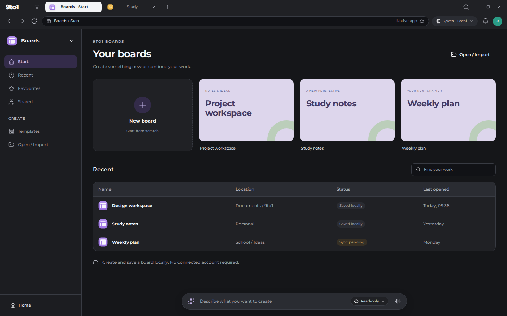
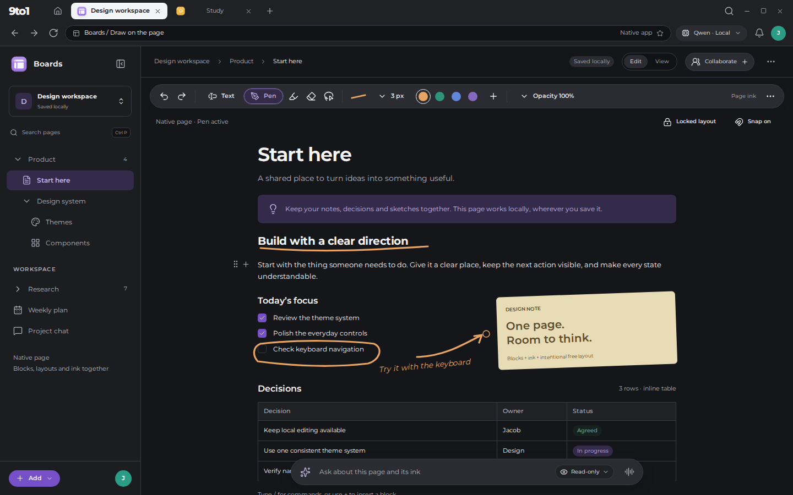
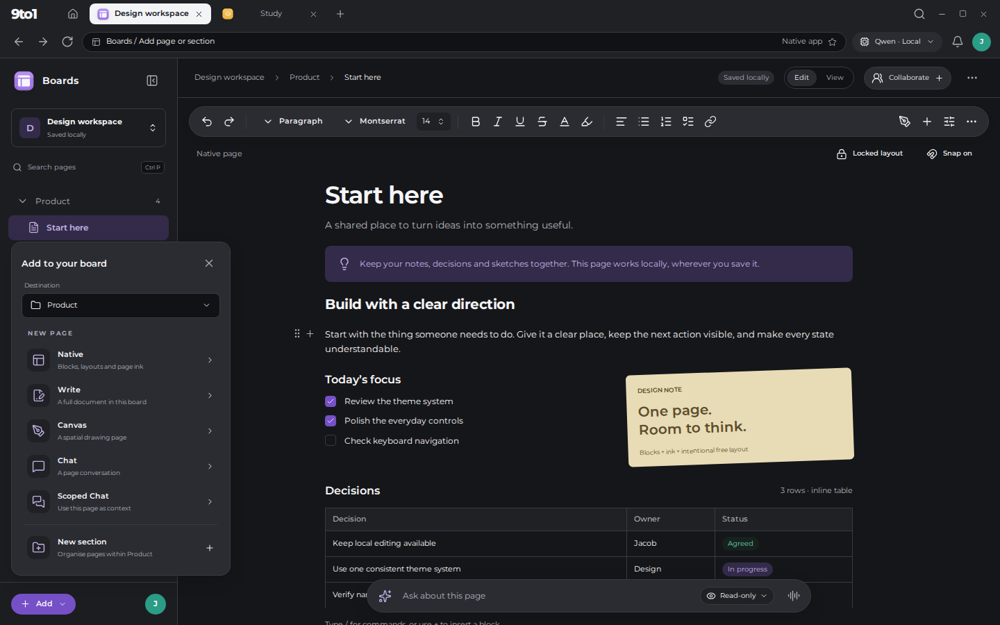
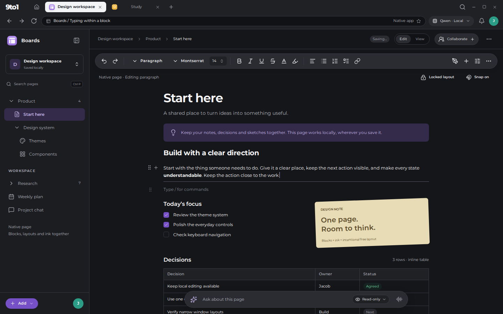
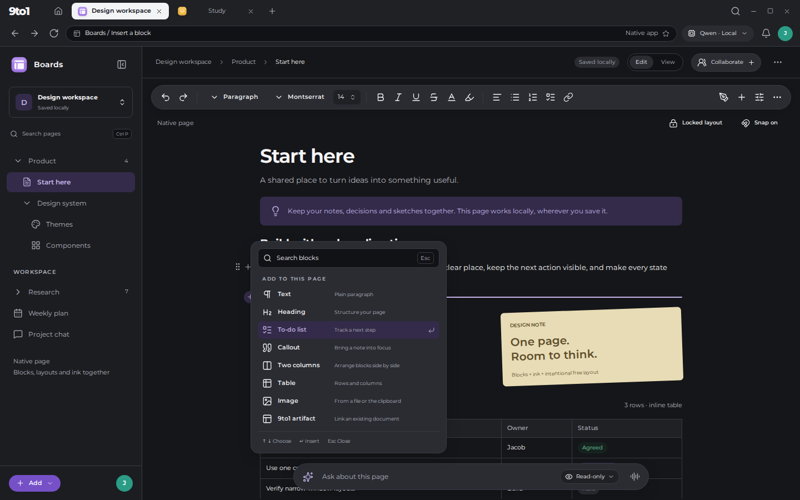
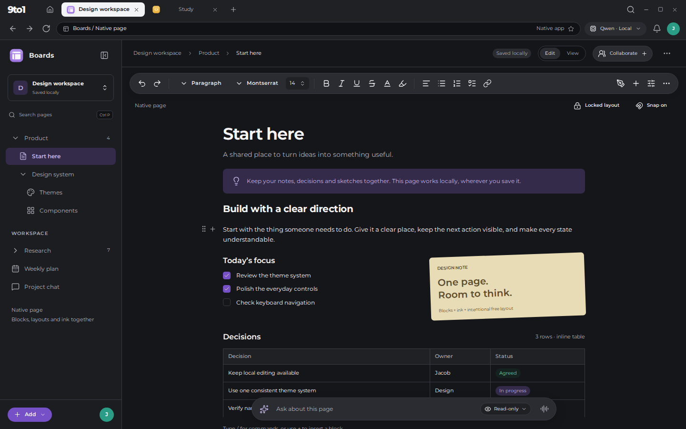
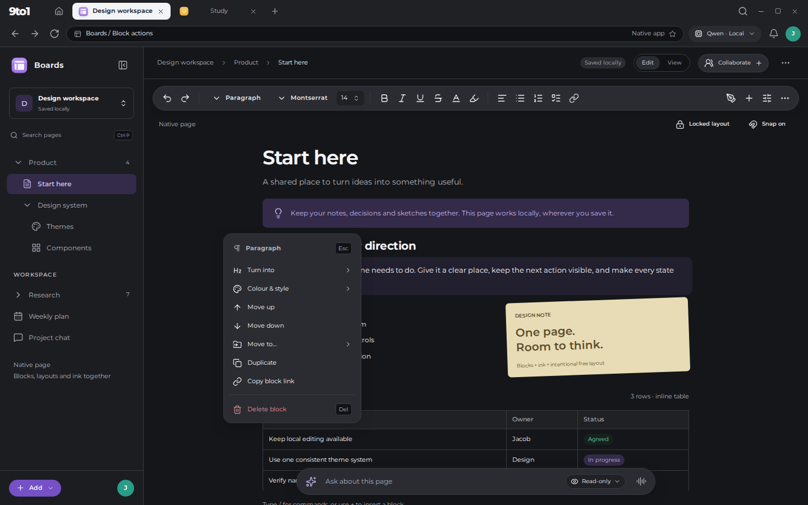
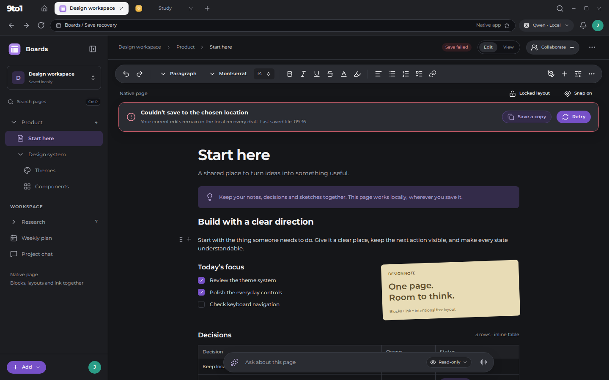
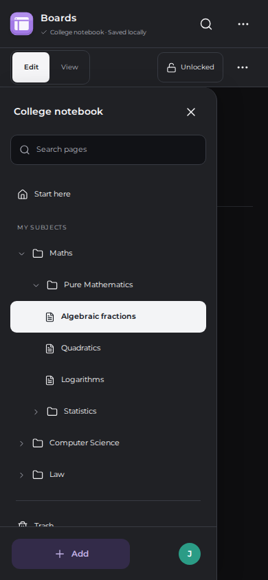

# Boards — seamless pages, blocks and ink

Module ID: `boards` · 9to1 Development Specification v3

## Prerequisites

- **CUI, themes and shared interaction system** — Typed UI components, theme tokens/materials, layout, focus, motion, accessibility and shared control states.
- **Shared productivity engine and canonical embeds** — Real document/object engines, semantic editing, canonical app embedding and donor feature parity.
- **Shared AI controls and artifact collaboration** — Contextual AI bars, shared model/permission controls, global collaborators and typed artifact proposals.
- **Artifacts, local persistence and recovery** — Canonical artifacts, revisions, typed edits, local saves, derived exports, sync and recovery.

## Overview

Boards is a native flexible document workspace combining structured blocks, free placement and ink with nested pages. It must work locally without a Files account or connected cloud provider.

Current owner overrides: V3-OWNER-011.

## Layouts & visible states

- **V3-BOARDS-LAY-01** — Keep a compact board identity/breadcrumb/switcher, nested page tree, bottom Add/avatar and a contextual top floating toolbar. Expose independent Edit/View, Locked and Snap controls.
- **V3-BOARDS-LAY-02** — Represent page creation/type choice, page options, insertion-between-blocks, typing/caret, selected block/drag affordance, free ink and active tool-options states explicitly.
- **V3-BOARDS-LAY-03** — Use a seamless authored surface rather than nesting an unnecessary second app canvas or presenting the page as disconnected generic cards.

## Features & behaviour

- **V3-BOARDS-FEA-01** — Add, rename, nest, reorder, duplicate and remove pages with correct source semantics. Page types embed real canonical app surfaces where supported.
- **V3-BOARDS-FEA-02** — Insert and edit text, lists, media, table/linked blocks, absolute objects and ink with unified selection/undo. Insertion lines and drag grips identify actual block boundaries.
- **V3-BOARDS-FEA-03** — Locked controls constrain movement/layout as defined; View prevents editing; Snap changes manipulation behaviour. Do not collapse all three into one read-only toggle.
- **V3-BOARDS-FEA-04** — Native .9to1board files may live at permitted locations. Local creation and editing must not require sign-in, a mounted Files provider or AI.
- **V3-BOARDS-FEA-05** — Contextual AI and collaborators use typed board/page/block changes with visible review and source ownership.

## Canonical entities & persistence

- **V3-BOARDS-ENT-01** — Persist BoardID, nested PageIDs, block/object/stroke IDs, order/layout coordinates, page type, embed references and revisions.
- **V3-BOARDS-ENT-02** — Store local draft/save and optional external file/sync state separately; embedded source artifacts retain their owning identity.

## Permissions & recovery

- **V3-BOARDS-PER-01** — Detach/remove references without silently deleting the original artifact. Shared-source permission changes show safe placeholders.
- **V3-BOARDS-PER-02** — Recover typed and ink changes after interruption; stale AI edits must not overwrite concurrent page/block changes.

## Acceptance checks

- **V3-BOARDS-ACC-01** — Test local create/open, page Add/type menu, page options, block insertion/typing/drag, pen options and undo/reopen.
- **V3-BOARDS-ACC-02** — Verify Edit/View, Locked and Snap independently, keyboard navigation, canonical embeds and no Files account dependency.

## Exact mock-up and state map

- **Boards · Start** — screen `boards-launch`. Launch.
- **Boards · Draw on the page** — screen `boards-ink`. Page ink.
- **Boards · Add page or section** — screen `boards-add`. Footer Add menu.
- **Boards · Typing within a block** — screen `boards-typing`. Text editing.
- **Boards · Insert a block** — screen `boards-insert`. Insertion catalogue.
- **Boards · Native page** — screen `boards-editor`. Editor.
- **Boards · Block actions** — screen `boards-context`. Selection & menu.
- **Boards · Save recovery** — screen `boards-recovery`. Failure state.
- **Mobile · Boards page drawer** — screen `mobile-boards`. 390 × 844.

## Source clause IDs

UX27-BOARD-001, UX27-BOARD-002, UX27-BOARD-003, UX27-BOARD-004, UX27-BOARD-005, UX27-BOARD-006, UX27-BOARD-007, UX27-BOARD-008, UX27-BOARD-009, UX27-BOARD-010, UX27-BOARD-011, UX27-BOARD-012, UX27-BOARD-013, UX27-BOARD-014, UX27-BOARD-015, UX27-BOARD-016, UX27-BOARD-017, UX27-BOARD-018, UX27-BOARD-019, UX27-BOARD-020, UX27-BOARD-021, UX27-BOARD-022, UX27-BOARD-023, UX27-BOARD-024, UX27-BOARD-025, UX27-BOARD-026, UX27-BOARD-027, UX27-BOARD-028, UX27-BOARD-029, UX27-BOARD-030, UX27-BOARD-031, UX27-BOARD-032, UX27-BOARD-033, UX27-BOARD-034, UX27-BOARD-035, UX27-BOARD-036, UX27-BOARD-037, UX27-BOARD-038, UX27-BOARD-039, UX27-BOARD-040, UX27-BOARD-041, UX27-BOARD-042, UX27-BOARD-043, UX27-BOARD-044, UX27-BOARD-045, UX27-BOARD-046, UX27-BOARD-047, SECTION-02, UX27-TEST-001, UX27-DATAFLOW-001, UX27-TEST-002, UX27-TEST-003, UX27-TEST-004, UX27-TEST-005, UX27-TEST-006, UX27-DATAFLOW-004, UX27-TEST-007, UX27-SHARED-015, UX27-TEST-008, UX27-TEST-009, UX27-DATAFLOW-006, UX27-TEST-010, UX27-SHARED-017, UX27-TEST-011, UX27-SHARED-005, UX27-TEST-012, UX27-TEST-013, UX27-TEST-014, UX27-TEST-015, UX27-TEST-016, UX27-TEST-017, UX27-TEST-018, UX27-TEST-019, UX27-TEST-020, UX27-TEST-021, UX27-TEST-022, UX27-TEST-023, UX27-TEST-024, UX27-TEST-025, UX27-TEST-026, UX27-SHARED-013, UX27-TEST-027, UX27-TEST-028, UX27-SHARED-020, UX27-TEST-029, UX27-TEST-030, UX27-TEST-031, UX27-SHARED-011, UX27-TEST-032, UX27-TEST-033, UX27-TEST-034, UX27-TEST-035, UX27-TEST-036, UX27-TEST-037, UX27-TEST-038, UX27-TEST-039, UX27-TEST-040, UX27-SHARED-012, UX27-TEST-041, UX27-SHARED-018, UX27-TEST-042, UX27-TEST-043, UX27-TEST-044, UX27-TEST-045, UX27-TEST-046, UX27-TEST-047, UX27-TEST-048, UX27-TEST-049

## Technical reading map

- Boards — seamless pages, blocks and ink — Boards — exact shell, navigation and local-first file behaviour; The intended composition (part 01) — `technical/boards-01.md` (2,331 words; V2-B1393, V2-B1394, V2-B1395…).
- Boards — seamless pages, blocks and ink — Backspace/Delete at boundaries; Lists, toggles and nesting (part 02) — `technical/boards-02.md` (2,365 words; V2-B1450, V2-B1451, V2-B1452…).
- Boards — seamless pages, blocks and ink — Compact table interaction, not fifty buttons; Table cell editing and navigation (part 03) — `technical/boards-03.md` (2,387 words; V2-B1502, V2-B1503, V2-B1504…).
- Boards — seamless pages, blocks and ink — Edit and View modes; Locked and Unlocked layout modes (part 04) — `technical/boards-04.md` (2,371 words; V2-B1556, V2-B1557, V2-B1558…).
- Boards — seamless pages, blocks and ink — Embedded artifact ownership and lifecycle; Collaboration and concurrency (part 05) — `technical/boards-05.md` (2,389 words; V2-B1618, V2-B1619, V2-B1620…).
- Boards — seamless pages, blocks and ink — Add page/section chooses the correct destination; Tree focus, expansion and rename (part 06) — `technical/boards-06.md` (2,382 words; V2-B2448, V2-B2449, V2-B2450…).
- Boards — seamless pages, blocks and ink — Merge split and undo without data loss; Image resize crop and missing media (part 07) — `technical/boards-07.md` (550 words; V2-B2603, V2-B2604, V2-B2605…).

Technical clauses retain APIs, data models, platform, recovery, donor and acceptance details. The technical files are part of this module, not optional background reading. Shared prerequisites mean stable service/interface contracts must be available; they do not require every dependent app UI to be complete. Use the named chunk for the relevant subtask or the complete module file for its full retained contract.

# Exact designs and implementation rules

These figures are the exact current atlas compositions. Their stable screen IDs match the Word specification and editable source. Open the atlas for full-size theme and interaction inspection.

## Boards · Start

Screen ID: `boards-launch`. Source: LAUNCH-001–006; Boards Home/start; UX27-AUTH-005 for Boards.

- Start is a separate active view. The editor is not mounted under a welcome banner.
- New, Open, Import, Templates and Recent resolve actual artifact identities. Missing or failed imports receive their own recovery states.
- Direct-open and session restore bypass Start. Returning here preserves the existing document session.

## Boards · Draw on the page

Screen ID: `boards-ink`. Source: Owner revision: preserve the Boards base and add drawing; UX27-BOARD-029–036.

- This is the same Native page and document-space viewport as the text/block editor. Ink is not a second Canvas panel or a raster background.
- Edit + Locked still permits page ink. Layout locking, snap, user Edit/View and AI Read-only/Write remain independent.
- Pen, highlighter, eraser and ink selection occupy the same contextual toolbar. Width, colour and opacity affect new strokes unless existing strokes are selected.
- Pointer capture, pressure fallback, zoom/scroll transforms and one-stroke undo must use the shared editable ink model. Page-level ink retains its coordinates when flow text reflows.
- The orange annotations are authored content. Theme changes restyle the controls and preserve their stored stroke colours.

## Boards · Add page or section

Screen ID: `boards-add`. Source: Owner revision: preserve Boards and show Add; UX27-BOARD-014; Native/Write/Canvas/Chat/Scoped Chat page types.

- The Add popup anchors above the fixed sidebar footer. It creates pages or sections, independently from toolbar Insert and inline block +.
- Destination is explicitly Product here. The canonical page types are Native, Write, Canvas, Chat and Scoped Chat; New section is a separate operation.
- Opening the popup allocates no page. A successful choice creates exactly one entity, reveals it in the tree and focuses its title/editor.
- Escape or an outside click restores focus to Add without modifying the page. At narrow widths this becomes a navigable sheet while retaining the footer entry point.

## Boards · Typing within a block

Screen ID: `boards-typing`. Source: Owner revision: preserve Boards and show typing; UX27-BOARD-016–021 / 028 / 036.

- The caret belongs to one paragraph BlockID. Text selection and keyboard input do not drag the block, paint ink or create a page-sized input frame.
- Enter splits a paragraph into two siblings; Shift+Enter is a soft break within the same block. IME commit is handled before structural Enter.
- The following empty paragraph has its own grip and insertion location. Formatting reflects the current caret/range and preserves valid inline marks.
- Saving… is distinct from Saved locally. A production editor must update that label from actual persistence state and preserve focus during autosave.

## Boards · Insert a block

Screen ID: `boards-insert`. Source: Owner revision: block insertion/options; UX27-BOARD-022–028 / 037–040.

- The visible insertion line is a boundary in the current page BlockTree. Inline +, slash and toolbar Insert share the same registered catalogue and target semantics.
- The highlighted result is a keyboard focus state, not a committed insertion. Search, arrows, Enter and Escape preserve the original text/range.
- Selecting a type replaces only the eligible slash token/empty block or inserts at this boundary; unrelated paragraph content remains intact.
- Content insertion is distinct from footer Add page/section. Tables and embedded artifacts retain shared object semantics and ownership.

## Boards · Native page

Screen ID: `boards-editor`. Source: UX27-BOARD-001–047; UX27-AUTH-005; later owner Boards topology; reference screenshot as defect evidence.

- Use a single seamless native page. Flow blocks, explicitly positioned content and page ink share one surface. No sheet frame or accidental Freeform canvas.
- Sidebar is 256 logical units by default, with 32-unit rows and 16-unit nesting. Board switcher stays above the tree; Add and avatar stay in the fixed footer.
- Edit/View, Locked/Unlocked and AI Read-only/Write are separate dimensions. Locked layout still permits page ink.
- This mock-up defines a 760-unit readable content column, typography and exact spacing. Save As writes an editable .9to1board anywhere permitted.

## Boards · Block actions

Screen ID: `boards-context`. Source: UX27-BOARD grip / block popup / nested navigation contracts; UX27-SHARED popup lifecycle.

- A grip hover reveals a specific block target. Click selects; drag moves only after the pointer threshold.
- The full-row block menu anchors to its target. Escape restores focus and selection; an outside click dismisses the menu.
- The persistent footer Add creates pages/sections. Toolbar Insert and block + add content to the current page.

## Boards · Save recovery

Screen ID: `boards-recovery`. Source: UX27-BOARD-009–014; shared canonical save/recovery state vocabulary.

- Save failure is not an empty page. Preserve edits, last durable revision and the recovery draft.
- Saving locally, saved locally and cloud sync are separate states. This example reports the failed destination without claiming successful file output.
- Retry re-attempts the same save; Save a copy chooses a new destination. Neither silently discards the live document.

## Mobile · Boards page drawer

Screen ID: `mobile-boards`. Source: UX27-BOARD-001–047 topology and nested pages; UX27-SHARED-005, 009–010; UX27-TEST-011–014, 033.

- The narrow layout collapses the nested page sidebar into a named drawer while preserving sections, hierarchy and stable page identities.
- Boards identity remains top-left. The top toolbar retains Edit/View separately from Locked/Unlocked; they describe different constraints.
- The drawer keeps Add and the user area at the bottom. Add opens page/section choices with a destination preview and never moves into a generic header action.
- Drawer navigation uses 44-pixel effective targets, independent internal scrolling and focus containment. Escape, Close or the scrim restores the previous page and initiating focus.
- Opening the drawer preserves page selection, scroll and any AI draft. Themes change appearance without rearranging this topology.
