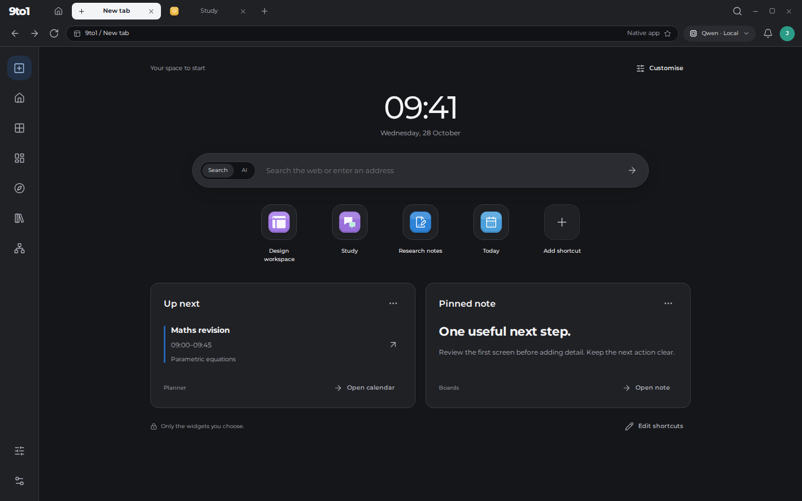
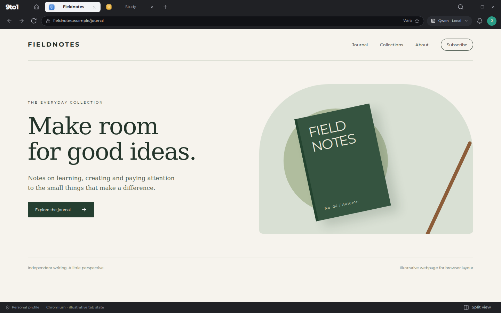
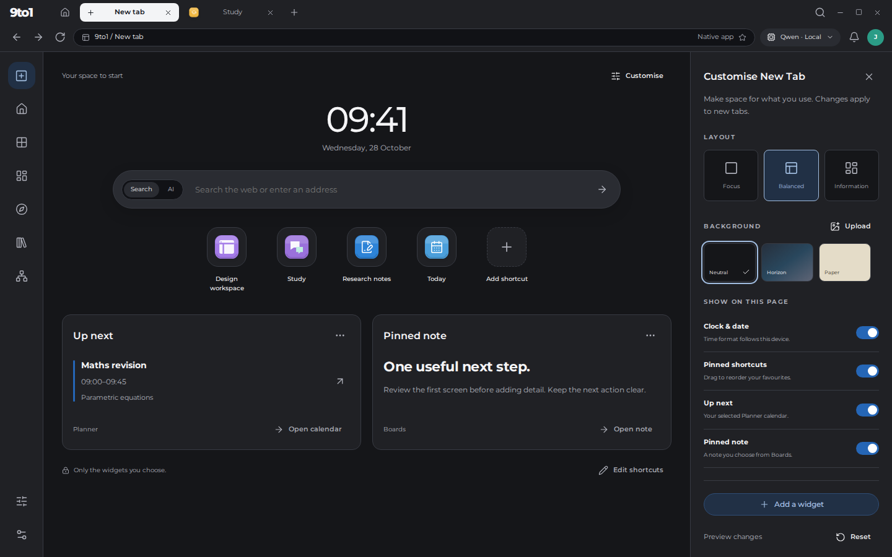
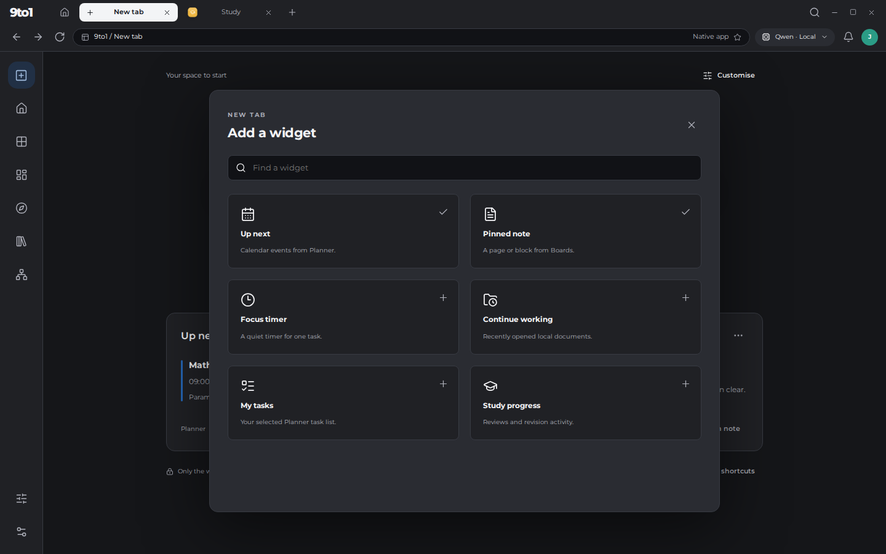

# Browse and the native/browser tab host

Module ID: `browse` · 9to1 Development Specification v3

## Prerequisites

- **Platform, app registry and host integration** — Canonical app registry, artifact routes, native/browser embedding, lifecycle and semantic UI/API parity.
- **CUI, themes and shared interaction system** — Typed UI components, theme tokens/materials, layout, focus, motion, accessibility and shared control states.
- **Go, universal search and entity navigation** — Permission-aware typed search, command/entity resolution and shared Go presentation.

## Overview

Browse provides real web browsing and the shared native-app/browser host. Tabs may contain app surfaces or authentic web engines while preserving isolation, history, profiles and canonical app state.

Current owner overrides: V3-OWNER-004.

## Layouts & visible states

- **V3-BROWSE-LAY-01** — Use the current compact icon rail on New Tab. Keep Apps, Dashboard, Models and New Tab discoverable semantic destinations.
- **V3-BROWSE-LAY-02** — Distinguish native app tabs from web tabs with appropriate address/navigation controls. The default selected tab treatment is the authoritative light surface with dark text.
- **V3-BROWSE-LAY-03** — Global model and Notifications buttons open anchored canonical dropdowns; they must not be simulated copies with conflicting state.

## Features & behaviour

- **V3-BROWSE-FEA-01** — Retain Gecko/Blink engine responsibilities, profiles, browsing controls, downloads and isolation from the original technical contract.
- **V3-BROWSE-FEA-02** — App tabs open the real app and canonical artifact, not a reduced webpage illustration. Closing/restoring tabs preserves drafts and background-task semantics.
- **V3-BROWSE-FEA-03** — New Tab search uses Go/search contracts and explicit default versus AI mode. Address navigation and command invocation remain distinct.

## Canonical entities & persistence

- **V3-BROWSE-ENT-01** — Persist TabID, tab type, target artifact/URL, engine/profile, history and allowed session/view state. Separate web sessions from app permission/context stores.
- **V3-BROWSE-ENT-02** — Restore tabs without replaying submitted commands or external actions.

## Permissions & recovery

- **V3-BROWSE-PER-01** — Enforce browser-origin/profile isolation and per-surface permission boundaries. Embedded pages cannot inherit internal app capabilities by appearance.
- **V3-BROWSE-PER-02** — Handle unsaved native tab close, crashed engine, failed navigation and unavailable artifact with genuine recovery.

## Acceptance checks

- **V3-BROWSE-ACC-01** — Exercise native/web tabs, engine history/profile, New Tab rail, anchored dropdowns and closed-tab restoration.
- **V3-BROWSE-ACC-02** — Verify focus/address routing, no native-tab fake URL assumptions and no loss of unsaved app work.

## Exact mock-up and state map

- **9to1 · New Tab** — screen `host-newtab`. Customisable start page.
- **9to1 · Browser** — screen `host-browser`. Web + native tabs.
- **New Tab · Customisation** — screen `host-newtab-customise`. Layout and widgets.
- **New Tab · Add a widget** — screen `host-newtab-widgets`. Widget picker.

## Source clause IDs

SECTION-04, UX27-HOST-001, UX27-HOST-002, UX27-HOST-003, UX27-HOST-004, UX27-HOST-005, UX27-HOST-006, UX27-HOST-007, UX27-HOST-008, UX27-HOST-009, UX27-TEST-058, UX27-SHARED-016, UX27-TEST-059, UX27-TEST-060, UX27-TEST-061, UX27-TEST-062, UX27-DATAFLOW-004

## Technical reading map

- Browse and the native/browser tab host — Apps; Workspace Apps (part 01) — `technical/browse-01.md` (1,012 words; V2-B0375, V2-B0376, V2-B0377…).
- Browse and the native/browser tab host — Browse; Donor authority and parity (part 02) — `technical/browse-02.md` (2,801 words; V2-B1819).
- Browse and the native/browser tab host — Host; Every advertised app has a real activation path (part 03) — `technical/browse-03.md` (382 words; V2-B2680, V2-B2681, V2-B2682…).

Technical clauses retain APIs, data models, platform, recovery, donor and acceptance details. The technical files are part of this module, not optional background reading. Shared prerequisites mean stable service/interface contracts must be available; they do not require every dependent app UI to be complete. Use the named chunk for the relevant subtask or the complete module file for its full retained contract.

# Retained technical requirements

# Browse and the native/browser tab host — Apps; Workspace Apps (part 01)

Reading status: active retained clauses, subject to the v3 owner overrides listed in the primary module. Historical process instructions and replaced original wording are stored separately.

### V2-B0375 · v2 lines 2084–2085

Apps
Workspace Apps

### V2-B0376 · v2 lines 2087–2088

<!-- UX27:BEGIN SECTION-04 -->
## 4. Haven/9to1 host, browser engines and application launching

### V2-B0377 · v2 lines 2090–2090

### UX27-HOST-001 — One real launch path per advertised surface

### V2-B0378 · v2 lines 2092–2092

**O/B.** Apps navigation, deep links, standalone executables and restored tabs resolve through the canonical application registry. Every listed installed app has a real registered surface and compatible services. Selecting Write, Boards, Present, Mesh or another app must not route to an unregistered placeholder or silently open an older implementation. Missing app/engine packages produce a scoped install/repair path with the requested target retained.

### V2-B0379 · v2 lines 2094–2094

A smoke matrix must open every in-scope advertised app from the actual Home Apps view, not merely instantiate classes in a test host. Record the route, resolved surface, package identity and observed result. One shared launch regression affecting many apps has priority over polishing a single successful scene.

### V2-B0380 · v2 lines 2096–2096

### UX27-HOST-002 — Home and New Tab identity

### V2-B0381 · v2 lines 2098–2098

**B/D.** The Home-icon tab exposes Apps, Dashboard and Models/Discover as distinct sidebar views. New Tab exposes those views plus New Tab. Preserve the selected destination and its filter/scroll state. Apps is an actual catalogue; Dashboard is a source-backed briefing; Models is discovery/configuration; none is a reskinned empty chat screen or a duplicate list pretending to be another product.

### V2-B0382 · v2 lines 2100–2100

Cards have real app icons, one primary name and status where relevant. Selecting an app opens its actual native surface in the intended tab. New-tab creation must not reset the browser profile or manufacture duplicate Home tabs unless requested. Search results distinguish installed, available-to-install and unavailable entries.

### V2-B0383 · v2 lines 2102–2102

### UX27-HOST-003 — Tab selection, closing and overflow

### V2-B0384 · v2 lines 2104–2104

**O/B/D.** Use the owner’s selected-tab light surface/black-text default unless an explicit accent override applies. Each tab has an icon, readable title, close affordance when appropriate and accessible state; overflow is navigable without shrinking every tab to an unusable glyph. Close hit targets must not overlap the neighbouring tab. Reordering previews the real insertion point and commits one organisational change.

### V2-B0385 · v2 lines 2106–2106

Closing an editor tab follows save/recovery semantics and is not permission to cancel an explicitly background-capable run. Middle-click behaviour follows the configured platform/product preference, with no accidental touchpad-region interpretation in application code. Reopen closed tab restores a real target and state, not a new empty document with the same label.

### V2-B0386 · v2 lines 2108–2108

### UX27-HOST-004 — Browser viewport and DPI correctness

### V2-B0387 · v2 lines 2110–2110

**O/B.** Allocate the embedded web view using actual content bounds and physical-pixel backing size appropriate to the current scale. Do not stretch a low-resolution bitmap to fit the window, double-scale CSS/content coordinates, or preserve a stale viewport after sidebar/window changes. Resize and monitor-DPI changes must update the engine’s viewport, rendering surface and input transform together.

### V2-B0388 · v2 lines 2112–2112

Test a known page with text, form fields and scrolling at several window sizes/scales. Check visual sharpness and that pointer hits match rendered targets. A screenshot alone cannot establish correct scroll/input transforms; native interaction evidence is required. Document the active engine/version and whether compositing or offscreen rendering is used.

### V2-B0389 · v2 lines 2114–2114

### UX27-HOST-005 — Wheel, trackpad and browser navigation

### V2-B0390 · v2 lines 2116–2116

**O/B.** Pass wheel deltas to the browser with the correct units, sign and scale exactly once. Small trackpad deltas accumulate smoothly instead of disappearing; a normal wheel notch must not move only an imperceptible amount because a second scaling factor was applied. Horizontal gestures, Ctrl+wheel zoom and ordinary two-finger scroll remain distinct. Back/forward and address changes use actual navigation entries, not simply swap titles.

### V2-B0391 · v2 lines 2118–2118

When a native app tab and web tab share the host, the active target receives input; a hidden web view cannot consume scrolling from Boards. Preserve scroll state for each tab independently. Test with an actual mouse and trackpad where available, and report the device-specific gap otherwise.

### V2-B0392 · v2 lines 2120–2120

### UX27-HOST-006 — Engine switching and failure states

### V2-B0393 · v2 lines 2122–2122

**B/D.** Firefox/Gecko and Chromium/Blink remain separately identified adapters with isolated engine-private profiles. Changing an engine keeps the canonical tab/workspace target while recreating the supported web session; do not promise transfer of live DOM/JavaScript state. Persisted site preferences are inspectable and reversible. When one engine is missing or fails, offer the available authorised alternative or repair path without pretending that a renderer is connected.

### V2-B0394 · v2 lines 2124–2124

A missing Chromium message must not disable local Boards, Write or Present. Preserve the pending URL and user-visible cause. Site authentication/verification failures require compatibility investigation using legitimate browser behaviour; do not bypass CAPTCHA, impersonate security state or weaken site protections to claim success.

### V2-B0395 · v2 lines 2126–2126

### UX27-HOST-007 — Profile/account popup lifecycle

### V2-B0396 · v2 lines 2128–2128

**O/B.** Profile/account menus belong to the current host anchor and follow the shared popup contract. Outside click, Escape and navigation that invalidates the context dismiss them. Switching account/profile shows the actual resulting identity before a consequential operation. A popup left over a different app is a failure even if its buttons still work.

### V2-B0397 · v2 lines 2130–2130

Keep browser profile, 9to1 account and document ownership distinguishable. Changing a browser profile is not permission to copy cookies, credentials or private document context into another profile. Local document availability must not be represented as dependent on an unrelated cloud sign-in.

### V2-B0398 · v2 lines 2132–2132

### UX27-HOST-008 — Session restoration and stale artifacts

### V2-B0399 · v2 lines 2134–2134

**B/D.** Restore typed target identities, current locations and permitted view state. Revalidate current package/provider availability and access. Never persist a short-lived in-process object pointer or one-shot capability as the only reopen data. Show a recoverable unavailable-target card for a missing item, leaving other tabs usable.

### V2-B0400 · v2 lines 2136–2136

A restored board must reopen its saved file/draft and actual page. Reloading the host must not replay AI prompts, external actions, saved graph executions or old permission responses. Test a mixed session with native apps and web pages, restart, and verify each tab independently.

### V2-B0401 · v2 lines 2138–2138

### UX27-HOST-009 — Startup and dependency repair

### V2-B0402 · v2 lines 2140–2140

**B/D.** Render the selected theme immediately and expose the real shell before slow document-dependent regions where safe. Instrument cold launch, warm launch, route activation, dependency discovery and first input separately. A brief truthful loading state is preferable to an unexplained white flash or a hidden window that never becomes interactive.

### V2-B0403 · v2 lines 2142–2143

A failed optional dependency is scoped; a missing required local engine names the package/architecture and supported repair action. Never ask the user to connect accounts to compensate for a missing native drawing library. Installation, repair and restart remain permission-controlled and preserve open work.
<!-- UX27:END SECTION-04 -->

# Browse and the native/browser tab host — Browse; Donor authority and parity (part 02)

Reading status: active retained clauses, subject to the v3 owner overrides listed in the primary module. Historical process instructions and replaced original wording are stored separately.

### V2-B1819 · v2 lines 10522–10617

V3 editorial amendment: V3-OWNER-004. Original wording is preserved in the replacement ledger.

Browse
Browse is the primary app branded “9to1”, incorporating the previous main shell. Each tab can open a website/search or a real native 9to1 app; apps also retain standalone executables. Home is a Home-icon tab with Apps, Dashboard and Models/Discover sidebar views. New Tab exposes those destinations through a compact icon rail alongside its New Tab canvas. Preserve all existing browser engines, the canonical tab/session model, Home Core and app requirements. See the 16 October 2026 delivery directive above.
Donor authority and parity
Firefox donor parity is the minimum supported capability set, not the finished feature ceiling. Unless a feature is explicitly replaced, excluded or made incompatible by an approved 9to1 architecture decision, Browse MUST retain mature Firefox functionality and quality-of-life behaviour.
* Tabs and windows, including restore/reopen behaviour, pinned tabs and normal navigation history.
* Profiles, bookmarks, history, downloads, browsing-data controls, site permissions, privacy/security controls and appropriate password/passkey integration.
* Firefox developer tooling, reader/media functionality, picture-in-picture where donor-supported, accessibility, keyboard navigation, crash/session recovery and mature settings/configuration.
* WebExtension compatibility to the maximum extent supported by the retained Firefox APIs, with unsupported or engine-specific APIs surfaced explicitly rather than silently ignored.
All Firefox proprietary or embedded AI surfaces are non-authoritative and MUST be removed or replaced by Dulche-backed 9to1 surfaces. The agent MUST NOT preserve a Firefox AI sidebar, chatbot, assistant or proprietary AI integration merely for donor parity.
Web engine architecture
Each web BrowserTab selects a WebEngine value of Firefox/Gecko or Chromium/Blink. The normal user-facing choice SHOULD be labelled Firefox and Chromium; implementation and diagnostics MAY additionally expose the underlying Gecko and Blink engine names. Gecko is the default unless the user or a persisted site rule selects Chromium.
Changing a tab between Firefox and Chromium changes the renderer/backend used for the page, not the canonical identity of the tab, workspace or Browse session. Switching engines reloads/reconstructs the document through the selected backend. Engine-private runtime state such as DOM objects, JavaScript heaps and renderer-process memory is not required to transfer.
Browse MUST own canonical higher-level browser entities instead of allowing Gecko and Chromium to directly share raw profile databases. At minimum the architecture must model BrowserProfile, BrowserTab, NavigationEntry, Bookmark, HistoryEntry, Download, SitePermission, Workspace, TabGroup, SplitView, SearchProvider, SiteEnhancer and EnginePreference as typed 9to1-owned entities or equivalent strongly typed contracts.
Gecko and Chromium MUST be isolated internally. They MUST NOT be pointed at the same physical cookie/profile/session database. Engine adapters translate the relevant canonical Browse state into each backend and propagate supported changes back to Browse.
Users MUST be able to use Firefox for this tab, Chromium for this tab, always Firefox for a site/domain, always Chromium for a site/domain, and reset a persisted site engine preference. A broken page SHOULD be switchable to the other engine with one obvious action without opening a separate browser product.
Automatic upstream maintenance
The Firefox/Gecko and Chromium/Blink frameworks MUST be maintained continuously against the latest appropriate upstream release and MUST automatically detect and ingest newer upstream versions when available. A long-lived stale engine is a maintenance defect.
Automatic update does not mean blindly shipping an unvalidated upstream binary. The update pipeline MUST fetch/rebase or reapply maintained 9to1 changes, build the affected engine integration, run Browse compatibility and regression suites, verify CUI integration, engine switching, extension baselines, session/profile isolation, Site Enhancer behaviour, DevTools integration and Dulche browser capabilities, and promote the new engine only after the applicable acceptance gates pass. Security-sensitive upstream releases receive expedited priority. The previous known-good engine build MUST remain rollback-capable until promotion is proven stable.
CUI and URI namespace contract
Browse has four distinct first-class content namespaces. They MUST remain architecturally and security-distinct even when multiple namespaces ultimately render through CUI.
* cui:// — generic CUI-rendered surfaces and extension-defined/custom CUI pages. This is the general CUI namespace and is not synonymous with Browse internals.
* browse:// — Browse-owned internal pages such as browse://newtab, browse://settings, browse://downloads, browse://history, browse://extensions and other Browse-owned management surfaces.
* 9to1:// — native 9to1 application surfaces hosted inside a Browse tab, for example 9to1://Spaces, 9to1://Write or a typed deep link such as 9to1://Write/<resource>. These are the actual application surfaces, not web versions or reduced browser copies.
* https:// and http:// — ordinary web content. User-facing normal web navigation uses these web schemes; Browse-owned, CUI and native-app content MUST NOT masquerade as an HTTP(S) origin.
Internal compatibility plumbing inherited from donors MAY exist only where technically unavoidable, but it MUST NOT be exposed as a competing public routing model. The 9to1 routing contract above is authoritative.
Native 9to1 app surfaces in tabs
Opening 9to1://<App> MUST instantiate the real CUI application surface and the real application services inside the Browse tab. It MUST NOT load a separately implemented web edition, feature-reduced embedded edition or imitation of the app. Responsive layout adaptation is allowed and expected; capability divergence merely because the app is hosted in Browse is not.
9to1:// routes MUST be registered centrally by the application/router registry and support typed deep links to canonical resources where the owning app supports them. A tab title and icon should reflect the actual resource/app instead of exposing an opaque route string as its primary label.
Native tabs and standalone executables MUST use the same app implementation, canonical resources and state. Every specified app retains a working standalone executable, usable without the visible 9to1 host. Opening a resource through either entry point MUST NOT create a disconnected copy.
9to1 native app tabs participate in normal Browse capabilities including tab groups, pinning, workspaces, restore/reopen and Split View. A user can therefore place 9to1://Write with a research document beside an https:// research page, or combine two different native 9to1 apps, without requiring a separate web version of either app.
Profiles and workspaces
Browser profiles are tab-scoped, not window-scoped. Every BrowserTab carries a ProfileID or equivalent profile context, allowing one window, one workspace and one Split View to contain tabs from different profiles simultaneously.
A BrowserProfile is an identity/storage/privacy boundary. Depending on supported configuration, it owns or scopes cookies, login sessions, site storage, site permissions, browsing-data attribution, extensions and extension state, search preferences, Site Enhancers, credentials/passkeys and other profile-specific browser configuration.
A Workspace is an organisational/session construct rather than an identity boundary. A workspace may contain tabs from multiple profiles and owns organisational state such as open tabs, groups, split arrangements, workspace pins and layout. Switching workspace MUST NOT inherently sign the user into or out of websites.
Profile identity MUST be visually discoverable on tabs and in relevant browser UI so the user can tell which account/session context will be used. Consequential actions and Dulche-controlled actions SHOULD make the active profile context clear where confusion could cause the action to occur under the wrong identity.
Changing a tab to another profile MUST reopen/recreate its web session under the destination profile rather than copying authentication material across profile boundaries. Safe navigation/organisation metadata such as URL, group, workspace and split position may be preserved where applicable.
Tabs, groups and placement
Browse MUST provide modern tab management in addition to Firefox donor parity. Tab groups are first-class canonical entities with stable identity, naming, optional colour/icon metadata, collapse/expand state, persistence, restore, drag/drop and movement between windows/workspaces. Dulche and other typed APIs can address a group directly.
Tab-strip placement MUST be a first-class configurable preference with full feature parity in all four orientations:
* Horizontal tabs at the top.
* Horizontal tabs at the bottom.
* Vertical tabs on the left.
* Vertical tabs on the right.
The interface MUST adapt properly to each orientation rather than mechanically moving a top strip. Groups, pinned tabs, profile indicators, drag/reorder, tab search, previews, context menus, engine state where surfaced, close/reopen, Dulche mentions and split operations MUST remain functional in every orientation. Compact/collapsed and appropriate auto-expand behaviours may be provided as configurable presentation options.
Split View
Split View displays two independent BrowserTab entities side-by-side in one browser content area with a resizable divider. The split container owns presentation only; each pane remains a real tab with its own URL/route, navigation history, profile, renderer/backend where applicable and canonical tab identity.
A split may mix any compatible tab surface classes, including web + web, 9to1 app + web, 9to1 app + 9to1 app, Browse internal + web and tabs from different BrowserProfiles. Either pane can be swapped, unsplit or moved without destroying the underlying tab.
The two-pane experience is the required baseline. The architecture SHOULD avoid assumptions that make future multi-pane layouts impossible, but more than two panes is not required unless separately specified.
New Tab canvas
browse://newtab remains a customisable CUI-native canvas: add, remove, move, resize and configure components. Profile persistence and configured workspace overrides remain. Share Home’s Apps, Dashboard and Models/Discover sidebar, plus a New Tab view.
The canvas can host deterministic widgets, browser widgets, 9to1 app widgets, extension-provided CUI widgets, static content and Generative Areas. It SHOULD reuse shared 9to1 canvas/layout infrastructure where practical instead of creating an incompatible bespoke layout system.
A Generative Area is a persistent container defined by a natural-language instruction, for example 'put some YouTube videos here for me to watch' or 'show my upcoming deadlines'. It stores the instruction/configuration, not merely one frozen model answer. It may refresh manually, on New Tab open or on an allowed schedule and may expose source restrictions, maximum item count, presentation style and network/Dulche permissions.
Generative Areas MUST resolve real canonical entities when the requested content refers to tabs, Files, events, 9to1 objects or other structured data. They MUST NOT fabricate canonical objects merely to fill a container. Generated/recommended content SHOULD remain distinguishable from deterministic widget output.
Search and AI entry
The primary New Tab/address search entry MUST expose two explicit modes: Search and AI. Search is the default. The active mode is clearly visible and switchable quickly, including by keyboard.
Search mode performs normal navigation/search behaviour and MUST NOT invoke an LLM merely to execute an ordinary URL or provider query. AI mode sends the request to Dulche and can use permissioned Browse capabilities and referenced browser/app context.
Browse MUST support a typed SearchProvider contract and allow the user to configure a default provider plus an optional secondary provider. Providers may supply query construction, suggestions and declared privacy/capability metadata. Extension-defined providers may participate through the same contract.
Browse MUST support searching two providers at once. Dual-provider search creates one real tab per provider for the same query and places those tabs into the standard Split View, one provider per pane. This MUST reuse normal BrowserTab and SplitView infrastructure rather than a bespoke dual-search renderer. Single-provider search remains the normal default unless the user configures otherwise.
Dulche browser experience
Dulche is the only authoritative AI system in Browse. Firefox-provided proprietary AI surfaces MUST be removed/replaced. Browse SHOULD provide both a persistent Dulche sidebar for larger tasks and a lightweight floating/command bar for contextual requests, using the shared Dulche runtime rather than launching a browser-specific model server.
The Dulche UI MUST support @-mentioning canonical browser context. At minimum users can mention tabs and SHOULD be able to mention tab groups, workspaces, split panes and other supported Browse entities. Mention autocomplete resolves to stable canonical IDs rather than copying only titles/URLs into the prompt.
Examples include comparing @Durham with @York, summarising all tabs in @Coursework, or asking Dulche to use a referenced 9to1://Write document together with an https:// research tab. Where the referenced surface is a native 9to1 app, Dulche MUST use that app's semantic APIs rather than screen-scraping its CUI.
Permissioned autonomous browsing
With explicit user permission, Dulche can autonomously operate Browse for a task. A request such as 'scroll through YouTube and pick out some good videos' may inspect visible/accessible results, scroll, open candidates, compare them and return recommendations without requiring confirmation for every benign intermediate interaction.
Permission scope MUST be explicit and composable. The implementation must support equivalents of read this page, control this tab, control these selected tabs and control Browse for this task. Granting one scope MUST NOT silently grant permanent global browser control.
Browser automation SHOULD use structured semantic capabilities such as Navigate, OpenTab, CloseTab, ActivateTab, ReadPage, ReadElement, Find, Scroll, Click, FillField, SelectOption, GoBack, GoForward and Reload when structured control exists. Blind coordinate input is a fallback, not the primary architecture.
Consequential external actions remain governed by the shared 9to1 permission/confirmation policy. Purchases, publishing/sending, destructive account changes, security changes, credential disclosure/entry and comparable external side effects MUST NOT become implicitly authorised merely because Dulche was permitted to browse.
Extensions and CUI extension surfaces
Firefox/WebExtension compatibility MUST be retained to the maximum practical extent. Because a tab may use Firefox/Gecko or Chromium/Blink, extension capability MUST be explicit. An extension may be Gecko-compatible, Chromium-compatible through supported adapters, compatible with both, Browse/CUI-only, partially compatible or unsupported in the active engine.
Switching one tab to Chromium MUST NOT silently uninstall an extension, disable it globally or make it disappear. Engine-specific limitations MUST be surfaced predictably.
Extensions can register supported CUI surfaces using cui:// routing and the extension CUI API, including settings pages, dashboards, sidebars, tool panels, New Tab components or other permitted custom pages. CUI rendering permission does not imply unrestricted Browse or 9to1 internal access; capabilities remain sandboxed and permission-scoped.
Site Enhancer
Browse MUST provide a first-class Site Enhancer feature inspired by mature site-customisation systems such as Arc Boosts while remaining a 9to1-native capability. A SiteEnhancer is a versioned, enable/disable-able canonical object associated with one or more domain/site match patterns.
Site Enhancers can define supported visual customisation such as colours, typography, spacing/layout adjustments, element visibility, backgrounds and custom CSS, plus controlled client-side behaviour/scripts where explicitly supported. They must declare permissions/capabilities and execute within a defined safety boundary.
Dulche can help create or modify a Site Enhancer from natural language, for example 'make YouTube less cluttered and hide Shorts'. Dulche MUST present the proposed effect/permissions at the appropriate confirmation boundary rather than silently installing arbitrary persistent scripts. Extensions may provide Site Enhancers through the same permissioned model.
Files, drag/drop and cross-app integration
Browse retains a mature Download entity/lifecycle while completed files integrate with the shared Files system so reveal/open/share/drag workflows use canonical 9to1 file semantics. Interrupted downloads, retries and completion state remain visible and recoverable.
Split panes and tabs SHOULD support semantic drag/drop. Where both surfaces understand a canonical 9to1 entity, transfer the typed entity/link instead of degrading it to copied text. Examples include dragging a Maps place into Planner or a Board item into Write. Web upload targets may receive files through normal browser security/permission rules.
Sites can open project previews in Browse and Browse development context can offer Open project in Sites/Open source in Dev when the page is linked to a local project. Dev can launch localhost/development targets directly into Browse. Mature Firefox developer tools MUST be retained/adapted rather than replaced by a feature-poor custom inspector.
Security and origin isolation
cui://, browse:// and 9to1:// are privileged/non-web namespaces with separate routing and origin/capability rules. Ordinary HTTP(S) pages MUST NOT be able to inspect native app state, call privileged CUI/Browse APIs, forge trusted 9to1:// content or inherit internal permissions simply by navigating to or linking an internal route.
A web page may request navigation to an allowed registered internal route only through the normal navigation/policy boundary. Navigating to 9to1:// does not grant the originating site the destination app's authority. Profile cookies/credentials and engine-private state MUST remain isolated according to their owning profile/backend.
Recovery and degraded states
Browse MUST handle Firefox renderer crashes, Chromium renderer crashes, whole-browser crashes, failed engine startup, unavailable selected engines, extension incompatibility, interrupted downloads, invalid/corrupt engine-private state and failed engine switches without corrupting the other engine or canonical Browse profile state.
Session recovery SHOULD restore tabs, groups, workspaces, split arrangements, ProfileID and per-tab engine preference wherever safe. If a preferred engine is unavailable, Browse MUST surface the degraded state and offer a safe fallback rather than silently losing the tab or rewriting profile data.
Browse acceptance requirements
* Firefox donor parity remains present except for explicit 9to1 replacements/exclusions; proprietary Firefox AI surfaces are replaced by Dulche.
* Gecko-default and Chromium alternative rendering work within one canonical Browse tab/session model, with engine/profile isolation and per-site engine rules.
* Both upstream engine frameworks can update automatically through validated build/test/promotion and rollback pipelines.
* cui://, browse://, 9to1:// and HTTP(S) routes resolve to the correct security/content surface, including real native 9to1 app rendering inside tabs.
* Profiles can be mixed per tab, per workspace and inside Split View without cross-profile cookie/session leakage.
* Tab groups, split tabs and top/bottom/left/right tab-strip placement retain equivalent core functionality.
* browse://newtab provides the customisable widget/generative canvas, Search/AI switch and dual-provider split search.
* Dulche @ mentions resolve to canonical browser/app entities and permissioned autonomous browsing uses semantic browser capabilities with consequential-action safeguards.
* Extension compatibility states, extension CUI surfaces and Site Enhancer permissions behave explicitly and recoverably.
* Crash/session recovery preserves canonical Browse state and a failure in one renderer does not corrupt the other renderer/profile state.

# Browse and the native/browser tab host — Host; Every advertised app has a real activation path (part 03)

Reading status: active retained clauses, subject to the v3 owner overrides listed in the primary module. Historical process instructions and replaced original wording are stored separately.

### V2-B2680 · v2 lines 14529–14529

## Host

### V2-B2681 · v2 lines 14531–14531

### UX27-TEST-058 — Every advertised app has a real activation path

### V2-B2682 · v2 lines 14533–14533

**Requirements:** UX27-HOST-001, UX27-SHARED-016 · **Status:** NOT RUN

### V2-B2683 · v2 lines 14535–14535

**Given:** Inventory of visible app entries with expected routed surface/build.

### V2-B2684 · v2 lines 14537–14539

**When:**
1. Launch each advertised in-scope app from Apps, direct route and standalone executable where specified.
2. Record source/build and instantiated owning surface.

### V2-B2685 · v2 lines 14541–14544

**Then:**
- No fake success or launch-only placeholder.
- Actual activated source matches the built candidate.
- A failing optional app is isolated and its missing dependency is actionable.

### V2-B2686 · v2 lines 14546–14546

### UX27-TEST-059 — Home and New Tab retain distinct identity

### V2-B2687 · v2 lines 14548–14548

**Requirements:** UX27-HOST-002, UX27-HOST-003 · **Status:** NOT RUN

### V2-B2688 · v2 lines 14550–14550

**Given:** Mixed native/web tab session with Home and New Tab.

### V2-B2689 · v2 lines 14552–14554

**When:**
1. Switch Apps/Dashboard/Models and New Tab views.
2. Create/select/close tabs and overflow a long tab row.

### V2-B2690 · v2 lines 14556–14559

**Then:**
- Correct view/selection is visible with readable selected-tab contrast.
- Home/New Tab do not become duplicate nested shells.
- Closing follows dirty-state protection and moves focus predictably.

### V2-B2691 · v2 lines 14561–14561

### UX27-TEST-060 — Chromium viewport and scrolling

### V2-B2692 · v2 lines 14563–14563

**Requirements:** UX27-HOST-004, UX27-HOST-005 · **Status:** NOT RUN

### V2-B2693 · v2 lines 14565–14565

**Given:** A supported real browser engine and test page with known geometry/scroll markers.

### V2-B2694 · v2 lines 14567–14569

**When:**
1. Resize and change display scale.
2. Use mouse wheel and trackpad in both axes; zoom and navigate.

### V2-B2695 · v2 lines 14571–14574

**Then:**
- Page is sharp and proportioned with accurate hit targets.
- Scroll direction and magnitude follow settings, with no double scaling.
- No security/CAPTCHA bypass is used as an alleged rendering fix.

### V2-B2696 · v2 lines 14576–14576

### UX27-TEST-061 — Missing engine does not disable native apps

### V2-B2697 · v2 lines 14578–14578

**Requirements:** UX27-HOST-006, UX27-HOST-009 · **Status:** NOT RUN

### V2-B2698 · v2 lines 14580–14580

**Given:** Browser engine deliberately unavailable in a disposable installation.

### V2-B2699 · v2 lines 14582–14583

**When:**
1. Open a web page, then a local Board and Present document.

### V2-B2700 · v2 lines 14585–14588

**Then:**
- Web failure names the unavailable engine and supported repair route.
- Native editors remain usable.
- No fabricated web screenshot or mandatory account connection hides the missing engine.

### V2-B2701 · v2 lines 14590–14590

### UX27-TEST-062 — Mixed session restore and failing target isolation

### V2-B2702 · v2 lines 14592–14592

**Requirements:** UX27-HOST-008, UX27-DATAFLOW-004 · **Status:** NOT RUN

### V2-B2703 · v2 lines 14594–14594

**Given:** Saved session with a board, deck, website and one missing local file.

### V2-B2704 · v2 lines 14596–14599

**When:**
1. Restart the host.
2. Reopen valid tabs and inspect the failed target.
3. Verify pending action logs.

### V2-B2705 · v2 lines 14601–14604

**Then:**
- Valid tabs restore stable identity and state.
- Missing file gets Locate/recovery rather than blocking the whole shell.
- Prior AI/Automation actions are not replayed just because tabs restore.

# Exact designs and implementation rules

These figures are the exact current atlas compositions. Their stable screen IDs match the Word specification and editable source. Open the atlas for full-size theme and interaction inspection.

## 9to1 · New Tab

Screen ID: `host-newtab`. Source: Owner revision 28 October supersedes full-width New Tab sidebar; UX27-HOST-002.

- New Tab uses an icon-only rail with accessible names and hover labels.
- Search remains the default; AI is an explicit separate destination.
- Layout, background, shortcuts and individual widgets are customisable independently of Home Dashboard.
- Source freshness and unavailable widget data must remain visible in the implementation.

## 9to1 · Browser

Screen ID: `host-browser`. Source: UX27-HOST-001–009; Browse browser surfaces.

- Web and native-app tabs coexist. The visible web address, engine and browser profile belong to the selected tab.
- The page shown is an authored example site, not a retrieved live page. Page content remains outside the CUI theme boundary.
- Back/forward, address search and tab overflow remain usable. Engine failure should affect only dependent web content.

## New Tab · Customisation

Screen ID: `host-newtab-customise`. Source: Owner revision 28 October; New Tab widget preference model.

- New Tab uses an icon-only navigation rail with accessible names and hover labels.
- Layout, background, shortcuts and individual widgets are separately configurable. These choices never edit Home Dashboard.
- New Tab controls update this local design preview immediately. Production persists them as user preferences and restores keyboard focus.
- Widget sources are explicit. A pinned note references its canonical Boards content rather than copying it.

## New Tab · Add a widget

Screen ID: `host-newtab-widgets`. Source: Owner revision 28 October; Browse New Tab widget catalogue.

- Adding a widget is an explicit action. Search filters the widget catalogue.
- Each widget identifies its data owner and asks for only its required source access.
- Move, resize, hide and remove are separate editing affordances. Removing a widget does not delete its source object.
