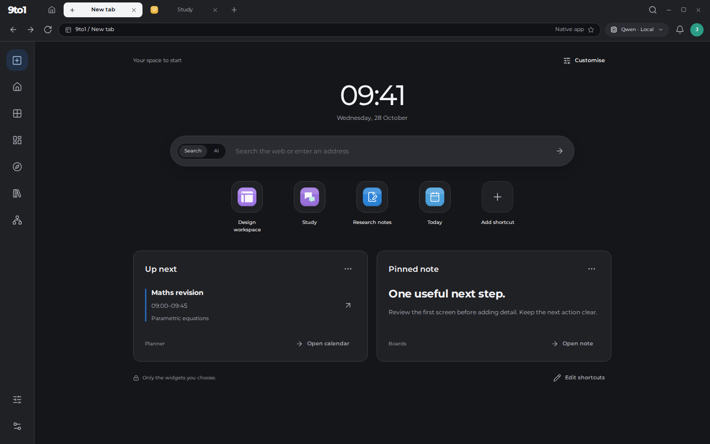
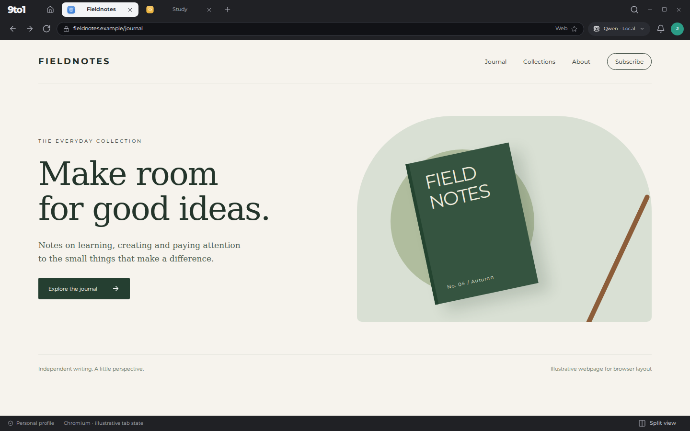
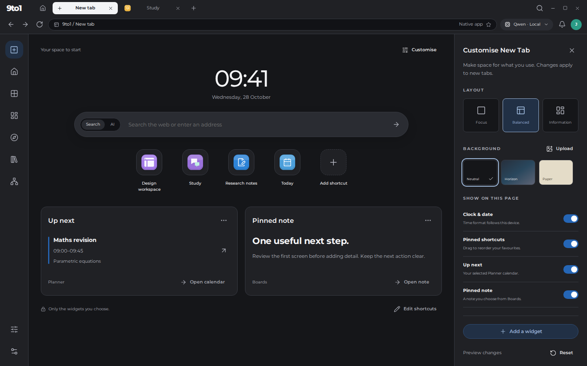
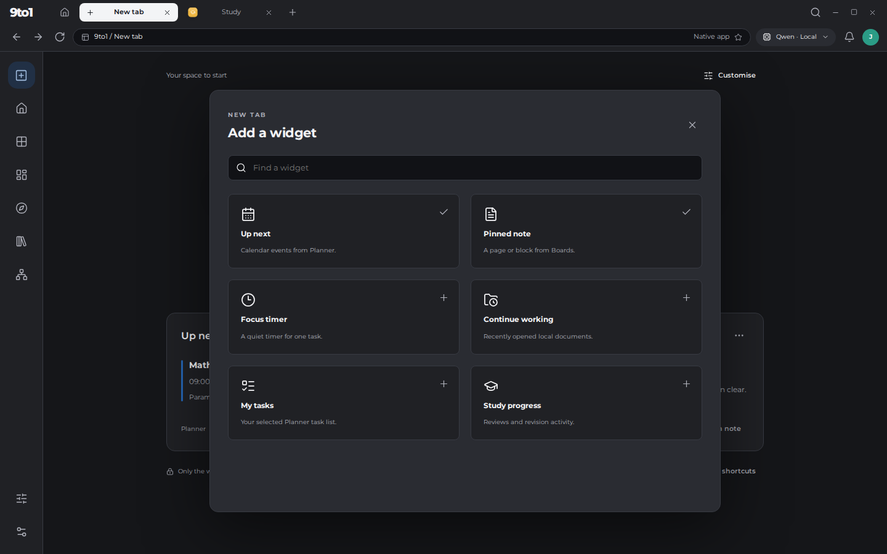

# Browse and the native/browser tab host

Module ID: `browse` · 9to1 Development Specification v3

## Prerequisites

- **Platform, app registry and host integration** — Canonical app registry, artifact routes, native/browser embedding, lifecycle and semantic UI/API parity.
- **CUI, themes and shared interaction system** — Typed UI components, theme tokens/materials, layout, focus, motion, accessibility and shared control states.
- **Go, universal search and entity navigation** — Permission-aware typed search, command/entity resolution and shared Go presentation.

## Overview

Browse provides real web browsing and the shared native-app/browser host. Tabs may contain app surfaces or authentic web engines while preserving isolation, history, profiles and canonical app state.

Current owner overrides: V3-OWNER-004.

## Layouts & visible states

- **V3-BROWSE-LAY-01** — Use the current compact icon rail on New Tab. Keep Apps, Dashboard, Models and New Tab discoverable semantic destinations.
- **V3-BROWSE-LAY-02** — Distinguish native app tabs from web tabs with appropriate address/navigation controls. The default selected tab treatment is the authoritative light surface with dark text.
- **V3-BROWSE-LAY-03** — Global model and Notifications buttons open anchored canonical dropdowns; they must not be simulated copies with conflicting state.

## Features & behaviour

- **V3-BROWSE-FEA-01** — Retain Gecko/Blink engine responsibilities, profiles, browsing controls, downloads and isolation from the original technical contract.
- **V3-BROWSE-FEA-02** — App tabs open the real app and canonical artifact, not a reduced webpage illustration. Closing/restoring tabs preserves drafts and background-task semantics.
- **V3-BROWSE-FEA-03** — New Tab search uses Go/search contracts and explicit default versus AI mode. Address navigation and command invocation remain distinct.

## Canonical entities & persistence

- **V3-BROWSE-ENT-01** — Persist TabID, tab type, target artifact/URL, engine/profile, history and allowed session/view state. Separate web sessions from app permission/context stores.
- **V3-BROWSE-ENT-02** — Restore tabs without replaying submitted commands or external actions.

## Permissions & recovery

- **V3-BROWSE-PER-01** — Enforce browser-origin/profile isolation and per-surface permission boundaries. Embedded pages cannot inherit internal app capabilities by appearance.
- **V3-BROWSE-PER-02** — Handle unsaved native tab close, crashed engine, failed navigation and unavailable artifact with genuine recovery.

## Acceptance checks

- **V3-BROWSE-ACC-01** — Exercise native/web tabs, engine history/profile, New Tab rail, anchored dropdowns and closed-tab restoration.
- **V3-BROWSE-ACC-02** — Verify focus/address routing, no native-tab fake URL assumptions and no loss of unsaved app work.

## Exact mock-up and state map

- **9to1 · New Tab** — screen `host-newtab`. Customisable start page.
- **9to1 · Browser** — screen `host-browser`. Web + native tabs.
- **New Tab · Customisation** — screen `host-newtab-customise`. Layout and widgets.
- **New Tab · Add a widget** — screen `host-newtab-widgets`. Widget picker.

## Source clause IDs

SECTION-04, UX27-HOST-001, UX27-HOST-002, UX27-HOST-003, UX27-HOST-004, UX27-HOST-005, UX27-HOST-006, UX27-HOST-007, UX27-HOST-008, UX27-HOST-009, UX27-TEST-058, UX27-SHARED-016, UX27-TEST-059, UX27-TEST-060, UX27-TEST-061, UX27-TEST-062, UX27-DATAFLOW-004

## Technical reading map

- Browse and the native/browser tab host — Apps; Workspace Apps (part 01) — `technical/browse-01.md` (1,012 words; V2-B0375, V2-B0376, V2-B0377…).
- Browse and the native/browser tab host — Browse; Donor authority and parity (part 02) — `technical/browse-02.md` (2,801 words; V2-B1819).
- Browse and the native/browser tab host — Host; Every advertised app has a real activation path (part 03) — `technical/browse-03.md` (382 words; V2-B2680, V2-B2681, V2-B2682…).

Technical clauses retain APIs, data models, platform, recovery, donor and acceptance details. The technical files are part of this module, not optional background reading. Shared prerequisites mean stable service/interface contracts must be available; they do not require every dependent app UI to be complete. Use the named chunk for the relevant subtask or the complete module file for its full retained contract.

# Exact designs and implementation rules

These figures are the exact current atlas compositions. Their stable screen IDs match the Word specification and editable source. Open the atlas for full-size theme and interaction inspection.

## 9to1 · New Tab

Screen ID: `host-newtab`. Source: Owner revision 28 October supersedes full-width New Tab sidebar; UX27-HOST-002.

- New Tab uses an icon-only rail with accessible names and hover labels.
- Search remains the default; AI is an explicit separate destination.
- Layout, background, shortcuts and individual widgets are customisable independently of Home Dashboard.
- Source freshness and unavailable widget data must remain visible in the implementation.

## 9to1 · Browser

Screen ID: `host-browser`. Source: UX27-HOST-001–009; Browse browser surfaces.

- Web and native-app tabs coexist. The visible web address, engine and browser profile belong to the selected tab.
- The page shown is an authored example site, not a retrieved live page. Page content remains outside the CUI theme boundary.
- Back/forward, address search and tab overflow remain usable. Engine failure should affect only dependent web content.

## New Tab · Customisation

Screen ID: `host-newtab-customise`. Source: Owner revision 28 October; New Tab widget preference model.

- New Tab uses an icon-only navigation rail with accessible names and hover labels.
- Layout, background, shortcuts and individual widgets are separately configurable. These choices never edit Home Dashboard.
- New Tab controls update this local design preview immediately. Production persists them as user preferences and restores keyboard focus.
- Widget sources are explicit. A pinned note references its canonical Boards content rather than copying it.

## New Tab · Add a widget

Screen ID: `host-newtab-widgets`. Source: Owner revision 28 October; Browse New Tab widget catalogue.

- Adding a widget is an explicit action. Search filters the widget catalogue.
- Each widget identifies its data owner and asks for only its required source access.
- Move, resize, hide and remove are separate editing affordances. Removing a widget does not delete its source object.
