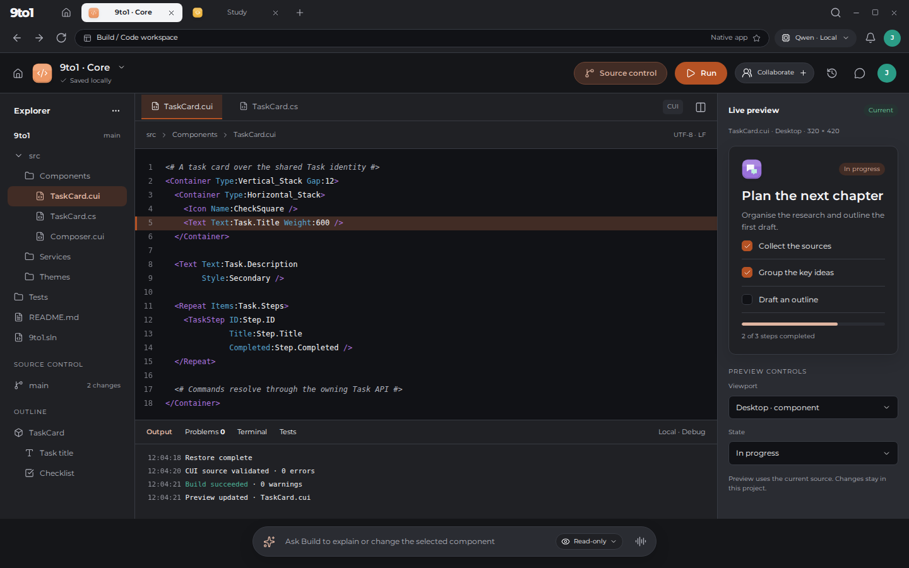
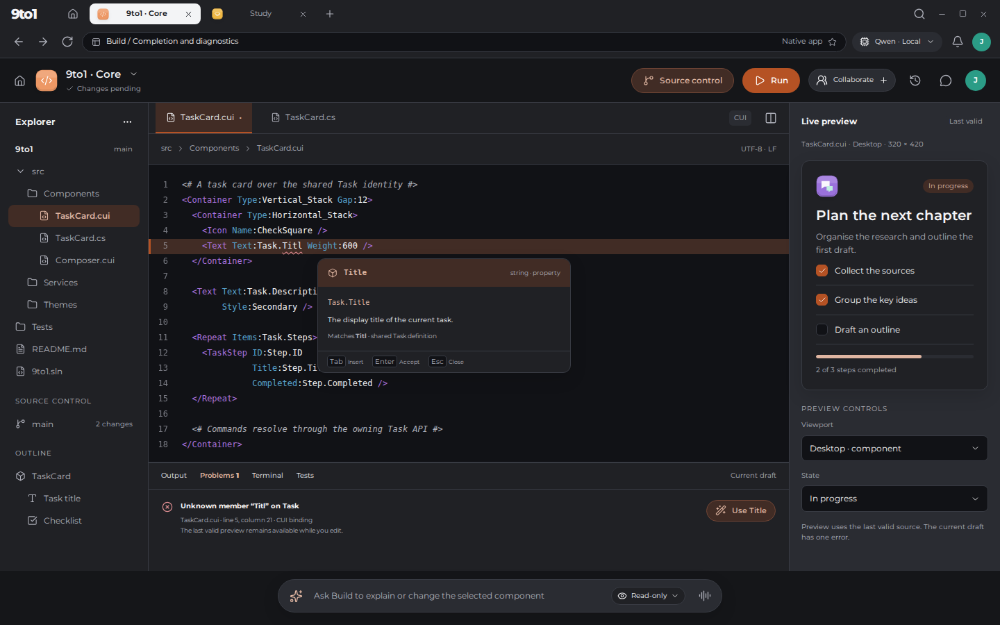

# Build Code — development environment

Module ID: `build-code` · 9to1 Development Specification v3

## Prerequisites

- **CUI, themes and shared interaction system** — Typed UI components, theme tokens/materials, layout, focus, motion, accessibility and shared control states.
- **Artifacts, local persistence and recovery** — Canonical artifacts, revisions, typed edits, local saves, derived exports, sync and recovery.
- **Permissions, approvals and execution scope** — Effective scoped grants, action approvals, policy intersections, revocation and audit.
- **Shared AI controls and artifact collaboration** — Contextual AI bars, shared model/permission controls, global collaborators and typed artifact proposals.

## Overview

Build Code is the full code-development domain within Build, sharing canonical project state with Sites and Stacks. It retains real language, build, debug, test and UI-builder capabilities from the supplied technical specification.

## Layouts & visible states

- **V3-BUILD-CODE-LAY-01** — Use project/file tree, editor tabs, genuine code area/gutter, run/debug controls and bounded diagnostics/output/terminal panels. Show autocomplete at the caret with applicable detail and keyboard selection.
- **V3-BUILD-CODE-LAY-02** — Diagnostics identify actual file/range/severity and a real problem list. Suggested fixes expose the target change rather than silently rewriting files.

## Features & behaviour

- **V3-BUILD-CODE-FEA-01** — Integrate language services, completion, navigation, formatting, refactoring, diagnostics, build/test/debug and source control through real engines.
- **V3-BUILD-CODE-FEA-02** — CUI visual building and code are representations of the same application/project; bindings and generated edits must remain inspectable. Invalid hot reload retains the last valid preview with an error state.
- **V3-BUILD-CODE-FEA-03** — AI coding produces revision-bound change sets/diffs with validation and applicable approval. Terminal execution uses the actual selected session/target and remains separately authorised.

## Canonical entities & persistence

- **V3-BUILD-CODE-ENT-01** — Persist ProjectID, file/resource IDs, source revisions, diagnostics/build/test results and run/debug session references. Files remain canonical across Code/Sites/Stacks.
- **V3-BUILD-CODE-ENT-02** — Editor tabs/caret/folds/selection are view state; working-tree changes, commits and deployment artifacts are separate.

## Permissions & recovery

- **V3-BUILD-CODE-PER-01** — Respect workspace/file permissions, secrets and tool execution scope. A valid patch is not automatic permission to run external commands or deploy.
- **V3-BUILD-CODE-PER-02** — Recover dirty buffers and failed builds/tests without erasing user changes. Rebase/reconcile stale AI diffs against the current project revision.

## Acceptance checks

- **V3-BUILD-CODE-ACC-01** — Test completion/diagnostic navigation, code→valid preview, invalid hot reload, build/test/debug and dirty buffer recovery.
- **V3-BUILD-CODE-ACC-02** — Verify patch review/accept/reject, actual file changes, target-aware terminal and shared project identity with Sites/Stacks.

## Exact mock-up and state map

- **Build · Code workspace** — screen `build-code`. Code.
- **Build · Completion and diagnostics** — screen `build-code-diagnostics`. Editor · invalid draft.

## Source clause IDs

UX27-BUILD-001, UX27-BUILD-002, UX27-BUILD-003, UX27-BUILD-004, UX27-BUILD-005, UX27-BUILD-006, UX27-BUILD-007, SECTION-07, UX27-TEST-076, UX27-TEST-077, UX27-TEST-078

## Technical reading map

- Build Code — development environment — Build/Dev, Sites and Stacks — explicit developer workflows; Adaptive product, retained domains (part 01) — `technical/build-code-01.md` (658 words; V2-B1686, V2-B1687, V2-B1688…).
- Build Code — development environment — Developer Apps; Dev (part 02) — `technical/build-code-02.md` (4,982 words; V2-B1707).
- Build Code — development environment — Build; One canonical project across editing surfaces (part 03) — `technical/build-code-03.md` (202 words; V2-B2773, V2-B2774, V2-B2775…).

Technical clauses retain APIs, data models, platform, recovery, donor and acceptance details. The technical files are part of this module, not optional background reading. Shared prerequisites mean stable service/interface contracts must be available; they do not require every dependent app UI to be complete. Use the named chunk for the relevant subtask or the complete module file for its full retained contract.

# Retained technical requirements

# Build Code — development environment — Build/Dev, Sites and Stacks — explicit developer workflows; Adaptive product, retained domains (part 01)

Reading status: active retained clauses, subject to the v3 owner overrides listed in the primary module. Historical process instructions and replaced original wording are stored separately.

### V2-B1686 · v2 lines 8728–8728

## 7. Build/Dev, Sites and Stacks — explicit developer workflows

### V2-B1687 · v2 lines 8730–8730

### UX27-BUILD-001 — Adaptive product, retained domains

### V2-B1688 · v2 lines 8732–8732

**O/B.** Build integrates Dev, Sites and Stacks functions while preserving each canonical project/domain model. The same project can move between code editing, visual site/CUI editing, source review, build/test and deployment without copied shadow projects. The navigation communicates the active project, environment and source revision, and changes its tool surfaces according to the current artifact type.

### V2-B1689 · v2 lines 8734–8734

Opening an existing repository consumes its real project files rather than requiring a proprietary replacement. New Project asks only applicable language/framework/runtime options, validates the destination and toolchain, and creates a genuinely buildable project. Missing tools get explicit supported configuration/install choices, not a simulated successful project.

### V2-B1690 · v2 lines 8736–8736

### UX27-BUILD-002 — Editor input, tabs and diagnostics

### V2-B1691 · v2 lines 8738–8738

**B/D.** Code editing preserves selection, indentation, undo, line endings and file encoding. Tab previews versus pinned editors are explicit; closing a dirty editor follows save/recovery. Language diagnostics target exact file/range/revision and clicking them navigates correctly. Stale results from an old build are labelled and must not overwrite current diagnostics silently.

### V2-B1692 · v2 lines 8740–8740

Completion, rename/refactor, find/replace and formatting show the actual change scope and remain undoable. AI edits are inspectable diffs against a pinned base, not opaque whole-file replacements that discard concurrent changes. Protected/frozen source boundaries remain enforced outside the UI as specified.

### V2-B1693 · v2 lines 8742–8742

### UX27-BUILD-003 — Run/build/test/debug pipeline

### V2-B1694 · v2 lines 8744–8744

**B/D.** Run selects an explicit configuration/environment, restores/builds as required, and reports actual stages/exit codes. A failed compile cannot show a successful preview from an unrelated old executable without labelling it stale. Stop targets the owned run/debug process, not all similarly named processes. Test navigation links failures to logs and source; skipped/platform-blocked tests remain distinct from passes.

### V2-B1695 · v2 lines 8746–8746

Debugging exposes breakpoints, pause/continue/step, stack, variables and console through the real debugger adapter. Editing while debugging follows a declared supported hot-reload/rebuild policy. Preview frame identity and source revision remain inspectable.

### V2-B1696 · v2 lines 8748–8748

### UX27-BUILD-004 — Visual editor and CUI authoring

### V2-B1697 · v2 lines 8750–8750

**B/D.** Visual selection, property edits, hierarchy changes and code/CUI edits update the same canonical source model. Drag handles, snapping, align/distribute, responsive preview and component insertion have actual undoable semantics. Generated ordinary UI is canonical CUI, not AXAML renamed after generation or a hidden legacy tree.

### V2-B1698 · v2 lines 8752–8752

A component palette item is available only when its registered contract exists. Invalid properties produce useful diagnostics rather than swallowed parser failures. Preview and shipping build must use compatible rendering/runtime paths; a designer-only visual is not evidence of app integration.

### V2-B1699 · v2 lines 8754–8754

### UX27-BUILD-005 — Source control and conflicts

### V2-B1700 · v2 lines 8756–8756

**B.** Preserve the detailed Stacks Branch/Twig/Leaf/Root/Freeze semantics and source ownership, including its explicit review choices for AI conflict resolutions. A conflict view shows exact files/hunks, base/local/incoming identities and the result of each choice. Accept without Merging and Accept and Merge remain distinct. Reject restores the proposed-resolution state without destroying the original work.

### V2-B1701 · v2 lines 8758–8758

The owner’s current request to consolidate 9to1 development onto main is a programme policy, not a deletion of branching capabilities from Build. Prune, force-push and protected-branch operations retain their elevated safeguards. Local commit, push, merge and published deployment are separate statuses.

### V2-B1702 · v2 lines 8760–8760

### UX27-BUILD-006 — Sites publishing and rollback

### V2-B1703 · v2 lines 8762–8762

**B/D.** Site editing, local preview, build artifact, staging and production deployment have explicit identities. Publish displays target/environment, relevant changes and required permissions; it never changes production merely because a preview is opened. A failed deployment preserves the previous live version and reports the actual failed stage.

### V2-B1704 · v2 lines 8764–8764

Verify routes, assets, forms/data bindings, responsive layouts and the deployed build—not just a local screenshot. Rollback selects a known valid deployment and records its result. Secret references stay protected in logs and exports, and a template must not contain the owner’s live credentials or private sample data.

### V2-B1705 · v2 lines 8766–8766

### UX27-BUILD-007 — Agentic development and review

### V2-B1706 · v2 lines 8768–8768

**B/D.** The Agent view identifies task scope, source base, current owned changes, execution mode, tools, blockers and review status. Steer/queue/stop map to the same durable runtime as Spaces. A draft instruction is not an admitted task; a completed tool command is not accepted product work. Keep permission prompts and unresolved ambiguity visible.

# Build Code — development environment — Developer Apps; Dev (part 02)

Reading status: active retained clauses, subject to the v3 owner overrides listed in the primary module. Historical process instructions and replaced original wording are stored separately.

### V2-B1707 · v2 lines 8770–9042

Acceptance checks run against exact candidate/source artifacts, with author/reviewer separation recorded. A text-only worker can inspect source and automation output but cannot claim to visually inspect screenshots. It may capture them for a capable reviewer and leave that gate NOT RUN.
<!-- UX27:END SECTION-07 -->
Developer Apps
Dev
Product role and engineering principle
9-1 Dev is the native CUI professional software-development environment. It MUST be fully useful without AI and provide mature project/workspace management, source editing, language tooling, build/run/test, debugging, terminal access, package/dependency management, source-control integration, visual CUI development, extension development, remote/container environments and structured agentic coding.
Dev is the authoritative code-development surface. Specialised products such as Stack, Sites and AI Studio retain their own domain authority, but Dev can open, inspect, edit and run their developer-facing project resources through stable shared identities and typed APIs.
Repository-aware AI mutations MUST use typed code/file/project/task actions and MUST expose the resulting reviewable change set. Opaque desktop automation MUST NOT be used when a structured development action exists.
Canonical workspace and project model
DevWorkspace has stable WorkspaceID, Roots[], Projects[], OpenEditors[], Tasks[], RunConfigurations[], DebugConfigurations[], Toolchains[], Environments[], SourceControlBindings[], ExtensionState, WorkspaceSettings, CreatedAt, ModifiedAt and Revision.
A workspace may contain multiple folders, repositories and related projects. Monorepos, client/server solutions and multi-language workspaces MUST NOT require flattening into one artificial project type.
Project has stable ProjectID, ProjectTypeID, language/framework metadata, source roots, build system, package/dependency metadata, target platforms, toolchain requirements, run/debug configurations, preview providers and Revision. Dev SHOULD consume existing ecosystem project files rather than replacing them with a proprietary project model where an established project format exists.
New Project workflow and project catalogue
File → New Project opens a searchable/filterable catalogue analogous to mature IDE project creation. Filters include language, framework, platform, project type, target runtime, installed toolchains, 9to1 product/surface and organisation templates.
First-party examples include console applications, CUI applications, class/static/shared libraries, web/API services, test projects, Python packages/CLI applications, Sites projects, Android/mobile projects, operating-system/kernel/bootloader projects, 9to1 extensions, CUI component libraries, AI provider/tool projects and other supported templates.
Project providers/extensions MAY register additional project templates, languages, frameworks and target types. The catalogue MUST NOT be hard-coded so tightly that adding a new ecosystem requires changing Dev core.
After selecting a project type Dev exposes only applicable framework/toolchain/runtime options and validates requirements before creation. Missing required SDK/toolchain components are shown explicitly with install/configure actions where supported.
9to1 Extension project type
9to1 Extension is a first-party New Project type. Its creation flow allows the developer to select one or more target 9to1 applications/surfaces and one or more contribution types.
Target applications may include Dev, Write, Present, Data, Boards, Canvas, Forms, Motion, Wave, Picture, Sites, AI Studio, Stack, Browse, Home, Files, Spaces and other extension-capable surfaces. Multi-target extensions are supported.
Contribution choices are filtered per target. Examples include Dev language/toolchain/debugger/project-template/editor/tool-window contributions; Forms fields/marking providers/modes; Data sources/transforms/visualisations/functions; AI Studio model/tool/evaluator/workflow providers; shared CUI components; Node Graph nodes; commands and integrations.
The wizard generates the canonical extension manifest, SDK/API references, initial permission declarations, test scaffolding and appropriate extension-host Run configurations. Generated scaffolding MUST contain only selected contributions rather than a giant all-products starter.
Editor and navigation
The source editor includes tabs, preview/pinned tabs, split editors, editor groups, breadcrumbs, outline/symbol view, optional minimap, line numbers, indentation/whitespace guides, bracket matching, folding, multi-cursor, rectangular selection, snippets, configurable keybindings, encoding/line-ending awareness, large-file mode and undo/redo.
Search/navigation includes file search, workspace text/regex search, go to line/file/symbol, references, implementations and structural/semantic search where the language provider supports it.
Editor state references canonical Files/project identity where possible rather than treating an absolute filesystem path as permanent identity.
Language intelligence and parsing
Dev uses established language tooling protocols/providers where practical. LSP or equivalent providers supply completion, hover, signature help, go-to-definition/declaration/type/implementation, references, rename, code actions, semantic diagnostics, document/workspace symbols, formatting and semantic tokens.
Tree-sitter or an equivalent maintained parser MAY provide fast syntax structure, incremental parsing, selections and editor features where suitable, while language-specific semantic operations remain owned by the relevant language/tooling provider.
Dev MUST NOT implement language semantics using fragile regex parsing where a maintained compiler/LSP/parser exists.
Toolchain Manager and built-in/provisionable toolchains
Dev provides a first-class Toolchain Manager. A Toolchain has stable ToolchainID, language, provider, compiler/runtime/interpreter, version, target architectures, debugger, language server, package manager, environment binding, capability state and provenance.
Core supported ecosystems SHOULD be usable out of the box through bundled or one-click provisionable toolchains where licensing/platform constraints permit. Examples include .NET SDK/Roslyn for C#/F#, LLVM/Clang for C/C++, CPython plus Python language/debug/package tooling, rustc/Cargo, a JDK for Java/Kotlin and the relevant JavaScript/TypeScript runtimes/tooling.
Python is treated correctly as a runtime/interpreter ecosystem rather than inaccurately labelling every execution as compilation. Native/package compilation tools may be added where project requirements need them.
Platform-native toolchains such as MSVC may be discovered and used when installed. Remote/container environments expose their own toolchains through the same abstraction.
Missing compiler/runtime indication
Dev MUST make toolchain readiness obvious before build/run. It must distinguish missing compiler/runtime, wrong version, missing debugger, missing language server, missing package manager, registry/authentication failure and general build failure.
A project requirement such as '.NET SDK >= 10', 'clang >= 20' or 'Python 3.14' is compared against the selected environment. The UI shows Ready or explicit environment issues with required versus installed versions.
Errors such as command-not-found or process spawn failure MUST NOT be the primary user experience when Dev can determine that a required toolchain component is missing. Supported components can be installed/configured directly through a typed toolchain operation.
Build pipeline and tasks
Dev supports structured Tasks and BuildPipelines. A pipeline may contain Restore, Generate, Compile, Link, Package, Test, Sign or other project-defined stages with dependencies, parallelism rules, environment, working directory, cancellation, timeout and diagnostics matching.
Build UI exposes stage-level state such as pending/running/succeeded/failed/cancelled and routes compiler/linter/build diagnostics into the common Problems model.
Tasks can be project-defined, extension-provided or inferred from recognised ecosystem files, but generated/inferred tasks remain inspectable and editable.
Run configurations and target-aware Run
Run means execute the selected project's declared launch target rather than universally starting one host executable. RunConfiguration has stable ID, provider/type, target artifact/project, arguments, environment, working directory, target platform/device, pre-launch tasks, preview provider and Revision.
Examples include console → terminal, web → development server + preview, Android → emulator/device install + launch, CUI application → application runtime, 9to1 extension → extension development host, operating system → virtual machine, and library → test/sample host where configured.
The Run selector shows the exact active target and environment. Dev MUST NOT silently run a different configuration because another panel gained focus.
Operating-system and kernel project support
OS/kernel/bootloader projects are first-class project types. Their Run pipeline may build the configured kernel/EFI/bootloader/ISO/disk image, verify the output artifact, start the configured virtual machine, attach the boot media and expose display/serial/debug channels in Dev.
An OS project can define architecture, firmware type, CPU/RAM, graphics, boot image/disk, networking, serial ports, snapshots, debugger transport and other virtual-machine settings through a VirtualMachineRunConfiguration.
Pressing Run on a valid OS project can therefore implement Build → Package boot artifact → Launch VM → Boot → attach configured console/debugger without the developer manually reconstructing a hypervisor command each time.
Virtual machine provider and OS preview
Virtualisation uses a provider abstraction. QEMU is an appropriate first-party/default provider where supported, with hardware acceleration through the host's available mechanisms. Additional providers may register through extensions.
Project state stores semantic VM settings rather than treating opaque provider CLI flags as the only canonical configuration. Provider-specific advanced settings may still be exposed where necessary.
The VM may render in an embedded Dev run/preview panel or a pop-out window and exposes power/reset/pause, display, serial console, boot logs, configured device state, basic performance information, snapshots and debugger status.
Workspace trust rules apply: opening an unknown repository MUST NOT automatically execute build scripts, boot images or VM configurations.
Low-level OS debugging
Where the selected VM/debugger provider supports it, OS development integrates with the ordinary debugger plus low-level views for registers, memory, disassembly, symbols, raw addresses, threads/cores and source mapping.
Serial/debug output is a structured run channel. Kernel panic or boot output remains attached to the run session and can be correlated with debugger/build state.
VM snapshots can be created/restored for repeatable kernel, driver, installer and boot-sequence debugging.
Debugger
Dev provides a full debugger using DAP or another maintained abstraction where practical. Supported capabilities include launch/attach, source/conditional breakpoints, hit-count breakpoints where supported, logpoints, continue/pause, step into/over/out, call stack, scopes, variables, watches, expression evaluation, threads/processes and exception breakpoints.
Capabilities are negotiated per debugger/provider; Dev MUST NOT expose controls that imply unsupported debugger semantics.
Testing and Test Explorer
Testing is a first-class typed subsystem. Test Explorer shows project/suite/test identity, running/passed/failed/skipped state, duration, failure output, source location and rerun capability.
Users and AI can run one test, a selection, file/suite/project/workspace set or previously failed tests. Test results have stable identities and are available to AI/change review without scraping terminal output.
Problems and diagnostics
Compiler, language-server, linter, build, package and test failures feed a common Problems model. Diagnostic records include provider/source, severity, message, code, file/resource identity, range and related information/quick fixes where available.
Diagnostics are semantic Dev objects consumable by UI, APIs and Dulche; they are not only coloured text in a terminal.
Terminal integration
Dev uses the shared Terminal runtime rather than implementing an incompatible second terminal emulator. It supports multiple tabs/panes, shell profiles, project/environment working-directory binding, environment variables, command history, task integration and clickable file/line diagnostics where supported.
A Dev terminal remains a real shell terminal and does not require AI for ordinary command execution. Terminal actions use shared Terminal APIs when canonical.
Source control and Stack integration
Stack remains the canonical 9to1 source-control/collaboration product. Dev presents working-tree/project source-control state and uses Stack/Git APIs for changed files, hunks, staged/unstaged state where applicable, branch/twig/leaf state, history, blame, conflicts, upstream state and other supported collaboration context.
Dev MUST NOT implement a separate competing project/branch model that diverges from Stack. It can expose conventional Git concepts directly when the backing repository uses them and map Stack-specific structures through the Stack contract.
Source-control state is accessible without AI and is also available to Dulche/agents as typed context.
Diff and review editor
Dev provides side-by-side, unified/inline and word-level diff views with file navigation, hunk/line selection where safe, staging/reverting, conflict resolution and navigation between changes.
Diff targets include working tree versus source-control base, branch/Stack comparisons, commits and AI change sets. Each comparison MUST identify its left/right revisions explicitly.
AI-generated changes MUST NOT bypass normal diff/review visibility.
AI ChangeSet model
Every mutating AI coding pass has a stable AIChangeSetID recording initiating task/prompt, model/agent identity where available, starting workspace/repository revision, exact file operations/patches, created/deleted/moved resources, child-agent contributions, tests/tasks run, diagnostics before/after, completion status and timestamps.
Dev distinguishes the AI-pass diff from the overall working-tree diff. Existing user modifications are not relabelled as AI-authored merely because an AI later edited the same file.
Revert AI Change attempts to reverse only the recorded AI patch/change set while preserving unrelated user changes. If later overlapping edits prevent safe automatic reversal, Dev surfaces a conflict rather than discarding work.
AI review workflow
Dev supports Review first and Apply then review workflows. Review first presents proposed patches before application; Apply then review applies scoped edits and immediately exposes them in the AI review surface. Workspace/user policy selects the default.
Review supports accept/reject by file and hunk, and finer region/line review where the patch model can apply it safely. AI may attach explanatory review annotations to hunks without inserting those explanations as source comments.
Review summaries include build/test/diagnostic outcomes where they were actually run, for example build passed, tests passed/failed, new warnings and resolved diagnostics. Dev MUST NOT claim tests/builds succeeded unless those executions occurred.
Structured AI coding and agentic development
Dulche/agent context includes workspace/project/repository identity, selected files/ranges/symbols, diagnostics, references/call relationships where available, tests, tasks/builds, source-control state, package state, terminal/run results and relevant preview state.
AI actions use typed operations such as read/search file, find symbol/references, create/move/delete file, apply patch/edit, semantic refactor, run task/test, inspect diagnostics, inspect diff, manage approved package operations and invoke owning shared APIs.
Longer agentic development can inspect, plan, edit, build/test, diagnose, iterate and present the final change set within an explicit scope. Agent Activity exposes current goal, operation, files examined/changed, validation, blockers, retries, subtasks/child agents and pending human decisions.
Parallel agents require scoped workspaces/branches/worktrees or another safe isolation/reconciliation mechanism. They MUST NOT blindly race edits against the same canonical files.
Symbol-aware editing and refactoring
Dev exposes code symbols such as class/type, function/method, property/field, interface, namespace/module and references when supplied by the language provider. AI and manual operations SHOULD target semantic symbols where possible rather than fragile character offsets.
Refactoring uses language/provider semantics where available: rename symbol, extract method/function, inline, move symbol, organise imports, change signature, safe delete and generate/implement members. Global text replacement MUST NOT substitute for a supported semantic refactor.
Package and dependency management
Package management is first-class while preserving ecosystem-native package formats, registries, manifests and lockfiles. Dev provides a common Dependencies view over direct packages, transitive packages, framework/runtime references, project references and relevant native/system dependencies.
Package installation/update/removal ultimately uses the configured ecosystem package manager and updates the real project/lock files. Dev MUST NOT create a proprietary dependency declaration that masks or conflicts with the project's native package manager.
Dependency graph view MAY reuse the shared Node Graph Framework to show direct/transitive relationships and version conflicts while preserving the actual underlying manifests.
NuGet and .NET dependency support
Dev MUST support NuGet for .NET projects where the configured .NET toolchain supports it. It understands PackageReference/project files, package sources, authenticated/private feeds, package restore and lock-file conventions.
The package UI can expose Installed, Updates and Browse views plus package version, source, target-framework compatibility, dependency tree, licence metadata and known advisory/deprecation state where reliable metadata exists.
NuGet actions use the actual .NET/NuGet tooling and resulting project/lockfile changes appear in the normal source diff. Private-feed credentials use shared secure credential infrastructure.
Other package ecosystems
Supported providers include, where installed/configured: npm/pnpm/Yarn and package.json/workspaces/lockfiles; pip/uv/Poetry/pyproject/requirements/virtual environments; Cargo/Cargo.toml; Maven/Gradle; CMake/Meson project dependencies plus vcpkg/Conan; and additional extension-provided package systems.
Dev makes the selected Python environment, Node runtime, .NET SDK and analogous environment-critical context clearly visible. Dependency failures distinguish registry unavailable, authentication required, package/version missing, incompatible version and restore incomplete.
AI/agent package changes MUST use the configured package manager and preserve the project's lockfile/dependency conventions unless the task explicitly requests migration.
Dependency integrity and reproducibility
Dev respects ecosystem lockfiles and project-local version constraints. Package operations SHOULD be reproducible and show manifest/lockfile diffs.
When authoritative advisory metadata is available Dev may surface known vulnerabilities, deprecated/yanked versions, licence metadata and conflicts. It MUST distinguish an external advisory from an AI-generated suspicion.
Offline/network/authentication states are represented accurately rather than collapsing every package restore problem into a generic build failure.
Native 9to1 extension platform
Dev is the primary development/debugging environment for a shared native 9to1 Extension platform. Extensions MAY contribute language/toolchain/debugger/formatter/linter providers, project templates, package providers, editors, commands, tool windows, CUI/visual-builder components, AI context/tools, Node Graph node types and product-specific contributions exposed by host APIs.
One extension package may target multiple 9to1 products through explicit contribution contracts; products do not need separate unrelated plugin formats for the same extension.
Extensions use a versioned manifest declaring ExtensionID, publisher/name/version, compatible host/API versions, entry points, target products, contributions, permissions/capabilities, dependencies, supported platforms, assets, update channel and signature/provenance.
Extension permissions, isolation and trust
Extensions declare required capabilities such as workspace read/write, process execution, network, terminal, credential access, Files, Stack or AI/model access. The host can present permissions during install/enable; low-risk themes/components MUST NOT silently inherit arbitrary process/filesystem/network rights.
Extension execution is isolated where practical with crash containment, startup timeout, resource monitoring, per-extension logs, disable/restart and safe-mode recovery. A broken extension SHOULD NOT crash-loop the whole Dev process.
Extension APIs are versioned/capability-negotiated. Deprecated APIs produce migration diagnostics and compatibility behaviour where reasonable rather than silent breakage.
Extension development host and inspector
Run on a 9to1 Extension project can launch the selected target product's clean Extension Host with the development extension loaded and debugger/logging attached. Multi-target extensions offer explicit target-host run choices.
Extension Inspector exposes registered contributions, activated services, requested permissions, host/API compatibility, logs/errors, extension-host state and performance/resource information where available.
Extension integration tests can target selected hosts and permissions without requiring installation into the developer's normal production profile.
Discover distribution and private extensions
Extension browsing/distribution integrates with the shared Discover/catalogue experience rather than creating an unrelated marketplace. Dev can filter Discover to compatible Dev/9to1 extensions and open listing/install/update flows through the shared extension service.
Extension listings expose publisher, version, compatible hosts/platforms, permissions, licence, source repository where supplied, dependencies, changelog and trust/signature information.
Organisations/workspaces may distribute private extensions according to the shared identity/permission model.
Sites integration
Sites and Dev share canonical project/resource identity. A Sites project can Open in Dev to expose underlying source/components/routes/styles/server functions/configuration/dependencies/tests/deployment configuration where that Sites project model makes those resources code-editable.
Sites visual edits and Dev source edits SHOULD round-trip when the underlying representation is intentionally round-trippable. Unsupported visual-only structures MUST be represented as managed boundaries rather than silently destroyed by source editing.
Web/Sites-compatible Run/Preview may use Sites preview/runtime infrastructure for responsive preview, route inspection, development server integration, preview environments and deployment-oriented diagnostics without Dev duplicating the entire Sites authoring product.
AI Studio integration
AI Studio remains the specialised authoring/testing environment for models, agents, prompts, evaluations, tools and AI workflows. Dev is the engineering environment that consumes and extends those resources in application source.
AI Studio resources referenced by a Dev project retain shared stable identities. Dev can Open in AI Studio, while AI Studio can Open source in Dev for custom tools, connectors, provider code, SDK integration and evaluation scripts.
Dev may embed selected AI testing/inspection panels such as test conversation, structured output, tool calls, latency/token metadata where available, but MUST NOT reimplement the complete AI Studio product.
Shared Sites + Dev + AI Studio workflows
A project can combine Sites-managed frontend resources, Dev-managed application/backend source and AI Studio-managed agent/model resources without export/copy steps between products. Cross-product references use canonical IDs and declared version/revision bindings.
Changing a shared AI resource or Sites component follows its owning product's version/revision rules; Dev detects relevant updates/conflicts instead of silently copying stale snapshots.
Visual CUI Builder
Dev MUST include a native visual CUI builder for CUI applications/components. The core layout is Component Tree + Visual Canvas + contextual Inspector, with source editing available alongside it.
The builder exposes registered CUI controls/components such as text, buttons, inputs, switches, selectors, menus, tabs, lists/tables/trees, cards/panels, dialogs, navigation, images/media, canvas/chart surfaces and project-defined components.
Visual editing manipulates the same canonical CUI representation/source model used by the runtime. Dev MUST NOT maintain a hidden proprietary canvas model that drifts from or overwrites hand-written CUI source.
Visual CUI layout, properties and bindings
The CUI builder supports hierarchy/nesting, reorder, grid/flex/dock-style layout according to CUI's real layout model, padding/margin/gap, alignment, min/max sizing, responsive behaviour, breakpoints, visibility/overflow and other supported CUI layout properties.
The Inspector exposes real component properties grouped into content, layout, appearance, behaviour/events, data bindings and accessibility. Editing an Inspector property changes the canonical source/model and source changes update the canvas.
Bindings such as model property → UI property and command/event bindings are first-class typed objects where CUI supports them. Simple event-handler creation can generate/navigate to real source handlers; graph-based behaviour may use the shared Node Graph Framework where the project architecture chooses it.
CUI states, component authoring and accessibility
Visual preview supports representative states such as default, hover, pressed, focused, disabled, selected, loading, empty and validation error where components expose them.
Developers can visually author reusable custom CUI components with typed properties/events/slots and reuse them throughout a project.
The builder continuously surfaces accessibility diagnostics such as missing labels, contrast problems, focus-order issues, unreachable controls, inadequate target size and colour-only state. These diagnostics integrate with the normal Problems model.
Two-way source and visual round-trip
Selecting a component in source/tree SHOULD highlight it in the visual preview where source mapping exists; selecting/inspecting a rendered element SHOULD reveal the owning component/source symbol/range where safe.
Hand-written/custom constructs that cannot be represented by a visual editor remain code-defined and preserved. The builder MUST NOT delete or rewrite unsupported code merely to force visual round-tripping.
Visual AI edits such as 'make this sidebar collapse below 800px' mutate real CUI properties/layout/source through typed actions and therefore appear in normal code/AI diffs.
Live split view and preview providers
Dev supports flexible split layouts including Code | Preview, Code | Diff, Diff | Preview, Code | Terminal, Code | Tests, Code | AI and debugger-oriented layouts. Workspace/project layouts can be saved.
PreviewProvider is a typed project/extension capability. Representative providers include CUI live render, Sites/web preview, Markdown render, extension host/sample host, AI Studio tool test harness, Android emulator/device and OS virtual-machine display/serial view.
In Code | Preview mode, the developer can resize/swap panes and optionally Follow editor or Pin a particular component/page/application preview while editing related files.
Hot reload and last-valid preview
Where the selected runtime supports it, source changes trigger incremental build/hot reload into the preview. Preview state clearly distinguishes Live, Building, Reloading, Build failed, Disconnected and Paused.
If a new build fails, Dev preserves the last valid preview when technically possible and overlays/links the new diagnostics rather than replacing useful state with a blank pane.
PreviewConfiguration can retain viewport/device, route/component target, theme/state/sample data, environment and other provider-specific design-time inputs.
Interactive preview and source inspection
Applicable previews are interactive. CUI/web previews can accept pointer/keyboard/navigation input, resize, hover/focus state and other runtime interactions without becoming the general Browse product.
Inspect element can expose component/type, source file/range, runtime bounds, computed style/layout, bindings, accessibility state and event handlers where the preview provider supplies mappings.
Responsive preview presets include phone, tablet, desktop and custom sizes where applicable.
Visual diff and AI preview validation
UI-oriented change review MAY offer Code diff | Visual diff and/or Diff | Preview. Source diff remains authoritative; visual comparison supplements engineering review rather than replacing it.
Where a preview provider supports before/after rendering, AI review can show previous/current render or affected component state and link visual differences back to the associated source changes.
AI-generated UI work SHOULD perform build/runtime/visual validation when the required preview/inspection capability is available and within scope. Passing compilation alone is not sufficient evidence that a visual task is correct.
Remote, container and reproducible environments
Dev supports environment adapters such as Local, WSL where available, SSH remote, devcontainer/container, cloud development environment and other extension-provided environments.
File operations, LSP/toolchains, tasks, debugging and package operations execute in the selected environment where appropriate. Remote development SHOULD run language servers/build tools near the project filesystem rather than blindly copying whole repositories to the client.
Dev recognises project-native environment definitions such as devcontainer.json rather than replacing them with an incompatible format.
Workspace trust and execution security
Opening a repository does not automatically trust or execute repository-controlled code. Workspace Trust controls execution of tasks/build scripts, package lifecycle scripts, debugger launch, extension recommendations, VM boot/run configurations and other code-execution surfaces.
Dev clearly separates reading/editing files from launching code, installing packages, network access, credential access, privilege elevation and deployment/external side effects.
Secrets/tokens use shared credential infrastructure where possible and MUST NOT be unnecessarily exposed to AI context, logs, source control, telemetry or generated diffs.
API and HTTP developer tooling
Dev SHOULD provide a native developer-oriented HTTP/API request tool for method, URL, headers, auth, body, environment variables, saved requests and response inspection, with WebSocket/event-stream capability where supported.
This tool remains developer-focused and does not replace Browse. Saved requests are project/workspace resources and secrets use secure variable/credential references.
Notebook and interactive execution
Where relevant to supported ecosystems, Dev MAY provide notebook/cell-oriented interactive execution with code cells, rich outputs, plots and variable/kernel state. Notebook capability is developer-oriented and MUST NOT duplicate Data's full analytical spreadsheet/database experience.
Interactive execution uses the selected environment/toolchain and clearly identifies kernel/runtime state.
Database developer handoff
Basic database/schema/query context may be surfaced for development, but Data remains the full database/analysis product. Dev can Open in Data or embed/link query/schema results through typed integration rather than building a second competing database IDE.
Persistent AI bar and context
Dev hosts the global persistent Dulche AI bar. Semantic context includes WorkspaceID, ProjectID, selected files/ranges/symbols, diagnostics, build/test results, source-control/Stack state, packages/toolchains, Run/Debug/Preview configuration, active environment, CUI visual selection and Revision.
Write-capable AI uses typed Dev/Files/Stack/Terminal/package/toolchain/NodeGraph actions under the owning API contracts and produces an AIChangeSet for repository/source mutations.
Dev API
Dev's first-party API catalogue is exhaustive under the global API-parity rule. Minimum canonical entry points include:
9to1.Dev.OpenWorkspace(workspaceOrFolder);
9to1.Dev.CreateProject(templateID, config);
9to1.Dev.OpenProject(projectID);
9to1.Dev.OpenFile(fileIDOrPath);
9to1.Dev.ReadFile(fileIDOrPath, range?);
9to1.Dev.ApplyEdit(target, edit, options?);
9to1.Dev.CreateFile(projectID, location, content?);
9to1.Dev.MoveFile(fileID, destination);
9to1.Dev.Search(workspaceID, query, options?);
9to1.Dev.FindSymbols(workspaceID, query, options?);
9to1.Dev.FindReferences(symbolID, options?);
9to1.Dev.Refactor(target, refactorType, config?);
9to1.Dev.GetDiagnostics(scope, options?);
9to1.Dev.RunTask(taskID, options?);
9to1.Dev.RunTests(scope, options?);
9to1.Dev.StartDebug(configurationID);
9to1.Dev.SetBreakpoint(target, config);
9to1.Dev.Run(configurationID, options?);
9to1.Dev.GetToolchainStatus(projectID, environmentID?);
9to1.Dev.InstallToolchain(toolchainRequirement, options?);
9to1.Dev.GetDependencies(projectID);
9to1.Dev.PackageOperation(projectID, operation, package, options?);
9to1.Dev.GetDiff(scope, comparison, options?);
9to1.Dev.GetAIChangeSet(changeSetID);
9to1.Dev.RevertAIChangeSet(changeSetID, options?);
9to1.Dev.OpenPreview(configurationID);
9to1.Dev.GetPreviewState(previewID);
9to1.Dev.CreateExtensionProject(config);
Shared Files, Stack, Terminal, NodeGraph, credentials and other domain operations use their owning namespaces where canonical.
Automation and events
Dev emits typed events such as WorkspaceOpened, ProjectCreated, FileChanged, DiagnosticsChanged, BuildStarted/Completed/Failed, TestRunCompleted, RunStarted/Stopped, DebugStarted/Stopped, ToolchainMissing/Changed, DependencyChanged, AIChangeSetCreated/Reviewed, PreviewUpdated/Failed and ExtensionHostStarted/Failed.
Automations/agents use stable resource IDs and meaningful lifecycle events rather than raw keypress/editor-caret telemetry.
Accessibility
Editor, project explorer, search, Problems, Test Explorer, debugger, source control/diffs, package/dependency views, terminal integrations, visual CUI builder, toolchain manager and AI review are keyboard operable and expose screen-reader semantics.
Diagnostics, breakpoints, source-control state, diff additions/deletions and build/test state MUST NOT rely only on colour/gutter glyphs.
Visual builder/preview functionality provides source/tree/Inspector alternatives so required project editing does not depend solely on pointer manipulation.
Performance and large-workspace behaviour
Dev uses lazy/incremental workspace indexing, incremental parsing, bounded caches, cancellation, virtualised large lists and project ignore/exclusion rules. Vendor/generated/build directories are not fully indexed by default when the project/provider marks them as such.
Opening a large monorepo MUST NOT synchronously parse millions of files on the UI thread. Tooling status/progress is visible and expensive indexing can be cancelled or scoped.
Large-file mode reduces expensive semantic/decorative features instead of freezing the editor.
Recovery and failure behaviour
Unsaved editor changes, editor layout and recoverable workspace state survive crashes where feasible. File saves use safe/atomic behaviour appropriate to the backing filesystem/provider.
Failed AI or bulk refactors preserve a recoverable change set and MUST NOT report completion when only part of a requested patch applied. Conflicts are surfaced explicitly.
Structured failures include WorkspaceNotFound, ProjectNotFound, FileNotFound, ToolchainMissing, ToolchainVersionMismatch, LanguageServiceUnavailable, BuildFailed, TestFailed, DebuggerUnavailable, RunConfigurationInvalid, PackageRestoreFailed, PackageAuthenticationRequired, ExtensionHostFailed, PreviewBuildFailed, VMProviderUnavailable, EnvironmentUnavailable, RevisionConflict, PermissionDenied and CapabilityUnavailable plus provider-specific diagnostics.
Platform capability behaviour
Windows, 9to1-OS and web preserve the same canonical Dev project/workspace/action models while capability-negotiating local compiler availability, process execution, VM acceleration, terminal/debugger integration, filesystem access, extension hosting and remote environments.
Where a platform cannot provide a capability locally, Dev exposes CapabilityUnavailable or uses an explicitly configured remote/service provider. It MUST NOT silently pretend a build/debug/run occurred on an unsupported target.
When Home is absent at process start, Dev follows the global Install Home/bootstrap contract.
Acceptance requirements
Dev is implementation-complete only when acceptance coverage verifies at least:
* A representative multi-file workspace/project opens, edits and saves source while preserving project/file identity.
* New Project can filter/select a language/project type/framework and refuses or warns clearly when its required toolchain is unavailable.
* A 9to1 Extension project can select at least two target apps, generate corresponding manifest/contribution scaffolding and launch an appropriate Extension Host.
* Representative C#/.NET, C/C++ and Python projects resolve the correct configured SDK/compiler/runtime and show a precise missing/wrong-version state when unavailable.
* A real build pipeline exposes stage-level restore/compile/link/package/test state and maps compiler diagnostics into Problems.
* Run launches the declared target rather than assuming every project is a host executable.
* An OS/kernel project can build a boot artifact and launch it through a configured VM provider with display/serial output; unsupported VM acceleration/provider state is reported clearly.
* Debugger breakpoints, stepping, call stack, variables and evaluation work for representative supported language/provider combinations.
* Test Explorer can run one test and a suite, preserves stable test/result identity and exposes failure source/output.
* LSP/provider completion, definition, references and semantic rename work for a representative supported language.
* Semantic refactor uses the language provider rather than global text replacement.
* Terminal integration uses the shared terminal runtime and respects the selected environment/project working directory.
* Stack/source-control state and file/hunk diffs match the actual repository state.
* An AI multi-file edit creates a distinct AIChangeSet whose diff excludes unrelated pre-existing user edits.
* AI review can accept/reject at least file/hunk level and Revert AI Change preserves unrelated overlapping user work or surfaces a conflict instead of deleting it.
* AI validation summaries only report build/tests actually executed.
* NuGet package add/update/remove uses the real project/package manager and produces normal project/lockfile diffs; private feed credentials are not written into source.
* At least one non-NuGet ecosystem package provider operates through the common Dependencies UI while retaining its native manifests/lockfiles.
* Extension permissions are declared/inspectable, a crashing extension can be disabled/recovered without crash-looping Dev, and extension-host debugging works.
* A Sites-compatible project can Open in Dev with stable source identity and use the declared preview pathway without export/import copying.
* An AI Studio resource referenced by a project retains shared identity and can Open in AI Studio rather than being copied into an unrelated file.
* Visual CUI Builder edits real CUI layout/property state bidirectionally with source and preserves unsupported code-defined constructs.
* Code | Preview updates through hot reload where supported, preserves the last valid preview after a build failure and can map a representative rendered CUI element back to source.
* A UI-oriented AI change can expose source diff plus visual/preview validation where the provider supports it.
* Local and at least one remote/container environment use the same workspace/project model while executing toolchains/tasks in the selected environment.
* Opening an untrusted workspace does not automatically execute project-controlled build/package/VM/extension code.
* Secrets are not unnecessarily inserted into AI context/logs/diffs.
* Large workspaces remain responsive through incremental indexing/virtualisation/cancellation.
* Keyboard and screen-reader workflows cover editor navigation, Problems, tests, debugger, diff review and project creation.
* Windows, 9to1-OS and web preserve the same canonical Dev model while capability-negotiating unsupported local execution features.
* When Home is absent at process start, Dev follows the global Install Home/bootstrap contract.

# Build Code — development environment — Build; One canonical project across editing surfaces (part 03)

Reading status: active retained clauses, subject to the v3 owner overrides listed in the primary module. Historical process instructions and replaced original wording are stored separately.

### V2-B2773 · v2 lines 14808–14808

## Build

### V2-B2774 · v2 lines 14810–14810

### UX27-TEST-076 — One canonical project across editing surfaces

### V2-B2775 · v2 lines 14812–14812

**Requirements:** UX27-BUILD-001, UX27-BUILD-002, UX27-BUILD-004 · **Status:** NOT RUN

### V2-B2776 · v2 lines 14814–14814

**Given:** Existing code/CUI/site project with language diagnostics.

### V2-B2777 · v2 lines 14816–14818

**When:**
1. Edit source, visual properties and hierarchy.
2. Navigate diagnostics and undo a refactor.

### V2-B2778 · v2 lines 14820–14823

**Then:**
- Visual/code views update one source model.
- Diagnostics point to the correct revision/range.
- Generated ordinary UI remains canonical CUI, with no shadow project.

### V2-B2779 · v2 lines 14825–14825

### UX27-TEST-077 — Failed build cannot present a stale success

### V2-B2780 · v2 lines 14827–14827

**Requirements:** UX27-BUILD-003 · **Status:** NOT RUN

### V2-B2781 · v2 lines 14829–14829

**Given:** Known runnable project followed by an intentional compile failure.

### V2-B2782 · v2 lines 14831–14833

**When:**
1. Run, then introduce the failure and Run again.
2. Inspect preview, exit code, diagnostics and Stop.

### V2-B2783 · v2 lines 14835–14838

**Then:**
- Failed build is reported.
- Any retained old preview is explicitly stale, not the new successful candidate.
- Stop affects the owned process only; debug/test adapters remain genuine.

### V2-B2784 · v2 lines 14840–14840

### UX27-TEST-078 — Conflicts and publishing have distinct boundaries

### V2-B2785 · v2 lines 14842–14842

**Requirements:** UX27-BUILD-005, UX27-BUILD-006, UX27-BUILD-007 · **Status:** NOT RUN

### V2-B2786 · v2 lines 14844–14844

**Given:** Disposable branch conflict and site staging deployment.

### V2-B2787 · v2 lines 14846–14848

**When:**
1. Inspect base/local/incoming changes.
2. Exercise the authorised review choice; preview site and then publish explicitly.

### V2-B2788 · v2 lines 14850–14853

**Then:**
- Review/merge/push/deployment statuses are distinct.
- No destructive default or publish-on-preview.
- Agent-authored repairs receive appropriate separate review.

# Exact designs and implementation rules

These figures are the exact current atlas compositions. Their stable screen IDs match the Word specification and editable source. Open the atlas for full-size theme and interaction inspection.

## Build · Code workspace

Screen ID: `build-code`. Source: UX27-BUILD-001–007; Dev: Editor and navigation, Visual CUI Builder, AI ChangeSet model.

- Dev, Sites and Stacks remain domains of one Build project. Switching surfaces retains the project and revision.
- Preview identifies its source and environment; a failed build must label the last valid preview as stale.
- The explorer, editor, tests and typed AI changes address canonical files. Review AI edits as a diff before applying them.
- Code and diagnostics use monospace. Ordinary chrome inherits the shared CUI theme.

## Build · Completion and diagnostics

Screen ID: `build-code-diagnostics`. Source: UX27-BUILD-002–004; Dev / Language intelligence, diagnostics and Visual CUI Builder; CUI / Hot reload and error boundaries.

- Completion, signature information, diagnostics and quick fixes resolve semantic symbols in the current source revision. Accepting completion is one undoable text edit.
- The invalid in-progress member name produces a navigable diagnostic at the actual file and line. The preview retains the last valid tree and is labelled Last valid.
- Draft text is preserved on validation failure. The current preview is not evidence that an invalid draft built successfully.
- Keyboard acceptance, dismissal and focus return belong to the editor; navigation to a diagnostic preserves the current file identity and selection.
