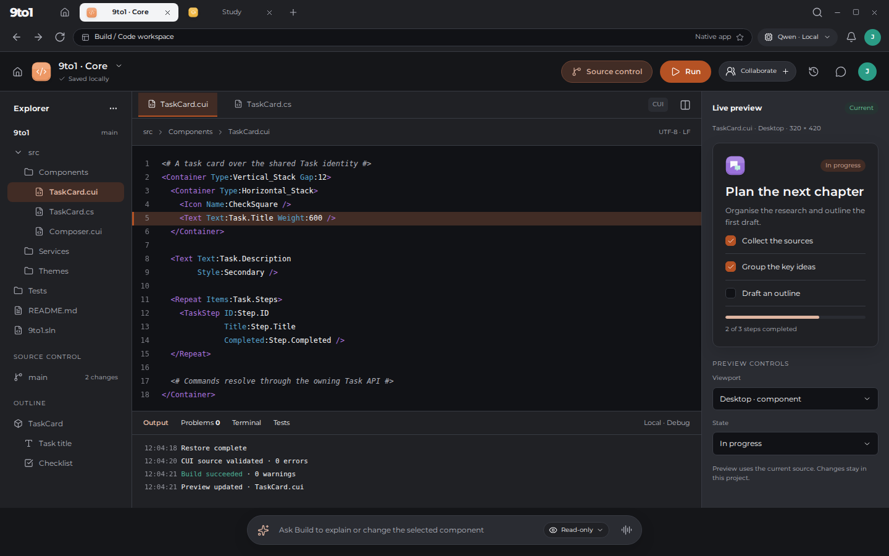
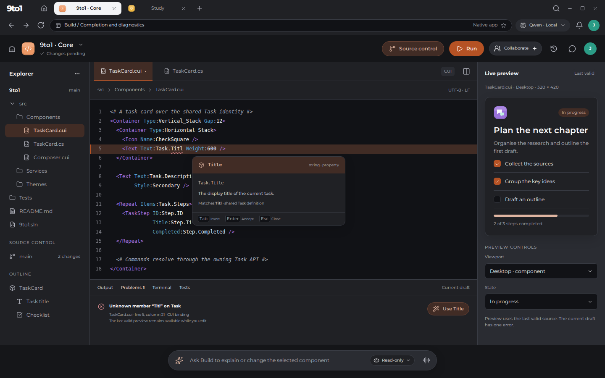

# Build Code — development environment

Module ID: `build-code` · 9to1 Development Specification v3

## Prerequisites

- **CUI, themes and shared interaction system** — Typed UI components, theme tokens/materials, layout, focus, motion, accessibility and shared control states.
- **Artifacts, local persistence and recovery** — Canonical artifacts, revisions, typed edits, local saves, derived exports, sync and recovery.
- **Permissions, approvals and execution scope** — Effective scoped grants, action approvals, policy intersections, revocation and audit.
- **Shared AI controls and artifact collaboration** — Contextual AI bars, shared model/permission controls, global collaborators and typed artifact proposals.

## Overview

Build Code is the full code-development domain within Build, sharing canonical project state with Sites and Stacks. It retains real language, build, debug, test and UI-builder capabilities from the supplied technical specification.

## Layouts & visible states

- **V3-BUILD-CODE-LAY-01** — Use project/file tree, editor tabs, genuine code area/gutter, run/debug controls and bounded diagnostics/output/terminal panels. Show autocomplete at the caret with applicable detail and keyboard selection.
- **V3-BUILD-CODE-LAY-02** — Diagnostics identify actual file/range/severity and a real problem list. Suggested fixes expose the target change rather than silently rewriting files.

## Features & behaviour

- **V3-BUILD-CODE-FEA-01** — Integrate language services, completion, navigation, formatting, refactoring, diagnostics, build/test/debug and source control through real engines.
- **V3-BUILD-CODE-FEA-02** — CUI visual building and code are representations of the same application/project; bindings and generated edits must remain inspectable. Invalid hot reload retains the last valid preview with an error state.
- **V3-BUILD-CODE-FEA-03** — AI coding produces revision-bound change sets/diffs with validation and applicable approval. Terminal execution uses the actual selected session/target and remains separately authorised.

## Canonical entities & persistence

- **V3-BUILD-CODE-ENT-01** — Persist ProjectID, file/resource IDs, source revisions, diagnostics/build/test results and run/debug session references. Files remain canonical across Code/Sites/Stacks.
- **V3-BUILD-CODE-ENT-02** — Editor tabs/caret/folds/selection are view state; working-tree changes, commits and deployment artifacts are separate.

## Permissions & recovery

- **V3-BUILD-CODE-PER-01** — Respect workspace/file permissions, secrets and tool execution scope. A valid patch is not automatic permission to run external commands or deploy.
- **V3-BUILD-CODE-PER-02** — Recover dirty buffers and failed builds/tests without erasing user changes. Rebase/reconcile stale AI diffs against the current project revision.

## Acceptance checks

- **V3-BUILD-CODE-ACC-01** — Test completion/diagnostic navigation, code→valid preview, invalid hot reload, build/test/debug and dirty buffer recovery.
- **V3-BUILD-CODE-ACC-02** — Verify patch review/accept/reject, actual file changes, target-aware terminal and shared project identity with Sites/Stacks.

## Exact mock-up and state map

- **Build · Code workspace** — screen `build-code`. Code.
- **Build · Completion and diagnostics** — screen `build-code-diagnostics`. Editor · invalid draft.

## Source clause IDs

UX27-BUILD-001, UX27-BUILD-002, UX27-BUILD-003, UX27-BUILD-004, UX27-BUILD-005, UX27-BUILD-006, UX27-BUILD-007, SECTION-07, UX27-TEST-076, UX27-TEST-077, UX27-TEST-078

## Technical reading map

- Build Code — development environment — Build/Dev, Sites and Stacks — explicit developer workflows; Adaptive product, retained domains (part 01) — `technical/build-code-01.md` (658 words; V2-B1686, V2-B1687, V2-B1688…).
- Build Code — development environment — Developer Apps; Dev (part 02) — `technical/build-code-02.md` (4,982 words; V2-B1707).
- Build Code — development environment — Build; One canonical project across editing surfaces (part 03) — `technical/build-code-03.md` (202 words; V2-B2773, V2-B2774, V2-B2775…).

Technical clauses retain APIs, data models, platform, recovery, donor and acceptance details. The technical files are part of this module, not optional background reading. Shared prerequisites mean stable service/interface contracts must be available; they do not require every dependent app UI to be complete. Use the named chunk for the relevant subtask or the complete module file for its full retained contract.

# Exact designs and implementation rules

These figures are the exact current atlas compositions. Their stable screen IDs match the Word specification and editable source. Open the atlas for full-size theme and interaction inspection.

## Build · Code workspace

Screen ID: `build-code`. Source: UX27-BUILD-001–007; Dev: Editor and navigation, Visual CUI Builder, AI ChangeSet model.

- Dev, Sites and Stacks remain domains of one Build project. Switching surfaces retains the project and revision.
- Preview identifies its source and environment; a failed build must label the last valid preview as stale.
- The explorer, editor, tests and typed AI changes address canonical files. Review AI edits as a diff before applying them.
- Code and diagnostics use monospace. Ordinary chrome inherits the shared CUI theme.

## Build · Completion and diagnostics

Screen ID: `build-code-diagnostics`. Source: UX27-BUILD-002–004; Dev / Language intelligence, diagnostics and Visual CUI Builder; CUI / Hot reload and error boundaries.

- Completion, signature information, diagnostics and quick fixes resolve semantic symbols in the current source revision. Accepting completion is one undoable text edit.
- The invalid in-progress member name produces a navigable diagnostic at the actual file and line. The preview retains the last valid tree and is labelled Last valid.
- Draft text is preserved on validation failure. The current preview is not evidence that an invalid draft built successfully.
- Keyboard acceptance, dismissal and focus return belong to the editor; navigation to a diagnostic preserves the current file identity and selection.
