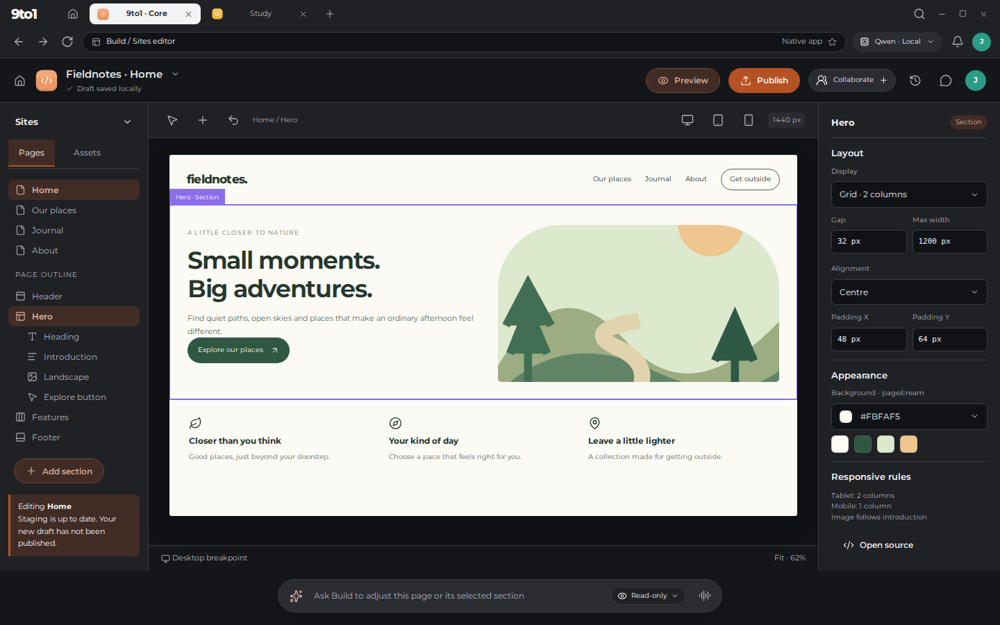
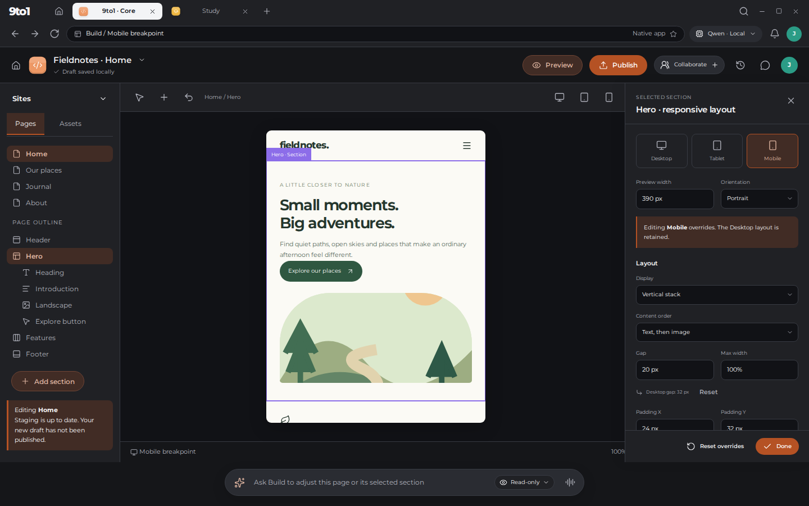

# Build Sites — responsive site authoring

Module ID: `build-sites` · 9to1 Development Specification v3

## Prerequisites

- **CUI, themes and shared interaction system** — Typed UI components, theme tokens/materials, layout, focus, motion, accessibility and shared control states.
- **Artifacts, local persistence and recovery** — Canonical artifacts, revisions, typed edits, local saves, derived exports, sync and recovery.
- **Permissions, approvals and execution scope** — Effective scoped grants, action approvals, policy intersections, revocation and audit.
- **Shared AI controls and artifact collaboration** — Contextual AI bars, shared model/permission controls, global collaborators and typed artifact proposals.

## Overview

Build Sites is the visual website domain of Build, sharing the project and source model with Code/Stacks. Responsive editing, content and publishing use real component/page data rather than a screenshot-only page canvas.

## Layouts & visible states

- **V3-BUILD-SITES-LAY-01** — Use page/component outline, central responsive preview and a selected-element inspector. Show desktop/tablet/mobile viewport controls with clear active width and breakpoint.
- **V3-BUILD-SITES-LAY-02** — Properties distinguish inherited/base values from breakpoint overrides. Preview, edit and deployed/public state are distinct.

## Features & behaviour

- **V3-BUILD-SITES-FEA-01** — Create and edit pages, reusable components, layouts, typography, assets, links/forms and source-defined CMS/content settings.
- **V3-BUILD-SITES-FEA-02** — Responsive changes apply to the selected property/breakpoint scope, preserve base/inherited values and allow explicit override reset.
- **V3-BUILD-SITES-FEA-03** — Code and visual changes target the same project model. Preview uses a real development environment and labels unavailable functionality truthfully.
- **V3-BUILD-SITES-FEA-04** — Publish/deploy identifies destination/domain, revision, validation and rollback state; production publication is a consequential separately authorised action.

## Canonical entities & persistence

- **V3-BUILD-SITES-ENT-01** — Persist ProjectID, page/component/element IDs, style tokens, breakpoint rules, asset references, content schema and revision.
- **V3-BUILD-SITES-ENT-02** — Preview session, build artifact, deployment revision and domain configuration are separate canonical records.

## Permissions & recovery

- **V3-BUILD-SITES-PER-01** — Respect project, provider and deployment grants. A saved design is not a published site, and an authorised preview is not permission to deploy.
- **V3-BUILD-SITES-PER-02** — Recover invalid builds, broken asset references and failed deployment without losing editable source or the last known-good published version.

## Acceptance checks

- **V3-BUILD-SITES-ACC-01** — Test responsive property inheritance/override/reset, component editing and the same change visible in code.
- **V3-BUILD-SITES-ACC-02** — Verify preview versus publish distinction, selected revision, error recovery and explicit deployment target.

## Exact mock-up and state map

- **Build · Sites editor** — screen `build-sites`. Sites.
- **Build Sites · Mobile breakpoint** — screen `build-sites-responsive`. Responsive · inspector.

## Source clause IDs

Named baseline section(s) retained in the technical-source chapters below.

## Technical reading map

- Build Sites — responsive site authoring — Sites; Product role and ownership principle (part 01) — `technical/build-sites-01.md` (5,784 words; V2-B1816).

Technical clauses retain APIs, data models, platform, recovery, donor and acceptance details. The technical files are part of this module, not optional background reading. Shared prerequisites mean stable service/interface contracts must be available; they do not require every dependent app UI to be complete. Use the named chunk for the relevant subtask or the complete module file for its full retained contract.

# Retained technical requirements

# Build Sites — responsive site authoring — Sites; Product role and ownership principle (part 01)

Reading status: active retained clauses, subject to the v3 owner overrides listed in the primary module. Historical process instructions and replaced original wording are stored separately.

### V2-B1816 · v2 lines 9683–10003

Sites
Product role and ownership principle
9-1 Sites is the native CUI visual website-building, CMS, preview and deployment surface. It MUST support professional source-backed websites and web applications while remaining approachable for users who prefer visual authoring.
Sites owns visual page/component authoring, responsive layout, site design systems, CMS/content authoring, routes/navigation, preview/deployment orchestration, domains, site diagnostics and site-specific runtime configuration. Dev owns general-purpose code engineering, Stack owns source-control/collaboration history, Files owns canonical file/asset identity, Data owns structured data/database semantics and Forms owns form/assessment runtime semantics.
A SiteProject MUST remain user-owned and addressable as real structured project/source state. Sites MUST NOT make opaque generated output the only canonical representation or require an export-to-code step for ordinary Dev/Stack interoperability.
Primary donor: cakemods site plugin
The latest appropriate cakemods website/site-plugin source is the primary donor and implementation reference for Sites. Its visual Page Editor, reusable-section/component model, design-system integration, preview behaviour, editor-shell/public-route separation, authoring quality-of-life and proven website-management behaviours MUST be preserved, expanded or replaced by demonstrably equivalent 9to1-native implementations.
Implementation MUST inspect/fetch the current donor source at implementation time if it is not present in the canonical development environment, subject to licensing and the global donor rules. A simplified greenfield page builder is not an acceptable substitute merely because it is easier to implement.
Sites may replace WordPress/PHP-specific storage, admin or runtime coupling with 9to1-native project, CUI, API and provider infrastructure, but donor functionality and useful interaction semantics must survive unless explicitly documented as not applicable.
Donor parity audit
A donor-parity inventory MUST classify every meaningful cakemods site/editor capability as Preserved, Expanded, Replaced by 9to1-native equivalent, or Not applicable with a recorded reason.
Parity review includes visual page editing, reusable sections/components, design-system/token handling, editor/public-shell ownership, page preview, route-specific asset/style loading, responsive behaviour, component state, site/content management, recovery and mature editing QoL visible in the donor.
Missing donor source is not permission to invent a toy substitute; the autonomous implementation process must obtain the latest appropriate donor source where the global donor contract permits.
Canonical SiteProject model
SiteProject has stable SiteID/ProjectID, source binding, framework/project type, Pages[], Routes[], Components[], ReusableComponents[], Layouts[], Theme/DesignSystem, Assets[], ContentCollections[], NavigationModels[], LogicGraphIDs[], DataBindings[], FormBindings[], Environments[], Deployments[], Domains[], Redirects[], SEO configuration, Analytics/Consent configuration, ExtensionState, Settings and Revision.
Page, Route, Component, ContentCollection, ContentRecord, Asset reference, Deployment and Domain binding each use stable identifiers that do not depend on mutable display names, URL paths or visual order unless the entity is explicitly path-addressed by design.
Persisted Sites-native formats are versioned. Unknown incompatible schema versions are rejected/preserved/migrated explicitly; they are not silently reinterpreted.
New Site and framework/project creation
New Site provides searchable templates/project types such as Blank, marketing/business site, portfolio, blog, documentation, landing page, web application, community/project site, content-driven site and other installed provider templates.
Where applicable the user selects framework/runtime/provider rather than being forced into one proprietary framework. First-party/native Sites projects and supported source projects may include HTML/CSS/JavaScript and registered framework providers such as React/Next/Astro or later equivalents when those providers can preserve the required round-trip contract.
Existing source projects may be opened from Stack/Dev. Sites MUST detect whether the selected framework/provider supports full visual round-trip, partial visual representation or preview-only mode and state the capability clearly.
Visual Page Editor
The normal Sites authoring surface is heavily based on the cakemods Page Editor model: site/page tree or layers, central visual canvas/preview and contextual Inspector/properties, with source available through Dev.
Users can create, select, move, nest, duplicate, hide, delete and configure supported components directly on the canvas/tree. Selection state is synchronised across canvas, component tree, Inspector, node graph and Dev/source mapping where supported.
The editor manipulates canonical page/component state rather than a screenshot approximation. Published output, preview, Dulche actions and APIs consume the same semantic component/project model.
Component and section model
Sites uses a canonical structured component tree. Core component categories include section/container, header, footer, navigation, text/heading, image/media, button/link, card, list, table, form host, dialog, tabs/accordion, gallery, hero/splash, sidebar/rail, CMS collection renderer, embed, custom component and extension-contributed types.
Component has stable ComponentID, ComponentType, properties, child/slot structure, layout, design-token/style references, responsive overrides, bindings, interaction references, component state, accessibility properties, source mapping where applicable and Revision.
The donor's reusable-section/component concept is preserved and expanded. User/org component libraries may provide reusable headers, footers, heroes, pricing blocks, FAQs, CTAs and domain-specific components.
Reusable components and sections
A reusable component/section definition has stable definition identity and may be instantiated across pages. Instances can expose declared properties/slots while inheriting the definition's structure/style/logic.
Sites distinguishes linked instances from detached copies. Editing a linked definition updates its instances according to override rules; Detach creates an independent component tree and must be an explicit operation.
Overrides are structured and traceable. Sites MUST NOT duplicate an entire reusable definition into each instance merely to support one overridden property.
Editor-shell and public-route context ownership
Sites MUST preserve the donor architecture's strict separation between editor/admin chrome and the public site being edited. Public headers, footers, theme chrome and public-only CSS MUST NOT leak into the Sites editor shell unless rendered inside the isolated public preview.
Rendering contexts include at least editor shell, public/live route, page preview, component preview and CMS/dynamic preview. Each context resolves an explicit asset/style/component ownership manifest.
Context boundaries are testable. A component or style registered only for a public route MUST NOT accidentally become part of the editor shell merely because the preview is open.
Layout and page composition
The visual editor supports mature responsive web layout including normal document flow, stack/flex-style layout, grid, wrapping, alignment, gaps, padding/margins, min/max sizing, aspect ratio, container widths, sticky/fixed positioning where supported, overlays and deliberate absolute/freeform positioning.
Structured responsive layout is the default. Sites MUST NOT represent ordinary pages as arbitrary fixed coordinates that only happen to fit one viewport.
Page/component hierarchy and layout rules remain editable through the Inspector and typed Sites actions; visual drag/reorder is a convenience over the same model.
Responsive design and breakpoints
Sites provides desktop, tablet, phone and custom responsive previews plus drag-resizable viewport inspection. Breakpoints come from the active project/design system and may be provider-defined.
Responsive properties inherit through a predictable cascade. A breakpoint override records only the changed properties rather than cloning the entire page.
The Inspector shows whether a value is inherited, defined at the current breakpoint or overridden elsewhere and allows resetting an override to inherited state.
Design system and tokens
Site-wide design state includes semantic colour tokens, typography, spacing scale, radius, shadows, breakpoints, container widths, component variants, interaction states and theme modes.
Components SHOULD reference semantic design tokens rather than duplicating unrelated literal styling where the project/provider supports tokens. Changing a shared token updates consumers without rewriting page structure.
Sites preserves the cakemods donor's design-system ownership concepts while migrating them into shared 9to1 theme/component APIs where appropriate.
Themes and component variants
Sites supports site theme variants including light/dark/system modes where configured. Theme changes MUST NOT destroy page content or component structure.
Components may define named variants and states such as primary/secondary button, compact/feature card, Default/Hover/Focused/Disabled/Loading/Error/Selected.
Visual preview can force a component state for design inspection without mutating production runtime state.
Visual source round-trip and code-defined constructs
Sites and Dev operate on the same canonical project/source wherever the active framework/provider supports round-tripping. A visual property change updates the real source/project representation; a supported source edit is reflected back into Sites after parse/reconcile.
Source mapping relates runtime/visual components to component definitions, project resources and source ranges/symbols where available.
If a valid project construct cannot be represented visually, Sites MUST preserve it and mark it Code-defined, Partially visual or another explicit capability state. It MUST NOT delete, flatten or rewrite unsupported code simply to make the canvas editable.
Generated code/assets derived from canonical node graphs or Sites metadata are marked as generated with provenance. Users are not encouraged to hand-edit generated output unless the provider declares supported reverse mapping.
Pages, routes and navigation
Page and Route are distinct canonical concepts. A Page may render at one or more routes according to provider/project rules; Routes support static, nested and parameterised/dynamic paths, redirects and error/not-found routes.
Changing a route checks internal references and can offer redirects. Navigation items SHOULD reference PageID/RouteID for internal destinations rather than storing only fragile path strings.
Navigation models support reusable menus, nested entries, active-state semantics, external links and conditional visibility where permitted.
Preview fidelity and asset manifest
Sites preview MUST use the same applicable component styles, theme assets, route-specific assets, fonts and rendering rules as the corresponding public/live route wherever technically possible. The cakemods donor's route/context asset-manifest discipline is a mandatory architectural reference.
Preview MUST NOT be a separately styled mock that can pass while the published page renders differently. Differences caused by deployment-only services are declared explicitly.
Route-specific assets such as homepage-only CSS/scripts are loaded only in applicable preview/live contexts and MUST NOT leak into unrelated pages or editor chrome.
Live preview and last-valid render
Preview modes include in-editor canvas, interactive preview, full-screen preview and shareable preview deployment where supported.
Where the framework/provider supports it, source/visual edits trigger incremental build/hot reload. Preview state visibly reports Live, Building, Reloading, Build failed, Disconnected or Paused.
If a new change fails to build/render, Sites preserves the last valid preview and overlays/links the current diagnostics rather than replacing the canvas with an uninformative blank page.
Stack source-control integration
A SiteProject may bind directly to Stack ProjectID/DomainID/revision. Editing context clearly identifies Main, Branch, Twig or Leaf and the exact source revision used for preview/deployment.
Sites edits become ordinary reviewable source changes in the selected Stack domain. Sites MUST NOT create an anonymous divergent copy when a source-backed Stack project is active.
Branch/Twig/Leaf preview deployments bind to exact revisions. Production deployment defaults to an approved Main/release revision unless project policy explicitly authorises another source.
Dev integration
Open in Dev opens the same project/domain/source identity, optionally preserving selected page/component/source mapping. Open in Sites from Dev opens the visual authoring surface for the same compatible resource.
Dev Code | Preview may use Sites as the preview provider. Source edits, build diagnostics and visual preview remain revision-linked rather than being transferred through export/import.
Advanced code-defined components, server functions, framework configuration and tests remain fully available in Dev even when the visual Sites surface presents simplified controls.
Full shared Node Graph Framework
Sites exposes the full shared 9to1 Node Graph Framework for advanced interaction and application behaviour. The node editor is a first-class companion to the cakemods-derived visual Page Editor rather than a separate incompatible automation product.
Visual Editor primarily answers structure/content/layout/style; Node Editor primarily owns events, runtime state, dynamic data, navigation/action flows, integrations and advanced animation/interaction.
Graph objects use stable GraphID/NodeID/PortID identity, typed connections, validation, grouping/comments, copy/paste, undo/redo, Draft/Published revision semantics and Dulche mutation through 9to1.NodeGraph.*.
Simple interaction UI and graph parity
Ordinary interactions remain approachable without opening nodes. Examples include Button → Navigate to page, open dialog, submit Form, set link or trigger a simple animation through Inspector controls.
Simple interaction configuration MUST map to the same canonical behaviour/graph primitives used by the advanced Node Editor, or to a formally shared behaviour object represented consistently in both views.
Open in Node Editor reveals/extends the advanced representation without silently changing the simple configured behaviour.
Sites node events, conditions and actions
Representative Sites events include PageLoaded/Unloaded, RouteChanged, ComponentClicked, Hovered, Focused, ValueChanged, Submitted, ScrollChanged, EnteredViewport, UserSignedIn/Out, CMSRecordChanged, timer/custom component events and provider/extension events.
Representative actions include Navigate/Redirect, UpdateComponentProperty/State, Show/Hide, Enable/Disable, Open/CloseDialog, ScrollTo, SetVariable, PlayAnimation, query/mutate permitted CMS/Data state, invoke Forms/Automation actions, call permitted API/server functions and emit custom events.
Conditions include typed comparisons, boolean combinations, role/auth state, viewport/capability state, collection/query results, component state and validation outcomes.
Node execution contexts and trust boundaries
Every executable node declares execution context/capabilities such as client-safe, server/trusted backend, build-time, deployment-provider or external integration. Sites MUST NOT compile secrets or trusted permission checks into untrusted browser execution merely because a graph contains them.
Security-sensitive permission, private Data mutation and credential operations are executed/verified in trusted environments through owning APIs. Client-side visibility logic is not an access-control boundary.
The graph editor visually identifies execution-boundary transitions and validates impossible/unsafe client↔server data flows before publish where determinable.
Node debugger and runtime inspection
Interactive preview includes node debugging: executed node/path highlighting, breakpoint/pause where supported, values, state variables, execution timing, errors and linked network/provider failures.
A user can exercise a page interaction and inspect the actual path taken through the graph rather than treating the node canvas as a static diagram.
Runtime inspection uses development/test context and respects secret redaction/permission boundaries.
Component state and node-driven animation
Components can expose named runtime states and node transitions, for example ProductCard Default → Loading → Selected/Error.
Simple animations remain configurable visually; advanced sequences may use graph/timeline primitives such as EnteredViewport → easing/spring → opacity/transform/property changes.
Responsive layout is normally expressed through design/layout breakpoints rather than width-check node spaghetti. Runtime viewport/capability nodes are reserved for behaviour that is genuinely conditional rather than ordinary responsive styling.
Native CMS and content collections
Sites includes a native structured CMS. ContentCollection has stable CollectionID, schema fields/types, indexes/constraints where supported, relationships, permissions, publishing workflow and Revision. ContentRecord has stable RecordID independent of display title/slug.
Typical collections include BlogPost, Product, Event, TeamMember, DocumentationPage or user-defined schemas. Supported fields include text/rich content, slug, number, boolean, date/time, media/File reference, enum, reference, list/set and structured/nested data where the provider supports it.
CMS authoring provides list/table and record-editing interfaces appropriate to the schema rather than forcing content authors into page source.
CMS relationships and dynamic content
Collections support references and one-to-one, one-to-many and many-to-many relations where the selected backend permits them. Relationship identity uses stable collection/record IDs rather than matching display strings.
Dynamic components can bind to record fields or collection queries. Collection renderers support filtering, sorting, pagination/loading and empty/loading/error states.
Complex structured data/database requirements may delegate to Data; Sites CMS remains optimised for web content authoring rather than duplicating Data's complete database product.
Dynamic routes and page templates
Dynamic routes such as /blog/:slug can bind to a collection/query and a reusable page template. Route resolution detects duplicate/conflicting slugs and unavailable records.
Dynamic page preview can select representative records and preserves the template/record distinction; editing template layout does not silently mutate record content.
Generated sitemap/canonical metadata use resolved published routes/records rather than draft-only paths.
Rich content authoring
CMS/page rich content supports headings, paragraphs, lists, links, images/media, tables, quotes, code blocks and registered rich components where supported. Long-form content MUST NOT require hand-authoring raw HTML for ordinary use.
Rich content remains structured and sanitised according to project/runtime security policy; pasted content does not gain arbitrary executable privilege.
Data integration
Sites can bind components, collections or server-side flows to Data projects/tables/queries through typed Data APIs. Examples include product grids, member dashboards, reporting widgets or structured content sources.
Bindings reference stable Data IDs/fields and preserve typed values, permissions and Data's live-database protection semantics. Sites MUST NOT bypass Data safeguards by issuing hidden raw mutations directly to backing databases.
Data-backed collection/rendering state includes loading, empty, error and stale/unavailable handling.
Forms integration
Sites embeds 9to1 Forms natively by referencing FormID/FormVersionID or another supported Forms embed/runtime reference. Contact forms, registrations, applications, quizzes and custom Forms modes remain owned by Forms.
Site styling may provide theme/context integration without discarding Forms validation, accessibility, response versioning, anti-abuse, assessment or Data-binding semantics.
Forms events exposed to Sites node graphs are typed and permission-scoped.
Files and asset management
Sites uses Files as canonical asset/file identity where appropriate. Asset references include stable File/Asset IDs, origin/provenance, usage references, alt/caption metadata, transformations/derived variants and Revision.
The asset browser supports images, video, icons, documents, fonts where licensing permits and other registered media. Moving/renaming a Files-backed asset MUST NOT break references that use stable identity.
Deleting an asset checks/reports site usages and follows Files recovery semantics rather than silently replacing broken content.
Image/media optimisation
Sites supports crop/focal point, responsive image variants, appropriate format optimisation, lazy/loading policy and alt text. The canonical source/original remains preserved.
Generated responsive thumbnails/encodings are derived build/cache assets with provenance; Sites MUST NOT create untracked duplicate originals merely to satisfy one page size.
Video/media embeds distinguish first-party/file media from external providers and expose privacy/performance implications.
SEO and discoverability
Per-page/route SEO supports title, meta description, canonical URL, robots/index policy, Open Graph/social metadata, structured data/schema and sitemap inclusion. Site-level configuration covers canonical hostname, sitemap, robots.txt and defaults.
Sites provides structured diagnostics for missing/duplicate titles, missing descriptions where policy expects them, broken canonical references, inaccessible/missing image alternatives and other deterministic SEO problems it can verify.
AI may propose SEO content but must not invent factual business claims or silently publish changes.
Accessibility diagnostics and guardrails
Sites continuously checks representative accessibility requirements including contrast, missing image alternatives, semantic labels, heading order, focus/keyboard accessibility, colour-only state, touch target sizing, animation/reduced-motion behaviour and custom component accessibility where inspectable.
Accessibility issues appear as structured diagnostics tied to PageID/ComponentID/source location where possible and integrate with Dev Problems/Dulche context.
Visual design freedom MUST NOT silently disable required semantic labels, focus order or other minimum accessibility behaviour.
Performance and web-quality diagnostics
Sites surfaces web-performance problems it can determine such as oversized images/media, excessive bundles/scripts/fonts, known render-blocking resources, large page payloads and expensive third-party dependencies.
Preview/build may expose measurable runtime metrics where the provider/runtime supports reliable collection. Unknown metrics remain unknown rather than fabricated.
Optimisation actions preserve behaviour/source ownership and remain inspectable changes.
Domains, redirects and HTTPS
Sites manages custom-domain bindings through a typed DomainBinding model with stable DomainBindingID, environment, hostname, canonical/apex/www policy, verification state, DNS requirements, TLS/HTTPS state and Revision.
Users can attach/remove domains, choose canonical host, configure redirects and inspect ownership/DNS/TLS status. Provider integrations may automate required DNS records only within the authorised scope and MUST NOT alter unrelated records.
Route/domain changes identify broken links/redirect opportunities and do not claim a domain is live until provider verification succeeds.
Deployment environments
Sites supports explicit Development/Preview and Production environments, plus Staging or provider-defined environments where configured.
Deployment has stable DeploymentID, SiteID/ProjectID, Stack DomainID/revision where applicable, environment, build/config revision, provider, URL, build result, deployment result, timestamps, actor/initiator and status.
A deployment is pinned to source/config revisions. A preview URL MUST identify a concrete deployment/revision rather than silently floating to whatever source is latest.
Deployment providers and build pipeline
Deployment uses a provider abstraction. First-party/connected providers may offer static hosting, edge/server functions, object storage/CDN, DNS/domain integration and preview deployments according to capabilities. Extensions can register additional providers.
Build pipeline exposes dependency restore, build/generate, validation, packaging and deploy/verify stages where applicable. Failures produce typed diagnostics and stage status rather than a generic Deployment failed result.
Sites does not hard-code one provider's CLI/configuration as the canonical project model; provider-specific settings may be retained as explicit provider configuration.
Deployment history, rollback and publishing safeguards
Sites preserves deployment history with source revision, configuration, build/check result, provider/environment, actor and URL/status.
Rollback normally redeploys a previously successful known source/config revision; it MUST NOT erase newer source history merely to return production to an earlier deployment.
Production publish is an external consequential action. The UI/API shows environment, domain, source DomainID/revision, build/check state and meaningful warnings before execution according to the global permission model. AI MUST NOT silently publish to production without an explicit authorised action/automation.
Custom code, scripts and server functions
Advanced projects support controlled custom CSS, JavaScript/TypeScript/modules, head/body markup hooks, custom components and server/API functions according to framework/provider capabilities.
Custom code is source-backed, versioned and visible in Dev/Stack; Sites MUST NOT store consequential executable snippets only in an invisible proprietary database.
Server functions/endpoints are real project resources with Dev debugging/testing where supported. Sites may provide simplified configuration but does not invent an incompatible second backend language/runtime.
Environment variables and secrets
Sites distinguishes public build/runtime values from private server/provider secrets. Secret values use shared secure credential infrastructure where possible and are referenced by ID/name rather than committed into project source.
Secrets MUST NOT be exposed into browser bundles, logs, previews, AI context or generated diffs unless the operation explicitly requires the value and the caller/environment is authorised.
Build/deploy diagnostics redact secret values while preserving enough context to identify which configured secret/reference failed.
Authentication and member areas
Sites may integrate with 9to1 identity/auth providers to create login/account/member experiences and restricted routes/components. Identity objects and permissions remain owned by the shared identity/security layer.
Restricted page visibility alone is not a security boundary; backend/private data access requires server-side authorisation.
Member/user-specific page state is represented explicitly so preview/test can simulate authorised roles without embedding real private credentials.
Localisation and site search
Sites supports locale-aware content/routes, language selector, fallback language and alternate-language SEO metadata where enabled. Translations remain editable content with provenance even when AI-assisted.
Site search can index selected published pages, CMS collections and permitted Data-backed content. Search provider/index state is typed and exposes stale/rebuild/error state for dynamic content.
Analytics, scripts and consent
Sites supports registered analytics/providers and custom events without silently injecting tracking. Analytics configuration identifies provider, enabled environments, events/scopes and privacy/consent requirements.
Consent configuration can categorise integrations/scripts such as Essential, Preferences, Analytics and Advertising and delay applicable execution until consent where configured/required.
Templates MUST NOT silently enable third-party tracking merely because the donor/template contained a tracking snippet.
Collaboration and revisions
Concurrent authoring uses stable page/component/content revisions and conflict detection. Sites MUST NOT silently overwrite another editor's changes.
Comments/review may attach to PageID/ComponentID/content where supported; source-level review remains available through Stack/Dev.
Visual and source edits participate in the same canonical revision/history model so conflicts can identify semantic component/property changes where possible.
Dulche AI authoring and visual QA
Dulche semantic context includes SiteID/ProjectID, current Stack DomainID/revision, selected PageID/ComponentID, route, component hierarchy, layout/responsive breakpoint, design tokens, CMS schema/record, bindings, node graph selection, diagnostics, preview/build/deployment state and Revision.
AI may create/refactor pages, components, responsive layouts, themes, CMS schemas/content, bindings, node graphs, SEO metadata and project structure only through typed Sites/shared-domain actions.
AI-created sites are ordinary editable SiteProjects, not screenshots or opaque generated bundles.
UI-oriented AI changes SHOULD use available visual preview/QA in addition to build success. Overflow, clipped content, broken responsive layout, inaccessible contrast and visibly failed states must not be declared correct solely because compilation passed.
Shared extension system
Sites participates in the shared 9to1 extension platform. Extensions may contribute components, component inspectors, CMS field types, Data sources/bindings, deployment providers, analytics/SEO integrations, project templates, visual-builder panels, node types and preview/runtime providers.
Extension contributions declare target Sites API version, permissions/capabilities and compatible platforms. A crashing extension must be containable/disableable according to the shared extension-host contract.
Sites extension development can be created/debugged from Dev's 9to1 Extension project type and appropriate Sites Extension Host.
First-party Sites URL namespace
Every publishable SiteProject receives or may reserve a first-party Sites URL under https://sites.9to1.uk/<site-slug>. The first-party URL is path-based rather than per-site DNS subdomain. Site identity remains stable even if the slug changes.
The site slug and Sites-managed route segments use the restricted lowercase character set a-z and hyphen; slash is the path-segment separator. Digits, spaces, underscores, mixed case, Unicode lookalikes and other punctuation are not valid in the first-party Sites namespace. A segment MUST NOT begin or end with a hyphen, and empty/repeated path segments are rejected. Sites normalises valid input to one canonical URL representation rather than allowing visually ambiguous aliases.
For example, a project may publish at sites.9to1.uk/cake and expose routes such as sites.9to1.uk/cake/about or sites.9to1.uk/cake/contact-us. Reserved platform/system names cannot be claimed as ordinary site slugs.
Slug availability is checked atomically at reservation/publish time. Changing a published slug is explicit and can create a managed redirect from the previous first-party URL according to retention/conflict policy.
AI name and domain verification
Every requested first-party site slug and every custom domain binding MUST pass automated name-safety verification before it can become an active public identity. Verification combines deterministic checks with an AI-assisted misleading-name assessment.
The assessment looks for likely impersonation, deceptive affiliation claims, confusingly similar names, misleading government/financial/security/support identities, obvious brand/person spoofing, homograph/punycode concerns for custom domains and other patterns that could materially mislead visitors about who operates the site. The AI assessment is a safety signal, not proof of wrongdoing.
Clear safe names may pass automatically. Ambiguous/high-risk names enter a PendingReview state rather than being silently published or permanently rejected by an opaque model decision. The user can see a meaningful reason category and use the supported review/appeal path where applicable.
Owning or controlling a custom domain does not bypass misleading-name screening, and passing misleading-name screening does not prove domain ownership. Name-safety verification and technical ownership verification are separate mandatory gates.
Verification records use stable VerificationID, subject URL/domain, normalized representation, rules/model version, decision state, reason categories, timestamps and review/audit references. Sensitive model internals need not be exposed, but the user-visible result must be actionable and non-deceptive.
Custom domains and provider connections
Sites supports custom apex domains and subdomains in addition to the default sites.9to1.uk/<site-slug> address. The user chooses which verified address is canonical and can configure redirects from other bound addresses.
Manual custom-domain ownership verification MUST use a secure provider-independent challenge, normally a purpose-specific DNS TXT record or equivalent proof whose random token is bound to the SiteID/account and expires/rotates according to policy. Merely entering a hostname, receiving traffic for it or controlling a Sites project is not sufficient proof of ownership.
Domain takeover protections include checking existing active claims, challenge freshness, account/site binding, DNS result validation, canonicalized IDN/punycode representation and safe reassignment/release semantics. A domain already actively bound elsewhere cannot be silently stolen by a second project.
Sites MAY connect to supported DNS/domain providers such as Cloudflare and later providers through typed provider integrations. With explicitly scoped authorization, a connected provider may enumerate eligible zones, create/verify only the required challenge/serving records, inspect DNS/TLS readiness and maintain authorised redirects/routing.
Provider authorization MUST be least-privilege where the provider permits it. Connecting a provider for one site/domain does not grant Sites permission to rewrite unrelated zones or records. All DNS mutations show affected zone/record scope through the global permission model and remain auditable.
If automated provider configuration is unavailable, Sites presents exact manual DNS instructions and continuously exposes Pending, Verified, Misconfigured, Conflict or provider-specific failure state without pretending propagation has completed.
Canonical Sites directory in Files
Every SiteProject has an explicit user-addressable project directory under the user's Sites area in Files, conceptually Sites/<Project Name>/, or an equivalent stable Files location selected/managed by the user.
That directory contains the actual source-backed site resources appropriate to the project's framework: source, public/static assets, component/page resources, framework manifests/configuration and versioned Sites project metadata where applicable. Sites-internal derived caches or provider credentials MUST NOT be mixed into user source as if they were canonical project content.
Files identity is canonical for Files-backed resources. Moving or renaming the project directory through supported Files/Sites operations preserves SiteID/project binding through stable IDs rather than creating a new site accidentally.
The site MUST remain reconstructable and editable from the canonical Sites/Files/Stack project resources. An external host MUST NOT be the only surviving copy of the source project.
External hosting and deployment authority
The public website is stored/served through an external HostingProvider or configured first-party hosting service backed by an external provider. The deployed copy is derived runtime/deployment state, not an independently editable canonical authority.
The authority chain is: canonical editable Sites project and Files/Stack source → revision-pinned build artifact → external provider deployment → first-party/custom domain routing. Each Deployment records SiteID, source DomainID/revision where applicable, build/config revision, provider identity and deployment artifact/result identity.
Provider-hosted state may include generated static output, server bundles/functions, optimized media, CDN/cache objects and runtime configuration. These artifacts retain deployment provenance but do not replace canonical source.
Direct provider-side edits that cannot be mapped back to canonical source are treated as external drift. Sites MUST NOT silently adopt them as canonical. Where import/reconciliation is supported it is an explicit reviewed operation.
If a hosting provider is unavailable, loses deployment state or the user changes provider, Sites can rebuild from canonical Files/Stack source, deploy to another configured provider, remap first-party/custom-domain routing and verify the resulting deployment. Recovery MUST NOT depend on scraping the live public website to reconstruct the project.
Hosting, URL and domain API additions
The Sites API MUST include typed operations equivalent to:
9to1.Sites.ReserveSlug(siteID, slug);
9to1.Sites.ChangeSlug(siteID, slug, options?);
9to1.Sites.VerifyPublicName(target, options?);
9to1.Sites.GetPublicNameVerification(verificationID);
9to1.Sites.BeginDomainVerification(siteID, domain, options?);
9to1.Sites.VerifyDomain(domainBindingID, options?);
9to1.Sites.ConnectDomainProvider(provider, scopes, options?);
9to1.Sites.ConfigureDomainRecords(domainBindingID, options?);
9to1.Sites.GetHostingState(siteID, environmentID?);
9to1.Sites.ChangeHostingProvider(siteID, providerID, options?);
Provider-specific DNS/hosting mutations still use the shared credential/permission model and MUST NOT bypass Sites deployment/domain safeguards.
Sites API
Sites' first-party API catalogue is exhaustive under the global API-parity rule. Minimum canonical entry points include:
9to1.Sites.CreateProject(config);
9to1.Sites.OpenProject(siteOrProjectID);
9to1.Sites.CreatePage(siteID, config);
9to1.Sites.UpdatePage(pageID, patch);
9to1.Sites.CreateRoute(siteID, config);
9to1.Sites.UpdateRoute(routeID, patch);
9to1.Sites.AddComponent(parentID, componentType, config);
9to1.Sites.UpdateComponent(componentID, patch);
9to1.Sites.MoveComponent(componentID, destination, options?);
9to1.Sites.CreateReusableComponent(siteID, sourceComponentID, config?);
9to1.Sites.DetachComponentInstance(instanceID);
9to1.Sites.SetLayout(targetID, layout);
9to1.Sites.SetResponsiveOverride(targetID, breakpointID, patch);
9to1.Sites.UpdateDesignSystem(siteID, patch);
9to1.Sites.CreateCollection(siteID, schema);
9to1.Sites.UpdateCollectionSchema(collectionID, change, options?);
9to1.Sites.CreateContent(collectionID, record);
9to1.Sites.UpdateContent(recordID, patch);
9to1.Sites.BindData(targetID, dataBinding);
9to1.Sites.BindForm(targetID, formBinding);
9to1.Sites.SetSEO(targetID, config);
9to1.Sites.CreatePreview(siteID, sourceRevision, config?);
9to1.Sites.Build(siteID, sourceRevision, config?);
9to1.Sites.Deploy(siteID, sourceRevision, environmentID, options?);
9to1.Sites.RollbackDeployment(deploymentID, options?);
9to1.Sites.AttachDomain(siteID, domainConfig);
9to1.Sites.ConfigureRedirect(siteID, redirectConfig);
9to1.Sites.GetDiagnostics(scope, options?);
Advanced node-graph mutation uses 9to1.NodeGraph.*; source control, Files, Data, Forms, Dev, identity, credentials and Automations use their owning namespaces where canonical.
Automation and typed events
Sites emits typed events such as PageCreated/Changed, ComponentChanged, RouteChanged, ContentPublished/Changed, BuildStarted/Completed/Failed, PreviewCreated, DeploymentStarted/Completed/Failed, DomainVerified/Failed, DiagnosticChanged and provider/extension lifecycle events.
Automations/agents consume stable IDs and permission-scoped data. External deployment/domain/content publication side effects remain subject to the global Home permission broker and product-specific protections.
Security and abuse boundaries
Sites sanitises/validates untrusted rich content, embed/custom code boundaries and public form/data interactions according to the active runtime/provider security model.
Public site content MUST NOT gain access to Sites editor/admin privileges merely because it is rendered in preview. Preview documents/iframes/processes use isolation appropriate to the platform.
Public/private source, CMS records, Data bindings and credentials preserve their owning permission boundaries through build and deployment.
Performance and large-site behaviour
Sites virtualises large page/component trees, CMS record lists, assets and deployment history. It loads/compiles only the content/assets needed for the active authoring/preview workflow where possible.
Large CMS collections, asset libraries and Data-backed lists use paging/streaming rather than unbounded UI payloads. Preview/build work is cancellable where technically possible.
Visual editing MUST remain responsive while builds/deployments/background indexing occur; long work exposes JobID/progress/status rather than blocking the editor.
Recovery and failure behaviour
Draft visual/source edits are crash-recoverable where feasible and do not corrupt the last valid published/deployed source revision.
A failed build/deploy leaves the prior successful deployment intact unless the provider itself performed an irreversible partial side effect; Sites reports each completed/failed stage accurately.
Structured failures include SiteNotFound, PageNotFound, ComponentNotFound, UnsupportedVisualConstruct, SourceRoundTripConflict, RouteConflict, CMSValidationFailed, BindingUnavailable, NodeGraphInvalid, PreviewBuildFailed, BuildFailed, DeploymentFailed, ProviderUnavailable, DomainVerificationFailed, DNSConflict, SecretUnavailable, PrivateDataExposureBlocked, RevisionConflict, PermissionDenied and CapabilityUnavailable plus provider-specific errors.
Platform capability behaviour
Windows, 9to1-OS and web preserve the same canonical SiteProject/Page/Component/CMS/NodeGraph/Deployment models while capability-negotiating local framework tooling, embedded preview, browser isolation, filesystem/source access and provider integrations.
A platform that cannot provide local build/runtime functionality uses an explicitly configured remote/provider capability or reports CapabilityUnavailable; it MUST NOT silently fake preview/build/deployment completion.
When Home is absent at process start, Sites follows the global Install Home/bootstrap contract.
Acceptance requirements
Sites is implementation-complete only when acceptance coverage verifies at least:
* The latest appropriate cakemods site-plugin donor has been audited and each meaningful editor/site capability is preserved, expanded, replaced equivalently or explicitly marked not applicable.
* A source-backed site opens in the cakemods-derived visual editor with stable Page/Component identity and can be edited without an export-to-code step.
* Editor-shell/public-route isolation prevents public site header/footer/styles from leaking into Sites chrome while isolated preview still renders the selected public structures.
* Preview loads the same applicable route/theme/component asset manifest as the live route for representative homepage and ordinary-page cases.
* A supported visual property edited in Sites updates the canonical source/project and a supported Dev source edit round-trips back into Sites.
* An unsupported valid code construct is preserved and shown as Code-defined/partial rather than silently deleted or flattened.
* Responsive desktop/tablet/mobile overrides inherit correctly without cloning the entire page and can be reset to inherited state.
* A linked reusable section updates its instances while Detach produces an independent instance without corrupting the original definition.
* Simple Inspector interaction such as Button → Navigate behaves consistently with the advanced Node Editor representation.
* A Sites node graph can implement a dynamic flow such as click → query/update state → show result, and the preview node debugger exposes the executed path/values.
* A security-sensitive graph operation is kept in its trusted execution context and is not compiled into an untrusted client bundle with secrets.
* CMS collections create typed records/relationships and drive a dynamic route such as /blog/:slug without unstable title-string identity.
* Forms embed retains Forms validation/runtime semantics and Data binding uses Data APIs/permissions rather than hidden direct database mutation.
* Files-backed asset rename/move preserves site references and derived responsive image variants retain source provenance.
* SEO configuration generates correct representative title/canonical/sitemap behaviour and diagnostics identify representative missing/duplicate metadata.
* Accessibility diagnostics identify representative contrast/alt/label/focus issues and the visual editor remains keyboard/screen-reader operable for core workflows.
* A Stack Branch/Twig/Leaf opens in Sites with exact ProjectID/DomainID/revision; visual edits appear as ordinary changes in that same domain.
* Open in Dev retains project/domain identity and Dev Code | Preview can use the Sites preview provider without export/import copying.
* A preview deployment is pinned to an exact source revision and a production deployment records its exact source/config revision.
* Rollback redeploys a known prior successful revision without destructively deleting newer source history.
* Domain attach/verification reports exact DNS/TLS state and does not modify unrelated DNS records.
* A build/deployment failure preserves the prior successful production deployment and reports stage/provider failure accurately.
* Private secrets are not emitted into browser bundles, logs, AI context or diffs during representative build/deploy workflows.
* AI-generated page/layout changes are normal editable source-backed objects and undergo available build plus visual QA rather than claiming success from compilation alone.
* A Sites extension can register a representative component/node/provider contribution through the shared extension host with declared permissions.
* Large page/component trees, CMS lists and asset libraries remain usable through virtualisation/paging and cancellable long-running jobs.
* Windows, 9to1-OS and web preserve the same canonical Sites model while capability-negotiating local build/preview/provider features.
* When Home is absent at process start, Sites follows the global Install Home/bootstrap contract.
* A published site receives a default first-party address under sites.9to1.uk/<site-slug>; first-party slug/route segments enforce the specified lowercase a-z/hyphen character rules with slash only as a path separator, reserved-name checks and atomic slug reservation.
* A requested first-party slug and every custom domain binding pass deterministic plus AI-assisted misleading-name verification; ambiguous/high-risk cases become PendingReview with actionable reason/review state rather than opaque automatic publication.
* Custom-domain ownership verification uses a site/account-bound secure DNS challenge and prevents duplicate/takeover claims; connected providers such as Cloudflare can configure only explicitly authorised records/zones under least-privilege scopes.
* Every SiteProject has a user-addressable canonical project directory under the user's Sites area in Files containing the real source/project resources appropriate to its framework.
* The external hosting provider stores/serves revision-pinned derived deployment artifacts and MUST NOT become the sole or independently editable canonical copy of the site.
* A site can be rebuilt from canonical Files/Stack source, redeployed to a replacement hosting provider and remapped/verified without scraping the live website to reconstruct project state.

# Exact designs and implementation rules

These figures are the exact current atlas compositions. Their stable screen IDs match the Word specification and editable source. Open the atlas for full-size theme and interaction inspection.

## Build · Sites editor

Screen ID: `build-sites`. Source: UX27-BUILD-001,004,006; Sites: Visual Page Editor, Responsive design, Preview fidelity, Deployment safeguards.

- Sites editing and Code operate on the same project, components and source revision.
- The public page appears inside an isolated preview. Its fonts, colours and styles never become editor chrome.
- Responsive preview and selected-component properties represent the same source model.
- Preview, staging and production are separate states. Publish must show its environment and changes before committing.

## Build Sites · Mobile breakpoint

Screen ID: `build-sites-responsive`. Source: UX27-BUILD-004,006; Sites / Responsive design, Visual Page Editor and Preview fidelity.

- The mobile preview is the same canonical Home page and Hero component at a 390px viewport; it is not a copied mobile page.
- Inspector controls distinguish inherited Desktop values from explicit Mobile overrides, with reset-to-inherited actions and clear breakpoint scope.
- Responsive properties update the supported site model and remain undoable. Visual preview and authored breakpoint rules must stay consistent.
- Changing a breakpoint or preview width never publishes the site. Production deployment remains a separate reviewed action.
