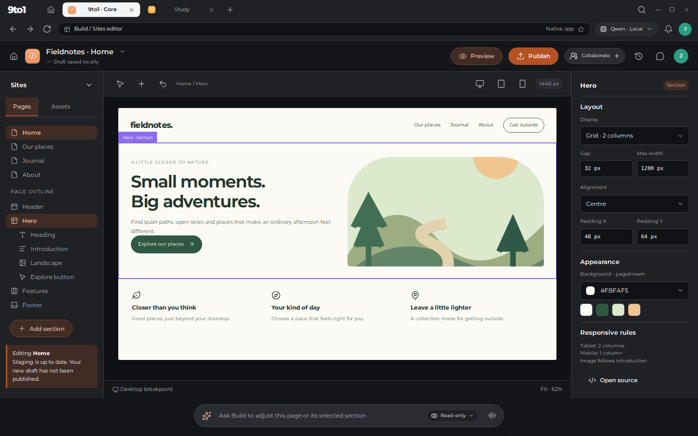
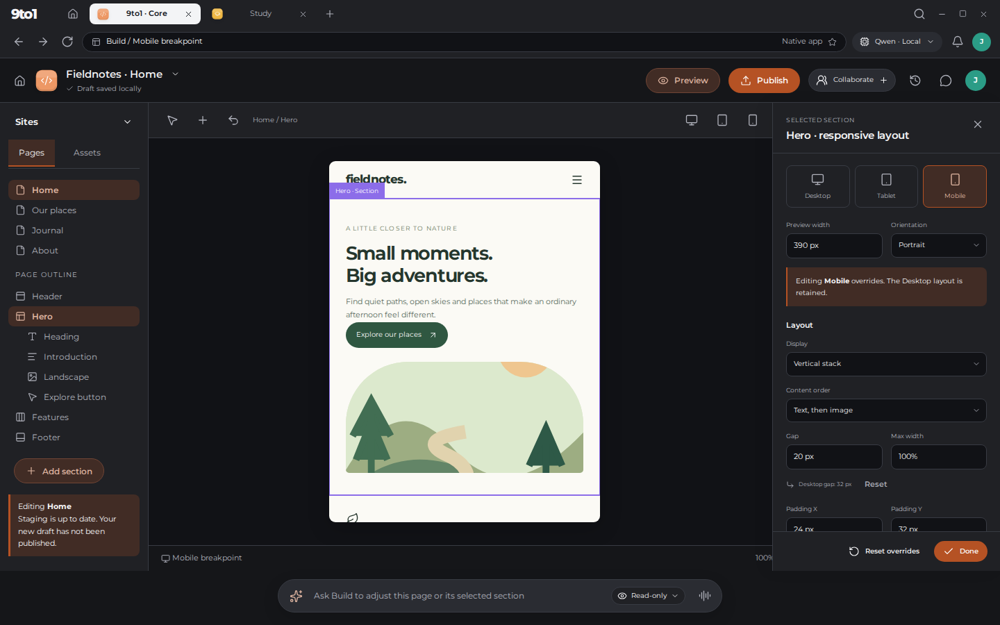

# Build Sites — responsive site authoring

Module ID: `build-sites` · 9to1 Development Specification v3

## Prerequisites

- **CUI, themes and shared interaction system** — Typed UI components, theme tokens/materials, layout, focus, motion, accessibility and shared control states.
- **Artifacts, local persistence and recovery** — Canonical artifacts, revisions, typed edits, local saves, derived exports, sync and recovery.
- **Permissions, approvals and execution scope** — Effective scoped grants, action approvals, policy intersections, revocation and audit.
- **Shared AI controls and artifact collaboration** — Contextual AI bars, shared model/permission controls, global collaborators and typed artifact proposals.

## Overview

Build Sites is the visual website domain of Build, sharing the project and source model with Code/Stacks. Responsive editing, content and publishing use real component/page data rather than a screenshot-only page canvas.

## Layouts & visible states

- **V3-BUILD-SITES-LAY-01** — Use page/component outline, central responsive preview and a selected-element inspector. Show desktop/tablet/mobile viewport controls with clear active width and breakpoint.
- **V3-BUILD-SITES-LAY-02** — Properties distinguish inherited/base values from breakpoint overrides. Preview, edit and deployed/public state are distinct.

## Features & behaviour

- **V3-BUILD-SITES-FEA-01** — Create and edit pages, reusable components, layouts, typography, assets, links/forms and source-defined CMS/content settings.
- **V3-BUILD-SITES-FEA-02** — Responsive changes apply to the selected property/breakpoint scope, preserve base/inherited values and allow explicit override reset.
- **V3-BUILD-SITES-FEA-03** — Code and visual changes target the same project model. Preview uses a real development environment and labels unavailable functionality truthfully.
- **V3-BUILD-SITES-FEA-04** — Publish/deploy identifies destination/domain, revision, validation and rollback state; production publication is a consequential separately authorised action.

## Canonical entities & persistence

- **V3-BUILD-SITES-ENT-01** — Persist ProjectID, page/component/element IDs, style tokens, breakpoint rules, asset references, content schema and revision.
- **V3-BUILD-SITES-ENT-02** — Preview session, build artifact, deployment revision and domain configuration are separate canonical records.

## Permissions & recovery

- **V3-BUILD-SITES-PER-01** — Respect project, provider and deployment grants. A saved design is not a published site, and an authorised preview is not permission to deploy.
- **V3-BUILD-SITES-PER-02** — Recover invalid builds, broken asset references and failed deployment without losing editable source or the last known-good published version.

## Acceptance checks

- **V3-BUILD-SITES-ACC-01** — Test responsive property inheritance/override/reset, component editing and the same change visible in code.
- **V3-BUILD-SITES-ACC-02** — Verify preview versus publish distinction, selected revision, error recovery and explicit deployment target.

## Exact mock-up and state map

- **Build · Sites editor** — screen `build-sites`. Sites.
- **Build Sites · Mobile breakpoint** — screen `build-sites-responsive`. Responsive · inspector.

## Source clause IDs

Named baseline section(s) retained in the technical-source chapters below.

## Technical reading map

- Build Sites — responsive site authoring — Sites; Product role and ownership principle (part 01) — `technical/build-sites-01.md` (5,784 words; V2-B1816).

Technical clauses retain APIs, data models, platform, recovery, donor and acceptance details. The technical files are part of this module, not optional background reading. Shared prerequisites mean stable service/interface contracts must be available; they do not require every dependent app UI to be complete. Use the named chunk for the relevant subtask or the complete module file for its full retained contract.

# Exact designs and implementation rules

These figures are the exact current atlas compositions. Their stable screen IDs match the Word specification and editable source. Open the atlas for full-size theme and interaction inspection.

## Build · Sites editor

Screen ID: `build-sites`. Source: UX27-BUILD-001,004,006; Sites: Visual Page Editor, Responsive design, Preview fidelity, Deployment safeguards.

- Sites editing and Code operate on the same project, components and source revision.
- The public page appears inside an isolated preview. Its fonts, colours and styles never become editor chrome.
- Responsive preview and selected-component properties represent the same source model.
- Preview, staging and production are separate states. Publish must show its environment and changes before committing.

## Build Sites · Mobile breakpoint

Screen ID: `build-sites-responsive`. Source: UX27-BUILD-004,006; Sites / Responsive design, Visual Page Editor and Preview fidelity.

- The mobile preview is the same canonical Home page and Hero component at a 390px viewport; it is not a copied mobile page.
- Inspector controls distinguish inherited Desktop values from explicit Mobile overrides, with reset-to-inherited actions and clear breakpoint scope.
- Responsive properties update the supported site model and remain undoable. Visual preview and authored breakpoint rules must stay consistent.
- Changing a breakpoint or preview width never publishes the site. Production deployment remains a separate reviewed action.
