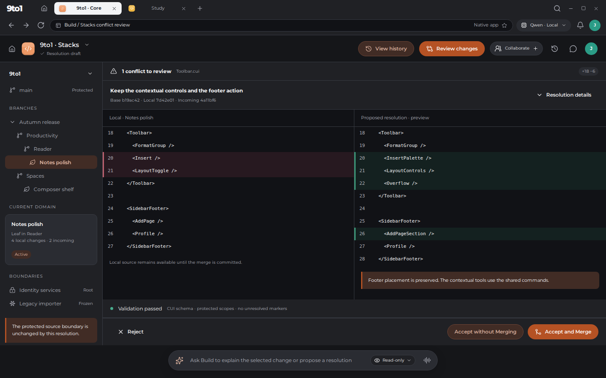
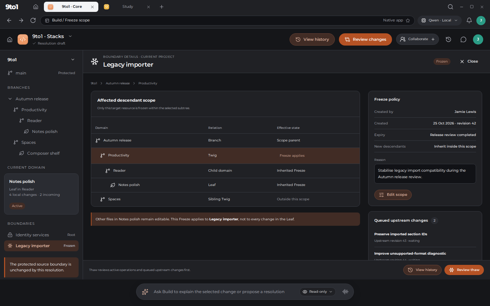

# Build Stacks — Branch, Twig and Leaf source control

Module ID: `build-stacks` · 9to1 Development Specification v3

## Prerequisites

- **CUI, themes and shared interaction system** — Typed UI components, theme tokens/materials, layout, focus, motion, accessibility and shared control states.
- **Artifacts, local persistence and recovery** — Canonical artifacts, revisions, typed edits, local saves, derived exports, sync and recovery.
- **Permissions, approvals and execution scope** — Effective scoped grants, action approvals, policy intersections, revocation and audit.

## Overview

Build Stacks exposes the specified Branch/Twig/Leaf hierarchy, changes and promotion controls over the canonical Build project. It preserves the source-defined collaboration, freeze and Git interoperability semantics.

## Layouts & visible states

- **V3-BUILD-STACKS-LAY-01** — Show the hierarchical Branch/Twig/Leaf tree, selected branch metadata, changed files/diff and actionable Change Requests.
- **V3-BUILD-STACKS-LAY-02** — Branch detail exposes author/owner, source/target revisions, freeze scope and state. Freeze controls show affected hierarchy, reason and release/expiry semantics.

## Features & behaviour

- **V3-BUILD-STACKS-FEA-01** — Preserve root authority/cascade, scoped freeze and reconciliation rules. Freezing a branch must not ambiguously freeze every unrelated project or delete working changes.
- **V3-BUILD-STACKS-FEA-02** — Keep Reject, Accept without Merging and Accept and Merge distinct. Promotion/review uses the actual change request and target branch/revision.
- **V3-BUILD-STACKS-FEA-03** — Support diff/conflict resolution, commit/history and source-defined Git interoperability without inventing independent file copies for every view.

## Canonical entities & persistence

- **V3-BUILD-STACKS-ENT-01** — Persist stack/project IDs, Branch/Twig/Leaf identities, ancestry, commits/revisions, change requests, merge outcomes and freeze audit records.
- **V3-BUILD-STACKS-ENT-02** — Working-tree edits remain distinguishable from committed/promoted revisions.

## Permissions & recovery

- **V3-BUILD-STACKS-PER-01** — Check author/role and protected-scope permissions before freeze, merge or promotion. Recheck target revision to prevent stale approvals.
- **V3-BUILD-STACKS-PER-02** — Recover conflicts and interrupted operations without silently accepting changes or losing uncommitted work.

## Acceptance checks

- **V3-BUILD-STACKS-ACC-01** — Test hierarchy navigation, diff/review and all three exact decision outcomes.
- **V3-BUILD-STACKS-ACC-02** — Exercise scoped freeze/release, concurrent target change, merge conflict and canonical Code/Sites working-tree identity.

## Exact mock-up and state map

- **Build · Stacks conflict review** — screen `build-stacks`. Stacks.
- **Build Stacks · Freeze scope** — screen `build-stacks-freeze`. Boundary · queued changes.

## Source clause IDs

Named baseline section(s) retained in the technical-source chapters below.

## Technical reading map

- Build Stacks — Branch, Twig and Leaf source control — Stacks; Product role (part 01) — `technical/build-stacks-01.md` (2,395 words; V2-B1708, V2-B1709, V2-B1710…).
- Build Stacks — Branch, Twig and Leaf source control — API and integration contracts; permissions and approvals (part 02) — `technical/build-stacks-02.md` (100 words; V2-B1812, V2-B1813, V2-B1814).
- Build Stacks — Branch, Twig and Leaf source control — Domain identity and effective source; Domain creation, hierarchy guards and reparenting (part 03) — `technical/build-stacks-03.md` (3,970 words; V2-B1815).

Technical clauses retain APIs, data models, platform, recovery, donor and acceptance details. The technical files are part of this module, not optional background reading. Shared prerequisites mean stable service/interface contracts must be available; they do not require every dependent app UI to be complete. Use the named chunk for the relevant subtask or the complete module file for its full retained contract.

# Retained technical requirements

# Build Stacks — Branch, Twig and Leaf source control — Stacks; Product role (part 01)

Reading status: active retained clauses, subject to the v3 owner overrides listed in the primary module. Historical process instructions and replaced original wording are stored separately.

### V2-B1708 · v2 lines 9043–9045

Stacks
Product role
Stack is 9to1's team-first source-control and software-collaboration product. It is not a conventional GitHub clone or a desktop Git client. It combines Git hosting/collaboration with a higher-level project model designed for parallel team development, cascading shared frameworks, strong source-domain rules, public collaboration and deep integration with the rest of 9to1.

### V2-B1709 · v2 lines 9048–9049

Donors
Primary donor: Gitea. Preserve mature donor features, quality-of-life behaviour and collaboration capabilities wherever they remain applicable, including repositories, users/teams, permissions, history/diffs, reviews, issues, releases, Git LFS, migration/mirroring and related backend features. Stack-specific behaviour replaces donor behaviour where the models conflict.

### V2-B1710 · v2 lines 9052–9052

Secondary donor/reference: Gitnuro may be used for local desktop Git workflows and UX patterns where useful.

### V2-B1711 · v2 lines 9055–9055

Donor parity must be explicitly audited. Every mature donor feature must be preserved, replaced by a 9to1-native equivalent, or explicitly recorded as not applicable.

### V2-B1712 · v2 lines 9058–9062

Project and storage model
Each Stack project is an independent project boundary. A Stack project may use:
* 9to1 Files as the source backing store;
* its own dedicated public or private GitHub repository;
* both Files and GitHub together, according to the user's configuration.

### V2-B1713 · v2 lines 9065–9065

Stack must never combine unrelated Stack projects into one shared repository.

### V2-B1714 · v2 lines 9068–9068

Public Stack projects MUST expose a dedicated user-facing source-browsing, forking and contribution interface. Normal participation MUST NOT require direct access to Stack-managed backing folders, manifests or dependency branches.

### V2-B1715 · v2 lines 9073–9073

Stack supports mixed public/private project components through an explicit visibility model attached to canonical resources/domains. Public projection is generated only from resources whose effective visibility permits publication; private files, objects, commits, credentials, metadata and historical objects MUST be excluded from the public Git/source projection, not merely hidden in the UI. Before publishing or mirroring a mixed-visibility project, Stack MUST validate the projected commit/object graph and block publication if private ancestry/content would be reachable.

### V2-B1716 · v2 lines 9078–9081

Startup and app shell
Stack has two startup modes:
* New Session: open Home.
* Last State: restore the previous tabs and navigation state.

### V2-B1717 · v2 lines 9084–9084

If Last State would reopen a tab/state that is known to have caused a repeatable crash, Stack must suppress or close the offending tab rather than crash-loop.

### V2-B1718 · v2 lines 9087–9089

Stack always uses a tabbed interface:
←  →  |  🏠  |  Project Tab 1  |  Project Tab 2  |  +
Home is permanently available as the leftmost tab. Opening a project opens a new tab. The + button opens a new tab.

### V2-B1719 · v2 lines 9092–9092

Home contains the main dashboard and its own sidebar pages, including My Projects, Discover Projects, Audit Log, My Team, Settings and similar administration/discovery surfaces. These pages stay inside Home rather than becoming separate top-level app tabs.

### V2-B1720 · v2 lines 9095–9095

Clicking Home while Home is already selected returns Home to the main dashboard.

### V2-B1721 · v2 lines 9098–9098

Back/Forward arrows sit to the left of Home and navigate history inside the currently selected tab. Unavailable navigation buttons are disabled/greyed.

### V2-B1722 · v2 lines 9101–9102

Source lineage
main is a special top-level source root and is above all normal Branches.

### V2-B1723 · v2 lines 9105–9105

main may contain normal project source and Roots. main may NEVER contain Twigs, Leaves or Subroots.

### V2-B1724 · v2 lines 9108–9112

Normal development follows:
main
└─ Branch
   └─ Twig
      └─ Leaf

### V2-B1725 · v2 lines 9115–9115

A Branch is broadly analogous to a Git branch.

### V2-B1726 · v2 lines 9118–9118

A Twig is a nested development domain beneath a Branch.

### V2-B1727 · v2 lines 9121–9121

A Leaf is a nested development domain beneath a Twig.

### V2-B1728 · v2 lines 9124–9124

Stack does not use worktrees as its user-facing or internal parallel-development model.

### V2-B1729 · v2 lines 9127–9135

Example:
main
└─ 9to1 2027 Q1 Update
   ├─ Write
   │  ├─ New Font Switcher
   │  ├─ Editor 2.0
   │  └─ Persistent Word Counter
   ├─ Present
   └─ Data 2.0

### V2-B1730 · v2 lines 9138–9139

Cascade semantics
Inheritance cascades downward by default:

### V2-B1731 · v2 lines 9142–9142

main → Branch → Twig → Leaf.

### V2-B1732 · v2 lines 9145–9145

Changes committed to main automatically cascade into every Branch and then through descendants.

### V2-B1733 · v2 lines 9148–9148

Changes made at a Branch cascade into its Twigs and Leaves.

### V2-B1734 · v2 lines 9151–9151

This allows shared frameworks/donor changes to be implemented once at a higher domain rather than duplicated in every child.

### V2-B1735 · v2 lines 9154–9154

If a cascade conflicts with descendant work, propagation for the affected path/node pauses until the conflict is resolved.

### V2-B1736 · v2 lines 9157–9157

The effective source state of a Twig/Leaf is its own changes combined with inherited state from its ancestors.

### V2-B1737 · v2 lines 9160–9160

Deletion and rename semantics must be represented explicitly so inherited files do not incorrectly reappear after a child intentionally deletes or renames them.

### V2-B1738 · v2 lines 9163–9164

Active domain
Users do not switch branches in the traditional Git sense.

### V2-B1739 · v2 lines 9167–9167

Right-clicking any Branch/Twig/Leaf exposes Set Active.

### V2-B1740 · v2 lines 9170–9170

The active domain is only the default context used when opening an editor, running tests or building the project.

### V2-B1741 · v2 lines 9173–9173

Other Branches/Twigs/Leaves remain browseable and actionable at all times and can expose actions such as Open in Editor or Build without requiring the user to stash changes or change the active domain.

### V2-B1742 · v2 lines 9176–9176

If no Branch/Twig/Leaf is active, main becomes active automatically.

### V2-B1743 · v2 lines 9179–9187

Project sidebar
A project shows its whole lineage as one collapsible tree rather than hiding branches behind a branch selector:
Project
└─ Branches
   └─ Branch (+A -D)
      └─ Twigs
         └─ Twig (+A -D)
            └─ Leaves
               └─ Leaf (+A -D)

### V2-B1744 · v2 lines 9190–9190

Project, Branches, Twigs and Leaves are collapsible headers.

### V2-B1745 · v2 lines 9193–9195

Every Branch/Twig/Leaf label shows live diff totals, for example:
Notes Overhaul (+90 -20)
Displayed +A/-D totals MUST represent only the delta owned by that node relative to its effective parent. Inherited ancestor changes MUST NOT increase a child node’s own displayed totals.

### V2-B1746 · v2 lines 9200–9200

Selecting a node shows its effective source plus the node's diff against its parent. Changed filenames are visually status-coded, including green for additions/positive changes and red for removals/deletions, with clear states for renames and conflicts. Diff entries show the affected path and exact file/location.

### V2-B1747 · v2 lines 9203–9204

Local and remote state
Uncommitted/unpushed changes appear at the top of a node's change view in bold with a yellow up-arrow.

### V2-B1748 · v2 lines 9207–9207

Committed changes appear underneath.

### V2-B1749 · v2 lines 9210–9210

Any Branch/Twig/Leaf containing uncommitted/unpushed changes also shows the yellow up-arrow beside its tree label.

### V2-B1750 · v2 lines 9213–9213

A user setting can change this view to show only uncommitted/unpushed changes.

### V2-B1751 · v2 lines 9216–9216

If changes exist on the remote but not the current machine, show a yellow cloud icon beside the node.

### V2-B1752 · v2 lines 9219–9219

If remote and local changes conflict, the cloud turns red.

### V2-B1753 · v2 lines 9222–9223

Conflict handling
When a conflict is detected, Stack opens a popup listing the conflicting filenames.

### V2-B1754 · v2 lines 9226–9226

View details opens the exact conflicting hunks/locations.

### V2-B1755 · v2 lines 9229–9229

Summarise with AI sends the relevant conflict context to Dulche/Home and returns a plain-language summary of the conflict.

### V2-B1756 · v2 lines 9232–9232

Fix with AI asks Dulche to produce a resolution through typed source-control actions rather than opaque UI automation.

### V2-B1757 · v2 lines 9235–9239

After an AI fix, Stack presents:
* a summary of what Dulche changed;
* the resulting diff;
* Reject;
* Accept and Merge ▼.

### V2-B1758 · v2 lines 9242–9242

The dropdown under Accept and Merge contains Accept without Merging.

### V2-B1759 · v2 lines 9245–9245

Reject restores the pre-fix state.

### V2-B1760 · v2 lines 9248–9248

Accept without Merging keeps the resolved changes but does not complete the merge.

### V2-B1761 · v2 lines 9251–9251

Accept and Merge accepts the resolution and completes the merge.

### V2-B1762 · v2 lines 9254–9254

AI conflict resolutions must never silently merge without this explicit review step.

### V2-B1763 · v2 lines 9257–9258

Roots
A Root means: this file/folder/domain is structurally important and locked in Stack.

### V2-B1764 · v2 lines 9261–9261

Root state is stored in roots.json in the owning domain. Domain means main, Branch, Twig or Leaf.

### V2-B1765 · v2 lines 9264–9264

All files/paths listed in that domain's roots.json are locked by Stack according to Root rules.

### V2-B1766 · v2 lines 9267–9267

A Root is authoritative for descendants: child domains cannot edit, replace or override the protected content directly.

### V2-B1767 · v2 lines 9270–9270

Roots represent authoritative shared frameworks, donor source or other protected components. Unless changed through the Root/Subroot workflow, Root content MUST cascade unchanged into descendant domains and descendants MUST NOT override it directly.

### V2-B1768 · v2 lines 9275–9275

A Root may exist in main or another domain.

### V2-B1769 · v2 lines 9278–9278

Root enforcement must derive from stored metadata, not only from transient UI state.

### V2-B1770 · v2 lines 9281–9282

Freeze
Freeze is different from Root.

### V2-B1771 · v2 lines 9285–9285

Root means “important/authoritative; direct editing below this domain is not allowed.”

### V2-B1772 · v2 lines 9288–9288

Freeze means “out of scope for now.”

### V2-B1773 · v2 lines 9291–9291

When creating a Freeze, the user chooses exactly which descendant subdomains inherit the Freeze. It does not automatically apply to every child unless selected.

### V2-B1774 · v2 lines 9294–9294

A Freeze may have an expiry point/time/condition after which editing is restored automatically.

### V2-B1775 · v2 lines 9297–9300

Stack must clearly show:
* that a file/domain is frozen;
* which descendants the Freeze applies to;
* when it expires, if applicable.

### V2-B1776 · v2 lines 9303–9303

Freeze lifecycle is explicit. A Freeze records stable FreezeID, target Root/resource/domain, selected descendant scope, creator, reason, creation revision, optional expiry/condition and state. New descendants inherit an active Freeze only when they fall inside its configured scope policy. Early thaw requires the configured Freeze-management permission and is audited. Automatic expiry transitions the Freeze to Expired and restores editability only after Stack checks for in-progress operations and reconciles queued upstream changes. A user without Freeze-management permission cannot override or bypass an active Freeze.

### V2-B1777 · v2 lines 9308–9309

Subroots
A Subroot is the controlled mechanism for testing changes to Root files.

### V2-B1778 · v2 lines 9312–9314

Subroots sit in the same domain that owns the Root, for example:
Twig
└─ Twig Subroots

### V2-B1779 · v2 lines 9317–9317

A Subroot explicitly selects which Roots are in scope.

### V2-B1780 · v2 lines 9320–9320

Each Root file/folder can be included in only one active Subroot at a time within that domain. Stack must prevent overlapping Subroots from claiming the same Root.

### V2-B1781 · v2 lines 9323–9323

Root changes are developed/tested through the Subroot rather than by directly editing protected descendant copies.

### V2-B1782 · v2 lines 9326–9326

main can contain Roots but can NEVER contain Subroots.

### V2-B1783 · v2 lines 9329–9329

Subroot completion is a first-class reviewed operation. Completing a Subroot requires a diff against the owning Root, configured validation/check results, conflict resolution and the required approvals. On completion the accepted change is applied to the owning Root as one auditable Root update, descendants receive it through normal cascade semantics, and the Subroot releases its Root claims. The user may instead abandon the Subroot, which discards its proposed Root changes while preserving audit/history. A Subroot cannot be silently deleted while it owns unresolved changes or Root claims.

### V2-B1784 · v2 lines 9334–9344

Files-backed storage
For Files-backed projects, Stack uses explicit Stack-managed dot folders:
Project Name/
├─ .git/
├─ .branches/
│  └─ Branch/
│     └─ nested Stack structure
├─ .source/
│  └─ project source tree
└─ .roots/
   └─ roots.json

### V2-B1785 · v2 lines 9347–9347

Leading-dot paths are Stack-managed infrastructure. The UI MUST identify them as managed/internal state and MUST prevent ordinary project-editing flows from casually deleting or editing them. Explicit diagnostic/recovery tooling MAY expose controlled access.

### V2-B1786 · v2 lines 9352–9352

The exact nested on-disk schema for Branch/Twig/Leaf/Subroot domains and their per-domain metadata must be versioned and documented.

### V2-B1787 · v2 lines 9355–9355

Stack MUST validate its managed folders/manifests when opening/synchronising a project. If required infrastructure is missing, moved, altered or partially deleted, Stack MUST enter a recoverable/diagnostic state, identify the damaged objects and attempt deterministic reconstruction from retained metadata/object IDs where reconstruction is possible; it MUST NOT silently treat damaged infrastructure as ordinary project source.

### V2-B1788 · v2 lines 9360–9361

GitHub-backed storage
Each Stack project using GitHub maps to its own dedicated GitHub repository.

### V2-B1789 · v2 lines 9364–9364

Normal Stack Branches remain normal native Git branches in that repository.

### V2-B1790 · v2 lines 9367–9367

Twigs, Leaves and Subroot state are not represented as a proliferation of independent Git branches.

### V2-B1791 · v2 lines 9370–9370

Stack stores Twig/Leaf/Subroot nested state in protected Stack-managed companion storage in the same repository. The canonical Git ref for that companion branch is `stack/twigs-and-leaves-dependency`; the UI presents it as managed infrastructure (for example “Twigs and Leaves (DEPENDENCY)”) and MUST NOT expose it as an ordinary user Branch.

### V2-B1792 · v2 lines 9375–9375

This dependency branch is never surfaced as a normal Branch inside Stack. Stack interprets it and renders the actual Branch → Twig → Leaf hierarchy.

### V2-B1793 · v2 lines 9378–9378

The dependency branch must contain a prominent README explaining that it is Stack-managed infrastructure and must not be deleted, merged into normal branches, rebased, renamed or manually edited.

### V2-B1794 · v2 lines 9381–9381

It must also contain a Stack manifest/schema sufficient to identify the project, version the storage format, map Branch/Twig/Leaf/Subroot IDs and recover safely.

### V2-B1795 · v2 lines 9384–9384

If the dependency tree/manifest appears in a normal branch because somebody merged or moved it, Stack must recognise the signature, warn the user and recover/relink the dependency branch where possible rather than treating those files as normal project source.

### V2-B1796 · v2 lines 9387–9387

If the dependency branch is deleted, Stack MUST detect the missing managed ref and MUST attempt reconstruction from retained commit/object IDs, manifests and configured Files-backed recovery metadata. If complete reconstruction is impossible, Stack MUST preserve recoverable evidence, identify unrecoverable objects explicitly and block unsafe writes that could overwrite remaining recovery state.

### V2-B1797 · v2 lines 9392–9392

The GitHub adapter MUST preserve Stack semantics rather than mirror the Files backing layout literally. Branches map to native Git branches; Twig/Leaf/Subroot state maps to the protected Stack companion branch/manifest model defined above. Other entities MUST use a native GitHub/Git construct only when that construct preserves the canonical Stack identity, permissions and lifecycle semantics; otherwise Stack-managed metadata remains authoritative.

### V2-B1798 · v2 lines 9397–9398

Sweeping and pruning
Sweep collects the changes from all descendant Twigs/Leaves into the owning Branch root, then removes those descendant development domains.

### V2-B1799 · v2 lines 9401–9401

Prune removes/discards a Stack Branch and its descendants from Stack.

### V2-B1800 · v2 lines 9404–9404

Prune requires 2FA.

### V2-B1801 · v2 lines 9407–9407

main can never be pruned.

### V2-B1802 · v2 lines 9410–9410

Pruning must not immediately destroy the backing source. The underlying Files/GitHub data must remain recoverable/auditable according to the project's retention policy.

### V2-B1803 · v2 lines 9413–9413

Individual Twigs and Leaves can also be removed independently.

### V2-B1804 · v2 lines 9416–9416

Pruned domains enter a recoverable Deleted state for the project's configured retention period. Restore reactivates the same stable DomainID and backing references when their retained source objects remain valid. Permanent purge is a separate privileged operation, requires explicit confirmation and 2FA for protected project policies, and is blocked while retained objects are referenced by active descendants, releases, change requests, audit requirements or recovery points. Purge records what was removed and what immutable audit evidence remains.

### V2-B1805 · v2 lines 9421–9422

Public collaboration
Public Stack projects expose a dedicated Stack interface for source browsing, forks and contributions rather than forcing users into internal Files storage.

### V2-B1806 · v2 lines 9425–9425

Public projects provide project profiles, source browsing, history/releases, contributor identity, forks, Change Requests, notifications and Discover integration. Moderation supports project-level roles, report/block actions and removal of abusive public content without rewriting unrelated source history. Forks receive independent ProjectID/repository identity and record their source-project provenance. Contributions return through Change Requests against an explicitly selected destination domain; contributors never receive implicit access to private project components or Stack-managed dependency storage.

### V2-B1807 · v2 lines 9430–9430

Where project components have different public/private visibility, Stack must preserve hard security boundaries and never rely on UI hiding.

### V2-B1808 · v2 lines 9433–9434

Sites integration
Stack is closely integrated with Sites.

### V2-B1809 · v2 lines 9437–9437

At minimum, Sites must be able to use Stack projects as source projects, open the relevant source domain, and maintain source ownership/history rather than publishing opaque generated output.

### V2-B1810 · v2 lines 9440–9440

Sites binds deployments/previews to exact Stack ProjectID, DomainID and source revision. Branch/Twig/Leaf domains may create isolated preview deployments where policy permits; production deployments default to an approved Main revision unless the project explicitly authorises another release source. Build/deployment status is attached to the exact revision. Sites edits to source-backed projects are committed back into the currently bound Stack domain as ordinary reviewable source changes; Sites MUST NOT maintain an anonymous divergent copy of the project.

### V2-B1811 · v2 lines 9445–9446

Gitea/Gitnuro donor parity
Gitea is the primary donor and must be forked from the latest appropriate source at implementation time.

# Build Stacks — Branch, Twig and Leaf source control — API and integration contracts; permissions and approvals (part 02)

Reading status: active retained clauses, subject to the v3 owner overrides listed in the primary module. Historical process instructions and replaced original wording are stored separately.

### V2-B1812 · v2 lines 9449–9449

Gitnuro may be used as a secondary donor/reference for local Git UX where its licence and architecture permit.

### V2-B1813 · v2 lines 9452–9466

Donor parity must cover, where applicable:
* repositories and repository settings;
* users, organisations/teams and permissions;
* commit history, branches, tags and diffs;
* reviews/pull-request-equivalent workflows;
* issues, milestones and project-management integration;
* releases;
* Git LFS;
* import/migration and mirroring;
* webhooks/integration surfaces;
* CI/build automation donor capabilities;
* package/release distribution capabilities;
* audit/activity history;
* search;
* mature donor QoL and recovery behaviour.

### V2-B1814 · v2 lines 9469–9469

A feature may only be omitted when Stack deliberately replaces it or records it as not applicable.

# Build Stacks — Branch, Twig and Leaf source control — Domain identity and effective source; Domain creation, hierarchy guards and reparenting (part 03)

Reading status: active retained clauses, subject to the v3 owner overrides listed in the primary module. Historical process instructions and replaced original wording are stored separately.

### V2-B1815 · v2 lines 9472–9682

Domain identity and effective source
Every source domain has stable DomainID, ProjectID, type (Main, Branch, Twig or Leaf), parent DomainID where applicable, name, creation/base revision, local revision, effective revision, state, visibility, permission policy and Revision. Renaming or moving display labels MUST NOT change identity.
Effective source is a deterministic projection of the domain's inherited ancestor state plus the domain's own deltas, tombstones, renames and Root/Freeze/Subroot rules. For a Leaf, the conceptual order is Main baseline → Branch delta → Twig delta → Leaf delta.
Each effective file/resource can expose lineage: originating ancestor/domain, inherited revision, local override/delta, rename/delete state, Root authority and any paused/conflicted cascade. View lineage MUST use canonical history rather than infer origin from current path text.
Domain creation, hierarchy guards and reparenting
Hierarchy is enforced by the model/API: Main may create Branches; a Branch may create Twigs; a Twig may create Leaves; a Leaf cannot create children. Main cannot be a child and cannot contain Twigs, Leaves or Subroots.
Creating a child records its exact parent/base effective revision. Later parent changes arrive through cascade processing; the recorded base remains available for history, review and conflict calculation.
Reparenting is not a rename. Moving a Twig to another Branch or a Leaf to another Twig requires an explicit Reparent operation that calculates the new base/effective source, previews conflicts, preserves stable DomainID/history and requires the configured permission. Cross-project reparenting is prohibited; use fork/import/migration workflows instead.
Deletion of a parent with active descendants is blocked unless the operation explicitly archives/prunes/migrates the descendants under the corresponding lifecycle rules.
Materialisation and concurrency model
Stack MUST support opening, browsing, building and acting on multiple domains concurrently without requiring user-facing Git worktree switching. Each active execution/editor receives a domain-scoped materialised view produced from canonical effective source.
Implementations MAY use overlay filesystems, virtual projections, content-addressed materialisation, temporary isolated checkout directories or another robust mechanism, but the materialisation is derived state and MUST NOT become a competing source of truth.
Concurrent writes target stable DomainID/resource identity. Two clients or agents editing the same domain/resource use revision/merge conflict semantics; isolated domains may proceed independently. A failed materialisation or cache rebuild MUST be recoverable from canonical Stack/Git/Files state.
Commit history for Branches, Twigs, Leaves and Subroots
Branches use normal native Git commit history where Git-backed. Twig/Leaf/Subroot changes also have ordered canonical Change/Commit records with stable IDs, parent revision, author/initiator, timestamp, message, affected resources and resulting domain revision.
When GitHub-backed, Twig/Leaf/Subroot commit objects are represented through the protected Stack companion storage/manifest so their history is durable without exposing each nested domain as a normal Git branch. The manifest maps stable Stack change IDs to retained Git object/content identities sufficient for reconstruction.
History for a domain distinguishes inherited ancestor changes from locally authored changes. Rewriting or squashing history is explicit and permission-controlled; it MUST NOT silently invalidate descendants, releases or open Change Requests.
Promotion and Change Requests
Normal contribution flow is Leaf → parent Twig → parent Branch → Main. Promotion is explicit upward movement of a reviewed change set; downward inheritance remains the separate cascade mechanism.
A ChangeRequest has stable ChangeRequestID, source DomainID/revision, destination DomainID/revision, included changes/commits, diff, author, reviewers, comments, required checks, approvals, conflict state, policy state, outcome and resulting revision.
Promote from a Leaf normally targets its parent Twig; from a Twig its parent Branch; from a Branch Main. Project policy MAY allow a deliberate bypass, but the UI/API must state which levels are being bypassed, calculate the complete destination diff and record the bypass in audit history.
Promotion never silently includes unrelated descendant or working-tree changes. The source revision being reviewed is pinned. New source edits after review begins create a new revision and invalidate/re-run configured approvals/checks as policy requires.
Completing a Change Request applies the accepted change to the destination, records resulting lineage, then normal cascade semantics propagate the destination update downward. The source domain may remain open, be marked completed or be swept/pruned according to user/project policy.
Review, approvals and merge strategy
Change Requests support threaded review comments, requested changes, approvals, assigned reviewers, CODEOWNERS/ownership-style policies where configured, check requirements and protected-domain rules.
Available integration strategies may include merge commit, fast-forward, rebase or squash only where the target/domain policy and Stack lineage model can preserve stable identity and ancestry. The chosen strategy is explicit in the Change Request outcome.
Protected Main/Branch domains can require approvals, passing checks, signed commits or designated maintainers before promotion. An administrator override, where policy permits it, is explicit and audited.
Cascade implementation and update state
Automatic Main/Branch cascade is represented as canonical ancestor revisions applied to descendant effective-source state, not as an uncontrolled series of user-visible Git merges. Each descendant tracks the highest ancestor revision successfully incorporated for each relevant lineage.
When an ancestor changes, Stack computes the descendant update. Non-conflicting inherited changes become part of effective source automatically; locally owned +A/-D totals remain unchanged. If a resource conflicts, cascade for that affected resource/path pauses and the descendant records UpstreamConflict while unrelated safe updates MAY continue.
Users can inspect pending/inherited upstream changes and the ancestor revisions that caused them. Cascade processing is idempotent and crash-resumable.
Deletion, rename and tombstone inheritance
A descendant deletion is represented as a tombstone bound to canonical resource lineage, not mere physical absence. The tombstone prevents the deleted ancestor resource from reappearing when a later cascade occurs.
Renames/moves preserve stable resource lineage where deterministically known, storing old/new path plus resource identity. A later ancestor edit to the pre-rename resource is mapped to the renamed descendant resource when lineage proves equivalence; ambiguous cases surface a conflict.
Replacing a resource with an unrelated new resource at the same path creates new lineage rather than pretending it is the old object. Tombstones and rename metadata are versioned and included in recovery/migration.
Conflict objects and resolver
Every unresolved conflict is a structured Conflict object with stable ConflictID, ProjectID/DomainID, resource identity/path, base revision/content, upstream side, local side, conflicting regions/properties, lineage, origin operation, state, assigned resolver where applicable and Revision.
Text/code conflict resolution supports three-way views such as Upstream | Result | Local, hunk/region selection, take upstream, take local, combine/edit result, accept all non-conflicting changes and Open in Dev. Structured 9to1 resources SHOULD use semantic conflict resolution when a canonical domain API can represent it faithfully.
Dulche may Summarise or propose Fix with AI through typed actions. AI proposals remain reviewable diffs; Reject restores the pre-proposal resolution state, Accept without Merging stores the resolution, and Accept and Merge completes the pending operation only after explicit user approval.
Root authority model
Root records have stable RootID, owning DomainID, protected resource identities/paths, creation revision, state, provenance/reason, policy and Revision. Root enforcement comes from canonical metadata; roots.json is a persisted projection/manifest, not the only source of truth.
A Root locks descendant override of the protected resource. The owning domain may update its Root through authorised Root workflows, after which descendants inherit the new authoritative state through normal cascade rules.
Root scope may include a file, folder or registered structured resource. Overlapping Root definitions are validated so ownership is deterministic.
Subroot lifecycle
A Subroot is a controlled experimental/update workspace for one or more Roots owned by the same eligible non-Main domain. It has stable SubrootID, owning DomainID, claimed RootIDs, base Root revisions, local proposed changes, checks/review state and lifecycle state.
Within one owning domain, a Root can belong to only one active Subroot at a time. Main can contain Roots but cannot contain Subroots.
Completing a Subroot requires a diff against the owning Root, required tests/checks, conflict resolution and configured approvals. Accepted changes update the owning Root atomically as an auditable Root revision, release the claims and cascade to descendants. Abandoning a Subroot discards the proposal while retaining history/audit. Subroots with unresolved changes/claims cannot be silently deleted.
Freeze lifecycle and permissions
A Freeze is a scoped edit restriction, distinct from Root authority. Freeze records have stable FreezeID, target resource/domain, selected descendant scope, creator, reason, creation revision, optional expiry/condition, policy and state.
New descendants inherit an active Freeze only according to its declared scope policy. Early thaw requires Freeze-management permission and is audited. Automatic expiry moves the Freeze to Expired and restores editability after checking in-progress operations and reconciling queued upstream updates.
Users without Freeze-management permission cannot bypass a Freeze through API, raw Git adapter or alternate client. Emergency administrator override, if enabled by organisation policy, is explicit, requires strong confirmation and is audited.
Files and GitHub dual-authority/synchronisation
When only Files backing is enabled, Files/Stack canonical metadata and source are authoritative. When only GitHub backing is enabled, native Git state plus protected Stack metadata are authoritative according to the adapter contract.
When both Files and GitHub are enabled, the project config explicitly selects authority mode: Stack/Files primary with GitHub mirror, GitHub primary with Files cache/backup, or managed bidirectional synchronisation. Bidirectional mode uses stable object/revision mapping and MUST surface concurrent divergent edits as sync conflicts; last-writer-wins is not an acceptable default.
Each successful sync records source revision, destination revision and mapping checkpoint. Partial sync leaves a resumable SyncConflict/Failed state and MUST NOT claim both backends are current.
Credentials and private remote metadata use shared credential/security infrastructure rather than being stored in project source.
Git compatibility and advanced Git operations
Git remains an interoperable underlying source-control substrate. Stack supports commit, stage/unstage where relevant, fetch, pull/synchronise, push, revert, cherry-pick, tags, signed commits, history, blame, diff, Git LFS, import/migration and mirrors where compatible.
Raw Git operations that would invalidate Stack-managed lineage, dependency refs or Root/Subroot metadata are blocked or routed through an explicit Advanced/Unmanaged operation that explains consequences and repairs/reconciles Stack metadata before normal work resumes.
Checking out an arbitrary Git branch inside a Stack-managed materialisation MUST NOT silently change the active Stack DomainID. Active domain is controlled by Stack's typed SetActive/OpenDomain operations.
Mixed public/private projection
Visibility is attached to canonical domains/resources and inherited according to explicit policy. Public projection includes only content and history proven public for the selected release/domain projection.
Before public GitHub mirroring, forking or source browsing, Stack validates the projected tree and reachable object/history graph. If private content, credentials, private commit ancestry or private Stack metadata would be reachable, publication is blocked until the exposure is resolved.
Changing a resource from public to private does not retroactively erase already-published Git history. Stack warns when historical exposure exists and offers supported remediation/rewrite workflows without pretending the previous public data was never published.
Team permissions and sensitive operations
Permissions can be set at organisation/project and, where needed, domain level. Core roles/capabilities cover view source, contribute, create child domains, commit, promote/create Change Requests, review/approve, manage Roots/Subroots, manage Freezes, manage releases/packages, administer visibility/remotes and prune/purge.
Child-domain permissions inherit from parent policy unless an explicit narrower override is allowed. A child MUST NOT grant broader access to private ancestor material than the parent/project permits.
Sensitive operations such as permanent purge, private→public exposure, protected-domain override, remote replacement and destructive Root history rewrite require elevated permission and stronger confirmation; project policy MAY require 2FA.
CI, build and test checks
Branches, Twigs and Leaves can run revision-pinned checks supplied by Dev, Automations or configured CI providers. CheckRun records provider, source DomainID/revision, workflow/config revision, status, logs/artifacts references and conclusion.
Change Requests show required and optional checks. Protected destinations can require successful build/test/lint/security/package checks before promotion. A check result from an older source revision MUST NOT satisfy a requirement for a newer reviewed revision.
Checks run against the exact effective source of the target domain, including inherited ancestor state, not merely that domain's local delta.
Releases, tags and packages
Release normally targets an approved Main revision. Project policy MAY permit another explicitly selected stable domain/revision, but the Release records its exact source identity and does not float with later domain changes.
Release has stable ReleaseID, source ProjectID/DomainID/revision, tag/version, notes, artifacts, checks, publisher, visibility and publication state. Tags map to immutable source revisions unless an explicit privileged retag operation is performed and audited.
Package/release distribution capabilities inherited from Gitea or shared 9to1 package infrastructure remain available where applicable. Packages record project, version, source/release revision, publisher, permissions and registry metadata so Dev can consume configured private/public feeds.
GitHub mirroring, backup and restore
GitHub mirroring/backup records mirror configuration, last successful checkpoint and source/destination revisions. A mirror is never treated as current merely because the remote exists.
Restore can rebuild Stack state from the authoritative Git repository plus protected Stack manifests/object mappings and configured Files recovery metadata. Missing companion refs are reconstructed from retained object IDs when possible.
If complete reconstruction is impossible, Stack preserves available source/history, marks exact Domains/Roots/Subroots/changes that cannot be recovered and blocks writes that would destroy remaining recovery evidence. It MUST NOT fabricate successful restoration.
Sites and Dev integration
Sites deployments/previews bind to exact Stack ProjectID, DomainID and revision. Branch/Twig/Leaf preview deployments are isolated where policy permits; production defaults to an approved Main release/revision unless explicitly configured otherwise.
Sites source edits are written back as normal changes in the bound Stack domain and become visible in diff/history/Change Requests. Sites MUST NOT maintain a hidden divergent source copy.
Open in Dev opens the exact Stack domain/materialised effective source and provides ProjectID/DomainID/revision context. Dev edits become local Stack changes in that domain. Builds/tests/diffs shown in Stack and Dev reference the same canonical revision identities.
Issues and Boards integration
Stack preserves source-oriented Issues, labels, milestones and repository issue workflows required by donor parity. Issues may link to commits, domains, Change Requests, releases and affected paths/resources.
Boards owns richer planning/project-management workflows. Stack can create/link a Board card from an Issue and show linked Board state, while Boards can reference Stack issues/changes. The products MUST NOT silently duplicate and diverge two full project-management databases.
Automations and webhooks
Stack exposes typed triggers/actions for project/domain/change/review/release lifecycle through Automations. Webhooks/integrations can subscribe to events such as push/change committed, domain created/completed, Change Request opened/updated/merged, check completed, release published and issue changed.
Webhook payloads expose stable IDs and permission-scoped data. Delivery has retry/idempotency identifiers and observable failure state; a failed webhook MUST NOT roll back an already-completed source operation unless an explicit transactional integration contract exists.
Public discovery, contributions and moderation
Public projects expose profile, source/history/releases, contributors, forks, Change Requests and Discover integration without exposing Stack-managed internal storage.
Forking creates independent ProjectID/repository identity and records source-project provenance. Contributions return through a Change Request against an explicitly selected public destination domain and do not grant access to private components.
Moderation includes report/block capabilities, project-maintainer controls and platform policy enforcement for public-facing content. Moderation actions affecting source visibility/history are explicit and audited.
Sweep, prune, retention and purge
Sweep previews the descendant domains and changes to be consolidated into the owning Branch, verifies conflicts/checks as configured, applies accepted descendant changes to the Branch and only then marks/removes completed descendant development domains. It MUST NOT discard unmerged descendant work silently.
Prune removes a Branch/Twig/Leaf from active Stack navigation and requires the configured permission; protected project policy can require 2FA. Main can never be pruned.
Pruned domains enter recoverable Deleted state for the configured retention period. Restore reactivates the same stable DomainID/backing references where retained objects remain valid.
Permanent purge is a separate privileged operation and is blocked while retained objects are referenced by active descendants, releases, Change Requests, audit requirements or recovery points. Purge records what source/metadata was removed and what immutable audit evidence remains.
Audit log
Audit coverage includes project creation/deletion/settings, domain create/reparent/archive/prune/restore/purge, commits and sync/push/fetch operations, Change Requests, approvals/overrides, conflicts and resolutions, Root/Subroot/Freeze lifecycle, permission/visibility changes, public projection, remote/mirror changes, releases/packages, CI/check state changes, moderation actions, autocommit actions and AI-authored actions.
Audit entries identify actor/initiator, stable target IDs, timestamp, operation type, relevant before/after revisions, outcome and linked recovery/change request where applicable. Sensitive values such as credentials are never logged.
Large repositories, binary data and LFS
Repository browsing/history/diff uses virtualisation, paging and lazy content loading for large trees/histories. Stack MUST NOT materialise every domain or download every large object merely to open a project.
Binary files display metadata/history and binary-aware replacement state rather than bogus line diffs. Git LFS or an equivalent configured large-object backend is preserved where applicable; pointer/object availability is validated before claiming a domain/release is complete.
Large-object quota/provider failures surface typed errors and do not silently replace missing binaries with empty files.
Metadata schema migration and disaster recovery
Stack-managed manifests and companion storage use explicit schema versions. Upgrades run idempotent migrations with pre-migration recovery checkpoints where feasible and never rewrite unknown/newer schema versions as if understood.
A migration failure leaves the previous recoverable state and marks the project NeedsMigration/Recovery rather than partially continuing normal writes.
Disaster recovery documentation and APIs cover loss/corruption of local materialisations, Files backing, GitHub companion ref, metadata manifests and sync checkpoints. Recovery prioritises canonical source/history and stable IDs, reports unrecoverable state precisely and never fabricates missing commits/resources.
Dulche and AI-assisted source control
Dulche context includes ProjectID, active/selected DomainID, ancestry/effective revisions, local/inherited changes, Roots/Subroots/Freezes, conflicts, Change Requests, checks, releases and permissions.
Examples include explaining why a file differs from Main, summarising a Twig's owned changes, creating a Leaf for a task, proposing a conflict resolution and preparing a domain for promotion.
AI source mutations, conflict fixes, commits, domain creation and review actions use typed Stack/Dev/Files APIs. AI MUST NOT manipulate Stack-managed companion branches/folders through opaque shell/UI automation when a semantic action exists.
AI claims about build/test/review readiness must reference actual executed check results for the pinned revision.
Stack API
Stack's first-party API catalogue is exhaustive under the global API-parity rule. Minimum canonical entry points include:
9to1.Stack.CreateProject(config);
9to1.Stack.OpenProject(projectID);
9to1.Stack.CreateBranch(projectID, config);
9to1.Stack.CreateTwig(branchID, config);
9to1.Stack.CreateLeaf(twigID, config);
9to1.Stack.SetActiveDomain(projectID, domainID);
9to1.Stack.GetDomain(domainID);
9to1.Stack.GetEffectiveTree(domainID, options?);
9to1.Stack.GetLineage(domainID, resourceIDOrPath);
9to1.Stack.GetDomainChanges(domainID, options?);
9to1.Stack.GetUpstreamChanges(domainID, options?);
9to1.Stack.SyncDomain(domainID, options?);
9to1.Stack.CreateCommit(domainID, changeSelection, message, options?);
9to1.Stack.Push(domainID, options?);
9to1.Stack.Fetch(projectID, options?);
9to1.Stack.ReparentDomain(domainID, newParentID, options?);
9to1.Stack.CreateChangeRequest(sourceDomainID, destinationDomainID, options?);
9to1.Stack.ReviewChangeRequest(changeRequestID, review);
9to1.Stack.ApproveChangeRequest(changeRequestID, options?);
9to1.Stack.MergeChangeRequest(changeRequestID, strategy, options?);
9to1.Stack.Promote(domainID, options?);
9to1.Stack.GetConflicts(scope);
9to1.Stack.ResolveConflict(conflictID, resolution, options?);
9to1.Stack.CreateRoot(domainID, resources, config?);
9to1.Stack.UpdateRoot(rootID, changeSet, options?);
9to1.Stack.CreateSubroot(domainID, rootIDs, config?);
9to1.Stack.CompleteSubroot(subrootID, options?);
9to1.Stack.AbandonSubroot(subrootID, options?);
9to1.Stack.CreateFreeze(target, scope, config?);
9to1.Stack.ThawFreeze(freezeID, options?);
9to1.Stack.CreateRelease(projectID, sourceRevision, config);
9to1.Stack.Sweep(branchID, options?);
9to1.Stack.Prune(domainID, options?);
9to1.Stack.RestorePruned(domainID, options?);
9to1.Stack.Purge(domainID, options?);
9to1.Stack.ConfigureAutocommit(domainID, config);
Generic Files, identity, credentials, Boards, Sites and Dev operations use their owning namespaces where canonical.
Autocommit
Autocommit is disabled by default and must be enabled explicitly per repository/domain. It supports a configured elapsed interval or inactivity duration; settings may display friendly minutes while runtime stores precise duration.
Autocommit detects eligible changes, excludes ignored/prohibited/known-secret material according to project security rules, refuses to run across unresolved conflicts, creates a normal canonical commit with an inspectable message/change selection and records the operation in audit history.
Two policies are distinct: Autocommit locally only, and Autocommit + sync remote. Remote synchronisation occurs only when enabled and permitted. Failed push/sync leaves the commit local with explicit Ahead/SyncFailed state; Stack MUST NOT claim the domain is synced.
Autocommit can be disabled for individual repositories/domains even when enabled at a broader user/workspace level.
Accessibility
Project/domain tree, change lists, diffs, conflict resolver, Change Requests, reviews, Root/Subroot/Freeze controls, releases and audit views are keyboard operable and expose screen-reader semantics.
Addition/deletion/conflict/upstream/local/remote states MUST NOT rely only on colour or icons. +A/-D counts, status text and accessible descriptions identify state.
Three-way conflict and diff views provide line/hunk navigation and textual descriptions usable without pointer-only interaction.
Performance and resilience
Stack virtualises large trees, history, diffs, reviews and audit streams; expensive lineage/effective-source calculations are cached by revision and invalidated deterministically.
Cascade, sync, Sweep, large Change Request checks, mirror operations and recovery run as cancellable/resumable jobs with stable JobID/progress/error state where applicable.
Crash/restart MUST not lose canonical domain metadata, pending conflict state or accepted commits. Derived materialisations/caches may be discarded and reconstructed.
Recovery and typed failures
Structured failures include ProjectNotFound, DomainNotFound, InvalidHierarchy, ReparentConflict, MaterialisationFailed, SourceCorrupt, ManagedMetadataMissing, SchemaVersionUnsupported, MigrationFailed, UpstreamConflict, ConflictUnresolved, RootLocked, RootClaimed, FreezeActive, ChangeRequestOutOfDate, RequiredCheckFailed, ApprovalRequired, SyncConflict, RemoteUnavailable, MirrorFailed, PrivateProjectionViolation, LFSObjectMissing, RestoreIncomplete, PurgeBlocked, RevisionConflict, PermissionDenied and CapabilityUnavailable plus provider-specific Git/Files errors.
Operations that partially affect external remotes or mirrors report exact completed/failed stages and preserve recovery checkpoints. Stack MUST NOT report rollback, restore, sync or merge success unless the resulting canonical and provider state was verified as required by that operation.
Platform capability behaviour
Windows, 9to1-OS and web preserve the same canonical Project/Domain/Root/Subroot/Freeze/ChangeRequest model. Local materialisation, Git executable availability, filesystem semantics, credential providers and build integrations are capability-negotiated.
Where a platform cannot safely materialise or execute a local action, Stack uses an explicitly configured service/remote provider or reports CapabilityUnavailable; it MUST NOT silently change source-control semantics.
When Home is absent at process start, Stack follows the global Install Home/bootstrap contract.
Acceptance requirements
Stack is implementation-complete only when acceptance coverage verifies at least:
* A Main → Branch → Twig → Leaf hierarchy persists stable DomainIDs across rename/reopen and enforces legal parent/child types.
* A child records its base revision and effective source correctly combines ancestor plus local deltas.
* Opening/building two domains concurrently does not require user-facing worktree switching and does not mix their writes.
* Local +A/-D counts exclude inherited ancestor changes, while upstream state remains inspectable.
* A non-conflicting Main change cascades through Branch/Twig/Leaf effective source; a conflicting resource pauses only the affected cascade and creates a structured Conflict.
* A descendant tombstone prevents a deliberately deleted inherited resource from reappearing after a later cascade.
* A tracked rename preserves lineage across a subsequent ancestor edit or surfaces an explicit ambiguity conflict.
* Leaf → Twig → Branch → Main promotion uses revision-pinned Change Requests, required approvals/checks and produces an auditable resulting revision.
* A reviewed source revision changing after approval invalidates/re-runs policy as configured rather than merging unreviewed edits.
* Conflict resolver supports manual three-way resolution and reviewed AI proposals with Reject, Accept without Merging and Accept and Merge semantics.
* Root enforcement blocks descendant override while an authorised owning-domain Root update cascades normally.
* A Subroot claims non-overlapping Roots, runs required review/checks, completes into the owning Root and releases its claims; Main cannot create Subroots.
* Freeze applies only to configured descendant scope, cannot be bypassed by ordinary clients, and early/automatic thaw follows permissions/audit rules.
* Files-backed managed folders/manifests validate on open and damaged derived state can be reconstructed without treating internal metadata as user source.
* GitHub-backed Branches remain native Git branches while Twig/Leaf/Subroot history survives through protected Stack companion metadata without appearing as normal Branches.
* Deleting the GitHub companion ref triggers deterministic recovery where retained objects permit it and otherwise reports exact unrecoverable state.
* Dual Files+GitHub mode records authority/sync checkpoints and surfaces concurrent divergence as SyncConflict instead of last-writer-wins.
* A mixed public/private project cannot publish a projection whose reachable tree/history includes private source or credentials.
* Raw Git operations that would corrupt Stack lineage/managed refs are blocked or require explicit advanced reconciliation.
* Project/domain permissions prevent a child from granting access beyond private ancestor/project policy.
* Revision-pinned CI/check results gate protected promotions and stale check results cannot satisfy a newer revision.
* A Release records immutable source revision/tag/artifacts/check state and package metadata remains linked to its source revision.
* GitHub mirror/backup status exposes the last verified checkpoint and restore does not claim success when objects are unrecoverable.
* Sites preview/production deployment and Open in Dev retain exact Stack ProjectID/DomainID/revision identity.
* Stack Issues can link to Boards without duplicating Boards as a divergent project-management database.
* Automations/webhooks receive typed stable-ID lifecycle events with observable delivery failure state.
* Public forks use independent identity/provenance and cannot expose private Stack-managed storage.
* Sweep previews/consolidates descendant work before removal; Prune is recoverable; Purge is separately privileged and blocked by active references.
* Autocommit is opt-in, does not run over unresolved conflicts/ignored or prohibited content, and distinguishes local commit from remote sync success.
* Large repositories/history use virtualised/lazy behaviour and missing LFS objects are reported instead of replaced silently.
* Metadata migration is versioned/idempotent and migration failure preserves recoverable prior state.
* Audit history covers source, permission, visibility, Root/Freeze/Subroot, review, release, prune/purge, mirror, autocommit and AI actions without logging secrets.
* Keyboard/screen-reader workflows cover domain navigation, diffs, conflict resolution and review.
* Windows, 9to1-OS and web preserve the same canonical Stack model while capability-negotiating local materialisation/Git support.
* When Home is absent at process start, Stack follows the global Install Home/bootstrap contract.

# Exact designs and implementation rules

These figures are the exact current atlas compositions. Their stable screen IDs match the Word specification and editable source. Open the atlas for full-size theme and interaction inspection.

## Build · Stacks conflict review

Screen ID: `build-stacks`. Source: UX27-BUILD-005; Stacks: Branch/Twig/Leaf, active domain, conflicts, Roots and Freeze.

- Branch, Twig and Leaf are nested development domains. Their active selection must be explicit.
- Review identifies base, local and incoming revisions and the exact conflicting file.
- Accept without Merging, Accept and Merge and Reject are distinct operations. Reject preserves the original work.
- Root and Freeze restrictions remain enforceable outside the UI. Commit, push, merge and deployment are different states.

## Build Stacks · Freeze scope

Screen ID: `build-stacks-freeze`. Source: Stacks / Roots, Freeze and Freeze lifecycle and permissions; UX27-BUILD-005.

- Freeze marks a specific resource or domain out of scope for a selected descendant scope. Root authority and Freeze state are separate concepts.
- The details view identifies the frozen target, scope, creator, reason, creation revision, optional expiry condition and affected descendants.
- Editing or thawing a Freeze requires the configured management permission. Descendant editing or an AI instruction cannot bypass an active Freeze.
- Expiry or thaw rechecks in-progress work and reconciles queued upstream changes. A thaw request does not silently apply those changes or report completion.
