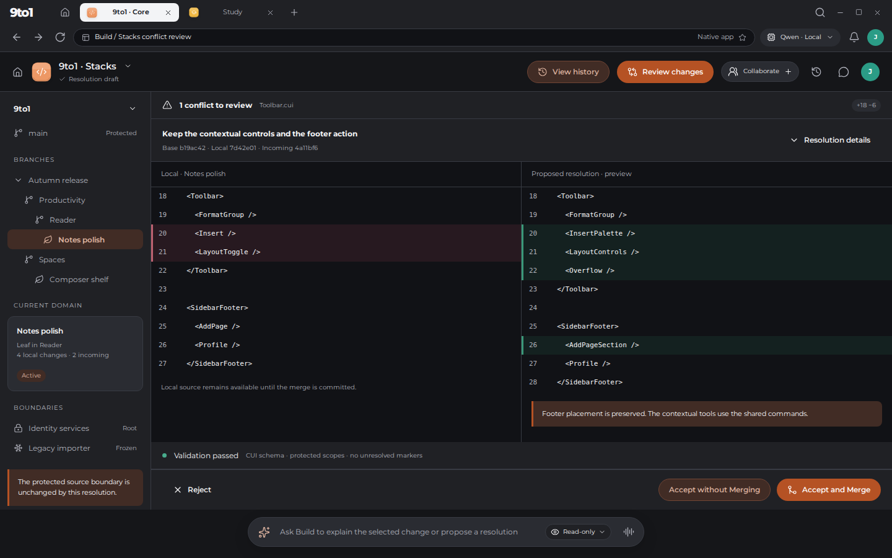
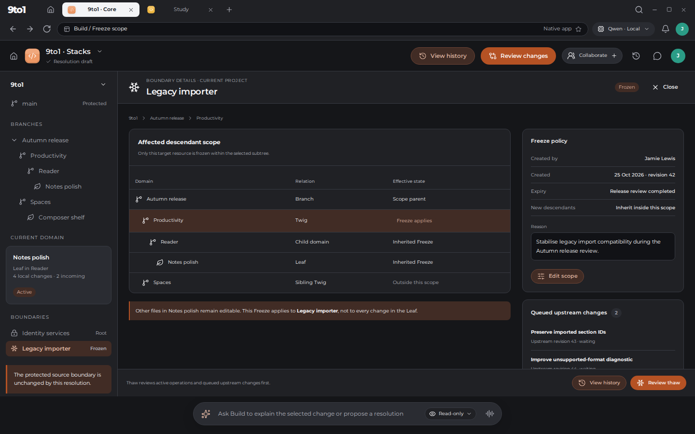

# Build Stacks — Branch, Twig and Leaf source control

Module ID: `build-stacks` · 9to1 Development Specification v3

## Prerequisites

- **CUI, themes and shared interaction system** — Typed UI components, theme tokens/materials, layout, focus, motion, accessibility and shared control states.
- **Artifacts, local persistence and recovery** — Canonical artifacts, revisions, typed edits, local saves, derived exports, sync and recovery.
- **Permissions, approvals and execution scope** — Effective scoped grants, action approvals, policy intersections, revocation and audit.

## Overview

Build Stacks exposes the specified Branch/Twig/Leaf hierarchy, changes and promotion controls over the canonical Build project. It preserves the source-defined collaboration, freeze and Git interoperability semantics.

## Layouts & visible states

- **V3-BUILD-STACKS-LAY-01** — Show the hierarchical Branch/Twig/Leaf tree, selected branch metadata, changed files/diff and actionable Change Requests.
- **V3-BUILD-STACKS-LAY-02** — Branch detail exposes author/owner, source/target revisions, freeze scope and state. Freeze controls show affected hierarchy, reason and release/expiry semantics.

## Features & behaviour

- **V3-BUILD-STACKS-FEA-01** — Preserve root authority/cascade, scoped freeze and reconciliation rules. Freezing a branch must not ambiguously freeze every unrelated project or delete working changes.
- **V3-BUILD-STACKS-FEA-02** — Keep Reject, Accept without Merging and Accept and Merge distinct. Promotion/review uses the actual change request and target branch/revision.
- **V3-BUILD-STACKS-FEA-03** — Support diff/conflict resolution, commit/history and source-defined Git interoperability without inventing independent file copies for every view.

## Canonical entities & persistence

- **V3-BUILD-STACKS-ENT-01** — Persist stack/project IDs, Branch/Twig/Leaf identities, ancestry, commits/revisions, change requests, merge outcomes and freeze audit records.
- **V3-BUILD-STACKS-ENT-02** — Working-tree edits remain distinguishable from committed/promoted revisions.

## Permissions & recovery

- **V3-BUILD-STACKS-PER-01** — Check author/role and protected-scope permissions before freeze, merge or promotion. Recheck target revision to prevent stale approvals.
- **V3-BUILD-STACKS-PER-02** — Recover conflicts and interrupted operations without silently accepting changes or losing uncommitted work.

## Acceptance checks

- **V3-BUILD-STACKS-ACC-01** — Test hierarchy navigation, diff/review and all three exact decision outcomes.
- **V3-BUILD-STACKS-ACC-02** — Exercise scoped freeze/release, concurrent target change, merge conflict and canonical Code/Sites working-tree identity.

## Exact mock-up and state map

- **Build · Stacks conflict review** — screen `build-stacks`. Stacks.
- **Build Stacks · Freeze scope** — screen `build-stacks-freeze`. Boundary · queued changes.

## Source clause IDs

Named baseline section(s) retained in the technical-source chapters below.

## Technical reading map

- Build Stacks — Branch, Twig and Leaf source control — Stacks; Product role (part 01) — `technical/build-stacks-01.md` (2,395 words; V2-B1708, V2-B1709, V2-B1710…).
- Build Stacks — Branch, Twig and Leaf source control — API and integration contracts; permissions and approvals (part 02) — `technical/build-stacks-02.md` (100 words; V2-B1812, V2-B1813, V2-B1814).
- Build Stacks — Branch, Twig and Leaf source control — Domain identity and effective source; Domain creation, hierarchy guards and reparenting (part 03) — `technical/build-stacks-03.md` (3,970 words; V2-B1815).

Technical clauses retain APIs, data models, platform, recovery, donor and acceptance details. The technical files are part of this module, not optional background reading. Shared prerequisites mean stable service/interface contracts must be available; they do not require every dependent app UI to be complete. Use the named chunk for the relevant subtask or the complete module file for its full retained contract.

# Exact designs and implementation rules

These figures are the exact current atlas compositions. Their stable screen IDs match the Word specification and editable source. Open the atlas for full-size theme and interaction inspection.

## Build · Stacks conflict review

Screen ID: `build-stacks`. Source: UX27-BUILD-005; Stacks: Branch/Twig/Leaf, active domain, conflicts, Roots and Freeze.

- Branch, Twig and Leaf are nested development domains. Their active selection must be explicit.
- Review identifies base, local and incoming revisions and the exact conflicting file.
- Accept without Merging, Accept and Merge and Reject are distinct operations. Reject preserves the original work.
- Root and Freeze restrictions remain enforceable outside the UI. Commit, push, merge and deployment are different states.

## Build Stacks · Freeze scope

Screen ID: `build-stacks-freeze`. Source: Stacks / Roots, Freeze and Freeze lifecycle and permissions; UX27-BUILD-005.

- Freeze marks a specific resource or domain out of scope for a selected descendant scope. Root authority and Freeze state are separate concepts.
- The details view identifies the frozen target, scope, creator, reason, creation revision, optional expiry condition and affected descendants.
- Editing or thawing a Freeze requires the configured management permission. Descendant editing or an AI instruction cannot bypass an active Freeze.
- Expiry or thaw rechecks in-progress work and reconciles queued upstream changes. A thaw request does not silently apply those changes or report completion.
