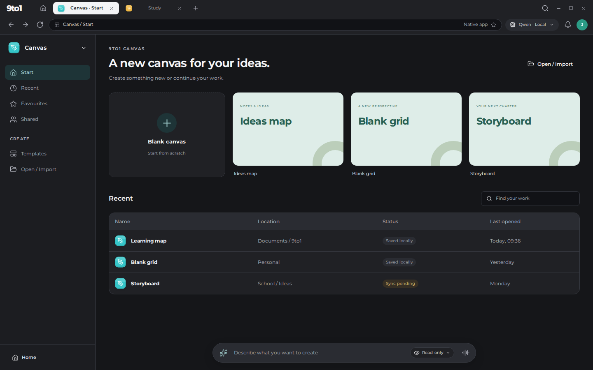
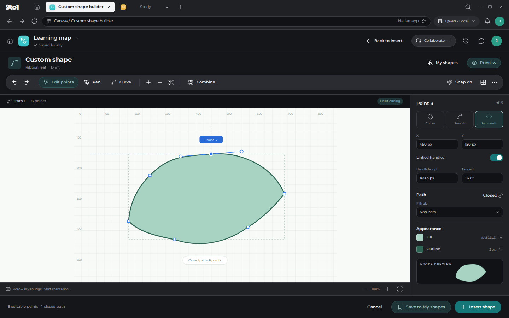
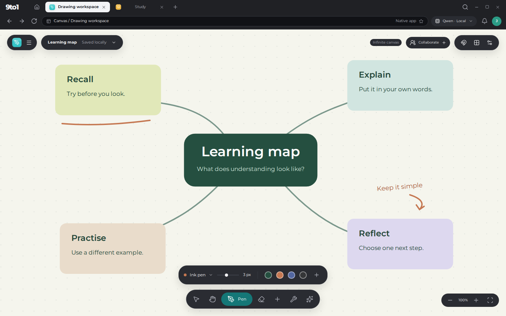
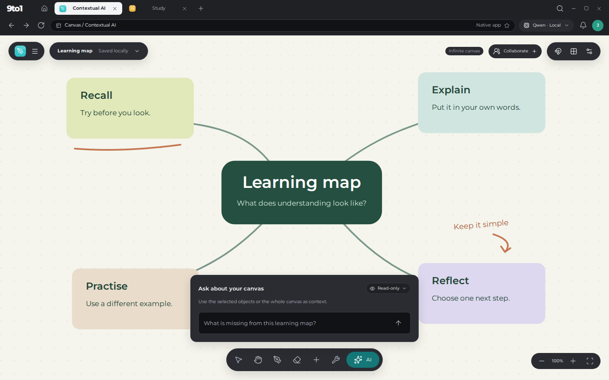
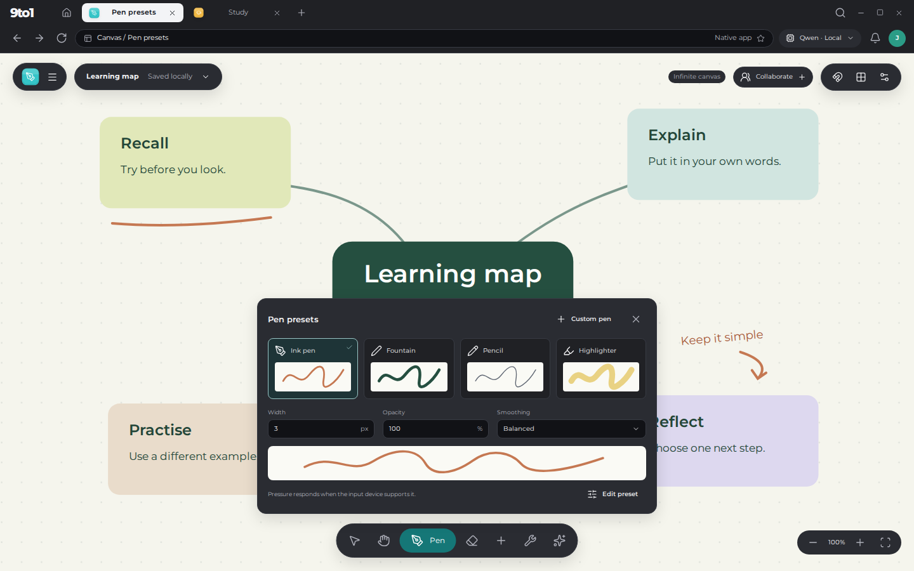
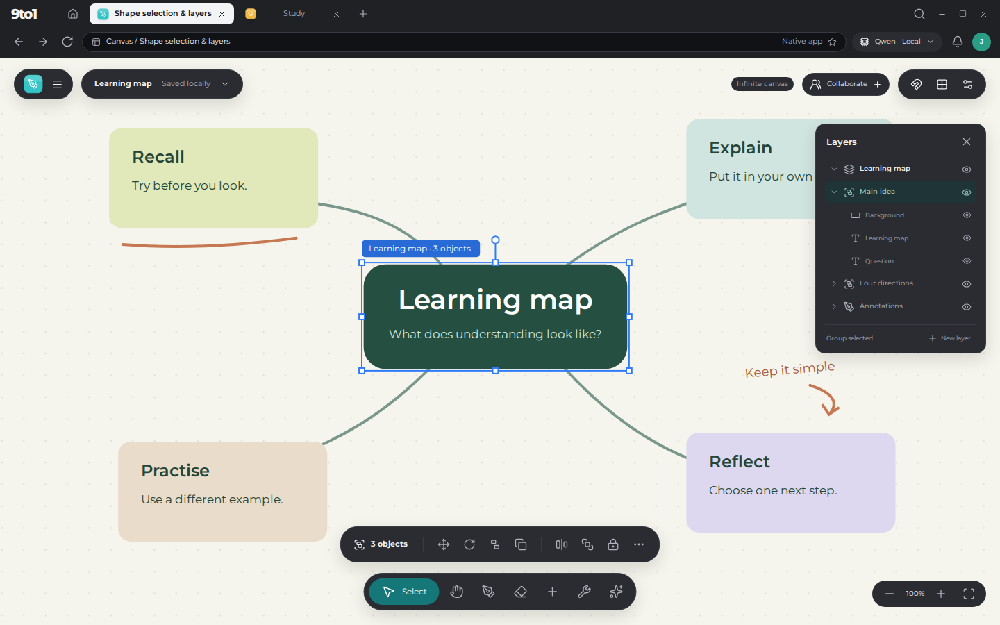
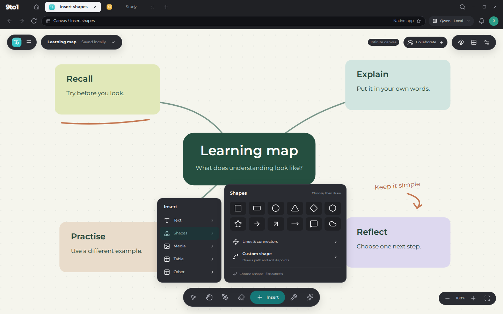

# Canvas — drawing, objects and semantic composition

Module ID: `canvas` · 9to1 Development Specification v3

## Prerequisites

- **CUI, themes and shared interaction system** — Typed UI components, theme tokens/materials, layout, focus, motion, accessibility and shared control states.
- **Shared productivity engine and canonical embeds** — Real document/object engines, semantic editing, canonical app embedding and donor feature parity.
- **Shared AI controls and artifact collaboration** — Contextual AI bars, shared model/permission controls, global collaborators and typed artifact proposals.
- **Artifacts, local persistence and recovery** — Canonical artifacts, revisions, typed edits, local saves, derived exports, sync and recovery.

## Overview

Canvas is a real drawing/composition workspace with shared object, vector/raster and ink semantics. Its dominant work surface uses a compact top identity and a focused bottom tool system.

## Layouts & visible states

- **V3-CANVAS-LAY-01** — Use bottom Select, Pan, Pen, Eraser, Insert, Tools and AI controls, with one contextual options row for the active tool. Keep compact name/menu/quick settings above the work surface.
- **V3-CANVAS-LAY-02** — Show object selection, pen width/colour, insert and contextual AI states. AI appears above the bottom toolbar and must not cover active controls.
- **V3-CANVAS-LAY-03** — Live Spaces work shows semantic object/stroke progress on the same Canvas artifact, not a screenshot replacing the editor.

## Features & behaviour

- **V3-CANVAS-FEA-01** — Support actual object/stroke selection, grouping, geometry transforms, connectors, drawing/erasing and source-defined hybrid raster/vector operations.
- **V3-CANVAS-FEA-02** — Tool changes preserve selection and undo; coordinate transforms stay correct at pan/zoom and responsive dimensions.
- **V3-CANVAS-FEA-03** — Semantic AI edits use selected object/context IDs with preview/approval and preserve authored content colours across themes.

## Canonical entities & persistence

- **V3-CANVAS-ENT-01** — Persist CanvasID, object/stroke/layer IDs, geometry, z-order, grouping/connector relationships, styles and revisions.
- **V3-CANVAS-ENT-02** — Viewport pan/zoom and transient tool settings are separate from authored state and generated export bytes.

## Permissions & recovery

- **V3-CANVAS-PER-01** — Enforce artifact/embedded source permissions and revision checks. A failed render/export leaves the native canvas recoverable.
- **V3-CANVAS-PER-02** — Reconnect to live work without duplicating strokes/objects or replaying already-committed actions.

## Acceptance checks

- **V3-CANVAS-ACC-01** — Test drawing, selection/grouping, erase, connectors, transforms and undo at several zoom levels.
- **V3-CANVAS-ACC-02** — Verify toolbar/AI separation, semantic live work from Spaces, theme-stable art and saved/exported revision identity.

## Exact mock-up and state map

- **Canvas · Start** — screen `canvas-launch`. Launch.
- **Canvas · Custom shape builder** — screen `canvas-shape-builder`. Editable path.
- **Canvas · Drawing workspace** — screen `canvas-editor`. Pen.
- **Canvas · Contextual AI** — screen `canvas-ai`. AI.
- **Canvas · Pen presets** — screen `canvas-pen-presets`. Drawing options.
- **Canvas · Shape selection & layers** — screen `canvas-selection`. Selection.
- **Canvas · Insert shapes** — screen `canvas-insert`. Insertion.

## Source clause IDs

UX27-CANVAS-001, UX27-CANVAS-002, UX27-CANVAS-003, UX27-CANVAS-004, UX27-CANVAS-005, SECTION-10, LAUNCH-001, UX27-TEST-087

## Technical reading map

- Canvas — drawing, objects and semantic composition — Canvas — deliberate spatial editing, not an accidental embedded panel; Canvas identity and tools (part 01) — `technical/canvas-01.md` (449 words; V2-B1376, V2-B1377, V2-B1378…).
- Canvas — drawing, objects and semantic composition — Canvas; Purpose, ownership and boundaries (part 02) — `technical/canvas-02.md` (5,083 words; V2-B1391).
- Canvas — drawing, objects and semantic composition — Canvas; Purposeful spatial input and exported content (part 03) — `technical/canvas-03.md` (74 words; V2-B2831, V2-B2832, V2-B2833…).

Technical clauses retain APIs, data models, platform, recovery, donor and acceptance details. The technical files are part of this module, not optional background reading. Shared prerequisites mean stable service/interface contracts must be available; they do not require every dependent app UI to be complete. Use the named chunk for the relevant subtask or the complete module file for its full retained contract.

# Exact designs and implementation rules

These figures are the exact current atlas compositions. Their stable screen IDs match the Word specification and editable source. Open the atlas for full-size theme and interaction inspection.

## Canvas · Start

Screen ID: `canvas-launch`. Source: LAUNCH-001–006; Canvas Home/start; UX27-AUTH-005 for Boards.

- Start is a separate active view. The editor is not mounted under a welcome banner.
- New, Open, Import, Templates and Recent resolve actual artifact identities. Missing or failed imports receive their own recovery states.
- Direct-open and session restore bypass Start. Returning here preserves the existing document session.

## Canvas · Custom shape builder

Screen ID: `canvas-shape-builder`. Source: Owner revision: detailed custom-shape builder; shared shape catalogue, vector path/anchor/Bézier capabilities; Present Insert and Canvas insertion parity.

- Custom shape is a focused draft authoring mode reached from Insert → Shapes. Opening it allocates no document object; Insert shape commits one editable canonical shared shape.
- The path has six stable anchor points, explicit cubic segments, a closed state and a non-zero fill rule. The selected point exposes coordinates, point type and linked Bézier handles.
- Corner, Smooth and Symmetric change tangent constraints. Add/remove/split, keyboard nudge and Boolean operations retain editable geometry and use logical undo transactions.
- The preview omits selection adorners. Fill #A8D3C3 and outline #2E6453 are authored values and remain unchanged across all eight UI themes.
- Save to My shapes creates a reusable definition; inserting an instance keeps its geometry editable. Cancel discards this uncommitted builder draft and restores the calling app’s insertion context.
- Present and Canvas use the same path and shape model. The two screens illustrate different callers, not app-specific incompatible editors.

## Canvas · Drawing workspace

Screen ID: `canvas-editor`. Source: Owner revision: expand Canvas drawing/shape/insert contexts; UX27-CANVAS-001–005; Canvas primary tools / options host / Insert catalogue parity.

- Primary tools stay bottom-centre in order: Select, Pan, Pen, Eraser, Insert, Tools, AI. Only the selected tool shows its label; reselecting Pen exposes its deeper preset options.
- Infinite mode fills the viewport without an artificial paper edge or page shadow. Authored background, artwork and ink colours remain fixed when UI themes change.
- One options host sits above the bottom toolbar. AI replaces that host; it does not add a second permanently expanded composer. The Layers popup is an explicit selected-object state, not a reserved drawing rail.
- Insert first-level categories are exactly Text, Shapes, Media, Table and Other. Selecting Shapes opens the shared catalogue; it inserts nothing until the user chooses and commits a shape. Custom shape enters the shared path builder.
- Selection and layer operations preserve canonical object, layer and stroke identities. Coordinates, hit testing, undo and saved colours survive zoom, pan, save/reopen and cross-app use.
- Pen presets retain resolved properties on existing strokes. Device pressure/tilt controls are capability-aware; fixed-width mouse fallback remains usable.

## Canvas · Contextual AI

Screen ID: `canvas-ai`. Source: Owner revision: expand Canvas drawing/shape/insert contexts; UX27-CANVAS-001–005; Canvas primary tools / options host / Insert catalogue parity.

- Primary tools stay bottom-centre in order: Select, Pan, Pen, Eraser, Insert, Tools, AI. Only the selected tool shows its label; reselecting Pen exposes its deeper preset options.
- Infinite mode fills the viewport without an artificial paper edge or page shadow. Authored background, artwork and ink colours remain fixed when UI themes change.
- One options host sits above the bottom toolbar. AI replaces that host; it does not add a second permanently expanded composer. The Layers popup is an explicit selected-object state, not a reserved drawing rail.
- Insert first-level categories are exactly Text, Shapes, Media, Table and Other. Selecting Shapes opens the shared catalogue; it inserts nothing until the user chooses and commits a shape. Custom shape enters the shared path builder.
- Selection and layer operations preserve canonical object, layer and stroke identities. Coordinates, hit testing, undo and saved colours survive zoom, pan, save/reopen and cross-app use.
- Pen presets retain resolved properties on existing strokes. Device pressure/tilt controls are capability-aware; fixed-width mouse fallback remains usable.

## Canvas · Pen presets

Screen ID: `canvas-pen-presets`. Source: Owner revision: expand Canvas drawing/shape/insert contexts; UX27-CANVAS-001–005; Canvas primary tools / options host / Insert catalogue parity.

- Primary tools stay bottom-centre in order: Select, Pan, Pen, Eraser, Insert, Tools, AI. Only the selected tool shows its label; reselecting Pen exposes its deeper preset options.
- Infinite mode fills the viewport without an artificial paper edge or page shadow. Authored background, artwork and ink colours remain fixed when UI themes change.
- One options host sits above the bottom toolbar. AI replaces that host; it does not add a second permanently expanded composer. The Layers popup is an explicit selected-object state, not a reserved drawing rail.
- Insert first-level categories are exactly Text, Shapes, Media, Table and Other. Selecting Shapes opens the shared catalogue; it inserts nothing until the user chooses and commits a shape. Custom shape enters the shared path builder.
- Selection and layer operations preserve canonical object, layer and stroke identities. Coordinates, hit testing, undo and saved colours survive zoom, pan, save/reopen and cross-app use.
- Pen presets retain resolved properties on existing strokes. Device pressure/tilt controls are capability-aware; fixed-width mouse fallback remains usable.

## Canvas · Shape selection & layers

Screen ID: `canvas-selection`. Source: Owner revision: expand Canvas drawing/shape/insert contexts; UX27-CANVAS-001–005; Canvas primary tools / options host / Insert catalogue parity.

- Primary tools stay bottom-centre in order: Select, Pan, Pen, Eraser, Insert, Tools, AI. Only the selected tool shows its label; reselecting Pen exposes its deeper preset options.
- Infinite mode fills the viewport without an artificial paper edge or page shadow. Authored background, artwork and ink colours remain fixed when UI themes change.
- One options host sits above the bottom toolbar. AI replaces that host; it does not add a second permanently expanded composer. The Layers popup is an explicit selected-object state, not a reserved drawing rail.
- Insert first-level categories are exactly Text, Shapes, Media, Table and Other. Selecting Shapes opens the shared catalogue; it inserts nothing until the user chooses and commits a shape. Custom shape enters the shared path builder.
- Selection and layer operations preserve canonical object, layer and stroke identities. Coordinates, hit testing, undo and saved colours survive zoom, pan, save/reopen and cross-app use.
- Pen presets retain resolved properties on existing strokes. Device pressure/tilt controls are capability-aware; fixed-width mouse fallback remains usable.

## Canvas · Insert shapes

Screen ID: `canvas-insert`. Source: Owner revision: expand Canvas drawing/shape/insert contexts; UX27-CANVAS-001–005; Canvas primary tools / options host / Insert catalogue parity.

- Primary tools stay bottom-centre in order: Select, Pan, Pen, Eraser, Insert, Tools, AI. Only the selected tool shows its label; reselecting Pen exposes its deeper preset options.
- Infinite mode fills the viewport without an artificial paper edge or page shadow. Authored background, artwork and ink colours remain fixed when UI themes change.
- One options host sits above the bottom toolbar. AI replaces that host; it does not add a second permanently expanded composer. The Layers popup is an explicit selected-object state, not a reserved drawing rail.
- Insert first-level categories are exactly Text, Shapes, Media, Table and Other. Selecting Shapes opens the shared catalogue; it inserts nothing until the user chooses and commits a shape. Custom shape enters the shared path builder.
- Selection and layer operations preserve canonical object, layer and stroke identities. Coordinates, hit testing, undo and saved colours survive zoom, pan, save/reopen and cross-app use.
- Pen presets retain resolved properties on existing strokes. Device pressure/tilt controls are capability-aware; fixed-width mouse fallback remains usable.
