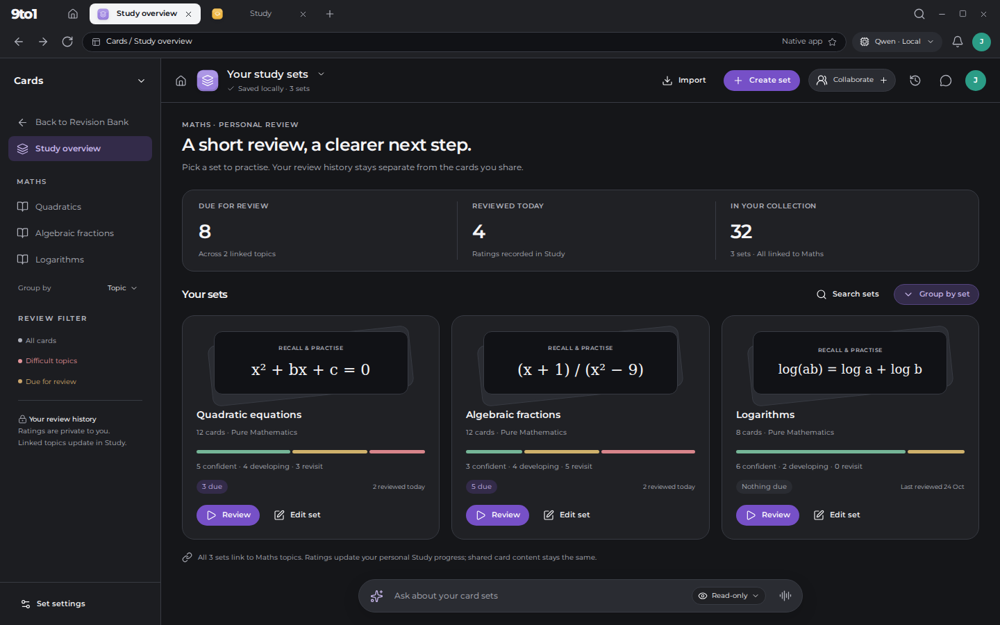
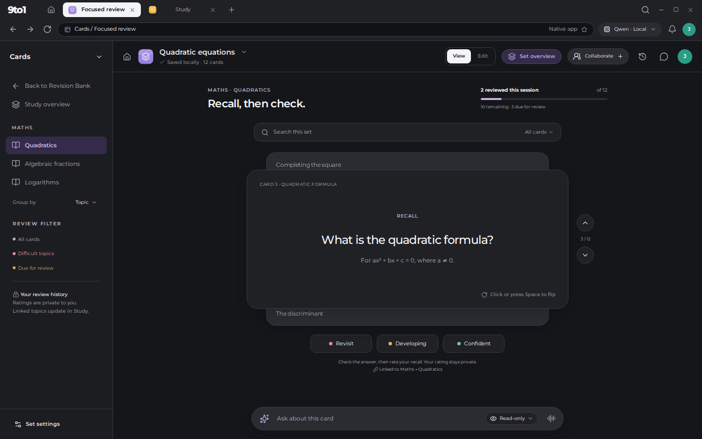
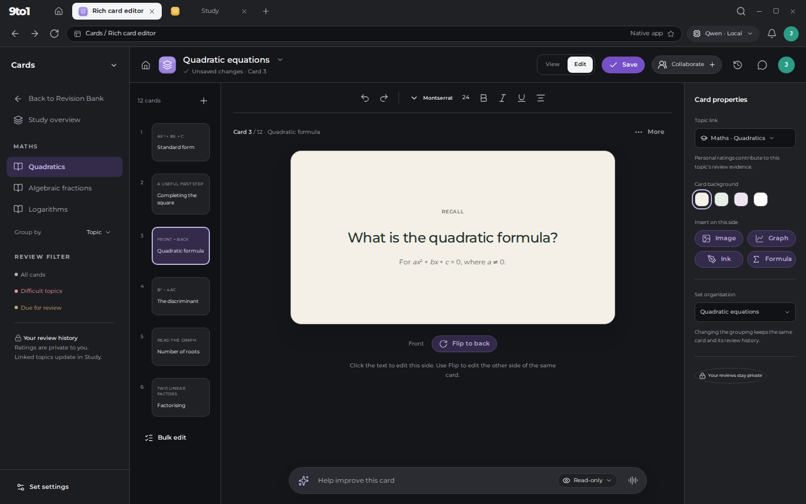

# Cards — sets, editing and study review

Module ID: `cards` · 9to1 Development Specification v3

## Prerequisites

- **CUI, themes and shared interaction system** — Typed UI components, theme tokens/materials, layout, focus, motion, accessibility and shared control states.
- **Artifacts, local persistence and recovery** — Canonical artifacts, revisions, typed edits, local saves, derived exports, sync and recovery.
- **Permissions, approvals and execution scope** — Effective scoped grants, action approvals, policy intersections, revocation and audit.

## Overview

Cards owns reusable flashcard/card sets and the direct edit/flip experience. Study links to canonical sets and records private review evidence without duplicating authored card content.

Current owner overrides: V3-OWNER-016.

## Layouts & visible states

- **V3-CARDS-LAY-01** — Present the focused card with neighbouring cards offset visibly; vertical stack is the default, with supported horizontal alternative. Keep the front/back relationship clear.
- **V3-CARDS-LAY-02** — In Edit, click edits content and Flip is a separate control. In View/review, clicking flips and cannot edit the source. Show set/card navigation and actual review position.

## Features & behaviour

- **V3-CARDS-FEA-01** — Create/edit/reorder cards and sets with front/back content, media and source references according to the retained contract.
- **V3-CARDS-FEA-02** — Switching Edit/View preserves focused card and authored draft; review outcomes attach to the reader’s progress rather than modifying the set for every reader.
- **V3-CARDS-FEA-03** — Cards used by Study open the same canonical set. Keep grading/review controls explicit and avoid fabricated retention/mastery metrics.

## Canonical entities & persistence

- **V3-CARDS-ENT-01** — Persist CardSetID, CardID, front/back content, order, source/provenance, revision and separate reader review/attempt records.
- **V3-CARDS-ENT-02** — Stack orientation/focus/view state is distinct from card content.

## Permissions & recovery

- **V3-CARDS-PER-01** — Read-only sets prevent editing while allowing permitted review. Revoked source media shows an honest unavailable state.
- **V3-CARDS-PER-02** — Recover partially edited cards and private review progress without duplication.

## Acceptance checks

- **V3-CARDS-ACC-01** — Test click-to-edit versus click-to-flip, front/back changes, neighbour offsets, keyboard navigation and edit/view switching.
- **V3-CARDS-ACC-02** — Reopen a Study-linked set and verify canonical content plus separate per-user progress.

## Exact mock-up and state map

- **Cards · Study overview** — screen `cards-study`. Sets and private review.
- **Cards · Focused review** — screen `cards-review`. Card review.
- **Cards · Rich card editor** — screen `cards-edit`. Front and back authoring.

## Source clause IDs

LE-08, LE-10, UX27-OTHER-006

## Technical reading map

- Cards — sets, editing and study review — Cards app; New 9to1 App: Cards (part 01) — `technical/cards-01.md` (849 words; V2-B2225, V2-B2226, V2-B2227…).

Technical clauses retain APIs, data models, platform, recovery, donor and acceptance details. The technical files are part of this module, not optional background reading. Shared prerequisites mean stable service/interface contracts must be available; they do not require every dependent app UI to be complete. Use the named chunk for the relevant subtask or the complete module file for its full retained contract.

# Retained technical requirements

# Cards — sets, editing and study review — Cards app; New 9to1 App: Cards (part 01)

Reading status: active retained clauses, subject to the v3 owner overrides listed in the primary module. Historical process instructions and replaced original wording are stored separately.

### V2-B2225 · v2 lines 13164–13166

Cards app
New 9to1 App: Cards
Built directly for flashcard creation.

### V2-B2226 · v2 lines 13169–13169

Include a visual editor, plus the AI bar and other things required by acceptance criteria and general rules (eg CUI).

### V2-B2227 · v2 lines 13172–13173

Cards should be simple to use and support bulk editing/creation. Eg:
| 

### V2-B2228 · v2 lines 13176–13176

Card 1

### V2-B2229 · v2 lines 13179–13179

|

### V2-B2230 · v2 lines 13182–13182

(shadow partially covering above)

### V2-B2231 · v2 lines 13185–13185

| 

### V2-B2232 · v2 lines 13188–13188

Card 2

### V2-B2233 · v2 lines 13191–13191

|

### V2-B2234 · v2 lines 13194–13195

(shadow partially covering below)
| 

### V2-B2235 · v2 lines 13198–13198

Card 3

### V2-B2236 · v2 lines 13201–13201

|

### V2-B2237 · v2 lines 13204–13204

Then scroll up/down (or change to left/right in settings) to switch cards. There should also be a floating search bar at the top of the screen, and a sidebar to change subjects/topics and navigate easily.

### V2-B2238 · v2 lines 13207–13207

Cards should support markdown visual formatting (bold, headers, italics, etc), font changing, background colour, image/graph insertion, and free drawing on the card.

### V2-B2239 · v2 lines 13210–13210

Cards should have both an editable front side and back side.

### V2-B2240 · v2 lines 13213–13213

The Cards app should also have a viewer/editor mode, changing how you interact with the cards. During edit, clicking the card edits it and you flip via a button in the editor. In view, clicking the card flips it and you can’t edit cards.

### V2-B2241 · v2 lines 13216–13216

Users MUST be able to group cards by set, topic or a custom grouping configuration and change that view from the sidebar context menu or Cards settings. Set review supports red/amber/green card ratings and focusing on difficult topics. Ratings MUST persist as personal review evidence and update Study progress when a valid topic link exists, as specified in LE-08 and LE-10.

### V2-B2242 · v2 lines 13219–13226

LE-10 — Cards canonical product contract
Cards is a first-party CUI app. No external app donor is selected by this section. It MUST ship through the normal app catalogue, modular installer, Files/open-with and registered preview/editor paths, with the global launch screen, settings, permissions and contextual AI bar. Windows, 9to1-OS and web retain the same canonical flashcard model; other already-supported client obligations remain active. A platform constraint must be declared and tested, not hidden behind an empty app shell or assumed mobile fallback.
A CardSet has stable SetID/ArtifactID, title, owner/scope, ordered CardID membership, subject/topic references, assets and schema/revision metadata. Each Card has stable CardID, editable Front and Back structured content, metadata and revision. Sets and topics organise the same cards; changing a view/grouping does not duplicate content. Shared deck content and a user's ReviewRecord are distinct: review state records principal, CardID, optional TopicID, red/amber/green rating, evidence type and reviewed-at time without publishing another learner's private progress.
Front/back content MUST preserve the specified formatting, font choice, background colour, images, graphs and freehand ink as editable structured data through the Shared Productivity Engine and owning object contracts. Markdown-like formatting is a visual authoring capability, not permission to flatten graphs/ink into text. Native save/export is versioned and round-trips all supported data. Import/export reports unsupported constructs and preserves the source; it does not silently discard unknown required fields.
Required operations are create/open/save, edit either side, add/duplicate/reorder/remove/restore cards, bulk create/edit, search/filter, set/topic/custom grouping, asset insertion, drawing, rate/review, import/export and settings. Bulk edits expose exact per-item results where partial success is allowed; destructive bulk changes have impact preview and the inherited approval rules. Undo/redo and interrupted-save recovery preserve the prior valid revision.
The focused-card view retains partially visible, shadowed neighbours. Vertical scrolling is the default; horizontal navigation is a persisted option. Provide keyboard/touch navigation, the floating search bar and the subject/topic sidebar without obstructing content. Edit mode uses click-to-edit and an explicit Flip button. View mode uses click-to-flip and cannot mutate card content; rating is permitted as personal review state. The AI bar's Write setting does not override the host's View restriction.
A rating MUST persist on the card's personal review record. When a valid Study topic link exists, it MUST submit attributed evidence to the existing Study service and update linked views. An unlinked card remains usable and offers topic linking rather than fabricating a mapping. Shared deck edits do not overwrite other users' review records. Inline Spaces flashcards and Revision Bank entries must be able to open/save the same canonical set.
Acceptance: create a multi-card set with distinct front/back text, rich formatting, image, graph and ink; bulk edit and undo; switch navigation/grouping; search; save/restart and native export/import without loss; prove View cannot edit; rate linked and unlinked cards; verify Study linkage, private per-user reviews, shared-edit conflicts, crash recovery and the same set in Cards, Spaces and Revision Bank. Large sets MUST virtualise card views and bound image/graph/ink caches.

### V2-B2243 · v2 lines 13229–13230

Planner Burrows
A way of having multiple planners. Events/tasks/assignments, etc, can be assigned to a specific burrow.

### V2-B2244 · v2 lines 13233–13233

Eg the study burrow has school events while the user-made minecraft burrow tracks minecraft events.

### V2-B2300 · v2 lines 13433–13433

### UX27-OTHER-006 — Cards study and editing

### V2-B2301 · v2 lines 13435–13435

**B/D.** The card stack uses the agreed depth/overlap presentation with front/back editing and a distinct study mode. Selecting a card for editing must not mark it studied. Flip is an explicit action with an animation that respects reduced motion; the accessible equivalent exposes front/back content without requiring motion. Next/previous navigation targets real CardIDs and preserves order/history.

### V2-B2302 · v2 lines 13437–13437

Ratings or answer outcomes update the actual study/review model only on an explicit response. Undo an accidental rating where supported. Card creation/import/export and cross-app Study integration use the canonical deck/cards rather than an isolated presentation-only stack.

# Exact designs and implementation rules

These figures are the exact current atlas compositions. Their stable screen IDs match the Word specification and editable source. Open the atlas for full-size theme and interaction inspection.

## Cards · Study overview

Screen ID: `cards-study`. Source: Owner revision: expanded Cards study view; LE-08; LE-10 canonical CardSet and ReviewRecord; UX27-OTHER-006.

- This is the Cards study overview. Set/topic/custom grouping changes the view over canonical CardIDs and SetIDs without duplicating card content.
- Due counts, recorded reviews and total card counts describe different things. The four reviews today are personal evidence, not mastery inferred from time spent.
- Rating segments show personal red/amber/green review evidence, labelled in text and separate from shared set content. A valid topic link sends attributed evidence to Study.
- Review opens the focused stack; Edit is an explicit alternative and preserves the same set identity. Import, add and grouping are owning-app operations.
- New and unassessed cards retain that status; an unlinked card offers topic linking instead of inventing a Study mapping.

## Cards · Focused review

Screen ID: `cards-review`. Source: Owner revision: lower review workspace with progress; LE-08, LE-10; UX27-OTHER-006.

- The review stack starts below a useful session header and floating search, creating a dedicated study workspace. Partially visible, shadowed neighbours preserve orientation; vertical navigation is the default.
- The header separates this session’s two recorded reviews from the current card position, remaining cards and due count. It does not infer mastery from flips or time.
- View mode flips on card activation and cannot edit content. Edit opens the same canonical CardSet with click-to-edit and an explicit Flip control.
- Red/amber/green ratings persist private ReviewRecords and update linked Study topics. Flipping or browsing alone records no mastery.
- The AI bar remains the Cards editor contract: Read-only/Write is separate from View/Edit and cannot override View mode. The new Spaces permission icon does not replace this editor control.

## Cards · Rich card editor

Screen ID: `cards-edit`. Source: Owner revision: useful Cards edit states; LE-10 rich front/back contract; UX27-OTHER-006.

- Edit uses click-to-edit structured card content, with an explicit Flip button. Clicking the canvas must never flip while Edit is active; View mode cannot mutate it.
- Front and Back remain independently editable structured content. Font choice, authored background, image/graph objects and freehand ink persist through native save/export rather than flattening into plain text.
- The card strip preserves stable ordering and CardIDs. Add, duplicate, reorder, remove/restore and bulk edits act on the canonical set; undo and interrupted-save recovery preserve the prior valid revision.
- The set’s topic link and the selected card’s metadata are editable separately from private review evidence. Editing content does not overwrite another learner’s rating history.
- The displayed draft is unsaved. Save, shared-edit conflict handling and partial bulk-change results must be explicit; no mock-up button performs external writes.
