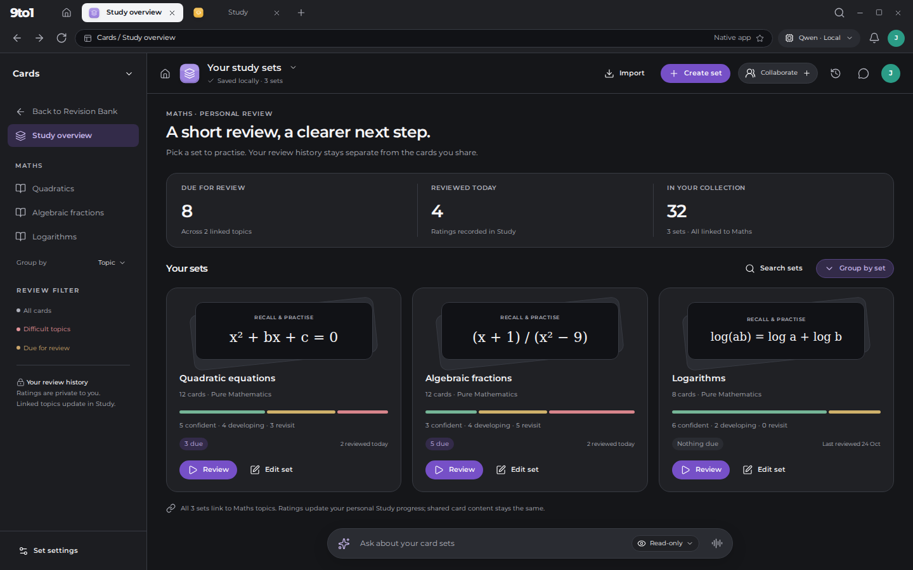
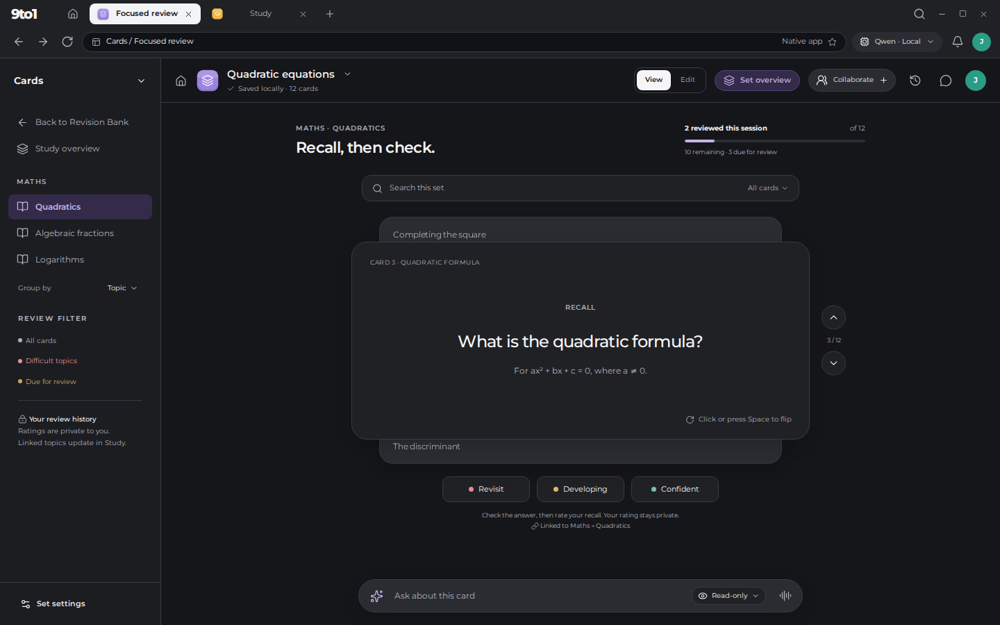
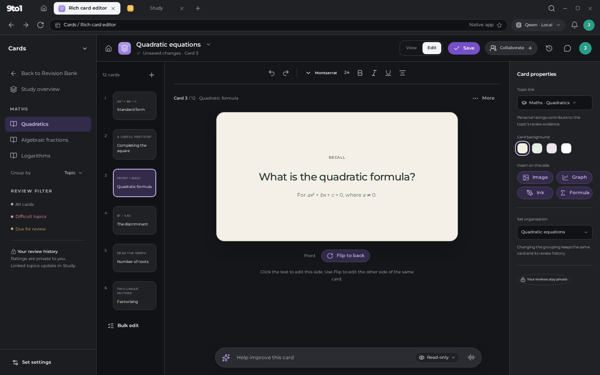

# Cards — sets, editing and study review

Module ID: `cards` · 9to1 Development Specification v3

## Prerequisites

- **CUI, themes and shared interaction system** — Typed UI components, theme tokens/materials, layout, focus, motion, accessibility and shared control states.
- **Artifacts, local persistence and recovery** — Canonical artifacts, revisions, typed edits, local saves, derived exports, sync and recovery.
- **Permissions, approvals and execution scope** — Effective scoped grants, action approvals, policy intersections, revocation and audit.

## Overview

Cards owns reusable flashcard/card sets and the direct edit/flip experience. Study links to canonical sets and records private review evidence without duplicating authored card content.

Current owner overrides: V3-OWNER-016.

## Layouts & visible states

- **V3-CARDS-LAY-01** — Present the focused card with neighbouring cards offset visibly; vertical stack is the default, with supported horizontal alternative. Keep the front/back relationship clear.
- **V3-CARDS-LAY-02** — In Edit, click edits content and Flip is a separate control. In View/review, clicking flips and cannot edit the source. Show set/card navigation and actual review position.

## Features & behaviour

- **V3-CARDS-FEA-01** — Create/edit/reorder cards and sets with front/back content, media and source references according to the retained contract.
- **V3-CARDS-FEA-02** — Switching Edit/View preserves focused card and authored draft; review outcomes attach to the reader’s progress rather than modifying the set for every reader.
- **V3-CARDS-FEA-03** — Cards used by Study open the same canonical set. Keep grading/review controls explicit and avoid fabricated retention/mastery metrics.

## Canonical entities & persistence

- **V3-CARDS-ENT-01** — Persist CardSetID, CardID, front/back content, order, source/provenance, revision and separate reader review/attempt records.
- **V3-CARDS-ENT-02** — Stack orientation/focus/view state is distinct from card content.

## Permissions & recovery

- **V3-CARDS-PER-01** — Read-only sets prevent editing while allowing permitted review. Revoked source media shows an honest unavailable state.
- **V3-CARDS-PER-02** — Recover partially edited cards and private review progress without duplication.

## Acceptance checks

- **V3-CARDS-ACC-01** — Test click-to-edit versus click-to-flip, front/back changes, neighbour offsets, keyboard navigation and edit/view switching.
- **V3-CARDS-ACC-02** — Reopen a Study-linked set and verify canonical content plus separate per-user progress.

## Exact mock-up and state map

- **Cards · Study overview** — screen `cards-study`. Sets and private review.
- **Cards · Focused review** — screen `cards-review`. Card review.
- **Cards · Rich card editor** — screen `cards-edit`. Front and back authoring.

## Source clause IDs

LE-08, LE-10, UX27-OTHER-006

## Technical reading map

- Cards — sets, editing and study review — Cards app; New 9to1 App: Cards (part 01) — `technical/cards-01.md` (849 words; V2-B2225, V2-B2226, V2-B2227…).

Technical clauses retain APIs, data models, platform, recovery, donor and acceptance details. The technical files are part of this module, not optional background reading. Shared prerequisites mean stable service/interface contracts must be available; they do not require every dependent app UI to be complete. Use the named chunk for the relevant subtask or the complete module file for its full retained contract.

# Exact designs and implementation rules

These figures are the exact current atlas compositions. Their stable screen IDs match the Word specification and editable source. Open the atlas for full-size theme and interaction inspection.

## Cards · Study overview

Screen ID: `cards-study`. Source: Owner revision: expanded Cards study view; LE-08; LE-10 canonical CardSet and ReviewRecord; UX27-OTHER-006.

- This is the Cards study overview. Set/topic/custom grouping changes the view over canonical CardIDs and SetIDs without duplicating card content.
- Due counts, recorded reviews and total card counts describe different things. The four reviews today are personal evidence, not mastery inferred from time spent.
- Rating segments show personal red/amber/green review evidence, labelled in text and separate from shared set content. A valid topic link sends attributed evidence to Study.
- Review opens the focused stack; Edit is an explicit alternative and preserves the same set identity. Import, add and grouping are owning-app operations.
- New and unassessed cards retain that status; an unlinked card offers topic linking instead of inventing a Study mapping.

## Cards · Focused review

Screen ID: `cards-review`. Source: Owner revision: lower review workspace with progress; LE-08, LE-10; UX27-OTHER-006.

- The review stack starts below a useful session header and floating search, creating a dedicated study workspace. Partially visible, shadowed neighbours preserve orientation; vertical navigation is the default.
- The header separates this session’s two recorded reviews from the current card position, remaining cards and due count. It does not infer mastery from flips or time.
- View mode flips on card activation and cannot edit content. Edit opens the same canonical CardSet with click-to-edit and an explicit Flip control.
- Red/amber/green ratings persist private ReviewRecords and update linked Study topics. Flipping or browsing alone records no mastery.
- The AI bar remains the Cards editor contract: Read-only/Write is separate from View/Edit and cannot override View mode. The new Spaces permission icon does not replace this editor control.

## Cards · Rich card editor

Screen ID: `cards-edit`. Source: Owner revision: useful Cards edit states; LE-10 rich front/back contract; UX27-OTHER-006.

- Edit uses click-to-edit structured card content, with an explicit Flip button. Clicking the canvas must never flip while Edit is active; View mode cannot mutate it.
- Front and Back remain independently editable structured content. Font choice, authored background, image/graph objects and freehand ink persist through native save/export rather than flattening into plain text.
- The card strip preserves stable ordering and CardIDs. Add, duplicate, reorder, remove/restore and bulk edits act on the canonical set; undo and interrupted-save recovery preserve the prior valid revision.
- The set’s topic link and the selected card’s metadata are editable separately from private review evidence. Editing content does not overwrite another learner’s rating history.
- The displayed draft is unsaved. Save, shared-edit conflict handling and partial bulk-change results must be explicit; no mock-up button performs external writes.
