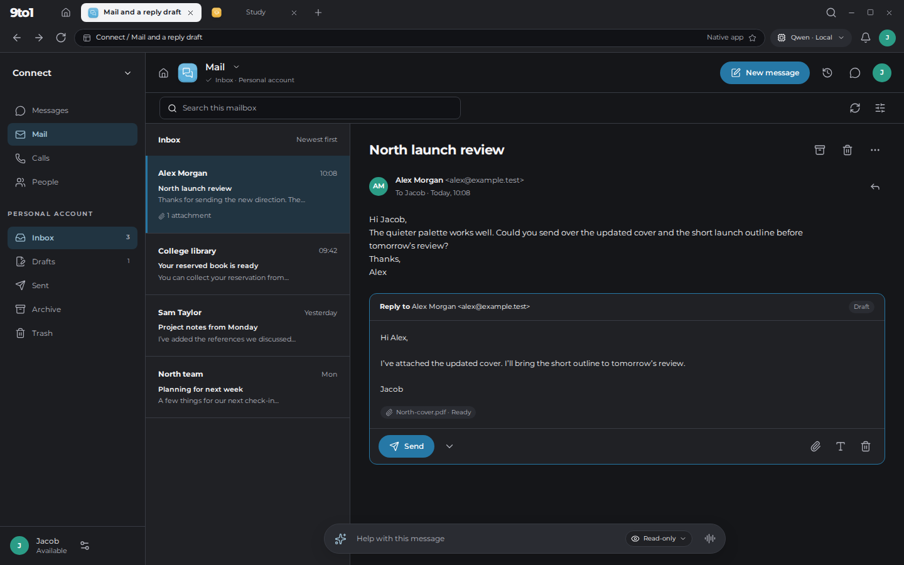
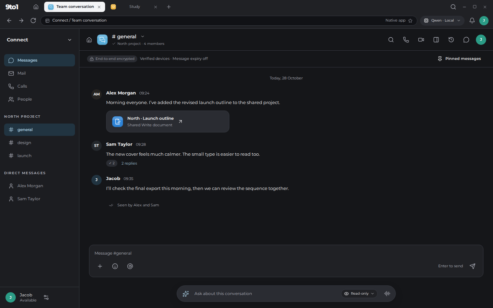
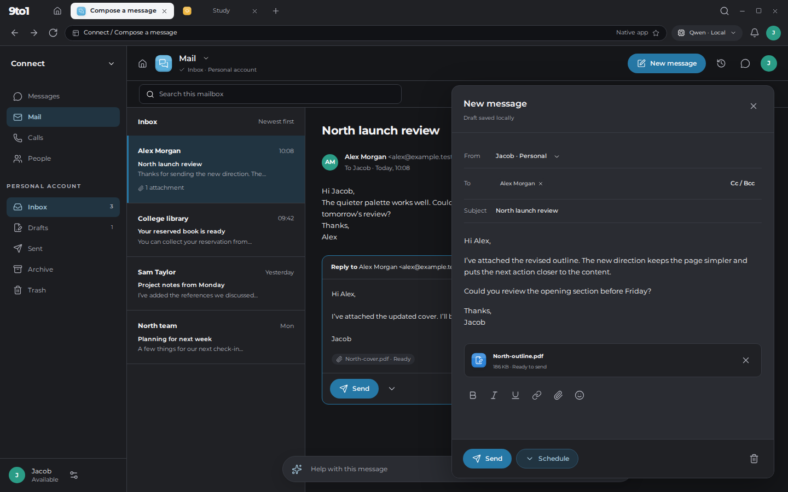
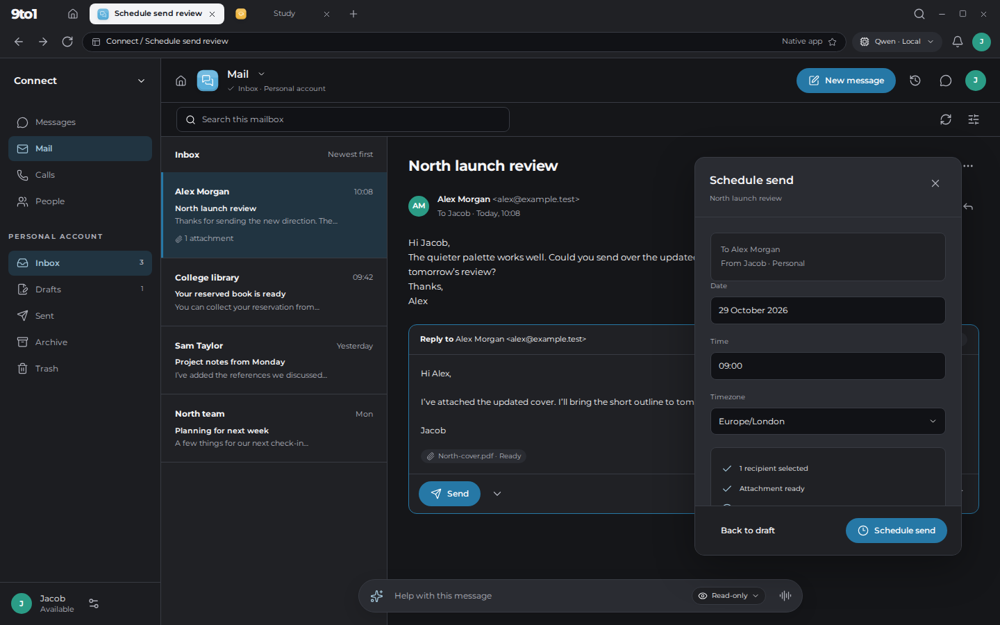

# Connect — conversations, contacts and Mail

Module ID: `connect` · 9to1 Development Specification v3

## Prerequisites

- **CUI, themes and shared interaction system** — Typed UI components, theme tokens/materials, layout, focus, motion, accessibility and shared control states.
- **Account, identity and resource entitlements** — Canonical CAKE account identity, secure sessions, server entitlements and resource allocation state.
- **External integrations and provider connections** — Canonical provider connections, OAuth scopes, typed capabilities, provenance and sync recovery.
- **Permissions, approvals and execution scope** — Effective scoped grants, action approvals, policy intersections, revocation and audit.
- **Artifacts, local persistence and recovery** — Canonical artifacts, revisions, typed edits, local saves, derived exports, sync and recovery.

## Overview

Connect unifies real communication channels, contacts and a full Mail experience while preserving the originating provider/channel/thread. It is not the generic external-integration manager.

## Layouts & visible states

- **V3-CONNECT-LAY-01** — Use channel/account navigation, conversation list and active conversation; Mail uses a genuine folder/list/message-or-compose layout with detailed drawers as needed.
- **V3-CONNECT-LAY-02** — Show provider identity, actual connection state, unread/sending/queued/failed status and attachment metadata. Assistant contacts remain identifiable configured identities.

## Features & behaviour

- **V3-CONNECT-FEA-01** — Support canonical contacts and threaded communication, search, attachments and channel-specific capabilities without flattening all providers into one fake protocol.
- **V3-CONNECT-FEA-02** — Mail retains MIME/header handling, folders, search, rules, attachment, reply/forward/draft/send, native engine and provider requirements from the source.
- **V3-CONNECT-FEA-03** — Assistant replies and delegated work stay in their originating channel/thread unless the user explicitly changes the target. Drafting is distinct from sending.
- **V3-CONNECT-FEA-04** — Offline send queues and retries use current grants and idempotency; a queued message is not reported delivered.

## Canonical entities & persistence

- **V3-CONNECT-ENT-01** — Persist connection/account, ContactID, ConversationID/thread, message IDs, source provider references, draft revision and delivery receipts.
- **V3-CONNECT-ENT-02** — Attachments refer to their canonical resource/bytes with provenance; local preview does not prove remote delivery.

## Permissions & recovery

- **V3-CONNECT-PER-01** — Use current provider and app permissions, recipient identity and explicit send authority. Revocation/expiry blocks new remote actions while preserving draft recovery.
- **V3-CONNECT-PER-02** — Handle partial attachment upload, invalid recipient, send uncertainty and reconnect without duplicate messages.

## Acceptance checks

- **V3-CONNECT-ACC-01** — Test Mail compose/save/reopen, reply in correct thread, attachment failure, offline queue and duplicate retry.
- **V3-CONNECT-ACC-02** — Verify Assistant contact handoff preserves source conversation and distinguishes a draft from an actual send.

## Exact mock-up and state map

- **Connect · Mail and a reply draft** — screen `connect-mail`. Mail.
- **Connect · Team conversation** — screen `connect-messages`. Messages.
- **Connect · Compose a message** — screen `connect-compose`. Interaction state.
- **Connect · Schedule send review** — screen `connect-schedule`. Interaction state.

## Source clause IDs

UX27-OTHER-003, UX27-OTHER-004

## Technical reading map

- Connect — conversations, contacts and Mail — Connect; Product role and donor strategy (part 01) — `technical/connect-01.md` (2,818 words; V2-B0659).
- Connect — conversations, contacts and Mail — Connect API and events; Failure and recovery (part 02) — `technical/connect-02.md` (2,400 words; V2-B0660, V2-B0661, V2-B0662…).
- Connect — conversations, contacts and Mail — Platform behaviour; Acceptance requirements (part 03) — `technical/connect-03.md` (580 words; V2-B0743, V2-B0744, V2-B0745…).

Technical clauses retain APIs, data models, platform, recovery, donor and acceptance details. The technical files are part of this module, not optional background reading. Shared prerequisites mean stable service/interface contracts must be available; they do not require every dependent app UI to be complete. Use the named chunk for the relevant subtask or the complete module file for its full retained contract.

# Retained technical requirements

# Connect — conversations, contacts and Mail — Connect; Product role and donor strategy (part 01)

Reading status: active retained clauses, subject to the v3 owner overrides listed in the primary module. Historical process instructions and replaced original wording are stored separately.

### V2-B0659 · v2 lines 3147–3233

Connect
Product role and donor strategy
9to1 Connect is the native CUI communications and collaboration application for people, teams and organisations. It combines real-time messaging, voice/video calling, SMS/RCS integration, organisational collaboration and the full Mail experience inside one coherent product. Connect is the parent communications product; Mail remains a first-class child mode/subsystem rather than being removed or flattened into chat.
The whole Connect application MUST use an open-source donor/reference for mature real-time communications behaviour. Element, together with Matrix as its underlying open communications protocol/reference architecture, is the preferred donor/reference for real-time messaging, rooms/conversations, threading, reactions, multi-device state, end-to-end encryption, presence-compatible collaboration and calling. The selected donor revision and applicable licensing obligations MUST be recorded in the donor-parity manifest before implementation.
The existing Mail subsystem retains Thunderbird as its preferred mature donor/reference for email protocol, MIME, IMAP/SMTP, authentication, offline mail, attachments, drafts, folders/labels, threading, certificates and mature email edge cases. Connect MUST NOT replace Thunderbird mail behaviour with a reduced chat-derived email implementation.
Donor parity applies to mature behavioural capability, interoperability and edge-case handling, not donor-native visual chrome. Connect MUST use a modern native CUI design consistent with 9to1. Proprietary donor services or branding MUST be replaced with 9to1-native equivalents where required.
Architecture and canonical entities
Connect MUST maintain stable canonical identities for at least UserID, ProfileID, OrganisationID, MembershipID, RoleID, ConversationID, RoomID/ChannelID where applicable, MessageID, ThreadID, CallID, ParticipantID, ContactRelationshipID, ReportID, IncidentID, EnforcementActionID and BanEvasionCaseID. Display names, usernames, email addresses, phone numbers, room names and mutable paths MUST NOT be used as canonical identity.
Email messages remain Mail entities governed by the Mail subsystem and its provider semantics. Native Connect chat/room messages remain Connect/Matrix-style communication entities. The product MAY provide unified navigation/search/notifications over both, but MUST NOT merge email and real-time messaging into one incompatible storage/protocol model.
Connect SHOULD use canonical 9to1 services rather than duplicating them. Shared files SHOULD reference canonical Files objects when applicable; assignments/tasks SHOULD reference canonical Planner objects where appropriate; Home owns notifications/permissions; Dulche provides AI; Contacts/people services own canonical contact data where defined.
Conversations, organisations and hierarchy
Connect MUST support one-to-one conversations, group conversations, organisation/team rooms or channels, threaded replies, reactions, message edits, message deletion according to policy, typing indicators, read state/receipts where enabled, presence/availability controls, mentions, attachments/media and conversation search subject to encryption/indexing constraints.
Users MAY belong to multiple organisations simultaneously. Organisations MUST support nested teams/departments/groups and explicit role/membership relationships, including organisational hierarchies such as management/employee or school leadership/department/teacher/student structures. Hierarchy MUST be represented through stable role/membership data rather than inferred only from room placement or display names.
Role and organisation policy MAY govern room creation, membership management, announcement rights, moderation powers, task assignment and administrative settings, but organisation policy MUST NOT silently override personal privacy protections that are not genuinely necessary for the organisation to operate.
Mail mode
Mail is a first-class Connect mode and retains the complete canonical Mail specification, Mail APIs and Thunderbird donor contract. Users MUST be able to use Mail as a complete manual email client with AI unavailable. Connect MUST provide coherent navigation between Mail and real-time communications while preserving the different underlying protocols, privacy properties and provider semantics.
Mail MAY remain independently deep-linkable and launchable where the package/shell architecture supports app shortcuts, but such launch targets resolve to the Mail mode of the canonical Connect application rather than creating a second incompatible Mail implementation.
Native messaging encryption and privacy
Native Connect conversations MUST use end-to-end encryption by default. Ordinary native Connect users MUST NOT be offered a misleading normal-chat mode that silently downgrades private communication to server-readable plaintext merely for implementation convenience.
The implementation MUST follow the platform-wide Privacy Ceiling and apply stricter communications protections where required. Content decryption keys MUST be available only to authorised endpoint devices/participants under the declared trust model. Servers MUST NOT possess a universal content-decryption key or silent moderation/decryption backdoor while the product claims E2EE.
Multi-device encryption MUST define device identity, device trust, key distribution, verification, rotation, lost-device handling, session recovery and cryptographic backup/recovery. Recovery MUST NOT introduce a server-held master key that silently allows universal message decryption.
Connect MUST minimise communication metadata separately from content encryption. Participant graphs, timestamps, delivery state, IP/network information, device identifiers, routing metadata and notification data MUST be collected/retained only as required for operation, safety or declared policy and MUST NOT be presented to users as E2EE-protected when they are observable to infrastructure.
Notification delivery MUST minimise plaintext leakage. Notification previews of encrypted conversations MUST use the most private technically reliable path and MUST respect user settings; push providers MUST NOT receive unnecessary message content.
Search/indexing over encrypted content SHOULD occur locally or through another architecture that preserves the declared E2EE model. Server-side plaintext indexing of native E2EE conversations is prohibited unless the user has explicitly exported/disclosed specific content into a separately governed service.
Disappearing messages
Connect MUST support disappearing-message policies at conversation and/or message scope. Policies MAY include predefined and custom expiry periods and MUST expose the active expiry state visibly enough for participants to understand it.
Expiry MUST be represented canonically and reconcile across authorised devices, including devices that were offline at the expiry time. Expired content MUST be removed from ordinary conversation history and applicable local indexes/caches according to the declared lifecycle.
Connect MUST NOT claim that disappearing messages prevent screenshots, manual copying, external capture or information already legitimately disclosed outside the conversation. Quoted/replied-to message representations MUST NOT preserve the full expired content indefinitely unless an explicit retention/evidence rule requires it.
Safety reports/evidence records that lawfully and transparently retain reported content are separate from ordinary disappearing-message history and MUST have their own access, purpose and retention policy.
SMS and RCS
Connect MUST support SMS and RCS where the current platform, telephony stack, carrier/provider and user permissions allow it. SMS/RCS identities and transport state MUST remain distinct from native Connect messaging.
The UI MUST truthfully represent the protection of the actual transport used. Ordinary SMS MUST NOT be labelled end-to-end encrypted. RCS MUST show E2EE only when encryption has actually been negotiated/supported for that conversation and participant set.
If an intended RCS message would fall back to SMS, any material change in privacy/security capability MUST be represented clearly enough that the user is not led to believe the stronger state still applies. Transport fallback MUST NOT reuse an E2EE badge/state from the prior route.
Voice and video calling
Connect MUST provide mature one-to-one and group voice/video calling with expected modern functionality including incoming/outgoing calls, ringing, missed calls, call history, join/leave/reconnect, participant roster, grid/speaker layouts, pin/spotlight where applicable, microphone mute/unmute, camera enable/disable, camera switching, input/output device selection, screen/window/application sharing, optional system-audio sharing where supported, reactions, raise hand, in-call text chat, picture-in-picture/full-screen and accessible keyboard/screen-reader controls.
Calls MUST use end-to-end encrypted media wherever the selected call architecture supports the native Connect trust model. Signalling and sensitive call state SHOULD receive equivalent or stronger protection where technically feasible. Infrastructure MUST NOT claim stronger privacy than the actual transport provides.
Microphone, camera and screen-capture permissions MUST be explicit, visible and revocable. Joining a call MUST NOT silently enable the camera or microphone contrary to the user's saved/default state. The UI MUST continuously and unmistakably show local mic/camera/screen-share state.
Call infrastructure MUST minimise retained metadata, and self-hosted/private infrastructure SHOULD be supported where compatible with the donor/protocol architecture. TURN/relay/direct-connect behaviour and the associated exposure of participant network addresses MUST be documented and privacy-aware.
Background blur, noise suppression, gain control, camera filters/effects, virtual backgrounds and similar media processing SHOULD run locally where technically practical. A cosmetic filter MUST NOT silently upload raw camera/microphone content to an external processor.
Recording, transcription and AI participation
Recording is disabled by default. Starting recording MUST use a Request Recording workflow rather than an immediate unilateral record action.
Before recording begins, every current participant MUST explicitly approve the recording request. Any participant declining or failing to approve within the defined request state prevents recording from starting. Approval is scoped to that recording session and MUST NOT become a permanent blanket permission.
When recording is active, all participants MUST receive a persistent, unmistakable recording indicator. A participant joining after recording has started MUST be informed before/while joining that recording is active and MUST explicitly acknowledge/approve participation under the recording state before their media is included. A new participant's refusal MUST prevent their media from being recorded and, where the architecture cannot isolate them, MUST pause/stop recording until consent is resolved.
Recording state, requester, participant approvals, start/stop times and resulting artifact identity MUST be auditable. Recordings MUST be stored as permissioned canonical artifacts with explicit owner/access/retention policy rather than hidden provider blobs.
Recording permission MUST NOT imply permission for transcription, AI summarisation or remote model processing. Recording, transcription and AI participation are separate capabilities with separate disclosure/permission requirements.
Adding Dulche, an Agent, transcription service or other non-human processor to a human conversation/call MUST be visible to affected participants where it can receive their communication. Ordinary access by the local Connect client to decrypted E2EE content does NOT automatically grant Dulche/cloud models access.
Contact and communication privacy controls
Connect MUST provide first-class Block, Mute and Contact Settings controls. Blocking and muting MUST be semantically distinct: mute suppresses attention/notifications according to user policy; block prevents the blocked identity from contacting/interacting with the blocker through applicable Connect channels and MUST be enforced beyond merely hiding content locally.
Contact Settings MUST allow the user to control, where applicable, who can directly message them, call them, video call them, add/invite them to groups, see presence/last-active, see read receipts and access profile/contact fields. Unknown contacts MAY be routed to message/contact requests rather than the primary inbox.
Per-conversation notification/mute controls, read-receipt controls, presence controls, privacy/discoverability controls and block lists MUST be available without requiring AI.
Reporting and Trust & Safety
Connect MUST provide a first-class Report workflow for inappropriate, abusive, fraudulent or illegal content/behaviour. Reporting MUST be possible from messages, conversations, calls, contacts/accounts and relevant media where evidence is available.
Because native Connect messaging is E2EE, routine server-side moderation MUST NOT silently scan all decrypted private conversations. A participant-initiated report MAY deliberately disclose selected reported messages/media and the minimum necessary surrounding context/provenance to the Trust & Safety system. The reporting UI MUST make the disclosure scope understandable.
Reports are allegations, not strikes. A Report MUST NOT automatically become a verified violation or count as an offence merely because it exists. Trust & Safety must distinguish Report, Incident and EnforcementAction as separate canonical objects.
Reported user-supplied text, quoted messages, media metadata and report descriptions are evidence/input, not privileged instructions to the moderation system. Prompt-like content inside evidence MUST NOT be able to override moderation policy or system instructions.
Moderation AI
Connect MAY use an intelligent AI-assisted Trust & Safety evaluator to triage reports, correlate evidence, identify repeat patterns, create/maintain structured Incident records and recommend or apply policy-defined protective restrictions.
The moderation AI MUST NOT expose a direct free-form conversational prompt surface to ordinary users. Users interact through structured report/appeal flows; they MUST NOT be able to directly prompt the moderation model to punish another user.
The evaluator SHOULD produce structured results including alleged policy category, evidence reviewed, provenance, confidence/uncertainty, severity, verified prior Incidents where policy permits, pattern/repetition state, recommended action, automatic-action eligibility and human-review requirement. User accusation volume alone MUST NOT be treated as proof.
Automatic detection/evaluation MUST resist coordinated false-report campaigns, duplicate-report amplification, fabricated evidence where provenance can be checked, prompt injection within evidence and circular reliance on previous unverified allegations. Dismissed/overturned reports/incidents MUST NOT continue increasing enforcement severity.
Protective restrictions MAY be applied quickly when needed to stop ongoing harm, including reporter-specific contact blocking, temporary DM/call restrictions, new-contact limits, invitation restrictions, media restrictions or rate limits. These temporary protections are distinct from a Connect-wide ban.
Severe-offence ban threshold
A Connect-wide account ban is a last-resort enforcement action reserved for severe offences or a substantial verified history of serious misconduct. Ordinary disagreements, unpopular opinions, isolated low-level rudeness or weak/ambiguous reports MUST NOT result in a Connect-wide ban.
Ban-eligible examples include accounts demonstrably operated primarily for scams/phishing or large-scale malicious spam; repeated targeted harassment/stalking/doxxing; repeated serious threats or malicious impersonation/scams; distribution of illegal images/content; or comparably severe abuse supported by evidence and applicable policy.
A substantial history means verified Incident records, not raw Report count. Multiple unverified or dismissed reports MUST NOT accumulate as though they were convictions.
Enforcement SHOULD be proportionate below the severe-ban threshold and MAY include warnings, temporary communication restrictions, feature-specific suspension, contact/request limits, group-invite restrictions, rate limiting or temporary account suspension according to policy.
Every ban MUST reference the applicable policy category, supporting IncidentIDs/evidence basis, decision source, effective time, duration/permanence, review status and appeal state. The system MUST preserve the distinction between evidence, analysis and final enforcement.
Permanent or long-duration account-wide sanctions SHOULD require stronger evidentiary confidence and/or human review according to severity and policy. Clearly malicious automated/scam accounts with strong evidence MAY be restricted rapidly without artificial delay merely because the final action is severe.
Appeals
Affected users MUST have a clear appeal mechanism for significant restrictions and bans. Appeal review MUST inspect the evidence and enforcement decision rather than merely rerun the identical model prompt and automatically return the same result.
Overturned enforcement MUST remove or appropriately quarantine the sanction's contribution to future escalation/ban-evasion logic. Audit history MAY retain the historical decision for accountability, but it MUST NOT continue operating as an active verified offence.
Ban-evasion and alternate-account detection
An active Connect ban MUST NOT be trivially circumventable by creating or switching to another account. Connect MUST provide a privacy-preserving Ban Evasion Risk Engine capable of identifying likely alternate accounts used to evade an active severe sanction.
Detection MUST be purpose-limited to security/abuse enforcement and MUST comply with the Privacy Ceiling. It SHOULD combine multiple relevant signals rather than relying on one simplistic identifier. Signals MAY include verified account relationships, device/account linkage legitimately available to 9to1, authentication attributes, repeated malicious behavioural patterns, overlap of abuse targets, timing patterns, organisation relationships and payment/entitlement linkage where applicable.
Shared IP address, household, school/workplace network, carrier NAT, VPN use or a shared device MUST NOT by itself establish that two accounts belong to the same banned person. Legitimate possession of multiple accounts is not ban evasion.
The engine MUST distinguish low-, medium- and high-confidence linkage. Low-confidence matches SHOULD trigger additional verification, monitoring within permitted bounds or temporary protective limits rather than automatic permanent inheritance of the original ban. High-confidence evidence tied to a severe active ban MAY cause the alternate account to inherit/continue the restriction according to policy.
Every suspected linkage MUST create a BanEvasionCase with evidence/signal references, original EnforcementActionID, confidence, decision and review/appeal state. Banned-account linkage MUST NOT depend on weakening E2EE or reading unrelated private messages.
Signals from an overturned/dismissed ban MUST be removed from active enforcement decisions. Anti-alt detection MUST NOT evolve into a general-purpose cross-service fingerprinting system unrelated to preventing sanction evasion.
AI and encrypted communication boundary
Dulche MAY assist with permitted Connect tasks such as drafting, summarisation, search, action extraction and organisation, but encrypted communication content is not automatically AI context. The user/organisation policy and the local/cloud Privacy Ceiling determine what content may be exposed.
A local AI route MAY process authorised content locally according to permissions. Sending decrypted chat/call/email content to a cloud model requires an authorised cloud-processing route and MUST NOT occur merely because the cloud model is the global fallback.
AI-generated actions that send messages, email, make calls, change membership, report users or perform enforcement are consequential typed actions subject to the normal Home permission/risk model plus any stricter Connect rule.
Agent updates — contact through Connect
Agents MUST be emailable, callable and textable through Connect. This includes email through Connect's Mail subsystem, supported voice-call routes, and text messaging through Connect, including SMS/RCS when an authorised configured provider/device supports that transport. Agents MUST appear as addressable Agent contacts rather than requiring users to open a separate Agent chat before contacting them.
Channel addresses/endpoints MUST resolve to the same canonical Agent identity. Incoming contact MUST route to that Agent and its authorised runtime; responses MUST return through the relevant Connect channel with conversation/call/run correlation. Agent permissions, memory boundaries, caller access, availability, privacy, retention and external-action approvals remain governed by the existing contracts. A message or call from a third party MUST NOT automatically acquire the account owner's permissions. Unsupported or disconnected transports MUST be reported accurately. Provisioning paid numbers, carrier services or other paid infrastructure requires separate spending authorisation.
Connect Agent-channel API and acceptance
Extend Connect’s existing contact and communication APIs for Agent contact/channel configuration, endpoint resolution and the supported email, voice-call and text operations. Preserve canonical Agent, Conversation, Call and Run IDs, permission scopes, correlation and idempotency on retries. Tests MUST deliver an email, call and text to the intended canonical Agent through each supported configured route and verify its response on that route; cover revoked caller access, disconnected or unsupported transport, failed delivery and prevention of duplicate external sends. A required route lacking a working supported implementation remains an explicit gap, not a completed parity claim.

# Connect — conversations, contacts and Mail — Connect API and events; Failure and recovery (part 02)

Reading status: active retained clauses, subject to the v3 owner overrides listed in the primary module. Historical process instructions and replaced original wording are stored separately.

### V2-B0660 · v2 lines 3236–3246

Connect API and events
Connect MUST expose typed APIs for conversations/messages, organisations/memberships/roles, contacts/privacy controls, calls, SMS/RCS routing where supported, reporting, safety state and user-authorised actions. Email-specific operations remain under the canonical 9to1.Mail API and are reachable through Connect without duplicating them.
Minimum Connect API families MUST include conversation list/get/create/update/membership, message send/edit/delete/react/thread, contact/block/mute/settings, organisation/membership/role, call start/join/leave/media-state/screen-share/record-request/record-state, report/create/status/appeal, and change/event subscriptions. Every consequential action MUST use stable IDs, structured results, revision/conflict semantics and the global permission/audit contract.
Trust & Safety internal APIs MUST be separately permissioned from ordinary client APIs. Direct user clients MUST NOT receive privileged moderation-model prompt access or arbitrary enforcement mutation authority.
Failure and recovery
Connect MUST provide structured failures including ConversationNotFound, MembershipDenied, EncryptionStateUnavailable, DeviceNotTrusted, KeyRecoveryRequired, TransportUnavailable, SMSFallbackRequired, CallUnavailable, MediaPermissionDenied, RecordingConsentRequired, RecordingConsentDeclined, ParticipantConsentPending, ReportNotFound, EvidenceUnavailable, EnforcementDenied, AppealUnavailable, BanEvasionReviewRequired and ProviderCapabilityUnsupported in addition to global errors.
Network interruption MUST preserve unsent messages/call state truthfully, reconcile delivered/read state after reconnect and avoid duplicate sends. Encryption/session recovery MUST NOT silently reset conversation security or create a new unverified device identity without disclosure.
Acceptance requirements
Connect is implementation-complete only when acceptance coverage verifies at least: native one-to-one and group chat with E2EE; multi-device key/device trust and recovery; threads/reactions/typing/read-state/presence controls; organisation/team hierarchy; complete Thunderbird-derived Mail mode; SMS/RCS transport-state truthfulness; mature one-to-one/group voice/video calls; screen sharing and standard call controls; local media effects where applicable; unanimous recording consent including future joiners; distinct recording/transcription/AI permissions; block/mute/contact privacy controls; disappearing messages; participant-initiated encrypted-chat reporting without universal server decryption; structured AI-assisted report triage without user prompt access to the moderation model; proportionate restrictions; severe-only Connect-wide bans; appeals; privacy-preserving ban-evasion detection; and enforcement of the platform-wide Privacy Ceiling.
Mail
Product role and donor strategy

### V2-B0661 · v2 lines 3249–3249

9-1 Mail is the native CUI email client for connected accounts. It MUST be a fully capable manual email client with AI disabled or unavailable. AI is additive: it may summarise, search, draft, rewrite and triage, but core reading, composition, sending, organisation, search, offline use and account management MUST remain directly usable without AI.

### V2-B0662 · v2 lines 3252–3252

Thunderbird is the preferred mature technical donor/reference for email protocol and compatibility behaviour, including IMAP, SMTP, OAuth, MIME parsing, attachments, offline mail, drafts, folders, threading, search foundations, junk/spam handling, certificates and mature email edge cases. Donor reuse MUST comply with the selected source version and licensing.

### V2-B0663 · v2 lines 3255–3255

Donor parity applies to mature email capabilities and behaviours, NOT to Thunderbird’s visual shell. Legacy donor chrome, menus, dialogs, pane styling or dated interaction patterns MUST NOT be reproduced merely for parity. The final product MUST be a modern, clean, native CUI Mail interface designed for 9to1.

### V2-B0664 · v2 lines 3258–3258

A Mail donor-parity manifest MUST identify the selected donor revision and classify applicable capabilities as Preserve, Replace with 9to1-native equivalent or Not applicable. Proprietary AI/subscription services from any donor/provider are not copied.

### V2-B0665 · v2 lines 3261–3261

Modern CUI shell and responsive layout

### V2-B0666 · v2 lines 3264–3264

The default desktop layout MUST use a clean three-pane structure: navigation/account sidebar, message/conversation list and reading pane. Visual separation MUST be subtle and CUI-native rather than relying on heavy boxes, legacy toolbars or nested window chrome. Message content should receive the majority of visual emphasis.

### V2-B0667 · v2 lines 3267–3267

Users MUST be able to select reading-pane right, reading-pane bottom or reading-pane off, plus supported density options. Smaller windows MUST responsively collapse the layout into two-pane or single-pane navigation without squeezing unreadable columns.

### V2-B0668 · v2 lines 3270–3270

The message list MUST prioritise sender/avatar or initials, subject, concise preview, timestamp, unread/important state and attachment/category indicators. Low-frequency controls MAY appear on hover/selection while common quick actions such as archive, delete, star and snooze remain directly discoverable.

### V2-B0669 · v2 lines 3273–3273

The reading pane MUST present a compact sender/recipient/date header, clear reply/reply-all/forward/other actions and an uncluttered message body. Long conversations MUST support collapsing older messages/quoted sections without losing access to full content.

### V2-B0670 · v2 lines 3276–3276

The final client MUST not expose donor-native UI surfaces. Settings, account management, compose, security prompts and advanced inspection must all use 9to1 CUI unless an OS-level credential/security dialog is explicitly required.

### V2-B0671 · v2 lines 3279–3279

Sidebar and navigation

### V2-B0672 · v2 lines 3282–3282

Mail MUST provide a unified top-level navigation including Unified Inbox, Starred/Favourites, Snoozed, Drafts, Sent, Scheduled, Outbox, Archive, Junk and Trash where the effective connected-account capabilities permit them. Individual accounts appear below with collapsible provider-native folders/labels.

### V2-B0673 · v2 lines 3285–3285

Unified views are query/projection surfaces over canonical provider/account messages and MUST NOT duplicate messages into a separate mailbox. Actions taken from a unified view route to the owning AccountID/provider semantics.

### V2-B0674 · v2 lines 3288–3288

Provider-native structures MUST be preserved. Gmail-style labels, Outlook categories/folders and generic IMAP folders MUST NOT be flattened into one simplistic hierarchy when that would break provider behaviour.

### V2-B0675 · v2 lines 3291–3291

Account and provider model

### V2-B0676 · v2 lines 3294–3294

Every connected mailbox MUST have stable AccountID identity independent of mutable email address/display name. MailAccount MUST store at least provider type, provider account identity, primary address/display name, supported capability set, authentication reference, sync configuration, signature configuration and sending configuration.

### V2-B0677 · v2 lines 3297–3297

Mail MUST support generic IMAP + SMTP as a baseline and provider-native adapters where beneficial, including Gmail/Google and Outlook/Microsoft. Provider adapters MAY expose richer push, label, thread, archive, snooze, scheduled-send or search behaviours while remaining behind the common Mail contract.

### V2-B0678 · v2 lines 3300–3300

Provider capabilities MUST be discovered/declared explicitly, including labels vs folders, archive, snooze, scheduled send, native search, push/change feed, undo send, aliases/from identities, read receipts, encryption/security features and provider-specific actions. Unsupported actions MUST be hidden/disabled or return ProviderCapabilityUnsupported rather than appearing functional.

### V2-B0679 · v2 lines 3303–3303

OAuth 2.0 is preferred when supported. Credentials/tokens MUST be stored through secure credential references. Token refresh, revoked access, reauthentication, app-password/provider-password flows and certificate errors MUST be handled without deleting valid local cached mail.

### V2-B0680 · v2 lines 3306–3306

Message, thread and folder identity

### V2-B0681 · v2 lines 3309–3309

Mail MUST maintain stable local canonical identities for AccountID-scoped messages and threads. Message records MUST include MessageID, AccountID, provider-native message ID, Internet Message-ID where present, ThreadID/provider conversation identity where applicable, folder/label state, timestamps, sender/recipients, flags and provider change/revision token where available.

### V2-B0682 · v2 lines 3312–3312

Internet Message-ID MUST NOT be assumed globally unique enough to serve as the sole database identity. Provider-native IDs are authoritative only within their AccountID/provider scope.

### V2-B0683 · v2 lines 3315–3315

Threads/conversations preserve ordered references to individual messages, participants, subject/summary metadata, unread count and latest-message state. Provider-native thread identity MUST be preserved when available. Generic IMAP MAY use a deterministic local threading model, but Mail MUST distinguish local grouping from provider-native conversation identity.

### V2-B0684 · v2 lines 3318–3318

Mail MUST NOT automatically merge threads across separate accounts solely because subjects or Message-ID relationships appear similar.

### V2-B0685 · v2 lines 3321–3321

Message rendering and privacy

### V2-B0686 · v2 lines 3324–3324

Mail MUST safely render plain-text and HTML email, inline images, quoted replies, signatures and attachments. HTML MUST be sanitised; arbitrary message script/executable application code MUST NOT execute in the trusted Mail surface.

### V2-B0687 · v2 lines 3327–3327

Remote images/external tracking resources MUST be blocked, privacy-proxied or otherwise privacy-controlled by default according to Mail privacy settings. The UI MUST provide a clear per-message/per-sender Load remote content/trust action rather than silently leaking message opens.

### V2-B0688 · v2 lines 3330–3330

Mail MAY offer tracking-protection features such as known tracking-pixel blocking or privacy-preserving remote-image proxying, but protection state MUST be visible and breakage must be recoverable by the user.

### V2-B0689 · v2 lines 3333–3333

Compose and drafts

### V2-B0690 · v2 lines 3336–3336

Compose MUST use a clean CUI editor that can operate as a focused pane/window and provides From identity/account, To, Cc, Bcc, subject, rich-text body, plain-text mode, attachments, inline images, signatures, reply/reply-all/forward and provider-supported message options. Recipient fields SHOULD progressively disclose Cc/Bcc rather than permanently consuming space.

### V2-B0691 · v2 lines 3339–3339

The composer SHOULD use Home’s Shared Productivity Engine for supported rich-text primitives, while exporting through an email-compatible formatting pipeline that produces valid email-safe HTML plus a plain-text alternative. Unsupported rich shared objects MUST be explicitly converted/attached rather than silently mangled.

### V2-B0692 · v2 lines 3342–3342

Drafts MUST autosave and survive app/process restart. Local/provider draft conflicts MUST preserve both revisions or surface a conflict rather than silently overwriting newer user text.

### V2-B0693 · v2 lines 3345–3345

FromIdentity MUST be separate from AccountID so provider-supported aliases can define address, display name, Reply-To and signature independently.

### V2-B0694 · v2 lines 3348–3348

Attachments and Files integration

### V2-B0695 · v2 lines 3351–3351

Attachments MUST expose stable AttachmentID scoped to MessageID plus filename, MIME type, size, Content-ID where relevant, download/cache state and security state. Attachment bytes MAY hydrate on demand according to offline/cache policy.

### V2-B0696 · v2 lines 3354–3354

Attachment actions MUST integrate with Files/Home handlers, including Open, Save, Save to 9to1 Drive, Save all, Add to Board and Open in compatible owning 9to1 app where applicable. Attachment saving creates a normal Files item and MUST not alter the original message.

### V2-B0697 · v2 lines 3357–3357

Compose MUST support Attach from Files across local files, 9to1 Drive and authorised connected providers. A future/share-link mode MAY send a hosted Files link instead of attaching bytes, but it MUST be an explicit access-semantic change rather than an invisible optimisation.

### V2-B0698 · v2 lines 3360–3360

Sync, push and offline behaviour

### V2-B0699 · v2 lines 3363–3363

Mail sync MUST use the fastest reliable provider mechanism available: provider push/change streams, webhooks or IMAP IDLE/incremental change tokens first; periodic polling/full mailbox scans only as fallback/recovery. Every account maintains durable sync/change cursor state and pending local operation state.

### V2-B0700 · v2 lines 3366–3366

Mail MUST provide Sync all, Sync this account, Sync this folder, Retry failed sync, Pause sync and Resume sync controls plus clear sync diagnostics including last successful contact, pending operations and errors.

### V2-B0701 · v2 lines 3369–3369

Offline use MUST support configurable caching of headers, recent/full message bodies and attachments on demand, plus selected folders/messages available offline. Cached mail remains readable without network.

### V2-B0702 · v2 lines 3372–3372

Offline-safe mutations including read/unread, star, label/category, move, archive, delete/restore, draft updates and queued sends MUST enter a durable operation journal and reconcile on reconnect using provider change tokens/revisions. Blind timestamp-based last-write-wins is prohibited for conflicts.

### V2-B0703 · v2 lines 3375–3375

Send pipeline, Outbox and Undo Send

### V2-B0704 · v2 lines 3378–3378

Outgoing messages MUST have explicit lifecycle states including Draft, Queued, Sending, Sent, Failed and Cancelled. An offline Send enters Outbox/Queued and MUST NOT be represented as Sent until the provider accepts the message.

### V2-B0705 · v2 lines 3381–3381

Mail MUST support client-side Undo Send through a configurable local hold delay before provider submission, even when a provider has no native undo. During the hold window the user can cancel. After irreversible provider submission, Mail MUST NOT claim that the send remains undoable unless the provider genuinely supports cancellation.

### V2-B0706 · v2 lines 3384–3384

Send failures MUST remain visible/retryable in Outbox with the actual provider/transport error and must not silently discard the draft/message.

### V2-B0707 · v2 lines 3387–3387

Scheduled send

### V2-B0708 · v2 lines 3390–3390

Scheduled send MUST use provider-native scheduling when available. Otherwise Mail may use a reliable 9to1 server/cloud scheduler or device-local scheduler only when its execution guarantees are accurately represented.

### V2-B0709 · v2 lines 3393–3393

The UI MUST identify execution location/guarantee as Provider scheduled, 9to1 cloud scheduled or This device scheduled. Device-local schedules MUST clearly state that execution depends on the device/runtime being available; they MUST NOT masquerade as guaranteed server scheduling.

### V2-B0710 · v2 lines 3396–3396

Search and smart views

### V2-B0711 · v2 lines 3399–3399

Mail search MUST support sender, recipient, subject, message body where indexed/available, attachment name, date range, account, folder/label, read/unread, attachment presence, categories/labels and starred state. Provider-native search MAY be used but cached/offline content MUST also support local indexed search where policy permits.

### V2-B0712 · v2 lines 3402–3402

Users MUST be able to save supported queries as smart views/folders. Smart views are dynamic queries over canonical messages and MUST NOT duplicate messages.

### V2-B0713 · v2 lines 3405–3405

Rules and automation integration

### V2-B0714 · v2 lines 3408–3408

Mail MUST support convenient message rules/filters for provider/local-supported triggers such as sender, recipient, subject and message metadata with actions such as move, label/category, mark read, star, notify or hand off to Automations.

### V2-B0715 · v2 lines 3411–3411

Cross-app consequential workflows MUST be represented through Automations/typed app APIs rather than hidden arbitrary scripts inside Mail rules. Rule execution MUST be auditable and idempotent where replay is possible.

### V2-B0716 · v2 lines 3414–3414

Snooze, archive and delete semantics

### V2-B0717 · v2 lines 3417–3417

Snooze MUST hide/deprioritise a message/thread until a specified time and restore it to the appropriate attention view. Provider-native snooze is preferred where available; a 9to1 metadata-layer implementation MAY be used only if it preserves provider consistency.

### V2-B0718 · v2 lines 3420–3420

Archive and Delete MUST be provider-aware. Archive may mean removing an Inbox label or moving to a configured Archive folder depending on provider. Delete MUST distinguish remove-current-label/folder, move to Trash and permanent delete where the provider exposes those concepts. Permanent deletion is a high-risk explicit action.

### V2-B0719 · v2 lines 3423–3423

Signatures, aliases and contacts

### V2-B0720 · v2 lines 3426–3426

Mail MUST support per-account and per-FromIdentity signatures with rich-text plus plain-text fallback. Signature selection may be automatic per identity but remains user-editable in the composer.

### V2-B0721 · v2 lines 3429–3429

Recipient autocomplete SHOULD use authorised shared Contacts/people services and provider contacts where configured, with local recipient history as fallback. Mail MUST NOT make its message database the canonical contacts store.

### V2-B0722 · v2 lines 3432–3432

Notifications

### V2-B0723 · v2 lines 3435–3435

Mail MUST publish typed notifications through Home Notifications for events such as new important mail, send failure, authentication required and significant sync error. Notifications MUST deep-link to the exact AccountID/ThreadID/MessageID or relevant settings surface.

### V2-B0724 · v2 lines 3438–3438

Mail MUST NOT implement a second incompatible notification centre; Home owns notification history/preferences/OS bridging.

### V2-B0725 · v2 lines 3441–3441

Persistent AI bar and AI action boundary

### V2-B0726 · v2 lines 3444–3444

Mail MUST host the global persistent bottom AI bar. Its context snapshot may include AccountID, current folder/view, selected MessageIDs/ThreadIDs, DraftID and selected recipients/content according to current permissions.

### V2-B0727 · v2 lines 3447–3447

Supported AI experiences MAY include summarise thread, identify action items, draft/rewrite a reply, conversational mailbox search, triage suggestions and creation of typed cross-app actions such as Planner items or saving attachments.

### V2-B0728 · v2 lines 3450–3450

Ordinary conversational AI MUST NOT silently send email merely because it generated a draft. Sending remains a consequential typed Mail action subject to the Home permission/risk model. An explicitly authorised Agent/Automation MAY send autonomously only when its effective permission/trust scope permits Mail.Send.

### V2-B0729 · v2 lines 3453–3453

Mail content provided to Dulche MUST obey local/cloud privacy policy. Selecting a mailbox/thread MUST NOT implicitly upload the whole mailbox to a cloud model. Context scope such as selected messages, current thread or explicit mailbox search MUST be represented and permission-filtered.

### V2-B0730 · v2 lines 3456–3456

Security, phishing and remote-content safety

### V2-B0731 · v2 lines 3459–3459

Mail MUST provide conventional safety signals without claiming infallible detection, including clear actual sender address vs display name, suspicious-link/attachment warnings, executable attachment restrictions and provider/header authentication information such as SPF/DKIM/DMARC results where available.

### V2-B0732 · v2 lines 3462–3462

Read receipts MUST require user/provider policy approval and MUST NOT be automatically sent solely because a sender requested one.

### V2-B0733 · v2 lines 3465–3465

Provider spam/junk systems SHOULD be used when available; generic accounts may use local classification/rules. Mark Junk/Not Junk MUST update provider state when supported.

### V2-B0734 · v2 lines 3468–3468

OpenPGP, S/MIME and advanced mail features

### V2-B0735 · v2 lines 3471–3471

Where supported by the selected mature donor source and target platform, Mail MUST preserve applicable OpenPGP and S/MIME signing/encryption workflows, certificate/key management and message verification/decryption behaviour unless a documented parity exception exists.

### V2-B0736 · v2 lines 3474–3474

Advanced message inspection MUST expose message source/raw MIME, headers, Internet Message-ID and provider/debug details without making these advanced controls dominate the default reading experience.

### V2-B0737 · v2 lines 3477–3477

Print and export

### V2-B0738 · v2 lines 3480–3480

Messages/threads MUST support print and supported export such as PDF, .eml and applicable text/HTML forms. Export MUST preserve attachments only when the selected format/workflow explicitly supports them.

### V2-B0739 · v2 lines 3483–3483

Mail API

### V2-B0740 · v2 lines 3486–3513

9to1.Mail.ListAccounts();
9to1.Mail.GetAccount(accountID);
9to1.Mail.Sync(accountID?);
9to1.Mail.SyncFolder(accountID, folderID);
9to1.Mail.ListFolders(accountID);
9to1.Mail.ListMessages(query);
9to1.Mail.GetMessage(messageID);
9to1.Mail.GetThread(threadID);
9to1.Mail.MarkRead(messageID, value);
9to1.Mail.Star(messageID, value);
9to1.Mail.Move(messageID, destination);
9to1.Mail.Archive(messageID);
9to1.Mail.Delete(messageID);
9to1.Mail.Restore(messageID);
9to1.Mail.Draft.Create(config);
9to1.Mail.Draft.Update(draftID, patch, expectedRevision?);
9to1.Mail.Draft.Delete(draftID);
9to1.Mail.Send(draftID);
9to1.Mail.ScheduleSend(draftID, time, executionPolicy?);
9to1.Mail.CancelQueued(messageID);
9to1.Mail.Reply(messageID, config?);
9to1.Mail.Forward(messageID, config?);
9to1.Mail.Attachment.Get(attachmentID);
9to1.Mail.Attachment.SaveToFiles(attachmentID, destination);
9to1.Mail.Search(query);
9to1.Mail.Rules.List();
9to1.Mail.Rules.Create(rule);
9to1.Mail.Changes.Subscribe(accountID?, cursor?);

### V2-B0741 · v2 lines 3516–3516

These are minimum canonical entry points. Every additional user-visible Mail operation and preserved donor capability MUST have an equivalent typed API/domain action under the global API-parity rule.

### V2-B0742 · v2 lines 3519–3519

Failure behaviour

# Connect — conversations, contacts and Mail — Platform behaviour; Acceptance requirements (part 03)

Reading status: active retained clauses, subject to the v3 owner overrides listed in the primary module. Historical process instructions and replaced original wording are stored separately.

### V2-B0743 · v2 lines 3522–3522

Mail MUST return structured failures including AccountNotFound, AuthenticationRequired, ProviderUnavailable, ProviderCapabilityUnsupported, Offline, SyncFailed, MessageNotFound, ThreadNotFound, DraftConflict, SendFailed, SendRejected, AttachmentUnavailable, MailboxQuotaExceeded, RateLimited, PermissionDenied, InvalidRecipient, EncryptionKeyUnavailable, CertificateError and structured partial bulk outcomes in addition to the global error contract.

### V2-B0744 · v2 lines 3525–3525

Platform behaviour

### V2-B0745 · v2 lines 3528–3528

Native Windows/9to1-OS Mail MUST support configured local caching/offline behaviour and Home-integrated notifications/files/model services. Web Mail uses authenticated server/provider APIs and the same canonical account/message identities where available, but browser storage/offline capabilities MUST be capability-negotiated rather than assumed identical to native.

### V2-B0746 · v2 lines 3531–3531

Acceptance requirements

### V2-B0747 · v2 lines 3534–3554

Mail is implementation-complete only when acceptance coverage verifies at least:
* The final UI passes dedicated visual QA for a cohesive modern 9to1 CUI shell with responsive pane behaviour, clean message/compose surfaces, consistent spacing/typography and no exposed legacy donor UI.
* Applicable mature donor email capabilities are accounted for in the donor-parity manifest independently from visual design.
* At least Gmail/Google, Outlook/Microsoft and generic IMAP+SMTP accounts can coexist with Unified Inbox without provider-semantics loss.
* Gmail-style label semantics and generic IMAP folder semantics remain distinguishable and correct.
* Incremental push/IDLE/provider sync updates a connected mailbox without complete rescans for ordinary changes.
* Offline cached mail is readable and queued mutations survive app/device restart then reconcile on reconnect.
* Draft autosave/recovery preserves content and surfaces provider/local conflicts rather than overwriting silently.
* Offline send enters Outbox/Queued and send failure remains visible/retryable rather than being reported Sent.
* Client-side Undo Send cancels before provider submission and stops presenting undo once sending is irreversible.
* Scheduled send accurately identifies provider/cloud/device execution semantics and does not imply guarantees the selected executor cannot provide.
* Attachments can be opened/saved through Files and Attach from Files works with authorised local/9to1 Drive content.
* Search works across the defined fields and saved smart views do not duplicate messages.
* Remote email HTML/script cannot execute trusted app code and remote-image tracking obeys privacy controls.
* OpenPGP/S/MIME donor-supported behaviour works or has an explicit scoped parity exception.
* The AI bar can summarise/draft against explicit context while respecting local/cloud privacy policy.
* AI cannot bypass Mail.Send permission simply because it drafted a message.
* Provider reauthentication/revocation does not erase valid cached messages/drafts.
* Home notification deep links open the exact intended message/thread/account.
* Home/Dulche service restart produces a recoverable/degraded state without mailbox database corruption.
* Core UI operations and provider actions have equivalent typed API coverage.

### V2-B2291 · v2 lines 13415–13415

### UX27-OTHER-003 — Mail reading and conversation navigation

### V2-B2292 · v2 lines 13417–13417

**B/D.** Account/folder navigation, message list and reading pane remain distinct, with unread, selected, flagged, attachment and sync states. Selecting a message displays its real content and identity; loading another cannot flash the previous message under the new sender/title. Thread expand/collapse preserves individual message provenance and accessible navigation.

### V2-B2293 · v2 lines 13419–13419

Remote images and active content follow privacy/security settings. A blocked resource explains its state without falsely claiming the message is empty. Search identifies the actual account/folder scope and returns accessible messages, not generated summaries presented as mailbox records.

### V2-B2294 · v2 lines 13421–13421

### UX27-OTHER-004 — Mail compose, attachments and send

### V2-B2295 · v2 lines 13423–13423

**B/D.** Compose retains recipients, subject, rich/plain content, attachments, sender identity and draft revision. Recipient chips resolve actual addresses and expose ambiguity rather than guessing. Attachment upload/availability is visible; remove acts on the selected attachment only. Send validates required fields and makes the actual sender/destination clear.

### V2-B2296 · v2 lines 13425–13425

Outbox, provider submission, sent-folder confirmation, scheduled send and Undo Send are distinct states with real supported semantics. A timeout cannot be blindly resent under a new identity. AI drafting is not implicit permission to send. Closing compose preserves a recoverable draft unless the user deliberately discards it.

# Exact designs and implementation rules

These figures are the exact current atlas compositions. Their stable screen IDs match the Word specification and editable source. Open the atlas for full-size theme and interaction inspection.

## Connect · Mail and a reply draft

Screen ID: `connect-mail`. Source: Connect parent product; UX27-OTHER-003–004; Mail compose/provider semantics.

- Mail remains a complete child mode of Connect with its own protocol and canonical entities.
- Folder navigation, message list and reading/compose pane remain distinct. The actual sender and recipient are visible.
- AI drafting does not send. The shown reply is a retained draft with attachment readiness and an explicit Send action.
- Provider submission, outbox, sent confirmation, scheduled send and Undo Send require distinct truthful states.

## Connect · Team conversation

Screen ID: `connect-messages`. Source: Connect messages/rooms/threading/encryption baseline; UX27-OTHER-014.

- Native messaging keeps its own Message/Room/Thread identities, separate from Mail entities.
- The encryption badge describes the actual transport. SMS must never inherit a native encrypted-chat badge.
- Room membership does not grant access to every linked file; each canonical attachment rechecks permission.
- Typing a draft, sending a message and an AI suggestion are distinct states.

## Connect · Compose a message

Screen ID: `connect-compose`. Source: Owner revision 28 October; UX27-OTHER-003–004; Mail identity, draft and send boundaries.

- From identity, recipients, subject, attachments and retained draft status are visible in the same compose surface.
- Adding recipients resolves the selected contact explicitly; drafting does not send or grant tool access.
- The send menu opens scheduling as a separate review. Attachment upload status is visible before sending.

## Connect · Schedule send review

Screen ID: `connect-schedule`. Source: Owner revision 28 October; Mail scheduled send and durable outbox semantics.

- A scheduled message retains the original draft, actual sender, recipients, selected timezone and attachment state.
- Scheduling is distinct from provider submission and sent confirmation. The user can edit or cancel before dispatch.
- A failure at dispatch leaves the message recoverable with a visible outbox error.
