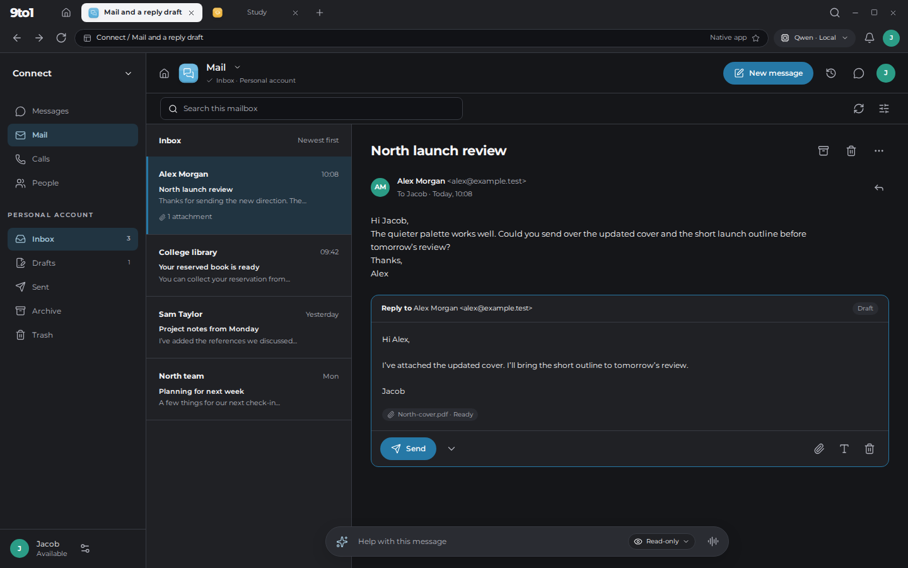
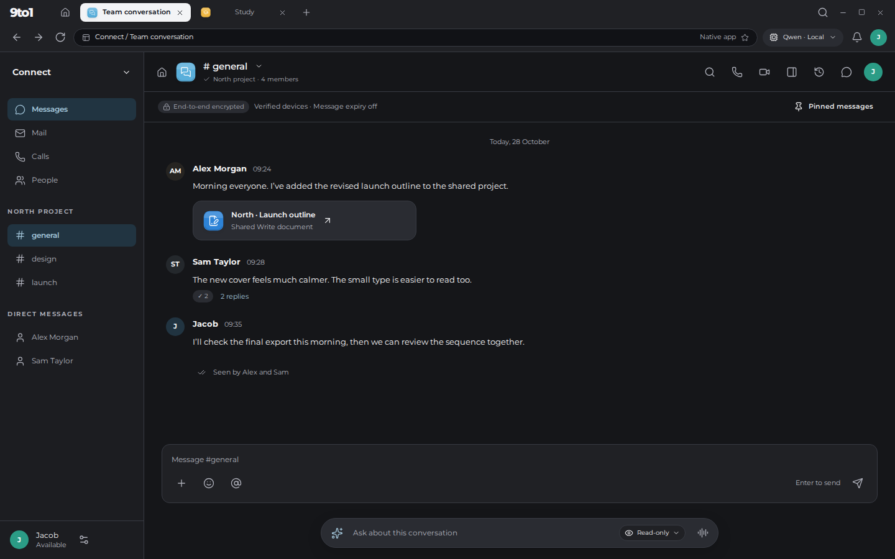
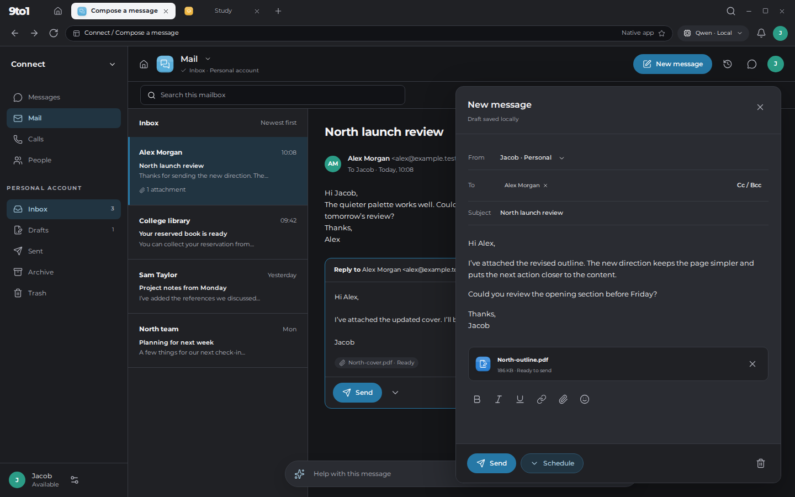
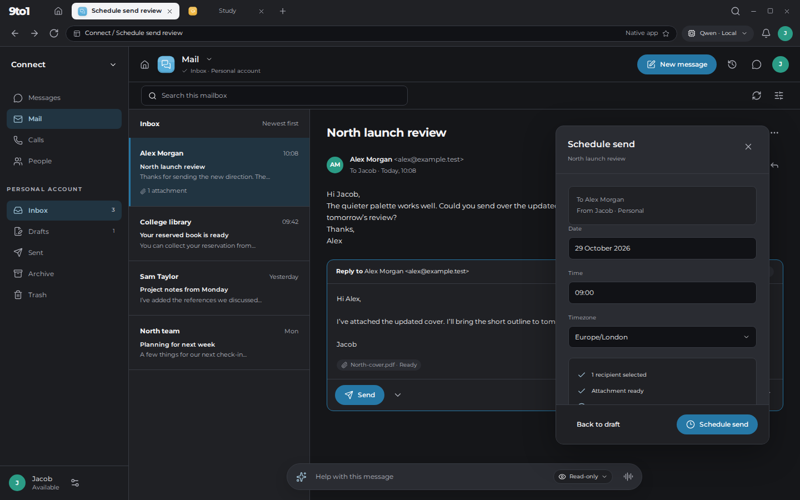

# Connect — conversations, contacts and Mail

Module ID: `connect` · 9to1 Development Specification v3

## Prerequisites

- **CUI, themes and shared interaction system** — Typed UI components, theme tokens/materials, layout, focus, motion, accessibility and shared control states.
- **Account, identity and resource entitlements** — Canonical CAKE account identity, secure sessions, server entitlements and resource allocation state.
- **External integrations and provider connections** — Canonical provider connections, OAuth scopes, typed capabilities, provenance and sync recovery.
- **Permissions, approvals and execution scope** — Effective scoped grants, action approvals, policy intersections, revocation and audit.
- **Artifacts, local persistence and recovery** — Canonical artifacts, revisions, typed edits, local saves, derived exports, sync and recovery.

## Overview

Connect unifies real communication channels, contacts and a full Mail experience while preserving the originating provider/channel/thread. It is not the generic external-integration manager.

## Layouts & visible states

- **V3-CONNECT-LAY-01** — Use channel/account navigation, conversation list and active conversation; Mail uses a genuine folder/list/message-or-compose layout with detailed drawers as needed.
- **V3-CONNECT-LAY-02** — Show provider identity, actual connection state, unread/sending/queued/failed status and attachment metadata. Assistant contacts remain identifiable configured identities.

## Features & behaviour

- **V3-CONNECT-FEA-01** — Support canonical contacts and threaded communication, search, attachments and channel-specific capabilities without flattening all providers into one fake protocol.
- **V3-CONNECT-FEA-02** — Mail retains MIME/header handling, folders, search, rules, attachment, reply/forward/draft/send, native engine and provider requirements from the source.
- **V3-CONNECT-FEA-03** — Assistant replies and delegated work stay in their originating channel/thread unless the user explicitly changes the target. Drafting is distinct from sending.
- **V3-CONNECT-FEA-04** — Offline send queues and retries use current grants and idempotency; a queued message is not reported delivered.

## Canonical entities & persistence

- **V3-CONNECT-ENT-01** — Persist connection/account, ContactID, ConversationID/thread, message IDs, source provider references, draft revision and delivery receipts.
- **V3-CONNECT-ENT-02** — Attachments refer to their canonical resource/bytes with provenance; local preview does not prove remote delivery.

## Permissions & recovery

- **V3-CONNECT-PER-01** — Use current provider and app permissions, recipient identity and explicit send authority. Revocation/expiry blocks new remote actions while preserving draft recovery.
- **V3-CONNECT-PER-02** — Handle partial attachment upload, invalid recipient, send uncertainty and reconnect without duplicate messages.

## Acceptance checks

- **V3-CONNECT-ACC-01** — Test Mail compose/save/reopen, reply in correct thread, attachment failure, offline queue and duplicate retry.
- **V3-CONNECT-ACC-02** — Verify Assistant contact handoff preserves source conversation and distinguishes a draft from an actual send.

## Exact mock-up and state map

- **Connect · Mail and a reply draft** — screen `connect-mail`. Mail.
- **Connect · Team conversation** — screen `connect-messages`. Messages.
- **Connect · Compose a message** — screen `connect-compose`. Interaction state.
- **Connect · Schedule send review** — screen `connect-schedule`. Interaction state.

## Source clause IDs

UX27-OTHER-003, UX27-OTHER-004

## Technical reading map

- Connect — conversations, contacts and Mail — Connect; Product role and donor strategy (part 01) — `technical/connect-01.md` (2,818 words; V2-B0659).
- Connect — conversations, contacts and Mail — Connect API and events; Failure and recovery (part 02) — `technical/connect-02.md` (2,400 words; V2-B0660, V2-B0661, V2-B0662…).
- Connect — conversations, contacts and Mail — Platform behaviour; Acceptance requirements (part 03) — `technical/connect-03.md` (580 words; V2-B0743, V2-B0744, V2-B0745…).

Technical clauses retain APIs, data models, platform, recovery, donor and acceptance details. The technical files are part of this module, not optional background reading. Shared prerequisites mean stable service/interface contracts must be available; they do not require every dependent app UI to be complete. Use the named chunk for the relevant subtask or the complete module file for its full retained contract.

# Exact designs and implementation rules

These figures are the exact current atlas compositions. Their stable screen IDs match the Word specification and editable source. Open the atlas for full-size theme and interaction inspection.

## Connect · Mail and a reply draft

Screen ID: `connect-mail`. Source: Connect parent product; UX27-OTHER-003–004; Mail compose/provider semantics.

- Mail remains a complete child mode of Connect with its own protocol and canonical entities.
- Folder navigation, message list and reading/compose pane remain distinct. The actual sender and recipient are visible.
- AI drafting does not send. The shown reply is a retained draft with attachment readiness and an explicit Send action.
- Provider submission, outbox, sent confirmation, scheduled send and Undo Send require distinct truthful states.

## Connect · Team conversation

Screen ID: `connect-messages`. Source: Connect messages/rooms/threading/encryption baseline; UX27-OTHER-014.

- Native messaging keeps its own Message/Room/Thread identities, separate from Mail entities.
- The encryption badge describes the actual transport. SMS must never inherit a native encrypted-chat badge.
- Room membership does not grant access to every linked file; each canonical attachment rechecks permission.
- Typing a draft, sending a message and an AI suggestion are distinct states.

## Connect · Compose a message

Screen ID: `connect-compose`. Source: Owner revision 28 October; UX27-OTHER-003–004; Mail identity, draft and send boundaries.

- From identity, recipients, subject, attachments and retained draft status are visible in the same compose surface.
- Adding recipients resolves the selected contact explicitly; drafting does not send or grant tool access.
- The send menu opens scheduling as a separate review. Attachment upload status is visible before sending.

## Connect · Schedule send review

Screen ID: `connect-schedule`. Source: Owner revision 28 October; Mail scheduled send and durable outbox semantics.

- A scheduled message retains the original draft, actual sender, recipients, selected timezone and attachment state.
- Scheduling is distinct from provider submission and sent confirmation. The user can edit or cancel before dispatch.
- A failure at dispatch leaves the message recoverable with a visible outbox error.
