# CUI, themes and shared interaction system

Module ID: `cui` · 9to1 Development Specification v3

## Prerequisites

- **Authority, scope and implementation reading map** — Current source precedence, narrow owner overrides, source accounting and the required module structure.

## Overview

CUI is the single public UI system for every 9to1 surface. The current Professional annex defines the canonical restrained default; theme identity changes materials, typography and motion without changing app topology or repainting authored content.

Current owner overrides: V3-OWNER-001, V3-OWNER-005, V3-OWNER-010, V3-OWNER-017.

## Layouts & visible states

- **V3-CUI-LAY-01** — Offer Professional, Glow, Playful, Frosted Glass, Bubble, Metallic, Retro and Western, plus Create Theme. Cinematic is an explicit legacy compatibility choice rather than a ninth current default.
- **V3-CUI-LAY-02** — Preserve each theme’s character: Professional restrained dark charcoal; Glow luminous accent-dependent controls; Playful soft coloured surfaces; Frosted Glass translucent layered material with a legible fallback; Bubble watery dimensional surfaces and gentle wobble; Metallic brushed reflective material; Retro monospace; Western wood and sepia.
- **V3-CUI-LAY-03** — Use Montserrat by default except the explicit Retro monospace treatment or authored document fonts. Use the exact Professional annex tokens, geometry and states where specified rather than inventing near-equivalent colours.
- **V3-CUI-LAY-04** — Show normal, hover, pressed, selected, disabled, focused, loading, validation, destructive and reduced-motion states. Icon and text contrast must remain legible over every theme material.
- **V3-CUI-LAY-05** — Use native platform emoji rendering for emoji characters. Keep application glyphs and identity marks coherent, distinct from decorative emoji.

## Features & behaviour

- **V3-CUI-FEA-01** — Use CUI public primitives and typed templates. Avalonia and donor engines are internal implementation details; do not expose raw AXAML or third-party controls as a competing public UI language.
- **V3-CUI-FEA-02** — Keep one deliberate primary scroll container per workspace, bounded panels and predictable focus/keyboard order. Popovers reposition at viewport edges; Escape/outside dismissal returns focus appropriately.
- **V3-CUI-FEA-03** — Shared menus, tooltips, sliders, switches, inputs, tabbars, avatars, toasts, dialog surfaces and selection controls inherit the same theme and semantic action variants.
- **V3-CUI-FEA-04** — App-specific content retains its own colours: slides, pages, photographs, charts, canvases and web previews do not receive theme-tint filters.
- **V3-CUI-FEA-05** — Reduced motion disables wobble, bounce and ornamental animation while preserving state changes and feedback. Transparency and material effects need performant, accessible fallback modes.

## Canonical entities & persistence

- **V3-CUI-ENT-01** — Store theme identity/version, compatible custom tokens, accent, typography/density and accessibility preferences in the Home-owned account/device preference contract. Space-specific overrides are explicit and reversible.
- **V3-CUI-ENT-02** — Keep semantic tokens separate from app identity accents and document content. Theme switching must not mutate artifact revision or user-authored styles.

## Permissions & recovery

- **V3-CUI-PER-01** — Custom themes are validated against supported tokens and accessible contrast/focus requirements; importing one is not permission to execute arbitrary UI code.
- **V3-CUI-PER-02** — Restore a valid baseline if a theme resource is missing, incompatible or fails to load; preserve the user’s chosen identity for recovery.

## Acceptance checks

- **V3-CUI-ACC-01** — Review all eight current themes, a custom theme and Cinematic compatibility with keyboard focus, mixed selected/disabled states, narrow screens and reduced motion.
- **V3-CUI-ACC-02** — Verify the Professional annex’s menu/toolbar/selection/notes and Present geometry exactly; compare rendered state captures rather than only token files.
- **V3-CUI-ACC-03** — Change themes while editing and verify selection, drafts, scroll, runtime state and authored content survive unchanged.

## Exact mock-up and state map

- **Create Theme · Authoring and preview** — screen `custom-theme`. Theme builder.
- **Components · Buttons, inputs and control states** — screen `components`. Component sheet.
- **Bubble · Material and controls** — screen `theme-bubble`. Theme showcase.
- **Western · Material and controls** — screen `theme-western`. Theme showcase.
- **Retro · Material and controls** — screen `theme-retro`. Theme showcase.

## Source clause IDs

CUI-EDITOR-102, CUI-EDITOR-103, CUI-EDITOR-104, CUI-EDITOR-105, UX27-SHARED-001, UX27-SHARED-002, UX27-SHARED-003, UX27-SHARED-004, UX27-SHARED-005, UX27-SHARED-006, UX27-SHARED-007, UX27-SHARED-008, UX27-SHARED-009, UX27-SHARED-010, UX27-SHARED-011, UX27-SHARED-012, UX27-SHARED-013, UX27-SHARED-014, UX27-SHARED-015, UX27-SHARED-016, UX27-SHARED-017, UX27-SHARED-018, UX27-SHARED-019, UX27-SHARED-020, SECTION-01, CUI-CONF-001, CUI-CONF-002, CUI-CONF-003, CUI-CONF-004, CUI-THEME-001, CUI-THEME-002, CUI-THEME-003, CUI-THEME-004, CUI-001, CUI-002, UX27-TEST-050, UX27-TEST-051, UX27-TEST-052, UX27-TEST-053, UX27-HOST-007, UX27-TEST-054, UX27-TEST-055, UX27-TEST-056, UX27-TEST-057, PRESENT-UX-101, PRESENT-INT-101, CUI-EDITOR-101, STARTUP-UX-101, PRESENT-AC-101, DESIGN-001, CUI-PRO-201, CUI-PRO-202, CUI-PRO-203, CUI-PRO-204, CUI-PREF-201, CUI-PREF-202, CUI-PREF-203, CUI-PREF-204, CUI-PREF-205, APP-VIS-201

## Technical reading map

- CUI, themes and shared interaction system — Context-menu coverage; Professional app theme (part 01) — `technical/cui-01.md` (2,346 words; V2-B0037, V2-B0038, V2-B0039…).
- CUI, themes and shared interaction system — Responsive layout and no control explosion; Accessibility and discoverability (part 02) — `technical/cui-02.md` (1,333 words; V2-B0293, V2-B0294, V2-B0295…).
- CUI, themes and shared interaction system — Basic markup and Container types; Comments, whitespace and escaping (part 03) — `technical/cui-03.md` (6,058 words; V2-B0304).
- CUI, themes and shared interaction system — Exclusive markup and interface ownership; Conformance gates (part 04) — `technical/cui-04.md` (1,918 words; V2-B2268, V2-B2269, V2-B2639…).

Technical clauses retain APIs, data models, platform, recovery, donor and acceptance details. The technical files are part of this module, not optional background reading. Shared prerequisites mean stable service/interface contracts must be available; they do not require every dependent app UI to be complete. Use the named chunk for the relevant subtask or the complete module file for its full retained contract.

# Retained technical requirements

# CUI, themes and shared interaction system — Context-menu coverage; Professional app theme (part 01)

Reading status: active retained clauses, subject to the v3 owner overrides listed in the primary module. Historical process instructions and replaced original wording are stored separately.

### V2-B0037 · v2 lines 105–105

CUI-EDITOR-102 — Context-menu coverage. Right-click on a selected shape/text/image or other object MUST open a context-specific menu with applicable Cut, Copy, Paste, Duplicate, Delete, Arrange/z-order, Align, Group and Format operations; text-editing right-click MUST offer text-appropriate commands; slide thumbnails MUST offer new, duplicate, delete, reorder/layout and related slide operations; empty canvas areas MUST offer relevant Paste/Insert/slide options. Each menu targets the intended ObjectID/SlideID and must position near its anchor without clipping; keyboard invocation/navigation, focus, escape/outside dismissal, checked/disabled/submenu states and correct z-order are mandatory. The same canonical commands must power context menus, toolbar, shortcuts and inspector.

### V2-B0038 · v2 lines 108–108

CUI-EDITOR-103 — Professional app theme. Use the supplied dark Unsloth Library reference for the overall restrained, modern, spacious professional aesthetic: cohesive dark palette, calm hierarchy, deliberately aligned title/status/header actions, subtle surfaces, softer appropriate rounding, consistent typography and clean panel separation. Do not copy external branding. The selected/hovered states must remain accessible and sufficiently visible. Use the 9to1 CUI theme's declared tokens; do not introduce one-off native-control overrides to imitate screenshots.

### V2-B0039 · v2 lines 111–111

CUI-EDITOR-104 — Icons must be reliable. Icons SHOULD be coherent, moderately rounded, optically centred, consistent in stroke/weight and recognisable, optionally with restrained semantic colour accents. Prefer proven audited icon assets to improvised generated SVG paths. Validate custom icons for viewBox/path integrity, clipping, scaling, stroke, alignment and normal/dark/focus/disabled presentation at ACTUAL toolbar pixel size. A syntactically valid SVG that looks broken is an acceptance failure.

### V2-B0040 · v2 lines 114–114

CUI-EDITOR-105 — Shared abstractions not forced layouts. Reusable CUI EditorShell/EditorToolbar, grouped commands, contextual inspector, menu/popover, insertion catalogue, selection-adorners and viewport contracts SHOULD be extended/shared where justified, with clear source ownership and typed interfaces. This sets shared standards for Write, Present, Data, Boards, Canvas and relevant apps, but MUST NOT force a Present three-row header or object-selection model onto applications whose category workflows require other layouts. Respect existing authoritative CUI ten-primitive language and registered Object Type integrations. Avalonia MAY supply underlying rendering, input, windowing and specialised engine integration behind CUI; it MUST NOT be the default public styling/control vocabulary or override CUI states. Diagnose actual code and renderer boundaries rather than inferring native leakage solely from screenshots.

### V2-B0243 · v2 lines 1168–1168

## 1. Shared visual, input and state contracts

### V2-B0244 · v2 lines 1170–1170

### UX27-SHARED-001 — Complete command contract

### V2-B0245 · v2 lines 1172–1172

**B/D.** Every visible command MUST have a stable command identifier; a semantic label; a validated icon where useful; an accessible name; keyboard/touch activation; its target object IDs; enabled/disabled/busy rules; permission and revision checks; a specified result; and an error/undo policy. The toolbar, menu, shortcut, contextual popup, AI action and automation API must invoke the same domain action instead of implementing separate mutations. A disabled command must expose a concise reason without requiring it to run. A command is not implemented because a button, handler name or empty task exists.

### V2-B0246 · v2 lines 1174–1174

Verification MUST activate representative commands from more than one surface, compare resulting canonical state, undo, save and reopen. Toolbar state must track external/API edits as well as local clicks.

### V2-B0247 · v2 lines 1176–1176

### UX27-SHARED-002 — Control-state matrix

### V2-B0248 · v2 lines 1178–1178

**B/D.** Implement distinct normal, hover, pressed, keyboard-focus, selected, checked, mixed, disabled, busy, error and unavailable states where meaningful. Hover must not masquerade as selection. Pointer-down shows pressed feedback but does not commit a consequential action; ordinary buttons commit once on valid release/activation. Moving out while pressed cancels activation unless the control’s gesture contract says otherwise. Space/Enter activation must not also cause a second pointer action. Focus remains visible independently of hover and selected fill.

### V2-B0249 · v2 lines 1180–1180

Busy state preserves the control’s size and accessible label, prevents duplicate submission where necessary, and exposes cancellation only when actually supported. Never replace content with a spinner so early that the user loses the target or cannot determine what is pending.

### V2-B0250 · v2 lines 1182–1182

### UX27-SHARED-003 — Geometry and scale defaults

### V2-B0251 · v2 lines 1184–1184

**D.** Use logical display units through CUI’s registered layout system, not hardcoded physical-screen coordinates. Where no more specific approved design exists, use a 4-unit spacing scale; compact row heights of 32 units; ordinary toolbar hit areas of 32×32; 16–20-unit glyphs; and 44×44 effective hit targets in a touch/coarse-pointer layout. Allow density and accessibility settings to increase sizes. A glyph’s visual bounds and its hit target are separate.

### V2-B0252 · v2 lines 1186–1186

Test at 100%, 125%, 150% and 200% display scaling, at representative narrow and wide windows, and when moved between monitors with different scale factors. Logical dimensions in this document must be mapped through the canonical CUI property system; they do not introduce a second public layout language.

### V2-B0253 · v2 lines 1188–1188

### UX27-SHARED-004 — Icon identity and quality

### V2-B0254 · v2 lines 1190–1190

**O/B/D.** Application icons use the owner’s rounded, filled, colourful, distinct design direction with light/dark variants. Boards uses the purple window-like identity; Data retains its teal identity; Spaces uses the agreed speech-bubble/Space-type composition when the actual approved asset is available. Do not substitute an unrelated donor logo, missing-glyph box, Unicode symbol or unreviewed generated path and call it the approved icon.

### V2-B0255 · v2 lines 1192–1192

Command icons belong to one coherent family, with optical alignment and appropriate stroke/fill weight. Pair unfamiliar or destructive symbols with text in their menus. Test actual assets at 16, 20, 24 and 32 logical units, under light/dark, hover, selected and disabled states. Decorative icons are excluded from screen-reader naming; icon-only controls receive meaningful labels.

### V2-B0256 · v2 lines 1194–1194

### UX27-SHARED-005 — Theme changes alter appearance, not topology

### V2-B0257 · v2 lines 1196–1196

**O/B.** Professional/Glow and light/dark choices resolve through CUI tokens. Theme switching may change palette, typography tokens, elevation and permitted surface treatment; it MUST NOT relocate the Boards footer Add action to the header, flatten its page tree, replace page controls or change document layout semantics. Keep active page, selection, scroll position and open document identity stable. Theme application is one coordinated update, not a frame with old text colours on new backgrounds.

### V2-B0258 · v2 lines 1198–1198

User-authored document colours/fonts and embedded artifact styling remain content, not app-theme values. Professional defaults follow the existing reference typography, including Montserrat where prescribed; code retains an appropriate monospace font. Do not manufacture one universal pill-shaped interface or overwrite explicitly different app layouts.

### V2-B0259 · v2 lines 1200–1200

### UX27-SHARED-006 — Contrast and readability

### V2-B0260 · v2 lines 1202–1202

**B/D/R.** Test real computed foreground/background pairs, not merely token names. Normal informative text targets at least 4.5:1 contrast; large text at least 3:1; essential control boundaries/focus indicators must remain distinguishable. A pale sidebar caption or dark title must not disappear after a theme switch. Disabled appearance must still be identifiable as a control, with an accessible reason; reduced opacity must not be applied to an entire container containing active children.

### V2-B0261 · v2 lines 1204–1204

Selected tabs default to the owner’s light grey/white surface with black text unless an explicit accent override applies. The override must retain readable contrast and selection distinction. Dark themes are not permission for dark-on-dark labels. These are product requirements informed by W3C guidance, not a claim of complete WCAG certification.

### V2-B0262 · v2 lines 1206–1206

### UX27-SHARED-007 — Motion token table

### V2-B0263 · v2 lines 1208–1208

**D.** Define shared named motion tokens instead of ad hoc per-control animations: `Immediate=0 ms`, `Feedback=100 ms`, `Reveal=140 ms`, `Reflow=180 ms`, `Panel=220 ms`. These are authored 9to1 defaults, not measured Notion/AppFlowy timings. Use restrained ease-out for entering elements and ease-in for dismissal; interactive drag and ink track live input without waiting for an easing cycle. A new action can interrupt a transition without dropping input or replaying the old action.

### V2-B0264 · v2 lines 1210–1210

Hover/focus colour transitions use Feedback; popovers use Reveal with at most a small opacity/4-unit translation; tree expansion and post-drop settling use Reflow; sidebar collapse uses Panel. Do not animate text caret positioning, text entry, file-save truth, permission grants or block identity. Motion must not create extra blank document space or move the hit target away from its rendered control.

### V2-B0265 · v2 lines 1212–1212

### UX27-SHARED-008 — Reduced motion and truthful progress

### V2-B0266 · v2 lines 1214–1214

**B/D/R.** Honour operating-system reduced-motion preference and a persistent app override. Remove nonessential translations, zooms, parallax and spring/bounce effects; retain immediate state changes and brief fades only where acceptable to the chosen setting. A loading animation denotes actual pending work, never fabricated progress. Determinate progress requires a real denominator; otherwise use an honest indeterminate state with the operation name and cancellation/retry where supported.

### V2-B0267 · v2 lines 1216–1216

Background activity must not continuously animate every hidden tab. Pause unnecessary off-screen presentation work while preserving actual background tasks. Motion settings do not disable authored animation playback in a media/presentation preview; that preview has its own explicit controls.

### V2-B0268 · v2 lines 1218–1218

### UX27-SHARED-009 — Popover lifetime and outside dismissal

### V2-B0269 · v2 lines 1220–1220

**O/B/D.** A popup has an owner surface, anchor, target identity, focus-return target and lifetime. Open only one unrelated popup chain per window; submenus remain a chain. Outside pointer-down, Escape, activating a different tab/app, destroying the owner, or losing the target closes applicable transient popups. A profile menu must not remain over a different app after navigation. Updating theme or layout repositions the existing popup correctly or dismisses it; it must never become an orphaned overlay.

### V2-B0270 · v2 lines 1222–1222

The outside-dismiss click must not accidentally activate a destructive background action. Escape closes the deepest submenu first, then its parent; it cancels a staged operation rather than silently committing. After dismissal return focus to the originating control or the nearest valid owner if that control no longer exists. Permission dialogs follow their explicit security contract and are not silently dismissed as ordinary menus.

### V2-B0271 · v2 lines 1224–1224

### UX27-SHARED-010 — Popup placement, keyboard and scrolling

### V2-B0272 · v2 lines 1226–1226

**B/D/R.** Anchor menus to the invoking control or pointer, with an 8-unit viewport safety margin by default. Flip above/below or left/right when necessary, then clamp without detaching the perceived anchor. Long menus have bounded internal scrolling; the document must not scroll underneath while the menu consumes wheel input. Arrow keys move between eligible items, Enter/Space activate, Escape dismisses, and type-ahead works where appropriate. A submenu opens on an intentional hover delay or keyboard action, not every incidental pointer crossing.

### V2-B0273 · v2 lines 1228–1228

Checked and mixed states are conveyed visually and accessibly. Shortcut labels align in a separate column. Disabled items can expose reasons without executing. Use normal native accessibility semantics on native platforms and equivalent ARIA semantics on web, rather than styling arbitrary text to resemble a menu.

### V2-B0274 · v2 lines 1230–1230

### UX27-SHARED-011 — Focus and selection are preserved through tools

### V2-B0275 · v2 lines 1232–1232

**B/D.** Text selection belongs to the editor model, not merely a transient native control focus. Opening the formatting island, colour picker or link popup preserves the exact selected range and direction. Apply affects that range, not the whole page or a newly focused empty field. Closing the tool returns the caret/selection to the document and reveals it without scrolling to the page top. A selection changed by an external revision is revalidated before applying, with a clear conflict result if the target is stale.

### V2-B0276 · v2 lines 1234–1234

Focus order follows visible hierarchy. Do not install global key handlers that consume ordinary text, IME composition or table navigation. Every popover, drawer and modal has an explicit focus policy, and no invisible control remains in the tab order after its surface closes.

### V2-B0277 · v2 lines 1236–1236

### UX27-SHARED-012 — Scroll ownership and coordinate transforms

### V2-B0278 · v2 lines 1238–1238

**O/B.** Wheel, touchpad, touch and scrollbar gestures target the hovered/active scroll container according to the platform convention. Apply OS natural-scroll direction once, never negate it again in an embedded engine. Preserve high-resolution fractional deltas rather than truncating small trackpad movement to zero. Boundary chaining is deliberate: a short menu scrolls itself; a page scrolls when the menu is closed; a canvas zoom gesture must not scroll the parent unexpectedly.

### V2-B0279 · v2 lines 1240–1240

Persisted content uses domain coordinates. Screen/DPI/viewport/scroll/zoom transforms are composed once and inverted consistently for hit testing. Use the same transform for content, selection handles, drag previews and ink. Test zoom, monitor-scale changes and nested surfaces rather than adding unexplained offset constants.

### V2-B0280 · v2 lines 1242–1242

### UX27-SHARED-013 — Undo transaction boundaries

### V2-B0281 · v2 lines 1244–1244

**B/D.** One split, block move, page move, completed pen stroke, drag-resize, format action, insertion or accepted AI patch is one logical undoable transaction unless a richer existing domain contract specifies otherwise. A drag preview is not hundreds of separate undo entries. Text typing groups coherently, but crossing into a distinct action closes the group. Undo restores identities, relationships, text marks, content and selection as far as the domain permits; Redo reapplies the intended operation without duplicating a node.

### V2-B0282 · v2 lines 1246–1246

External side effects such as sending mail, publishing a site or deleting a remote object are not automatically reversible document edits. Their UI must describe the actual reversal/cancellation boundary. Never display an Undo control that merely hides a toast while leaving an unintended external action unexplained.

### V2-B0283 · v2 lines 1248–1248

### UX27-SHARED-014 — Error scope and recovery

### V2-B0284 · v2 lines 1250–1250

**O/B.** An unavailable browser engine affects web tabs, not local Board creation. An unavailable model affects AI generation, not ordinary editing. An unavailable cloud account affects that account’s resources, not local files. Present errors at the narrowest owning surface with a named failed operation, preserved input, and genuine retry/recovery options. A permanent window-wide generic “action could not complete” banner is not adequate diagnosis for every later action.

### V2-B0285 · v2 lines 1252–1252

Retry must reuse or reconcile the operation identity where duplicate effects are possible. Do not silently treat a timeout as failure to execute. Closing an error notification does not clear a real permission hold, erase failed-save state or falsely mark an artifact saved.

### V2-B0286 · v2 lines 1254–1254

### UX27-SHARED-015 — Save-state vocabulary

### V2-B0287 · v2 lines 1256–1256

**B/D.** Distinguish at least `New local draft`, `Changes pending`, `Saving locally`, `Saved locally`, `Sync pending`, `Synced`, `Save failed`, `Read-only` and `Conflict` where applicable. Display the destination and last durable revision in details without crowding the main workspace. A cloud upload pending after a successful local commit is not “not saved locally”; a failed local write is never “Saved”. No hardcoded “Saved · Just Now” label.

### V2-B0288 · v2 lines 1258–1258

When closing a document with unsaved durable state, preserve a recovery draft and offer appropriate Retry/Save As/Discard/Cancel choices. Discard affects only the explicitly selected unsaved change set and must not delete unrelated saved files or owned embedded artifacts.

### V2-B0289 · v2 lines 1260–1260

### UX27-SHARED-016 — Rendering must reflect actual route and build

### V2-B0290 · v2 lines 1262–1262

**O/B.** UI changes count only when the route the user opens instantiates the changed surface in the identified installed build. Record application route, resolved registered surface, source commit, package/build identity and canonical document target. A standalone scene test or directly constructed page does not prove the host route activates it. Launch through the real user entry point and verify navigation, content, focus and persistence on that path.

### V2-B0291 · v2 lines 1264–1264

Prevent multiple obsolete implementations from silently providing different behaviour under the same public app name. Shared services remain canonical; standalone and hosted entry points use the same domain model and supported surface implementation. Diagnostics may expose route/build identity without becoming ordinary document content.

### V2-B0292 · v2 lines 1266–1266

### UX27-SHARED-017 — Loading, empty and offline states

# CUI, themes and shared interaction system — Responsive layout and no control explosion; Accessibility and discoverability (part 02)

Reading status: active retained clauses, subject to the v3 owner overrides listed in the primary module. Historical process instructions and replaced original wording are stored separately.

### V2-B0293 · v2 lines 1268–1268

**B/D.** An empty collection shows an explanation and an immediately usable create/open action, not a blank rectangle. Loading shows only the region awaiting data and retains safe navigation. Failure does not impersonate empty data. Offline/local-only state explains which optional services are unavailable without forcing an account wizard over a usable local editor. Restoration shows the actual target, including unavailable references, without fabricating placeholder documents as the recovered originals.

### V2-B0294 · v2 lines 1270–1270

Skeletons reserve plausible dimensions only while data is genuinely pending, then release them. Do not leave a giant fixed-height placeholder inside an editable block. A loading message is not persisted as user content and must not duplicate on each render.

### V2-B0295 · v2 lines 1272–1272

### UX27-SHARED-018 — Responsive layout and no control explosion

### V2-B0296 · v2 lines 1274–1274

**B/D.** Each toolbar declares priority groups and an overflow policy. At reduced width, move lower-priority groups into a labelled overflow menu before clipping or adding uncontrolled rows. Keep essential create/save/mode controls reachable. Do not render every possible action for every cell/block simultaneously. Contextual tools replace the relevant group in the existing tool surface; they do not add a second wall of controls.

### V2-B0297 · v2 lines 1276–1276

Remember user-resized panes within sensible bounds. Sidebars scroll independently of the document; fixed footers remain visible. An accessibility zoom setting may require a more spacious layout, but must not silently remove actions. Test narrow windows with long titles and translated labels.

### V2-B0298 · v2 lines 1278–1278

### UX27-SHARED-019 — Accessibility and discoverability

### V2-B0299 · v2 lines 1280–1280

**B/D/R.** Every pointer gesture has a practical keyboard/menu alternative. Trees expose hierarchy and expanded/selected state; sliders announce label/value/range; icon buttons have action names; canvas objects have meaningful semantic navigation where supported. Do not make hover the only way to discover an essential action on touch devices. Tooltips show a label, shortcut and useful disabled reason, with a default pointer delay of 400 ms; keyboard focus can expose the same information without a precision hover.

### V2-B0300 · v2 lines 1282–1282

Tree focus and the page currently open are separate until activation; keyboard navigation must not trigger an expensive page load on every arrow press. Native accessibility adapters and web semantics require actual testing rather than accepting a label property in source as proof.

### V2-B0301 · v2 lines 1284–1284

### UX27-SHARED-020 — Performance without content loss

### V2-B0302 · v2 lines 1286–1286

**B.** Preserve the 20 October scalable-content annex: no arbitrary document/page/slide/block count cap used to hide an inefficient implementation. Prioritise input, selection, current-region edits and scrolling over distant rendering/indexing. Virtualise and hydrate by stable IDs, keep caches bounded, and use incremental persistence. Unrendered content remains real, searchable and exportable.

### V2-B0303 · v2 lines 1288–1316

Measure input/frame/save/open behaviour on declared hardware and workloads. New motion timings above are presentation defaults, not performance guarantees. No pass is earned by silently dropping strokes, skipping blocks, truncating exports, disabling recovery or lowering canonical document fidelity.
<!-- UX27:END SECTION-01 -->
CakeUI (CUI)
Purpose, design philosophy and framework boundary
CakeUI (CUI) is the authoritative 9to1 user-interface framework and .cui is the only final application-markup format for first-party 9to1 applications. CUI is intentionally small, opinionated and quick to learn: ordinary application authors work with a fixed compact element vocabulary, Types, properties, Themes, Definitions, Prefabs, variables, Styles/actions and a small set of structural language constructs rather than an Avalonia-sized public control taxonomy.
CUI is derived from a pinned Avalonia source fork for mature low-level rendering, composition, text measurement, layout foundations, input, focus, accessibility, windowing and platform integration. Avalonia remains an implementation foundation; it is not the public app-authoring framework. CUI MUST compile directly to the CUI/Avalonia runtime representation and MUST NOT translate .cui into AXAML as an intermediate authoring/runtime contract.
Shipping first-party app projects MUST stop recognising .axaml and .hui as accepted application markup. C# and other implementation code remain valid for domain logic, services, specialised controls/renderers and platform integration; ordinary visible application structure and styling are authored through CUI.
CUI-CONF-001 — Public language boundary. A .cui extension alone proves nothing. Shipping authoring registries, schemas, parser/runtime loaders, code generation, hot reload, samples, designer output and documentation MUST expose the canonical CUI vocabulary and typed properties, not donor controls disguised by a file rename. Use Text, not TextBlock; Container Type="Grid", not Grid; Container Type="Vertical Stack" or "Horizontal Stack", not StackPanel. Layout and scrolling use the registered CUI Container properties, including RowSizes, ColumnSizes, Row, Column and independent scrolling, not public RowDefinitions/ColumnDefinitions or Grid.Row-style attached-property syntax. Do not reject valid registered CUI properties merely because a donor has a similarly named property.
CUI-CONF-002 — No permanent legacy aliases. Reject Grid, StackPanel, WrapPanel, ScrollViewer, TextBlock and Border as built-in public element tags, including donor-namespace/reflection escape routes. Border remains a valid registered CUI property, not a primitive tag. Custom (Definition) components remain supported, but MUST NOT be used to re-export the forbidden donor taxonomy as aliases. Import symbol aliases and the explicitly specified CUI shorthand/ID aliases remain valid. An explicit one-time source migration tool may read legacy input and emit canonical CUI with diagnostics; production compilation/loading MUST NOT silently accept or fall back to legacy syntax.
CUI-CONF-003 — Internal donor boundary. Keep the pinned Avalonia fork, its provenance/licensing and required mature low-level capabilities. CUI compiles directly to its own typed representation and runtime binding, never through generated AXAML. Native framework objects, donor-private assets and specialised host implementation code stay behind reviewed renderer/platform adapters; they do not define an alternative first-party application UI. Inventory every first-party shell, page, menu, dialog, popup, inspector and shared component and migrate its ordinary structure/styling to CUI. No generic Object wrapper around an entire legacy app, second hidden UI tree or swallowed parser failure may bypass this boundary.
The framework MUST make common UI concise without becoming ambiguous. Shorthand may reduce typing but MUST NOT change semantics or permit guessing. If a shorthand token has more than one valid resolution, compilation fails and the developer must use an explicit form.
Donor, source and compatibility contract
The implementation MUST obtain and include the selected appropriate Avalonia source revision in the CUI source tree/build graph under the global donor-source contract. The exact upstream repository, selected revision/release, licence obligations and local modifications MUST be traceable.
CUI MUST maintain an upstream-parity manifest for the low-level Avalonia capabilities it relies on and a CUI property-parity manifest for broadly applicable visual/layout/property families derived from Avalonia and mature CSS concepts. A feature being absent from CUI's small primitive element vocabulary is not permission to omit mature framework capability when it can be represented through Type, property, Definition, Prefab or Object hosting.
The public CUI language/runtime is versioned independently from Avalonia. Upstream Avalonia changes MUST be adapted behind CUI contracts and MUST NOT silently alter public CUI syntax or semantics.
CUI-CONF-004 — Authentic specialised surfaces. A registered Object Type may host an actual donor-backed document, canvas, browser or media engine; for example Object Type="WriteDocumentSurface" is a valid integration shape when that Type is registered. Its contract MUST expose the applicable typed content/selection/actions, lifecycle, input/focus, accessibility, theme integration, errors and canonical state. CUI owns surrounding app controls and chrome; the engine owns its specialised content semantics. Neither a static image nor a generic text box is a substitute for a required specialised engine. CUI themes MUST NOT rewrite user-authored document styling or other artifact content.
Core language vocabulary
The built-in visual/structural vocabulary is exactly the ten elements listed below: Page, Container, Text, Image, Audio, Video, Object, Button, Input and Layer. Specialised products extend CUI through registered Type, (Definition), Prefab or Object Type rather than expanding the primitive donor-control taxonomy. Nonvisual/declarative language constructs, including Anchor placement declarations, are separate from these ten elements and retain their specified semantics.
Core visual/structural elements:
* Page — root navigation/render surface and top-level UI scope.
* Container — general layout/composition element; layout behaviour is selected primarily through Type and properties.
* Text — textual content element.
* Image — image content element.
* Audio — audio/media element where a visual/controller surface is required.
* Video — video element.
* Object — host for specialised renderers/objects such as graphs, Canvas surfaces, browser/media/document engines and other non-primitive content.
* Button — standard action control.
* Input — standard input family; Type selects text, number, checkbox, slider and other registered input behaviours.
* Layer — rendering-depth container; Layer is also available as an element property.

# CUI, themes and shared interaction system — Basic markup and Container types; Comments, whitespace and escaping (part 03)

Reading status: active retained clauses, subject to the v3 owner overrides listed in the primary module. Historical process instructions and replaced original wording are stored separately.

### V2-B0304 · v2 lines 1319–1726

V3 editorial amendment: V3-OWNER-005. Original wording is preserved in the replacement ledger.

Core nonvisual/declarative constructs:
* Theme, Style, Property, Variable, Prefab, ActionEvent/&, If, Else, Repeat, Import, Keyframe/@ and Anchor. Anchor is the nonvisual named placement declaration used by LoadAt and related placement APIs; it is not an eleventh visual primitive or a donor layout control.
Built-in language/framework keywords are case-insensitive. User-defined IDs, Groups, C# variables, custom Definition names, Prefab IDs and other user symbols are case-sensitive unless the owning external language/package explicitly defines different rules.
Basic markup and Container types
CUI uses XML-like nesting but is its own strict language. Most behavioural variation is expressed through Type and properties rather than different primitive element names.
<Page>
    <Container Type="Grid">
        <Text>Hello</Text>
    </Container>
</Page>
Container MUST support at least Grid, Vertical Stack, Horizontal Stack and Absolute as built-in Types. Additional mature layout Types MAY be registered without changing the core element vocabulary.
<Container Type="Vertical Stack" Horizontal-Scrolling="True" Vertical-Scrolling="True">
Attribute-assignment shorthand uses a colon after an identifier. The following are equivalent when unambiguous:
<Container Type="Grid">
<Container Type:Grid>
For unquoted shorthand values, underscore MAY represent a space. Therefore Type:Vertical_Stack resolves to Type="Vertical Stack" when that is the only valid symbol. Quoted values are literal and underscore substitution never occurs inside quotes.
If both an underscored name and the corresponding spaced name exist in the active resolution scope, shorthand is ambiguous and MUST fail compilation rather than choosing one.
Comments, whitespace and escaping
Comments use <# and #> and MAY span multiple lines. Comments do not nest and do not create runtime nodes.
<# This is a CUI comment #>
Formatting whitespace outside text-bearing content is ignored. Text content uses the Text element's whitespace policy; the default collapses source indentation/newline whitespace that exists only for readable markup, while Whitespace:Preserve retains exact authored whitespace.
Quoted values are literal except for explicitly documented escape sequences. The compiler MUST provide an escaping mechanism for CUI-significant punctuation in free text/shorthand. Formatter output MUST be deterministic.
(Definition), custom elements and custom Types
(Definition) is a declaration modifier. A Definition creates reusable language/component definitions and is not rendered merely because its declaration is present.
<Paragraph (Definition)>
    ...
</Paragraph>
The declaration above creates a reusable Paragraph element that can later be instantiated as <Paragraph>...</Paragraph>.
<Text (Definition) Type="ABCDEFG">
    ...
</Text>
A Type Definition extends the relevant base element's registered behaviour/style contract. Built-in element and Type names cannot be silently shadowed by user definitions; an intentional framework-supported override must be explicit.
Definitions SHOULD be authored using ordinary CUI elements/properties so authors do not have to learn a separate component language.
Themes and inherited theme structure
Theme is an inherited visual-design scope. Everything within a Theme uses that Theme until a descendant Theme overrides it; after the descendant closes, inheritance returns to the parent Theme.
Current built-in Theme names:
* Professional.
* Glow.
* Playful.
* Frosted Glass.
* Bubble.
* Metallic.
* Retro.
* Western.
Cinematic is retained only as explicit legacy compatibility. Create Theme supports compatible custom definitions.
Themes are complete CUI-owned visual systems, not colour-only palettes. Each built-in Theme MUST provide coherent effective typography, colours, surfaces, spacing, control shapes/templates, corner treatment, elevation, focus/hover/pressed/selected/disabled/validation states and motion defaults for supported CUI elements and Types, using explicit CUI inheritance/reuse where appropriate. Themes MUST NOT silently change a control's semantic meaning, required user workflow or user-authored artifact content.
<Theme Name="Glow">
    <Container Type:Vertical_Stack>
        ...
    </Container>
</Theme>
CUI-owned theme implementation and renderer isolation
CUI-THEME-001 — One presentation authority. CUI owns the effective styles, resources, control templates and state visuals of first-party application surfaces on every supported renderer. Do not install Avalonia FluentTheme, SimpleTheme or another donor/application theme as the global/default visual owner underneath CUI. Removing a theme import alone is not a fix: supply the complete CUI-owned templates, states and resources required for functioning controls. Retained donor-private rendering mechanisms must remain encapsulated and unable to override CUI styling or leak default native chrome into CUI surfaces. System-owned OS dialogs and user-authored document/content styles are separate explicitly identified boundaries, not excuses for unthemed first-party app controls.
CUI-THEME-002 — Deterministic startup and fallback. Resolve Home's effective user_preference before presenting the normal shell, using the last valid authorised cache when offline. Missing/invalid custom themes fall back explicitly to CUI Professional with a clear diagnostic; never silently fall back to Fluent, Simple or unrelated native styling. New windows, menus, popups, tooltips, dialogs, nested Prefabs and specialised Object chrome use the same effective CUI resources. Reactive theme changes preserve focus/selection, canonical data and ongoing work; they cannot merely swap an accent colour.
CUI-THEME-003 — Inspectable precedence. The CUI Style and property precedence section below is the sole cascade. Donor style priorities, resource load order, native selectors or framework theme variants are not additional precedence layers. Resolve each effective typed property through CUI and expose its winning value/source in the CUI theme/property inspector. General control defaults belong in the active CUI theme; hidden hard-coded donor defaults must not defeat it. Renderer adapters apply resolved values and return input/state changes through CUI rather than independently restyling controls. Equal-specificity declarations resolve deterministically by CUI scope/source order, not incidental renderer timing. Animation and state presentation remain governed by their declaring CUI property/Style contract; accessibility policies remain enforced.
CUI-THEME-004 — Real conformance evidence. Test all eight current built-in Themes, Cinematic compatibility and a custom theme, nested overrides and return to inheritance, user_preference across at least two independently running apps, restart/offline fallback, supported native/web surfaces, keyboard focus, validation, disabled/selected/hover/pressed states, scale/contrast and reduced motion. Include menus/dialogs/popups and specialised Object chrome, not only Buttons. Demonstrate that competing donor-default resource/selector values cannot win the CUI cascade, and inspect actual screenshots plus computed semantic/property state. Preserve user-authored content identically through theme changes. Missing theme/template resources or a renderer-specific default-theme leak is a conformance failure, not accepted visual variation.
Home user-preference theme binding
CUI MUST accept the reserved dynamic theme-name input `user_preference` in any valid Theme scope, for example `<Theme Name="user_preference"> ... </Theme>`. `user_preference` is a resolver/reference, NOT an additional built-in theme or a literal visual style. Its resolved value is the currently effective Home-managed theme selection for the active user/profile, including supported installed custom themes. Resolution MUST use the canonical Home Core settings/theme service; app-specific hard-coded theme copies, duplicated preference stores and silent overrides are prohibited.
Unless a particular nested region explicitly chooses another supported Theme, first-party 9to1 app shells and shared CUI components MUST inherit the user's effective preferred theme consistently (including Picture, Wave and Motion). An explicit descendant Theme override remains scoped and retains the documented parent-theme inheritance when it ends; app-specific temporary/preview overrides MUST be visible and reversible, must not overwrite the user's Home preference, and must not silently disable user-selected accessibility settings. Dynamic binding is reactive: valid Home changes update affected active windows/surfaces and future launches coherently, with theme resource and inherited properties re-resolved rather than merely changing accent colours.
CUI/theme acceptance MUST exercise switching Home's preferred theme among Glow, Professional and a supported custom theme, applying `Name="user_preference"` in at least two independent running apps, observing correct live/restored styling across restart and signed-in supported surfaces, then testing offline cached preference, missing/invalid custom theme fallback, descendant explicit override and return to parent preference, plus reduced-motion/contrast/accessibility inheritance. Theme updates MUST NOT change user content or canonical artifact state.
Users can define custom Theme types in .cui-theme files.
<Theme (Definition) Name="Rainbow" Inherits="Professional">
    <Button (Definition)>
        <# Theme-specific Button properties #>
    </Button>
</Theme>
Within a Theme definition, an element Definition without Type defines that Theme's default presentation for that element. A Definition with Type defines the Theme presentation for that element Type. Custom Themes SHOULD inherit another Theme when only deltas are needed.
Default typography
Montserrat is the default CUI/9to1 interface font wherever technically available and legally redistributable. First-party 9to1 applications and the 9to1-OS shell SHOULD inherit the global CUI typography system rather than independently selecting unrelated UI fonts.
CUI MUST define a robust fallback font stack for environments where Montserrat is unavailable and must support specialised font roles such as monospace/code text. Users may override the system/interface font through the supported customisation/theme framework without requiring application-specific hacks.
Prefabs and reusable shared CUI
A Prefab packages reusable shared CUI structure/code in a .cui-prefab file. Prefabs are intended for components that should be implemented once and reused across apps, such as the shared Dulche AI bar.
<Prefab (Definition) Type="static" ID="AIBar">
    ...
</Prefab>
Prefab Type MUST be static or dynamic.
* Static Prefab — all live instances share one internal mutable Prefab state. If an internal property/state changes, every live instance reflects the same shared state. Host placement, host parent, host size and host Active state remain per instance.
* Dynamic Prefab — each instance receives independent runtime state while sharing the same compiled implementation/defaults.
Static Prefab state is runtime-shared, not automatically persistent across process restart. Persistence occurs only when the owning Prefab/app explicitly stores that state.
Prefabs may contain normal elements, Definitions, nested Prefabs, variables, Styles, actions, Themes and specialised Objects. Cyclic Prefab/Definition dependencies MUST be rejected.
A Prefab exposes caller-settable inputs, actions/events and optional CUI-content/Children inputs explicitly. It MUST NOT implicitly capture arbitrary caller state.
Prefab inputs and instantiation
Prefab inputs are declared using Variable Definitions or another equivalent typed public-definition form implemented by the compiler.
<Variable (Definition) Type="string"::Title>
<Variable (Definition) Type="string"::Subtitle>
A Prefab instance may provide declared inputs in markup or runtime load arguments. Static Prefabs MUST reject conflicting per-instance mutable input semantics that would violate their shared-state contract; content requiring independent mutable state uses a dynamic Prefab.
Variables and variable-reference syntax
Ordinary application variables remain ordinary implementation-language values. CUI reactivity is attached to the CUI reference by default; application authors do not have to wrap every value in a special Live<T> type merely to update UI.
string Name = "Jacob";
<Text>Hello <:Name:></Text>
<:Name:> is the compact live variable-reference form. Live is assumed unless static is explicitly requested.
<:Name:live>
<:Name:static>
Typed/conversion shorthand prefixes the target type:
<int:Age:>
<int:Age:static>
The long conversion forms are equivalent:
<Variable.ToInt>Age</Variable>
<Variable Type="int">Age</Variable>
Variable.ToInt and Variable Type="int" MUST resolve to the same typed conversion operation. Equivalent ToString, ToFloat, ToBool and other registered conversion forms MAY exist. Conversion failure MUST return/produce a defined typed validation/conversion error; it MUST NOT silently substitute an unrelated default such as zero.
Live versus static references
A live CUI reference subscribes to the referenced CUI-visible value and automatically reevaluates the dependent UI when that value changes. A static CUI reference evaluates on load/explicit refresh and does not update merely because the source changes.
Static subexpressions retain their last evaluated value even when another live reference in the same element causes an unrelated update. Element.Refresh() explicitly reevaluates the element's static references; refreshing a Container/Page recursively refreshes the applicable active subtree.
CUI build tooling MUST instrument or generate change-notification plumbing for CUI-visible persistent fields/properties/observable collections referenced live. Per-frame polling is prohibited. Short-lived method locals cannot become magically persistent observable state after their scope ends.
Live dependency relationships
new Live(...) is reserved for relationships between application values/objects, not for basic CUI binding.
Graph = new Live(x, y);
The declaration above means Graph depends on x and y. A change to either dependency invalidates/recomputes Graph through Graph's defined derived getter, refresh/update operation or explicitly supplied recomputation function. Live MUST NOT invent a new scalar value when no recomputation semantics exist.
Dependency cycles MUST be rejected at compile/build time when statically discoverable and surfaced as typed dependency errors otherwise.
ID/Name and Group addressing
ID and Name are aliases for the same unique identity mechanism. An element may own zero or one ID/Name and any number of Groups. Multiple elements may belong to the same Group.
<Text ID="txt" Group="Labels,Important">Hello</Text>
<Text Name="txt">Hello</Text>
ID shorthand is :: and Group shorthand is :::.
<Text::txt:::Labels,Important>Hello</Text>
Within a scope, IDs are unique. Groups intentionally contain multiple members. An ID and Group MUST NOT use the same identifier in one scope because direct runtime addressing would be ambiguous.
Generated/runtime handles allow direct element mutation:
txt.Text = "Hello";
Labels.Color = "Green";
A direct Group operation broadcasts to every current compatible member in scope. The runtime MUST validate the entire target set before a persistent group mutation; incompatible required targets cause the operation to fail rather than silently producing partial state.
ID and Group scope
Page creates a top-level CUI addressing scope. Each dynamic Prefab/custom Definition instance creates a child scope for its internal IDs/Groups. A static Prefab has one shared internal state scope. Bare IDs/Groups resolve only in the current scope; cross-scope access must explicitly name the containing Page/Prefab instance.
Groups are dynamic: active or inactive members remain members while the corresponding object exists. Persistent active Styles targeting a Group apply to newly loaded compatible members while that Style remains active.
Property declarations and shorthand
Properties are strongly typed registered CUI properties. The long Property form and compact $ form are semantically equivalent.
<Property="Color" Color="Green">...</Property>
<$Color:Green>...</$Color>
<$Color=Green>...</$Color>
The short closing form </$> closes the most recently opened property region when nesting is unambiguous.
<$Color:Green>Hello</$>
A property region is a typed property scope, not an ordinary visual element. It can have an ID or Groups using the same shorthand system.
<$Color:Green::pinkText>Hello</$>
<$Color:Green:::greenText>Hello</$>
Multiple property declarations may contribute different property types to the same Group. If a target Group exposes exactly one property type, a property mutation may omit the property name. If multiple property types are available, the property name is mandatory.
Property-target mutation directives
CUI markup may mutate an existing property target/Group declaratively.
<:::$greenText.Color="Pink">
<:::$greenText="Pink">
The second form is valid only when greenText resolves to exactly one property type. For a multi-property Group such as Color plus Background, the explicit property is required.
<:::$fancyText.Color="Blue">
<:::$fancyText.Background="Black">
Outside a Style/event rule, a mutation directive executes when its containing declaration becomes active/loaded and executes again on later reactivation. It is a persistent stored-property mutation, not an automatically reversible Style overlay.
Text and Children runtime content
Text and Children are distinct runtime surfaces.
* Text is literal textual content. Assigning markup-looking characters to Text displays them as text.
* Children is structured CUI child content. Assigning to Children parses the value as a CUI child fragment under the host's allowed component/action capabilities.
Assignment means Replace by default; Replace() is the explicit equivalent and Add() appends.
txt.Text = "Hello";
txt.Text.Add(" world");
txt.Children = "<$Color:Green>Hello</$>";
txt.Children.Add("<Text>Another item</Text>");
A failed dynamic Children parse/validation MUST leave the previous valid child tree intact and return a typed error.
Active, Hidden and Interactive
Active, Hidden and Interactive are separate properties and MUST NOT be collapsed into one Avalonia visibility/enabled flag.
* Active=True means the element/declaration participates in its normal active lifecycle/tree. Active=False deactivates/unloads it from normal layout/render/input participation while retaining enough object/state information for later reactivation.
* Hidden=True suppresses visual rendering only. A hidden active object still occupies layout, retains state and can receive interaction/events when Interactive=True.
* Interactive=False disables user-originated interaction/focus targeting while leaving the active object visible/layout-participating unless another property changes that.
All objects default to Active=True, Hidden=False and Interactive=True unless a Definition/Type/Theme explicitly defines another default.
<Text::Txt Active="False">Hello</Text>
Txt.Active(true);
Active(false) is an effective participation gate and MUST NOT overwrite stored Hidden, Interactive or other properties. Reactivating restores those stored properties exactly. Property assignments made while inactive update stored state and become effective when reactivated.
Parent lifecycle and independent activation
Normal descendants inherit Active state from the nearest active parent. Effective Active is Self.Active AND parent EffectiveActive.
A leading ! or ActiveIndependently=True breaks only the parent-to-child Active dependency.
<!Style::PersistentStyle>
<Text ActiveIndependently="True">...</Text>
An independently active child/declaration is not forced inactive when its parent deactivates and must be deactivated separately. ! does not break Theme inheritance, symbol scope, Prefab ownership, variables, Groups, styling inheritance or event targeting.
For independently active visual descendants whose logical parent deactivates, the runtime preserves the required logical/positioning reference state without causing the inactive parent to re-enter ordinary sibling layout.
Lifecycle events
Initial activation generates Loaded. A False-to-True Active transition generates Loaded again. A True-to-False transition generates Deactivated. Event processing is typed and follows the ActionEvent rules below.
Stateful/non-once events are temporary overlays for the event lifetime; Once-prefixed variants commit their property/action result as persistent state rather than reverting with event end. Once means committed/persistent, not 'execute only once ever'.
Layout property model
CUI's property catalogue MUST provide mature visual/layout coverage comparable in scope to broadly applicable CSS and Avalonia properties while retaining CUI's typed semantics. Layout is property-driven.
Required layout/property families include:
* Width, Height, MinWidth, MaxWidth, MinHeight and MaxHeight.
* Margin, Padding, CellMargin and CellGap.
* HorizontalAlignment, VerticalAlignment, wrapping/overflow and scrolling properties.
* Grid Rows, Columns, RowSizes, ColumnSizes, Row, Column, RowSpan and ColumnSpan.
* Absolute X/Y positioning and associated coordinate modes.
* Typography, colour, background, borders, corner radii, opacity, clipping, transforms, shadows/effects and other applicable mature property families.
Numeric layout units MUST be typed. Bare fixed dimensions use CUI logical/DPI-aware pixels unless the property explicitly defines another unit. Auto, percentages and fractional/fill sizing are supported where meaningful.
ColumnSizes:1fr_2fr_200
RowSizes:Auto_1fr
Grid and stack behaviour
Container Type:Grid performs row/column layout. Container Type:Vertical_Stack and Horizontal_Stack perform ordered stack layout. CellGap controls spacing between grid/stack cells/items; CellMargin controls the per-cell/item margin contribution.
Scrolling is orthogonal to layout Type and can be enabled independently.
<Container Type:Vertical_Stack Horizontal-Scrolling:True Vertical-Scrolling:True>
Invalid layout-property combinations MUST fail at compile time when statically knowable or return a typed runtime layout error when dynamically introduced.
Absolute positioning and coordinate system
Container Type:Absolute enables free child positioning. Bare X and Y use CUI's proportional coordinate system by default and MAY be decimal values.
The centre of the positioning surface is (0,0). The normal horizontal range is -1000 at the left edge to +1000 at the right edge. The normal vertical range is -1000 at the bottom edge to +1000 at the top edge. Values outside the normal range are legal and place the reference point beyond the surface, which is useful for transitions/off-screen UI.
<Container Type:Absolute>
    <Text X:-500.5 Y:250.25>Hello</Text>
</Container>
An axis may alternatively use X-px/Y-px for CUI logical pixels or X-%/Y-% for percentage positioning. Percentage 0 is left/bottom, 50 is centre and 100 is right/top. Coordinates in every mode MAY be decimals.
An element may define only one authoritative positioning mode per axis at a time. Supplying X and X-px together, for example, is an error.
Coordinate recalibration and inherited axes
X-Inherited and Y-Inherited independently recalibrate descendant coordinate resolution to the declaring Container's bounds.
* X-Inherited=True makes that Container's left/right bounds the descendant -1000/+1000 X range and the corresponding percentage/pixel reference surface.
* Y-Inherited=True makes that Container's bottom/top bounds the descendant -1000/+1000 Y range and the corresponding percentage/pixel reference surface.
The nearest applicable inherited axis scope wins. X and Y may therefore resolve against different ancestor Containers. Outside an Absolute/free-positioning context, free X/Y placement is invalid unless the owning specialised Type explicitly declares support.
Layering and rendering depth
Layer is both a container element and an inheritable signed-integer property.
<Layer Layer="1">...</Layer>
<Layer:2>...</Layer>
<Text Layer="5">Hello</Text>
Higher Layer values render/hit-test above lower values; negative and positive values are valid. An element-level Layer overrides the parent layer and becomes the inherited layer for its normal descendants unless they override it again. Equal layers use normal tree/source order, with the later item above the earlier item where they overlap.
Layer controls depth only; it does not by itself imply modal behaviour or layout.
Modal behaviour
Modal is a separate property. Modal=True traps applicable focus/input inside the modal subtree and blocks lower-layer interaction in the same render surface until dismissal. Nonmodal high-layer popups may sit above content without blocking unrelated lower-layer interaction outside their bounds.
Anchor and runtime placement
Anchor is an optional named placement point, not a prerequisite for loading a Prefab or dynamically created UI.
<Anchor::bob>
Runtime placement MUST support at least:
* LoadAt(anchor) — place at an Anchor.
* LoadAt(x,y) — fixed proportional coordinates in the selected/current Absolute coordinate scope.
* LoadAtPixels(x,y) and LoadAtPercent(x,y).
* LoadUnder(element), LoadAbove(element), LoadLeftOf(element) and LoadRightOf(element).
* LoadIn(grid,row,column, optional spans/alignment).
* LoadInto(container).
Relative placement operations such as LoadUnder, LoadAbove, LoadAt(anchor) and LoadIn(grid,...) remain live placement relationships and track target movement/resizing. Raw coordinate placement is fixed in the chosen coordinate scope unless the caller changes it.
When multiple Prefabs/UI instances are loaded at the same Anchor without another placement rule, they flow downward from that Anchor in load order. Raw repeated coordinate loads overlap unless another rule is supplied.
Style and property precedence
Effective presentation MUST resolve deterministically in the following order from lowest to highest precedence:
* CUI built-in property default.
* Inherited Theme.
* element Type/(Definition) default.
* explicit instance property.
* scoped <$Property> region.
* active Style/event overlay.
A direct runtime property assignment changes the stored explicit property value at its normal level; it is not an invisible new top-level precedence layer. If a temporary event Style currently overrides that property, the new stored value becomes visible when the temporary overlay ends. This complete CUI cascade MUST be enforced before renderer application; Avalonia/native themes, bindings, selectors and local-value priorities MUST NOT override or reinterpret it. Test both stored mutation during an active overlay and restoration after the overlay ends.
Style rules and ActionEvent
Action events use the long form <ActionEvent Type="..."> or & shorthand.
<&Hover>
<&Clicked>
<&PointerEnter>
<&PointerExit>
Inside a Style, an ActionEvent begins a rule and following property/action declarations belong to that event until the next ActionEvent or the end of the Style. A property declaration before any event is an unconditional Style property while that Style is active.

Event target syntax
Curly braces declare an explicit target. {::foo} targets ID foo; {:::foo} targets Group foo. TargetID and TargetGroup are the verbose equivalent attributes.
<&Hover{::greenText}>
<&Hover TargetID="greenText">
<$Color:Pink{:::labels}>
<$Color:Pink TargetGroup="labels">
When an event/property declaration is owned by an element/Style and no explicit target is provided, it targets the owning element/context according to that construct's standard rule.
Temporary versus Once events
Stateful events such as Hover apply their associated Style overlay only while the state is active; ending Hover automatically reveals the previously effective values. OnceHover commits the resulting mutation so it remains after Hover ends.
The same temporary-versus-committed distinction applies to corresponding event families such as Clicked/OnceClick, Loaded/OnceLoaded and Deactivated/OnceDeactivated where meaningful. Once-prefixed events may execute on later qualifying occurrences; 'Once' denotes committed effect semantics, not a one-time lifetime subscription.
Event source, propagation and cancellation
Events target the actual originating element by default and do not automatically bubble through every parent. Bubble=True enables supported upward propagation.
Event context MUST expose at least Event.Source, Event.Target, Event.Type and applicable Event.Value. For a Group trigger, Event.Source identifies the particular Group member that generated the event, enabling a single Group rule to affect only that member when desired.
Event.Cancel() cancels further compatible propagation/action when the event family permits cancellation.
Typed actions and asynchronous work
ActionEvent MAY invoke a named typed application/domain action in addition to Style/property changes. UI actions MUST converge on the same domain operations used by the app's API/Automation surface where an equivalent operation exists; CUI MUST NOT become a parallel private business-logic layer.
<&Clicked{::SaveButton} Action:SaveDocument>
Long-running/async actions MUST NOT block the UI thread and must expose typed running/completed/failed/cancelled state/events usable by CUI.
Input and two-way value flow
Displaying a variable is one-way by default. Writable Input properties bind two-way by default when the source is writable and the conversion is valid.
<Input Type:Text Value=<:Name:>>
<Input Type:Checkbox Checked=<:Enabled:>>
<Input Type:Slider Value=<:Volume:>>
WriteBack=False disables automatic source update. A :static reference is snapshot-only and has no automatic write-back.
When typed conversion fails during input, the control retains the invalid entered representation and exposes validation error state; the source variable is not overwritten until conversion succeeds.
Conditional UI
CUI MUST provide structural conditional composition.
<If Condition=<:LoggedIn:>>
    ...
</If>
<Else>
    ...
</Else>
Condition is live by default. When the condition changes, the applicable branch is instantiated and the other branch is removed from the structural tree. A static condition reevaluates only on explicit containing-scope refresh.
Structural removal is stronger than Active inheritance: an ActiveIndependently child cannot remain alive after the entire conditional branch that owns it ceases to exist.
Repeated UI
Repeat creates one generated UI instance per source item and MUST preserve item identity across live collection additions/removals/reordering.
<Repeat Source=<:Users:> As:user Key=<:user.ID:>>
    <Text><:user.Name:></Text>
</Repeat>
Key may be omitted only when each item exposes an unambiguous stable ID. A live Repeat without stable identity MUST fail rather than recreate items with ambiguous state transfer. The iteration variable exists only inside its Repeat instance.
Property catalogue and transform support
The CUI property registry MUST include mature CSS/Avalonia-like visual properties and transforms rather than limiting authors to basic colours and dimensions.
At minimum, applicable registered properties include:
* Rotate, Scale, ScaleX, ScaleY, Skew, SkewX, SkewY, Translate, TranslateX and TranslateY.
* Opacity, Background, Foreground/Color, Border, BorderColor, BorderWidth, CornerRadius, Shadow, Clip and Effect.
* Typography, text alignment/wrapping, layout sizing/alignment, scrolling, cursor/input/focus and accessibility properties.
* Animation and animation-control properties.
Properties remain strongly typed. Unknown/incompatible property names or values are compiler errors when statically knowable.
Effect versus Background backdrop processing
Effect and Background modifier chains have different targets.
* Effect processes the element's own rendered appearance. Effect:Blur(1), for example, blurs that element.
* Background modifier chains process only the live rendered appearance of content behind the element as seen through the element's background region. They MUST NOT mutate, rotate, recolour, blur, move, restyle or otherwise change the actual underlying elements, their layout, hitboxes, state, events, Layer or accessibility tree.
Backdrop processing is live, not a captured fake snapshot. If content behind the background changes because of user interaction, variable updates, animation, video, scrolling, layout or any other render change, the appearance seen through the Background MUST update automatically without calling Refresh(). The compositor MAY cache safely but must invalidate affected backdrop dependencies correctly.
A fully transparent background exposes the processed backdrop directly; a semi-transparent colour/material composites over the processed backdrop; a fully opaque result may make the backdrop invisible and may be optimised away when observationally equivalent.
Blur, Refract and chained backdrop modifiers
Gaussian blur is built in.
Effect:Blur(1)
Background:Blur(1).Red
Blur uses a ratio by default: Blur(1) is equivalent to Blur(100%), Blur(0.5) to Blur(50%). The renderer maps the public ratio to the platform blur implementation deterministically.
Refract is a built-in live backdrop modifier that refracts/distorts content behind the Background, enabling liquid-glass-like materials.
Background:Refract(1).Blur(1).Color(Green).Red
Backdrop modifiers are evaluated left-to-right. Visual properties with a defined backdrop-rendering interpretation may participate as modifiers. For example:
Background:Refract(1).Blur(1).Color(Green).Rotate(30deg).Red
In the example above, only the sampled live backdrop appearance inside the Background is refracted, blurred, colour-treated and rotated; the underlying elements themselves remain unchanged. A property with no meaningful/registered backdrop interpretation MUST produce a typed compiler/runtime error rather than being silently ignored.
Gradients
Gradient is a first-class property value/modifier.
Gradient(Linear),Red(10%),Blue(20%),Green(70%)
Gradient(Linear),Red,Blue,Green
Gradient(Linear).Red, Blue, Green
Explicit stop percentages define stop positions. When stops omit positions, they are distributed evenly. Radial and other registered gradient forms are supported through the same Gradient(Type) model. Stop positions MUST be deterministic and validated; duplicate positions MAY be used for hard transitions where supported.
Animation and Keyframes
Animation is the canonical property used to apply a named animation.
<Button Animation:ShinyButton>
Named animations are declared using @ shorthand or Keyframe long form.
<@ShinyButton>
<Keyframe Name="ShinyButton">
Keyframe positions may be percentages or absolute time in milliseconds.
<$10%>
<$1000>
<$1000> means 1000 milliseconds / one second. Explicit ms/s duration syntax is also supported. Percentage keyframes require a declared/inferable Animation duration; absolute-time keyframes may infer total duration from the greatest absolute keyframe when no longer Duration is declared.
Keyframe bodies contain ordinary typed property declarations. Animatable/interpolatable property types interpolate between frames; non-interpolatable properties switch at the relevant frame boundary.
Animation control properties MUST cover at least Duration, Delay, Easing, Repeat/iteration, direction/playback and reduced-motion behaviour. The exact property registry is versioned with CUI.
Assigning/changing Animation while an element is active starts/restarts it according to its playback properties. An animation applied by a temporary Style follows that Style's lifetime unless its action explicitly commits/persists animation state.
Theme, Definition and property interaction
Theme defaults, Type/Definition defaults, explicit properties, property regions, Styles, animations and runtime changes MUST all resolve through the same registered CUI property system. There MUST NOT be separate incompatible colour/layout/transform implementations for each syntax.
Theme changes at runtime MUST invalidate only affected presentation state and preserve canonical app/domain state.
Runtime loading and element methods
Named/ID-addressable elements expose generated typed runtime handles. Runtime APIs MUST provide property mutation plus lifecycle/content operations including Active(...), Refresh(), Text/Children Replace/Add and placement/load functions where supported.
Runtime calls and markup directives MUST converge on the same underlying CUI property/lifecycle/action operations so behaviour does not depend on how a mutation was initiated.
Imports and project file discovery
The CUI toolchain automatically indexes supported local .cui, .cui-theme and .cui-prefab files within the declared project/source roots. External/shared packages use Import.
<Import Source:"package/path">
Ambiguous symbols from multiple imports MUST fail until disambiguated, including by an explicit alias such as As:SharedUI. Circular Definition/Prefab import dependencies are rejected.
Accessibility, focus and keyboard semantics
CUI MUST make accessible behaviour the default. Interactive built-ins provide appropriate semantic roles, focusability and keyboard behaviour unless explicitly overridden for a valid reason.
Framework accessibility/focus properties include:
* AccessibleName and AccessibleDescription.
* Role.
* TabIndex and Focusable.
* Shortcut and focus-state presentation.
Focus order follows semantic/tree/layout order unless explicitly overridden. Inactive elements cannot receive user focus. Hidden-but-interactive controls are technically representable under CUI's Hidden semantics, but first-party accessibility lint MUST reject invisible focusable/interactive constructs unless an explicit justified accessibility contract is supplied.
Reduced motion, high contrast, scaling/zoom and non-colour-only state communication MUST be framework-level capabilities rather than app-specific reinventions.
Localisation and directionality
CUI MUST support resource-backed/localisable user-visible strings, locale-aware number/date formatting and right-to-left directionality. Direction/layout mirroring is framework-managed where applicable. Literal developer/debug strings MAY remain literal; shipping product copy SHOULD use the localisation/resource system.
Security and dynamic CUI
First-party compiled .cui, Plugin CUI and Generative UI are different trust classes.
* Compiled first-party CUI may reference its declared application contracts.
* Plugin/external CUI surfaces execute inside their declared/authorised host capability environment and do not gain action permissions merely by rendering controls.
* Generative UI is structured data rendered through approved CUI components/actions and MUST NOT become arbitrary trusted .cui/C# execution.
Dynamic Children strings are parsed as CUI only when the caller intentionally uses Children. User/external text should normally use Text or an explicit AddText-equivalent. Dynamic markup MUST be constrained to registered/authorised elements, properties, variables and actions of the current host.
Error boundaries and failure behaviour
Static syntax/type/property/binding errors are build/compile errors with file, line and column diagnostics and, where safe, suggested corrections.
Runtime failures from dynamic CUI, plugin content, specialised Object hosts, data or async actions MUST be isolated at the nearest declared/default error boundary where feasible so one failed component does not unnecessarily destroy the entire window/application.
An invalid dynamic CUI update must preserve the last valid tree/content. Unknown incompatible compiled CUI/runtime versions fail with a structured compatibility error.
Hot reload and developer tooling
CUI tooling MUST include compiler/build integration, formatter, linter, hot reload, component/Prefab preview, semantic tree inspector, accessibility inspector, binding/variable dependency inspection, Theme/resource inspection and rendering/performance diagnostics.
Hot reload preserves the current valid runtime tree when edited CUI is invalid. Once valid again, compatible nodes are patched while preserving state by stable IDs where unambiguous. Definition/Theme/Prefab changes update compatible live instances without arbitrarily resetting unrelated runtime state.
Testing and semantic selectors
CUI MUST expose a semantic test/accessibility tree so automated tests can locate elements by ID, role, accessible name and other stable semantic selectors rather than raw screen coordinates when semantic targeting exists.
The test harness MUST be able to render a CUI Page/Prefab at declared dimensions, Theme, scale, accessibility/reduced-motion settings and platform capability profile; interact through semantic input; inspect resulting state; and capture deterministic visual evidence where applicable.
Performance and rendering
CUI MUST use Avalonia's mature low-level rendering/composition foundations while adding CUI-level invalidation, dependency and component semantics without introducing unnecessary full-tree work.
* Live variable changes invalidate only dependent expressions/properties/subtrees.
* Virtualisable lists/grids/trees MUST use framework virtualisation rather than constructing every off-screen item by default.
* Backdrop Blur/Refract/Gradient processing MAY use compositor caching, but cache invalidation MUST remain live and correct when sampled content changes.
* Animation/input loops MUST avoid blocking application/domain work on the UI thread.
* Caches must be bounded and revision/dependency invalidated.
Performance acceptance requires measured evidence on the declared supported-hardware/platform baseline. 'Looks fast' is not sufficient.
Platform and Home runtime integration
Native CUI applications depend on the compatible Home-managed CUI/shared runtime under the global Home runtime-dependency contract. The CUI compiler/toolchain belongs to the development/build environment; the runtime version/capability requirement is recorded in app/package metadata.
Web CUI MAY use a browser-specific implementation/runtime, but it MUST preserve the same public CUI semantics, component contracts, state identities and supported action/property behaviour except for explicitly declared platform capability differences.
Platform differences such as unsupported backdrop effects, specialised renderer capabilities or input hardware MUST be capability-negotiated explicitly. The runtime MUST NOT silently reinterpret unsupported CUI into materially different behaviour.
Language/runtime versioning
Compiled CUI output MUST record at least CUI language version, CUI runtime ABI/component-registry version and required capability set. Breaking language/runtime changes require migration tooling or explicit compatibility handling.
Custom distributed Themes/Prefabs/packages SHOULD carry their own version/dependency metadata. Missing/incompatible package versions surface as structured build/runtime dependency errors.
CUI compiler pipeline
The canonical pipeline is parse -> shorthand normalization -> symbol/import resolution -> Definition/Prefab/Theme expansion metadata -> typed property/variable/action validation -> accessibility/static lint -> dependency graph generation -> compiled CUI representation/source maps -> runtime binding.
The compiler MUST NOT silently accept unknown attributes/tags/types/events/properties. Typographical mistakes such as Type:Vertcal_Stack SHOULD produce an unknown-symbol error with an unambiguous suggestion such as Vertical Stack when available.
Acceptance criteria
CUI is implementation-complete only when real compiled/runtime behaviour proves the agreed language and framework semantics, including CUI-CONF-001–004 and CUI-THEME-001–004. Source presence, parsing a toy file or rendering a static Button is insufficient. Acceptance MUST include compiler-negative tests for forbidden donor tags/namespaces/attached layout syntax, unknown tags/properties, ambiguous shorthand and production .axaml/.hui input; compiler-positive tests for all canonical elements, Types and legitimate Definitions; runtime property-cascade/theme-isolation tests; and inventory-based integration checks against real first-party applications. A canonical parser beside an unchanged legacy shipping host does not pass.
Release validation MUST demonstrate at minimum:
* A real app surface authored only in .cui with .axaml/.hui rejected as app markup while using the pinned Avalonia fork underneath.
* Fixed core elements, Container Grid/Vertical Stack/Horizontal Stack/Absolute Types, scrolling and mature layout properties.
* Colon attribute shorthand, underscore-to-space shorthand, comments, strict ambiguity detection and explicit quoted disambiguation.
* (Definition) custom elements and Types plus built-in/custom inherited Themes including Professional, Glow, Playful, Frosted Glass, Bubble, Metallic, Retro and Western, with Cinematic legacy compatibility.
* Static and dynamic Prefabs loaded in multiple hosts, proving shared versus per-instance internal state.
* Live/default and static variable references, typed conversion forms and Live(x,y) dependency relationships without per-frame polling.
* ID/Name aliases, :: ID shorthand, ::: Group shorthand, scoped Prefab IDs/Groups and deterministic cross-scope access.
* Property long form, $ shorthand, property IDs/Groups, inferred single-property Group mutation and mandatory explicit property selection for multi-property Groups.
* Text versus Children semantics, Replace/Add and rollback on invalid dynamic child markup.
* Active, Hidden, Interactive and !/ActiveIndependently lifecycle semantics including restoration of stored state.
* Layer tag/property with positive/negative values, element override, same-layer ordering and separate Modal behaviour.
* Absolute decimal ratio coordinates, x/y pixel and percent modes, X-Inherited/Y-Inherited recalibration and nested independent axis scopes.
* Prefab/UI placement at Anchor, raw coordinates, pixels, percentages, above/below/left/right of elements and Grid positions, including live relative tracking.
* Style rules with Hover/OnceHover, Clicked/OnceClick, Loaded/OnceLoaded and Deactivated/OnceDeactivated plus TargetID/TargetGroup and {::}/{:::} shorthand.
* Event.Source for Group triggers, opt-in bubbling/cancellation and typed async action invocation.
* Conditional If/Else and identity-preserving Repeat over live collections.
* Two-way Input write-back with conversion/validation failure handling.
* Rotate/Scale/Skew/Translate and representative CSS/Avalonia-like visual/layout properties through the common typed registry.
* Element Effect:Blur and live Background:Blur/Refract modifier chains proving that underlying elements remain semantically/visually unchanged outside the backdrop view.
* A backdrop over changing/animated/video content updates live without Refresh().
* Linear and Radial gradients with explicit and evenly distributed stops.
* Named Animation: application using <@Name>/<Keyframe Name=...>, percentage and millisecond keyframes, interpolation, easing/repeat and reduced-motion handling.
* Hot reload preserving the last valid UI and stable state across compatible updates.
* Keyboard-only operation, screen-reader semantics, high-contrast/reduced-motion/scaling and accessibility lint.
* Semantic UI automation/test selection without coordinate clicking when IDs/roles are available.
* Native and web/platform capability negotiation plus language/runtime version mismatch handling.
Any implementation that recreates CUI as an AXAML preprocessor, uses polling for ordinary live variables, treats Hidden as unloaded, treats Active as destructive property reset, mutates underlying elements through Background backdrop modifiers, snapshots Blur/Refract instead of keeping them live, silently guesses ambiguous shorthand, partially applies incompatible Group mutations, or exposes unreviewed donor/property capability gaps MUST fail release conformance.

# CUI, themes and shared interaction system — Exclusive markup and interface ownership; Conformance gates (part 04)

Reading status: active retained clauses, subject to the v3 owner overrides listed in the primary module. Historical process instructions and replaced original wording are stored separately.

### V2-B2268 · v2 lines 13352–13352

CUI-001 — Exclusive markup and interface ownership. All 9to1 UI markup is canonical CUI. AXAML/XAML and Avalonia native markup MUST NOT parse as CUI, including aliases or silent conversion. CUI owns ALL visible UI: navigation, menus, dialogs, toolbars, context menus, overlays, notifications, settings, controls and specialised-surface UI. Avalonia is permitted only as an internal cross-platform rendering/windowing/input/accessibility infrastructure layer, never a public design language or uncontrolled native-themed interface. Specialised donor engines may compute, render content or perform domain operations behind typed CUI adapters; they may not surface independently styled UI. The canonical versioned CUI component/property registry defines allowed syntax; unknown components/properties fail validation. Native-looking public components and AXAML leakage fail acceptance regardless of functional tests.

### V2-B2269 · v2 lines 13355–13355

CUI-002 — Conformance gates. Build/CI MUST parse all public UI definitions using the CUI grammar and registry, reject native markup vocabulary and attached-property syntax, inspect runtime UI boundaries, and smoke-test real rendered packaged apps. Valid registered CUI properties must not be rejected merely because their names resemble internal implementation details. Any specialised engine adapter must document lifecycle, content/selection/action contracts, focus/input, accessibility, errors, theme, state and recovery. CUI controls every visible UI affordance, including engine-related context controls. Internal platform primitives are permitted only when visually and behaviourally controlled by CUI.

### V2-B2639 · v2 lines 14406–14406

## Shared UI

### V2-B2640 · v2 lines 14408–14408

### UX27-TEST-050 — Consistent icons and control states

### V2-B2641 · v2 lines 14410–14410

**Requirements:** UX27-SHARED-001, UX27-SHARED-002, UX27-SHARED-004 · **Status:** NOT RUN

### V2-B2642 · v2 lines 14412–14412

**Given:** Representative toolbar, tree, dialog and disabled/busy commands.

### V2-B2643 · v2 lines 14414–14416

**When:**
1. Inspect normal, hover, press, focus, selected, mixed, disabled and busy states at actual display sizes.
2. Activate with pointer and keyboard.

### V2-B2644 · v2 lines 14418–14421

**Then:**
- Icons render with correct bounds/weight and semantic names.
- States are distinguishable; one valid activation commits once.
- Unavailable actions expose reasons without impersonating working controls.

### V2-B2645 · v2 lines 14423–14423

### UX27-TEST-051 — Dark/light contrast without topology change

### V2-B2646 · v2 lines 14425–14425

**Requirements:** UX27-SHARED-005, UX27-SHARED-006 · **Status:** NOT RUN

### V2-B2647 · v2 lines 14427–14427

**Given:** Boards, Library and editor with selected content and open navigation.

### V2-B2648 · v2 lines 14429–14431

**When:**
1. Switch all supported theme/brightness combinations.
2. Inspect ordinary text, icons, selection and focus against computed surfaces.

### V2-B2649 · v2 lines 14433–14436

**Then:**
- Readable labels/title do not become dark-on-dark.
- Layout, selection and content remain stable.
- Record measured contrast where applicable; no blanket conformance claim from one screenshot.

### V2-B2650 · v2 lines 14438–14438

### UX27-TEST-052 — Reduced motion preserves the result

### V2-B2651 · v2 lines 14440–14440

**Requirements:** UX27-SHARED-007, UX27-SHARED-008 · **Status:** NOT RUN

### V2-B2652 · v2 lines 14442–14442

**Given:** Menus, sidebars, tree expansion and drag reflow under ordinary motion.

### V2-B2653 · v2 lines 14444–14447

**When:**
1. Measure displayed transitions.
2. Enable reduced motion and repeat.
3. Trigger an operation that completes immediately.

### V2-B2654 · v2 lines 14449–14452

**Then:**
- Declared timing defaults apply where no owner-specific token overrides them.
- Nonessential movement is removed/reduced without missing final state or focus.
- No artificial minimum spinner delay or fake progress is introduced.

### V2-B2655 · v2 lines 14454–14454

### UX27-TEST-053 — Outside click Escape and navigation dismiss popups

### V2-B2656 · v2 lines 14456–14456

**Requirements:** UX27-SHARED-009, UX27-HOST-007 · **Status:** NOT RUN

### V2-B2657 · v2 lines 14458–14458

**Given:** Open account, block, colour and nested menu variants.

### V2-B2658 · v2 lines 14460–14462

**When:**
1. Click outside; press Escape; switch tab/route; close the target.
2. Repeat with a child menu.

### V2-B2659 · v2 lines 14464–14467

**Then:**
- Correct overlay closes and focus returns sensibly.
- Child handling does not prematurely close the parent when interacting inside it.
- No account popup remains orphaned across unrelated routes.

### V2-B2660 · v2 lines 14469–14469

### UX27-TEST-054 — Popup near viewport edges

### V2-B2661 · v2 lines 14471–14471

**Requirements:** UX27-SHARED-010 · **Status:** NOT RUN

### V2-B2662 · v2 lines 14473–14473

**Given:** Long menu near bottom/right of a small scaled window.

### V2-B2663 · v2 lines 14475–14477

**When:**
1. Open, keyboard-navigate and scroll the menu.
2. Resize while it is open.

### V2-B2664 · v2 lines 14479–14482

**Then:**
- Popup flips/constrains within the viewport, with controlled internal scrolling.
- Focused items remain reachable and visible.
- Page content does not unexpectedly consume menu scroll.

### V2-B2665 · v2 lines 14484–14484

### UX27-TEST-055 — Scaling touch targets and overflow

### V2-B2666 · v2 lines 14486–14486

**Requirements:** UX27-SHARED-003, UX27-SHARED-018, UX27-SHARED-019 · **Status:** NOT RUN

### V2-B2667 · v2 lines 14488–14488

**Given:** Dense toolbar and nested tree at multiple scales and coarse-pointer mode.

### V2-B2668 · v2 lines 14490–14492

**When:**
1. Resize from wide to narrow and inspect icon hit areas.
2. Invoke overflow actions with keyboard/touch.

### V2-B2669 · v2 lines 14494–14497

**Then:**
- Commands move to planned overflow rather than wrapping uncontrolled rows or clipping.
- Effective touch targets are usable.
- Accessible labels and focus order remain coherent.

### V2-B2670 · v2 lines 14499–14499

### UX27-TEST-056 — Scoped error and truthful retry

### V2-B2671 · v2 lines 14501–14501

**Requirements:** UX27-SHARED-014, UX27-SHARED-017 · **Status:** NOT RUN

### V2-B2672 · v2 lines 14503–14503

**Given:** A local editor with an optional unavailable provider.

### V2-B2673 · v2 lines 14505–14507

**When:**
1. Trigger the provider action, then continue local editing.
2. Retry with changed state.

### V2-B2674 · v2 lines 14509–14512

**Then:**
- Error identifies affected action/cause instead of repeating a global generic banner.
- Unrelated local editing remains usable.
- Retry revalidates state and cannot duplicate an uncertain external effect.

### V2-B2675 · v2 lines 14514–14514

### UX27-TEST-057 — Undo through menus and gesture previews

### V2-B2676 · v2 lines 14516–14516

**Requirements:** UX27-SHARED-011, UX27-SHARED-013 · **Status:** NOT RUN

### V2-B2677 · v2 lines 14518–14518

**Given:** Document with selected text and selected object in separate runs.

### V2-B2678 · v2 lines 14520–14522

**When:**
1. Apply a menu formatting action; Undo.
2. Perform a long move with many previews; Undo.

### V2-B2679 · v2 lines 14524–14527

**Then:**
- Tool interaction retains intended target.
- One conceptual change yields one logical undo, independent of preview/sample count.
- Undo updates all views of canonical state.

### ANNEX-B0001 · annex lines 1–1

9to1 Development Specification v2 — Shared CUI Professional, Present Design, Interaction & Theme Preferences

### ANNEX-B0002 · annex lines 4–4

NORMATIVE OWNER-APPROVED ANNEX • 12 October 2026. This annex is part of the active 9to1 V2 specification and is intended to be referenced from the original V2 document. It incorporates the owner's Present reference image and requirements confirmed through Astra and this discussion. It supplements the existing October 12 PRESENT-UX-101–106, PRESENT-INT-101–107, CUI-EDITOR-101–105, STARTUP-UX-101–103, PRESENT-AC-101–104, CUI-THEME-001–004, APP-AC/ACCEPT, DESIGN-001 and donor-parity rules. Its specific newer compatible instructions prevail within their named scope; the four-part product delivery plan and all unrelated prior requirements remain.

### ANNEX-B0003 · annex lines 7–7

A. CUI is the sole user-interface design authority

### ANNEX-B0004 · annex lines 10–10

CUI-PRO-201 — Avalonia and Skia are retained as backend technology for rendering, input, layout, text shaping, windowing, composition and accessibility. They are NOT allowed to supply a visible FluentTheme, SimpleTheme, default Avalonia/AXAML template, selector/resource precedence, inherited popup chrome or donor styling for first-party CUI surfaces. All active native and browser CUI-hosted applications, including Present, MUST use CUI-owned typed templates, materials, semantic tokens, states and lifecycle. Audit the actual application startup, resource dictionaries, templated subclasses, menus, popups, tooltips, sliders, scrollbars, numeric inputs, accessibility and specialised canvases. Reject missing CUI templates rather than falling back to native. Legacy native Present entrypoints still using Fluent must be migrated to compliant CUI appearance without losing existing behaviour, or explicitly quarantined as incomplete; deleting Fluent imports while breaking control behaviour is not a fix.

### ANNEX-B0005 · annex lines 13–13

CUI-PRO-202 — Professional reference. The owner's target image specifies a calm, neutral charcoal/superdark editor, darker inset stage, subtly brighter and softly elevated floating tools, white document title, muted grey secondary text, Montserrat throughout ordinary UI, disciplined whitespace, clear logical grouping, restrained outlines, slightly rounded inputs and generously rounded menus/floating surfaces. Shared icons should be coherent vector assets with consistent weight, precise alignment and honest hit areas. Hover, focus, pressed, selected, disabled and validation states must be visible, consistent and accessible. Avoid Windows-Fluent blue/grey tint, native-style widgets, mismatched fonts, uneven padding, accidental wrapping or controls made to look professional only through application-local colour patches. These principles belong in shared Professional tokens/templates, not separate hard-coded per-app workarounds.

### ANNEX-B0006 · annex lines 16–16

CUI-PRO-203 — Mica/backdrop material is exclusive to Professional for now. Apply subtle Gaussian/Mica-style blur and material finish only to the underlying workspace/backdrop and compatible chrome immediately above it. The authored slide itself and every document object, image, foreground text, PDF/exported artifact and accessibility surface must remain crisp and retain document-authored colours. Present's slide corners are slightly softer; its floating toolbar is brighter than the background. Honour high-contrast, transparency and reduced-motion options with clear opaque fallback. Browser/WASM performance and crashes are hard gates: do not create thousands of tiny grain canvases, trigger heavy repeated filters or freeze on document opening; cache/retain drawing graphs and provide safe feature detection.

### ANNEX-B0007 · annex lines 19–19

CUI-PRO-204 — Native-control-leakage regression checks. Prove at runtime and source boundary that Fluent/Simple cannot win against CUI for active UI, including subclassed controls and overlay/popups. Whole menu rows must be clickable; shadows cannot clip; unsupported symbols must not appear as square glyphs. Changing themes while a text field is focused must preserve caret, selection, typed content and ongoing operation state. Scope the current theme correctly to canvas chrome and thumbnails, while never altering user-authored document content. Test light, dark and high-contrast variants plus at least one representative other app for shared control changes.

### ANNEX-B0008 · annex lines 22–22

B. Themes, account-wide preferences and app-specific accents

### ANNEX-B0009 · annex lines 25–25

CUI-PREF-201 — Current Home Appearance/CUI built-in choices are Professional, Glow, Playful, Frosted Glass, Bubble, Metallic, Retro and Western, plus Create Theme. This active picker supersedes earlier lists containing only five built-ins. Preserve compatibility with previously saved theme enum identities and unsupported historical choices, including Cinematic, through explicit migration or truthful legacy handling; do not corrupt saved account preferences. Themes are whole visual systems, not merely colour palettes, and include inherited templates, typography, geometry, materials, focus and motion. Keep user_preference, scoped nested themes and typed CUI property precedence.

### ANNEX-B0010 · annex lines 28–28

CUI-PREF-202 — Theme selection, custom-theme definitions, accent override modes and colours are account-wide when authenticated. Home's canonical revisioned, permission-checked settings owner is the source of truth, available through typed get/set/subscribe. A device holds an account-specific offline cache only; it must not become a competing preference source. Check credentials/session scope, cross-account isolation, concurrent-save conflict handling, restart, device-to-device propagation, two signed-in sessions, offline fallback and sign-out. Do not erase unrelated theme fields when changing one selection. Do not present an unconfigured preview OAuth integration or local-only mock account store as production-ready sync.

### ANNEX-B0011 · annex lines 31–31

CUI-PREF-203 — Override Accent Colours? modes: None [default], All Apps, Individual Apps. Under None, preserve original app accents: Write blue; Present red; Data green; Boards ultraviolet; Picture pink-red; Wave cyan; Motion orchid. Under All Apps, Home directly exposes one selected accent which is transformed according to the chosen theme's treatment (e.g. a glowing gradient in Glow) consistently across all applicable apps. Under Individual Apps, expose a per-app colour selector inside that app; all choices still persist account-wide through Home. Resolve correct app identity in browser/native routes rather than always using Home's colours or a fixed purple under Professional. Respect other themes and accessibility settings.

### ANNEX-B0012 · annex lines 34–34

CUI-PREF-204 — Create Theme must offer Theme Name; independently authored Primary, Secondary and Tertiary Accent Type: Solid Colour, Gradient or Pattern. For solid expose a genuine colour chooser; for gradient expose a real gradient creator with editable colour stops and supported types including linear and radial; for pattern expose a real pattern builder. Expose per-accent authored colours, transparency and Gaussian background blur as supported by CUI. Include Main Font, Primary Button Font, Secondary Button Font, Tertiary Button Font, Heading Font, Body Font, Code Font — each with Family, Weight and Size. Include Button Roundness in the inclusive 0–100% range. Actual preview, validation, cancel-without-save, persistence, reload, inheritance and safe invalid-property fallback are required. Hover Effects and Custom Cursors remain explicitly LATER enhancements, not mandatory completed editor options now. Unknown material types must surface typed unavailability rather than simulated success.

### ANNEX-B0013 · annex lines 37–37

CUI-PREF-205 — On a custom theme, an app accent override recolours only the PRIMARY authored accent, preserving its original gradient topology/stop positions, pattern geometry, transparency and Gaussian blur. Secondary and Tertiary accents retain their authored colours. Verify real rendering and native/browser changes, per-app identity, local offline resolution and account synchronisation. Theme changes never recolour saved slide/document content.

### ANNEX-B0014 · annex lines 40–40

C. Present visual reference and workspace composition

### ANNEX-B0022 · annex lines 64–64

D. Direct manipulation, editor responsiveness and acceptance

### ANNEX-B0029 · annex lines 85–85

APP-VIS-201 — Shared nonregression. Integrating new features MUST preserve the strongest compatible existing functionality AND currently specified CUI layout, design, data identities and interactions; donor features are migrated into compliant controls rather than importing an obsolete UI. Shared theme changes need representative regression in other apps and built-in/custom themes. Independent acceptance of real packaged/deployed workflows is mandatory under the existing seven APP-AC gates: Usability, Product fit, Functionality, Integration, Separation/authenticity, User fit, Refinement. Checkpoints/compiles/unit tests/single screenshots are not VERIFIED.

### ANNEX-B0030 · annex lines 88–88

End of normative 12 October 2026 Professional / Present / Theme Preferences annex

# Exact designs and implementation rules

These figures are the exact current atlas compositions. Their stable screen IDs match the Word specification and editable source. Open the atlas for full-size theme and interaction inspection.

## Create Theme · Authoring and preview

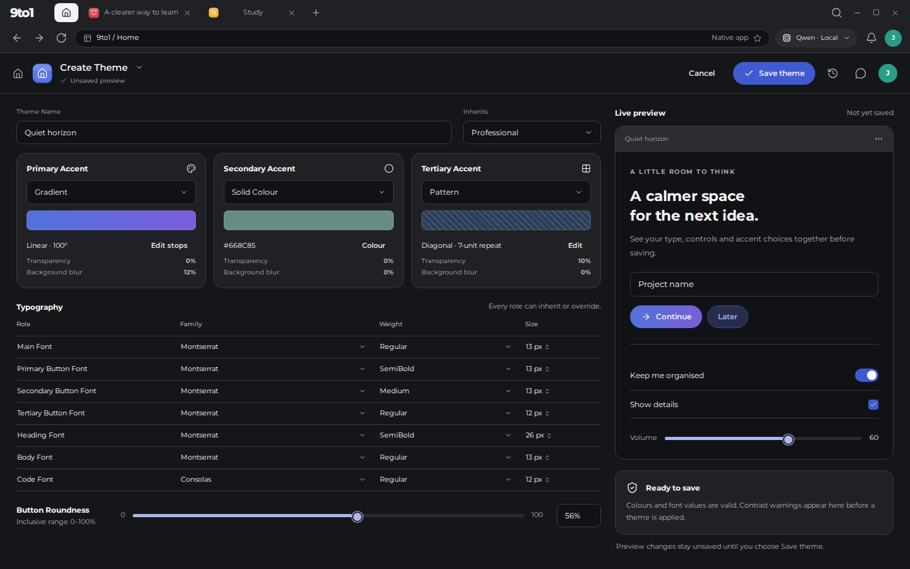

Screen ID: `custom-theme`. Source: CUI-PREF-204–205; CUI-PRO-203; CUI inherited themes and typed fallback.

- Primary, Secondary and Tertiary each independently choose Solid Colour, Gradient or Pattern, with authored transparency and supported blur.
- All seven font roles expose family, weight and size. Button Roundness accepts the full 0–100% range.
- This custom theme inherits Professional, so supported backdrop blur can be authored. Preview does not modify the saved preference until Save.
- An app override recolours only Primary, preserving gradient stops, pattern geometry, transparency and blur; Secondary/Tertiary remain authored.
- Hover Effects and Custom Cursors are later enhancements and are not presented as enabled controls.

## Components · Buttons, inputs and control states

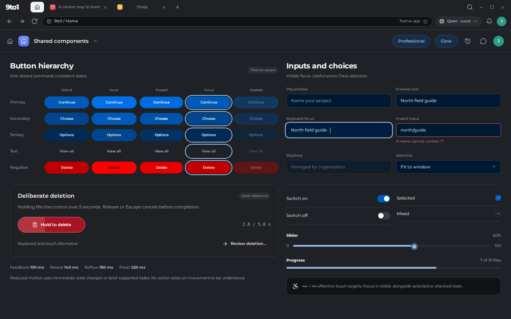

Screen ID: `components`. Source: Authoritative PPT slides 1–6; UX27-SHARED-002–008/019; CUI-THEME-004.

- Primary, Secondary, Tertiary, Negative and Text buttons retain their semantic hierarchy in Professional and Glow. Accent-dependent colours resolve through the selected theme.
- Hover morphs, pressed feedback and focus are distinct. The slide’s bounce becomes a restrained interruptible press response; reduced motion removes movement.
- Five-second destructive hold is one optional pointer path. A keyboard/single-activation review dialog provides an equally explicit accessible confirmation route.
- Input focus, invalid and disabled states remain distinct. Active controls never inherit disabled parent opacity.
- Shared Feedback/Reveal/Reflow/Panel durations are 100/140/180/220 ms draft defaults; input, caret, save truth and permissions do not wait for animation.
- Professional/Glow component examples preserve the deck’s blue/orange palette. Dark labels on bright Glow/red hover fills retain contrast. The six other themes are new design definitions; Professional material always has an opaque fallback.

## Bubble · Material and controls

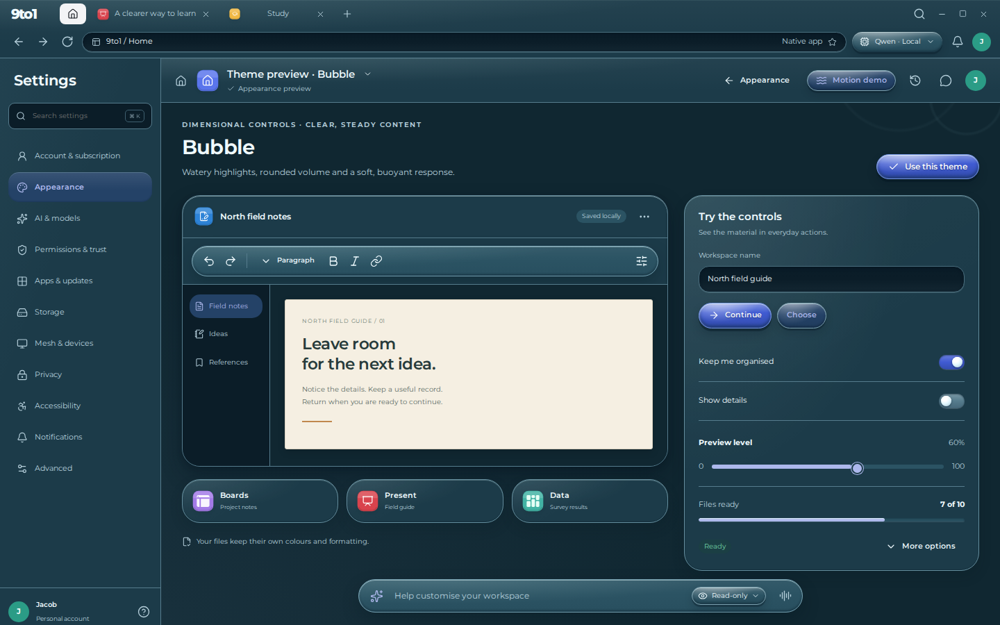

Screen ID: `theme-bubble`. Source: Owner theme refinement, 28 October 2026; CUI-PREF-201–205; CUI-THEME-001–004; Retro category reference: https://opencode.ai/docs/themes/.

- Water-like highlights and refracted edge light give controls depth. Gloss is restricted to control surfaces; text retains stable contrast and authored paper colours stay unchanged.
- A click applies one 520 ms damped wobble to the activated control. State and action feedback occur immediately; animation never delays execution, save or permission changes.
- Reduced Motion and the operating-system preference both remove movement. There is no ambient loop, floating layout or full-screen blur.
- Light mode uses pale water surfaces and dark teal text. High contrast omits material decoration; focus and selected states remain separately visible.
- The sample document is authored content: its cream paper, type and ink remain identical under every theme. Theme selection does not edit the document or grant any tool permission.

## Western · Material and controls

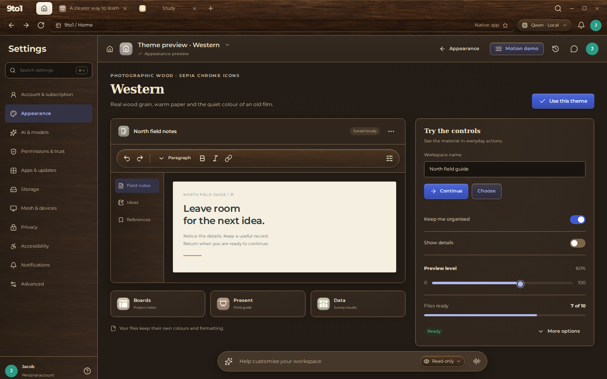

Screen ID: `theme-western`. Source: Owner theme refinement, 28 October 2026; CUI-PREF-201–205; CUI-THEME-001–004; Retro category reference: https://opencode.ai/docs/themes/.

- The build embeds one original photographic wood texture in --western-wood-image. Host, address and selected chrome use that same asset at preserved aspect ratio with strong readability overlays.
- Sepia applies to chrome icons only. App symbols remain recognisable; source images, authored slide/document content, graphs, ink and Assistant portraits are never filtered.
- Dark mode uses an inlaid dark address bar; light mode uses a pale waxed-wood treatment. Subtle inset edges and grain create material detail without obscuring labels.
- No layout, toolbar tier, control location or navigation topology changes. Reduced Motion remains honoured; wood and the slight vignette are static.
- The sample document is authored content: its cream paper, type and ink remain identical under every theme. Theme selection does not edit the document or grant any tool permission.

## Retro · Material and controls

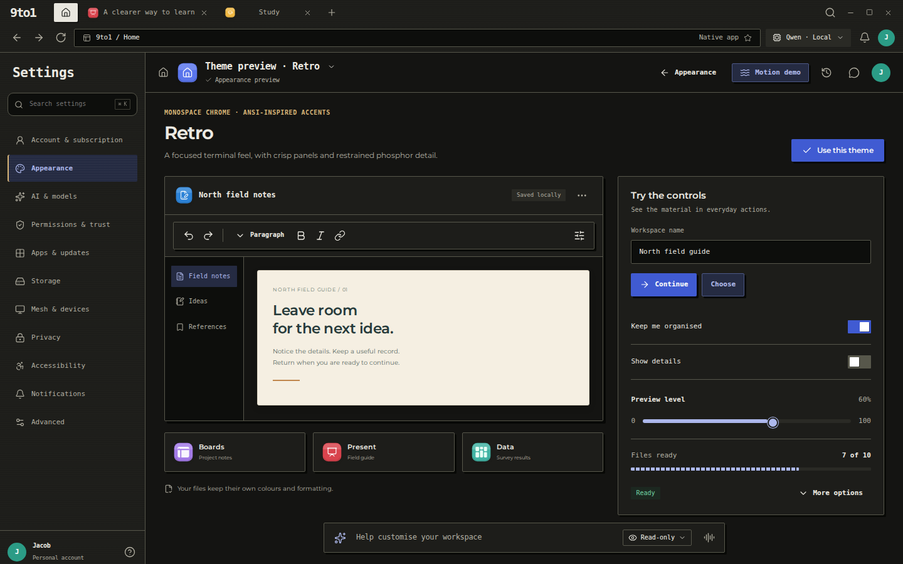

Screen ID: `theme-retro`. Source: Owner theme refinement, 28 October 2026; CUI-PREF-201–205; CUI-THEME-001–004; Retro category reference: https://opencode.ai/docs/themes/.

- Modern terminal conventions inform the charcoal panels, monochrome hierarchy, monospace chrome, sharp control cells and hard offset shadows. OpenCode’s public theme documentation is a category reference, not a product or branding copy.
- Static scanlines and dither are limited to chrome at low opacity. They do not cover document pixels, charts, authored colour, video frames, images or ink.
- The optional 160 ms active response is a single small text-shadow displacement, without flashing content. Reduced Motion removes it; there is no continuous scan animation.
- App accents and semantic status colours remain distinct. Light mode uses a legible paper-terminal palette; themes retain the same toolbar/container geometry.
- The sample document is authored content: its cream paper, type and ink remain identical under every theme. Theme selection does not edit the document or grant any tool permission.

## Eight current themes on the same editor

### Professional

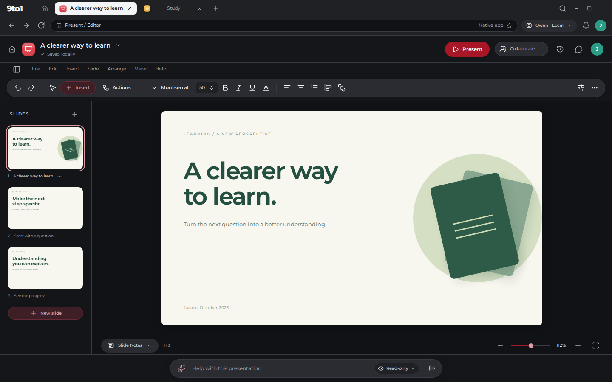

### Glow

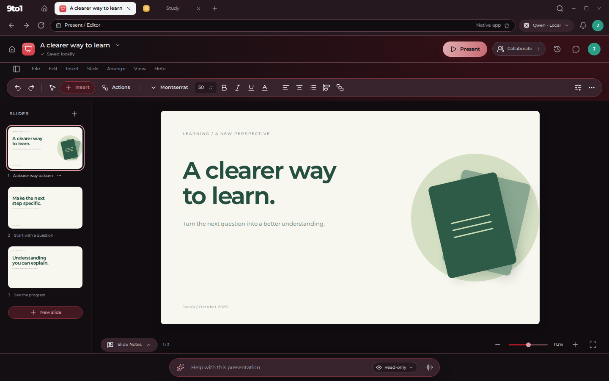

### Playful

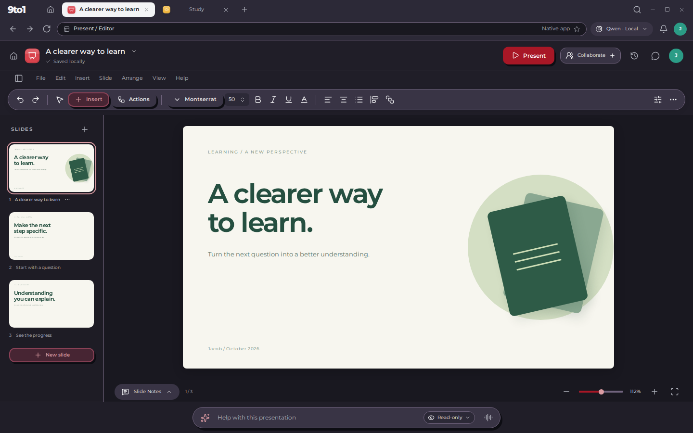

### Frosted Glass

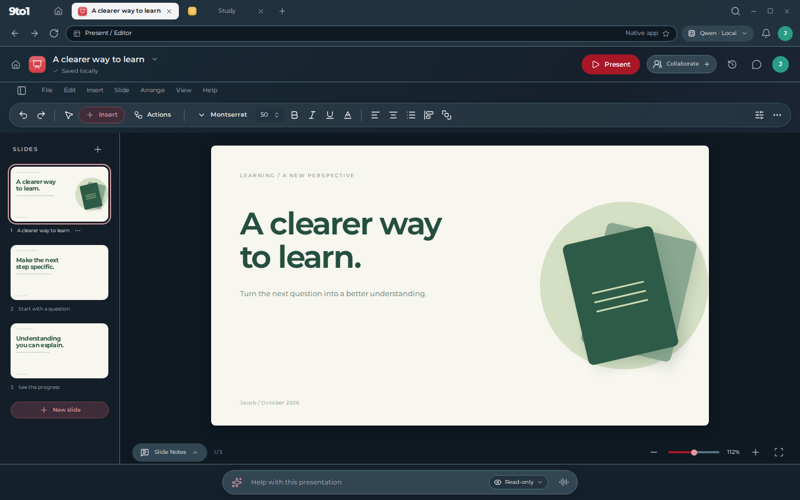

### Bubble

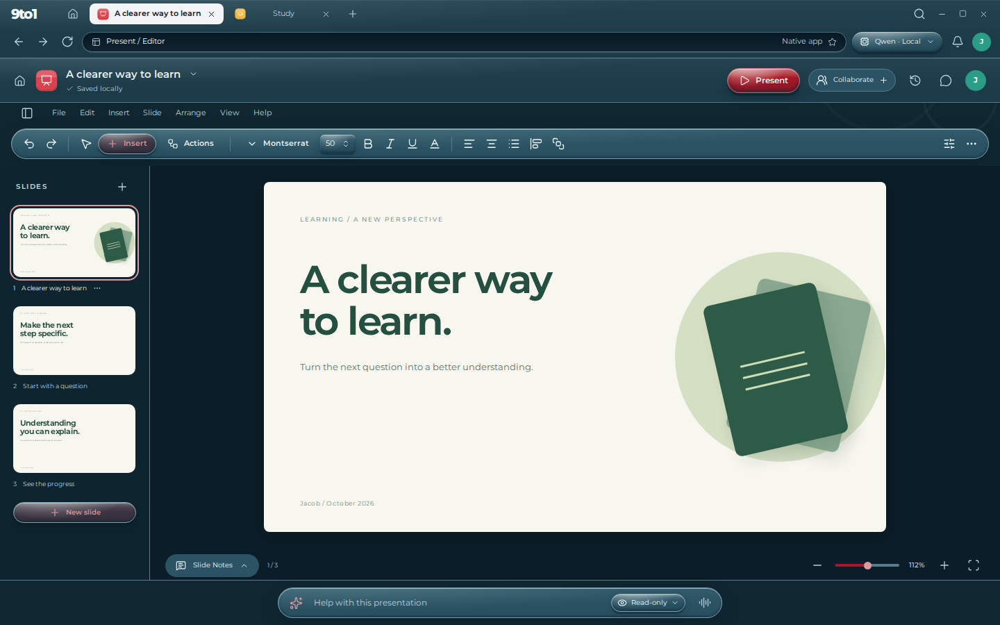

### Metallic

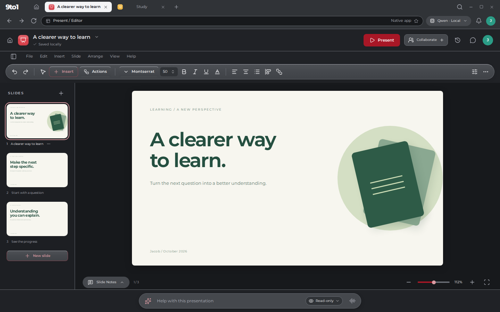

### Retro

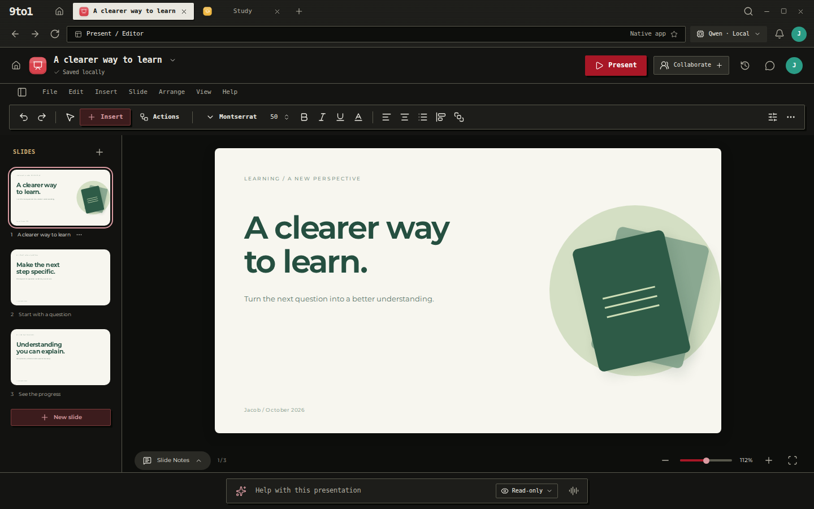

### Western

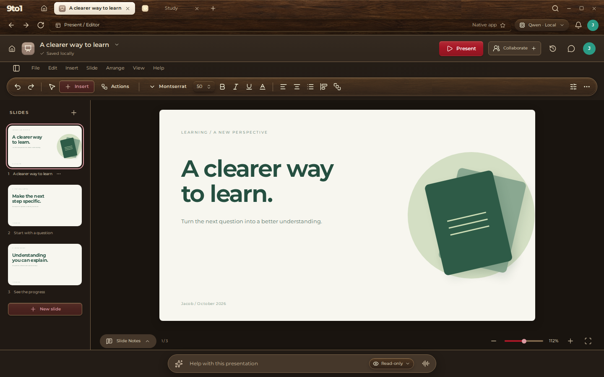
