# CUI, themes and shared interaction system

Module ID: `cui` · 9to1 Development Specification v3

## Prerequisites

- **Authority, scope and implementation reading map** — Current source precedence, narrow owner overrides, source accounting and the required module structure.

## Overview

CUI is the single public UI system for every 9to1 surface. The current Professional annex defines the canonical restrained default; theme identity changes materials, typography and motion without changing app topology or repainting authored content.

Current owner overrides: V3-OWNER-001, V3-OWNER-005, V3-OWNER-010, V3-OWNER-017.

## Layouts & visible states

- **V3-CUI-LAY-01** — Offer Professional, Glow, Playful, Frosted Glass, Bubble, Metallic, Retro and Western, plus Create Theme. Cinematic is an explicit legacy compatibility choice rather than a ninth current default.
- **V3-CUI-LAY-02** — Preserve each theme’s character: Professional restrained dark charcoal; Glow luminous accent-dependent controls; Playful soft coloured surfaces; Frosted Glass translucent layered material with a legible fallback; Bubble watery dimensional surfaces and gentle wobble; Metallic brushed reflective material; Retro monospace; Western wood and sepia.
- **V3-CUI-LAY-03** — Use Montserrat by default except the explicit Retro monospace treatment or authored document fonts. Use the exact Professional annex tokens, geometry and states where specified rather than inventing near-equivalent colours.
- **V3-CUI-LAY-04** — Show normal, hover, pressed, selected, disabled, focused, loading, validation, destructive and reduced-motion states. Icon and text contrast must remain legible over every theme material.
- **V3-CUI-LAY-05** — Use native platform emoji rendering for emoji characters. Keep application glyphs and identity marks coherent, distinct from decorative emoji.

## Features & behaviour

- **V3-CUI-FEA-01** — Use CUI public primitives and typed templates. Avalonia and donor engines are internal implementation details; do not expose raw AXAML or third-party controls as a competing public UI language.
- **V3-CUI-FEA-02** — Keep one deliberate primary scroll container per workspace, bounded panels and predictable focus/keyboard order. Popovers reposition at viewport edges; Escape/outside dismissal returns focus appropriately.
- **V3-CUI-FEA-03** — Shared menus, tooltips, sliders, switches, inputs, tabbars, avatars, toasts, dialog surfaces and selection controls inherit the same theme and semantic action variants.
- **V3-CUI-FEA-04** — App-specific content retains its own colours: slides, pages, photographs, charts, canvases and web previews do not receive theme-tint filters.
- **V3-CUI-FEA-05** — Reduced motion disables wobble, bounce and ornamental animation while preserving state changes and feedback. Transparency and material effects need performant, accessible fallback modes.

## Canonical entities & persistence

- **V3-CUI-ENT-01** — Store theme identity/version, compatible custom tokens, accent, typography/density and accessibility preferences in the Home-owned account/device preference contract. Space-specific overrides are explicit and reversible.
- **V3-CUI-ENT-02** — Keep semantic tokens separate from app identity accents and document content. Theme switching must not mutate artifact revision or user-authored styles.

## Permissions & recovery

- **V3-CUI-PER-01** — Custom themes are validated against supported tokens and accessible contrast/focus requirements; importing one is not permission to execute arbitrary UI code.
- **V3-CUI-PER-02** — Restore a valid baseline if a theme resource is missing, incompatible or fails to load; preserve the user’s chosen identity for recovery.

## Acceptance checks

- **V3-CUI-ACC-01** — Review all eight current themes, a custom theme and Cinematic compatibility with keyboard focus, mixed selected/disabled states, narrow screens and reduced motion.
- **V3-CUI-ACC-02** — Verify the Professional annex’s menu/toolbar/selection/notes and Present geometry exactly; compare rendered state captures rather than only token files.
- **V3-CUI-ACC-03** — Change themes while editing and verify selection, drafts, scroll, runtime state and authored content survive unchanged.

## Exact mock-up and state map

- **Create Theme · Authoring and preview** — screen `custom-theme`. Theme builder.
- **Components · Buttons, inputs and control states** — screen `components`. Component sheet.
- **Bubble · Material and controls** — screen `theme-bubble`. Theme showcase.
- **Western · Material and controls** — screen `theme-western`. Theme showcase.
- **Retro · Material and controls** — screen `theme-retro`. Theme showcase.

## Source clause IDs

CUI-EDITOR-102, CUI-EDITOR-103, CUI-EDITOR-104, CUI-EDITOR-105, UX27-SHARED-001, UX27-SHARED-002, UX27-SHARED-003, UX27-SHARED-004, UX27-SHARED-005, UX27-SHARED-006, UX27-SHARED-007, UX27-SHARED-008, UX27-SHARED-009, UX27-SHARED-010, UX27-SHARED-011, UX27-SHARED-012, UX27-SHARED-013, UX27-SHARED-014, UX27-SHARED-015, UX27-SHARED-016, UX27-SHARED-017, UX27-SHARED-018, UX27-SHARED-019, UX27-SHARED-020, SECTION-01, CUI-CONF-001, CUI-CONF-002, CUI-CONF-003, CUI-CONF-004, CUI-THEME-001, CUI-THEME-002, CUI-THEME-003, CUI-THEME-004, CUI-001, CUI-002, UX27-TEST-050, UX27-TEST-051, UX27-TEST-052, UX27-TEST-053, UX27-HOST-007, UX27-TEST-054, UX27-TEST-055, UX27-TEST-056, UX27-TEST-057, PRESENT-UX-101, PRESENT-INT-101, CUI-EDITOR-101, STARTUP-UX-101, PRESENT-AC-101, DESIGN-001, CUI-PRO-201, CUI-PRO-202, CUI-PRO-203, CUI-PRO-204, CUI-PREF-201, CUI-PREF-202, CUI-PREF-203, CUI-PREF-204, CUI-PREF-205, APP-VIS-201

## Technical reading map

- CUI, themes and shared interaction system — Context-menu coverage; Professional app theme (part 01) — `technical/cui-01.md` (2,346 words; V2-B0037, V2-B0038, V2-B0039…).
- CUI, themes and shared interaction system — Responsive layout and no control explosion; Accessibility and discoverability (part 02) — `technical/cui-02.md` (1,333 words; V2-B0293, V2-B0294, V2-B0295…).
- CUI, themes and shared interaction system — Basic markup and Container types; Comments, whitespace and escaping (part 03) — `technical/cui-03.md` (6,058 words; V2-B0304).
- CUI, themes and shared interaction system — Exclusive markup and interface ownership; Conformance gates (part 04) — `technical/cui-04.md` (1,918 words; V2-B2268, V2-B2269, V2-B2639…).

Technical clauses retain APIs, data models, platform, recovery, donor and acceptance details. The technical files are part of this module, not optional background reading. Shared prerequisites mean stable service/interface contracts must be available; they do not require every dependent app UI to be complete. Use the named chunk for the relevant subtask or the complete module file for its full retained contract.

# Exact designs and implementation rules

These figures are the exact current atlas compositions. Their stable screen IDs match the Word specification and editable source. Open the atlas for full-size theme and interaction inspection.

## Create Theme · Authoring and preview

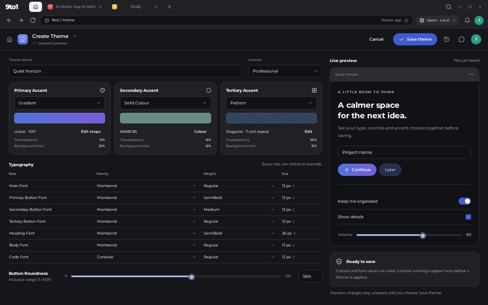

Screen ID: `custom-theme`. Source: CUI-PREF-204–205; CUI-PRO-203; CUI inherited themes and typed fallback.

- Primary, Secondary and Tertiary each independently choose Solid Colour, Gradient or Pattern, with authored transparency and supported blur.
- All seven font roles expose family, weight and size. Button Roundness accepts the full 0–100% range.
- This custom theme inherits Professional, so supported backdrop blur can be authored. Preview does not modify the saved preference until Save.
- An app override recolours only Primary, preserving gradient stops, pattern geometry, transparency and blur; Secondary/Tertiary remain authored.
- Hover Effects and Custom Cursors are later enhancements and are not presented as enabled controls.

## Components · Buttons, inputs and control states

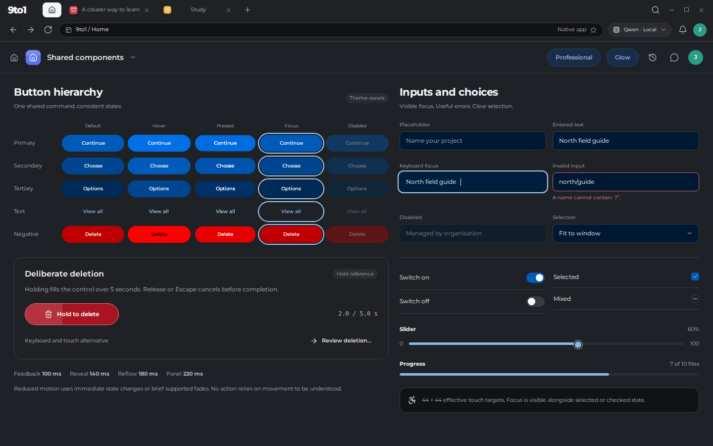

Screen ID: `components`. Source: Authoritative PPT slides 1–6; UX27-SHARED-002–008/019; CUI-THEME-004.

- Primary, Secondary, Tertiary, Negative and Text buttons retain their semantic hierarchy in Professional and Glow. Accent-dependent colours resolve through the selected theme.
- Hover morphs, pressed feedback and focus are distinct. The slide’s bounce becomes a restrained interruptible press response; reduced motion removes movement.
- Five-second destructive hold is one optional pointer path. A keyboard/single-activation review dialog provides an equally explicit accessible confirmation route.
- Input focus, invalid and disabled states remain distinct. Active controls never inherit disabled parent opacity.
- Shared Feedback/Reveal/Reflow/Panel durations are 100/140/180/220 ms draft defaults; input, caret, save truth and permissions do not wait for animation.
- Professional/Glow component examples preserve the deck’s blue/orange palette. Dark labels on bright Glow/red hover fills retain contrast. The six other themes are new design definitions; Professional material always has an opaque fallback.

## Bubble · Material and controls

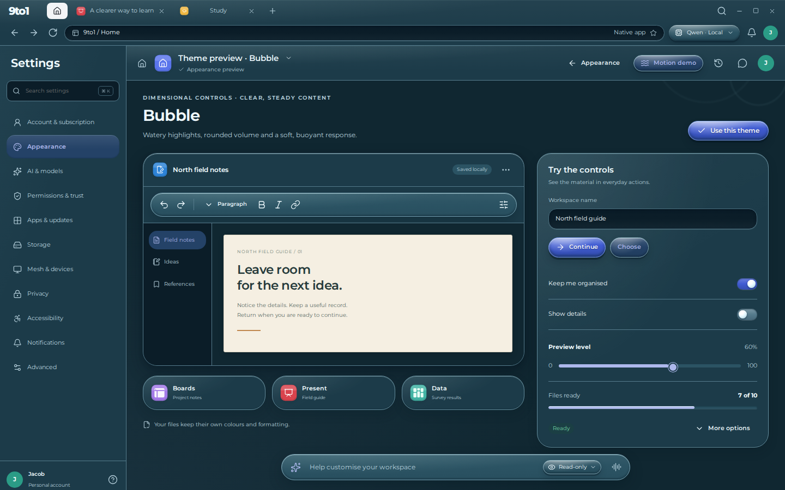

Screen ID: `theme-bubble`. Source: Owner theme refinement, 28 October 2026; CUI-PREF-201–205; CUI-THEME-001–004; Retro category reference: https://opencode.ai/docs/themes/.

- Water-like highlights and refracted edge light give controls depth. Gloss is restricted to control surfaces; text retains stable contrast and authored paper colours stay unchanged.
- A click applies one 520 ms damped wobble to the activated control. State and action feedback occur immediately; animation never delays execution, save or permission changes.
- Reduced Motion and the operating-system preference both remove movement. There is no ambient loop, floating layout or full-screen blur.
- Light mode uses pale water surfaces and dark teal text. High contrast omits material decoration; focus and selected states remain separately visible.
- The sample document is authored content: its cream paper, type and ink remain identical under every theme. Theme selection does not edit the document or grant any tool permission.

## Western · Material and controls

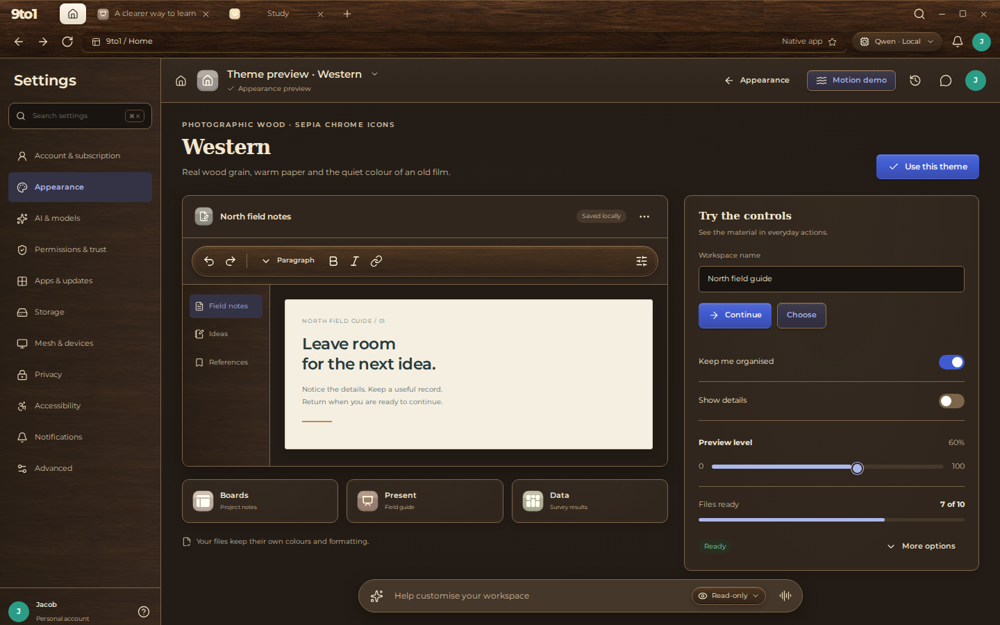

Screen ID: `theme-western`. Source: Owner theme refinement, 28 October 2026; CUI-PREF-201–205; CUI-THEME-001–004; Retro category reference: https://opencode.ai/docs/themes/.

- The build embeds one original photographic wood texture in --western-wood-image. Host, address and selected chrome use that same asset at preserved aspect ratio with strong readability overlays.
- Sepia applies to chrome icons only. App symbols remain recognisable; source images, authored slide/document content, graphs, ink and Assistant portraits are never filtered.
- Dark mode uses an inlaid dark address bar; light mode uses a pale waxed-wood treatment. Subtle inset edges and grain create material detail without obscuring labels.
- No layout, toolbar tier, control location or navigation topology changes. Reduced Motion remains honoured; wood and the slight vignette are static.
- The sample document is authored content: its cream paper, type and ink remain identical under every theme. Theme selection does not edit the document or grant any tool permission.

## Retro · Material and controls

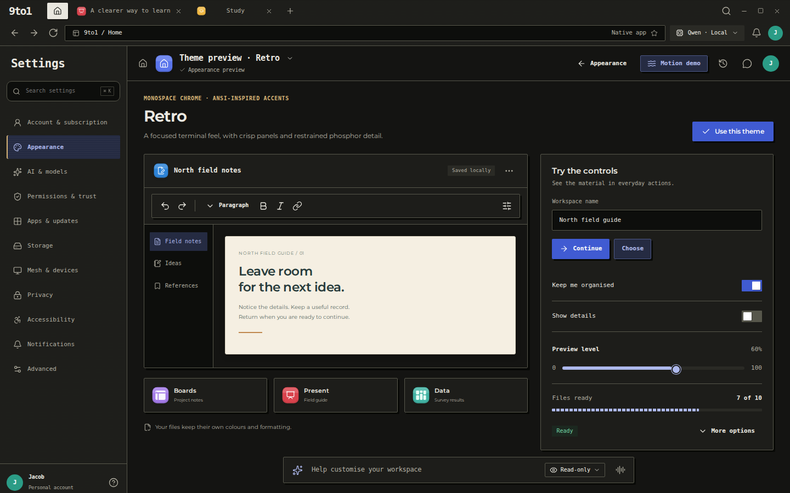

Screen ID: `theme-retro`. Source: Owner theme refinement, 28 October 2026; CUI-PREF-201–205; CUI-THEME-001–004; Retro category reference: https://opencode.ai/docs/themes/.

- Modern terminal conventions inform the charcoal panels, monochrome hierarchy, monospace chrome, sharp control cells and hard offset shadows. OpenCode’s public theme documentation is a category reference, not a product or branding copy.
- Static scanlines and dither are limited to chrome at low opacity. They do not cover document pixels, charts, authored colour, video frames, images or ink.
- The optional 160 ms active response is a single small text-shadow displacement, without flashing content. Reduced Motion removes it; there is no continuous scan animation.
- App accents and semantic status colours remain distinct. Light mode uses a legible paper-terminal palette; themes retain the same toolbar/container geometry.
- The sample document is authored content: its cream paper, type and ink remain identical under every theme. Theme selection does not edit the document or grant any tool permission.

## Eight current themes on the same editor

### Professional

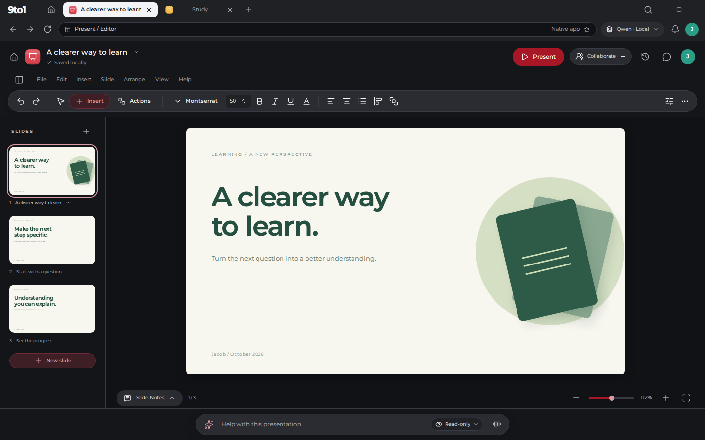

### Glow

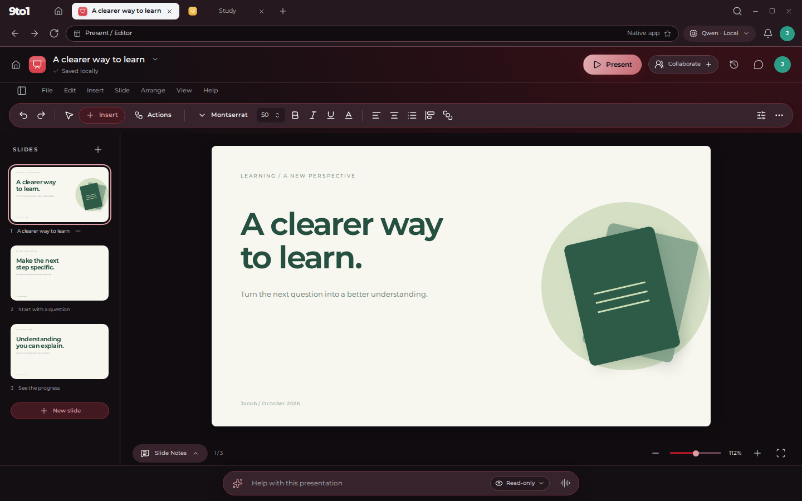

### Playful

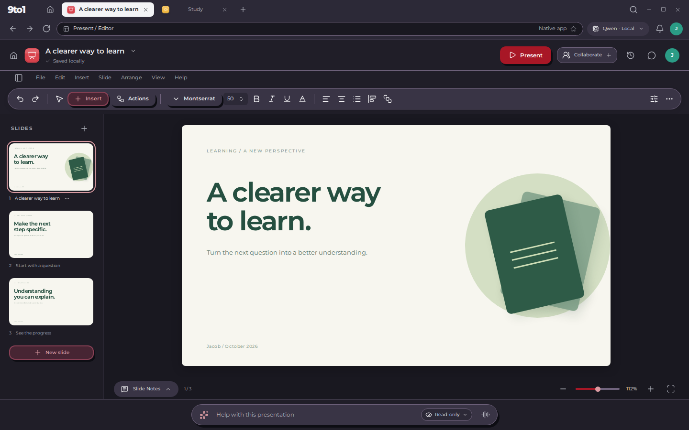

### Frosted Glass

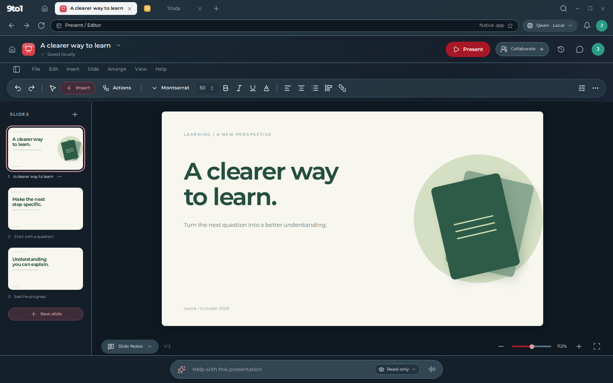

### Bubble

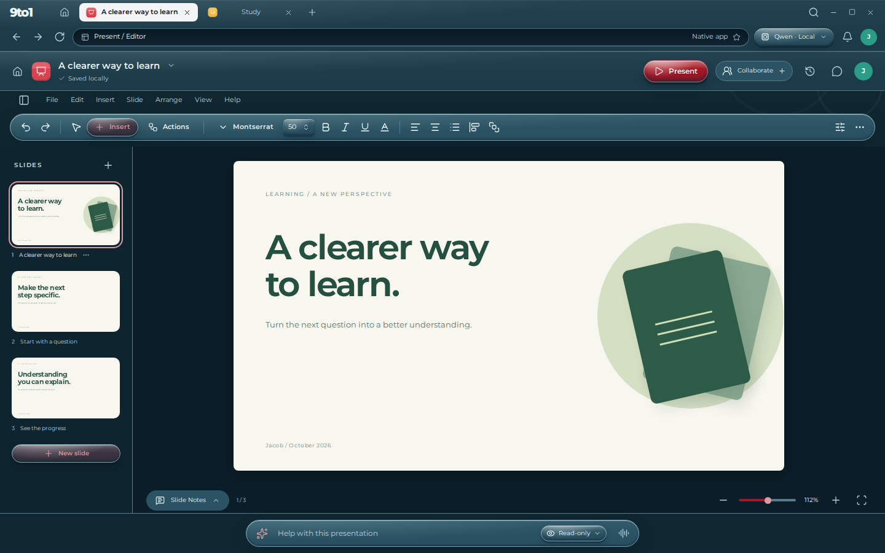

### Metallic

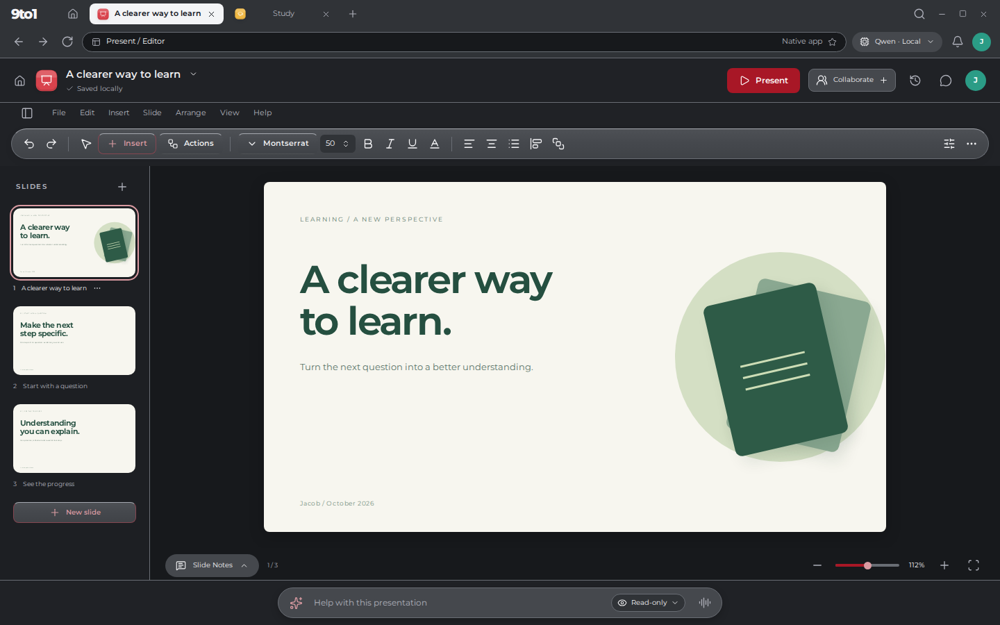

### Retro

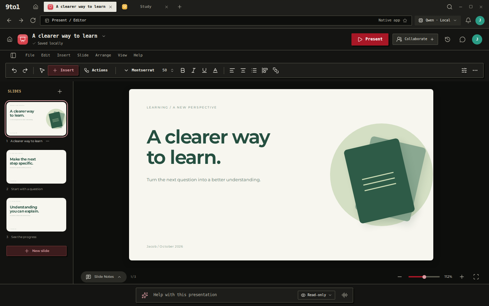

### Western

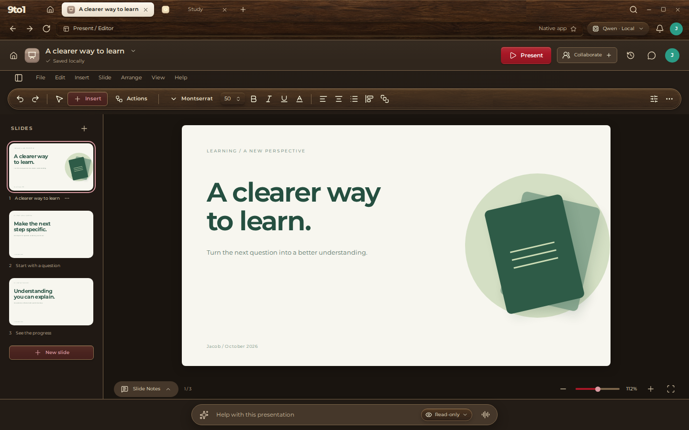
