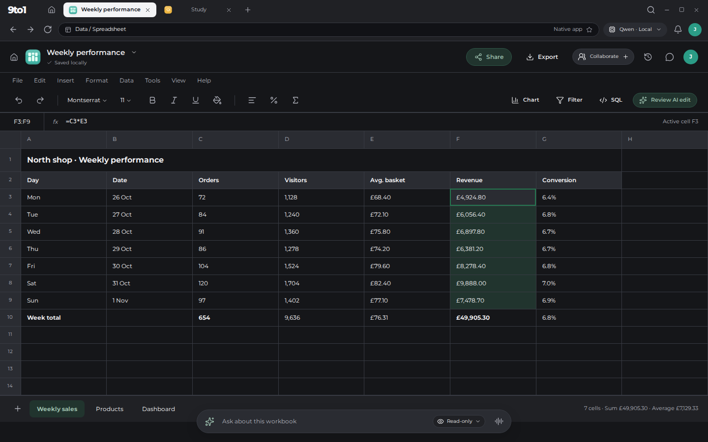
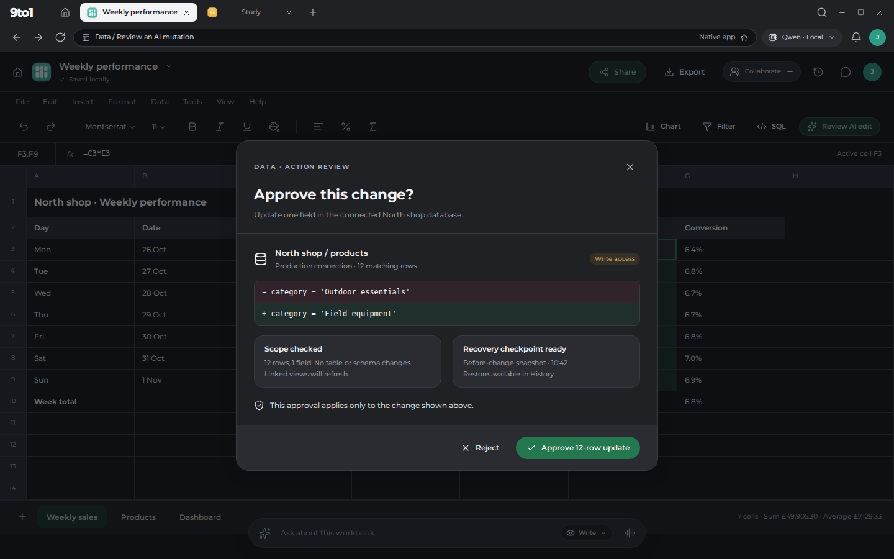
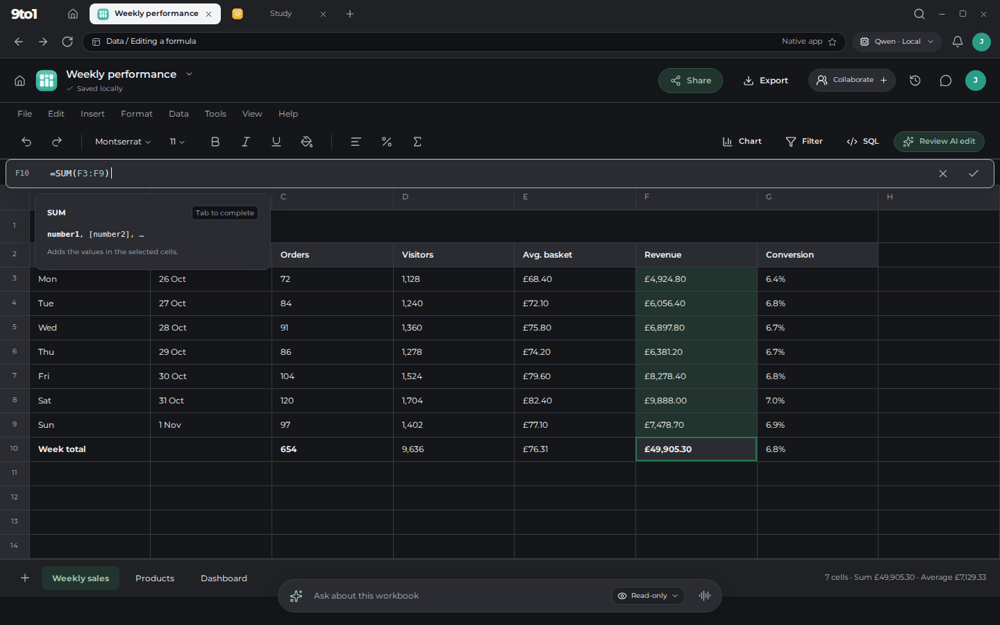
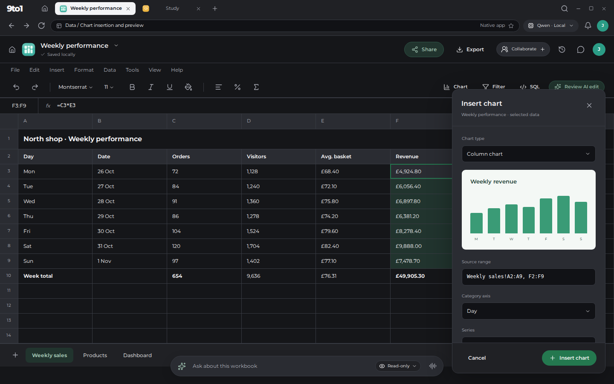

# Data — worksheets, tables and explicit AI approval

Module ID: `data` · 9to1 Development Specification v3

## Prerequisites

- **CUI, themes and shared interaction system** — Typed UI components, theme tokens/materials, layout, focus, motion, accessibility and shared control states.
- **Shared productivity engine and canonical embeds** — Real document/object engines, semantic editing, canonical app embedding and donor feature parity.
- **Artifacts, local persistence and recovery** — Canonical artifacts, revisions, typed edits, local saves, derived exports, sync and recovery.
- **Shared AI controls and artifact collaboration** — Contextual AI bars, shared model/permission controls, global collaborators and typed artifact proposals.

## Overview

Data is a full spreadsheet/table system with formula/dependency behaviour, views and an explicit AI mutation review boundary. It must never turn narrated calculations into unverified cell results.

## Layouts & visible states

- **V3-DATA-LAY-01** — Use genuine worksheet grid, row/column headers, selection/ranges, name/formula bar and sheet tabs. Properties/filter/view controls follow the current table or range.
- **V3-DATA-LAY-02** — The shared AI/SQL bar makes its mode and target explicit. Show proposed range/cell changes and action-specific approval before every AI mutation.

## Features & behaviour

- **V3-DATA-FEA-01** — Retain formulas, dependency graphs, recalculation, tables, structured fields, filters, sort, views, charts and donor-compatible operations from the technical contract.
- **V3-DATA-FEA-02** — SQL context and supported target/runtime are explicit; a native command, query and AI-generated mutation are separate operations.
- **V3-DATA-FEA-03** — Every AI mutation requires approval for the concrete action/change set, even when a broad Write control or earlier plan is present unless the retained explicit grant contract covers that exact action.
- **V3-DATA-FEA-04** — Formulas and previews use real evaluated results, typed error states and known locale/units; do not invent successful recalculation.

## Canonical entities & persistence

- **V3-DATA-ENT-01** — Persist workbook/table/sheet IDs, cell/range references, formula graph, table schemas, view/filter configuration, revisions and approval/change receipts.
- **V3-DATA-ENT-02** — Keep derived chart/render/export state linked to a known data revision.

## Permissions & recovery

- **V3-DATA-PER-01** — Validate permissions, expected revision, range scope and data constraints before applying. Rejected proposals leave data unchanged.
- **V3-DATA-PER-02** — Handle formula errors, conflicting edits, failed imports and interrupted export with recoverable native state.

## Acceptance checks

- **V3-DATA-ACC-01** — Test edit/formula→recalculate, table/filter/view, multi-cell selection and import/export fidelity.
- **V3-DATA-ACC-02** — Verify an AI change is only proposed before approval, reject is non-mutating, accept records exact cells/revision, and stale proposals fail safely.

## Exact mock-up and state map

- **Data · Spreadsheet** — screen `data`. Editor.
- **Data · Review an AI mutation** — screen `data-approval`. Approval.
- **Data · Editing a formula** — screen `data-formula`. Interaction state.
- **Data · Chart insertion and preview** — screen `data-chart`. Interaction state.

## Source clause IDs

UX27-DATA-001, UX27-DATA-002, UX27-DATA-003, UX27-DATA-004, SECTION-11, UX27-TEST-088

## Technical reading map

- Data — worksheets, tables and explicit AI approval — Data — tables, formulas, views and real state; Cell selection versus editing (part 01) — `technical/data-01.md` (341 words; V2-B1671, V2-B1672, V2-B1673…).
- Data — worksheets, tables and explicit AI approval — Data; Product role and data paradigms (part 02) — `technical/data-02.md` (5,676 words; V2-B1683).
- Data — worksheets, tables and explicit AI approval — Data; Cell modes formulas and canonical views (part 03) — `technical/data-03.md` (88 words; V2-B2837, V2-B2838, V2-B2839…).

Technical clauses retain APIs, data models, platform, recovery, donor and acceptance details. The technical files are part of this module, not optional background reading. Shared prerequisites mean stable service/interface contracts must be available; they do not require every dependent app UI to be complete. Use the named chunk for the relevant subtask or the complete module file for its full retained contract.

# Retained technical requirements

# Data — worksheets, tables and explicit AI approval — Data — tables, formulas, views and real state; Cell selection versus editing (part 01)

Reading status: active retained clauses, subject to the v3 owner overrides listed in the primary module. Historical process instructions and replaced original wording are stored separately.

### V2-B1671 · v2 lines 8212–8212

## 11. Data — tables, formulas, views and real state

### V2-B1672 · v2 lines 8214–8214

### UX27-DATA-001 — Cell selection versus editing

### V2-B1673 · v2 lines 8216–8216

**B/D.** Data distinguishes active cell, selected range and cell-edit mode. Click selects, typing edits/replaces according to the documented spreadsheet behaviour, and the formula bar shows the actual expression/value of the active cell. Arrow/Tab/Enter navigation respects edit mode and does not move selection while an IME candidate is being committed. Multi-range selection and fill handles operate only where supported and visibly indicated.

### V2-B1674 · v2 lines 8218–8218

Column/row headers select the intended stable range and provide contextual operations, not a separate button for every cell. Copy/paste preserves applicable values, formulas, relative references and formatting through the canonical model.

### V2-B1675 · v2 lines 8220–8220

### UX27-DATA-002 — Formulas and recalculation

### V2-B1676 · v2 lines 8222–8222

**B/D.** Formula edits validate syntax and dependencies, distinguish pending calculation from an error, and update affected cells incrementally. Show actual error categories at the affected cells without replacing the workbook with a generic failure. Relative/absolute references, named ranges and cross-sheet references remain stable under supported insertion/reorder operations.

### V2-B1677 · v2 lines 8224–8224

Undo a formula change restores the expression and recalculated dependencies. Export/reopen verifies formulas and values, not only displayed strings. A model-generated number is not a formula engine result unless it was actually written and calculated through the domain API.

### V2-B1678 · v2 lines 8226–8226

### UX27-DATA-003 — Database views and Boards embedding

### V2-B1679 · v2 lines 8228–8228

**B.** Structured records, field schemas, filters, sorts, groups and supported table/kanban/calendar/gallery views are projections of one canonical Data artifact. Changing a view does not duplicate records. A Boards database block references that artifact and retains permissions, formulas and revision semantics; no Boards-only shadow database is introduced to imitate AppFlowy.

### V2-B1680 · v2 lines 8230–8230

View settings are explicit, persist appropriately and distinguish personal from shared configuration. Filtering hides records from the view without deleting them. Dragging a kanban card updates the specified grouping/status field and is undoable/permission-checked.

### V2-B1681 · v2 lines 8232–8232

### UX27-DATA-004 — Import, large data and errors

### V2-B1682 · v2 lines 8234–8234

**B/D.** Import previews delimiters, encoding, column types and conversions before committing where ambiguity can lose data. Preserve leading zeros, dates and text intentionally rather than silently coercing everything. Large data uses indexed/virtualised views and incremental processing; an unrendered row is still searchable/exportable.

# Data — worksheets, tables and explicit AI approval — Data; Product role and data paradigms (part 02)

Reading status: active retained clauses, subject to the v3 owner overrides listed in the primary module. Historical process instructions and replaced original wording are stored separately.

### V2-B1683 · v2 lines 8236–8499

Permission failures, schema conflicts and partial external refreshes preserve prior valid state and identify affected sources. An external sync status is separate from local persistence. Test a real Data artifact embedded in Boards, edited from both surfaces and reopened with matching state.
<!-- UX27:END SECTION-11 -->
Data
Product role and data paradigms
9-1 Data is the native CUI spreadsheet, structured-data, relational-database, SQL-query and analytical workspace. It combines conventional spreadsheet work, rich structured cells, relational modelling, multidimensional analytical data, charts/pivots, data transformation, database exploration and AI-assisted analysis in one coherent product.
Data MUST support four native data paradigms without forcing one paradigm onto every project: spreadsheet/grid data, relational database data, hierarchical/rich structured data and multidimensional analytical data. These paradigms may interoperate through explicit projections, relationships and transformations, but their semantics MUST NOT be silently conflated.
The ordinary spreadsheet remains the approachable default. Advanced relational, nested, multidimensional and query capabilities appear when the data or user workflow requires them. Native .9to1d projects MAY represent richer structures than XLSX/ODS; compatibility formats MUST NOT constrain the native model.
Shared engines, donor source and implementation authority
LibreOffice Calc is the spreadsheet-compatibility/donor engine for established spreadsheet behaviour, formula compatibility and XLSX/ODS interoperability. DuckDB is the local analytical SQL engine for local tables, files, queries and relational projections. Configured providers MAY add PostgreSQL, MySQL/MariaDB, SQLite, SQL Server and other supported external database systems through typed connection adapters.
The 9to1 source tree MUST contain or fetch the appropriate maintained LibreOffice Calc donor source required by the architecture, subject to the global donor-source and licensing contract. The implementation agent MUST NOT treat a missing LibreOffice installation or missing checked-out donor source as permission to build a miniature replacement spreadsheet engine. If the required donor source is absent during an autonomous development pass, the agent MUST obtain/fork the latest appropriate compatible source and record the exact upstream/version used before continuing dependent implementation.
Data MUST integrate donor capability into the 9to1 product model, CUI and typed APIs. Merely shelling out to soffice as an opaque external black box while leaving the canonical Data experience or API surface incomplete does not satisfy the implementation requirement.
Shared charting, Node Graph, Files, identity/permissions, credential storage, AI/model, action/audit and other cross-product infrastructure MUST be reused where canonical rather than privately reimplemented.
Canonical Data project model
DataProject has stable ProjectID, Workbooks[], DataSources[], Connections[], SavedQueries[], DataModels[], TransformPipelines[], DataCubes[], Visualisations[], Charts[], PivotModels[], project settings, CreatedAt, ModifiedAt and Revision.
A project MAY contain only a workbook, only database/query resources, only a multidimensional model, or any compatible combination. A user MUST NOT need to create unrelated projects merely because one analysis starts in a spreadsheet and later uses SQL or a transformation pipeline.
Data resources reference stable identities rather than UI coordinates wherever the resource has independent semantic identity. Ordinary A1/R1C1-style references remain available for spreadsheet compatibility, but tables, records, queries, charts, pivots, connections, relationships, visualisations and pipelines have stable IDs.
Workbook and spreadsheet model
Workbook has stable WorkbookID, Sheets[], workbook names/named ranges, calculation settings, external/link metadata, compatibility metadata and Revision.
Sheet has stable SheetID, ordered rows/columns/cells, tables, drawings/charts where applicable, filters, freeze state, view state and Revision. Reordering or renaming a sheet MUST NOT invalidate stable references that use SheetID.
Cells support ordinary scalar values, formulas, formatting, validation, comments/notes, hyperlinks/references and compatible Calc spreadsheet features. Grid coordinates identify a location in a sheet; they are not the sole identity mechanism for richer Data objects.
Normal spreadsheet workflows include direct cell/formula-bar editing, fill/copy, pattern autofill, insert/delete rows and columns, row/column resize/hide/freeze, multi-range selection, find/replace, sort/filter, named ranges, tables, validation/dropdowns, conditional formatting, comments/notes, sheet management, protection where compatible and undo/redo.
Rich native cells and multiple values
A native .9to1d cell MAY contain a typed value object rather than only one scalar. Supported native value families include scalar number/text/boolean/date/time/duration, formula, list/array, set/tags, record/key-value object, nested table, canonical 9to1 object reference, query-backed value, calculated structured value and other explicitly registered structured types.
Multiple values in one cell are first-class typed members, not comma-separated text. A list/set/record cell can expose member ordering, labels/keys, type validation, per-member editing, filtering/query semantics and explicit expansion into rows/columns when required.
The grid MAY display a concise collapsed summary such as '3 values' or '5 related records'; selecting or expanding the cell exposes the complete structured value without altering the underlying schema.
Formula, filter, Visualise and SQL-projection semantics for structured cells MUST be defined explicitly. Unsupported operations produce typed errors or require an explicit projection/flattening step rather than silently stringifying complex values.
Nested cells, nested tables and hierarchical data
A cell MAY own a nested table/record structure with stable nested identity and schema. Nested data is not represented as an untyped blob. Data supports drill-down, expand/collapse and focused child-table editing so hierarchical information can be represented without forcing every child structure onto a separate top-level sheet.
Data MUST distinguish nested owned data from references to separate related records. A nested child table is part of the parent value/object lifecycle; a relation/reference points to independently canonical records and MUST NOT duplicate them merely for display.
Hierarchical structures MAY nest beyond one level when the schema requires it, subject to performance and usability limits. The UI MUST avoid expanding an entire deep hierarchy by default.
Multidimensional and 3D analytical data
Data MUST support native multidimensional datasets beyond a two-dimensional row-by-column grid. A DataCube has stable CubeID, Dimensions[], Measures[], DimensionMembers/hierarchies, fact/cell storage or query definition, calculated measures, source/provenance and Revision.
A common three-dimensional example is Product × Region × Month, but the model MUST support additional dimensions such as Scenario, Currency or Channel. The UI presents manageable two-dimensional slices, pivots, comparisons and Visualise views rather than attempting to render arbitrary high-dimensional data literally.
Users can switch or compare dimension members, for example Month=January versus Month=February, without duplicating twelve nearly identical sheets. Multidimensional state remains canonical and may be queried through explicit relational projections/views.
DataCube projections to spreadsheet, SQL, pivot or Visualise views MUST preserve source identity and declare the projection rules.
Multiple views over one canonical dataset
The same canonical dataset MAY be viewed as an ordinary spreadsheet grid, structured/nested table, relational table, pivot, hierarchy/tree, multidimensional slice, SQL relation, transformation graph or Visualise view. These are views/projections of the same data where possible, not independent copied datasets.
Creating a new view MUST NOT silently duplicate source data unless the user explicitly requests a snapshot/materialised copy. Edits through a writable view update the same canonical object subject to that view's mapping and permissions.
Formula engine and calculation
Data MUST preserve Calc-compatible formula semantics wherever spreadsheet compatibility is claimed. Supported families include arithmetic, logical, text, date/time, lookup/reference, statistical, financial, array/dynamic-array behaviour where supported and error-handling functions.
Formula dependencies MUST be tracked so recalculation can be dependency-aware. Data MUST NOT blindly recalculate an entire large workbook after every unrelated edit when a narrower dependency recomputation is possible.
Formula errors remain typed and inspectable, including divide-by-zero, invalid/missing references, type mismatch, circular dependency and backend/function availability errors. Data MUST NOT collapse distinct formula failures into a generic error string.
Structured/native cell values may expose additional functions for contains/count/map/filter/member access and projection where explicitly supported; compatibility exports must detect when such formulas cannot be represented faithfully.
Tables, records and stable row identity
Structured DataTable objects are first-class rather than merely formatted ranges. A DataTable has stable TableID, schema/header metadata, Records[], filters/sorts, source/query relationship, constraints and Revision.
Database-mode rows are Records with stable RecordID. Sorting, filtering or moving a visible row MUST NOT change the record's identity. Relationships and AI/Automation references target stable record/key identity rather than 'whatever is currently on row 37'.
A SQL result may materialise into or back a query-linked DataTable. Conversely, eligible DataTables can be exposed to DuckDB as relations without exporting them first.
Relational schema and field design
Any eligible DataTable may be promoted/configured as a relational table with explicit field/schema metadata. Fields support name, data type, nullability/required state, default, validation/check rules, uniqueness, generated/computed definition, key role, references and backend-specific metadata where applicable.
Native field types include integer, decimal, currency, text, boolean, date/time, duration, enum/category, UUID/ID, reference, list/set, record/object, nested table and calculated/computed types. External database tables restrict available types and constraints to the connected backend's declared capability.
Data MUST provide a Table Design/Schema view where field definitions, keys, required state, defaults, references and constraints can be inspected and edited directly without relying on scattered context menus.
Primary keys, candidate keys and indexes
Relational tables support single-column and composite primary keys, candidate/unique keys, generated IDs and UUID-style stable keys. Primary-key changes MUST validate duplicates, missing values and dependent references before commitment.
Indexes are explicit schema metadata where the backend supports them, including primary/unique, ordinary and compound indexes. Data SHOULD explain index capability and likely purpose without automatically creating indexes everywhere.
Project-local structured tables MAY use stable RecordID independently of a user-visible relational primary key; external relational projection semantics MUST define which key is authoritative for joins and persistence.
Foreign keys and sheet/table relationships
Data supports explicit relationships between tables/sheets through foreign-key/reference objects rather than requiring VLOOKUP/XLOOKUP-style formulas to express every data relationship.
Relationship types include one-to-one, one-to-many and many-to-many through a junction/association table. A relationship has stable RelationshipID, source table/fields, target table/key, cardinality, optionality, referential action rules and Revision.
Example: Students.TutorID → Tutors.TutorID. The UI may display a friendly related value such as tutor name while storing the stable referenced key/record. Selecting such a reference can offer Open related record without duplicating the target record.
Relationship designer and ER diagrams
Data MUST provide a visual Relationship Designer showing tables/entities, key fields and typed relationship edges with cardinality/optionality. Users can create, inspect, edit and delete relationships and can generate a junction table for a many-to-many relationship.
The Relationship Designer SHOULD reuse the shared Node Graph Framework for pan/zoom/selection/grouping/connection mechanics while preserving Data-specific relationship semantics and constraints.
Data can generate an entity-relationship diagram showing entities/tables, fields, primary keys, foreign keys, cardinality, optionality and junction tables. The ER diagram is a Visualise/data-model representation, not a second independent schema.
Referential integrity and cascade behaviour
Relationships may enforce referenced-key existence, restrict deletion/update, cascade delete/update or set-null according to backend/native capability. Consequential cascade operations MUST be previewable with affected-object/record impact where knowable.
If a relationship prevents deletion, Data MUST expose which dependency blocks the operation. It MUST NOT silently disable referential integrity or orphan dependent records.
A large cascade such as deleting one parent that affects thousands of dependent records requires an explicit impact surface before execution in manual protected workflows and always in AI-originated mutation workflows.
Normalisation and denormalisation
Data MUST include a Normalise tool that analyses selected relational/tabular structures for common design problems such as repeating groups, duplicated entities, non-atomic values where a relational design is desired, partial dependencies, transitive dependencies, duplicated lookup data and missing candidate keys.
Normalisation assistance may propose transformations toward 1NF, 2NF, 3NF and, where appropriate for advanced users, BCNF. The proposal MUST show new tables, keys, relationships and record-migration effects before mutation. Data MUST explain assumptions rather than blindly applying a theoretical normal form to data that is intentionally hierarchical or multidimensional.
Data also supports explicit Flatten/Denormalise transformations for analytics/export. Normalisation and denormalisation are controlled structured transformations, not destructive reinterpretations.
Lookups and related-record navigation
A foreign-key/reference field may display a user-friendly target field while retaining the stable referenced key/record internally. Lookup display configuration MUST NOT replace the actual stored relationship.
One-to-many relationships can expose related-record counts or expandable related-record views. Such displays reference canonical records; they MUST NOT copy the children into a nested owned structure unless the user explicitly converts the relationship.
Data sources and connections
Data distinguishes static/imported data, linked files, project-local queryable data and external/live connections. Static/imported sources include declared CSV/TSV/JSON where supported and spreadsheet formats. Local query sources include DuckDB-accessible tables/files such as CSV/Parquet where supported. External/live connections use typed provider adapters.
DataSource and Connection objects have stable identity, provider/dialect, scope, capability metadata, source schema/version information where available and refresh state. Credentials/secrets MUST use the 9to1 credential/trust infrastructure and MUST NOT be embedded in .9to1d project content, query history or ordinary logs.
Connection capability negotiation defines supported transactions, snapshots/checkpoints, schema introspection, DDL/DML features, explain plans, cancellation and backup/recovery options.
SQL workspace
Data MUST provide native SQL authoring/execution with syntax highlighting, dialect-aware parsing/validation, schema/object browser, table/column/function completion, relationship-aware join suggestions, query formatting, parameters where supported, saved queries, query history, execution timing/statistics, cancellation, paged/virtualised result sets, EXPLAIN/plan access where supported and result export/materialisation.
DuckDB SHOULD make local analytical querying nearly frictionless: eligible project tables and supported local files can be queried directly without requiring users to provision an external database.
SQL results can be inspected, opened in Visualise, saved as a query, materialised to a sheet/table, exported or used as downstream transformation input.
Persistent AI / SQL bar switcher
In Data, the persistent floating input bar contains an explicit mode switcher between AI and SQL. AI mode routes natural-language requests through Dulche and typed Data actions. SQL mode treats the input as SQL and executes it natively against the explicitly selected SQL target; SQL text MUST NOT be sent to AI merely to emulate execution.
SQL mode MUST always display the active execution target, for example DuckDB · This Project or PostgreSQL · Production. The selected connection/database/schema scope MUST be visible enough that users cannot reasonably confuse a local analytical target with a live external target.
Changing the SQL execution target is explicit. Data MUST NOT silently retarget a query because another sheet, panel or connection became focused.
Native SQL execution records and results
Every execution creates a canonical SqlExecution record with stable ExecutionID, ConnectionID/target, dialect, statements, classification, ReadOnly state, initiator, start/completion state, result sets, affected objects/rows where known, recovery strategy/reference where applicable, transaction/savepoint metadata, outcome/error and audit reference.
SQL result sets preserve typed columns and support virtualised/paged browsing. Successful prior result state MUST remain available when a later execution fails unless the user explicitly replaces/discards it.
Query history records target, dialect, classification, result metadata and outcome without storing secrets. SavedQuery objects are persistent editable query resources with stable identity.
Read-only and mutating SQL classification
Data MUST parse/classify SQL before execution. Provably read-only statements such as ordinary SELECT/CTE SELECT, EXPLAIN and supported metadata introspection MAY execute directly subject to connection permissions.
Potentially mutating or schema-changing SQL includes INSERT, UPDATE, DELETE, MERGE, CREATE, ALTER, DROP, TRUNCATE and provider-specific mutation commands. Classification MUST be conservative when the dialect/parser cannot prove a statement is read-only.
Multi-statement input is treated as one explicit execution plan with per-statement classification and declared atomicity/partial-execution risk.
Protected live-database SQL execution
Consequential SQL against an external/live database enters the protected execution path. Before execution Data MUST identify the target, classify statements, inspect likely affected objects, use a transaction/savepoint where supported, determine preview/impact information where technically possible, establish an appropriate recoverable backup/checkpoint strategy when required, show the effect/recovery state and obtain the applicable confirmation.
Recovery strategy is backend-aware and may use transaction rollback, savepoint, affected-row before-image capture, table snapshot/copy, database-native snapshot, backup file/provider recovery point, schema export plus affected data or another verified recoverable mechanism. Data MUST record the strategy actually established.
If the safety contract for the requested live mutation requires rollback/backup protection and Data cannot establish it, execution MUST stop. Data MUST NOT state or imply that a backup, transaction or rollback exists when it does not.
After execution Data verifies the actual outcome where feasible, records audit/recovery information and truthfully reports partial success/failure. It MUST NOT blindly retry consequential SQL without operation identity/idempotency or renewed confirmation where required.
DDL and dependency impact
Schema-changing SQL receives dependency-aware analysis where metadata is available. Before consequential DROP/ALTER/rename operations Data SHOULD identify dependent views, foreign keys, indexes, saved queries, linked Data views, Forms integrations, Visualisations and other known references.
DDL impact that cannot be determined reliably MUST be represented as unknown rather than assumed safe.
Manual SQL versus AI-proposed SQL
Direct SQL typed and executed by the user remains native SQL interaction and is not treated as an AI mutation merely because it is entered in the shared bar. Read-only SQL should not acquire unnecessary AI-style approval friction.
AI may draft, explain, optimise, fix or generate SQL, but an AI-proposed consequential mutation MUST NOT bypass Data's per-action approval rules. For external database changes, the proposed SQL and target/impact/recovery information MUST be inspectable before approved execution.
If AI decides SQL is the best implementation of a Data task, the generated SQL remains visible/inspectable and execution occurs through the same SQL safety pipeline rather than an opaque hidden database mutation.
Visual query builder
Data SHOULD provide a no-code/low-code visual query builder for select fields, filters, joins, groups, aggregations, ordering and limits. It produces an inspectable structured query/SQL representation rather than a second incompatible query engine.
Declared relationships SHOULD inform join suggestions. Users can switch to or edit equivalent SQL where the backend/query can be represented faithfully.
Transformation pipelines
Data MUST support reusable structured TransformPipeline objects for data cleaning and reshaping. Core step families include type conversion, rename, split/merge, text cleaning, filter, replace, derive column, group/aggregate, sort, join, union/append, pivot/unpivot, deduplicate, fill missing values, date parsing and supported custom expressions.
Pipelines retain ordered step identity, source mappings, schema expectations, outputs, provenance and Revision. They are rerunnable against refreshed source data so recurring imports do not require repeating manual cleanup.
For complex branching/dependencies, Data provides an advanced transformation graph using the shared Node Graph Framework. Nodes may represent Source → Select → Filter → Join → Derive → Group → Output and other registered transforms. The step-list/table workflow and graph are representations of the same canonical pipeline where compatible.
Refresh and stale-data semantics
Linked/query-backed resources record source identity, last successful refresh, current source version/revision where knowable, stale state, refresh policy and downstream dependencies.
Refresh failure MUST NOT erase the previous valid result. The previous result remains available with explicit stale/error state unless the user explicitly discards it.
Automatic refresh is permission- and resource-aware; external consequential side effects MUST NOT be hidden inside a data-refresh operation.
Visualise mode from the persistent eye icon
The persistent floating toolbar's eye icon exposes alternative views of the current artifact. In Data, Eye → Visualise opens an interactive graphical analytical representation over selected ranges/tables, the active sheet or another explicit Data source without modifying the underlying workbook.
Visualise is distinct from inserting a chart into a sheet. Inserted charts are persistent workbook objects. Visualise is an adaptive analytical lens over canonical data. A useful Visualise configuration MAY be saved as a DataVisualisation, embedded elsewhere or converted to a persistent chart/view where the representation supports it.
Opening/changing Visualise MUST NOT require restructuring or duplicating the underlying spreadsheet.
Adaptive visualisation inference
Visualise inspects headers, types, ordering, table orientation and semantic structure to determine suitable graphical representations. It considers numeric versus categorical fields, dates/time, ordinal/ranked fields, probabilities, names/entities, groups, repeated measurements, paired numeric variables, distributions and declared dimensions/relationships.
Data SHOULD rank sensible visualisations for the current structure instead of presenting every visual type as equally appropriate. Examples include category+value → bar/column; two numeric variables → scatter; numeric distribution → histogram/box/stem-and-leaf; time-indexed values → line/time-series; ranked outcomes → tier list; probability/distribution data → probability cloud; paired/ordered comparisons → alignment chart.
Automatic inference is always inspectable and overrideable. The user can explicitly map roles such as X/category, Y/value, series, group, label, size, rank/tier criterion, time, probability and comparison source.
Visualisation catalogue and specialised views
Visualise supports at least bar/column, stacked/grouped bar, line, area, scatter, histogram, box-and-whisker, stem-and-leaf, probability/distribution cloud, tier list, alignment chart, heatmap, pie/donut where mathematically appropriate, density/distribution views where supported and other registered visualisations whose input requirements match the selected data.
A tier-list view can map entity, ranking field, tier boundaries/order, secondary labels and optional group. Tiers may derive from explicit categories or user-defined numeric/rule boundaries. The tier rules MUST be visible/editable rather than inferred invisibly.
An alignment chart represents comparable ordered positions/values from two or more sources/groups with explicit mappings. Specialised views MUST define their required field roles and accessible non-visual representation.
Multi-sheet and multi-source Visualise comparison
Within Visualise, users can Add data → Sheet and add ranges/tables from additional sheets in the same workbook for comparison. Each source retains WorkbookID, SheetID and Range/TableID identity rather than copying values into an anonymous temporary dataset.
Data can suggest field mappings across differently arranged sheets using headers, types and semantic similarity, but users can inspect/change mappings. Example: 2025 Results.Score ↔ 2026 Results.Score even when the physical column locations differ.
Saved visualisations refresh from their live canonical sources when those sources change, subject to refresh/version rules.
Visualise interaction, saved objects and cross-app reuse
Visualise views support appropriate selection, filtering, series isolation, sorting, zoom/pan where useful, exact-value inspection, mapping changes and type changes without losing source identity. Selecting a graphical mark SHOULD map back to the corresponding row/cell/record and offer Go to source where possible.
DataVisualisation has stable VisualisationID, Type, Sources[], FieldMappings, Filters, Grouping, Sorting, VisualSettings, ComparisonConfiguration, interaction/presentation state where appropriate and Revision.
Write, Present, Home and other authorised surfaces can embed/reference saved Data visualisations as semantic/live objects rather than requiring screenshots, preserving accessibility labels, source relationships and refresh semantics.
Charts, pivots and analytical sheets
Data includes persistent chart objects bound to ranges/tables/query results with editable series, axes, labels, legends, titles, source mappings and formatting. Common analytical chart families are available through the donor/shared chart engine and update as source data changes.
PivotModel/PivotTable objects support row, column, value and filter fields, aggregation choice, sorting, grouping where supported and refresh. Pivot configuration/source identity remains canonical rather than being pasted as static values.
Data MAY provide analytical/report sheets that compose tables, pivots, charts, metrics and controls. Persistent cross-9to1 dashboards remain owned by Home; Home can reference selected Data visualisations/metrics instead of Data becoming a duplicate dashboard product.
Cross-app conversion into Data
Data MUST support AI-assisted conversion of structured content from other 9to1 surfaces into native Data structures. The preferred source is the source app's canonical semantic objects, not screenshots/OCR, whenever typed structure is available.
Import/Convert to Data can accept compatible Write, Present, Canvas, Boards, Forms, Spaces and other registered 9to1 artifacts. Dulche analyses repeated structures, fields, lists, tables, objects, connections and metadata and proposes an explicit target schema/mapping before materialisation when the conversion is not deterministic.
Conversion MUST preserve source provenance and provide Go to source where source identity is retained.
Write, Present, Boards and Canvas conversion semantics
Write → Data can recognise native tables, headings, repeated document sections, lists, key/value blocks, dates, people and canonical references. Repeated sections may become records; list fields can become true multi-value cells rather than comma-separated text.
Present → Data can map one slide to one record, repeated cards/objects to rows, native tables to Data tables, chart data to result/source tables where available, speaker notes to optional fields and slide metadata to columns. Repeated layout semantics SHOULD inform schema inference.
Boards → Data can map cards to records, columns/groups to categorical fields, labels to multi-value fields, assignees to person references, due dates to dates, checklists to nested tables/lists and linked objects to canonical references.
Canvas → Data can map nodes/cards to records, groups/frames to categories and connections to a relationship/edge table. Connected diagrams SHOULD be represented as appropriate node and edge datasets rather than flattened nonsensically into one sheet.
Snapshot versus linked conversion
Cross-app conversion supports Snapshot and Linked modes. Snapshot creates independent Data content from the current source state. Linked conversion retains canonical source/object references and a reusable mapping so refresh can import subsequent changes subject to conflict rules.
Linked mappings record source app/artifact/object IDs, conversion rules, last successful refresh, source revision where available, local-edit state and ambiguity/confidence metadata for AI-inferred mappings.
Refreshing a linked conversion MUST NOT silently discard incompatible local edits; conflicts or schema drift are surfaced.
Data profiling and quality inspection
For selected ranges/tables Data SHOULD provide profiling including row/record count, null/blank count, unique count, inferred/declared type, min/max, mean/median where suitable, value distribution, duplicate detection and invalid/outlier indicators where statistically appropriate.
Profiling distinguishes measured facts from heuristic anomaly suggestions. It MUST NOT label an observation erroneous merely because it is statistically unusual.
Files and source identity
Files remains authoritative for source/export file identity, move/rename/delete/recover/share and provider/cloud hydration. Linked data sources reference stable FileID/AssetID identity rather than absolute paths.
Imported file workflows distinguish embedded/copy, linked-source and query-backed semantics. Users can inspect whether changes to the source will affect Data and whether Data can refresh/write back.
Moving or renaming an underlying source in Files MUST NOT break a stable link when the provider identity remains valid.
Import/export and compatibility boundaries
Data supports native .9to1d plus declared XLSX, ODS, CSV and TSV import/export and other explicitly supported data formats. LibreOffice Calc compatibility paths are used for representative spreadsheet interoperability.
Native .9to1d features such as nested tables, list-valued cells, records/objects, canonical cross-app references, multidimensional cubes, rich relationships and linked-source mappings may exceed XLSX/ODS capability. Export MUST detect unsupported semantics and present explicit transformations such as expand list to rows/columns, stringify, move nested table to another sheet, flatten hierarchy or export a cube slice/pivot.
Data MUST NOT silently flatten rich native content and claim a lossless round-trip. Compatibility warnings identify structures/formulas/objects that will be flattened, materialised or omitted before export.
Forms and other 9to1 integrations
Data can create a Forms artifact from a relational/table schema rather than duplicating a full form builder. Field type, required state, enum/reference options and validation can seed the generated form. Submitted responses write through typed Data APIs subject to permissions and constraints.
Write/Present can embed live Data tables/charts/Visualisations; Forms responses can be analysed/queryable in Data; Automations can refresh/import/export/run permitted queries; Spaces can reference datasets/results; Home can surface selected metrics/visualisations.
Database/table record editing MAY provide a focused single-record editor, but general form-design capability remains owned by Forms.
AI context, provenance and analysis
Dulche Data context includes ProjectID, WorkbookID/SheetID, selected range/table/RecordIDs, formula dependencies, QueryID/result set, relational schema/relationships, DataCube dimensions/measures, chart/pivot/Visualisation, TransformPipeline, ConnectionID/target capability and project/source revisions.
AI analysis can explain trends, propose transformations, create charts/visualisations, repair formulas, design relational schema and draft SQL using typed context. Where a request mutates canonical Data state, the explicit Data mutation approval contract applies.
Users MUST be able to inspect value provenance where available: literal/formula/query/transform origin, source cell/table/query/pipeline, refresh status, external connection/source and whether AI modified the value/object.
AI mutation approval and live-database protection
Data inherits the shared floating AI-bar Read-only / Write-mode contract but deliberately narrows Write mode: every AI-requested Data mutation requires explicit approval for that specific action. Switching the AI bar to Write mode, trusting the Agent/app or previously approving another Data action MUST NOT authorise subsequent Data mutations automatically.
For workbook/local analytical changes, the approval surface MUST show the proposed operation/change set sufficiently for the user to understand what will change. For a connected live database, Data additionally shows meaningful SQL/action preview, target, affected objects/rows where knowable, schema/dependency/external-side-effect impact and the established recovery mechanism.
If required live-database rollback/backup protection cannot be established, the mutation MUST stop rather than falsely claim rollback protection.
After an approved live-database mutation, Data MUST verify the actual outcome where feasible, record the canonical Action Graph/audit result and preserve recovery references. Partial failure MUST be reported truthfully and MUST NOT trigger blind consequential retries.
Data API
Data's first-party API catalogue is exhaustive under the global API-parity rule. Minimum canonical entry points include:
9to1.Data.CreateProject(config);
9to1.Data.Open(projectOrFileID);
9to1.Data.CreateWorkbook(projectID, config?);
9to1.Data.AddSheet(workbookID, config?);
9to1.Data.SetRangeValues(sheetID, range, values, options?);
9to1.Data.SetFormula(sheetID, cellOrRange, formula);
9to1.Data.CreateTable(sheetID, rangeOrSchema, config?);
9to1.Data.SetTableSchema(tableID, schemaPatch);
9to1.Data.SetPrimaryKey(tableID, fields);
9to1.Data.CreateRelationship(projectID, config);
9to1.Data.UpdateRelationship(relationshipID, patch);
9to1.Data.Normalise(target, options?);
9to1.Data.Flatten(target, options?);
9to1.Data.CreateCube(projectID, config);
9to1.Data.CreateQuery(projectID, targetConnectionID, sql, options?);
9to1.Data.ExecuteSql(targetConnectionID, sql, options?);
9to1.Data.ExplainSql(targetConnectionID, sql, options?);
9to1.Data.CreateTransformPipeline(projectID, source, config?);
9to1.Data.AddTransformStep(pipelineID, step);
9to1.Data.Refresh(targetID, options?);
9to1.Data.CreateChart(source, config);
9to1.Data.CreatePivot(source, config);
9to1.Data.CreateVisualisation(sourceOrSources, config);
9to1.Data.UpdateVisualisation(visualisationID, patch);
9to1.Data.Profile(target, options?);
9to1.Data.ConvertFromArtifact(sourceArtifactID, mappingOrPrompt, options?);
9to1.Data.ConnectSource(provider, config);
9to1.Data.Export(target, format, options);
Transformation and relationship graph mutation uses 9to1.NodeGraph.* when the shared Node Graph Framework is canonical. Files, credential and other shared-domain operations use their owning shared API namespaces when canonical.
Automation and integration events
Automations, Spaces, Dulche and other authorised clients can use the exhaustive Data action catalogue subject to Data's mutation approval/security rules. Long imports, refreshes, profiling, transforms, SQL jobs and exports expose stable progress, cancellation and typed result/error state.
Data emits meaningful typed events such as project/revision changed, source stale/refreshed, schema changed, relationship changed, query completed/failed, SQL mutation completed/rolled back/partially failed, Visualisation changed and export completed. It MUST NOT flood Automations with raw per-cell hover/selection events.
Collaboration and revision conflicts
Workbook/sheet/table/record/formula/schema/relationship/query/pipeline/cube/Visualisation mutations are revision-aware. Independent edits MAY merge when safe; incompatible concurrent mutations to the same canonical object/property surface conflict rather than blind last-write-wins.
Running query/refresh/transform/export jobs are pinned to the intended source/project revisions where applicable. Results record which inputs/revisions produced them.
Accessibility
Data MUST be keyboard-operable for spreadsheet navigation/editing, formula entry, tables, relational design, SQL authoring/execution, query results, Visualise controls, charts/pivots and transformation/relationship graphs.
Screen-reader users can inspect cell coordinates and semantic type/value, structured-cell members, table/field/key identity, relationships, query target/result columns, chart/Visualise equivalents, refresh state and errors.
Every graphical Visualise representation MUST expose a meaningful non-visual equivalent: for example scatter points as an accessible point table, box plots as quartile/statistical values, tier lists as ordered tier/entity lists, and stem-and-leaf as structured textual data. State MUST NOT rely on colour alone.
Performance and large-data behaviour
Spreadsheet UI MUST virtualise cells/rows/columns so only required visible/nearby content is rendered. Large imports/query results use streaming/paging/chunking and background jobs rather than freezing the UI or loading every result row into presentation memory.
Formula calculation is dependency-aware; chart/pivot/Visualise recomputation and profiling run incrementally/background where appropriate. Large source files/tables/cubes use bounded caches and query pushdown/column pruning where the backend supports it.
AI context MUST be scoped semantically to relevant ranges, tables, schema, query results or sampled/profiled context. Data MUST NOT dump an entire million-row workbook into a model prompt simply because the project is open.
Recovery and failure behaviour
Project/workbook saves and schema changes MUST be crash-safe. Failed imports, refreshes, transforms, SQL executions, exports or Visualise calculations MUST leave previous valid canonical data intact unless the user explicitly accepted a destructive operation whose partial effects are truthfully reported.
Structured failures include ProjectNotFound, WorkbookNotFound, SheetNotFound, TableNotFound, RecordNotFound, InvalidFormula, CircularReference, SchemaViolation, ConstraintViolation, RelationshipViolation, ConnectionUnavailable, AuthenticationRequired, SqlParseError, SqlExecutionFailed, MutationProtectionUnavailable, BackupFailed, RollbackFailed, PartialCommit, RefreshFailed, TransformFailed, VisualisationIncompatible, ExportCompatibilityLoss, RevisionConflict, PermissionDenied and CapabilityUnavailable plus provider/backend errors.
Data MUST distinguish 'rollback attempted' from 'rollback succeeded'. Recovery/audit metadata remains inspectable after failure.
Platform capability behaviour
Windows, 9to1-OS and web preserve the same canonical Data project/workbook/schema/query/pipeline/cube/Visualisation model while capability-negotiating local DuckDB execution, LibreOffice-derived compatibility components, external database drivers, file access and hardware/resource differences.
A platform that cannot execute a particular local/provider capability MUST expose CapabilityUnavailable or route to an explicitly configured supported service; it MUST NOT silently substitute incompatible semantics.
When Home is absent at process start, Data follows the global Install Home/bootstrap contract rather than launching an incompatible private runtime.
Acceptance requirements
Data is implementation-complete only when acceptance coverage verifies at least:
* A representative workbook supports ordinary cell/formula editing, tables, formatting, sorting/filtering and save/reopen while preserving workbook/sheet/object identity.
* Representative XLSX and ODS files round-trip through the declared LibreOffice-derived compatibility path within the documented compatibility contract, and the required donor source/version is present/recorded rather than replaced by a miniature spreadsheet clone.
* Formula dependency recalculation updates affected dependants without requiring whole-workbook recomputation for unrelated edits.
* List-valued and record-valued cells preserve multiple typed members across save/reopen and can be explicitly expanded/projected without silent stringification.
* A nested table retains stable nested identity/schema and remains distinct from a relationship to independently canonical records.
* A DataCube with at least three dimensions can be sliced/compared without duplicating separate sheets for every dimension member.
* A relational table enforces a single or composite primary key and reports duplicate/missing-key violations.
* A declared foreign-key relationship enforces configured referential integrity; one-to-many and many-to-many/junction-table modelling persist correctly.
* Relationship Designer/ER view displays primary/foreign keys and cardinality from the canonical schema rather than maintaining duplicate diagram-only relationships.
* Normalise proposes a decomposition with keys/relationships and previews migration before mutation; Flatten/Denormalise remains an explicit separate transformation.
* DuckDB can query eligible project tables/local files and materialise a result into a native Data table without export/import duplication.
* SQL mode in the persistent bar visibly shows the active target and executes native SQL against that target rather than routing commands through AI.
* A read-only SQL query produces a typed virtualised result set with execution metadata and preserves prior valid results after a later failed query.
* A consequential external/live SQL mutation is classified, exposes target/impact, establishes the required verified recovery strategy, obtains the applicable confirmation, executes through transaction/checkpoint protection where supported and records the actual outcome.
* Data blocks a protected live mutation when required backup/rollback protection cannot be established and never falsely claims recovery succeeded.
* Multi-statement SQL reports transactional atomicity or partial-execution risk and truthfully identifies any partial commit after failure.
* AI-generated consequential SQL is visible/inspectable and cannot bypass per-action Data mutation approval.
* A transformation pipeline can clean/join/derive data, rerun after source refresh and preserve prior valid output if refresh fails.
* Eye → Visualise opens an adaptive view without modifying the workbook, recommends compatible representations from source semantics and permits manual field-role overrides.
* Visualise supports representative specialised views including box plot, stem-and-leaf, probability/distribution cloud, tier list, scatter and alignment-style comparison with accessible non-visual equivalents.
* A saved DataVisualisation can combine ranges/tables from at least two workbook sheets with explicit field mapping and continues to reference live canonical sources.
* Selecting a supported Visualise mark can identify/go to its source record/cell where mapping is one-to-one.
* A linked conversion from at least one structured Write/Present/Boards/Canvas artifact preserves source provenance and refresh mapping; a snapshot conversion remains independent.
* Boards-style labels/checklists or equivalent source structures can become true multi-value/nested Data fields rather than comma-separated flattening.
* Charts/pivots persist structured source configuration and refresh when source data changes.
* Native rich features that cannot fit XLSX/ODS trigger explicit export-compatibility choices rather than silent flattening/lossless claims.
* Large sheets/query results remain responsive through UI virtualisation, paging/streaming and bounded caches.
* AI context is scoped to relevant Data objects and does not serialise the entire large project by default.
* Keyboard/screen-reader users can operate spreadsheet, SQL, relational, Visualise and graph workflows without pointer-only dependencies.
* Windows, 9to1-OS and web preserve the same canonical Data model while capability-negotiating local/provider execution differences.
* When Home is absent at process start, Data follows the global Install Home/bootstrap contract.

# Data — worksheets, tables and explicit AI approval — Data; Cell modes formulas and canonical views (part 03)

Reading status: active retained clauses, subject to the v3 owner overrides listed in the primary module. Historical process instructions and replaced original wording are stored separately.

### V2-B2837 · v2 lines 15001–15001

## Data

### V2-B2838 · v2 lines 15003–15003

### UX27-TEST-088 — Cell modes formulas and canonical views

### V2-B2839 · v2 lines 15005–15005

**Requirements:** UX27-DATA-001, UX27-DATA-002, UX27-DATA-003, UX27-DATA-004 · **Status:** NOT RUN

### V2-B2840 · v2 lines 15007–15007

**Given:** Data artifact with formulas, filtered views and many rows; linked view in Boards.

### V2-B2841 · v2 lines 15009–15012

**When:**
1. Edit a cell in navigation/text modes; recalculate.
2. Change sort/filter and inspect linked view.
3. Export/import including off-screen rows.

### V2-B2842 · v2 lines 15014–15017

**Then:**
- Caret/navigation semantics are distinct; formulas refer to intended identities.
- Views share one canonical dataset and do not silently mutate source order where inappropriate.
- Full data survives virtualisation and round-trip.

# Exact designs and implementation rules

These figures are the exact current atlas compositions. Their stable screen IDs match the Word specification and editable source. Open the atlas for full-size theme and interaction inspection.

## Data · Spreadsheet

Screen ID: `data`. Source: UX27-DATA-001–004; Data spreadsheet/SQL baseline; CUI-PREF-203.

- Active cell, selected range and cell editing have different visual states. The formula bar exposes the active expression.
- Spreadsheet, database and SQL views share canonical data where an explicit projection exists. A view never silently duplicates records.
- Data keeps its green app accent and teal icon. Every AI mutation requires a separate action approval.
- Selected sample revenue range demonstrates selection geometry; production values must come from the real calculation engine.

## Data · Review an AI mutation

Screen ID: `data-approval`. Source: Shared persistent AI bar, Data per-action exception; UX27-DATA-002–004; UX27-SHARED-014.

- The underlying AI bar is in Write mode, which never removes Data’s per-action approval. Rejecting leaves the source unchanged.
- Live database review identifies target, affected records, validation and a recoverable backup before execution.
- The proposed diff and execution results use separate states. An approval button does not claim execution succeeded.
- If the backup fails, the approval action becomes unavailable with a reason.

## Data · Editing a formula

Screen ID: `data-formula`. Source: Owner revision 28 October; UX27-DATA-001–004; formula authoring and selected ranges.

- Cell editing is a separate state from range selection. Function help remains anchored to the active expression and never obscures the whole sheet.
- Reference tokens map to coloured selection ranges. Commit and Cancel remain explicit; Enter commits to the same cell.
- This is a manual formula-edit state. Any AI-generated mutation still needs its own per-action approval.

## Data · Chart insertion and preview

Screen ID: `data-chart`. Source: Owner revision 28 October; Data charts and canonical range binding.

- The chart retains a live binding to its source range and series, rather than a copied screenshot.
- Preview and Insert are separate. Source headers, category axis and series selection remain editable.
- Chart colours belong to the chart document. Theme changes affect chrome without recolouring the authored chart.
