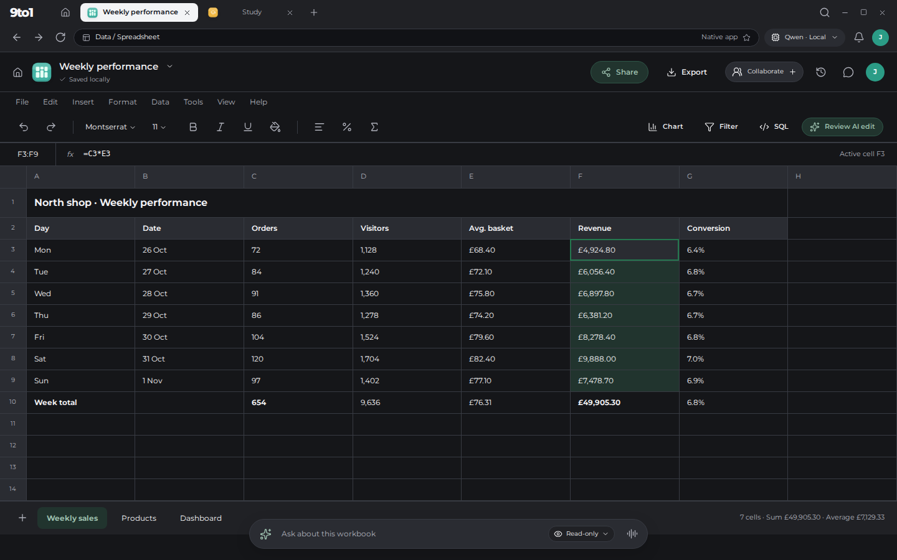
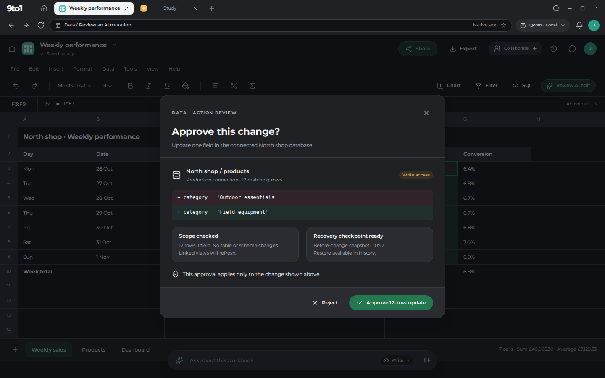
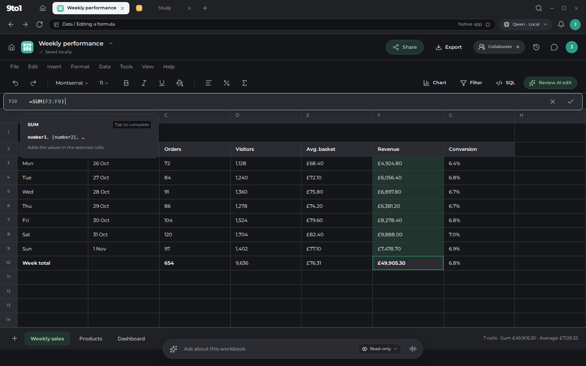
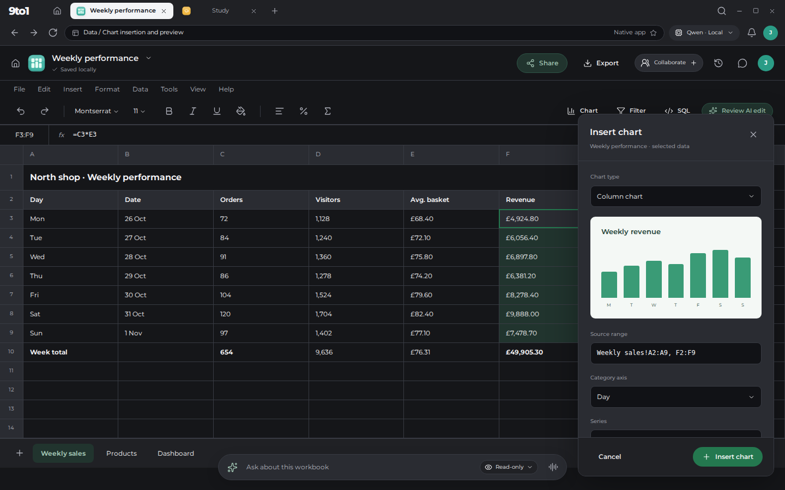

# Data — worksheets, tables and explicit AI approval

Module ID: `data` · 9to1 Development Specification v3

## Prerequisites

- **CUI, themes and shared interaction system** — Typed UI components, theme tokens/materials, layout, focus, motion, accessibility and shared control states.
- **Shared productivity engine and canonical embeds** — Real document/object engines, semantic editing, canonical app embedding and donor feature parity.
- **Artifacts, local persistence and recovery** — Canonical artifacts, revisions, typed edits, local saves, derived exports, sync and recovery.
- **Shared AI controls and artifact collaboration** — Contextual AI bars, shared model/permission controls, global collaborators and typed artifact proposals.

## Overview

Data is a full spreadsheet/table system with formula/dependency behaviour, views and an explicit AI mutation review boundary. It must never turn narrated calculations into unverified cell results.

## Layouts & visible states

- **V3-DATA-LAY-01** — Use genuine worksheet grid, row/column headers, selection/ranges, name/formula bar and sheet tabs. Properties/filter/view controls follow the current table or range.
- **V3-DATA-LAY-02** — The shared AI/SQL bar makes its mode and target explicit. Show proposed range/cell changes and action-specific approval before every AI mutation.

## Features & behaviour

- **V3-DATA-FEA-01** — Retain formulas, dependency graphs, recalculation, tables, structured fields, filters, sort, views, charts and donor-compatible operations from the technical contract.
- **V3-DATA-FEA-02** — SQL context and supported target/runtime are explicit; a native command, query and AI-generated mutation are separate operations.
- **V3-DATA-FEA-03** — Every AI mutation requires approval for the concrete action/change set, even when a broad Write control or earlier plan is present unless the retained explicit grant contract covers that exact action.
- **V3-DATA-FEA-04** — Formulas and previews use real evaluated results, typed error states and known locale/units; do not invent successful recalculation.

## Canonical entities & persistence

- **V3-DATA-ENT-01** — Persist workbook/table/sheet IDs, cell/range references, formula graph, table schemas, view/filter configuration, revisions and approval/change receipts.
- **V3-DATA-ENT-02** — Keep derived chart/render/export state linked to a known data revision.

## Permissions & recovery

- **V3-DATA-PER-01** — Validate permissions, expected revision, range scope and data constraints before applying. Rejected proposals leave data unchanged.
- **V3-DATA-PER-02** — Handle formula errors, conflicting edits, failed imports and interrupted export with recoverable native state.

## Acceptance checks

- **V3-DATA-ACC-01** — Test edit/formula→recalculate, table/filter/view, multi-cell selection and import/export fidelity.
- **V3-DATA-ACC-02** — Verify an AI change is only proposed before approval, reject is non-mutating, accept records exact cells/revision, and stale proposals fail safely.

## Exact mock-up and state map

- **Data · Spreadsheet** — screen `data`. Editor.
- **Data · Review an AI mutation** — screen `data-approval`. Approval.
- **Data · Editing a formula** — screen `data-formula`. Interaction state.
- **Data · Chart insertion and preview** — screen `data-chart`. Interaction state.

## Source clause IDs

UX27-DATA-001, UX27-DATA-002, UX27-DATA-003, UX27-DATA-004, SECTION-11, UX27-TEST-088

## Technical reading map

- Data — worksheets, tables and explicit AI approval — Data — tables, formulas, views and real state; Cell selection versus editing (part 01) — `technical/data-01.md` (341 words; V2-B1671, V2-B1672, V2-B1673…).
- Data — worksheets, tables and explicit AI approval — Data; Product role and data paradigms (part 02) — `technical/data-02.md` (5,676 words; V2-B1683).
- Data — worksheets, tables and explicit AI approval — Data; Cell modes formulas and canonical views (part 03) — `technical/data-03.md` (88 words; V2-B2837, V2-B2838, V2-B2839…).

Technical clauses retain APIs, data models, platform, recovery, donor and acceptance details. The technical files are part of this module, not optional background reading. Shared prerequisites mean stable service/interface contracts must be available; they do not require every dependent app UI to be complete. Use the named chunk for the relevant subtask or the complete module file for its full retained contract.

# Exact designs and implementation rules

These figures are the exact current atlas compositions. Their stable screen IDs match the Word specification and editable source. Open the atlas for full-size theme and interaction inspection.

## Data · Spreadsheet

Screen ID: `data`. Source: UX27-DATA-001–004; Data spreadsheet/SQL baseline; CUI-PREF-203.

- Active cell, selected range and cell editing have different visual states. The formula bar exposes the active expression.
- Spreadsheet, database and SQL views share canonical data where an explicit projection exists. A view never silently duplicates records.
- Data keeps its green app accent and teal icon. Every AI mutation requires a separate action approval.
- Selected sample revenue range demonstrates selection geometry; production values must come from the real calculation engine.

## Data · Review an AI mutation

Screen ID: `data-approval`. Source: Shared persistent AI bar, Data per-action exception; UX27-DATA-002–004; UX27-SHARED-014.

- The underlying AI bar is in Write mode, which never removes Data’s per-action approval. Rejecting leaves the source unchanged.
- Live database review identifies target, affected records, validation and a recoverable backup before execution.
- The proposed diff and execution results use separate states. An approval button does not claim execution succeeded.
- If the backup fails, the approval action becomes unavailable with a reason.

## Data · Editing a formula

Screen ID: `data-formula`. Source: Owner revision 28 October; UX27-DATA-001–004; formula authoring and selected ranges.

- Cell editing is a separate state from range selection. Function help remains anchored to the active expression and never obscures the whole sheet.
- Reference tokens map to coloured selection ranges. Commit and Cancel remain explicit; Enter commits to the same cell.
- This is a manual formula-edit state. Any AI-generated mutation still needs its own per-action approval.

## Data · Chart insertion and preview

Screen ID: `data-chart`. Source: Owner revision 28 October; Data charts and canonical range binding.

- The chart retains a live binding to its source range and series, rather than a copied screenshot.
- Preview and Insert are separate. Source headers, category axis and series selection remain editable.
- Chart colours belong to the chart document. Theme changes affect chrome without recolouring the authored chart.
