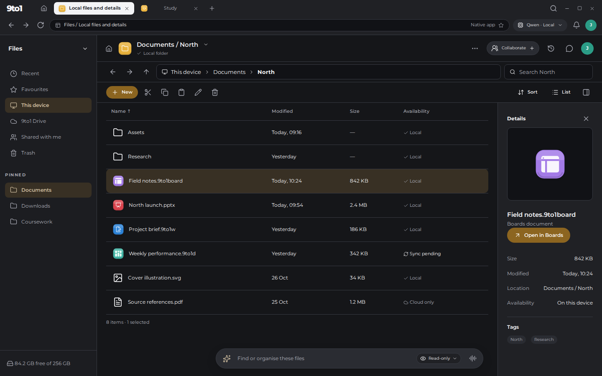
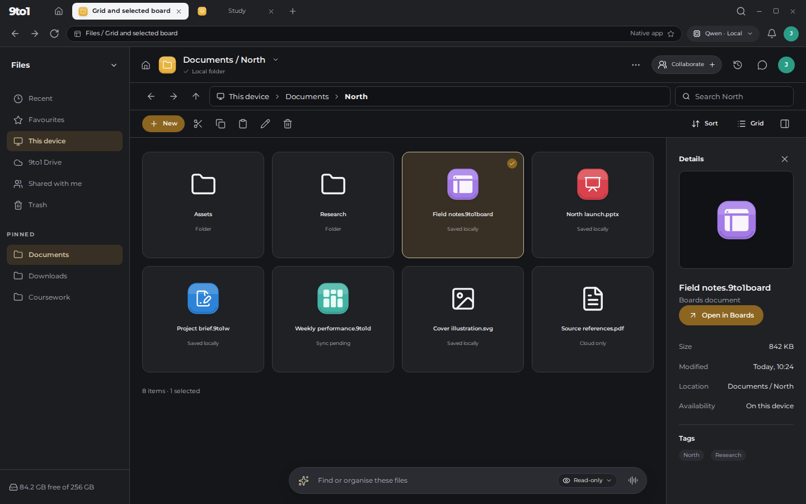
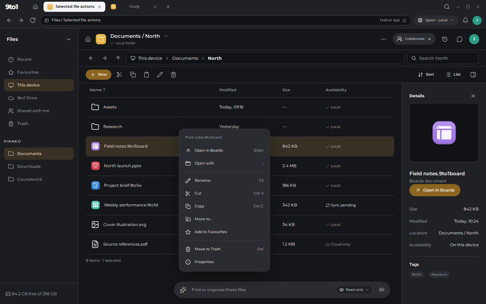
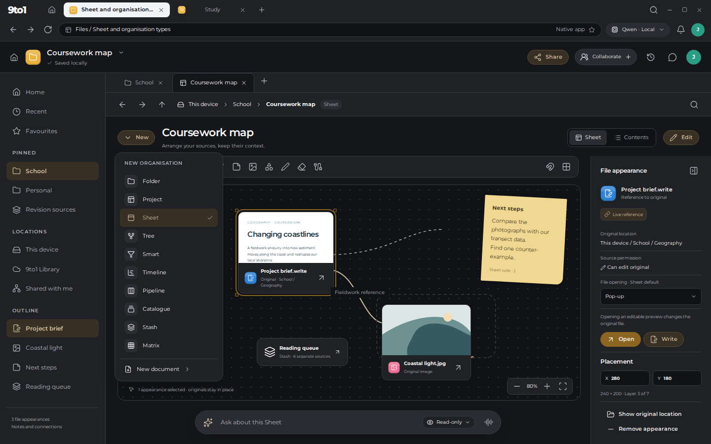

# Files and ten organisational folder views

Module ID: `files` · 9to1 Development Specification v3

## Prerequisites

- **CUI, themes and shared interaction system** — Typed UI components, theme tokens/materials, layout, focus, motion, accessibility and shared control states.
- **Artifacts, local persistence and recovery** — Canonical artifacts, revisions, typed edits, local saves, derived exports, sync and recovery.
- **Permissions, approvals and execution scope** — Effective scoped grants, action approvals, policy intersections, revocation and audit.
- **External integrations and provider connections** — Canonical provider connections, OAuth scopes, typed capabilities, provenance and sync recovery.

## Overview

Files is the mature file manager and canonical resource browser, supporting local and authorised remote providers. Its organisational views are alternative structures over real content and references, with a normal contents fallback.

Current owner overrides: V3-OWNER-014.

## Layouts & visible states

- **V3-FILES-LAY-01** — Use navigable locations, breadcrumbs, search, list/grid, selection, details/preview and genuine file operations. Maintain comfortable padding between item text, selection backgrounds and table edges.
- **V3-FILES-LAY-02** — Support Folder, Project, Sheet, Tree, Smart, Timeline, Pipeline, Catalogue, Stash and Matrix. Each view exposes its own useful workflow and can return to normal contents.
- **V3-FILES-LAY-03** — Folder/Project use ordinary hierarchy/sections; Sheet exposes structured fields; Tree supports hierarchy; Smart shows a scoped query; Timeline shows dated placement; Pipeline shows stages/gates; Catalogue structured records; Stash ordered collection; Matrix stable row/column axes.

## Features & behaviour

- **V3-FILES-FEA-01** — Use provider-native create/open/import/rename/move/copy/delete/restore capabilities with truthful availability, operation progress and conflicts. Upload or reference is explicit.
- **V3-FILES-FEA-02** — Organisational membership usually references canonical source artifacts; adding an item does not move/copy it unless the chosen operation says so.
- **V3-FILES-FEA-03** — Tree has a visual editor and a read-oriented View; Sheet tools open in the default popup with Open original and permission-aware context. Pipeline movement respects actual stage/gate rules.
- **V3-FILES-FEA-04** — Smart queries remain constrained by source scope; Matrix cells use stable axes and references, not fragile display positions. Removing collection membership is distinct from deleting the file.
- **V3-FILES-FEA-05** — Preview and Open in App resolve the real owning app. File type, source owner, revision and sync state remain inspectable.

## Canonical entities & persistence

- **V3-FILES-ENT-01** — Persist FileID/provider ID, canonical path/resource, revision, metadata and operation receipts. Organisational view configuration, query, membership, axes/stages and ordering have stable IDs.
- **V3-FILES-ENT-02** — Keep preview/index/cache records derived from permission-aware sources; preserve offline changes and pending operations separately from confirmed remote state.

## Permissions & recovery

- **V3-FILES-PER-01** — Recheck access on preview/open/export/move. Missing, revoked, unsupported, conflict and quota conditions offer safe recovery.
- **V3-FILES-PER-02** — Do not treat a file reference in a Space/Binder/Board as authority to mutate or relocate the underlying file.

## Acceptance checks

- **V3-FILES-ACC-01** — Exercise local and remote list→preview→open/edit→rename/move recovery with canonical identity. Test keyboard multiselect and selection padding.
- **V3-FILES-ACC-02** — Test all ten organisation types, normal fallback, non-destructive membership removal, denied source and persisted configuration after reopen.

## Exact mock-up and state map

- **Files · Local files and details** — screen `files`. File manager.
- **Files · Grid and selected board** — screen `files-grid`. Interaction state.
- **Files · Selected file actions** — screen `files-context`. Interaction state.
- **Files · Sheet and organisation types** — screen `files-organisation`. Sheet · references.

## Source clause IDs

SECTION-12, UX27-FILES-001, UX27-FILES-002, UX27-FILES-003, UX27-FILES-004, TF-F01, TF-F02, TF-F03, TF-F04, TF-F05, TF-F06, TF-F07, TF-F08, TF-F09, TF-F10, TF-F11, UX27-TEST-089, SCALE-009

## Technical reading map

- Files and ten organisational folder views — Files — optional integration, mature file-manager behaviour; Navigation and selection (part 01) — `technical/files-01.md` (2,376 words; V2-B0548, V2-B0549, V2-B0550…).
- Files and ten organisational folder views — Sharing and ACLs; Search, metadata and previews (part 02) — `technical/files-02.md` (1,308 words; V2-B0621, V2-B0622, V2-B0623…).
- Files and ten organisational folder views — Files — native organisation types; Shared Files organisation shell and operations (part 03) — `technical/files-03.md` (3,082 words; V2-B2164).
- Files and ten organisational folder views — Files; Ordinary file handling without domain takeover (part 04) — `technical/files-04.md` (133 words; V2-B2843, V2-B2844, V2-B2845…).

Technical clauses retain APIs, data models, platform, recovery, donor and acceptance details. The technical files are part of this module, not optional background reading. Shared prerequisites mean stable service/interface contracts must be available; they do not require every dependent app UI to be complete. Use the named chunk for the relevant subtask or the complete module file for its full retained contract.

# Retained technical requirements

# Files and ten organisational folder views — Files — optional integration, mature file-manager behaviour; Navigation and selection (part 01)

Reading status: active retained clauses, subject to the v3 owner overrides listed in the primary module. Historical process instructions and replaced original wording are stored separately.

### V2-B0548 · v2 lines 2757–2758

<!-- UX27:BEGIN SECTION-12 -->
## 12. Files — optional integration, mature file-manager behaviour

### V2-B0549 · v2 lines 2760–2760

### UX27-FILES-001 — Navigation and selection

### V2-B0550 · v2 lines 2762–2762

**B/D.** Preserve the selected Files donor’s mature sidebar, tabs, breadcrumbs/address entry, back/forward, search, list/grid/details views and keyboard selection behaviour through CUI. File/folder icons, type, modified state, availability and selection are legible at the chosen density. Double-click/Open activates the intended item; rename is deliberate and does not accidentally open it.

### V2-B0551 · v2 lines 2764–2764

Tab history and view preferences persist by location where appropriate. Network/provider failure affects that location, not unrelated local browsing. A folder named Boards is an ordinary folder, not a hidden prerequisite imposed on the Boards app.

### V2-B0552 · v2 lines 2766–2766

### UX27-FILES-002 — File operations and conflict dialogs

### V2-B0553 · v2 lines 2768–2768

**B/D.** Copy/move/rename/delete create real operations with progress, destination, conflict policy and cancellation semantics. Drag/drop indicates copy versus move and validates cross-provider behaviour. A conflict dialog distinguishes replace, keep both, skip and scoped apply-to-all where supported; it must not silently overwrite because a name collision exists.

### V2-B0554 · v2 lines 2770–2770

Trash is distinct from permanent delete. Undo reflects the actual provider’s recoverability, not a decorative button. Long operations continue through the supported operation service rather than disappear when the current folder view closes.

### V2-B0555 · v2 lines 2772–2772

### UX27-FILES-003 — Open with and owning-app semantics

### V2-B0556 · v2 lines 2774–2774

**B.** Opening `.9to1board` delegates to Boards’ canonical artifact parser/editor, with narrow current access. Files may index or synchronise the file but does not own its semantic block/ink merge. Open With and Reveal actions expose actual registered handlers and locations. A stale registration is repaired explicitly, not hidden by opening a different file with a matching title.

### V2-B0557 · v2 lines 2776–2776

A user can create/open/save a board without ever connecting the Files UI. Optional hosted Files/cloud capabilities remain available through their proper adapters and consent, without replacing ordinary local Save As.

### V2-B0558 · v2 lines 2778–2778

### UX27-FILES-004 — Sync, availability and offline status

### V2-B0559 · v2 lines 2780–2780

**B/D.** Distinguish local-only, available-offline, cloud-only, uploading/downloading, conflict, revoked and unavailable items. A cloud-only entry does not falsely appear fully local; a local revision waiting to sync is not lost. Show the actual provider/account and last refresh, with bounded retries and actionable errors.

### V2-B0560 · v2 lines 2782–2785

Structural file changes use Files’ canonical identity/revision model; semantic document changes remain with the owning app. Do not resolve simultaneous edits of rich artifacts through arbitrary byte-level last-write-wins. Retain private thumbnails/indexes according to current access and privacy policy.
<!-- UX27:END SECTION-12 -->
Files
Product role and donor-first implementation

### V2-B0561 · v2 lines 2788–2788

9-1 Files is both the native CUI file-manager app and the 9to1 hosted storage service. The desktop/native product is donor-backed by Files/WinUI and MUST first reach behavioural/layout parity with the selected appropriate donor source before 9to1-specific extensions are treated as complete. CUI replaces the rendering/framework layer; the donor’s mature information architecture, workflows, interaction semantics and quality-of-life behaviour remain the baseline unless a scoped donor-parity exception is recorded.

### V2-B0562 · v2 lines 2791–2791

The parity baseline includes applicable donor navigation/sidebar structure, toolbar/commands, tabs, back/forward history, breadcrumbs/address bar, file/folder views, details/grid layouts, sorting/grouping, context menus, properties, previews, search, tags/favourites, drag/drop, clipboard, archives, network/location handling, keyboard shortcuts, selection behaviour, file-operation UX, progress/conflict dialogs, session restoration and other user-visible donor behaviours available in the selected legally usable source.

### V2-B0563 · v2 lines 2794–2794

A donor-parity manifest MUST identify the selected donor revision and classify each applicable donor feature as Preserve, Replace with 9to1-native equivalent or Not applicable. Proprietary donor AI is not copied; equivalent AI functionality uses Dulche/9to1 APIs. Subscription/account infrastructure specific to the donor is not inherited unless independently required by this specification.

### V2-B0564 · v2 lines 2797–2797

Authority and ownership boundaries

### V2-B0565 · v2 lines 2800–2800

Files owns file/folder identity, hosted storage, locations/providers, structural hierarchy, transfers, sync, versions, sharing/ACLs, Trash/recovery, file-operation history and filesystem-level collaboration. Files does NOT own semantic editing/collaboration inside another app’s document/project format.

### V2-B0566 · v2 lines 2803–2803

The owning app remains authoritative for semantic file content and live in-document collaboration: Write owns Write-document collaboration, Present owns presentations, Boards owns Boards content, Canvas owns Canvas content, Data owns workbook/database semantics and Stack owns Git/Stack source-control semantics. Files stores and synchronises durable revisions produced by those apps but MUST NOT attempt to merge paragraphs, spreadsheet cells, Board blocks, Canvas strokes or Git histories generically.

### V2-B0567 · v2 lines 2806–2806

Raw/unowned binary/text files use Files’ revisioned-content storage model. When two clients concurrently modify bytes and no owning semantic merge engine exists, Files MUST preserve both conflicting revisions or expose a structured conflict; it MUST NOT silently choose the newest wall-clock timestamp.

### V2-B0568 · v2 lines 2809–2809

Canonical identity and item model

### V2-B0569 · v2 lines 2812–2812

Every 9to1-hosted file and folder MUST have a stable FileID or FolderID independent of name, path, sort position or parent. Rename and move MUST preserve identity. Paths are human-facing projections of hierarchy and MUST NOT be used as canonical identity by other 9to1 apps.

### V2-B0570 · v2 lines 2815–2815

Hosted file metadata MUST include at least FileID, ParentFolderID, Name, ItemType, content/media type, owner/scope, size, created/modified timestamps, current content revision, sync/availability state, sharing state and version metadata. Folders MUST expose equivalent stable identity and ordered/queriable child relationships.

### V2-B0571 · v2 lines 2818–2818

Synced local materialisations of 9to1 Drive items MUST retain metadata linking the local file to the canonical hosted FileID and base/current remote revision. Identity MUST NOT be reconstructed from pathname alone.

### V2-B0572 · v2 lines 2821–2821

Locations and provider abstraction

### V2-B0573 · v2 lines 2824–2824

Files MUST expose all storage roots through one typed Location/Provider abstraction. Required native location classes include 9to1 Drive, local disks, removable storage and supported network locations. Connected cloud providers MAY be added through adapters.

### V2-B0574 · v2 lines 2827–2827

Every provider MUST declare capabilities explicitly, including read, write, rename, move, copy, trash, permanent delete, versions, sharing, offline availability, search, streaming, server-side copy/move, change feeds and any provider-specific constraints. The UI and APIs MUST disable/report unsupported operations rather than pretending parity exists.

### V2-B0575 · v2 lines 2830–2830

Provider authentication and secrets MUST be stored through secure credential references. Provider-specific OAuth/tokens MUST NOT be persisted in plaintext Files configuration or logs.

### V2-B0576 · v2 lines 2833–2833

Desktop shell, tabs and views

### V2-B0577 · v2 lines 2836–2836

The CUI desktop shell MUST preserve the donor’s applicable tabbed browsing, navigation history, breadcrumbs/address bar, command toolbar, sidebar/location hierarchy, selection behaviour and view-management semantics. Session restore MUST reopen the prior tab/location set where available; unavailable removable/network locations restore into an explicit unavailable state rather than being silently discarded.

### V2-B0578 · v2 lines 2839–2839

Grid/list/details and other applicable donor view modes MUST be supported. Sort, group, visible columns, thumbnail size and compatible folder/view preferences MAY persist per-folder or per-location according to provider capability.

### V2-B0579 · v2 lines 2842–2846

Folder colour customisation
Files MUST support native folder-colour customisation independently of any OneDrive-specific donor capability. Users can choose from presets or an arbitrary colour using a full colour wheel/picker, apply the chosen presentation to a folder and reset it to the default appearance.
Folder colour is Files presentation metadata associated with the stable folder identity, not a pathname-only hack. It must work for local folders and 9to1-hosted folders and should work for connected-provider folders where provider capability or Files-owned metadata permits. A provider that lacks native folder-colour metadata MUST NOT force Files to disable the feature if the presentation override can safely be stored by Files.
Where compatible with sync/account policy, folder-colour metadata may follow the canonical folder across devices. Files MUST expose the same typed operation to Dulche and Automations, enabling actions such as changing selected/project folder colours without GUI automation.
Native 9to1 creation and project integration

### V2-B0580 · v2 lines 2849–2849

Files MUST replace Office-centric creation defaults with first-class 9to1 creation entries. The toolbar/context New menu MUST include at least Folder, Write document, Presentation, Spreadsheet/Data artifact, Board, Canvas and Stack project when the current location/provider can store the requested artifact.

### V2-B0581 · v2 lines 2852–2852

Creation MUST invoke the owning app’s canonical API rather than having Files manufacture private document internals. For example, creating a Write document from Files calls the Write creation API and receives the resulting canonical ArtifactID/FileID. Files owns placement/storage; the owning app owns document structure.

### V2-B0582 · v2 lines 2855–2855

Files MUST support Create Stack here and Create Stack from this folder for appropriate folders. The latter registers/imports the existing source location as a Stack project rather than creating a nested duplicate source tree. Stack identity/backing remains owned by Stack; Files supplies the selected backing location/reference.

### V2-B0583 · v2 lines 2858–2858

App/project folders MAY expose a project-aware representation so users see a meaningful project entity instead of internal managed metadata by default. Advanced inspection MAY reveal underlying files when the owning app permits it. Files MUST respect app-managed/protected metadata markers and warn/block casual destructive edits that would corrupt managed project state.

### V2-B0584 · v2 lines 2861–2861

9to1 Drive integration

### V2-B0585 · v2 lines 2864–2864

9to1 Drive MUST appear directly in the normal Files sidebar/location tree alongside local drives and other providers. Hosted storage MUST NOT open into a separate incompatible cloud-files UI. Desktop, web and owning apps address the same canonical hosted objects by stable IDs.

### V2-B0586 · v2 lines 2867–2867

A file uploaded through cakemods.com and later opened in desktop Files MUST refer to the same FileID/content revision, not a separately imported desktop copy. Local materialisation is a cache/replica of the hosted object associated with FileID/revision metadata.

### V2-B0587 · v2 lines 2870–2870

Hosted storage MUST expose quota/allocation, used space and pending/reserved upload space where applicable. Quota exhaustion MUST fail structurally and MUST NOT leave invisible orphan uploads.

### V2-B0588 · v2 lines 2873–2873

Rapid push-based sync architecture

### V2-B0589 · v2 lines 2876–2876

Sync is a core correctness requirement. 9to1 Drive MUST use event/push-driven incremental synchronisation as the normal connected path. Polling/full rescans are recovery/fallback mechanisms and MUST NOT be the primary source of ordinary change propagation.

### V2-B0590 · v2 lines 2879–2879

The server MUST produce ordered change events for filesystem-level changes including create, rename, move, metadata change, content-revision commit, delete, restore, share/ACL changes and relevant availability/sync metadata changes. Connected clients maintain a durable SyncCursor/last acknowledged server revision and apply deltas incrementally.

### V2-B0591 · v2 lines 2882–2882

On reconnect, a client submits its last durable cursor plus pending local operation journal state; the server returns deltas since that cursor, the client reconciles queued local operations, then resumes the live stream. Duplicate/replayed operation IDs MUST be idempotent and MUST NOT perform consequential mutations twice.

### V2-B0592 · v2 lines 2885–2885

Ordinary metadata operations such as rename/move/create MUST be pushed immediately after commit and processed continuously by connected clients. Intentional multi-minute delays for normal metadata propagation are non-conformant. Foreground/open artifacts and explicit manual sync receive scheduling priority over background hydration/prefetch.

### V2-B0593 · v2 lines 2888–2888

Optimistic local operations

### V2-B0594 · v2 lines 2891–2891

User-initiated structural operations SHOULD feel immediate. Files MAY optimistically apply a local rename/move/create to the UI before the remote round trip, but MUST record the operation durably as Pending with OperationID, expected/base revision and inverse/recovery metadata.

### V2-B0595 · v2 lines 2894–2894

If the server accepts the mutation, the operation becomes committed/synced and remote clients receive the corresponding event. If validation fails, Files MUST reconcile/reverse the optimistic state and display the structured reason; it MUST NOT leave the UI pretending the server accepted a rejected mutation.

### V2-B0596 · v2 lines 2897–2897

Sync and availability state

### V2-B0597 · v2 lines 2900–2900

Hosted items MUST expose explicit sync/availability state rather than a generic spinner. Required states include CloudOnly, Hydrating, AvailableOffline, AlwaysAvailable, LocalChanges, Uploading, Synced, Conflict, Paused and Error. Internal implementations MAY maintain separate content and metadata states so lightweight metadata can become synced while content transfer continues.

### V2-B0598 · v2 lines 2903–2903

CloudOnly means metadata is locally visible but content bytes are not guaranteed local. AvailableOffline means content is currently materialised and may be evicted by managed cache policy only when safe. AlwaysAvailable means the user has pinned the content and Files MUST retain a local copy until the user changes that policy or storage becomes critically unavailable and the user explicitly resolves the situation.

### V2-B0599 · v2 lines 2906–2906

Opening, previewing or an owning app requesting bytes for CloudOnly content triggers hydration on demand. Hydration MUST expose progress/failure and MUST NOT claim the item is locally available before durable content validation completes.

### V2-B0600 · v2 lines 2909–2909

Manual sync and sync-on-demand

### V2-B0601 · v2 lines 2912–2912

Files MUST provide visible manual sync controls, including Sync now, Sync this item, Sync this folder/selection, Pause sync, Resume sync, retry eligible failures and refresh/reconcile from cloud. Manual sync is an acceleration/reconciliation control, not a substitute for reliable automatic sync.

### V2-B0602 · v2 lines 2915–2915

Sync now MUST flush eligible pending local mutations, request current server deltas since the durable cursor, retry eligible transfers, reconcile conflicts that have deterministic policy and report the resulting pending/error/conflict state. It MUST NOT discard unsynced changes merely to match cloud state.

### V2-B0603 · v2 lines 2918–2918

Offline-first behaviour

### V2-B0604 · v2 lines 2921–2921

Locally materialised files/folders MUST remain usable offline according to their owning app/file-format capabilities. While offline, Files MUST allow safe queued structural operations including create folder, rename, move, delete/restore and reorganisation, and it MUST allow edits to locally available content through the owning app.

### V2-B0605 · v2 lines 2924–2924

Offline mutations enter a durable ordered operation journal that survives Files/Home/process/device restart. On reconnect, operations are reconciled against remote revisions/permissions before commit. Blind last-write-wins based solely on timestamps is prohibited for conflicts.

### V2-B0606 · v2 lines 2927–2927

Free up space MUST verify that the canonical hosted revision is durable and equivalent/newer before evicting local bytes. Items with unsynced local content MUST NOT be evicted. AlwaysAvailable items MUST NOT be evicted by normal cache cleanup.

### V2-B0607 · v2 lines 2930–2930

Real-time filesystem collaboration

### V2-B0608 · v2 lines 2933–2933

Files MUST provide real-time collaboration for filesystem structure and Files-owned metadata. Connected authorised clients viewing the same hierarchy should receive live create, rename, move, delete/restore, share/ACL and metadata updates without requiring manual refresh.

### V2-B0609 · v2 lines 2936–2936

Structural mutations MUST carry stable OperationID, actor/caller identity, target object ID, base/expected revision, operation type and result revision. Simultaneous incompatible structural edits MUST produce a deterministic RevisionConflict/Conflict object rather than silently letting whichever request arrived last overwrite the other.

### V2-B0610 · v2 lines 2939–2939

If an owning app has a file open by FileID and another collaborator moves/renames that file, Files MUST publish LocationChanged/metadata events while preserving FileID. The owning app continues editing the same canonical file without losing attachment simply because the path changed.

### V2-B0611 · v2 lines 2942–2942

Semantic collaboration inside a file is exclusively owned by the file’s owning app. Files receives/commits durable revisions from that collaboration layer and exposes version/storage metadata, but it MUST NOT run a second generic content-collaboration engine over the same file.

### V2-B0612 · v2 lines 2945–2945

Transfers

### V2-B0613 · v2 lines 2948–2948

Copy, move, upload, download and provider-transfer operations MUST be represented as durable Transfer jobs with TransferID, item set, source/destination, bytes/items totals where known, progress, state, retryability, error list and pause/resume/cancel support where technically possible.

### V2-B0614 · v2 lines 2951–2951

Hosted uploads/downloads MUST use resumable/chunked transfer when the service/provider supports it. Files/Home restart MUST resume from validated committed chunks where possible rather than restarting large transfers from zero.

### V2-B0615 · v2 lines 2954–2954

Transfer completion MUST include integrity validation where hashes/checksums are supported. Integrity failure is a failed transfer and MUST NOT be represented as successful-with-warning.

### V2-B0616 · v2 lines 2957–2957

Destination conflicts MUST use explicit policy: Ask, Replace, KeepBoth or Skip, with ApplyToRemaining where appropriate. Automated callers MUST specify a policy or receive ConflictRequiresDecision.

### V2-B0617 · v2 lines 2960–2960

Version history and durable revisions

### V2-B0618 · v2 lines 2963–2963

9to1 Drive files MUST have durable version history. Each durable revision MUST include VersionID/RevisionID, timestamp, actor/source, parent/base revision where relevant and content identity/hash where available. Restoring an older revision MUST create a new current revision or otherwise preserve the later history rather than deleting it.

### V2-B0619 · v2 lines 2966–2966

Owning apps MAY commit incremental/semantic collaboration checkpoints, but Files stores the durable file/artifact revision boundary supplied by the app. Files MUST not reinterpret app-specific internal history as generic filesystem versions unless the owning app explicitly publishes those revisions.

### V2-B0620 · v2 lines 2969–2969

Trash, delete and recovery

# Files and ten organisational folder views — Sharing and ACLs; Search, metadata and previews (part 02)

Reading status: active retained clauses, subject to the v3 owner overrides listed in the primary module. Historical process instructions and replaced original wording are stored separately.

### V2-B0621 · v2 lines 2972–2972

Normal hosted deletion MUST be soft/recoverable. Trash records MUST preserve stable item ID, original parent/location, deletion timestamp and restoration metadata. Permanent purge is a distinct high-risk operation.

### V2-B0622 · v2 lines 2975–2975

Deleting a Files container or reference MUST NOT silently cascade-permanently-delete separately owned embedded/project artifacts unless the owning app explicitly defines cascade semantics and Files presents the impact before execution.

### V2-B0623 · v2 lines 2978–2978

Sharing and ACLs

### V2-B0624 · v2 lines 2981–2981

Hosted files/folders MUST support first-class sharing using stable account/team/organisation principal IDs. Required ACL concepts include owner, direct grants, inherited grants and viewer/editor-style capability roles or their equivalent typed scopes.

### V2-B0625 · v2 lines 2984–2984

Folder permission inheritance MUST distinguish inherited from direct grants. Moving an item between differently permissioned folders MUST calculate/result in an explicit effective permission change and MUST NOT silently retain/remove direct grants contrary to the configured inheritance policy.

### V2-B0626 · v2 lines 2987–2987

Shared with Me MUST reference canonical objects owned elsewhere rather than cloning them into the recipient’s Drive. Revocation affects future access immediately subject to already-downloaded/offline-data retention policy.

### V2-B0627 · v2 lines 2990–2990

If public/link sharing is supported, link shares MUST use revocable ShareID/token state with explicit permission level and optional expiry/password where implemented. Raw file URLs MUST NOT themselves imply authority.

### V2-B0628 · v2 lines 2993–2993

Search, metadata and previews

### V2-B0629 · v2 lines 2996–2996

Files MUST support filename/folder search plus indexed metadata/content search where provider/file-type policy permits. Files publishes supported searchable entities to Home’s shared index; current permissions are rechecked when rendering/opening results.

### V2-B0630 · v2 lines 2999–2999

Common item metadata MUST include provider/location, type, size, relevant timestamps, owner/sharing, sync/offline state, current revision and hashes/integrity data where available. App-specific metadata MUST be namespaced/versioned.

### V2-B0631 · v2 lines 3002–3002

Files MUST provide preview/thumbnail contracts. Owning apps/providers MAY register read-only preview renderers for native artifacts. Preview MUST NOT mutate the source artifact or require launching a full app window unless no lightweight preview capability exists.

### V2-B0632 · v2 lines 3005–3005

Open routing, context actions and drag/drop

### V2-B0633 · v2 lines 3008–3008

Home’s app/file-handler registry determines default/open-with routing. Native 9to1 artifacts MUST expose enough type/version metadata that routing is not dependent solely on filename extension. Users MAY choose alternate compatible handlers where supported.

### V2-B0634 · v2 lines 3011–3011

Installed apps MAY contribute typed registered context actions based on item type/capability, such as Open in Write, Add to Board, Open in Pictures, Create Stack from folder or other ecosystem actions. Context actions MUST be declared through Home’s registry and MUST NOT inject arbitrary untrusted shell code into Files.

### V2-B0635 · v2 lines 3014–3014

Drag/drop and clipboard operations MUST preserve operation intent, source identity and provider capability. Cross-provider drag MUST make copy-vs-move semantics explicit. A cut/paste MUST NOT delete the source until destination commit succeeds.

### V2-B0636 · v2 lines 3017–3017

AI bar and privacy

### V2-B0637 · v2 lines 3020–3020

Files MUST host the global persistent contextual AI bar. The Files context snapshot includes current location/provider, selected FileIDs/FolderIDs, artifact types, sync state and permissions. AI requests use typed Files/owning-app/Stack actions for operations such as organise, rename, move, convert, summarise or create a Stack.

### V2-B0638 · v2 lines 3023–3023

Selecting a private local file MUST NOT silently upload file content to a cloud model. Dulche’s local/cloud privacy and permission rules apply. Context handoff MUST identify the exact file/revision being provided and whether bytes/content leave the device.

### V2-B0639 · v2 lines 3026–3026

Files MUST remain fully functional with AI disabled/unavailable. AI is additive and MUST NOT replace essential manual file-management UI.

### V2-B0640 · v2 lines 3029–3029

Operation journal, undo and change feed

### V2-B0641 · v2 lines 3032–3032

Consequential filesystem operations MUST be recorded in a durable operation journal with OperationID, actor/caller, target object IDs, source/destination where applicable, base/result revisions, state and structured error/result. The journal supports crash recovery, sync reconciliation and auditability.

### V2-B0642 · v2 lines 3035–3035

Safely reversible operations such as rename, move and soft-delete SHOULD expose undo by performing a real inverse storage mutation against current revision checks. Undo MUST NOT be UI-only fiction and MUST fail explicitly if intervening changes make the inverse unsafe.

### V2-B0643 · v2 lines 3038–3038

Files MUST expose a resumable typed change feed with stable event IDs/cursors for create/change/move/share/delete/restore/sync-state and other supported filesystem events. Automations/watchers can resume from a cursor without arbitrary full rescans.

### V2-B0644 · v2 lines 3041–3041

Properties and sync diagnostics

### V2-B0645 · v2 lines 3044–3044

A Properties/details surface MUST expose stable identity, path/location, provider, type, size, timestamps, owner/sharing, sync/offline state, current version/history access, app association and provider-specific metadata where available.

### V2-B0646 · v2 lines 3047–3047

Files MUST provide clear sync diagnostics for 9to1 Drive, including current connectivity/server contact, pending uploads/downloads, pending structural operations, conflicts, paused/error state, offline-pinned usage and local cache usage. Item-level errors MUST expose local/base/cloud revision information where relevant and provide Resolve/Retry/View details actions.

### V2-B0647 · v2 lines 3050–3050

Safety and filesystem edge cases

### V2-B0648 · v2 lines 3053–3053

Provider adapters and local materialisation MUST define handling for illegal/reserved filenames, case sensitivity, path length, path traversal, symlinks/reparse points and unsupported metadata. Remote names MUST NOT escape the intended local sync root or overwrite unrelated local paths.

### V2-B0649 · v2 lines 3056–3056

Filesystem shortcuts/symlinks MUST remain distinct from 9to1 artifact references/shortcuts. Copying a reference MUST NOT accidentally clone the referenced canonical artifact unless the user explicitly chooses duplication.

### V2-B0650 · v2 lines 3059–3059

Files API

### V2-B0651 · v2 lines 3062–3099

9to1.Files.ListLocations();
9to1.Files.GetProviderCapabilities(locationID);
9to1.Files.List(locationID, parentID?, query?);
9to1.Files.Get(itemID);
9to1.Files.CreateFolder(parentID, name);
9to1.Files.CreateArtifact(parentID, artifactType, config?);
9to1.Files.Rename(itemID, name, expectedRevision?);
9to1.Files.Move(itemID, destinationFolderID, expectedRevision?);
9to1.Files.Copy(itemID, destinationFolderID, policy?);
9to1.Files.Delete(itemID);
9to1.Files.Restore(itemID);
9to1.Files.Purge(itemID);
9to1.Files.Upload(destinationFolderID, source, options?);
9to1.Files.Download(itemID, destination, options?);
9to1.Files.Transfer.Get(transferID);
9to1.Files.Transfer.Pause(transferID);
9to1.Files.Transfer.Resume(transferID);
9to1.Files.Transfer.Cancel(transferID);
9to1.Files.Sync.GetState();
9to1.Files.Sync.GetItemState(itemID);
9to1.Files.Sync.Now();
9to1.Files.Sync.Item(itemID);
9to1.Files.Sync.Folder(folderID);
9to1.Files.Sync.Pause();
9to1.Files.Sync.Resume();
9to1.Files.Sync.SetAvailability(itemID, CloudOnly | AvailableOffline | AlwaysAvailable);
9to1.Files.Sync.ListPending();
9to1.Files.Sync.ListConflicts();
9to1.Files.Sync.ResolveConflict(conflictID, resolution);
9to1.Files.GetVersions(itemID);
9to1.Files.RestoreVersion(itemID, versionID);
9to1.Files.Share.Get(itemID);
9to1.Files.Share.Grant(itemID, principalID, role);
9to1.Files.Share.Revoke(itemID, principalID);
9to1.Files.Search(query);
9to1.Files.Changes.Subscribe(cursor?);
9to1.Files.Changes.GetSince(cursor);
9to1.Files.CreateStack(folderID, options?);

### V2-B0652 · v2 lines 3102–3102

These are minimum canonical entry points. Every additional donor-parity and 9to1-native user-visible operation MUST have an equivalent typed Files or owning-app action under the global API-parity rule.

### V2-B0653 · v2 lines 3105–3105

Failure behaviour

### V2-B0654 · v2 lines 3108–3108

Files MUST return structured failures including ItemNotFound, RevisionConflict, NameConflict, ConflictRequiresDecision, PermissionDenied, ProviderUnavailable, ProviderCapabilityUnsupported, QuotaExceeded, Offline, TransferInterrupted, IntegrityFailed, SyncConflict, FileInUse, StorageUnavailable, InvalidName, DestinationUnavailable, HomeServiceUnavailable and structured partial bulk results in addition to the global error contract.

### V2-B0655 · v2 lines 3111–3111

Platform behaviour

### V2-B0656 · v2 lines 3114–3114

Windows and 9to1-OS native Files expose local, removable, network, hosted and connected-provider locations according to platform/provider capability. Web Files exposes hosted/provider-accessible content but MUST NOT pretend to have arbitrary access to the browser user’s local filesystem. Browser local upload/download uses explicit browser-authorised file/folder selection.

### V2-B0657 · v2 lines 3117–3117

Acceptance requirements

### V2-B0658 · v2 lines 3120–3144

Files is implementation-complete only when acceptance coverage verifies at least:
* The CUI port accounts for applicable Files/WinUI donor functionality and preserves its core layout/workflows/QoL through a donor-parity manifest.
* 9to1 Drive appears as a normal first-class location and the same FileID opened via web and desktop represents the same canonical hosted object.
* Rename/create/move on one connected client appears live on another client without manual refresh and preserves stable item identity.
* Moving/renaming a file while it is open in its owning app does not break the open document because the app remains attached by FileID.
* Manual Sync now flushes eligible pending operations, retrieves server deltas and reports unresolved errors/conflicts.
* A CloudOnly file hydrates on demand; AvailableOffline works without network; AlwaysAvailable survives restart/cache cleanup.
* Free up space refuses to evict unsynced content and verifies durable cloud revision before eviction.
* Offline structural operations survive device restart and reconcile correctly after reconnect.
* Two conflicting concurrent binary/raw-file edits preserve both revisions or create an explicit conflict; no version is silently lost.
* Two collaborators concurrently reorganising the same hierarchy receive deterministic structural conflict behaviour rather than blind last-write-wins.
* A large resumable upload survives Files/Home restart and continues from validated committed progress.
* A failed transfer integrity check is reported as failure and never as completed.
* Version history and restore preserve later history and identify actor/source/revision.
* Trash/restore/purge behave distinctly and purge uses the elevated destructive flow.
* Sharing/ACL changes propagate to connected clients and revocation prevents future authorised access.
* Creating Write/Present/Data/Board/Canvas artifacts from Files invokes the owning app and creates canonical artifacts.
* Create Stack here/from this folder produces the expected Stack project without duplicating existing source.
* Owning-app real-time collaboration commits durable Files revisions without Files attempting semantic content merges.
* Provider capability differences disable/report unsupported operations rather than pretending support.
* Bulk operations return exact succeeded/failed/skipped outcomes and never silently lose items.
* Private local content is not sent to a cloud AI merely because it is selected in Files.
* Change-feed cursor resume does not require a full filesystem rescan and does not duplicate consequential events.
* Home crash/recovery preserves pending sync journal state and does not create duplicate operations or storage corruption.
* A very large hierarchy can process ordinary incremental changes without complete rescans for each event.

# Files and ten organisational folder views — Files — native organisation types; Shared Files organisation shell and operations (part 03)

Reading status: active retained clauses, subject to the v3 owner overrides listed in the primary module. Historical process instructions and replaced original wording are stored separately.

### V2-B2164 · v2 lines 12595–12650

Files — native organisation types
TF-F01 — Shared Files organisation shell and operations
The existing donor-parity Files sidebar, tabs, Back/Forward, breadcrumbs/address bar, toolbar, selection, previews, location management and grid/list/details views remain the shell. The New menu MUST expose the ten organisation types at compatible locations, alongside existing native document creation. Creation asks for type, name and storage/backing location, then opens an immediately usable empty organisation. A provider lacking native metadata MAY use the existing Files-owned metadata capability; unsupported storage or write permissions MUST be explained before creation rather than falling back to an ordinary folder without consent.
Every non-Folder type is a first-class versioned Files organisation object with a stable Files item identity, type, storage location, settings and local membership/layout records. A membership records its stable membership/placement ID, target FileID/FolderID or organisation ID and any type-specific section/stage/cell/order data. Contextual membership is not a second filesystem parent. New files created from a virtual view use an explicit Files destination, initially the organisation's configured backing location; the location MUST be inspectable/changeable before creation. The owning app creates the file, and Files then adds its appearance. An external file is imported through the normal transfer flow before a new managed reference is committed.
Organisation commands MUST include Add existing, New item, Rename, Open, Open in new tab/window, Show original location, Properties, Share, view/layout settings, Remove from this organisation and the separately labelled original-file delete action when permitted. Supported bulk actions show the selected scope and partial-success results. Dragging an existing item into a contextual collection adds a reference by default; the drop indicator MUST state Add reference, Move original, Copy original or Reorder as appropriate. The default MUST NOT unexpectedly move or duplicate source bytes.
All organisation types MUST support nesting with every other type, including ordinary folders, subject only to explicit provider capabilities and coherent containment rules. Nested organisation objects are openable as units, not flattened into their parents. Owned containment MUST be acyclic; reference resolution MUST detect recursion and avoid infinite expansion. Smart query results MUST not recursively ingest their own collection. A relationship that cannot be represented safely is rejected with its reason and an alternative, not silently converted to a different type.
A normal folder-style contents view MUST be available for every specialised type without converting its data. Changing the view does not erase sections, coordinates, relationships, filters, stages, metadata or ordering. View choice and viewport are per-user preferences; authored layout and collection settings are shared document state. Tree retains its stricter editor-only visual mode. Breadcrumbs MUST distinguish a contextual section/group from an actual filesystem folder, and Show original location MUST resolve the canonical storage location.
TF-F02 — Folder
Folder remains an ordinary filesystem/location hierarchy with its existing donor behaviours, sorting, grouping, views, folder colours, navigation, permissions and file operations. The new organisation types MUST NOT reinterpret existing folders, add mandatory grouping metadata or replace normal move/copy semantics. Files can store a new organisation object within a folder, and a contextual collection can reference a folder without creating a second physical parent.
Folder acceptance MUST verify ordinary create, rename, move, copy, delete/restore, colour, sort and nested navigation before and after adding organisation objects. A normal folder opened from a Project, Tree or Matrix MUST still behave as a folder, and returning to the parent context MUST restore that view without moving the folder.
TF-F03 — Project
Project is a folder-like view divided into visible named sections on the same page. For example, Homework shows Maths containing Mathshomework.pptx and Mathshomework2.pptx, and French containing Frenchlistening.docx. A Maths folder containing its own homework remains possible. Sections are not subfolders and assigning an item to a section MUST NOT change its underlying Files location.
The main view MUST show each section's title, authorised item count, collapse control, contextual menu and Add item entry point. A section contains the selected grid/list/details representation of its members. The toolbar provides Add section, Add existing, New item and view/sort controls. Sections support create, rename, reorder, collapse/expand, colour/label customisation through shared presentation controls and delete. A searchable section outline provides direct navigation for large Projects without forcing the user to open every section as a new page.
Each section has a persistent SectionID and addressable deep link. Moving an appearance between sections updates that membership only; source rename/edit actions remain visibly separate. New unassigned members appear in an Unsectioned area. Removing a section MUST offer to keep its members in Unsectioned or remove those appearances; neither option deletes originals. Sorting items within one section MUST not reorder the other sections unless the user applies a Project-wide sort. Per-user collapse state MUST not rewrite shared ordering.
Project acceptance MUST create the Homework example, add a nested folder and another organisation type, reorder and rename sections, follow a SectionID link after rename, move an appearance and delete a section while retaining originals. Reopen and a second authorised client MUST preserve authored section order/membership; viewer mode MUST allow reading and navigation without showing usable mutation controls.
TF-F04 — Sheet
Sheet is a Files-owned whiteboard-like workspace for arranging separate files and ideas. The canvas MUST support file/folder/organisation appearances, sticky notes, rich text, images, labelled connections, freehand drawing and shapes. These surrounding objects supply context; placing a file does not merge its contents into a new document. A Sheet can contain another Sheet, a Stash or a Link document as an openable item without spreading its contents over the parent canvas.
The editor MUST provide Select, Pan, Add files, Text, Sticky note, Image, Shape, Pen, Eraser and Connector tools. A contextual inspector exposes supported appearance, fill/stroke, text style, dimensions, position, layering and link/target properties. Multi-selection supports move, resize where compatible, align/distribute, group/ungroup, duplicate appearance and remove. Snap/grid controls, zoom, fit and an object outline MUST be available. Connectors attach to stable object IDs rather than being abandoned when an item moves; deleting a connected object previews and removes its affected contextual connections, not its source file.
File appearances MUST show a useful permission-safe name/type/preview and an identifiable open action. Each Sheet has a persisted File opening setting: Pop-up or Owning app, with Pop-up as the initial setting for a new Sheet. An item's explicit context command can choose the other route for that opening without silently changing the Sheet default. In authoring mode a click selects and the explicit Open action or normal activation gesture opens; in view mode activation opens directly. Pop-up editing uses only a safe registered owning editor and MUST identify that it changes the original; otherwise provide a read-only preview and Open in owning app.
Persist ObjectID/PlacementID, source reference, geometry, z-order, grouping, notes, drawing strokes, shape properties, connector endpoints and opening policy. Viewport and selection remain per-user. Moving or deleting a file appearance MUST not alter an unrelated appearance in another Sheet, while editing the canonical file MUST update every authorised live reference. Undo for local geometry MUST not roll back source edits performed through a different editor.
Sheet acceptance MUST combine a Write file, image, sticky note, labelled connection, freehand stroke, shape and nested Stash; arrange and group them; open and edit the same original from two contexts; close the preview and recover the prior canvas position; switch opening policy; and save/reopen with identical authored layout. Keyboard and touch users MUST be able to create, select, open and reposition items without precise pointer dragging.
TF-F05 — Tree
Tree is a structured Sheet connecting related files and groups. An editor can create a Maths group linked to Maths.pptx, Maths2.pptx and Algebra.pptx; activating Maths opens a pop-up containing its related contents and folders. The same actual file can appear in multiple Trees without unmanaged copies or separately created shortcut files. Tree relationship changes affect the Tree; source edits affect the shared original.
Editors MUST see a Tree / View switch. Tree provides a connected layout with Add group, Add existing, Connect, Disconnect, arrange, expand/collapse and fit controls, plus a searchable outline and a selected-node inspector. Nodes display accessible names and authorised previews/counts. Connections, parent/group relationships and collapsed branches MUST be explicit. Reparenting MUST preview its structural effect; a cycle is rejected. Changing arrangement MUST not change logical relationships or file identity.
View presents the contents using ordinary folder-style browsing. View-only users MUST receive View, not a disabled visual Tree. They can open authorised groups/files and navigate Back, but MUST NOT obtain the protected visual layout through a hidden route, embed or layout API. An editor switching to View sees the same accessible logical contents. Editing permission on the Tree does not imply edit permission on its referenced files, and source permissions remain independently checked.
Persist stable GroupID/NodeID/ConnectionID, memberships, hierarchy and authored layout. Removing a group or node MUST show whether children are being retained/reassigned or appearances removed and MUST never delete originals as an incidental graph operation. Tree acceptance MUST verify the Maths journey, one file in two Trees, rename/move stability, cycle rejection, editor/viewer mode differences, nested folders and no protected-layout leakage through APIs or Boards embeds.
TF-F06 — Smart
Smart is a rule-based collection of canonical originals from explicitly selected locations. The editor MUST show a readable rule builder, location/scope picker, All/Any condition grouping, supported operators and a live result preview. Required filter fields include tags, file type, work status and modification date where the source supplies them. Values that are unavailable MUST be treated as unknown, not silently replaced with false, zero or an empty string.
The command bar provides Edit rules, Add location, Refresh/reconcile, Pin item and view/sort controls. Each result exposes Why included, identifying the matching rule or manual pin. Pinned exceptions remain visible even when they stop matching; unpinning returns the item to rule-driven membership. Removing a dynamically matched appearance MUST explain that it will return while it matches and direct the user to adjust the rule or scope rather than pretending the source was removed from the collection. Original-file delete remains separate.
Optional AI setup converts a request into proposed visible rules and locations for review. It MUST not run an opaque classifier as the only explanation for membership or search private locations without permission. Membership updates use the Files change/index contracts, with visible freshness and partial/unavailable-provider state. A disconnected provider MUST NOT make its missing results look like confirmed non-matches. Nested organisations can be matched or pinned as whole objects under TF-F01.
Persist the versioned rule expression, selected location IDs, recursion policy, pins and view settings; cached results are not authoritative copies. Smart acceptance MUST demonstrate entry/exit after tag and date changes, All/Any conditions, a pinned non-match, a newly inaccessible location, an offline result set and an inspectable AI-generated rule proposal. No match operation may move, duplicate or widen access to an original.
TF-F07 — Timeline
Timeline positions files and nested groups along a chronology. The main surface MUST provide a labelled time axis, zoom between broad periods and individual dates, pan, date navigation, fit, an Undated area and a visible Date source selector: Created, Modified, Deadline or Assigned. Labelled periods can contain material and open their contents in a pop-up. A date range is drawn as a span rather than forced into a single point.
The inspector MUST show the effective date/range, source of that value, relevant timezone/date-only interpretation and any locally assigned value. Users can add, rename, resize and reorder labelled periods, open an item/group and filter the displayed contents. Dragging a file to change its chronological position is available for Assigned dates and changes Timeline-local data. Under Created/Modified/Deadline, the UI MUST explain the source rather than secretly rewrite it; explicitly editing a writable source date invokes its owning operation with permission and impact checks.
Files with no value for the selected date source remain in Undated. Overlapping items MUST remain discoverable through stacking/grouping, previews and the folder-style alternative. Live source-date changes reposition the appearance without changing the file's identity. Changing the selected date source MUST preserve authored assigned dates and periods for later reuse instead of deleting them.
Persist DateSource, assigned start/end values, period IDs/ranges, memberships and display settings. Timeline acceptance MUST cover all four date-source choices, an ongoing range, an undated file, overlapping files, a nested organisation, a period pop-up, timezone/date-only boundaries and a source modification that updates the view without rewriting unrelated dates.
TF-F08 — Pipeline
Pipeline represents progression through configurable stages, not a Project's static categories. The main view MUST show horizontally arranged stage columns, accessible stage titles/counts, item previews, Add stage and Add item. A compact list/grouped view remains available. Users can create, rename, reorder and remove stages, move appearances between stages and inspect an item's contextual process history without opening its source document.
The stage editor MUST support optional checklist requirements and reviewer approval. New personal Pipelines begin without mandatory gates. A transition preview identifies unmet requirements, approval status and any explicit shared-metadata mapping. An unmet mandatory gate blocks the transition with its reason; a request for reviewer approval becomes visibly pending and does not masquerade as a completed stage move. Reviewer identity and authority MUST be checked. Dragging, the Move to stage command and APIs enforce the same gates and revision checks.
Each membership has a stable EntryID and local StageID, order, checklist state and approval/transition records. Pipeline stage state is local to that Pipeline by default. A Mapping control may explicitly connect a selected field/stage to global file metadata, showing the target field, conversion, affected items, required rights and conflict behaviour before activation. No implicit mapping occurs. If the global update cannot be authorised or committed, the transition remains blocked or reports an explicitly declared partial result; it MUST not silently claim both succeeded.
Deleting a stage MUST require a destination for retained entries or explicit removal of appearances. Originals are unchanged. Pipeline acceptance MUST move an item by pointer, keyboard and API; reject an unmet checklist; obtain and revoke an authorised approval; handle a simultaneous transition; and prove that a stage change in one Pipeline does not change another Pipeline or source metadata without an explicit mapping.
TF-F09 — Catalogue
Catalogue is a file-centred collection with structured information attached to entries. It MUST provide Cards, Table and Grouped views, a field editor, sort/filter/group controls and an information panel that opens without launching the full source document. The file itself is the organised item; typing a filename into a disconnected table cell MUST NOT create a valid source reference.
Required configurable field kinds include text/description, person/owner reference, status/select, tags, date, number and rating. Each field declares its stable FieldID, type, source and validation. The UI MUST distinguish source metadata from Catalogue-local fields, and read-only source values from writable ones. Editing local notes or ratings MUST not alter another Catalogue. Editing an exposed global field invokes its actual owning operation and shows that broader scope. Changing a field type MUST preview incompatible values and preserve them until an explicit conversion is confirmed.
The entry panel MUST show the authorised source identity/location, available metadata, local values, Open, Show original location and Remove from Catalogue. Users can add/reorder/hide fields, resize columns, choose card preview fields, group results and edit compatible selections in bulk. Validation errors stay attached to the affected field/entry without dropping the rest of the user's edit. Removing a field previews affected local values and is recoverable through normal history; it does not delete source properties.
Persist EntryID-to-source mappings, the field schema, local values and authored view configuration. Catalogue acceptance MUST use the same file in two Catalogues with different local notes, change a true global property visibly, reject an invalid field value, preserve values during type changes, open the information panel in all views and retain canonical identity after source rename.
TF-F10 — Stash
Stash is a deliberately ordered collection for working through separate files one at a time. Its reader MUST show the current item, its position in the sequence, Previous/Next, an overview/filmstrip, Open in owning app and an optional Reviewed control. Keyboard and touch navigation MUST work. The sequence is persistent authored data, not an incidental filename sort, and files remain separate rather than forming Flow's continuous page.
Editors can add, remove and reorder entries through the overview, using drag and explicit Move earlier/later commands. A Compare action opens two selected entries side by side with independent source identity and navigation; changing one comparison slot MUST not silently advance the main reading position. On narrow screens comparison may switch between clearly labelled A/B views while retaining both selected entries. A Stash opened from a Sheet remains one contextual surface rather than expanding every entry onto the canvas.
Persist stable EntryIDs and sequence order. Reading position and optional reviewed state are per user, keyed to EntryID rather than numeric position, and survive restart. Reordering MUST retain the reader's current item when it still exists. Removing that entry moves to a clearly identified neighbouring position without deleting its original. The UI MUST distinguish Complete/reviewed status from actually changing a file's global work status.
Stash acceptance MUST save a non-alphabetical sequence, reopen at the same item, mark reviewed items, reorder from another authorised client, compare two files, handle a denied/missing source and return from a Sheet pop-up without changing the canvas or cloning files.
TF-F11 — Matrix
Matrix organises material by two authored dimensions. The main view MUST display user-defined row and column headings together, with sticky headings or an equivalent persistent orientation aid, cell counts/previews, Add row, Add column and view/zoom controls. Each intersection contains file/folder/organisation appearances. Users can open a cell group, a row's combined contents or a column's combined contents without traversing an invented outer-folder hierarchy.
Rows and columns support create, rename, reorder and remove. Each has a stable ID; a CellID is tied to those identities, not its visual coordinates or labels. Dragging an appearance between cells changes Matrix-local classification only. Keyboard navigation MUST identify the current row/column and provide explicit move/add/open commands. Large grids MUST remain navigable using filtering, scrolling and the normal contents view rather than shrinking every cell until its contents are unreadable.
Removing an axis previews the affected memberships and offers reassignment, retention in an Unassigned group or removal of appearances; it MUST not delete originals. A row/column combined view MUST not suggest that repeated appearances are independent copies: repeated canonical items are coalesced with visible placement context or clearly marked as repeated references. The authorised counts MUST correspond to the chosen displayed unit, not include hidden private entries.
Matrix acceptance MUST build Topic A/B/C rows and Writing/Data/Presentations columns, populate a cell with a nested folder, open cell/row/column groups, rename/reorder both axes, move an appearance, remove an axis safely and reopen without losing identity, classification or readable orientation.

# Files and ten organisational folder views — Files; Ordinary file handling without domain takeover (part 04)

Reading status: active retained clauses, subject to the v3 owner overrides listed in the primary module. Historical process instructions and replaced original wording are stored separately.

### V2-B2843 · v2 lines 15019–15019

## Files

### V2-B2844 · v2 lines 15021–15021

### UX27-TEST-089 — Ordinary file handling without domain takeover

### V2-B2845 · v2 lines 15023–15023

**Requirements:** UX27-FILES-001, UX27-FILES-002, UX27-FILES-003, UX27-FILES-004 · **Status:** NOT RUN

### V2-B2846 · v2 lines 15025–15025

**Given:** Mixed files including .9to1board, with one remote-only unavailable item.

### V2-B2847 · v2 lines 15027–15028

**When:**
1. Navigate/select, copy/move through a collision, Open with Boards and inspect sync state.

### V2-B2848 · v2 lines 15030–15033

**Then:**
- File operations have explicit conflict/undo/progress semantics.
- Boards handles its document; Files does not become a mandatory connected account.
- Local save and remote availability/sync are separately truthful.

### SCALABILITY-B0011 · scalability lines 33–33

SCALE-009 — FILES AND CLOUD. Files MUST support stable asset identity, metadata indexing, byte-range or chunk-aware operations, integrity-verified resumable uploads/downloads, revisions, permissions, transactional commits and recovery. External cloud/storage quotas and device capacity may constrain actual sizes, but MUST be made transparent; no disguised universal file-size cap. Preserve privacy, secure storage and offline access according to the rest of V2.

# Exact designs and implementation rules

These figures are the exact current atlas compositions. Their stable screen IDs match the Word specification and editable source. Open the atlas for full-size theme and interaction inspection.

## Files · Local files and details

Screen ID: `files`. Source: UX27-FILES-001–004; Files donor-first baseline; UX27-BOARD-003–006.

- Selected rows retain 16 px leading padding around the app icon and comfortable padding around every cell.
- Keep mature address, breadcrumb, history, selection, sort, list/grid and details interactions.
- Local availability and provider sync are separate statuses. A cloud outage does not block local folders.
- Open with Boards resolves the same editable .9to1board file. Files is an optional storage/navigation integration for Boards.
- Moving a file preserves canonical identity; a name collision opens explicit Replace, Keep both or Skip review.

## Files · Grid and selected board

Screen ID: `files-grid`. Source: Owner revision 28 October; UX27-FILES-001–004.

- Grid and List are two views of the same folder and selection; changing view never duplicates files.
- The selection tint surrounds the complete tile with comfortable padding on every edge. File icon, name and availability remain within the selected surface.
- Details refer to the selected canonical board; Open in Boards opens its editable document.

## Files · Selected file actions

Screen ID: `files-context`. Source: Owner revision 28 October; Files selection and canonical operations.

- The context menu is anchored beside the selected file and uses the same command model as toolbar actions.
- Open, Open with, Rename, Move, Copy and Trash have distinct outcomes. Moving preserves identity; Trash remains recoverable.
- Menu focus returns to the selected row when closed. File properties remain visible without changing the selection.

## Files · Sheet and organisation types

Screen ID: `files-organisation`. Source: TF-F01–TF-F11; TF-F04 (Sheet); UX27-FILES-001–004.

- Files owns Folder, Project, Sheet, Tree, Smart, Timeline, Pipeline, Catalogue, Stash and Matrix. The New menu exposes all ten; each keeps the standard Files shell and compatible nesting.
- Every specialised organisation offers an ordinary Contents view without erasing coordinates, sections, membership or metadata. Tree additionally requires editor rights for its visual Tree view.
- A Sheet arranges references, notes, drawings and shapes. Add existing defaults to Add reference; removing an appearance does not delete or move its original.
- The Sheet default File opening setting is Pop-up. In authoring, click selects and the explicit Open action opens; a safe owning editor must disclose that it edits the original. Source permissions remain independent.
- Selection, viewport and view choice belong to the current user. Authored geometry, connector endpoints, shared layout and opening policy persist as Sheet state.
