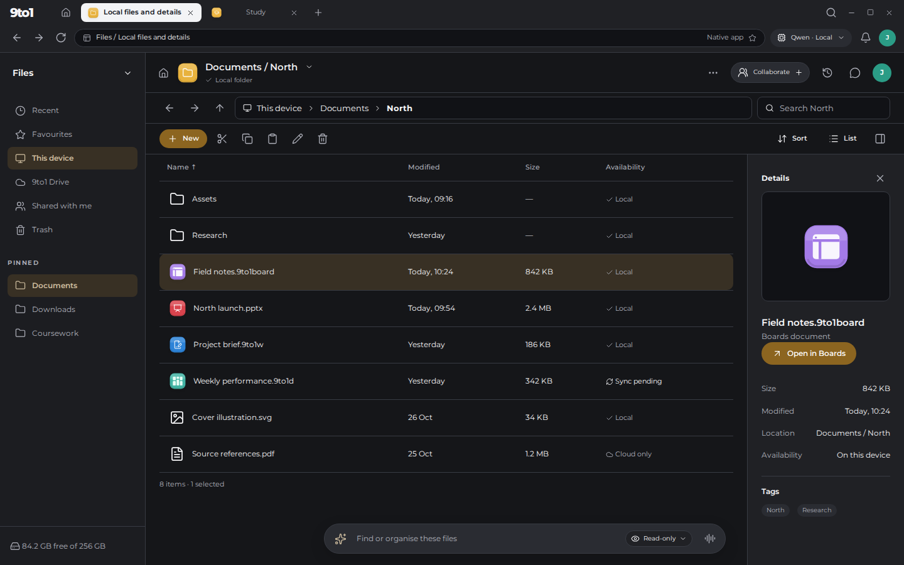
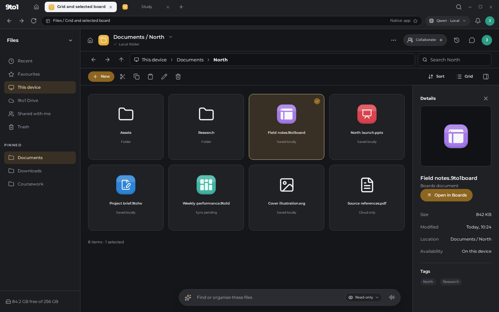
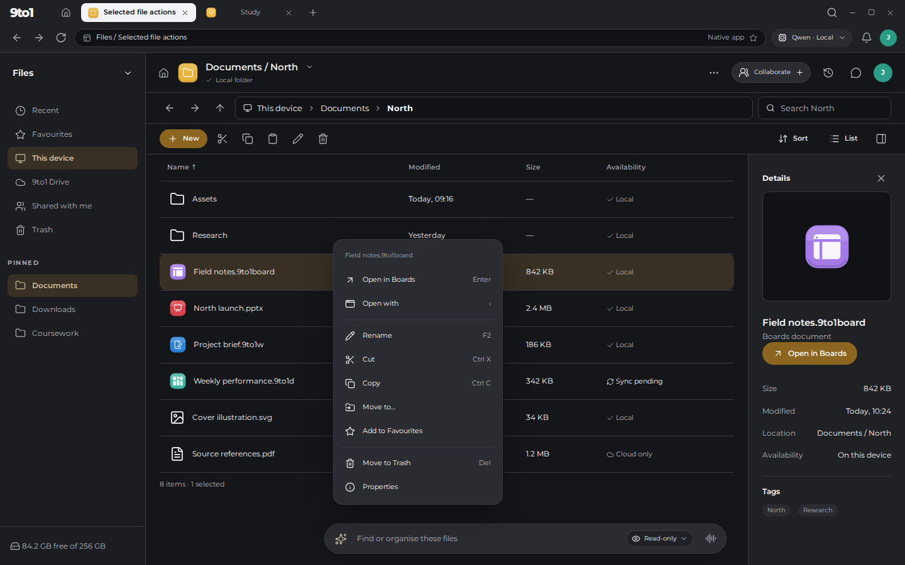
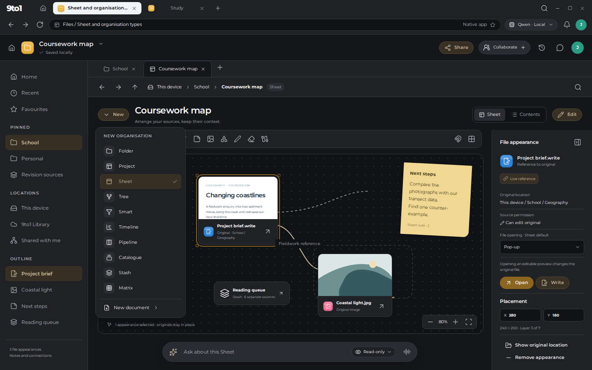

# Files and ten organisational folder views

Module ID: `files` · 9to1 Development Specification v3

## Prerequisites

- **CUI, themes and shared interaction system** — Typed UI components, theme tokens/materials, layout, focus, motion, accessibility and shared control states.
- **Artifacts, local persistence and recovery** — Canonical artifacts, revisions, typed edits, local saves, derived exports, sync and recovery.
- **Permissions, approvals and execution scope** — Effective scoped grants, action approvals, policy intersections, revocation and audit.
- **External integrations and provider connections** — Canonical provider connections, OAuth scopes, typed capabilities, provenance and sync recovery.

## Overview

Files is the mature file manager and canonical resource browser, supporting local and authorised remote providers. Its organisational views are alternative structures over real content and references, with a normal contents fallback.

Current owner overrides: V3-OWNER-014.

## Layouts & visible states

- **V3-FILES-LAY-01** — Use navigable locations, breadcrumbs, search, list/grid, selection, details/preview and genuine file operations. Maintain comfortable padding between item text, selection backgrounds and table edges.
- **V3-FILES-LAY-02** — Support Folder, Project, Sheet, Tree, Smart, Timeline, Pipeline, Catalogue, Stash and Matrix. Each view exposes its own useful workflow and can return to normal contents.
- **V3-FILES-LAY-03** — Folder/Project use ordinary hierarchy/sections; Sheet exposes structured fields; Tree supports hierarchy; Smart shows a scoped query; Timeline shows dated placement; Pipeline shows stages/gates; Catalogue structured records; Stash ordered collection; Matrix stable row/column axes.

## Features & behaviour

- **V3-FILES-FEA-01** — Use provider-native create/open/import/rename/move/copy/delete/restore capabilities with truthful availability, operation progress and conflicts. Upload or reference is explicit.
- **V3-FILES-FEA-02** — Organisational membership usually references canonical source artifacts; adding an item does not move/copy it unless the chosen operation says so.
- **V3-FILES-FEA-03** — Tree has a visual editor and a read-oriented View; Sheet tools open in the default popup with Open original and permission-aware context. Pipeline movement respects actual stage/gate rules.
- **V3-FILES-FEA-04** — Smart queries remain constrained by source scope; Matrix cells use stable axes and references, not fragile display positions. Removing collection membership is distinct from deleting the file.
- **V3-FILES-FEA-05** — Preview and Open in App resolve the real owning app. File type, source owner, revision and sync state remain inspectable.

## Canonical entities & persistence

- **V3-FILES-ENT-01** — Persist FileID/provider ID, canonical path/resource, revision, metadata and operation receipts. Organisational view configuration, query, membership, axes/stages and ordering have stable IDs.
- **V3-FILES-ENT-02** — Keep preview/index/cache records derived from permission-aware sources; preserve offline changes and pending operations separately from confirmed remote state.

## Permissions & recovery

- **V3-FILES-PER-01** — Recheck access on preview/open/export/move. Missing, revoked, unsupported, conflict and quota conditions offer safe recovery.
- **V3-FILES-PER-02** — Do not treat a file reference in a Space/Binder/Board as authority to mutate or relocate the underlying file.

## Acceptance checks

- **V3-FILES-ACC-01** — Exercise local and remote list→preview→open/edit→rename/move recovery with canonical identity. Test keyboard multiselect and selection padding.
- **V3-FILES-ACC-02** — Test all ten organisation types, normal fallback, non-destructive membership removal, denied source and persisted configuration after reopen.

## Exact mock-up and state map

- **Files · Local files and details** — screen `files`. File manager.
- **Files · Grid and selected board** — screen `files-grid`. Interaction state.
- **Files · Selected file actions** — screen `files-context`. Interaction state.
- **Files · Sheet and organisation types** — screen `files-organisation`. Sheet · references.

## Source clause IDs

SECTION-12, UX27-FILES-001, UX27-FILES-002, UX27-FILES-003, UX27-FILES-004, TF-F01, TF-F02, TF-F03, TF-F04, TF-F05, TF-F06, TF-F07, TF-F08, TF-F09, TF-F10, TF-F11, UX27-TEST-089, SCALE-009

## Technical reading map

- Files and ten organisational folder views — Files — optional integration, mature file-manager behaviour; Navigation and selection (part 01) — `technical/files-01.md` (2,376 words; V2-B0548, V2-B0549, V2-B0550…).
- Files and ten organisational folder views — Sharing and ACLs; Search, metadata and previews (part 02) — `technical/files-02.md` (1,308 words; V2-B0621, V2-B0622, V2-B0623…).
- Files and ten organisational folder views — Files — native organisation types; Shared Files organisation shell and operations (part 03) — `technical/files-03.md` (3,082 words; V2-B2164).
- Files and ten organisational folder views — Files; Ordinary file handling without domain takeover (part 04) — `technical/files-04.md` (133 words; V2-B2843, V2-B2844, V2-B2845…).

Technical clauses retain APIs, data models, platform, recovery, donor and acceptance details. The technical files are part of this module, not optional background reading. Shared prerequisites mean stable service/interface contracts must be available; they do not require every dependent app UI to be complete. Use the named chunk for the relevant subtask or the complete module file for its full retained contract.

# Exact designs and implementation rules

These figures are the exact current atlas compositions. Their stable screen IDs match the Word specification and editable source. Open the atlas for full-size theme and interaction inspection.

## Files · Local files and details

Screen ID: `files`. Source: UX27-FILES-001–004; Files donor-first baseline; UX27-BOARD-003–006.

- Selected rows retain 16 px leading padding around the app icon and comfortable padding around every cell.
- Keep mature address, breadcrumb, history, selection, sort, list/grid and details interactions.
- Local availability and provider sync are separate statuses. A cloud outage does not block local folders.
- Open with Boards resolves the same editable .9to1board file. Files is an optional storage/navigation integration for Boards.
- Moving a file preserves canonical identity; a name collision opens explicit Replace, Keep both or Skip review.

## Files · Grid and selected board

Screen ID: `files-grid`. Source: Owner revision 28 October; UX27-FILES-001–004.

- Grid and List are two views of the same folder and selection; changing view never duplicates files.
- The selection tint surrounds the complete tile with comfortable padding on every edge. File icon, name and availability remain within the selected surface.
- Details refer to the selected canonical board; Open in Boards opens its editable document.

## Files · Selected file actions

Screen ID: `files-context`. Source: Owner revision 28 October; Files selection and canonical operations.

- The context menu is anchored beside the selected file and uses the same command model as toolbar actions.
- Open, Open with, Rename, Move, Copy and Trash have distinct outcomes. Moving preserves identity; Trash remains recoverable.
- Menu focus returns to the selected row when closed. File properties remain visible without changing the selection.

## Files · Sheet and organisation types

Screen ID: `files-organisation`. Source: TF-F01–TF-F11; TF-F04 (Sheet); UX27-FILES-001–004.

- Files owns Folder, Project, Sheet, Tree, Smart, Timeline, Pipeline, Catalogue, Stash and Matrix. The New menu exposes all ten; each keeps the standard Files shell and compatible nesting.
- Every specialised organisation offers an ordinary Contents view without erasing coordinates, sections, membership or metadata. Tree additionally requires editor rights for its visual Tree view.
- A Sheet arranges references, notes, drawings and shapes. Add existing defaults to Add reference; removing an appearance does not delete or move its original.
- The Sheet default File opening setting is Pop-up. In authoring, click selects and the explicit Open action opens; a safe owning editor must disclose that it edits the original. Source permissions remain independent.
- Selection, viewport and view choice belong to the current user. Authored geometry, connector endpoints, shared layout and opening policy persist as Sheet state.
