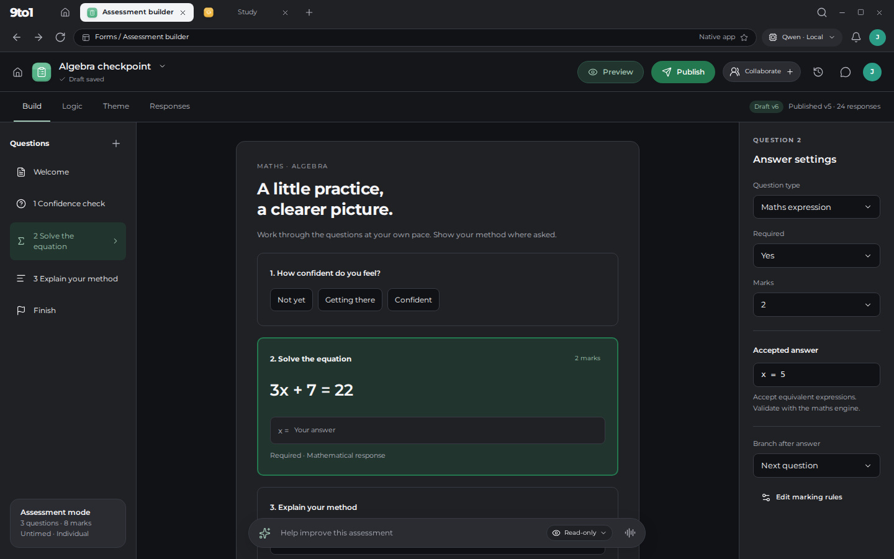
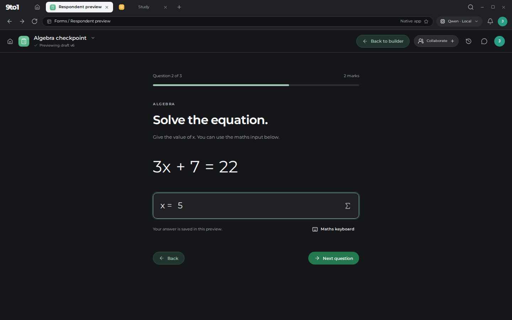

# Forms — builder, logic and responses

Module ID: `forms` · 9to1 Development Specification v3

## Prerequisites

- **CUI, themes and shared interaction system** — Typed UI components, theme tokens/materials, layout, focus, motion, accessibility and shared control states.
- **Artifacts, local persistence and recovery** — Canonical artifacts, revisions, typed edits, local saves, derived exports, sync and recovery.
- **Permissions, approvals and execution scope** — Effective scoped grants, action approvals, policy intersections, revocation and audit.
- **Node Editor — shared graph framework** — Shared typed graph schemas, editing/validation, draft activation and runtime presentation.

## Overview

Forms provides a complete question/form designer with validation, branching and response review. Study and Play may reuse canonical Forms artifacts rather than creating incompatible quiz stores.

## Layouts & visible states

- **V3-FORMS-LAY-01** — Show question outline, authored form preview, selected question properties, logic/validation and response/results views. Author, preview/test and respondent states are distinct.
- **V3-FORMS-LAY-02** — Each supported question type has real answer/constraint controls, required state and accessible labels.

## Features & behaviour

- **V3-FORMS-FEA-01** — Add/reorder/duplicate questions and sections, configure answer types, constraints, defaults, branching and scoring where supported.
- **V3-FORMS-FEA-02** — Validate conditions and regular expressions safely; offer an actual tester with sample input and clear result/error. A configured condition must resolve against stable question IDs.
- **V3-FORMS-FEA-03** — Publishing/collecting responses uses defined audience/access and version behaviour. Preview/sample submissions are labelled and not silently counted as real responses.

## Canonical entities & persistence

- **V3-FORMS-ENT-01** — Persist FormID, question/section IDs, schema/revision, logic rules, published version, response/attempt IDs and provenance.
- **V3-FORMS-ENT-02** — Separate author draft from respondent answers and per-attempt progress.

## Permissions & recovery

- **V3-FORMS-PER-01** — Respect response privacy and sharing scope. Changing a published form handles existing submissions/version compatibility explicitly.
- **V3-FORMS-PER-02** — Invalid logic or validation must not activate; failed submission offers retry without duplicate recorded responses.

## Acceptance checks

- **V3-FORMS-ACC-01** — Test builder→preview→publish/eligible response→results, question constraints, branch rule and invalid regex.
- **V3-FORMS-ACC-02** — Verify canonical reuse in Study/Play, keyboard accessibility and interruption/retry without duplicate response.

## Exact mock-up and state map

- **Forms · Assessment builder** — screen `forms`. Builder.
- **Forms · Respondent preview** — screen `forms-preview`. Interaction state.

## Source clause IDs

UX27-OTHER-005

## Technical reading map

- Forms — builder, logic and responses — Forms; Product role and runtime principle (part 01) — `technical/forms-01.md` (4,322 words; V2-B1684).
- Forms — builder, logic and responses — Forms authoring and respondent mode (part 02) — `technical/forms-02.md` (112 words; V2-B2297, V2-B2298, V2-B2299).

Technical clauses retain APIs, data models, platform, recovery, donor and acceptance details. The technical files are part of this module, not optional background reading. Shared prerequisites mean stable service/interface contracts must be available; they do not require every dependent app UI to be complete. Use the named chunk for the relevant subtask or the complete module file for its full retained contract.

# Retained technical requirements

# Forms — builder, logic and responses — Forms; Product role and runtime principle (part 01)

Reading status: active retained clauses, subject to the v3 owner overrides listed in the primary module. Historical process instructions and replaced original wording are stored separately.

### V2-B1684 · v2 lines 8500–8725

Forms
Product role and runtime principle
9-1 Forms is the native CUI structured form, assessment, data-entry and lightweight interactive-application builder. It covers surveys, questionnaires, applications, registrations, feedback, quizzes/tests, database-entry interfaces, conversational interviews, live multiplayer quizzes and custom event-driven experiences while keeping simple forms fast to create.
The canonical result is a structured FormProject and runtime configuration, not a collection of rendered pages. Fields, pages, themes, logic, marking rules, timers, multiplayer state, Data bindings and custom mode behaviour remain typed editable state. The same semantic model is used by the builder, published runtime, AI, Automations and APIs.
Forms MUST support simple no-code creation without exposing advanced complexity by default, but the product ceiling MUST NOT be limited to the capabilities of conventional survey builders. Advanced logic, layout, assessment and multiplayer features use the same underlying canonical objects rather than separate incompatible modes.
Canonical project model
FormProject has stable FormID, ModeDefinition, FormVersions[], Pages[], Fields[], Components[], Theme, LogicGraphID where used, DataBindings[], MarkingScheme, QuestionBanks[], PublishingSettings, AccessPolicy, RuntimeSettings, CreatedAt, ModifiedAt and Revision.
Page/Section objects have stable PageID, ordered child components/fields, layout configuration, visibility rules and Revision. Field has stable FieldID, FieldType, label/help/content, response schema, required/validation state, appearance/layout state, marking configuration where applicable, Data binding where applicable and Revision.
Choice options, table columns, rubric criteria, marking rules, grading schemes, branching rules and reusable components have stable identity when independently addressable. Published runtime and stored responses reference IDs, not question text or screen coordinates.
Builder workspace and preview
The default builder provides a structured page/canvas editor, field/component palette, contextual Inspector, logic/mode controls, theme/layout controls and Preview/Test. Common tasks MUST NOT require the node editor.
Preview supports desktop, tablet, mobile and narrow embedded layouts. Interactive preview can simulate answers, validate branching, exercise marking rules, test Data bindings with safe test context and identify unreachable pages/conditions before publication.
Builder and preview operate on the same canonical FormProject. Preview MUST NOT create a separate approximation that can diverge from published behaviour.
Core field and component types
Forms supports at least short text, long text, number/decimal/currency, email, phone, date/time, duration, single choice, multiple choice, dropdown, checkbox/set, rating/scale, ranking, matrix/grid, file upload, signature where supported, person/reference picker, Data foreign-key lookup, rich text/content, image/media block, calculated/read-only field, hidden/system field, mathematical response, graph response, repeating group and table input.
Field types define canonical answer schemas rather than coercing everything to text. Validation, Data binding and marking consume the typed answer model.
Custom/reusable Form Components may contain multiple child fields and layout/logic, for example Address, Person details, Emergency contact or Rating + comment. Reusing a component preserves structured child identity rather than pasting an opaque widget.
Table input and repeating structured responses
Forms MUST provide a real TableInput field, not merely a multiple-choice grid. TableInput defines typed columns, optional fixed rows, respondent-added rows, minimum/maximum row count, required columns, per-cell/row validation, calculated columns, dropdown/reference columns, duplicate rules and Data bindings.
A table input may write multiple related Data records rather than serialising an entire table into one string. For example an expense report may submit one parent Report record plus one related Expense record per entered row.
Repeating groups provide similar semantics for card/form layouts where each repeated item has multiple fields. TableInput and repeating groups preserve stable row/item identity within a response.
Native modes: Form, Test and Quiz
Forms ships at least three first-party runtime presets built on the common Forms state/marking engine.
Form mode accepts any valid answer according to field validation. It is intended for surveys, applications, registration, feedback and general data collection. Correct/incorrect semantics are absent unless a field explicitly defines assessment behaviour.
Test mode supports correct/incorrect/partial answers, points, marking rules, grading schemes and result release. Respondents normally complete the assessment as a whole and receive score/grade/feedback according to configured release policy.
Quiz mode uses the same assessment engine but supports question-by-question evaluation/progression. After each answer the runtime may show correct/incorrect/partial state, explanation/feedback and then advance according to mode settings. A final score/grade can still be produced.
Mode semantics MUST be expressed through the common runtime/state system rather than three independent engines.
Custom modes and state-machine runtime
Advanced authors can create Custom Modes using the shared node/state system. A custom mode can define start state, question/component selection, timers, score variables, lives/attempts, branching, dialogue turns, participant state, completion conditions and result calculation.
Examples include 'answer three questions correctly as quickly as possible', adaptive difficulty, limited-lives games, interview/conversation flows, staged applications and game-show experiences.
Built-in Form/Test/Quiz behaviour SHOULD be representable as first-party presets over the same runtime concepts so custom modes do not fork core response, Data, accessibility or publishing infrastructure.
Marking engine and multiple accepted answers
Assessable fields support one or more typed MarkingRules. Rules can resolve Correct, Incorrect, Partial, NeedsReview or another configured outcome and award points according to explicit scoring policy.
Text questions can define multiple accepted correct answers. Normalised matching can optionally ignore case, trim/collapse whitespace, normalise Unicode and ignore selected punctuation/diacritics according to author settings.
Example: a question asking for the name of the central processor may accept 'CPU' and 'Central Processing Unit' as equivalent accepted answers without requiring AI.
Rules can be combined with explicit boolean logic such as AcceptedAnswer(A) OR AcceptedAnswer(B) OR Regex(C), and more complex marking flows can use the node editor where appropriate.
Regex validation and marking
Regex is supported for both response validation and marking. Authors can configure pattern, flags, explanatory label and accepted/rejected test cases.
The builder MUST include a regex tester with live example inputs, invalid-pattern diagnostics and clear indication of full-match versus partial-match semantics. Forms MUST NOT execute unbounded or unsafe regex behaviour in a way that can freeze the runtime; implementations use bounded/safe regex execution appropriate to the platform.
Regex rules remain inspectable structured MarkingRule/ValidationRule objects and can be combined with other deterministic rules.
AI, human and hybrid marking
Question-level AI marking can be enabled explicitly. AI marking uses a structured rubric with expected concepts/criteria, maximum points, optional sample correct/partial/incorrect answers, required/forbidden concepts and feedback policy. The result records awarded points, matched/missed criteria, feedback and uncertainty/review state rather than only an opaque prose verdict.
Marking mode may be deterministic automatic, mathematical/symbolic, AI, manual human or hybrid. Hybrid workflows can let deterministic rules resolve obvious answers, invoke AI for unresolved open responses and optionally require human moderation before release.
A useful default marking pipeline is deterministic accepted-answer/regex rules, then mathematical equivalence where applicable, then AI rubric evaluation only when configured and still unresolved. Authors can override this ordering.
QuestionResult records marking provenance so consequential results can show whether a mark came from exact rule, regex, symbolic maths evaluator, AI, human marker or combination.
Partial credit, grading and feedback
Assessments support points, weighted questions, partial credit, criterion/rubric scoring, optional penalties where explicitly configured and section/category subtotals.
GradingScheme maps score/percentage or configured measures to grade/band/pass state. Boundaries are structured editable rules rather than hard-coded labels.
Feedback can be configured per answer/rule/rubric criterion and released immediately, after a question, after submission, after manual review or at a configured release state.
LaTeX and visual mathematics editor
Forms MUST provide first-class mathematical authoring. MathExpression uses LaTeX-compatible canonical representation but can be edited through a visual equation editor so authors/respondents are not required to know LaTeX.
The editor supports fractions, powers/indices, roots, logarithms, trigonometry, calculus notation, sigma/product notation, vectors, matrices, inequalities, sets, piecewise expressions, probability/statistics notation, Greek/special symbols and aligned expressions where supported.
Visual and LaTeX modes edit the same expression and remain bidirectionally synchronised. Invalid LaTeX produces an explicit recoverable editing error rather than losing the prior valid expression.
MathAnswer types include numeric, algebraic expression, equation, inequality, interval, coordinate, vector, matrix, set, multiple expressions and free-working response. Numeric rules can configure exact value, absolute/percentage tolerance, significant figures, decimal places and units where applicable.
Graph plotter and graph-response questions
Forms MUST include a native mathematical graph plotter/editor for quiz/test content. Authors can define functions, equations, inequalities, points, coordinate tables, regions, axes, grid/domain/range configuration and other supported 2D graph primitives.
GraphResponse questions can ask respondents to place points, draw a line/curve, submit coordinates, enter a function/equation for plotting, identify a region or manipulate an existing graph according to declared tools.
Graph answers remain structured GraphDefinition/GraphResponse data, not screenshots. Marking compares the submitted mathematical/graph representation using configured tolerances/equivalence rules where supported.
MathExpression, GraphDefinition and related primitives SHOULD be reusable shared mathematical objects across Forms, Write, Present and other 9to1 surfaces rather than privately reinvented.
Question banks, randomisation, attempts and timing
Forms supports reusable QuestionBank objects with tags, subject/topic, difficulty, points, marking rules and other metadata. A Test/Quiz can select deterministic or random subsets subject to constraints such as minimum questions from specified categories.
Question/choice order can be randomised per participant where configured. Attempts can be unlimited, fixed-count, one-only or custom-mode controlled. Retry policies may target only incorrect questions.
Timing supports whole-assessment timers, per-question/per-section timers, countdowns, time bonus/penalty, late-submission policy and custom timer variables. Server-authoritative timing is required for multiplayer and integrity-sensitive modes.
Forms and Data bidirectional integration
Forms and Data are bidirectionally integrated through typed bindings. A form can store responses in a Data spreadsheet/table, relational table or permitted database-backed Data target while preserving field types, references, nested/repeating structures and provenance.
A FormField may bind to a stable Data TableID/FieldID rather than a physical spreadsheet column letter. Relational lookups can write foreign-key references; repeating/table input can create child/junction records where the mapping defines that behaviour.
Data may also define or evolve Form fields. Adding a compatible field to a bound Data schema can propose or automatically add an appropriate Forms field according to configured synchronisation policy. Forms changes may similarly propose/add Data fields where the binding policy permits.
Data schema synchronisation policies
Each Forms↔Data binding explicitly configures directionality: Forms→Data, Data→Forms or bidirectional. It also defines synchronisation mode such as Manual, Suggest changes, Automatic compatible changes or Strict schema binding.
Schema synchronisation MUST be migration-aware. Deleting or changing a Data field that has historical Form responses MUST NOT delete or reinterpret historical answers silently. Forms can archive/detach a field, migrate compatible data or surface a conflict according to policy.
Type changes, key/reference changes and destructive schema operations require preview of effect on field configuration, published versions, stored responses and dependent logic before commitment.
Full node editor and logic graph
Forms MUST expose the full shared 9to1 Node Graph Framework for advanced behaviour. Simple conditional logic remains available through friendly controls, but advanced authors can open the underlying Form Logic graph without creating a second incompatible rules engine.
Logic graphs have stable GraphID/NodeID/PortID identity, typed connections, grouping/comments, copy/paste/duplicate, undo/redo, validation, Draft/Published revision semantics and Dulche graph mutation through 9to1.NodeGraph.*.
Graph validation MUST detect incompatible ports, unreachable states where knowable, missing targets, cycles that would create uncontrolled update loops and client/server trust-boundary violations.
Form events, conditions and actions
Minimum Form events include FormOpened, PageEntered, FieldChanged/AnswerChanged, ValidationPassed/Failed, PageSubmitted, ResponseSaved, FormSubmitted, AnswerMarked, QuizGraded and runtime/session events defined below.
Conditions include equality/inequality, contains, numeric comparison/range, answered/unanswered, selected option, validation result, calculated value, Data lookup result, participant/user/session state and other registered typed predicates.
Actions include show/hide, enable/disable, required/optional, set/calculated value, jump to page/state, show message/content, add/remove repeating item, populate options, perform permitted Data lookup, trigger authorised Automation, mark/score, submit/block submission and custom-mode state transitions.
Security-critical validation and consequential actions MUST execute or be verified server-side; client-side visibility logic alone cannot be treated as an access-control or integrity boundary.
Appearance, theme and layout system
Forms MUST provide substantially deeper appearance control than conventional survey builders while preserving responsive accessibility. FormTheme includes typography, palette, backgrounds, surfaces/cards, borders, corner radius, shadows, spacing, content width, field/input appearance, buttons, progress/navigation, focus/error/success states and reusable design tokens.
Pages use a responsive structured layout system supporting full-width and multi-column arrangements, grid, grouped cards/panels, inline/stacked labels, compact/dense modes, hero/header regions, dividers and rich content. Layout is responsive rather than relying on arbitrary absolute positioning for ordinary form design.
Authors can configure logos, organisation branding, custom header/footer, background artwork and hosted-form identity. Custom domains/advanced branding integrate with the wider 9to1 web platform where supported.
Greater design freedom MUST NOT allow the form author to bypass minimum accessibility constraints such as semantic labels, focus order, contrast, tap targets or colour-independent state.
Reusable components and templates
Users/organisations can save reusable Form Components and FormTheme presets. Reusable components preserve structured child fields, validation, layout and optional logic while allowing controlled instance overrides.
Templates such as signup, application, event registration, feedback, quiz/test, database record editor and survey are starting configurations that produce ordinary editable FormProject state rather than locked special modes.
Publishing, versions and response compatibility
Forms has explicit Draft and Published runtime versions. Editing Draft MUST NOT mutate the currently published experience until the author publishes/activates the new version according to policy.
Every response records FormID and the FormVersionID/schema revision answered. Historical responses remain interpretable even when fields are renamed, moved, hidden or removed in later versions.
Publishing states include at least Draft, Published/Accepting responses and Closed, with optional scheduled open/close where the platform supports it. Authors configure whether in-progress respondents remain on the version they started or migrate only through explicitly safe rules.
Response model, save/resume and editing
Response has stable ResponseID, FormID/FormVersionID, responder/participant identity where known, Answer records keyed by FieldID, started/submitted timestamps, attachments, state, score/marking result where applicable, Data-write status and Revision.
Forms supports configurable draft/save-and-resume, edit-after-submit policy, response limits, duplicate-prevention policy and confirmation/next-action behaviour.
Historical answer values MUST remain attached to the field/version schema that produced them rather than being reinterpreted based only on the latest field label.
Multiplayer live-session runtime
Forms supports server-authoritative MultiplayerSession objects layered onto Form/Test/Quiz/custom modes. A LiveSession has stable SessionID, FormVersionID, hosts, Participants[], Teams[], current state/round/question, Scoreboard, timers, elimination/lives state, join policy, spectator policy, moderation state, event sequence and Revision.
Typical first-party session states include Lobby, Starting, QuestionActive, Marking/Reveal, RoundTransition and Finished, but custom modes may define richer state machines using the same runtime.
Multiplayer does not duplicate questions or marking rules. A Test/Quiz can be hosted live using its existing canonical content.
Joining, teams and host control
Live sessions support short join codes, QR/share links, CAKE ID authenticated joining, guest nickname joining where allowed, private/invite-only sessions, organisation/class restrictions, maximum participants, late-join rules and optional spectators.
Sessions support individual and team play. Team scoring/answer semantics may use one nominated answer, shared answer, majority vote, fastest member, average/aggregate scoring or custom graph-defined policy.
Host controls include participant/connection state, start/pause/advance, skip, extend time, lock joining, reveal answer, invalidate question/round, adjust score with audit history, eliminate/reinstate, remove participant, moderate names/content and end session.
Multiplayer quiz, knockout and game-show modes
A standard Multiplayer Quiz can synchronise question reveal, answer window, marking, reveal/feedback and scoreboard progression across participants.
Knockout mode supports policies such as incorrect/timeout eliminates, configurable lives, eliminate bottom N or bottom percentage, fastest N advance, cumulative threshold, team elimination, re-entry/resurrection rounds and sudden-death rules. These are structured mode parameters or logic-graph behaviour rather than hard-coded one-off UI.
Buzzer rounds support server-authoritative first-buzz ordering, answering rights, lockout/pass behaviour and host/human judging where configured.
Question presentation can be on participant devices, host/projector only, both, participant-specific or team-specific according to mode.
Conversational and interview modes
Custom modes may create turn-based conversational experiences such as job interviews, oral quizzes, panel discussions or AI quizmaster sessions. The interviewer can be an authorised human or configured AI agent; next questions may depend on prior structured answers/context.
Conversational responses are stored as structured turn/question/answer records with speaker/participant identity and optional rubric results, not only one giant transcript.
AI interviewers remain subject to configured scope, marking/review policy and disclosure requirements; human takeover/co-hosting can be supported where realtime collaboration infrastructure permits.
Multiplayer timing, reconnection and fairness
Multiplayer timing and state transitions are server-authoritative. Clients MUST NOT decide whether an answer arrived before timeout, who buzzed first, the final score or whether a participant is eliminated.
Session runtime records authoritative question-open/close and submission timestamps. Speed scoring MUST use a documented server-side policy and SHOULD avoid pretending millisecond differences are perfectly fair when network latency materially affects participants.
Reconnect preserves participant identity, submitted answers and session state according to configured reconnect policy. A short connection loss MUST NOT silently erase prior responses or create a duplicate participant.
Anti-cheat and assessment integrity
Forms MUST provide configurable anti-cheat/integrity controls, with stronger options available for Tests and live assessments while making clear that browser-based controls reduce opportunities but cannot guarantee that cheating is impossible.
Core controls include authenticated participant requirements, one active attempt/session per identity where configured, server-authoritative timers and answer locks, randomised question/choice order, question-bank variants, delayed answer/reveal policies, duplicate-session/device anomaly detection where permitted, copy/paste/context-menu restrictions where appropriate, visibility/focus-change logging or warnings where platform policy permits, per-question navigation restrictions, locked previous answers, and host moderation.
Assessment authors can configure whether focus/tab changes are ignored, logged, warned or treated as an integrity event. Such signals MUST NOT automatically prove misconduct; they are contextual evidence and may be unreliable on some platforms.
High-integrity deployments MAY integrate approved kiosk/lockdown or proctoring capabilities where separately configured, supported, legally permitted and appropriately disclosed/consented. Forms MUST NOT secretly access camera, microphone, screen or other sensitive capabilities.
Server-side validation, marking, attempt state and scoring MUST not trust client-supplied authority. Client code cannot award itself points, extend its own timer, resurrect an eliminated participant or reveal protected answers merely by modifying local state.
Question/answer payload delivery SHOULD minimise unnecessary early exposure: the runtime need not send future protected questions/correct answers to clients before they are authorised to see them.
Anti-cheat events and moderation actions are auditable, privacy-scoped and retained according to configured policy.
Live scoring and AI/human judging
Multiplayer scoring can consider correctness, partial credit, time, streak/difficulty or custom variables only when explicitly configured. ScorePolicy is structured and inspectable; speed bonuses are optional.
AI-marked questions in live modes define how asynchronous model latency interacts with progression: wait for all marks, score later, exclude AI-marked items from speed bonuses, or require human review. The runtime MUST NOT silently disadvantage a participant because one model call completed more slowly.
Human judges/hosts can accept/reject or adjust uncertain responses with an audit trail where the mode allows it.
Scoreboards and participant views
Scoreboards may show full live ranking, top N, team standings, personal position only, anonymous ranking, knockout/bracket/lives state or remain hidden until the end.
Accessibility/fairness settings can disable speed-based ranking or reduce competitive disclosure. Participant views show only state permitted by the session policy.
Privacy, abuse prevention and public access
Public forms support explicit access policy, rate limiting, abuse/spam controls, duplicate-response controls and configured CAPTCHA/challenge integration where appropriate. File uploads enforce type/size/count and malware/scanning policy through the shared storage/security layer where available.
Forms supports anonymous, link-based, CAKE ID authenticated and organisation-restricted access according to configuration. Responder identity requirements and privacy/consent text must be explicit.
Sensitive answer data is permission-scoped. Submission events MUST NOT leak response content to Automations, hosts or integrations that lack the required permission.
AI-assisted authoring, design and logic
Dulche can create forms from natural-language requirements or convert supported structured Write/Present/Data/Boards/Canvas content into Form fields/pages using canonical source objects rather than screenshots when possible.
AI can propose or modify fields, layout, themes, pages, branching, marking rubrics, question banks and logic graphs through typed Forms/NodeGraph actions. AI edits preserve FieldIDs/Data bindings where the user's intent is to reorganise rather than replace them.
Examples include 'turn this Write document into a survey', 'make this look like a university application portal', 'show a follow-up only when Other is selected' and 'reorganise this long form for mobile'.
Persistent AI bar and context
Forms hosts the global persistent Dulche AI bar. Semantic context includes FormID/FormVersionID, selected PageID/FieldID/ComponentID, field schema, layout/theme selection, Data bindings, logic graph selection, mode/state variables, marking rules, preview state and Revision.
Write-capable AI changes Forms only through typed Forms/shared-engine/NodeGraph actions and remains subject to permissions, revision control and per-action Data mutation approval when a Form operation changes linked Data.
Forms API
Forms' first-party API catalogue is exhaustive under the global API-parity rule. Minimum canonical entry points include:
9to1.Forms.CreateProject(config);
9to1.Forms.Open(formOrFileID);
9to1.Forms.AddPage(formID, config?);
9to1.Forms.AddField(formID, pageID, fieldType, config);
9to1.Forms.UpdateField(fieldID, patch);
9to1.Forms.AddTableInput(formID, pageID, config);
9to1.Forms.SetMode(formID, modeDefinition);
9to1.Forms.SetValidation(fieldID, rules);
9to1.Forms.SetMarking(fieldID, markingConfig);
9to1.Forms.CreateQuestionBank(formID, config);
9to1.Forms.AddQuestionToBank(bankID, fieldOrTemplateID);
9to1.Forms.SetTheme(formID, theme);
9to1.Forms.SetLayout(targetID, layout);
9to1.Forms.BindData(formID, bindingConfig);
9to1.Forms.SyncDataBinding(bindingID, options?);
9to1.Forms.Publish(formID, options?);
9to1.Forms.OpenResponses(formID);
9to1.Forms.CloseResponses(formID);
9to1.Forms.Submit(formVersionID, answers, context?);
9to1.Forms.Mark(responseID, options?);
9to1.Forms.CreateLiveSession(formVersionID, config);
9to1.Forms.JoinLiveSession(sessionID, participant, options?);
9to1.Forms.StartLiveSession(sessionID);
9to1.Forms.SubmitLiveAnswer(sessionID, participantID, fieldID, answer);
9to1.Forms.SetParticipantState(sessionID, participantID, patch);
9to1.Forms.AdvanceLiveSession(sessionID, action?);
9to1.Forms.EndLiveSession(sessionID, options?);
9to1.Forms.GetResponse(responseID);
9to1.Forms.ExportResponses(formID, format, options?);
Advanced logic and custom-mode graph mutation uses 9to1.NodeGraph.* where the shared Node Graph Framework is canonical. Data, Files, identity and other shared-domain operations use their owning namespaces when canonical.
Automation and typed events
Automations, Spaces, Dulche and authorised integrations can consume typed Forms events subject to permissions. Useful events include FormPublished, FormOpened/Closed, ResponseStarted/Saved/Submitted/Updated, ResponseMarked, QuizGraded, DataSyncConflict, LiveSessionStarted/Ended, ParticipantJoined/Left/Reconnected, QuestionOpened/Closed, LiveAnswerSubmitted, ParticipantEliminated/Reinstated and ScoreChanged.
Events expose stable IDs and minimal required metadata. Sensitive answers/identity are included only when the consuming principal has the corresponding permission.
Accessibility
Builder and published runtime MUST be keyboard-operable and screen-reader compatible for field entry, navigation, maths editor alternatives, graph-response controls, table input, validation, quiz feedback and multiplayer participation.
Every field has semantic label/help/error association. Dynamic show/hide/focus behaviour uses accessible announcements and predictable focus management. State MUST NOT rely on colour alone.
Graph/math questions provide accessible textual/equation representations and non-pointer input paths for required operations where feasible. Multiplayer score/rank changes should not create unusable constant announcements; meaningful state updates are summarised appropriately.
Theme/layout freedom is constrained by minimum contrast, logical focus order, responsive reflow and touch-target requirements.
Performance and realtime behaviour
Published forms load only the assets/question state required for the current permitted experience. Large question banks, response sets, Data-backed option lists and multiplayer sessions use paging/streaming/cache strategies rather than unbounded client payloads.
Realtime multiplayer uses server-authoritative event sequencing and bounded fan-out/state updates. One slow participant or AI-marking task MUST NOT freeze the whole host interface.
Autosave/draft persistence is incremental and resilient to transient network loss according to configured offline/retry policy.
Recovery and failure behaviour
FormProject edits, Draft/Published versions and stored responses are crash-safe. A failed publish MUST leave the prior published version available unless explicitly withdrawn.
Response submission uses idempotency/operation identity where needed so retries do not create accidental duplicate records. Partial Forms→Data writes are detected and surfaced with recoverable state rather than falsely reporting a complete submission.
Structured failures include FormNotFound, VersionNotFound, FieldNotFound, ValidationFailed, MarkingUnavailable, MathParseError, GraphResponseInvalid, RegexInvalid, DataBindingUnavailable, DataSyncConflict, PublishFailed, ResponseClosed, DuplicateAttempt, SessionNotFound, SessionClosed, ParticipantNotFound, JoinRejected, IntegrityPolicyViolation, MultiplayerStateConflict, AIJudgeUnavailable, RevisionConflict, PermissionDenied and CapabilityUnavailable plus shared backend/provider errors.
Platform capability behaviour
Windows, 9to1-OS and web preserve the same canonical FormProject, response, mode, Data binding, graph and multiplayer-session model while capability-negotiating device features, realtime transport, identity providers, proctoring/kiosk integrations and mathematical/rendering backends.
A platform that lacks a configured capability exposes CapabilityUnavailable or a documented fallback; it MUST NOT silently change answer schema, marking or assessment-integrity semantics.
When Home is absent at process start, Forms follows the global Install Home/bootstrap contract rather than launching an incompatible private runtime.
Acceptance requirements
Forms is implementation-complete only when acceptance coverage verifies at least:
* A simple Form can be created, styled, published, completed and responses reviewed while preserving stable Form/Page/Field/Response identity.
* Form, Test and Quiz presets use the common runtime but exhibit their intended answer/marking/progression semantics.
* A custom mode built with the node editor can implement a non-standard state machine such as 'three correct answers as quickly as possible' without forking the Forms runtime.
* TableInput accepts multiple typed rows with per-column validation and can map rows to related Data records.
* A question accepts multiple deterministic correct answers such as CPU and Central Processing Unit under configured normalisation rules.
* Regex validation/marking can be tested in the builder, rejects an invalid pattern safely and applies configured full/partial-match semantics.
* AI marking uses a structured rubric, records marking provenance and can enter NeedsReview rather than fabricating certainty.
* Hybrid marking can resolve deterministic answers first and route only unresolved configured answers to AI/human review.
* A visual maths expression round-trips to LaTeX and back without losing supported structure; malformed LaTeX does not destroy the previous valid expression.
* A graph-response question stores structured graph data and can be marked against configured mathematical/coordinate criteria without relying on a screenshot.
* A Form can write responses into a Data spreadsheet/relational table while preserving types, references and nested/repeating structures.
* Data→Forms schema synchronisation can add a compatible field according to configured policy; destructive schema changes preserve historical responses and surface migration/conflict rather than silently deleting data.
* Simple conditional logic such as answer X → show question Y is configurable without nodes and is represented consistently in the advanced logic graph.
* Node validation detects a cyclic/uncontrolled update loop or invalid target without locking the published runtime.
* Theme/layout controls can produce a branded responsive multi-column form while accessibility constraints remain satisfied.
* Draft changes do not affect the currently published version until publication, and historical responses remain interpretable against the FormVersion they answered.
* A standard live multiplayer quiz synchronises question state, answer windows, scoring and reveal using server-authoritative state.
* A knockout session can eliminate participants according to configured rules and finish when its declared completion condition is met.
* Team and buzzer-style sessions preserve server-authoritative answer/buzz ordering and configured scoring semantics.
* A disconnected participant can reconnect according to policy without losing prior submitted answers or duplicating identity.
* Anti-cheat settings can randomise questions/options, enforce server-side timers/locks and log configured focus-change/integrity events without treating such signals as automatic proof of misconduct.
* Protected future questions/correct answers are not unnecessarily delivered to a participant client before authorised reveal.
* Client-side manipulation cannot self-award points, extend authoritative timers, reveal protected answers or reinstate an eliminated participant.
* Optional high-integrity integrations require explicit configuration/capability and do not secretly activate camera/microphone/screen capture.
* An AI-marked multiplayer question follows the configured latency/fairness policy and does not silently use model-response speed as participant performance.
* Forms↔Data write failures expose partial/retry state and do not falsely report submission success.
* Keyboard and screen-reader users can complete representative simple, assessment, table, maths and multiplayer workflows.
* Windows, 9to1-OS and web preserve the same canonical Forms model while capability-negotiating platform-specific realtime/integrity features.
* When Home is absent at process start, Forms follows the global Install Home/bootstrap contract.

# Forms — builder, logic and responses — Forms authoring and respondent mode (part 02)

Reading status: active retained clauses, subject to the v3 owner overrides listed in the primary module. Historical process instructions and replaced original wording are stored separately.

### V2-B2297 · v2 lines 13427–13427

### UX27-OTHER-005 — Forms authoring and respondent mode

### V2-B2298 · v2 lines 13429–13429

**B/D.** Author mode uses a structured question list/canvas and properties over stable QuestionIDs. Dragging reorders questions with insertion feedback and preserves branching/validation references. Adding a question opens appropriate settings for its type, not every possible property at once. Preview/respondent mode exercises the actual form definition without editing it; returning preserves author state.

### V2-B2299 · v2 lines 13431–13431

Required-field errors appear at the affected questions with an accessible summary/focus path. Submission succeeds only after the configured durable response write, including Data integration where required. Partial writes/retries do not duplicate responses. Assessment, maths, table and multiplayer workflows retain their full baseline semantics rather than being reduced to a simple contact form.

# Exact designs and implementation rules

These figures are the exact current atlas compositions. Their stable screen IDs match the Word specification and editable source. Open the atlas for full-size theme and interaction inspection.

## Forms · Assessment builder

Screen ID: `forms`. Source: UX27-OTHER-005; Forms structured questions, maths, publishing and responses.

- Question outline, form canvas and inspector use stable QuestionIDs; reordering preserves branching and validation.
- Draft editing never silently changes the published form. Preview runs the selected draft revision.
- Assessment mode retains mathematical inputs and marking rules, beyond ordinary survey fields.
- Publish and response export are separate actions; a response is accepted only after a durable write.

## Forms · Respondent preview

Screen ID: `forms-preview`. Source: Owner revision 28 October; UX27-OTHER-005; draft/published revision isolation.

- Respondent preview uses the selected draft revision without publishing it or creating a real submitted response.
- Question input, required validation, mathematical expression input and progress remain visible in the same form.
- Returning to Build preserves the draft; the preview never silently switches the published revision.
