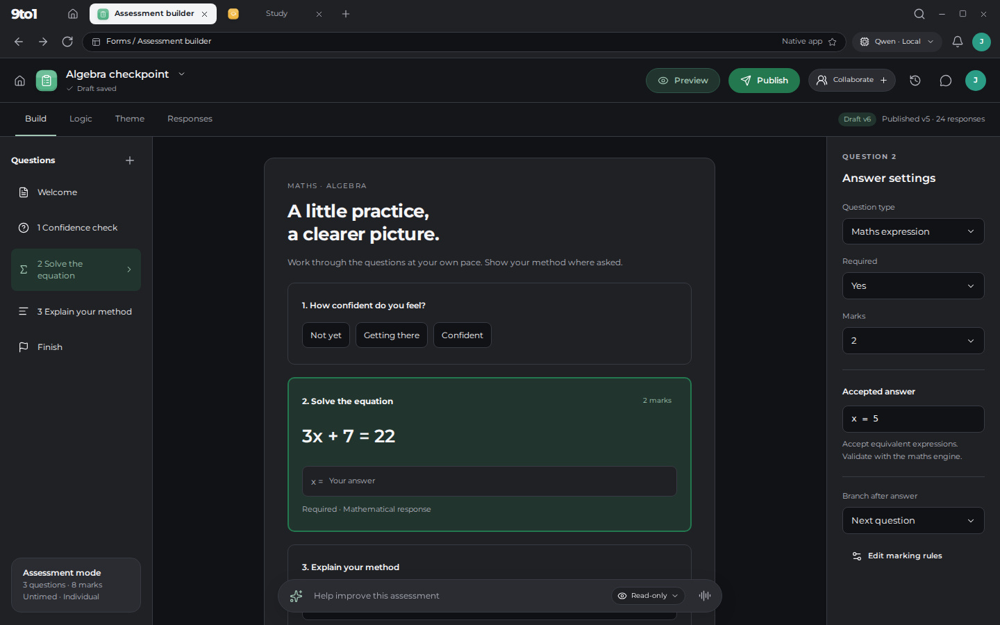
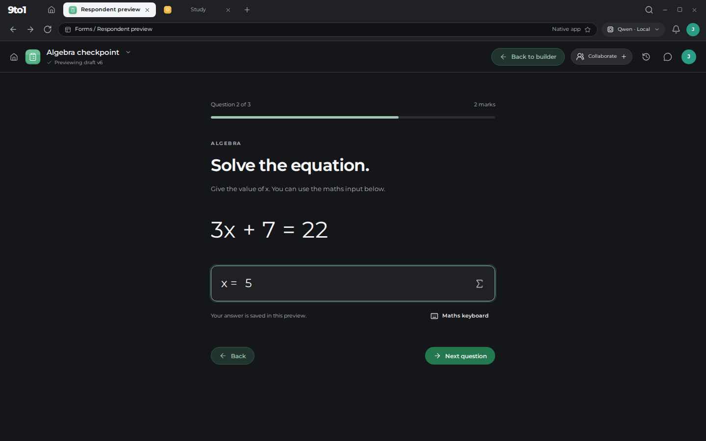

# Forms — builder, logic and responses

Module ID: `forms` · 9to1 Development Specification v3

## Prerequisites

- **CUI, themes and shared interaction system** — Typed UI components, theme tokens/materials, layout, focus, motion, accessibility and shared control states.
- **Artifacts, local persistence and recovery** — Canonical artifacts, revisions, typed edits, local saves, derived exports, sync and recovery.
- **Permissions, approvals and execution scope** — Effective scoped grants, action approvals, policy intersections, revocation and audit.
- **Node Editor — shared graph framework** — Shared typed graph schemas, editing/validation, draft activation and runtime presentation.

## Overview

Forms provides a complete question/form designer with validation, branching and response review. Study and Play may reuse canonical Forms artifacts rather than creating incompatible quiz stores.

## Layouts & visible states

- **V3-FORMS-LAY-01** — Show question outline, authored form preview, selected question properties, logic/validation and response/results views. Author, preview/test and respondent states are distinct.
- **V3-FORMS-LAY-02** — Each supported question type has real answer/constraint controls, required state and accessible labels.

## Features & behaviour

- **V3-FORMS-FEA-01** — Add/reorder/duplicate questions and sections, configure answer types, constraints, defaults, branching and scoring where supported.
- **V3-FORMS-FEA-02** — Validate conditions and regular expressions safely; offer an actual tester with sample input and clear result/error. A configured condition must resolve against stable question IDs.
- **V3-FORMS-FEA-03** — Publishing/collecting responses uses defined audience/access and version behaviour. Preview/sample submissions are labelled and not silently counted as real responses.

## Canonical entities & persistence

- **V3-FORMS-ENT-01** — Persist FormID, question/section IDs, schema/revision, logic rules, published version, response/attempt IDs and provenance.
- **V3-FORMS-ENT-02** — Separate author draft from respondent answers and per-attempt progress.

## Permissions & recovery

- **V3-FORMS-PER-01** — Respect response privacy and sharing scope. Changing a published form handles existing submissions/version compatibility explicitly.
- **V3-FORMS-PER-02** — Invalid logic or validation must not activate; failed submission offers retry without duplicate recorded responses.

## Acceptance checks

- **V3-FORMS-ACC-01** — Test builder→preview→publish/eligible response→results, question constraints, branch rule and invalid regex.
- **V3-FORMS-ACC-02** — Verify canonical reuse in Study/Play, keyboard accessibility and interruption/retry without duplicate response.

## Exact mock-up and state map

- **Forms · Assessment builder** — screen `forms`. Builder.
- **Forms · Respondent preview** — screen `forms-preview`. Interaction state.

## Source clause IDs

UX27-OTHER-005

## Technical reading map

- Forms — builder, logic and responses — Forms; Product role and runtime principle (part 01) — `technical/forms-01.md` (4,322 words; V2-B1684).
- Forms — builder, logic and responses — Forms authoring and respondent mode (part 02) — `technical/forms-02.md` (112 words; V2-B2297, V2-B2298, V2-B2299).

Technical clauses retain APIs, data models, platform, recovery, donor and acceptance details. The technical files are part of this module, not optional background reading. Shared prerequisites mean stable service/interface contracts must be available; they do not require every dependent app UI to be complete. Use the named chunk for the relevant subtask or the complete module file for its full retained contract.

# Exact designs and implementation rules

These figures are the exact current atlas compositions. Their stable screen IDs match the Word specification and editable source. Open the atlas for full-size theme and interaction inspection.

## Forms · Assessment builder

Screen ID: `forms`. Source: UX27-OTHER-005; Forms structured questions, maths, publishing and responses.

- Question outline, form canvas and inspector use stable QuestionIDs; reordering preserves branching and validation.
- Draft editing never silently changes the published form. Preview runs the selected draft revision.
- Assessment mode retains mathematical inputs and marking rules, beyond ordinary survey fields.
- Publish and response export are separate actions; a response is accepted only after a durable write.

## Forms · Respondent preview

Screen ID: `forms-preview`. Source: Owner revision 28 October; UX27-OTHER-005; draft/published revision isolation.

- Respondent preview uses the selected draft revision without publishing it or creating a real submitted response.
- Question input, required validation, mathematical expression input and progress remain visible in the same form.
- Returning to Build preserves the draft; the preview never silently switches the published revision.
