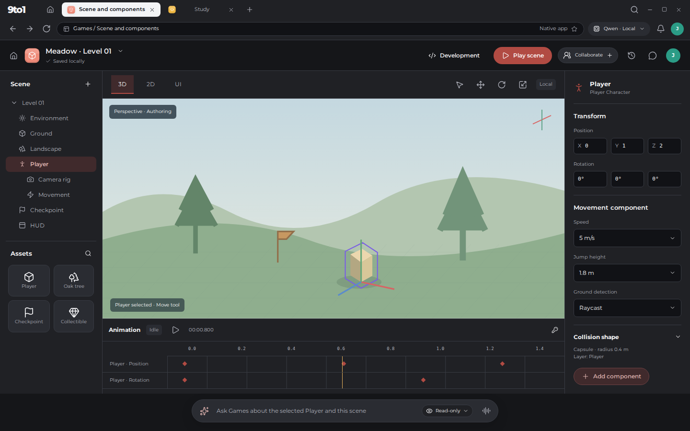

# Games — scene and runtime development

Module ID: `games` · 9to1 Development Specification v3

## Prerequisites

- **CUI, themes and shared interaction system** — Typed UI components, theme tokens/materials, layout, focus, motion, accessibility and shared control states.
- **Artifacts, local persistence and recovery** — Canonical artifacts, revisions, typed edits, local saves, derived exports, sync and recovery.
- **Permissions, approvals and execution scope** — Effective scoped grants, action approvals, policy intersections, revocation and audit.
- **Shared AI controls and artifact collaboration** — Contextual AI bars, shared model/permission controls, global collaborators and typed artifact proposals.

## Overview

Games provides the source-defined game-development environment, with scene, asset, component, animation and runtime tooling over one canonical project. Runtime play state is distinct from authored source.

## Layouts & visible states

- **V3-GAMES-LAY-01** — Use scene hierarchy, viewport, component inspector, assets and timeline/animation context. Development, Creation and Rendering workspaces are coordinated views of the same project.
- **V3-GAMES-LAY-02** — Show edit/play/runtime and debug/build/export states clearly, including selected object and active component properties.

## Features & behaviour

- **V3-GAMES-FEA-01** — Retain full scene/entity/component, asset, scripting, physics/interaction, animation, debugging and build/export capabilities from the technical contract.
- **V3-GAMES-FEA-02** — Editing controls modify source; runtime simulation changes do not automatically save back into the authored scene. Explicit apply/copy-from-runtime semantics require review where supported.
- **V3-GAMES-FEA-03** — AI work produces typed project changes and real validation/build receipts, not an invented playable preview.

## Canonical entities & persistence

- **V3-GAMES-ENT-01** — Persist ProjectID, scene/entity/component/asset IDs, source revisions, animation data and runtime/build session references.
- **V3-GAMES-ENT-02** — Generated assets and build artifacts retain provenance and selected source revision.

## Permissions & recovery

- **V3-GAMES-PER-01** — Respect project/resource and execution permissions. Unavailable engine/plugin/runtime capabilities must be reported rather than hidden.
- **V3-GAMES-PER-02** — Recover compile/runtime failures and unsaved authoring state while keeping the last valid source/build distinct.

## Acceptance checks

- **V3-GAMES-ACC-01** — Test scene selection/component edit, animation, play/stop, runtime/source separation and actual build failure/success receipts.
- **V3-GAMES-ACC-02** — Verify workspace switching preserves project identity and no runtime changes silently overwrite authoring.

## Exact mock-up and state map

- **Games · Scene and components** — screen `games`. Scene editor.

## Source clause IDs

UX27-OTHER-015

## Technical reading map

- Games — scene and runtime development — Games; Product role and ambition (part 01) — `technical/games-01.md` (3,708 words; V2-B0748).
- Games — scene and runtime development — Games and creation workspaces (part 02) — `technical/games-02.md` (107 words; V2-B2327, V2-B2328, V2-B2329).

Technical clauses retain APIs, data models, platform, recovery, donor and acceptance details. The technical files are part of this module, not optional background reading. Shared prerequisites mean stable service/interface contracts must be available; they do not require every dependent app UI to be complete. Use the named chunk for the relevant subtask or the complete module file for its full retained contract.

# Exact designs and implementation rules

These figures are the exact current atlas compositions. Their stable screen IDs match the Word specification and editable source. Open the atlas for full-size theme and interaction inspection.

## Games · Scene and components

Screen ID: `games`. Source: Games: CUI-native editor, scene graph, purposeful components; UX27-OTHER-015.

- Scene hierarchy, viewport, components and assets select the same stable object identity.
- Development and Creation/Rendering share one project. Play/test is explicit and does not overwrite authored scene state.
- The CUI Visual Builder owns game UI authoring; gameplay, material and animation graphs use appropriate registered nodes.
- The persistent AI bar receives semantic scene/project context rather than falling back to generic computer use.
