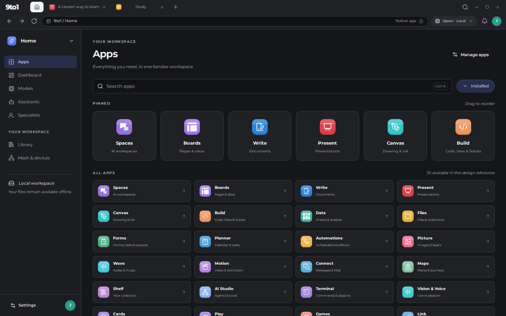
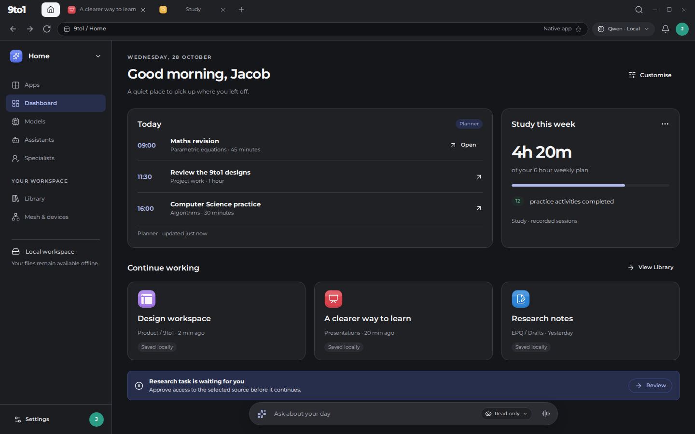
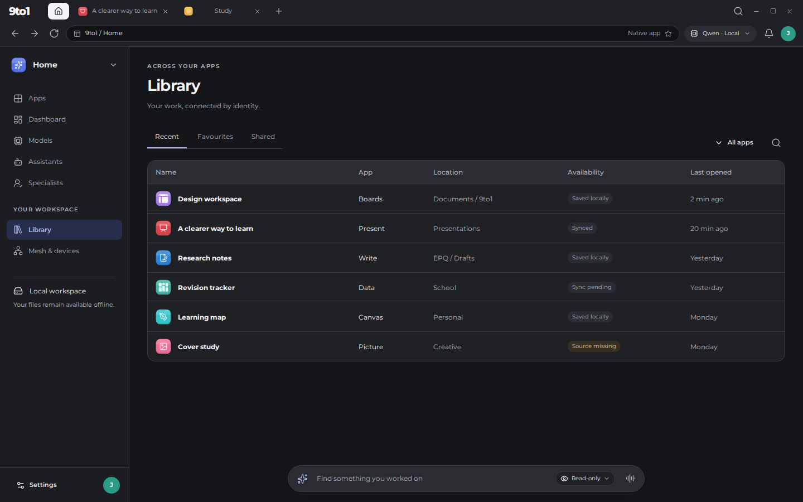
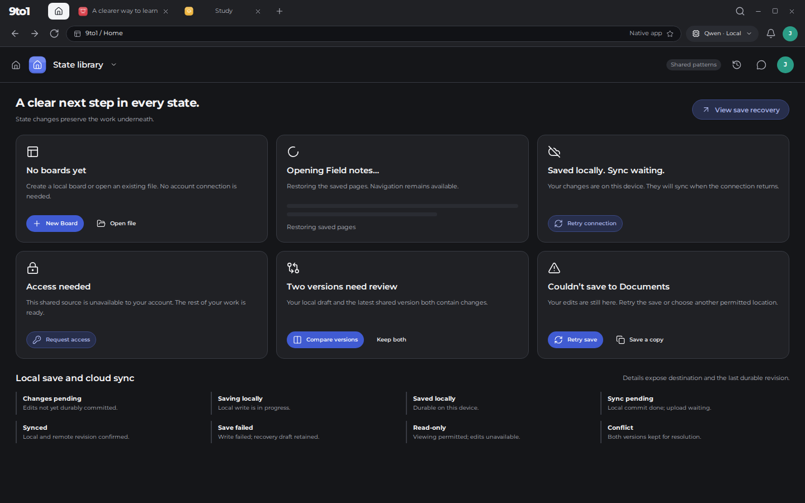

# Home — Apps, Dashboard and global systems

Module ID: `home` · 9to1 Development Specification v3

## Prerequisites

- **Platform, app registry and host integration** — Canonical app registry, artifact routes, native/browser embedding, lifecycle and semantic UI/API parity.
- **CUI, themes and shared interaction system** — Typed UI components, theme tokens/materials, layout, focus, motion, accessibility and shared control states.
- **Account, identity and resource entitlements** — Canonical CAKE account identity, secure sessions, server entitlements and resource allocation state.
- **Models, discovery and universal model routing** — Model discovery/lifecycle, stable provider capabilities, ordered routing and truthful usage/effort metadata.
- **Global Assistants, Specialists and collaborators** — Persistent global Assistant/Specialist identities, Teams, canonical conversations and editor collaboration.

## Overview

Home is the ecosystem control centre, app registry entry point and owner of shared account/preferences/capability surfaces. It exposes Apps, Dashboard, Models and the global Assistant/Specialist systems without pretending every shared service is a standalone app.

Current owner overrides: V3-OWNER-002, V3-OWNER-003, V3-OWNER-004, V3-OWNER-007, V3-OWNER-010.

## Layouts & visible states

- **V3-HOME-LAY-01** — Apps provides discoverable canonical app entries and meaningful groups/search. Dashboard surfaces genuine recent work and shared status. Models is discovery-led with Installed management alongside.
- **V3-HOME-LAY-02** — Use the house Home icon consistently. Global profile, model and Notifications controls open the same canonical services in Home and app hosts.
- **V3-HOME-LAY-03** — Keep Assistants and Specialists accessible as global destinations. Remove Events as a visible navigation destination; activity belongs to Notifications.

## Features & behaviour

- **V3-HOME-FEA-01** — Launch real registered app targets, resume canonical artifacts and show availability/installation state. Pinning/reordering is a preference change, not an app install.
- **V3-HOME-FEA-02** — Dashboard entries reference actual tasks, files, recent items and provider state. Empty/unavailable data must be honest and actionable.
- **V3-HOME-FEA-03** — Home owns common configuration for themes, models, integrations, Plugins/Skills, permissions, account and Mesh, while apps own their domain artifacts.

## Canonical entities & persistence

- **V3-HOME-ENT-01** — Persist Home navigation/pinning preferences, account/device scope and recent-item references independently from app contents.
- **V3-HOME-ENT-02** — Retain source-defined event/audit records and deep links through Notifications; removing a destination does not delete historical events.

## Permissions & recovery

- **V3-HOME-PER-01** — Check grants when opening recents or shared resources. Missing/removed targets provide safe recovery rather than a fake app preview.
- **V3-HOME-PER-02** — Manual local app access remains available when signed out or shared AI services are unavailable.

## Acceptance checks

- **V3-HOME-ACC-01** — Exercise Apps→launch→Home→recent artifact and verify target identity. Test Dashboard empty/error states, global Assistant entry and model discovery.
- **V3-HOME-ACC-02** — Search the visible navigation for Events and verify activity is available only through Notifications.

## Exact mock-up and state map

- **Home · Apps** — screen `home-apps`. App catalogue.
- **Home · Dashboard** — screen `home-dashboard`. Briefing.
- **Home · Library** — screen `home-library`. Artifact index.
- **States · Recovery and persistence reference** — screen `states`. State library.

## Source clause IDs

LE-02

## Technical reading map

- Home — Apps, Dashboard and global systems — Home; Product role and ownership (part 01) — `technical/home-01.md` (2,163 words; V2-B0404, V2-B0405, V2-B0406…).
- Home — Apps, Dashboard and global systems — Package contract and lifecycle; Spaces QOL (part 02) — `technical/home-02.md` (328 words; V2-B2182, V2-B2183).

Technical clauses retain APIs, data models, platform, recovery, donor and acceptance details. The technical files are part of this module, not optional background reading. Shared prerequisites mean stable service/interface contracts must be available; they do not require every dependent app UI to be complete. Use the named chunk for the relevant subtask or the complete module file for its full retained contract.

# Exact designs and implementation rules

These figures are the exact current atlas compositions. Their stable screen IDs match the Word specification and editable source. Open the atlas for full-size theme and interaction inspection.

## Home · Apps

Screen ID: `home-apps`. Source: UX27-HOST-001–003; Home Apps; UX27-SHARED-004–006; current screenshot as installed-layout evidence only.

- Browse is the primary 9to1 host. App and web tabs share one tab strip. Standalone apps retain the same inner shell.
- Selected tabs are light grey with dark text. Distinct filled app icons remain recognisable across themes.
- Home Apps manages real packages. Launch, installation, update and repair are different states. Uninstalling does not delete documents.
- The sample catalogue previews the suite. Build owns Code, Sites and Stacks; Assistants and Specialists are shared systems accessible from Home, editors and Spaces; Mail is inside Connect.

## Home · Dashboard

Screen ID: `home-dashboard`. Source: Home Dashboard; UX27-HOST-002; shared Dashboard tile model.

- Dashboard contains sourced widgets and briefing tiles. Chat remains a Spaces destination.
- Reordering, resizing, pinning and locking widgets have separate affordances. Generative content and generative layout are independent preferences.
- Each live tile keeps source and freshness metadata. A failed source gets an inline error, not a fictional updated value.

## Home · Library

Screen ID: `home-library`. Source: Home Library; canonical artifact identity / owner routing.

- Library indexes artifacts across apps. It does not create a second storage authority.
- Opening an item routes to its owning app and exact canonical identity. Availability and last saved state remain distinct.

## States · Recovery and persistence reference

Screen ID: `states`. Source: UX27-SHARED-014–019; UX27-BOARD-003–009; TF-02; Files sync/availability rules.

- Loading, empty, failure, offline, denied and conflict each have distinct copy, icon and meaningful next action.
- Local durability and cloud sync are independent. A pending upload never erases a Saved locally state.
- Recovery retains the existing document and unsaved draft. Retry reconciles the same operation when duplicate effects are possible.
- Permission denial never invents content or switches to another account automatically. Conflict review preserves both versions until resolved.
