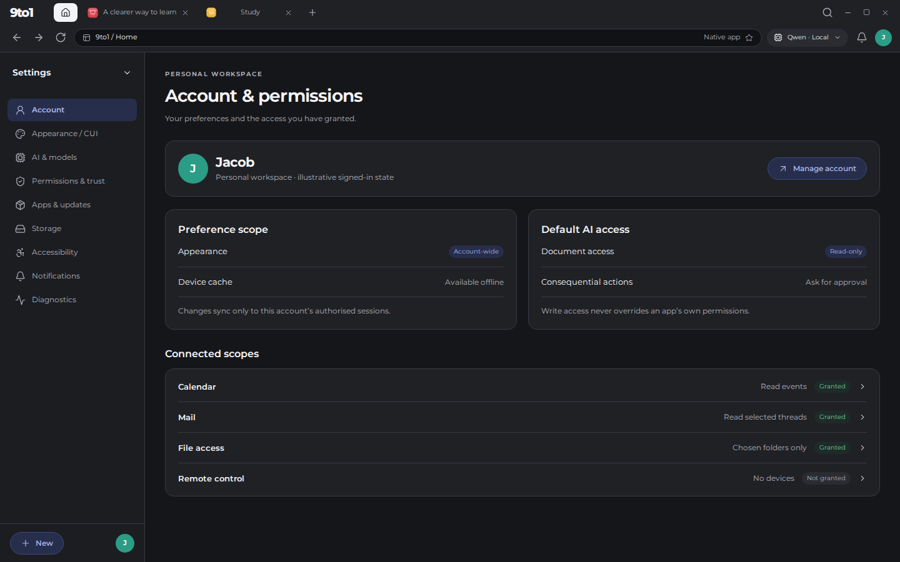
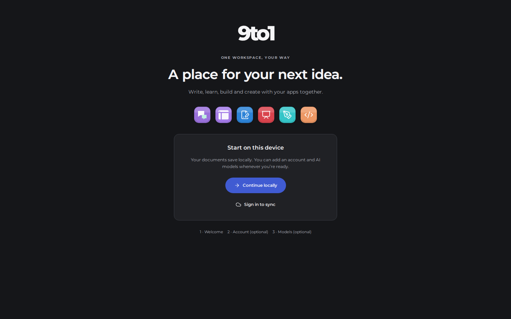

# Account, identity and resource entitlements

Module ID: `identity` · 9to1 Development Specification v3

## Prerequisites

- **Platform, app registry and host integration** — Canonical app registry, artifact routes, native/browser embedding, lifecycle and semantic UI/API parity.
- **CUI, themes and shared interaction system** — Typed UI components, theme tokens/materials, layout, focus, motion, accessibility and shared control states.
- **Privacy, data boundaries and context isolation** — Privacy scopes, consent, local/remote boundaries, source provenance, retention and revocation.

## Overview

Home owns account identity and resource subscriptions while local applications remain usable without a mandatory cloud account. Entitlements are server-authoritative resource capabilities, not arbitrary feature flags inferred from a profile name.

## Layouts & visible states

- **V3-IDENTITY-LAY-01** — Account settings show canonical identity, name, username, optional icon/pronouns/job, account state, subscription/resource allocation and secure session controls.
- **V3-IDENTITY-LAY-02** — Clearly distinguish personal and organisation scope, signed-out/local use, pending verification, active subscription, payment failure and unavailable account service.

## Features & behaviour

- **V3-IDENTITY-FEA-01** — Use CAKE authentication and the retained identity/account contracts. Required profile fields are name and username; optional fields must remain optional.
- **V3-IDENTITY-FEA-02** — Preserve named Free, Boost, Plus, Pro, Ultra, Ultra+ and Max packages and the source-defined currency/prices/resource thresholds. Do not invent unavailable allocations or derive limits from marketing labels.
- **V3-IDENTITY-FEA-03** — Apply verified reserved-account/business exceptions only to authenticated canonical account identity; a typed display name or matching username cannot grant privileges.
- **V3-IDENTITY-FEA-04** — Treat resource purchases, organisation seats and application capabilities as separate dimensions. UI estimates must not be presented as settled billing.

## Canonical entities & persistence

- **V3-IDENTITY-ENT-01** — Keep AccountID, session credentials, entitlements, plan revision and resource ledgers canonical. Store secrets in the appropriate secure credential store.
- **V3-IDENTITY-ENT-02** — Server-confirmed payment, allocation, reserve/consume/settle and webhook idempotency remain backend contracts; account UI reads their actual state.

## Permissions & recovery

- **V3-IDENTITY-PER-01** — Authenticate sensitive account operations, respect organisation policy and display revocation/session expiry honestly. A settings mock-up never performs a real purchase or account mutation.
- **V3-IDENTITY-PER-02** — Preserve local drafts and manual workflows when identity services are offline or the user signs out; recheck access before cloud sync or model use.

## Acceptance checks

- **V3-IDENTITY-ACC-01** — Test signed-out local creation, authenticated settings, profile validation, session expiry and reauthentication without losing work.
- **V3-IDENTITY-ACC-02** — Verify package/resource display against the retained server contract and prohibit privilege escalation through profile edits.

## Exact mock-up and state map

- **Home · Account & permissions** — screen `account`. Settings.
- **9to1 · Welcome** — screen `onboarding`. First run.

## Source clause IDs

BIZ-01, BIZ-02, BIZ-03, BIZ-04, BIZ-05, BIZ-06, BIZ-07, BIZ-08

## Technical reading map

- Account, identity and resource entitlements — Accounts & Subscription; CAKE ID and authentication (part 01) — `technical/identity-01.md` (2,346 words; V2-B0336, V2-B0337, V2-B0338…).
- Account, identity and resource entitlements — Business add-ons — pricing, seats and resource billing; Entitlements and usage API (part 02) — `technical/identity-02.md` (2,161 words; V2-B0365, V2-B0366, V2-B0367…).

Technical clauses retain APIs, data models, platform, recovery, donor and acceptance details. The technical files are part of this module, not optional background reading. Shared prerequisites mean stable service/interface contracts must be available; they do not require every dependent app UI to be complete. Use the named chunk for the relevant subtask or the complete module file for its full retained contract.

# Retained technical requirements

# Account, identity and resource entitlements — Accounts & Subscription; CAKE ID and authentication (part 01)

Reading status: active retained clauses, subject to the v3 owner overrides listed in the primary module. Historical process instructions and replaced original wording are stored separately.

### V2-B0336 · v2 lines 1857–1859

Accounts & Subscription
CAKE ID and authentication
CAKE ID is the shared identity used across CAKE and 9to1. A normal CAKE ID is separate from a WordPress user account; WordPress may remain linked for site administration, but ordinary 9to1 users must not need WordPress accounts.

### V2-B0337 · v2 lines 1862–1862

9to1 web apps authenticate against CAKEMODS/CAKE ID using a browser-based OAuth 2.0 Authorization Code flow with PKCE or an equivalent secure public-client flow. Desktop, web and open-source/custom clients are treated as untrusted public clients: they receive short-lived user access tokens and never contain provider keys, billing secrets or entitlement-signing secrets.

### V2-B0338 · v2 lines 1865–1865

The server is authoritative for account state, sessions, entitlements, organisation policy, Dust, storage/site quotas, billing and provider credentials. A modified or self-built client can change its own interface or features but cannot grant itself paid entitlements, bypass quotas or mint trusted usage.

### V2-B0339 · v2 lines 1868–1868

Authentication/session operations must support account sign-in/sign-out, current-user/profile lookup, active-session/device inspection and revocation. Sensitive account or billing changes use trusted CAKEMODS web flows rather than accepting raw payment credentials through the open-source client.

### V2-B0340 · v2 lines 1871–1898

9to1 welcome and first-run flow
A fresh 9to1 desktop/Home profile MUST use a short, skippable welcome flow before normal Home use. This flow is separate from the fuller 9to1-OS installer/OOBE contract and MUST NOT require a CAKE ID or local-model download in order to reach local 9to1 functionality.
Step 1 — Welcome
Show “Welcome to” with the 9to1 logo as the dominant visual and one primary Start button. The first screen SHOULD remain deliberately minimal and MUST NOT present an unrelated setup questionnaire.
Step 2 — Sign In?
Show the prompt “Sign In?” with supporting copy explaining that signing in provides access to cloud and connection features. The primary Sign In action opens the system browser at 9to1.uk/auth using the existing secure public-client authentication contract. Successful authentication MUST return the resulting authorised session to the initiating 9to1 profile without exposing provider secrets to the client. A clearly visible Not Now action continues in local-only mode without disabling otherwise eligible local functionality.
Step 3 — Local model discovery
After the sign-in decision, 9to1 MUST search the supported local-model/runtime registry for an installed model that satisfies the current minimum local-AI capability policy. If at least one eligible sufficiently current/capable local model is already available, the model-download screen is skipped.
If no eligible local model is found, show “Download Models?” with supporting copy explaining that local models provide unlimited on-device AI usage. The screen presents up to three currently recommended models as selectable model cards and shows inline download progress for active downloads. The user MAY continue without downloading a model.
The recommended-model list MUST NOT be hard-coded into the shipped client. 9to1 MUST retrieve a small versioned recommendation manifest hosted under 9to1.uk. Each recommendation identifies the intended model/source and Hugging Face download location plus the metadata required by the existing Dulche local-model verification/install path. This allows the recommended set to change without requiring a 9to1 client update. Failure to retrieve the manifest MUST degrade to an honest unavailable state rather than fabricate recommendations.
Completion and repeat behaviour
After the sign-in/model decisions are complete or skipped, continue directly into Home; no additional mandatory completion page is required. The completion state MUST persist for that profile so ordinary returning users are not shown the welcome flow again. Sign-in state, local models and equivalent settings remain manageable later through their normal Home/Settings surfaces.
Profiles — customisation and Jacob's reserved account
Profile customisation MUST include changing the display name and username through the profile/account UI and equivalent authorised APIs. Username availability, uniqueness and reservation checks MUST apply consistently across UI, APIs, registration and rename flows. Changes MUST preserve the canonical CAKE ID/UserID, ownership, history, permissions and entitlements; mutable names MUST NOT become identity or authorisation keys.
The exact handle @CroakyJake MUST be reserved exclusively for Jacob. Registration and rename flows MUST prevent other accounts from claiming it, including case variants that would bypass the reservation. The reservation MUST be bound through trusted provisioning to Jacob's verified canonical account ID, not awarded to whichever account first requests that text. Production identifiers MUST be verified rather than guessed.
Jacob's verified account MUST automatically receive all Business features free of charge, including subsequently added Business features, without requiring a paid Business subscription. This is an account-bound entitlement: changing a display name or username MUST NOT grant it to another person or remove it from Jacob. Reservation and entitlement administration MUST be privileged, auditable operations, separate from ordinary profile editing. Free Business access does not bypass security permissions or authorise third-party spending.
Profile customisation — required and optional fields
The profile editor MUST include the following fields. An asterisk (*) denotes a required field; only Name and Username are required within this field set.
Name* — REQUIRED. The user's profile/display name, extending the existing display-name customisation requirement.
Username* — REQUIRED. The user's account handle, subject to the existing availability, uniqueness and reservation rules.
Icon — OPTIONAL. The user's profile icon, which the user can add, change or remove.
Pronouns — OPTIONAL. User-provided pronouns, which the user can add, change or clear.
Job — OPTIONAL. The user's job/job title. This field is especially relevant in a Business context but MUST also be available to ordinary personal users; it MUST NOT be Business-only or mandatory for Business users.
The UI MUST visibly mark Name and Username with an asterisk and explain that * denotes required. Icon, Pronouns and Job MUST be allowed to remain unset and to be cleared without preventing an otherwise valid profile from being saved. Name and Username MUST NOT be saved as empty or whitespace-only values. Optional personal information MUST NOT be inferred or populated without the user's input.
The equivalent authorised profile APIs MUST expose the same five fields and apply the same required/optional validation rules. Partial updates MUST preserve fields omitted from the request rather than clearing them. Existing canonical account identity, ownership, permissions, username reservation and account-bound Business entitlement requirements remain unchanged, including Jacob's reserved @CroakyJake handle and free Business features.
Acceptance MUST verify that a profile can be saved with valid Name and Username while Icon, Pronouns and Job are unset; all three optional fields can subsequently be added, changed and cleared; Job is available to both personal and Business users without becoming required; blank required fields produce validation errors; and equivalent authorised API operations preserve the same behaviour and account identity.
Profile API, provisioning and acceptance
Extend the existing account/profile APIs for profile reads and partial updates, icon management and username availability. Reservation and account-bound Business-entitlement provisioning MUST remain privileged, auditable operations. APIs MUST expose the same validation as the UI, preserve omitted fields and return structured conflicts or validation failures. Ordinary clients MUST NOT self-grant Business access. Test rename without identity or ownership loss, rejected unauthorised @CroakyJake claims and case variants, and automatic free Business access for Jacob’s verified account only; security permissions and third-party spending approvals still apply.

### V2-B0341 · v2 lines 1901–1902

Subscription model
9to1 uses a preset-first subscription model with optional customisation. Subscription state has two separate dimensions: price-threshold entitlements and resource configuration. The two MUST be stored and evaluated independently.

### V2-B0342 · v2 lines 1905–1905

Price-threshold entitlements determine which feature/model/site capabilities the account unlocks as its canonical configured monthly price crosses defined thresholds. Resource configuration determines the account’s allocated quantities, including AI Dust, storage, hosted-site capacity and other metered resources.

### V2-B0343 · v2 lines 1908–1908

Named plans Free, Boost, Plus, Pro, Ultra, Ultra+ and Max serve both as threshold names and as preset configuration names. Their canonical ascending PlanLevel order is Free = 0, Boost = 1, Plus = 2, Pro = 3, Ultra = 4, Ultra+ = 5 and Max = 6. APIs, billing logic and entitlement checks MUST use stable PlanID/PlanLevel rather than inferring ordering from display names. A preset is a convenience starting configuration; the preset label MUST NOT be treated as the sole source of entitlement truth.

### V2-B0344 · v2 lines 1911–1911

Local models and core local tools are not metered through cloud AI Dust. The Free configuration MUST retain useful local/core functionality while cloud AI, hosted storage/sites and other server-funded resources remain subject to server-authoritative entitlements and quotas.

### V2-B0345 · v2 lines 1914–1914

Price thresholds

### V2-B0346 · v2 lines 1917–1917

Let EntitlementPriceMonthly be the canonical monthly price assigned by the subscription backend to the account’s current configuration. The backend MUST compute effective threshold entitlements from this value; clients MUST NOT infer them from the displayed preset name.

### V2-B0347 · v2 lines 1920–1920

Thresholds are cumulative. For every threshold T where EntitlementPriceMonthly >= T.Price, all entitlements defined by T are added to the account’s effective entitlement set. Therefore a Max-priced configuration also receives all lower-threshold grants, including Ultra grants, unless a future threshold explicitly defines a non-cumulative exception.

### V2-B0348 · v2 lines 1923–1923

Selecting a preset does not bypass threshold evaluation. If a user customises a preset and the resulting configured price crosses a different threshold, the backend MUST recalculate the effective threshold set from the resulting EntitlementPriceMonthly.

### V2-B0349 · v2 lines 1926–1933

The currently defined commercial thresholds are:
* Free — £0/month. Unlocks access to select free cloud models and unlimited local/core tools.
* Boost — £7.99/month. Entry paid cloud-AI tier. It unlocks CAKE-funded cloud models within the Boost model-cost band, benchmarked against Luna-class pricing rather than tied to one specific named model.
* Plus — £19.99/month. Adds a materially larger cloud-AI/resource allowance than Boost while retaining access to the Boost model-cost band and any other models priced within that effective band. Plus exists as the regular-use tier between Boost and Pro.
* Pro — £34.99/month. Adds a higher CAKE-funded model-cost band benchmarked against Sol-class pricing, while retaining all lower-band model access. Pro also permits materially higher cloud-AI, storage and hosted-site allocations than Plus.
* Ultra — £69.99/month. Adds the highest standard CAKE-funded model-cost band, benchmarked against Astra-class pricing, while retaining all lower-band model access.
* Ultra+ — £99.99/month. Retains at least the complete Ultra model-access set and enables materially larger cloud-AI, storage, hosted-site and concurrency allocations than Ultra.
* Max — £149.99/month. Retains at least the complete Ultra+ model-access set and enables the highest standard preset cloud-AI, storage, hosted-site and concurrency allocations. Because thresholds are cumulative, Max-priced configurations retain every lower-threshold entitlement.

### V2-B0350 · v2 lines 1936–1937

Cloud model entitlement MUST be expressed through versioned effective model-cost/capability bands rather than a permanent allow-list of model brand names. References such as Luna-class, Sol-class and Astra-class are pricing/capability benchmarks for the current commercial design, not exclusive model identities. Any CAKE-funded model whose effective provider cost and capability profile fit within the user's unlocked band may be made available, subject to provider availability, safety/privacy policy and backend configuration. Replacing a benchmark model with another comparably priced model MUST NOT require renaming the subscription tier.
OPEN: the backend still needs one canonical rule defining how temporary discounts, promotional credits, tax and non-monthly billing cadence affect EntitlementPriceMonthly. Until that rule is defined, threshold eligibility MUST be calculated only by the server and MUST NOT be reproduced locally by clients.

### V2-B0351 · v2 lines 1940–1940

Preset configurations

### V2-B0352 · v2 lines 1943–1943

Free, Boost, Plus, Pro, Ultra, Ultra+ and Max also exist as pre-made subscription configurations. A preset MUST define explicit resource values such as allocated AI Dust, storage allocation, hosted-site limits, concurrency/burst limits where applicable and any other metered resources supported by the subscription system.

### V2-B0353 · v2 lines 1946–1946

Preset configuration and threshold entitlement state MUST remain separate server-side fields. Changing resource values MAY change the configured monthly price and therefore the unlocked threshold set, but MUST NOT mutate the canonical definition of the source preset.

### V2-B0354 · v2 lines 1949–1949

A customised plan MUST retain the concrete resource values selected by the user even when those values no longer match any named preset. The UI MAY display the source preset for context, but APIs MUST return the actual resource configuration rather than reconstructing it from a tier name.

### V2-B0355 · v2 lines 1952–1952

Preset definitions MUST be versioned. Existing accounts MUST retain an auditable reference to the preset version they originally selected plus subsequent customisation state. Updating a preset definition MUST NOT silently rewrite existing subscriber allocations.

### V2-B0356 · v2 lines 1955–1955

Known preset requirements are now: Boost is £7.99/month with light cloud-AI usage, small hosted storage, a maximum of 1 full hosted site and 3 single-page sites; Plus is £19.99/month with materially higher cloud-AI usage and storage, a maximum of 3 full hosted sites and 5 single-page sites. Pro (£34.99), Ultra (£69.99), Ultra+ (£99.99) and Max (£149.99) MUST each provide materially more included cloud-AI usage, storage and hosted-site capacity than the preceding paid preset. Exact AI Dust/storage/site quantities above Plus are not yet fully specified and MUST NOT be invented.

### V2-B0357 · v2 lines 1958–1958

Canonical subscription state

### V2-B0358 · v2 lines 1961–1972

The server-authoritative subscription object MUST expose at least the following fields:
* PresetID? — stable identifier of the preset used as the starting configuration, or null when no preset applies.
* PresetVersion? — version of the referenced preset, or null when no preset applies.
* IsCustomised — true when the current resource configuration differs from the referenced preset/version.
* EntitlementPriceMonthly — canonical monthly price used for threshold evaluation.
* EffectiveThresholds — ordered list/set of all currently unlocked thresholds.
* EffectiveEntitlements — resolved feature/model/site entitlements after threshold, account and organisation-policy evaluation.
* AIDustAllocated — allocated cloud-AI Dust for the current billing/configuration period.
* StorageAllocatedBytes — storage allocation in bytes.
* HostedSiteLimit — concurrent/full hosted-site allowance.
* SinglePageSiteLimit — additional single-page-site allowance after threshold/resource evaluation.
* AdditionalResources — versioned typed object/map for future metered resources. Clients MUST ignore unknown keys they do not understand while preserving them when round-tripping configuration.

### V2-B0359 · v2 lines 1975–1975

Free hosted-site inactivity

### V2-B0360 · v2 lines 1978–1978

For a Free hosted site, inactivity takes the site offline rather than deleting it. During the first 120 days the account MUST sign in at least once every 30 days to keep the free site online. After that period, the current rule requires at least one account sign-in per year. Taking a site offline MUST NOT delete its stored site data.

### V2-B0361 · v2 lines 1981–1981

Custom resource allocation

### V2-B0362 · v2 lines 1984–1987

The custom-plan editor includes the high-level choice “What do you want to use 9to1 for?” with these profiles:
* Full Workspace (Balanced)
* Prioritise AI Limits
* Prioritise Storage & Sites Limits

### V2-B0363 · v2 lines 1990–1993

Current £10 allocation examples are:
* Balanced: 250 GB storage + 35,000 AI Dust.
* AI-priority: 25 GB storage + 65,000 AI Dust.
* Storage/Sites-priority: 500 GB storage + 15,000 AI Dust.

### V2-B0364 · v2 lines 1996–1996

The current internal allocation baseline is £1 of plan budget = 10,000 AI Dust before commercial margin/profit. The server remains authoritative for the actual commercial conversion and account balance.

# Account, identity and resource entitlements — Business add-ons — pricing, seats and resource billing; Entitlements and usage API (part 02)

Reading status: active retained clauses, subject to the v3 owner overrides listed in the primary module. Historical process instructions and replaced original wording are stored separately.

### V2-B0365 · v2 lines 1999–2020

Business add-ons — pricing, seats and resource billing
Business costs an additional USD $5 per month per organisation and supports a maximum of 50 seats. Business + costs an additional USD $15 per month per organisation and has no subscription seat cap. Neither add-on has a separate per-seat fee. Purchased AI usage/credits, storage and other funded resources remain separately configured and may be pooled or allocated individually; unlimited seats do not mean unlimited resources.
Both add-ons include 9to1 Admin and the functional Business capabilities specified below. Business + includes the Business capability set; further exclusive Business + capabilities are OPEN and MUST NOT be invented from its name. Pricing displays, quotes, invoices and entitlement APIs MUST distinguish the organisation add-on, seat capacity and resource charges. A base-resource quote in another currency MUST NOT be silently relabelled as USD; the trusted billing quote must make currency/conversion explicit.
Billing state MUST store AddOnID, add-on definition version, OrgID, seat-limit value or explicit Unlimited, effective dates and applicable account-bound grants separately from user resource configurations. No client-supplied role, username or plan label can self-grant Business. The free Business entitlement for Jacob remains governed by the Profiles subsection and does not authorise paid resource purchases or third-party spending.
Changing Business + to Business with more than 50 active members MUST require a seat-remediation preview or retain a visibly constrained pending-downgrade state; it must not silently remove users or delete shared content. Add-on cancellation and billing failure MUST have explicit entitlement/recovery states. Account-level billing, export and recovery remain available through appropriate authorised routes even when normal Business editing is unavailable. Exact grace periods, proration and suspended/pending-seat accounting remain OPEN unless defined in the canonical billing policy.
Entitlements and usage API
The subscription/account layer must expose supported first-party APIs for the information and actions available to the user, following the global API-parity rule. The core surface includes:
9to1.Account.GetCurrent();
9to1.Account.GetEntitlements();
9to1.Account.ListSessions();
9to1.Account.RevokeSession(sessionID);
9to1.Account.RevokeAllOtherSessions();
9to1.Subscription.GetPlan();
9to1.Subscription.GetUsage();
9to1.Subscription.GetDustBalance();
9to1.Subscription.GetStorageUsage();
9to1.Subscription.GetSiteUsage();
9to1.Subscription.ListPresets();
9to1.Subscription.PreviewConfiguration(config);
9to1.Subscription.OpenCheckout(config);
9to1.Subscription.OpenManage();
9to1.Subscription.GetPersonalAPIStatus();

### V2-B0366 · v2 lines 2023–2023

Billing-changing calls do not accept raw payment-card details. OpenCheckout/OpenManage hand off to an authenticated trusted CAKEMODS billing flow. Read APIs return the server-authoritative account state rather than trusting client-maintained counters.

### V2-B0367 · v2 lines 2026–2027

Server-authoritative enforcement
All paid/cloud usage is enforced server-side. The open-source client is never the authority for remaining Dust, model access, storage, site count, billing state or quotas. Custom/forked clients use the same live account entitlements and cannot bypass limits by changing local code.

### V2-B0368 · v2 lines 2030–2030

For cloud AI, the trusted gateway checks identity, organisation policy where applicable, model entitlement, hard limits and Dust before execution. Usage follows a reserve → run → settle model so concurrent requests cannot overspend the same balance. Provider keys and commercial billing logic remain server-side.

### V2-B0369 · v2 lines 2033–2033

Short-lived or one-time signed capability tokens may be used internally for narrowly scoped operations, but they do not become reusable secrets embedded in applications. Server-side storage/site operations perform the same authoritative entitlement checks.

### V2-B0370 · v2 lines 2036–2037

Personal API access
Accounts with at least 80,000 allocated AI Dust unlock Personal API access. Personal API usage consumes the same account Dust allowance as normal 9to1 cloud-AI usage; it is not a separate unlimited pool.

### V2-B0371 · v2 lines 2040–2040

Personal API access is for the account holder’s own external integrations and workflows. It is not a public-facing resale allowance and does not grant permission to redistribute CAKE provider credentials or resell the underlying service.

### V2-B0372 · v2 lines 2043–2044

Web subscription behaviour
Web and desktop clients MUST resolve account state from the same CAKE ID and entitlement service. For the same account and organisation context, plan identity, Dust balance, hosted-storage usage, site quota/usage and applicable feature entitlements MUST be consistent across official clients, subject only to explicitly documented platform capability differences.

### V2-B0373 · v2 lines 2049–2049

Where a future web feature requires material hosted compute that is not available on the free/local product - for example hosted Mini Computer virtual machines - it may be offered as a subscription-backed server capability with explicit resource limits. The browser UI must never pretend that local-only or unavailable server compute exists.

### V2-B0374 · v2 lines 2052–2081

Business features — functional specification
BIZ-01 — Organisation boundary and shared state
Business is an organisation collaboration and management capability set, not merely labels on pricing cards. It comprises Team Space and an organisation drive; organisation Connect; cross-account device Mesh; pooled or individually partitioned usage; team-wide Agents; and device-level policy controls for managed 9to1-OS Business accounts. 9to1 Admin supplies their management interface, while the existing apps retain canonical ownership of their domain data.
Every organisation-scoped operation MUST carry an explicit OrgID and authenticated membership/delegation context. Personal and organisation work remain separately identifiable in switchers, search, storage, AI context and billing. Joining an organisation MUST NOT merge personal files, chats, memories, devices or credentials into it. Moving/sharing personal material requires a deliberate authorised operation with destination ownership, access and billing impact shown. Leaving one organisation cannot revoke or destroy unrelated personal work or membership elsewhere.
BIZ-02 — Team Space and organisation drive
Each organisation MUST support a canonical shared Team Space backed by organisation-owned shared storage, not an independent copy of every member’s files. Space membership, role/group access, instructions, permitted models/tools and shared Agent bindings are managed through the existing Spaces model. Files, Pages, Boards and other app artifacts retain stable canonical IDs and their owning formats; references/embeds do not create silent forks.
The organisation drive MUST support folders, create/upload/open/edit where the owning app supports it, search, move/rename, version history, sharing/access review, archive/delete/recover and authorised export. Access may be assigned to organisation roles/groups or explicitly scoped members. Effective object access is checked by storage, search/indexing, previews, AI retrieval and exports, not just the Files UI. External sharing requires policy permission and explicit recipient/link scope; revocation must remove future server access and invalidate applicable derived access paths.
Shared-storage accounting MUST identify the owning organisation and charge canonical stored data once according to the storage policy rather than once per viewer. Access removal preserves organisation-owned artifacts and transfers responsibilities where necessary; it does not give administrators ownership of a departed member’s unrelated personal files. Restore/export workflows retain identity and permissions deliberately rather than accidentally republishing private content.
BIZ-03 — Organisation Connect
Connect MUST provide an organisation directory and scoped organisational groups/channels and contact endpoints, with role-controlled membership, creation and management. Where shared business identities or communication endpoints are configured, delegates act through named authorised roles with auditable attribution, not password sharing or undetectable impersonation. Inviting an external correspondent to communicate is distinct from making them an organisation seat or allocating paid usage.
Organisation communications MUST use Connect’s canonical conversations, contacts, calls and message identities. Agent email/call/text endpoints resolve to the same canonical team Agent and its permissions. External providers and device-backed transports require actual supported connections and credentials; provisioning paid endpoints needs separate approval. Membership or admin status does not create blanket permission to read private/E2EE content, export it to a model or bypass participant consent and retention controls.
BIZ-04 — Cross-account device Mesh
Business Mesh MUST allow explicitly authorised devices belonging to different organisation members to share supported compute/storage capabilities through Home/Mesh. Enrolment records MUST bind DeviceID, device/account owner, OrgID, verified trust/key material reference, supported capabilities, resource limits and grant expiry/revocation state. Organisation membership alone must not automatically pair a personal device or expose its files, GPU or network.
A resource grant MUST specify permitted consumers/workloads, CPU/GPU/memory/storage/concurrency budgets and permitted data locations. Job admission checks both requester permissions and the contributing device’s current policy. Data/secrets are scoped to the job and authorised endpoint; device contribution does not grant unrelated file, screen, microphone or personal-session access. Sensitive/local-only work cannot silently migrate to a different member’s device or a cloud provider without an authorised processing route.
Mesh MUST expose availability, queued/running jobs, utilisation, failure and cancellation/revocation outcomes. Revocation blocks new work and cancels or safely terminates existing work where supported; it must not claim to undo already completed actions or erase copies outside its actual control. A disconnected device remains unavailable/pending, never fictitiously running a workload. Windows and 9to1-OS expose only supported native capabilities; web can manage grants and observe jobs without pretending to supply privileged local resources.
BIZ-05 — Shared and individual usage pools
An organisation MUST be able to use a shared funded AI/resource pool or individually partition its purchased allocation by member/role. Partitioning is accounting over the same authoritative ledger, not duplicate credits. Store PoolID, source allocation, period, remaining/reserved/settled amounts, allocation owner and applicable policy. Member views show their effective allowance; authorised administrators can inspect aggregate and scoped consumption without exposing private work content.
Requests reserve capacity before execution and settle actual usage afterwards, releasing unused reservation according to the backend contract. The organisation total, individual ceiling and role ceiling all apply where configured. Parallel requests, retries and delayed provider reports MUST NOT spend the same balance twice. Changing pool mode preserves in-flight reservations and history and requires a validated allocation plan; insufficient funds or ambiguous settlement blocks unsafe transfer rather than inventing capacity.
Role-based rollover permission defined in Admin MUST be applied to eligible credit lots at rollover/expiry transitions and be visible in member balances. Changes preserve original lot provenance and settled charges. The product MUST distinguish rolled-over credits from newly purchased allocation and show the effective expiry. No personal balance is swept into an organisation pool merely because its owner joins; no organisation-funded balance becomes a departed member’s personal credit without an explicit supported transfer policy.
BIZ-06 — Team-wide Agents
A team Agent is a canonical Dulche Agent with organisation ownership/scope and configurable discovery, invocation, authoring and administration grants. Eligible members MUST be able to discover and invoke it from supported Spaces/app pickers and configured Connect channels without creating separate private copies. Shared configuration and approved knowledge are distinct from per-user conversations and private memories; access to one member’s context cannot leak into another member’s response.
Agent publishing/versioning, ownership transfer, required Plugins, allowed models, tool scopes, approval boundaries, schedules, budgets and concurrency limits MUST be enforced by Dulche/Home and the owning services. An Agent cannot use its owner’s wider authority to bypass the requesting member’s restrictions unless an explicit, separately authorised delegated service capability covers that operation. Persistent scheduled work records the service principal, scope and funding source and is re-evaluated on role, policy or membership changes.
Pausing, revoking or archiving a team Agent MUST stop new authorised dispatch, preserve auditable run history and report what happened to queued/running work. Sensitive credentials remain secure references; publishing an Agent is not permission to reveal them. AI Studio, Admin and runtime surfaces all edit or reference the same Agent identity and versioned definition.
BIZ-07 — Managed 9to1-OS accounts and device policy
Business MUST provide device-level administrative controls for explicitly enrolled managed 9to1-OS Business accounts. Controls MUST cover supported app/package and Plugin installation/enablement restrictions, allowed features and Automations, required organisation/role Plugins, enforced settings, default-model/routing policy and Mesh-resource participation. Existing compatibility-framework and privileged-operation restrictions continue to apply beneath every launch surface.
The OS policy agent MUST verify policy origin/version, apply only the enrolled managed scope and report Applied, Pending, Failed, Unsupported or NonCompliant status with reasons. Local UI changes, direct API calls and alternate launch paths cannot bypass enforced settings. Offline endpoints retain their last valid policy and cannot claim a newly published policy was applied without acknowledgement. Revocation and next-contact reconciliation must be explicit.
Managed account policy is not automatic whole-device ownership. Personal users, personal artifacts and unenrolled devices remain outside the organisation’s authority. Destructive remote actions, full-device wipe, arbitrary privileged shell access and surveillance are not implicitly authorised by Business. Other operating systems may expose supported Mesh and app policy, but they must not claim complete 9to1-OS endpoint-management parity without an explicit capability implementation.
BIZ-08 — Cross-app enforcement and acceptance
Permissions, policy, membership and credit changes MUST propagate through supported authoritative services and invalidate affected cached grants before further protected server actions. Published configuration, delivered configuration and acknowledged enforcement remain different states. Long-running rollout, export and reassignment use resumable jobs with per-target results. Downgrade, service outage or partial rollout must preserve data and fail closed for newly unauthorised actions.
Acceptance MUST demonstrate a shared artifact edited through two apps without forking; denied access absent from search, preview and AI context; organisation Connect without access to personal messages; explicit two-account Mesh enrolment, bounded execution and revocation; shared-pool concurrency and individual ceilings; role-dependent rollover; a team Agent that cannot leak another member’s private context; and OS restrictions enforced below UI across restart/offline/reconnect. Each feature requires equivalent authorised API coverage, persistence, accessibility, failure/recovery and actual end-to-end evidence. Inclusion on a pricing card alone is not conformance.

### V2-B0502 · v2 lines 2512–2512

Account and subscription surface

### V2-B0503 · v2 lines 2515–2515

Home MUST provide the primary native CAKE ID account/subscription surface. It displays authenticated user identity, organisation/workspace context where applicable, current configured subscription/preset source, EntitlementPriceMonthly, EffectiveThresholds, EffectiveEntitlements, AI Dust balance/allocation/usage, storage allocation/usage, site limits/usage and active sessions/devices using server-authoritative values.

### V2-B0504 · v2 lines 2518–2518

Home MUST NOT recalculate paid entitlements locally from a displayed tier label. Checkout, plan changes and sensitive billing management hand off to the trusted authenticated CAKEMODS billing flow defined by the Accounts & Subscription contract. Sign-out/session revocation actions MUST preserve local user data according to each app’s offline/storage policy rather than deleting it by default.

# Exact designs and implementation rules

These figures are the exact current atlas compositions. Their stable screen IDs match the Word specification and editable source. Open the atlas for full-size theme and interaction inspection.

## Home · Account & permissions

Screen ID: `account`. Source: Home Settings; CUI-PREF-202; account scope / trust boundaries.

- Home owns revisioned preferences. An authenticated account is authoritative; offline cache remains account-scoped.
- Changing a theme does not wipe unrelated settings. Local mode continues to support ordinary document editing.
- Permission visibility follows selected personal/organisation scope. App entitlement and role privilege are separate.

## 9to1 · Welcome

Screen ID: `onboarding`. Source: Accounts & Subscription first run; UX27-AUTH-005; LAUNCH-001–006.

- Initial setup is a standalone pre-host window. Tabs, browser address controls and the loaded app shell are absent.
- First run offers Welcome, optional sign-in and model discovery as separate steps.
- Ordinary local editing must work without an account, model, browser renderer or Files connection.
- Choosing local mode is a first-class path, not a concealed or disabled link.
