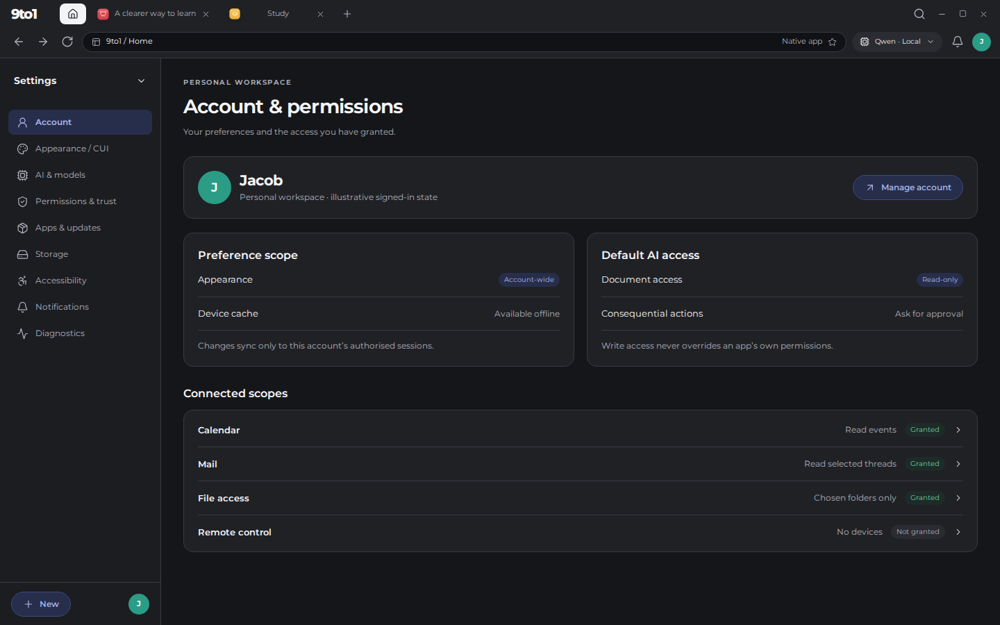
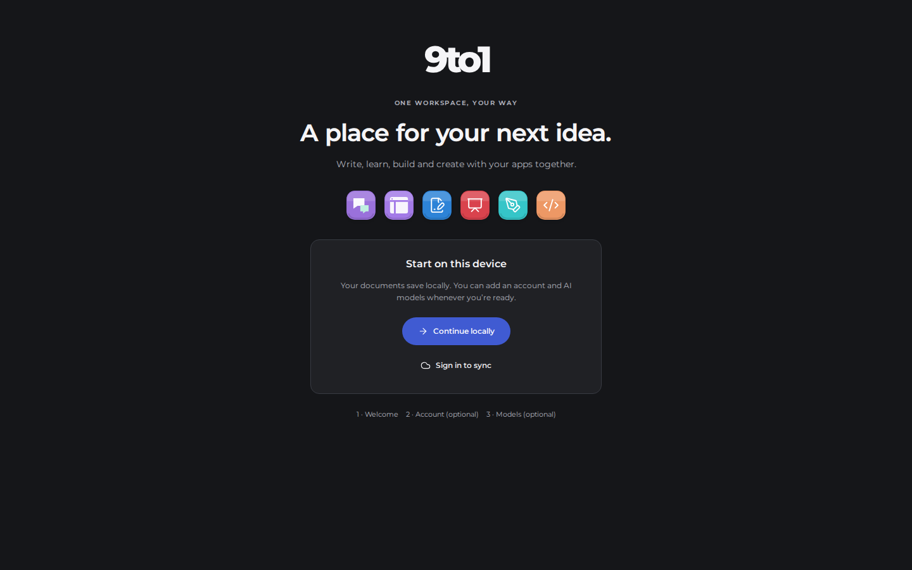

# Account, identity and resource entitlements

Module ID: `identity` · 9to1 Development Specification v3

## Prerequisites

- **Platform, app registry and host integration** — Canonical app registry, artifact routes, native/browser embedding, lifecycle and semantic UI/API parity.
- **CUI, themes and shared interaction system** — Typed UI components, theme tokens/materials, layout, focus, motion, accessibility and shared control states.
- **Privacy, data boundaries and context isolation** — Privacy scopes, consent, local/remote boundaries, source provenance, retention and revocation.

## Overview

Home owns account identity and resource subscriptions while local applications remain usable without a mandatory cloud account. Entitlements are server-authoritative resource capabilities, not arbitrary feature flags inferred from a profile name.

## Layouts & visible states

- **V3-IDENTITY-LAY-01** — Account settings show canonical identity, name, username, optional icon/pronouns/job, account state, subscription/resource allocation and secure session controls.
- **V3-IDENTITY-LAY-02** — Clearly distinguish personal and organisation scope, signed-out/local use, pending verification, active subscription, payment failure and unavailable account service.

## Features & behaviour

- **V3-IDENTITY-FEA-01** — Use CAKE authentication and the retained identity/account contracts. Required profile fields are name and username; optional fields must remain optional.
- **V3-IDENTITY-FEA-02** — Preserve named Free, Boost, Plus, Pro, Ultra, Ultra+ and Max packages and the source-defined currency/prices/resource thresholds. Do not invent unavailable allocations or derive limits from marketing labels.
- **V3-IDENTITY-FEA-03** — Apply verified reserved-account/business exceptions only to authenticated canonical account identity; a typed display name or matching username cannot grant privileges.
- **V3-IDENTITY-FEA-04** — Treat resource purchases, organisation seats and application capabilities as separate dimensions. UI estimates must not be presented as settled billing.

## Canonical entities & persistence

- **V3-IDENTITY-ENT-01** — Keep AccountID, session credentials, entitlements, plan revision and resource ledgers canonical. Store secrets in the appropriate secure credential store.
- **V3-IDENTITY-ENT-02** — Server-confirmed payment, allocation, reserve/consume/settle and webhook idempotency remain backend contracts; account UI reads their actual state.

## Permissions & recovery

- **V3-IDENTITY-PER-01** — Authenticate sensitive account operations, respect organisation policy and display revocation/session expiry honestly. A settings mock-up never performs a real purchase or account mutation.
- **V3-IDENTITY-PER-02** — Preserve local drafts and manual workflows when identity services are offline or the user signs out; recheck access before cloud sync or model use.

## Acceptance checks

- **V3-IDENTITY-ACC-01** — Test signed-out local creation, authenticated settings, profile validation, session expiry and reauthentication without losing work.
- **V3-IDENTITY-ACC-02** — Verify package/resource display against the retained server contract and prohibit privilege escalation through profile edits.

## Exact mock-up and state map

- **Home · Account & permissions** — screen `account`. Settings.
- **9to1 · Welcome** — screen `onboarding`. First run.

## Source clause IDs

BIZ-01, BIZ-02, BIZ-03, BIZ-04, BIZ-05, BIZ-06, BIZ-07, BIZ-08

## Technical reading map

- Account, identity and resource entitlements — Accounts & Subscription; CAKE ID and authentication (part 01) — `technical/identity-01.md` (2,346 words; V2-B0336, V2-B0337, V2-B0338…).
- Account, identity and resource entitlements — Business add-ons — pricing, seats and resource billing; Entitlements and usage API (part 02) — `technical/identity-02.md` (2,161 words; V2-B0365, V2-B0366, V2-B0367…).

Technical clauses retain APIs, data models, platform, recovery, donor and acceptance details. The technical files are part of this module, not optional background reading. Shared prerequisites mean stable service/interface contracts must be available; they do not require every dependent app UI to be complete. Use the named chunk for the relevant subtask or the complete module file for its full retained contract.

# Exact designs and implementation rules

These figures are the exact current atlas compositions. Their stable screen IDs match the Word specification and editable source. Open the atlas for full-size theme and interaction inspection.

## Home · Account & permissions

Screen ID: `account`. Source: Home Settings; CUI-PREF-202; account scope / trust boundaries.

- Home owns revisioned preferences. An authenticated account is authoritative; offline cache remains account-scoped.
- Changing a theme does not wipe unrelated settings. Local mode continues to support ordinary document editing.
- Permission visibility follows selected personal/organisation scope. App entitlement and role privilege are separate.

## 9to1 · Welcome

Screen ID: `onboarding`. Source: Accounts & Subscription first run; UX27-AUTH-005; LAUNCH-001–006.

- Initial setup is a standalone pre-host window. Tabs, browser address controls and the loaded app shell are absent.
- First run offers Welcome, optional sign-in and model discovery as separate steps.
- Ordinary local editing must work without an account, model, browser renderer or Files connection.
- Choosing local mode is a first-class path, not a concealed or disabled link.
