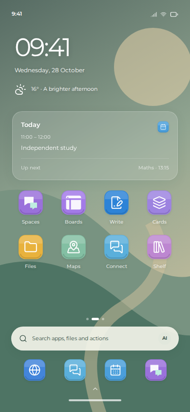

# Launcher — mobile and OS home surface

Module ID: `launcher` · 9to1 Development Specification v3

## Prerequisites

- **CUI, themes and shared interaction system** — Typed UI components, theme tokens/materials, layout, focus, motion, accessibility and shared control states.
- **Platform, app registry and host integration** — Canonical app registry, artifact routes, native/browser embedding, lifecycle and semantic UI/API parity.
- **Go, universal search and entity navigation** — Permission-aware typed search, command/entity resolution and shared Go presentation.

## Overview

Launcher is the Android/9to1OS home surface for applications, widgets, search and layout customisation. It consumes the shared package/app registry rather than building a second installer or app identity system.

## Layouts & visible states

- **V3-LAUNCHER-LAY-01** — Use a responsive home layout with app icons, dock, search and useful widgets. Respect mobile safe areas, touch targets and native navigation insets.
- **V3-LAUNCHER-LAY-02** — Show app/widget layout editing and installed/unavailable target states where relevant; do not wrap the OS launcher in browser chrome.

## Features & behaviour

- **V3-LAUNCHER-FEA-01** — Launch canonical apps, add/reorder/remove shortcuts/widgets and use shared Go/search. A removed shortcut does not uninstall the package.
- **V3-LAUNCHER-FEA-02** — Preserve source-defined home-screen pages/dock/widget capabilities and platform integration. Widgets reflect actual authorised data and lifecycle.

## Canonical entities & persistence

- **V3-LAUNCHER-ENT-01** — Persist launcher layout, page/dock positions, widget configuration and canonical app/package references by user/device.
- **V3-LAUNCHER-ENT-02** — Runtime app state and package installation belong to the owning registry/runtime.

## Permissions & recovery

- **V3-LAUNCHER-PER-01** — Respect widget/data grants and device policy. Unavailable apps offer the actual permitted install/locate/recovery path.
- **V3-LAUNCHER-PER-02** — Restore layout after restart without replaying app actions or losing user customisation.

## Acceptance checks

- **V3-LAUNCHER-ACC-01** — Test touch/keyboard launch, search, layout edit and restart persistence on narrow screens.
- **V3-LAUNCHER-ACC-02** — Verify shortcut removal, registry consistency and no browser shell on the native launcher.

## Exact mock-up and state map

- **Launcher · Mobile home** — screen `launcher`. Mobile.

## Source clause IDs

Named baseline section(s) retained in the technical-source chapters below.

## Technical reading map

- Launcher — mobile and OS home surface — Launcher; Lawnchair donor authority (part 01) — `technical/launcher-01.md` (824 words; V2-B1821).

Technical clauses retain APIs, data models, platform, recovery, donor and acceptance details. The technical files are part of this module, not optional background reading. Shared prerequisites mean stable service/interface contracts must be available; they do not require every dependent app UI to be complete. Use the named chunk for the relevant subtask or the complete module file for its full retained contract.

# Retained technical requirements

# Launcher — mobile and OS home surface — Launcher; Lawnchair donor authority (part 01)

Reading status: active retained clauses, subject to the v3 owner overrides listed in the primary module. Historical process instructions and replaced original wording are stored separately.

### V2-B1821 · v2 lines 10709–10751

Launcher
9to1 Launcher is the Android/9to1-OS home launcher. It is a maintained fork/adaptation of the latest appropriate Lawnchair source and is a distinct product from Shelf. Launcher MUST NOT be implemented as the cross-platform 9to1 package installer/updater or as the Shelf quick-access library.
Lawnchair donor authority
Lawnchair is the primary donor and mature behavioural baseline for Launcher. Applicable donor functionality and quality-of-life behaviour MUST be retained unless this specification explicitly replaces it. The goal is not merely donor parity: 9to1 Launcher is intended to be substantially more customisable than conventional Android launchers, including mature highly-customisable launchers such as Nova Launcher, while remaining coherent, performant and accessible.
Core launcher surfaces
Launcher owns the Android-style home screen, home pages, app drawer, dock, folders, widgets, app shortcuts, gestures, app discovery and visual organisation of installed applications. It consumes the authoritative installed-application/package registry owned by Home/platform package infrastructure; it does not maintain a competing package database.
* Multiple configurable home pages with drag/reorder and persistent layout.
* App drawer with configurable organisation, sorting, categories, visibility rules and search.
* Configurable dock, including size, rows/columns where supported, presentation and behaviour.
* Folders with configurable appearance, layout, ordering and appropriate actions.
* Pinned/favourite apps, hidden apps and application shortcuts/actions.
* Compatible Android widgets plus 9to1-native CUI widgets through a shared widget abstraction.
* Backup/restore of launcher layout and settings, with account/device sync where enabled and compatible.
* Full accessibility, keyboard/navigation support and appropriate touch/controller interaction.
Extreme customisation
Launcher MUST expose unusually deep customisation while preserving usable defaults. The architecture must avoid hard-coding one visual layout so additional options can be added without rewriting core launcher state.
* Grid dimensions, independent horizontal/vertical spacing, margins, page padding and icon placement behaviour.
* Icon size, icon shape/masking, per-app icon overrides, icon packs, labels, label typography and label visibility.
* Dock geometry, drawer geometry, folder geometry and home-page-specific layout configuration where supported.
* Backgrounds, transparency, blur, theme/accent integration and supported animation/transition behaviour.
* Gesture mapping including swipe, double-tap, pinch and other supported gestures, with actions resolved through typed commands rather than hard-coded donor-only behaviour.
* Per-page, per-folder and per-component presentation options where doing so remains understandable and performant.
* Import/export of launcher configuration and recoverable handling of unsupported/missing configuration after platform or donor updates.
Launcher should offer strong defaults and discoverable presets so extreme customisation does not require every user to configure dozens of controls before the launcher is usable.
Applications and stable identity
Launcher placement MUST reference stable InstalledApplication/Application IDs from the authoritative platform registry rather than raw executable/package paths. Updating an app must not destroy its home-screen placement, folder membership or configured icon unless the application's canonical identity actually changes.
Launcher can represent Android apps, 9to1-native apps and other platform-recognised application targets exposed through the OS compatibility/application registry. Package install, uninstall, update, repair, rollback and channel management remain Home/platform responsibilities. Launcher may surface status/actions such as 'update available' but delegates execution to the authoritative package service.
Widgets
9to1-native apps and extensions can register typed CUI launcher widgets with declared supported sizes, configuration surfaces, update behaviour, data permissions and actions. Compatible Android App Widgets remain supported where the Android platform layer permits them. Launcher MUST present both through a coherent placement/resizing model without pretending they share identical runtime/security semantics.
Dulche integration
Dulche is a first-class Launcher capability rather than an add-on. With user permission it can inspect and modify semantic launcher layout/configuration through typed APIs instead of simulating touch gestures.
Example requests include 'make a page for college', 'put all my games into folders', 'move Maps into the dock', 'make this page denser', 'add my upcoming events widget' or 'make a Development page with Dev, Stack and Terminal'. Dulche MUST operate on canonical launcher entities and honour the same profile, permission and package boundaries as manual actions.
Search and Go integration
Launcher can expose search/application discovery, but universal retrieval/navigation/action logic belongs to Go, which is specified under OS. Launcher search SHOULD consume Go providers/results where appropriate and render them in Launcher context rather than implementing an incompatible second system-wide index.
Profiles and OS boundaries
Launcher MUST respect Android/OS user, work-profile and application-profile boundaries. Profile-specific apps/widgets/shortcuts must retain their owning profile identity and should be visually distinguishable where confusion could cause the user to act under the wrong account or authority.
Launcher acceptance requirements
* The latest appropriate Lawnchair donor is forked/adapted and mature donor launcher behaviour is retained unless explicitly replaced.
* Launcher is the Android/9to1-OS home launcher only; Shelf remains a separate quick-access product and Home/platform services own package management.
* Home pages, app drawer, dock, folders, widgets, gestures, shortcuts, hidden apps, backup/restore and accessibility are production-capable.
* Customisation materially exceeds the donor/default Android baseline and supports deep grid, icon, folder, dock, page, theme, animation and gesture configuration without destabilising canonical launcher state.
* Dulche can safely manipulate launcher layout through typed semantic APIs.
* Application placement survives normal app updates because layout references canonical application identity rather than copied package/executable metadata.

# Exact designs and implementation rules

These figures are the exact current atlas compositions. Their stable screen IDs match the Word specification and editable source. Open the atlas for full-size theme and interaction inspection.

## Launcher · Mobile home

Screen ID: `launcher`. Source: Launcher: home pages, app drawer, dock, widgets and extreme customisation.

- Launcher owns Android-style home pages, folders, widgets, app drawer and dock. It is distinct from Shelf and Home package management.
- Grid, icon size, dock, folders, gestures and wallpaper are configurable while retaining canonical app identities.
- Touch targets remain usable. Widgets use their owning app data and declared permissions.
- Search / Go and Dulche are first-class entry points. The screen shows a saved home layout, not a fixed product-wide arrangement.
