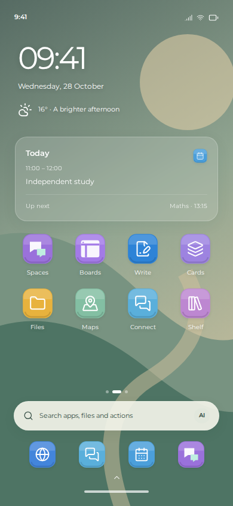

# Launcher — mobile and OS home surface

Module ID: `launcher` · 9to1 Development Specification v3

## Prerequisites

- **CUI, themes and shared interaction system** — Typed UI components, theme tokens/materials, layout, focus, motion, accessibility and shared control states.
- **Platform, app registry and host integration** — Canonical app registry, artifact routes, native/browser embedding, lifecycle and semantic UI/API parity.
- **Go, universal search and entity navigation** — Permission-aware typed search, command/entity resolution and shared Go presentation.

## Overview

Launcher is the Android/9to1OS home surface for applications, widgets, search and layout customisation. It consumes the shared package/app registry rather than building a second installer or app identity system.

## Layouts & visible states

- **V3-LAUNCHER-LAY-01** — Use a responsive home layout with app icons, dock, search and useful widgets. Respect mobile safe areas, touch targets and native navigation insets.
- **V3-LAUNCHER-LAY-02** — Show app/widget layout editing and installed/unavailable target states where relevant; do not wrap the OS launcher in browser chrome.

## Features & behaviour

- **V3-LAUNCHER-FEA-01** — Launch canonical apps, add/reorder/remove shortcuts/widgets and use shared Go/search. A removed shortcut does not uninstall the package.
- **V3-LAUNCHER-FEA-02** — Preserve source-defined home-screen pages/dock/widget capabilities and platform integration. Widgets reflect actual authorised data and lifecycle.

## Canonical entities & persistence

- **V3-LAUNCHER-ENT-01** — Persist launcher layout, page/dock positions, widget configuration and canonical app/package references by user/device.
- **V3-LAUNCHER-ENT-02** — Runtime app state and package installation belong to the owning registry/runtime.

## Permissions & recovery

- **V3-LAUNCHER-PER-01** — Respect widget/data grants and device policy. Unavailable apps offer the actual permitted install/locate/recovery path.
- **V3-LAUNCHER-PER-02** — Restore layout after restart without replaying app actions or losing user customisation.

## Acceptance checks

- **V3-LAUNCHER-ACC-01** — Test touch/keyboard launch, search, layout edit and restart persistence on narrow screens.
- **V3-LAUNCHER-ACC-02** — Verify shortcut removal, registry consistency and no browser shell on the native launcher.

## Exact mock-up and state map

- **Launcher · Mobile home** — screen `launcher`. Mobile.

## Source clause IDs

Named baseline section(s) retained in the technical-source chapters below.

## Technical reading map

- Launcher — mobile and OS home surface — Launcher; Lawnchair donor authority (part 01) — `technical/launcher-01.md` (824 words; V2-B1821).

Technical clauses retain APIs, data models, platform, recovery, donor and acceptance details. The technical files are part of this module, not optional background reading. Shared prerequisites mean stable service/interface contracts must be available; they do not require every dependent app UI to be complete. Use the named chunk for the relevant subtask or the complete module file for its full retained contract.

# Exact designs and implementation rules

These figures are the exact current atlas compositions. Their stable screen IDs match the Word specification and editable source. Open the atlas for full-size theme and interaction inspection.

## Launcher · Mobile home

Screen ID: `launcher`. Source: Launcher: home pages, app drawer, dock, widgets and extreme customisation.

- Launcher owns Android-style home pages, folders, widgets, app drawer and dock. It is distinct from Shelf and Home package management.
- Grid, icon size, dock, folders, gestures and wallpaper are configurable while retaining canonical app identities.
- Touch targets remain usable. Widgets use their owning app data and declared permissions.
- Search / Go and Dulche are first-class entry points. The screen shows a saved home layout, not a fixed product-wide arrangement.
