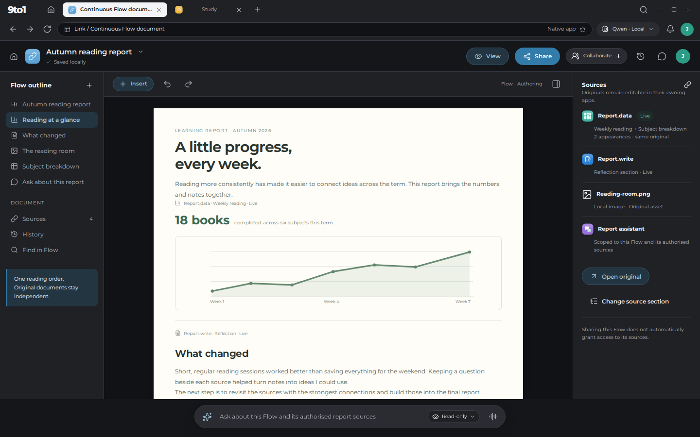
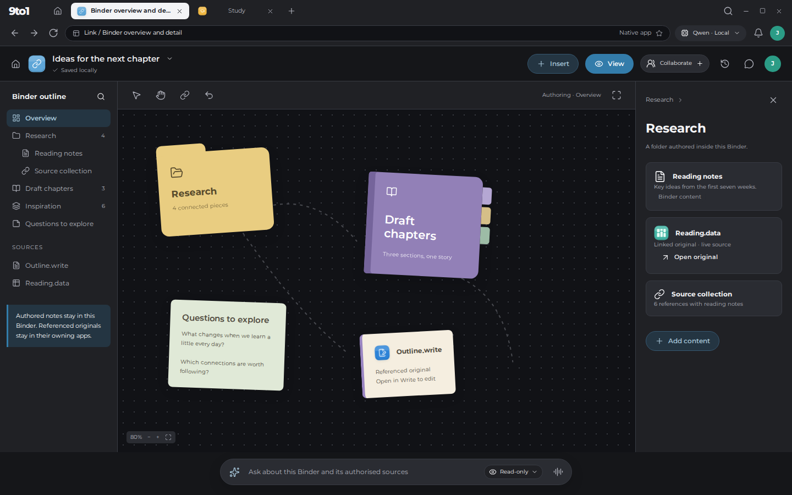
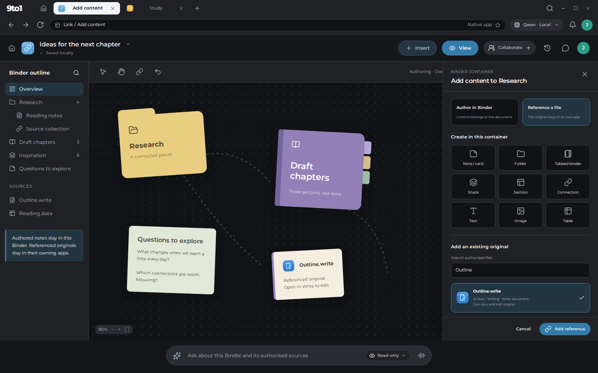
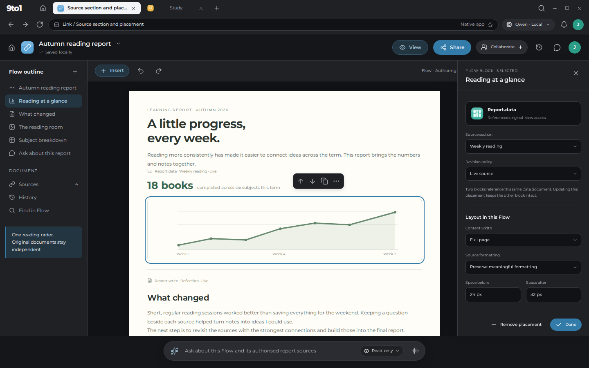

# Link — Flow and Binder

Module ID: `link` · 9to1 Development Specification v3

## Prerequisites

- **CUI, themes and shared interaction system** — Typed UI components, theme tokens/materials, layout, focus, motion, accessibility and shared control states.
- **Shared productivity engine and canonical embeds** — Real document/object engines, semantic editing, canonical app embedding and donor feature parity.
- **Artifacts, local persistence and recovery** — Canonical artifacts, revisions, typed edits, local saves, derived exports, sync and recovery.
- **Permissions, approvals and execution scope** — Effective scoped grants, action approvals, policy intersections, revocation and audit.

## Overview

Link composes canonical sources into continuous reading and authored spatial organisation. Flow and Binder are two distinct workflows, both preserving source identity and ownership.

## Layouts & visible states

- **V3-LINK-LAY-01** — Flow uses one primary continuous reading scroll with author outline and source controls; the mandatory annual-report composition spans Data, Write, image, Data and report-assistant content in sequence.
- **V3-LINK-LAY-02** — Binder provides authored nested notes/folders, binder tabs/stacks and nonlinear spatial organisation. Show add/insert and source-reference properties in context, not a generic file-manager clone.

## Features & behaviour

- **V3-LINK-FEA-01** — Flow blocks reference live or pinned source revisions with clear ownership; edit opens the correct owning surface or supported typed block editor.
- **V3-LINK-FEA-02** — Binder adds/reorders/groups references and authored local notes without moving the referenced source files. Creating a Binder folder is not creating a provider folder.
- **V3-LINK-FEA-03** — Insert controls identify source type, canonical target and live/pinned binding. Source updates/deletion/permission loss have explicit visible behaviour.

## Canonical entities & persistence

- **V3-LINK-ENT-01** — Persist Link document, Flow block and Binder item/container IDs, order/spatial coordinates, authored content, source references, live/pinned revision policy and history.
- **V3-LINK-ENT-02** — Source artifacts remain owned by Data/Write/Files/etc.; derived reading previews are not independent copies.

## Permissions & recovery

- **V3-LINK-PER-01** — Check source permission at render and open. Do not leak inaccessible cached source content; display safe unavailable state and repair/relink.
- **V3-LINK-PER-02** — Detach/remove never silently deletes or moves originals. Conflicting edits and stale pinned sources remain inspectable.

## Acceptance checks

- **V3-LINK-ACC-01** — Render the complete Data→Write→image→Data→assistant Flow with one main scroll and real source provenance.
- **V3-LINK-ACC-02** — Add/edit a Binder reference and Flow block, reopen, revoke a source and verify no source file movement/deletion.

## Exact mock-up and state map

- **Link · Continuous Flow document** — screen `link-flow`. Flow.
- **Link · Binder overview and detail** — screen `link-binder`. Binder.
- **Link Binder · Add content** — screen `link-binder-insert`. Authored objects · references.
- **Link Flow · Source section and placement** — screen `link-flow-block-edit`. Selected block · live source.

## Source clause IDs

TF-L01, TF-L02, TF-L03

## Technical reading map

- Link — Flow and Binder — Link; Link shell, documents and shared content (part 01) — `technical/link-01.md` (1,149 words; V2-B2165).

Technical clauses retain APIs, data models, platform, recovery, donor and acceptance details. The technical files are part of this module, not optional background reading. Shared prerequisites mean stable service/interface contracts must be available; they do not require every dependent app UI to be complete. Use the named chunk for the relevant subtask or the complete module file for its full retained contract.

# Retained technical requirements

# Link — Flow and Binder — Link; Link shell, documents and shared content (part 01)

Reading status: active retained clauses, subject to the v3 owner overrides listed in the primary module. Historical process instructions and replaced original wording are stored separately.

### V2-B2165 · v2 lines 12651–12669

Link
TF-L01 — Link shell, documents and shared content
Link connects work together through Flow and Binder. The launch screen and New menu MUST distinguish them by both name and preview: Flow is a continuous page; Binder is an explorable interconnected document. Creating a document asks for its type, name and Files destination. A document can itself be placed in any compatible Files organisation, opened from Spaces or included in Boards without changing its identity. Link MUST NOT offer Sheet as a third document type or use Boards as the name of Binder.
The editor MUST expose the current document type, outline/search, Insert, source management, preview/view mode, undo/redo, save/sync/history and sharing. Link-authored text, tables, images, media, drawings and other supported objects use the Shared Productivity Engine. Embedded originals use registered owning-app renderers/editors. A Sources panel lists authorised references, live/pinned policy, selected source section, availability and permission status, with Reveal placement, Change source/section and Open original actions.
Link owns its block/container structure, arrangement and directly authored information. Existing files stay independent originals. Authoring a note inside Binder does not require creating a new file; placing a Write document inside Binder does not silently import its text as Binder-owned content. The distinction MUST be visible in the inspector and destructive-action wording. Duplicate document copies its authored structure and preserves source references unless the user explicitly chooses independent source copies.
TF-L02 — Flow reading and authoring UI
Flow MUST render selected documents and other content inline in one chosen reading order, with one primary vertical scroll. It MUST not be a column of file icons, buttons to open pop-ups or permanently nested vertically scrolling document panels. The content width, typography integration and transitions MUST form a coherent page while preserving the owning source's meaningful content. Large tables may use local horizontal navigation; interactive media can retain their own controls, but normal document reading MUST remain continuous.
The author MUST have a reorderable block outline and an insertion affordance between blocks. Insert supports authorised whole documents or stable source sections, directly authored shared objects, images/media and a scoped report assistant. Each selected block shows Move, Duplicate placement, Remove, source/section selection and supported layout controls. Reordering by drag or outline commands changes only the Flow sequence. Duplicate placement can show the same original at a second point without cloning it. Source labels/chrome MUST be available on focus/selection or through the Sources panel without making the reading surface resemble a file-manager grid.
The Annual report example is mandatory: Report.data, then Report.write, then an image, then another authorised section/appearance of Report.data, then an AI assistant for questions about the report. Readers scroll through all contributions as one page. The assistant's context is the report and its authorised sources; it cannot silently search unrelated work or reveal a source the reader cannot access. AI unavailability MUST not block reading the report.
A live source change MUST update the correct block while preserving the reader's stable location as far as the underlying content permits. Explicit revision pinning MUST be visible. Missing sections, unsupported renderers, offline sources and denied access get bounded, accurately labelled placeholders without erasing the block or substituting another source. Navigation back from an original editor MUST return to the corresponding Flow position. Large documents use incremental layout/virtualisation without changing source identity or making the scrollbar repeatedly jump during ordinary reading.
Inline viewing is required for supported sources. Inline editing is available only through a safe registered owning editor, with an explicit Edit original state and ordinary source permissions, revision checks and audit. A reader with edit rights to Flow but not its source can rearrange the reference where permitted but cannot edit that source. Where embedded editing is unavailable, provide faithful read-only inline content plus Open in owning app; do not flatten, fork or invent a private editor. Formatting a Flow-owned heading MUST not unexpectedly restyle a source document.
Flow acceptance MUST build the Annual report example; use the same Data source twice with stable section selectors; edit the original through a permitted route; revoke source access; delete a referenced section; reorder and undo; reopen and resume reading; and verify a continuous primary scroll on desktop and mobile. No source copy or widened permission may be introduced by composition.
TF-L03 — Binder overview, containers and navigation
Binder is one authored interconnected document with an overview and layers of detail: one file, connected ideas, and explorable contents. Its authoring surface MUST be a freeform overview containing clickable notes, cards, physical-style folders, binders, tabs, stacks and connected sections. These are real authored document containers with nested content, not ordinary filesystem folders with decorative styling and not merely shortcuts to other files.
The palette MUST provide note/card, folder, tabbed binder, stack, section/connection and supported shared content objects. Authors can place, resize, group, layer and label objects, create/reorder tabs and stack contents, connect stable items and edit a selected container's contents. The inspector exposes title, accessible label, appearance, target/open behaviour and relevant container settings. The hierarchy/outline is searchable and supports the same add, rename, move, reorder and open operations without relying on spatial precision.
Opening a folder reveals its contained material. Opening a tabbed binder exposes named section tabs and the selected section. A stack exposes its ordered contents. A card or note can reveal writing, images, tables, audio and other supported material authored directly in Binder or referenced from an original. Containers can nest under the shared recursion safeguards. Visual physical metaphors MUST not conceal controls or require ornamental animations to finish before the content is usable; reduced motion preserves the same navigation.
Reader mode hides layout handles and authoring chrome while retaining accessible openable items, connections, breadcrumbs/Back, Close and search/outline. Closing a detail view returns to the same surrounding overview and focus. A stable item deep link opens the corresponding detail and a route back to its context. Readers choose what to explore; Binder MUST NOT force a fixed sequence or masquerade as a Paths progression system. Connections are navigation links between related parts, not an obligation to turn the document into a flowchart.
Persist stable object/container/section/tab/connection IDs, nested authored content, geometry, source references and intended overview. Reader viewport, currently open containers and selected tabs are per-user session state unless the author explicitly sets a default starting view. Deleting a Binder container previews its authored descendants; separately referenced files remain intact. Extracting authored content into another app requires an explicit owning-app create/export operation, not an implicit file for every note.
Binder acceptance MUST author a folder with rich content, a tabbed binder, a stack, a referenced original and a connection; read them in a non-linear order; close back to the same overview; find an off-canvas item through the outline; follow a deep link after rename; and open the Binder from a Sheet and as a Boards page. Directly authored information, source references and all nested content MUST survive reopen without being flattened or split into unwanted files.

# Exact designs and implementation rules

These figures are the exact current atlas compositions. Their stable screen IDs match the Word specification and editable source. Open the atlas for full-size theme and interaction inspection.

## Link · Continuous Flow document

Screen ID: `link-flow`. Source: TF-L01–02: Link shell and Flow; TF-X01.

- Flow combines inline content in one primary vertical scroll. Do not turn sources into independent scrolling panels or file cards.
- The mandatory report composition can include Data, Write, an image, another section of the same Data source and a scoped report assistant.
- References retain source identity and visible live/pinned policies. Edit original and authored Flow edits are different actions.
- Returning from an original editor restores the reader to the same Flow position. Source permission is checked independently of Flow access.

## Link · Binder overview and detail

Screen ID: `link-binder`. Source: TF-L01, TF-L03: Binder overview, authored containers and nonlinear navigation.

- Binder is one authored interconnected document. Its notes, folders, tabs and stacks contain real nested content.
- File references preserve their originals. Rearranging a Binder never moves the source file.
- Reader mode retains nonlinear open/close, breadcrumbs, Back and outline while hiding layout handles.
- Opening and closing a container restores the surrounding viewport and focus. Source editing requires separate source permission.

## Link Binder · Add content

Screen ID: `link-binder-insert`. Source: TF-L01, TF-L03; TF-X01–02.

- Binder’s palette adds real authored notes, cards, folders, tabbed binders, stacks, sections, connections and shared content objects.
- The destination is the selected Research container, identified independently from its title. Adding a source creates a reference without moving or duplicating the original file.
- Directly authored content stays within Binder. Referenced source editing is separately permissioned and uses the owning app.
- Insert, remove, reorder and nested navigation preserve stable container/item identities. Closing the palette restores the same overview and focus.

## Link Flow · Source section and placement

Screen ID: `link-flow-block-edit`. Source: TF-L01–02; TF-X01–02.

- The selected Flow block retains a canonical source and stable section identity. Live or pinned revision policy is explicit and separate from arrangement.
- Move, duplicate placement and remove operate on the Flow sequence without copying or deleting the source file.
- Flow layout permission and source-edit permission are independent. This state permits arranging the block but presents the source as view-only.
- Continuous reading and one primary scroll remain intact. A source editor opens through its own registered capability and returns to the same Flow position.
