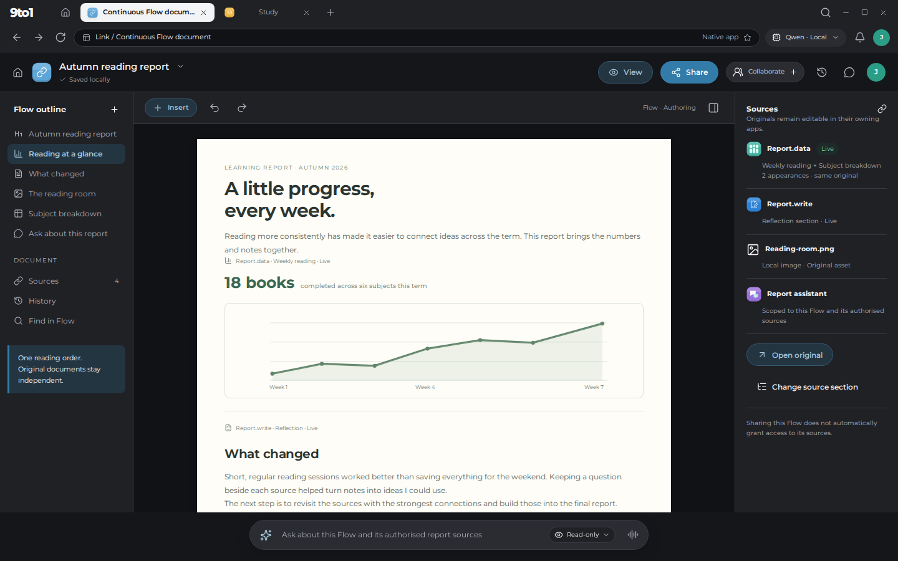
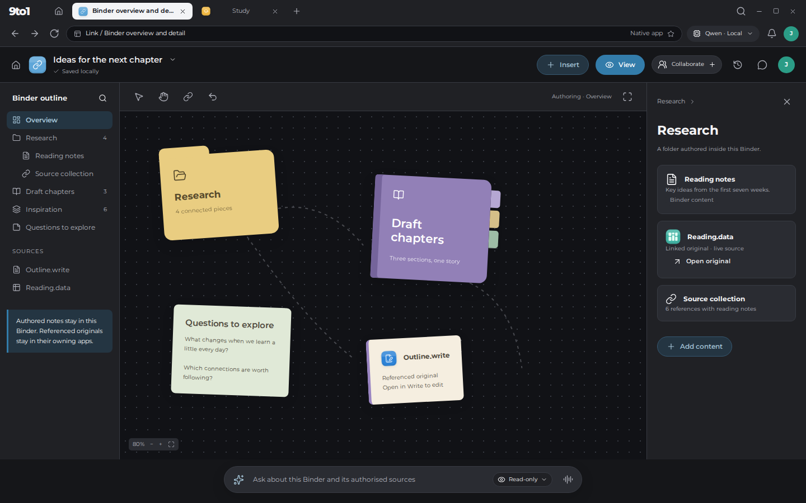
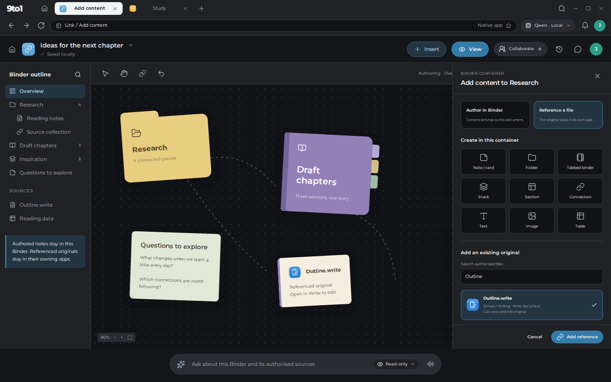
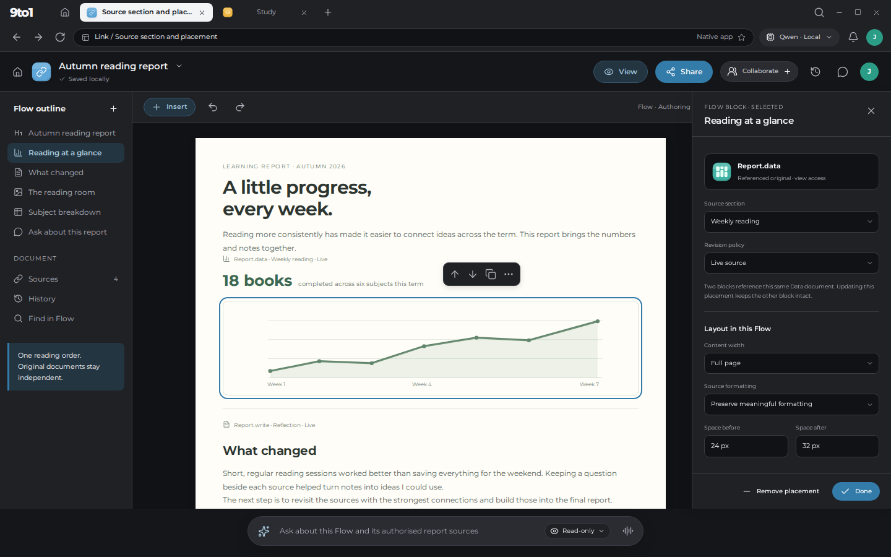

# Link — Flow and Binder

Module ID: `link` · 9to1 Development Specification v3

## Prerequisites

- **CUI, themes and shared interaction system** — Typed UI components, theme tokens/materials, layout, focus, motion, accessibility and shared control states.
- **Shared productivity engine and canonical embeds** — Real document/object engines, semantic editing, canonical app embedding and donor feature parity.
- **Artifacts, local persistence and recovery** — Canonical artifacts, revisions, typed edits, local saves, derived exports, sync and recovery.
- **Permissions, approvals and execution scope** — Effective scoped grants, action approvals, policy intersections, revocation and audit.

## Overview

Link composes canonical sources into continuous reading and authored spatial organisation. Flow and Binder are two distinct workflows, both preserving source identity and ownership.

## Layouts & visible states

- **V3-LINK-LAY-01** — Flow uses one primary continuous reading scroll with author outline and source controls; the mandatory annual-report composition spans Data, Write, image, Data and report-assistant content in sequence.
- **V3-LINK-LAY-02** — Binder provides authored nested notes/folders, binder tabs/stacks and nonlinear spatial organisation. Show add/insert and source-reference properties in context, not a generic file-manager clone.

## Features & behaviour

- **V3-LINK-FEA-01** — Flow blocks reference live or pinned source revisions with clear ownership; edit opens the correct owning surface or supported typed block editor.
- **V3-LINK-FEA-02** — Binder adds/reorders/groups references and authored local notes without moving the referenced source files. Creating a Binder folder is not creating a provider folder.
- **V3-LINK-FEA-03** — Insert controls identify source type, canonical target and live/pinned binding. Source updates/deletion/permission loss have explicit visible behaviour.

## Canonical entities & persistence

- **V3-LINK-ENT-01** — Persist Link document, Flow block and Binder item/container IDs, order/spatial coordinates, authored content, source references, live/pinned revision policy and history.
- **V3-LINK-ENT-02** — Source artifacts remain owned by Data/Write/Files/etc.; derived reading previews are not independent copies.

## Permissions & recovery

- **V3-LINK-PER-01** — Check source permission at render and open. Do not leak inaccessible cached source content; display safe unavailable state and repair/relink.
- **V3-LINK-PER-02** — Detach/remove never silently deletes or moves originals. Conflicting edits and stale pinned sources remain inspectable.

## Acceptance checks

- **V3-LINK-ACC-01** — Render the complete Data→Write→image→Data→assistant Flow with one main scroll and real source provenance.
- **V3-LINK-ACC-02** — Add/edit a Binder reference and Flow block, reopen, revoke a source and verify no source file movement/deletion.

## Exact mock-up and state map

- **Link · Continuous Flow document** — screen `link-flow`. Flow.
- **Link · Binder overview and detail** — screen `link-binder`. Binder.
- **Link Binder · Add content** — screen `link-binder-insert`. Authored objects · references.
- **Link Flow · Source section and placement** — screen `link-flow-block-edit`. Selected block · live source.

## Source clause IDs

TF-L01, TF-L02, TF-L03

## Technical reading map

- Link — Flow and Binder — Link; Link shell, documents and shared content (part 01) — `technical/link-01.md` (1,149 words; V2-B2165).

Technical clauses retain APIs, data models, platform, recovery, donor and acceptance details. The technical files are part of this module, not optional background reading. Shared prerequisites mean stable service/interface contracts must be available; they do not require every dependent app UI to be complete. Use the named chunk for the relevant subtask or the complete module file for its full retained contract.

# Exact designs and implementation rules

These figures are the exact current atlas compositions. Their stable screen IDs match the Word specification and editable source. Open the atlas for full-size theme and interaction inspection.

## Link · Continuous Flow document

Screen ID: `link-flow`. Source: TF-L01–02: Link shell and Flow; TF-X01.

- Flow combines inline content in one primary vertical scroll. Do not turn sources into independent scrolling panels or file cards.
- The mandatory report composition can include Data, Write, an image, another section of the same Data source and a scoped report assistant.
- References retain source identity and visible live/pinned policies. Edit original and authored Flow edits are different actions.
- Returning from an original editor restores the reader to the same Flow position. Source permission is checked independently of Flow access.

## Link · Binder overview and detail

Screen ID: `link-binder`. Source: TF-L01, TF-L03: Binder overview, authored containers and nonlinear navigation.

- Binder is one authored interconnected document. Its notes, folders, tabs and stacks contain real nested content.
- File references preserve their originals. Rearranging a Binder never moves the source file.
- Reader mode retains nonlinear open/close, breadcrumbs, Back and outline while hiding layout handles.
- Opening and closing a container restores the surrounding viewport and focus. Source editing requires separate source permission.

## Link Binder · Add content

Screen ID: `link-binder-insert`. Source: TF-L01, TF-L03; TF-X01–02.

- Binder’s palette adds real authored notes, cards, folders, tabbed binders, stacks, sections, connections and shared content objects.
- The destination is the selected Research container, identified independently from its title. Adding a source creates a reference without moving or duplicating the original file.
- Directly authored content stays within Binder. Referenced source editing is separately permissioned and uses the owning app.
- Insert, remove, reorder and nested navigation preserve stable container/item identities. Closing the palette restores the same overview and focus.

## Link Flow · Source section and placement

Screen ID: `link-flow-block-edit`. Source: TF-L01–02; TF-X01–02.

- The selected Flow block retains a canonical source and stable section identity. Live or pinned revision policy is explicit and separate from arrangement.
- Move, duplicate placement and remove operate on the Flow sequence without copying or deleting the source file.
- Flow layout permission and source-edit permission are independent. This state permits arranging the block but presents the source as view-only.
- Continuous reading and one primary scroll remain intact. A source editor opens through its own registered capability and returns to the same Flow position.
