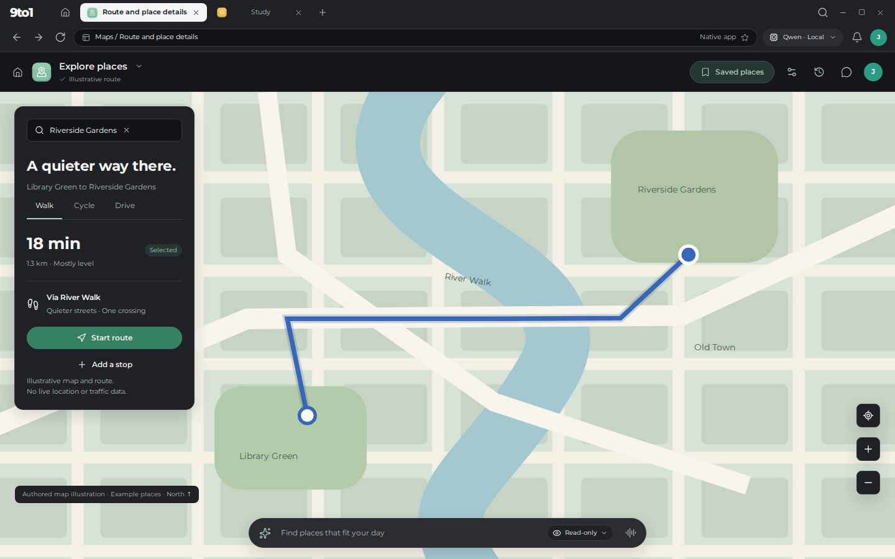
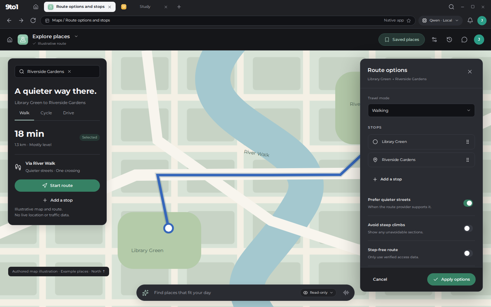

# Maps — search, places and routes

Module ID: `maps` · 9to1 Development Specification v3

## Prerequisites

- **CUI, themes and shared interaction system** — Typed UI components, theme tokens/materials, layout, focus, motion, accessibility and shared control states.
- **Permissions, approvals and execution scope** — Effective scoped grants, action approvals, policy intersections, revocation and audit.
- **External integrations and provider connections** — Canonical provider connections, OAuth scopes, typed capabilities, provenance and sync recovery.
- **Artifacts, local persistence and recovery** — Canonical artifacts, revisions, typed edits, local saves, derived exports, sync and recovery.

## Overview

Maps provides real place search, saved places, map layers and routing with explicit location permissions and truthful provider freshness/availability. AI mode assists through the same canonical map capabilities.

## Layouts & visible states

- **V3-MAPS-LAY-01** — Use a dominant map with search, source-aware result/route cards, layer/zoom controls and selected place detail.
- **V3-MAPS-LAY-02** — Keep default search versus AI mode explicit, and distinguish live location, entered origin and unknown/unavailable position.

## Features & behaviour

- **V3-MAPS-FEA-01** — Resolve place/geocode/route requests through actual providers. Show route options, units, distance/time and traffic/freshness only when grounded in provider data.
- **V3-MAPS-FEA-02** — Save canonical places/collections and open routes with clear mode/origin/destination. Do not invent travel estimates from a mock-up geometry.
- **V3-MAPS-FEA-03** — AI edits/proposals target the same map entities and preserve permission scope.

## Canonical entities & persistence

- **V3-MAPS-ENT-01** — Persist place/route/query IDs, provider references, coordinates, timestamps/freshness and saved collection membership.
- **V3-MAPS-ENT-02** — Map tiles/cache are derived; transient viewport is separate from saved places and route inputs.

## Permissions & recovery

- **V3-MAPS-PER-01** — Location capture is explicit and revocable. Cached/private location information must not leak through unrelated search or AI context.
- **V3-MAPS-PER-02** — Handle provider/network failure, ambiguous place and unsupported route mode with useful recovery.

## Acceptance checks

- **V3-MAPS-ACC-01** — Test search→place→route→save, ambiguous matches, location denied and provider failure.
- **V3-MAPS-ACC-02** — Verify freshness labels, true units and same canonical targets in default/AI mode.

## Exact mock-up and state map

- **Maps · Route and place details** — screen `maps`. Map.
- **Maps · Route options and stops** — screen `maps-route-options`. Interaction state.

## Source clause IDs

UX27-OTHER-010

## Technical reading map

- Maps — search, places and routes — Maps; Primary donor and default provider stack (part 01) — `technical/maps-01.md` (2,605 words; V2-B1820).
- Maps — search, places and routes — Maps search, pins and routes (part 02) — `technical/maps-02.md` (106 words; V2-B2312, V2-B2313, V2-B2314).

Technical clauses retain APIs, data models, platform, recovery, donor and acceptance details. The technical files are part of this module, not optional background reading. Shared prerequisites mean stable service/interface contracts must be available; they do not require every dependent app UI to be complete. Use the named chunk for the relevant subtask or the complete module file for its full retained contract.

# Retained technical requirements

# Maps — search, places and routes — Maps; Primary donor and default provider stack (part 01)

Reading status: active retained clauses, subject to the v3 owner overrides listed in the primary module. Historical process instructions and replaced original wording are stored separately.

### V2-B1820 · v2 lines 10618–10708

V3 editorial amendment: V3-OWNER-003. Original wording is preserved in the replacement ledger.

Maps
9to1 Maps is the canonical geospatial, place, landmark, routing and navigation service for the 9to1 ecosystem as well as a full user-facing CUI application. Other apps MUST consume Maps entities, APIs and embeddable CUI surfaces rather than independently inventing incompatible place, route or location models.
Primary donor and default provider stack
The primary mature donor is the latest appropriate CoMaps source. The maintained 9to1 Maps fork/adaptation MUST preserve applicable CoMaps mapping, offline-map, POI, favourites, tracks, navigation and route-planning functionality and mature quality-of-life behaviour unless this specification explicitly replaces it. CUI replaces/adapts the donor user interface without reducing the mature capability baseline.
9to1 Maps MUST separate the donor application from provider services behind typed interfaces. The default open stack is:
* OpenStreetMap data as the principal open geographic dataset.
* MapLibre Native as the default provider-facing/vector-map rendering framework where appropriate.
* The retained CoMaps-derived offline map/rendering/search/routing pipeline for mature downloadable/offline operation where it provides capability not equivalently supplied by the online stack.
* Pelias as the default self-hostable online geocoding, reverse-geocoding and place-search service.
* Valhalla as the default self-hostable routing/navigation service for supported travel modes.
* GTFS/GTFS-Realtime-compatible transit data through a typed transit provider; an OpenTripPlanner-compatible implementation may be used where appropriate.
* Traffic, satellite, terrain, street-level imagery and specialist datasets as optional provider capabilities rather than hard-coded assumptions.
The implementation MUST NOT make public OpenStreetMap community tile or public Nominatim endpoints an unlimited production dependency. Provider-specific usage, caching, attribution, redistribution and offline-storage rules MUST be enforced. 9to1-hosted/self-hosted services and user-connected providers can be substituted through the same typed provider contracts.
One provider does not need to supply every capability. Rendering, map data, geocoding, search, routing, transit, traffic, imagery and offline datasets MUST be independently replaceable where technically possible. Provider identity, provenance, freshness and required attribution MUST remain available to Maps.
Canonical geospatial entities
Maps MUST define stable canonical entities rather than allowing each app to store copied address strings. At minimum, the typed model must cover Place, Address, Coordinate, Route, RouteLeg, RouteStep, SavedPlace, PersonalLandmark, CommunityPOI, MapView, SearchResult, SearchProvider, MapProviderReference and SavedRoute/CustomJourney or equivalent strongly typed contracts.
A Place may reference one or more provider records, OpenStreetMap objects, community objects or user-authored data without making any single provider identifier the canonical 9to1 identity. Provider records are provenance references, not the primary identity of a saved 9to1 entity.
Planner, Notifications, Spaces, Boards, Write, Present, Forms, Automations and other apps MUST reference canonical Place/Route/Landmark IDs through typed APIs where a persistent location relationship is required.
Search / AI interaction
Maps MUST use the same explicit Search / AI interaction pattern established elsewhere in 9to1. Search is the default mode. The selected mode is always visible and can be switched immediately without losing the selected place, route or current map context.
Search mode performs deterministic geographic discovery and manual route construction. It must search, as applicable, addresses, postcodes, coordinates, named places, businesses/POIs, categories, saved places, PersonalLandmarks, CommunityPOIs and supported 9to1 entities with attached locations. Provider result confidence and ambiguity MUST remain visible; Maps MUST NOT fabricate an exact address or place identity from weak geocoding.
Selecting a result opens a canonical place/details surface with provenance and relevant actions such as View, Navigate, Add to route, Set as start, Set as destination, Add stop, Save, Share and other capability-appropriate actions.
AI mode is a Dulche-backed natural-language Maps interface operating the same canonical Maps state and APIs. Requests such as 'take me to the nearest Starbucks', 'find somewhere quiet to study within a 15-minute walk', 'find a bench along this route' or 'add a coffee stop halfway home' MUST be resolved through real search/location/routing capabilities rather than invented model knowledge.
A request such as 'take me to the nearest Starbucks' should resolve the permitted current location, search real place providers, rank valid candidates according to the user's request and actual route/travel distance where available, resolve the chosen candidate to a canonical Place, calculate a route and start/present navigation according to the explicit user intent. If multiple interpretations materially affect the result, Maps must present candidates or request the minimum necessary disambiguation rather than guessing.
Search and AI are interoperable. A place found manually can become AI context, and an AI-generated route/place remains a normal canonical Maps object that the user can inspect, edit, reorder, save or share manually.
Saved places and personal landmarks
Users can save ordinary provider/OpenStreetMap places and create PersonalLandmarks anywhere on the map. A PersonalLandmark does not require an existing mapped place, recognised address, road, POI or provider object; a coordinate and user-defined identity are sufficient.
Users MUST be able to drop a pin at any coordinate, name it, optionally categorise it, add notes/metadata, save it privately, share it explicitly and navigate to it. Examples include a meeting point, favourite viewpoint, shortcut entrance, personal picnic spot or a specific bench.
Common saved places such as Home, College, Church or Work are canonical SavedPlace references. Other apps resolve these references through Maps rather than retaining independent copies of the underlying address.
Personal/private landmarks are private by default. Creating a private landmark MUST NOT implicitly publish its coordinates, name, notes or category to the community database or an external provider.
Community POIs and landmark presets
Maps MUST provide a first-class community POI system so users can contribute useful hyperlocal geographic data over time. Users can choose a structured preset when dropping a pin, including extensible categories such as Bench, Bin, Recycling point, Picnic table, Picnic area, Public toilet, Drinking-water point, Bicycle parking, Bicycle repair/pump, EV charger, Bus stop, Crossing, Defibrillator, Viewpoint, Playground, Entrance, Accessible entrance, Steps, Lift, Ramp and Shelter.
Presets represent typed POI categories, not merely icons. A category can expose optional structured attributes appropriate to that object. For example, a Bench may record backrest, armrests, cover, capacity, material, accessibility or condition; a Bin may record waste/recycling type and condition. The common contribution path MUST remain fast: a user can submit a useful POI with minimal required fields and enrich it later.
Users choose explicitly between keeping a landmark private and submitting it publicly. Public submission creates or proposes a CommunityPOI in the 9to1 community geographic database; it is not the same action as contributing to OpenStreetMap.
CommunityPOI records must retain stable identity, coordinate, category, structured attributes, source/provenance, creation/update metadata, verification state, edit history, confidence/quality information and reports/flags as applicable.
The community system MUST support a quality lifecycle such as Submitted/Unverified, Community-confirmed and Verified, together with corrections such as Removed, Wrong location, Wrong category, Duplicate and Details changed. A user can confirm that an existing object is still present without recreating it.
Before creating a public POI, Maps SHOULD perform deterministic nearby duplicate detection using distance, category compatibility and known identifiers. If a likely duplicate exists, the user can confirm/update the existing object or explicitly state that the new object is distinct.
Community POIs are first-class searchable/routable destinations. Users can search for categories such as benches, bins or picnic tables, enable category layers and ask Dulche structured queries such as 'find a walking route with benches along the way'.
Where a community contribution maps cleanly to OpenStreetMap semantics, Maps MAY separately offer an explicit 'Contribute to OpenStreetMap' flow subject to OSM account, licensing, validation and editing rules. Public submission to the 9to1 community database MUST NOT silently publish to OpenStreetMap or another third party.
Routing and route planning
Maps MUST support route planning for driving, walking, cycling and public transport where the active providers/data support those modes, with typed extension points for additional modes. Routes contain structured legs/steps, provider provenance, travel-mode information, timing/freshness where applicable and sufficient geometry for rendering/navigation.
A route can be referenced, embedded, shared and manipulated by other 9to1 apps. A route is not reduced to copied text directions. Alternative routes and provider uncertainty/freshness remain available where supported.
Normal route building in Search mode MUST allow selecting an origin/destination, adding intermediate places, reordering/removing stops and editing route preferences without invoking AI.
Saved custom routes / Custom Journeys
Users MUST be able to build, name, save, edit, duplicate, share and later start reusable custom routes/journeys. A custom route can describe both where the user travels and what the user intends to do along the way; it is richer than a simple list of waypoints.
A SavedRoute/CustomJourney must support ordered typed steps such as TravelStep, StopStep, WaitStep, ActivityStep and ManualInstructionStep or equivalent. Examples include walk to a coordinate, sit on a named bench, wait ten minutes, grab coffee from a selected place, use a shortcut, take a particular entrance, then continue to college.
Each step may include a canonical Place/Landmark/Coordinate reference, transport mode, optional timing or stop duration, notes, routing preferences and required/preferred/optional semantics. These semantics allow dynamic rerouting to adapt ordinary travel segments without silently removing user-authored intent.
Users may create user-defined path segments that are not present in provider routing graphs, for example a campus cut-through, alley, informal footpath or other personally known shortcut. Such segments MUST be visibly marked as user-defined/unverified by provider routing data and MUST NOT be presented as provider-validated infrastructure.
AI mode can create and edit SavedRoutes from natural language, for example: 'Create my Walk to College route: walk to the bench by the river, sit there for ten minutes, grab coffee from Z, take the shortcut behind the library, then turn right to college.' Dulche resolves real referenced entities where possible and must present ambiguity rather than hallucinating a landmark.
During active navigation, non-travel steps such as 'sit on Riverside Bench for 5 minutes' or 'grab coffee' are valid current journey steps. The route can continue after the user marks/completes/skips the step according to the journey model.
Saved custom routes can be shared with other users where permissions allow, preserving route geometry, user-defined instructions, typed stops and shared/community landmark references. Private landmark details must not be leaked merely because a route is shared; sharing semantics must explicitly handle private dependencies.
Navigation to arbitrary/custom destinations
Any canonical Place, PersonalLandmark, CommunityPOI or raw permitted coordinate can be a navigation destination even when no street address exists. Routing SHOULD bring the user to the closest supported route-graph point and then represent the actual final coordinate honestly rather than inventing a road/entrance.
Custom/community destinations must participate in navigation, route sharing, Planner/Event references and Dulche requests just like provider-defined places, while retaining provenance and verification status.
Live information and dynamic routing
Where providers support it, Maps can expose live traffic, incidents, road closures, transit departures/delays and dynamic journey times. Live-looking information MUST retain provider provenance and freshness timestamps/state. Stale data MUST NOT be represented as current.
Saved/custom journeys may be dynamically rerouted around disruptions while preserving required user-authored stops/instructions where feasible. If a required custom/user-defined segment cannot be validated or becomes impractical, Maps must surface the conflict rather than silently deleting that instruction.
Location permissions and privacy
Location data is sensitive. Maps/Home permissions MUST distinguish at least resolving a known PlaceID, searching places, approximate current location, precise current location and background location. Location history, if implemented, requires a separately explicit capability/retention model.
An app does not automatically receive the user's live location merely because it can call Maps APIs. Dulche natural-language requests are subject to the same location permissions; 'near me' and routing requests cannot bypass precise-location controls.
Search history, route history, precise locations, Home/Work-style places, saved routes and private landmarks require user-visible retention/clear controls. Sensitive location history MUST NOT automatically become globally indexed Go content or extension-readable data.
Offline operation
Maps MUST retain mature CoMaps-derived offline capability and support downloadable regions where data/provider licences permit. Offline mode should support map rendering and, where the retained/local datasets allow it, place search/geocoding and routing without requiring a live cloud service.
Downloaded region management must show storage usage, version/freshness and update state. Licence/provider rules govern whether particular imagery/tiles/datasets may be cached or redistributed; unsupported offline caching MUST fail explicitly rather than silently violating provider terms.
CUI embeds and cross-app composition
Maps is both a full app and a CUI surface provider. It MUST expose reusable typed CUI components such as PlaceCard, MapView/MiniMap, LocationPicker, RouteCard and Journey/Navigation surfaces so other 9to1 apps can embed real Maps functionality without cloning it.
Planner/Notifications activity can attach canonical Places/Routes; Boards and Spaces can embed interactive Place/Map cards; Write/Present can insert linked map/place/route objects; Forms can use the canonical LocationPicker; Automations can reference place/location conditions subject to permissions.
Maps MUST be available as the real native surface through 9to1://Maps and support typed deep links to canonical place/route/journey objects. It therefore participates naturally in Browse tabs and Split View, for example Maps beside Planner or Write beside a route.
Dulche integration
Dulche accesses Maps through typed semantic capabilities, not map-pixel scraping. Capabilities can include SearchPlaces, ResolvePlace, GetCurrentLocation, BuildRoute, ModifyRoute, SearchCommunityPOIs, CreateLandmark, CreateSavedRoute, AddRouteStep and StartNavigation subject to the appropriate permission/action policy.
Natural-language context such as 'near me', 'near college', 'between here and home', 'along this route', 'around that place' or 'the restaurant I just looked at' must resolve against real permitted Maps state: current location, SavedPlaces, selected Places, active route/journey and recent canonical Maps entities.
Automations and extensions
Maps may expose automation triggers such as arrive at place, leave place, enter/exit radius, material route-duration change or transit disruption where platform/background capabilities and permissions support them. Persistent/background location requires explicit OS/Home permission and MUST NOT be inferred from ordinary foreground Maps access.
Extensions may add providers, overlays, POI categories, route modes, map layers or specialist geospatial tools through typed capability contracts. Providing a layer/provider does not automatically grant precise location, private landmark access or route history.
Safety, provenance and disclaimer
Maps MUST present map and calculated route data as guidance rather than guaranteed ground truth. A displayed road, path, crossing, entrance, restriction, building, POI or route MUST NOT be represented as guaranteed to exist, be accessible, be legal to use or be safe merely because it appears in provider/community data.
The following compact user-facing disclaimer is required in Maps and MUST be available during route/navigation use: 'Map data is sourced by third party providers and community volunteers. Check important routes.'
A fuller safety/data notice may additionally explain that provider/community data can be incomplete, inaccurate or outdated and that users should follow real-world signs, restrictions and conditions. The compact notice does not replace the product's separately reviewed legal terms.
Community/unverified objects must expose verification/provenance state where relevant and MUST NOT be styled in a way that falsely implies the same confidence as independently established/provider-verified data.
Maps acceptance requirements
* The latest appropriate CoMaps donor baseline is retained/adapted with CUI without losing mature offline/navigation behaviour except where explicitly replaced.
* Open provider interfaces support the agreed default OSM/MapLibre/Pelias/Valhalla stack and allow independent replacement of rendering, search/geocoding, routing, transit, traffic and imagery capabilities.
* Place, Route, SavedPlace, PersonalLandmark, CommunityPOI and SavedRoute/CustomJourney have stable canonical identities usable across 9to1 apps.
* Search mode supports deterministic place discovery/manual route building; AI mode uses Dulche against the same canonical Maps state and typed capabilities.
* Users can drop a pin anywhere, create a private custom landmark, navigate to it, choose structured POI presets and explicitly submit community POIs.
* Community POI duplicate detection, provenance, verification/update lifecycle, reports and routable/searchable behaviour are implemented without silently publishing to OpenStreetMap.
* Saved custom routes support typed travel/stop/wait/activity/manual steps, required/preferred/optional intent, user-defined shortcut/path segments, AI creation/editing and safe sharing.
* Location permissions distinguish approximate/precise/background access and prevent unrelated apps/extensions from inheriting sensitive location data.
* Offline maps remain usable where licences/data permit and do not rely on prohibited bulk use of public community endpoints.
* 9to1://Maps and reusable Maps CUI surfaces integrate with Planner, Notifications, Boards, Spaces, Write/Present, Forms, Automations, Browse and Dulche.
* The required route/data disclaimer and provenance/freshness states are present; Maps never represents provider/community route data as guaranteed real-world truth.

# Maps — search, places and routes — Maps search, pins and routes (part 02)

Reading status: active retained clauses, subject to the v3 owner overrides listed in the primary module. Historical process instructions and replaced original wording are stored separately.

### V2-B2312 · v2 lines 13457–13457

### UX27-OTHER-010 — Maps search, pins and routes

### V2-B2313 · v2 lines 13459–13459

**B/D.** Search is the default deterministic mode, distinct from AI. Results show source/provenance and resolve to real places; selecting one opens relevant details/actions without inventing an exact address. Dropping a personal pin creates a private landmark at the chosen coordinates. Public community submission is a separate explicit action, not a side effect of saving a personal place.

### V2-B2314 · v2 lines 13461–13461

Route stops are reorderable with clear start/destination/intermediate roles and recalculation state. Provider failure retains the intended route inputs and explains missing capability. Current location and saved private places remain permission-controlled. Planner/Boards links reference canonical Place/Route identities rather than copied address strings.

# Exact designs and implementation rules

These figures are the exact current atlas compositions. Their stable screen IDs match the Word specification and editable source. Open the atlas for full-size theme and interaction inspection.

## Maps · Route and place details

Screen ID: `maps`. Source: UX27-OTHER-010; Maps source/provenance/search/route baseline.

- This is an explicitly illustrative map fixture; it is not a navigation result or a real geographic route.
- Real search resolves canonical places and shows source/freshness. Uncertain geocoding must remain visible.
- Route choice, stops and travel mode edit the same canonical route. Source outages have scoped unavailable states.
- Search and AI operate the same map entities; model prose alone cannot create a verified route.

## Maps · Route options and stops

Screen ID: `maps-route-options`. Source: Owner revision 28 October; Maps canonical routes, mode and source metadata.

- The options panel edits the same route, including travel mode, stops and preferences.
- Estimated route data retains its map/provider source and freshness; this fixture is illustrative rather than navigation guidance.
- A failed or unavailable route remains visibly unresolved instead of substituting a generated route.
