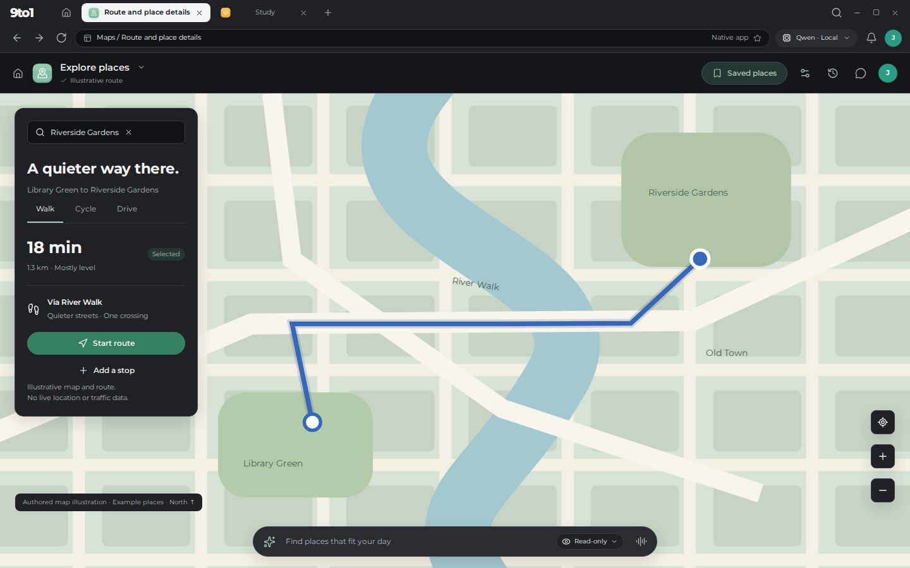
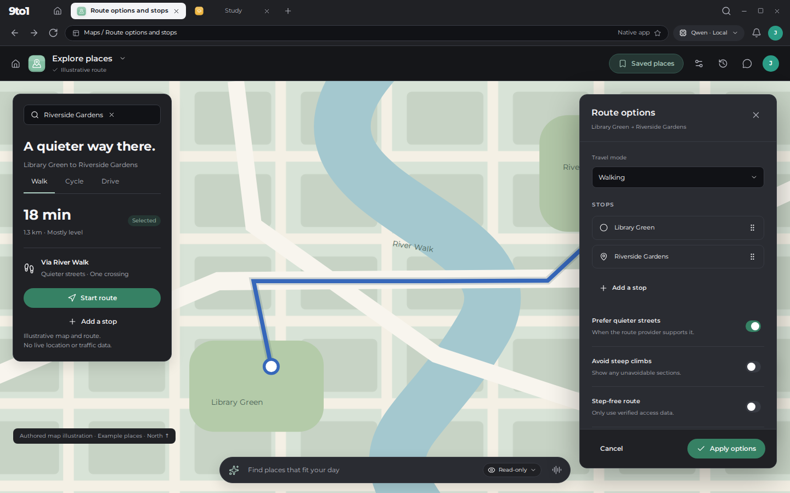

# Maps — search, places and routes

Module ID: `maps` · 9to1 Development Specification v3

## Prerequisites

- **CUI, themes and shared interaction system** — Typed UI components, theme tokens/materials, layout, focus, motion, accessibility and shared control states.
- **Permissions, approvals and execution scope** — Effective scoped grants, action approvals, policy intersections, revocation and audit.
- **External integrations and provider connections** — Canonical provider connections, OAuth scopes, typed capabilities, provenance and sync recovery.
- **Artifacts, local persistence and recovery** — Canonical artifacts, revisions, typed edits, local saves, derived exports, sync and recovery.

## Overview

Maps provides real place search, saved places, map layers and routing with explicit location permissions and truthful provider freshness/availability. AI mode assists through the same canonical map capabilities.

## Layouts & visible states

- **V3-MAPS-LAY-01** — Use a dominant map with search, source-aware result/route cards, layer/zoom controls and selected place detail.
- **V3-MAPS-LAY-02** — Keep default search versus AI mode explicit, and distinguish live location, entered origin and unknown/unavailable position.

## Features & behaviour

- **V3-MAPS-FEA-01** — Resolve place/geocode/route requests through actual providers. Show route options, units, distance/time and traffic/freshness only when grounded in provider data.
- **V3-MAPS-FEA-02** — Save canonical places/collections and open routes with clear mode/origin/destination. Do not invent travel estimates from a mock-up geometry.
- **V3-MAPS-FEA-03** — AI edits/proposals target the same map entities and preserve permission scope.

## Canonical entities & persistence

- **V3-MAPS-ENT-01** — Persist place/route/query IDs, provider references, coordinates, timestamps/freshness and saved collection membership.
- **V3-MAPS-ENT-02** — Map tiles/cache are derived; transient viewport is separate from saved places and route inputs.

## Permissions & recovery

- **V3-MAPS-PER-01** — Location capture is explicit and revocable. Cached/private location information must not leak through unrelated search or AI context.
- **V3-MAPS-PER-02** — Handle provider/network failure, ambiguous place and unsupported route mode with useful recovery.

## Acceptance checks

- **V3-MAPS-ACC-01** — Test search→place→route→save, ambiguous matches, location denied and provider failure.
- **V3-MAPS-ACC-02** — Verify freshness labels, true units and same canonical targets in default/AI mode.

## Exact mock-up and state map

- **Maps · Route and place details** — screen `maps`. Map.
- **Maps · Route options and stops** — screen `maps-route-options`. Interaction state.

## Source clause IDs

UX27-OTHER-010

## Technical reading map

- Maps — search, places and routes — Maps; Primary donor and default provider stack (part 01) — `technical/maps-01.md` (2,605 words; V2-B1820).
- Maps — search, places and routes — Maps search, pins and routes (part 02) — `technical/maps-02.md` (106 words; V2-B2312, V2-B2313, V2-B2314).

Technical clauses retain APIs, data models, platform, recovery, donor and acceptance details. The technical files are part of this module, not optional background reading. Shared prerequisites mean stable service/interface contracts must be available; they do not require every dependent app UI to be complete. Use the named chunk for the relevant subtask or the complete module file for its full retained contract.

# Exact designs and implementation rules

These figures are the exact current atlas compositions. Their stable screen IDs match the Word specification and editable source. Open the atlas for full-size theme and interaction inspection.

## Maps · Route and place details

Screen ID: `maps`. Source: UX27-OTHER-010; Maps source/provenance/search/route baseline.

- This is an explicitly illustrative map fixture; it is not a navigation result or a real geographic route.
- Real search resolves canonical places and shows source/freshness. Uncertain geocoding must remain visible.
- Route choice, stops and travel mode edit the same canonical route. Source outages have scoped unavailable states.
- Search and AI operate the same map entities; model prose alone cannot create a verified route.

## Maps · Route options and stops

Screen ID: `maps-route-options`. Source: Owner revision 28 October; Maps canonical routes, mode and source metadata.

- The options panel edits the same route, including travel mode, stops and preferences.
- Estimated route data retains its map/provider source and freshness; this fixture is illustrative rather than navigation guidance.
- A failed or unavailable route remains visibly unresolved instead of substituting a generated route.
