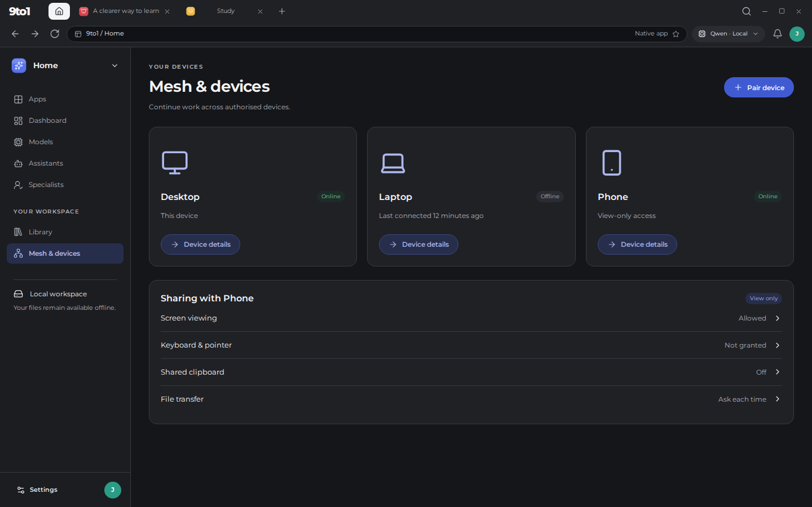

# Mesh devices, replication and remote capabilities

Module ID: `mesh` · 9to1 Development Specification v3

## Prerequisites

- **Platform, app registry and host integration** — Canonical app registry, artifact routes, native/browser embedding, lifecycle and semantic UI/API parity.
- **Account, identity and resource entitlements** — Canonical CAKE account identity, secure sessions, server entitlements and resource allocation state.
- **Privacy, data boundaries and context isolation** — Privacy scopes, consent, local/remote boundaries, source provenance, retention and revocation.
- **Artifacts, local persistence and recovery** — Canonical artifacts, revisions, typed edits, local saves, derived exports, sync and recovery.

## Overview

Mesh discovers and coordinates authorised devices for explicit replication and remote capabilities. Storage location, remote inference/execution and current connectivity remain separate, visible dimensions.

## Layouts & visible states

- **V3-MESH-LAY-01** — Show canonical device identity, ownership, online/offline/connecting status, advertised capabilities, relevant resource state and pending transfers.
- **V3-MESH-LAY-02** — Pairing, permission, unavailable device and conflict/retry states must be visible. Settings and Home use the same device roster.

## Features & behaviour

- **V3-MESH-FEA-01** — Use authorised device pairing/trust and the source-defined transport/discovery contracts. A reachable device does not automatically expose every folder, model or runtime.
- **V3-MESH-FEA-02** — Replicate explicitly scoped conversations/resources with manifest/revision awareness. Do not silently transfer Temporary conversations or private sources.
- **V3-MESH-FEA-03** — Route remote tasks only when their capabilities, current policy and runtime availability satisfy the request.

## Canonical entities & persistence

- **V3-MESH-ENT-01** — Persist DeviceID, trust relationship, scoped capabilities, replica manifests, revision/transfer state and Task/Run references.
- **V3-MESH-ENT-02** — Device reachability is transient; ownership and permissions are durable configuration.

## Permissions & recovery

- **V3-MESH-PER-01** — Revocation prevents new access and reconciles pending transfers safely. Offline peers must not be shown as current authoritative copies without freshness information.
- **V3-MESH-PER-02** — Surface conflicts, retry and uncertain outcomes rather than overwriting independently edited replicas.

## Acceptance checks

- **V3-MESH-ACC-01** — Test pairing, scoped resource sharing, disconnect/reconnect, conflicting revisions, revoked device and remote execution refusal.
- **V3-MESH-ACC-02** — Verify the UI distinguishes storage replication from a model running on that device.

## Exact mock-up and state map

- **Home · Mesh & devices** — screen `home-mesh`. Devices.

## Source clause IDs

UX27-OTHER-017

## Technical reading map

- Mesh devices, replication and remote capabilities — Mesh; Mini Computer, Mesh and remote sessions (part 01) — `technical/mesh-01.md` (286 words; V2-B0460, V2-B0461, V2-B0462…).

Technical clauses retain APIs, data models, platform, recovery, donor and acceptance details. The technical files are part of this module, not optional background reading. Shared prerequisites mean stable service/interface contracts must be available; they do not require every dependent app UI to be complete. Use the named chunk for the relevant subtask or the complete module file for its full retained contract.

# Exact designs and implementation rules

These figures are the exact current atlas compositions. Their stable screen IDs match the Word specification and editable source. Open the atlas for full-size theme and interaction inspection.

## Home · Mesh & devices

Screen ID: `home-mesh`. Source: Home Mesh; UX27-OTHER-017.

- Connection, capability and granted scopes belong to the selected device identity.
- View-only and input control are separate modes. Closing a viewer does not shut down its remote machine.
- Pairing, clipboard, file and device forwarding each have explicit permission boundaries.
