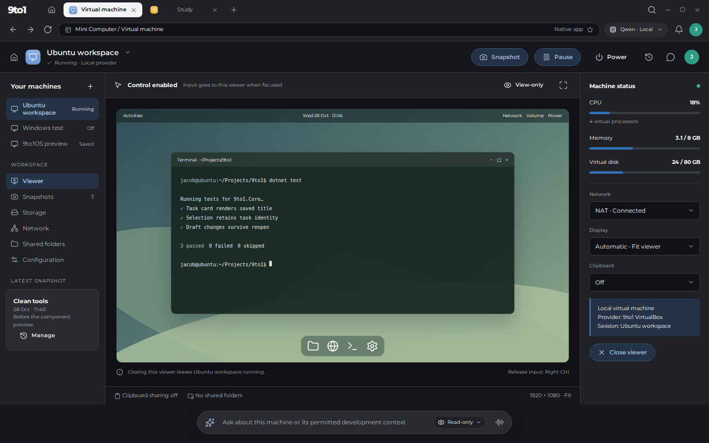

# Mini Computer — VM and remote desktop control

Module ID: `mini-computer` · 9to1 Development Specification v3

## Prerequisites

- **CUI, themes and shared interaction system** — Typed UI components, theme tokens/materials, layout, focus, motion, accessibility and shared control states.
- **Permissions, approvals and execution scope** — Effective scoped grants, action approvals, policy intersections, revocation and audit.
- **Artifacts, local persistence and recovery** — Canonical artifacts, revisions, typed edits, local saves, derived exports, sync and recovery.

## Overview

Mini Computer displays and controls a real VM/device session through the supported backend. Input ownership, resource configuration and close-versus-stop semantics remain explicit.

## Layouts & visible states

- **V3-MINI-COMPUTER-LAY-01** — Provide authentic desktop viewport with visible target/session/runtime state. Show View only versus Control and the current input owner.
- **V3-MINI-COMPUTER-LAY-02** — Keep connection, scaling/full-screen, clipboard/file transfer, snapshot/resource and power controls discoverable without confusing window close with machine stop.

## Features & behaviour

- **V3-MINI-COMPUTER-FEA-01** — Use the actual VM/viewer/input backend, supported guest capabilities and runtime versions. Control grants gate keyboard/pointer delivery.
- **V3-MINI-COMPUTER-FEA-02** — Configure resources and snapshots with defined powered-state constraints. Closing the viewer detaches; stopping/shutting down affects the machine and requires the corresponding action.
- **V3-MINI-COMPUTER-FEA-03** — Clipboard/file sharing and AI computer interaction are separately permissioned capabilities; a visible desktop does not grant either automatically.

## Canonical entities & persistence

- **V3-MINI-COMPUTER-ENT-01** — Persist machine/session IDs, configuration, supported runtime, disk/snapshot references, connection and input-ownership state.
- **V3-MINI-COMPUTER-ENT-02** — Viewer pan/scale/full-screen is transient; guest process and machine lifecycle continue according to runtime state.

## Permissions & recovery

- **V3-MINI-COMPUTER-PER-01** — Respect device/VM scope and input ownership, handle lost control and disconnect visibly, and revoke input immediately when required.
- **V3-MINI-COMPUTER-PER-02** — Recover reconnect and snapshot/stop failures without claiming the machine is stopped or unchanged until confirmed.

## Acceptance checks

- **V3-MINI-COMPUTER-ACC-01** — Test view-only→control grant, input routing, revoke control, close viewer and explicit stop as separate outcomes.
- **V3-MINI-COMPUTER-ACC-02** — Verify resource/snapshot constraints, clipboard/file permission and disconnected recovery.

## Exact mock-up and state map

- **Mini Computer · Virtual machine** — screen `mini-computer`. Session.

## Source clause IDs

Named baseline section(s) retained in the technical-source chapters below.

## Technical reading map

- Mini Computer — VM and remote desktop control — Mini Computer; Product role and shared virtualisation engine (part 01) — `technical/mini-computer-01.md` (4,463 words; V2-B1818).

Technical clauses retain APIs, data models, platform, recovery, donor and acceptance details. The technical files are part of this module, not optional background reading. Shared prerequisites mean stable service/interface contracts must be available; they do not require every dependent app UI to be complete. Use the named chunk for the relevant subtask or the complete module file for its full retained contract.

# Exact designs and implementation rules

These figures are the exact current atlas compositions. Their stable screen IDs match the Word specification and editable source. Open the atlas for full-size theme and interaction inspection.

## Mini Computer · Virtual machine

Screen ID: `mini-computer`. Source: Mini Computer: viewer, lifecycle, snapshots, clipboard trust; UX27-OTHER-017.

- The viewer identifies the machine, provider, connection and input owner. View-only and control are distinct.
- Closing the viewer leaves the VM running. Pause, save state, stop and shutdown are explicit lifecycle operations.
- Clipboard, folders and device sharing have visible independent permissions.
- Snapshots and runtime changes retain canonical VM identity; reconnect never invents a replacement session.
