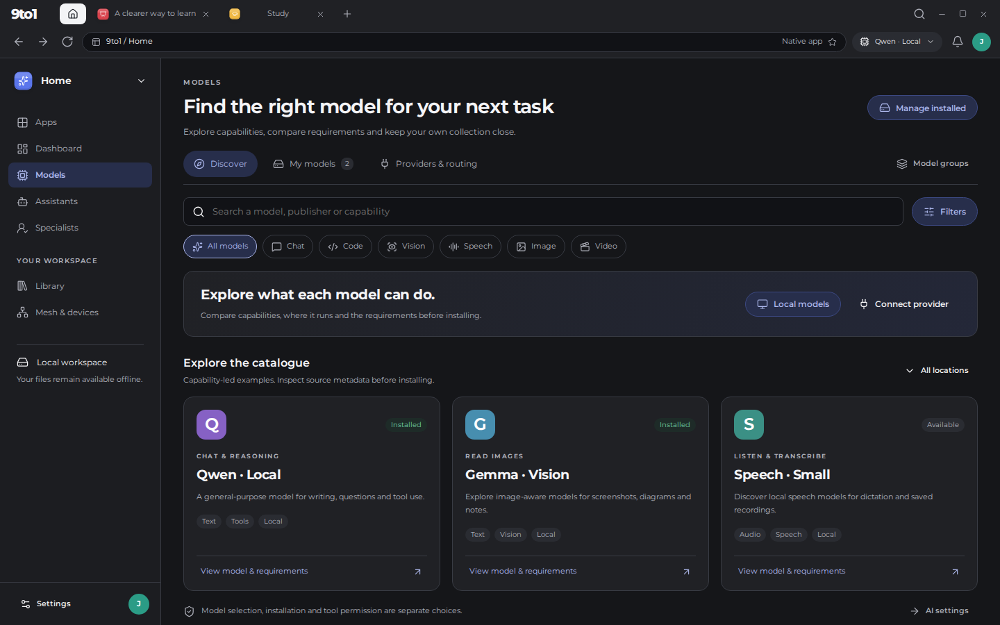
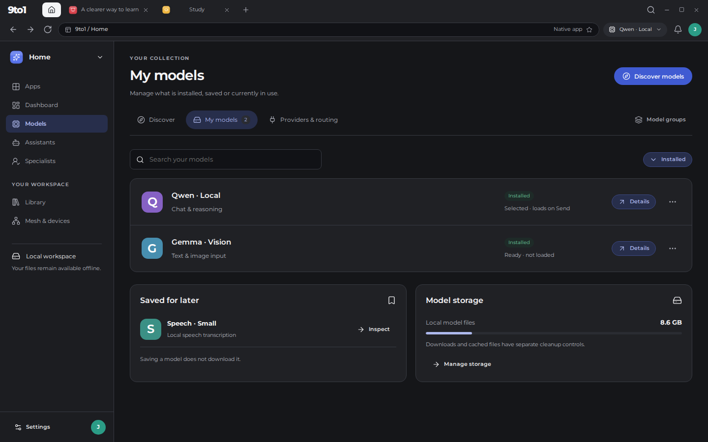
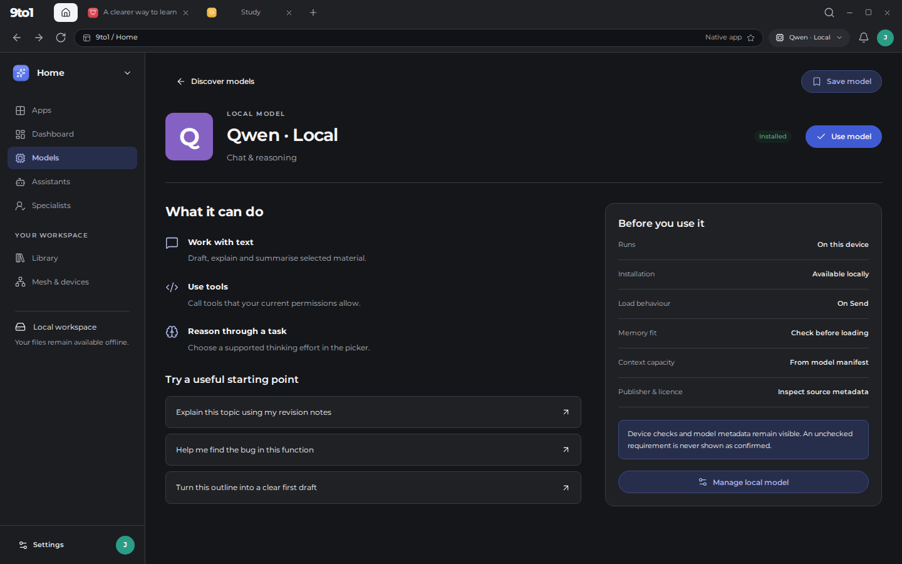
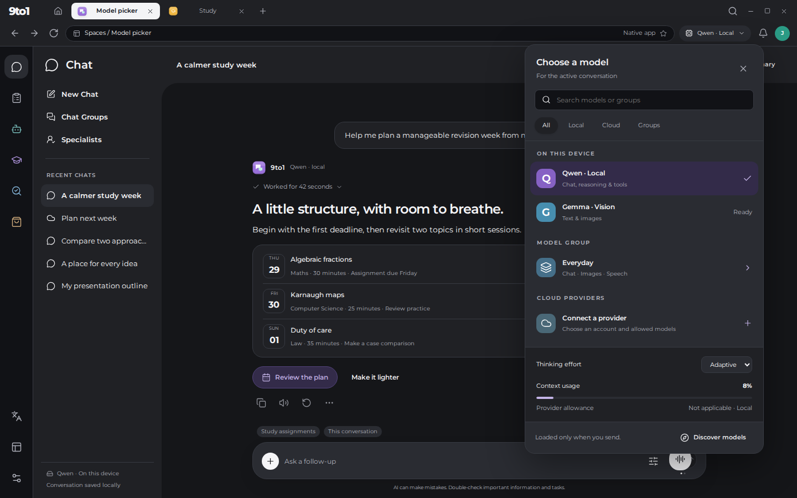

# Models, discovery and universal model routing

Module ID: `models` · 9to1 Development Specification v3

## Prerequisites

- **CUI, themes and shared interaction system** — Typed UI components, theme tokens/materials, layout, focus, motion, accessibility and shared control states.
- **Account, identity and resource entitlements** — Canonical CAKE account identity, secure sessions, server entitlements and resource allocation state.
- **Permissions, approvals and execution scope** — Effective scoped grants, action approvals, policy intersections, revocation and audit.
- **Dulche runtime, requests and execution services** — Canonical AI broker, capability-aware routing, durable Task/Runs, action execution and lifecycle.

## Overview

Models combines discovery and comparison with local installed-model management. The Universal Model Picker is the same canonical routing control in Home, Spaces and editors, with truthful capability, provider, limit and hardware information.

Current owner overrides: V3-OWNER-007, V3-RECON-001.

## Layouts & visible states

- **V3-MODELS-LAY-01** — Use discovery as the main Models experience, with search/filter, modality and capability metadata, hardware fit and a distinct Installed view. Model detail exposes source, provider, variants, limits and management actions.
- **V3-MODELS-LAY-02** — The shared picker separates Active and Background ordered routes. Chat/Image/Voice are primary groups; Audio/Video advanced groups appear when supported. Voice routes name actual voices.
- **V3-MODELS-LAY-03** — Display reasoning effort as supported discrete levels, independent from context consumption and provider usage. Unknown metrics read unknown/N/A; local routes hide inapplicable cloud allowances.

## Features & behaviour

- **V3-MODELS-FEA-01** — Install, verify, load, unload, update, remove and recover/rollback local models through actual lifecycle services. Show download/verification failures and storage requirements before committing.
- **V3-MODELS-FEA-02** — Resolve provider identity and model variant by stable IDs. A display-name match is not capability equivalence.
- **V3-MODELS-FEA-03** — For effort tiers, use canonical labels 35/70/100 for three levels, 25/50/75/100 for four and 20/40/60/80/100 for five. Bind each option bijectively to the provider’s real level ID/ordinal; do not pass these labels through the obsolete floor formula.
- **V3-MODELS-FEA-04** — Model/provider limits support explicit windows, units, reset times and user-pinned display selection. Estimates and time-to-block must be labelled and grounded in measured evidence; do not fabricate throughput or allowance.

## Canonical entities & persistence

- **V3-MODELS-ENT-01** — Keep provider/model/voice IDs, manifests, installed artifacts, capabilities, route order, active/background assignment and limit records canonical. Model weights are references managed once, not copied into each conversation.
- **V3-MODELS-ENT-02** — Account/device defaults and request/conversation overrides have explicit lifecycles and inheritance. Changing model validates inherited effort and capability settings.

## Permissions & recovery

- **V3-MODELS-PER-01** — Secure credentials; distinguish provider consent from 9to1 app grants. An installed model may be unavailable because of hardware, policy or runtime state.
- **V3-MODELS-PER-02** — Do not remove weights used by an active run without the required lifecycle handling; show real partial-install and rollback states.

## Acceptance checks

- **V3-MODELS-ACC-01** — Verify discovery→detail→install→verify→load→picker eligibility; simulate insufficient disk, incompatible hardware and failed verification.
- **V3-MODELS-ACC-02** — Test each effort mapping, mixed provider limits, no-capability models, unknown counters and local-only fallback restrictions.

## Exact mock-up and state map

- **Models · Discover** — screen `home-models`. Model discovery.
- **Models · Installed and saved** — screen `home-models-installed`. Model management.
- **Models · Capability and requirements** — screen `home-model-details`. Model details.
- **9to1 · Model picker** — screen `host-model-picker`. Anchored dropdown.

## Source clause IDs

LE-06, SPUI-133, SPUI-134, SPUI-135, SPUI-136, SPUI-137, SPUI-138, SPUI-139, SPUI-140, SPUI-141, SPUI-142, SPUI-143, SPUI-144, SPUI-145, SPUI-146, STUDY-UI-201, STUDY-AC-201, LE-08, LE-09, LE-10, LE-11, LE-12

## Technical reading map

- Models, discovery and universal model routing — Discover; Universal Model Picker (part 01) — `technical/models-01.md` (2,349 words; V2-B0441, V2-B0442, V2-B0443…).
- Models, discovery and universal model routing — Usage data contract; MODEL REASONING EFFORT DISPLAY (part 02) — `technical/models-02.md` (2,364 words; V2-B2203, COMPANION-B0015, COMPANION-B0016…).
- Models, discovery and universal model routing — CONTEXT AND USAGE PRESENTATION; MANDATORY ACCEPTANCE (part 03) — `technical/models-03.md` (1,668 words; COMPANION-B0024, COMPANION-B0025, COMPANION-B0026…).

Technical clauses retain APIs, data models, platform, recovery, donor and acceptance details. The technical files are part of this module, not optional background reading. Shared prerequisites mean stable service/interface contracts must be available; they do not require every dependent app UI to be complete. Use the named chunk for the relevant subtask or the complete module file for its full retained contract.

# Retained technical requirements

# Models, discovery and universal model routing — Discover; Universal Model Picker (part 01)

Reading status: active retained clauses, subject to the v3 owner overrides listed in the primary module. Historical process instructions and replaced original wording are stored separately.

### V2-B0441 · v2 lines 2256–2256

Discover

### V2-B0442 · v2 lines 2259–2259

9-1 Discover is the model browser/discovery surface inside Home. It MUST aggregate model/catalogue information from configured providers rather than depend on one catalogue. Search, filter and comparison MUST support model identity, provider/origin, modality, capabilities, architecture/parameter information when known, context limits, quantisation/format where known, local/cloud status, hardware-fit estimate, install/connection state, entitlement/cost class and privacy/residency information.

### V2-B0443 · v2 lines 2262–2262

Discover MUST treat Chat, Image and Voice as first-class model categories. Advanced discovery additionally exposes Audio and Video models. Voice MUST NOT be buried under Audio: conversational/live voice is a primary model category because it has distinct runtime, quality and capability requirements.

### V2-B0444 · v2 lines 2265–2265

Voice discovery MUST expose capability metadata such as Conversational compatibility, Monologue compatibility, Live Listener compatibility, Live Translate compatibility, visual understanding, tool/action support, streaming, interruption/turn-taking support, supported languages/accents and translation language pairs when known, one-way/bidirectional/multi-language live interpretation support, local/cloud execution, latency characteristics, privacy/residency and entitlement/cost.

### V2-B0445 · v2 lines 2268–2268

Discover MUST recommend the highest-quality compatible Voice models/configurations for the user's required mode and constraints. Recommendation dimensions MAY include reasoning quality, speech naturalness, speech-recognition accuracy, expressiveness, instruction following, turn-taking quality, interruption handling, long-form coherence, audio-context understanding, visual capability, tool reliability and latency. Unknown measurements remain Unknown rather than being invented.

### V2-B0446 · v2 lines 2271–2271

Voice recommendations MUST be contextual rather than a single universal ranking. Discover may surface labels such as Highest quality, Best for Conversational, Best for Monologue, Best for Live Listener, Best for Live Translate, Best local and Fastest when supported by actual capability/evaluation data. Each recommendation MUST explain the relevant reasons/constraints rather than presenting an unexplained badge. Live Translate recommendations should consider speech-recognition accuracy, translation quality, output-speech quality, latency, turn detection, code-switching and multi-language support where measured.

### V2-B0447 · v2 lines 2274–2274

Discover MAY recommend either a native realtime Voice Model or, where 9to1 supports it, a compatible composite voice configuration. Composite implementation detail is secondary to the normal user-facing Voice selection and MUST NOT force ordinary users to manually assemble STT/reasoning/TTS pipelines.

### V2-B0448 · v2 lines 2277–2277

When a selected Voice Model exposes multiple named voices, Discover MUST show those voices as selectable variants with the underlying Voice Model as secondary metadata. Voice-quality/model recommendations and named-voice selection are distinct concepts.

### V2-B0449 · v2 lines 2280–2280

A model listing MUST preserve stable provider-scoped identity even when multiple providers expose the same human-readable model name. Unknown metadata MUST remain unknown rather than being fabricated.

### V2-B0450 · v2 lines 2283–2283

Discover MUST support the relevant install/pull/connect/open-in-picker action for providers that expose those capabilities. Install/connect actions route through Dulche/provider/package APIs and the normal permission/account model.

### V2-B0451 · v2 lines 2286–2286

Universal Model Picker

### V2-B0452 · v2 lines 2289–2337

The Universal Model Picker is the single shared model/provider selection and routing interface for the 9to1 ecosystem. On Windows/regular 9to1 it is hosted by Home; on 9to1-OS the same canonical state is surfaced by the OS. Apps, Agents and AI surfaces MUST NOT create incompatible private model pickers, provider registries or fallback logic when this shared capability applies.
Compact picker and full manager
The compact picker is used inside apps, Agents and AI surfaces when selecting the effective model/route. The full manager lives in Home/Settings → AI/Models and adds provider configuration, installation/acquisition, aliases, defaults, route ordering, background routing, fallbacks, privacy, resource and lifecycle controls.
Entries expose stable Dulche model identity plus user-facing name/alias, provider/source, local/cloud/remote state, modalities/capabilities, tool/structured-output support, reasoning controls, context/output limits, loading/availability, privacy/residency, entitlement/cost where known and local RAM/VRAM fit where meaningful. Display names are never used as canonical identity.
Simple defaults and capability categories
The normal picker keeps the primary capability configuration approachable: Chat Model/Route, Image Model/Route and Voice Model/Voice. Advanced exposes Audio Model/Route and Video Model/Route. The user may instead choose one Active Model/Route and allow all compatible capabilities to inherit it, with ordered fallback resolving unsupported capabilities.
Chat is the primary general-purpose route for conversation, reasoning, writing, coding, tool use, agentic work and multimodal chat where supported.
Image supports an explicit Inherit from Active/Chat route. Inheritance means use that ordered route and its native image-generation/editing-capable candidates; it MUST NOT silently substitute an unrelated unconfigured image provider. A dedicated Image route is an explicit override.
Voice is the first-class conversational/live-voice selection used by Vision & Voice for supported Conversational, Monologue, Live Listener and Live Translate modes. When the selected Voice Model exposes named voices, the user-facing field is labelled Voice and selects VoiceID while showing VoiceModelID as secondary metadata. When there are no named variants the field remains Voice Model.
Advanced Audio covers dedicated transcription, synthesis, audio understanding/transformation or music/audio generation where applicable. Advanced Video covers video generation, editing/transformation or video-native understanding. These category routes may inherit the Active route or use explicit independent ordered routes.
Active and Background routes
Users may configure a single Active Model/Route for all foreground AI work or assign capability-specific/app/Agent overrides. Separately, a Background Model/Route can be configured for non-interactive work such as background summarisation, indexing/classification, Background Learning processing, permitted Automations AI work, proactive suggestions and other low-priority background tasks.
If no Background route is configured, background work inherits the Active route subject to normal capability/privacy/policy filtering. A task-specific explicit model outranks Agent/app/category defaults; a configured Background route applies only to eligible background work and MUST NOT override an explicit Agent/task requirement.
Ordered Model Routes
Home/Dulche MUST support versioned ordered Model Routes shared by regular 9to1 and 9to1-OS. A Model Route is an ordered list of stable configured model identities plus per-entry enabled/disabled state and routing policy. Users can reorder candidates directly in Home, including by drag/reorder UI, without changing the models' canonical identities.
Example: an Active route may be ChatGPT 6 Sol → Gemma 4 → Fable 5. The ordering means use the highest-priority candidate that is both eligible and available for the request. The router MUST evaluate compatibility before invocation rather than deliberately sending impossible requests to higher entries first.
Foreground and background workloads may use different ordered routes. A user can therefore choose a powerful cloud model first for interactive work while using a small local model first for background work. Users who want simplicity can select a single model and leave fallback entries empty.
Eligibility-first routing
For every routed request Dulche first derives task requirements such as modality/capability, tool use, structured output, context/output requirements, reasoning support and foreground/background role. It then filters candidates against provider/model capability, privacy/locality policy, administrator policy, connection/authentication permission, user fallback policy, entitlement and other hard constraints before considering route priority.
After filtering, Dulche selects the highest-priority available candidate. A lower candidate may be used automatically when a higher candidate is unavailable because of a classified routing condition such as usage/quota exhaustion, provider/model outage, unsupported required capability, context incompatibility, authentication/provider unavailability when another authorised option exists, or local resource insufficiency after permitted reclamation.
Capability mismatch should normally be detected before invocation. For example, if the first two models in a route cannot generate video and the third can, a video-generation request routes directly to the third eligible model rather than failing through the first two.
Conditions that are not model fallback
Model fallback is not a generic retry mechanism. Errors such as missing user files, invalid tool arguments, target-app permission denial, required human approval, business-logic rejection or an external service action failure do not justify silently switching models unless the failure is independently classified as a model/provider-routing condition.
Fallback privacy and control
Each route and candidate can restrict fallback, including no fallback, local-only fallback, cloud-allowed fallback or provider-specific constraints. A route containing cloud candidates does not itself authorise sensitive context to leave the device. Privacy, administrator and task policies are evaluated before route ordering.
A request explicitly pinned to a model with fallback disabled MUST fail transparently rather than silently substitute another model. Likewise a local-only request cannot fall through to cloud merely because the local model is unavailable.
Routing transparency
The effective model and routing reason remain inspectable. Home/Dulche records route identity, selected model and skipped/fallback reasons where relevant, for example 'Sol skipped: usage exhausted; Gemma selected' or 'Sol skipped: video-generation unsupported; Fable selected'. This metadata may be surfaced subtly in normal UI and in more detail through diagnostics/Action Graph without cluttering every response.
Selection inheritance and overrides
The configuration hierarchy MUST be deterministic: request-specific explicit selection → Agent/task override → app/surface override → capability/category route → Background route for eligible background work or Active route for foreground work → configured route fallbacks. A lower-level explicit override wins, while inherited state is visibly distinguishable from an explicit override.
LLM Space and Desktop Space overrides MAY exist but remain scoped. Category overrides are independent; for example an LLM Space may override Chat while inheriting global Image/Voice/Audio/Video routes.
Reasoning and capability validation
The picker renders only reasoning/effort levels actually exposed by the selected model/provider. It MUST NOT invent Low/Medium/High controls for a model that does not support them. Incompatible explicit selections are blocked or clearly explained unless an authorised fallback route can satisfy the requirement.
Aliases and model identity
Users can assign friendly aliases/nicknames to models. Aliases are presentation conveniences and may be duplicated; all routing objects store stable provider-scoped Dulche ModelID values so duplicate names never create ambiguous execution.
Local model lifecycle
Where supported, the full manager provides discover/install or pull, import, verify, download progress, load, unload, remove, update/replace, rollback, storage-location and compatible CPU/GPU/offload configuration. These operations use Dulche Runtime/Den and provider/package APIs rather than a second model-host implementation.
Provider support
Routes may contain compatible local runtimes, configured commercial/cloud providers, self-hosted/OpenAI-compatible endpoints, Ollama, another Dulche device, enterprise endpoints and authorised provider/Plugin implementations. Provider authentication and credentials remain owned by the appropriate shared credential/provider system.
Resource awareness
For local candidates the picker may show estimated RAM/VRAM requirement, current availability, loading state and reclaimable resources when known. On 9to1-OS this integrates with the AI-aware resource manager; on other Home platforms it uses the available Dulche/runtime resource information without pretending OS-level reclamation exists where it does not.
Administrator and managed-profile policy
Managed profiles may limit approved models/providers, acquisition, external cloud use, maximum cost/usage class or fallback destinations. Policy filtering happens before user ordering so reordering a blocked provider cannot bypass a School/organisation restriction.
Universal Model Picker acceptance requirements
* Regular 9to1/Home and 9to1-OS use one canonical Dulche model catalogue and versioned routing contract.
* Users can use one Active Model for everything compatible or configure separate capability/app/Agent and Background routes.
* Ordered model routing automatically falls through on classified quota, availability, capability, context or resource conditions while respecting privacy, permissions and admin policy.
* Capability mismatch is filtered before invocation where knowable; model fallback is not misused for unrelated tool/app/business-logic failures.
* Users can reorder, enable/disable and inspect route candidates and understand which model ultimately handled a request.

### V2-B2015 · v2 lines 11566–11567

Model resolution
Dulche supports three model-resolution paths:

### V2-B2016 · v2 lines 11570–11570

Dulche Den

### V2-B2017 · v2 lines 11573–11575

The user's Den may store models using both a stable ID and a user-facing name. Either can be used for lookup. User-facing names are not required to be unique.
Dulche.Den.GetModelByID(id);
Returns the model matching the supplied ID.

### V2-B2018 · v2 lines 11578–11579

Dulche.Den.ListModelsByName(name);
Returns all Den models matching the supplied user-facing name, including their IDs.

### V2-B2019 · v2 lines 11582–11582

Models.toml

### V2-B2020 · v2 lines 11585–11587

Models.toml contains the models available to the current Dulche configuration and the capabilities/properties associated with them.
Dulche.GetModelByID(id);
Returns the configured model matching the supplied ID.

### V2-B2021 · v2 lines 11590–11591

Dulche.ListModelsByConfig(property);
Returns all configured models matching the supplied property. A property may describe a capability, such as reasoning support, or an identifying property such as an ID.

### V2-B2022 · v2 lines 11594–11594

Local directory

### V2-B2023 · v2 lines 11597–11599

Dulche can resolve a model directly from a local directory, with support for as many compatible model file types as practical.
Dulche.GetModelFromDir(directory);
Where an operation fails because the requested model cannot be resolved, Dulche returns "model not found" rather than throwing an exception.

### V2-B2024 · v2 lines 11602–11605

Model discovery and acquisition
Dulche can discover and obtain models from supported sources including llama.cpp, Ollama and Hugging Face.
Dulche.FindModel(source, id);
Checks whether the requested model exists at the specified source.

### V2-B2025 · v2 lines 11608–11609

Dulche.ListModels(source, property);
Lists models from the specified source that match the supplied property.

### V2-B2026 · v2 lines 11612–11613

Dulche.Pull(source, model);
Pulls a model temporarily. A pulled model survives endpoint suspension, but is discarded when the endpoint is stopped.

### V2-B2027 · v2 lines 11616–11617

Dulche.Install(source, model);
Installs a model persistently.

### V2-B2028 · v2 lines 11620–11622

Model replacement
Dulche.Replace(oldModel, newModel);
Replaces one model with another. When no replacement policy is specified, Dulche applies the safe replacement policy: preserve only metadata explicitly classified as model-independent (for example a user-facing alias), recalculate model-derived capabilities/limits from the replacement artifact, and reset configuration values that are invalid or unsupported by the replacement. Immutable artifact/model identity MUST NOT be copied from the old model.

### V2-B2029 · v2 lines 11627–11628

Dulche.Replace(oldModel, newModel, preserveConfig);
Preserves compatible properties from the old model where possible.

### V2-B2030 · v2 lines 11631–11632

Dulche.Replace(oldModel, newModel, wipe);
Replaces the model without preserving its previous configuration.

### V2-B2031 · v2 lines 11635–11635

safe MAY be specified explicitly as the preservation policy. Under safe, only fields classified by the replacement schema as model-independent/safe-to-carry MAY be preserved; all model-derived or compatibility-sensitive fields MUST be recalculated or reset.

### V2-B2154 · v2 lines 12472–12480

Universal Model Picker
On 9to1-OS, the Universal Model Picker is the OS-hosted presentation of the same canonical Dulche/Home model/provider state used by regular 9to1. Model identities, provider connections, ordered Model Routes, active/background routing, category overrides, fallbacks, permissions and usage state MUST remain interoperable across Home and 9to1-OS rather than becoming separate OS-only configuration.
The OS picker provides the same compact selection experience plus deeper integration with Settings → AI, system resource management, administrator policy and local-model lifecycle. It can expose local/cloud/remote identity, capabilities, reasoning/effort controls, aliases/nicknames, route order, fallback state, locality/privacy, loading/residency, RAM/VRAM fit and per-app/Agent/Desktop-Space overrides.
9to1-OS may host the picker natively while Windows regular 9to1 hosts it through Home, but both clients MUST read/write the same versioned routing contracts and Dulche model catalogue. A route configured in Home remains meaningful on 9to1-OS subject to device-local model availability, provider authentication, administrator policy and device-specific resource constraints.
OS resource and policy integration
When a selected local model requires additional memory, the picker integrates with the 9to1-OS resource broker to show required/available/reclaimable RAM/VRAM and may request permitted reclamation before declaring the model unavailable. It MUST distinguish Installed, Unloaded, Loading, Loaded, Offloaded/Partially loaded where supported and Unavailable due to resources.
Administrator-managed user profiles can restrict allowed models/providers, cloud use, model acquisition and routing fallback. Model ordering MUST never bypass those restrictions; policy-ineligible candidates are filtered before route selection.
Shared-routing invariant
Ordered model fallback is a shared 9to1 capability, not an OS-specific behaviour. Requests from regular 9to1/Home and 9to1-OS use the same eligibility-first routing semantics: determine required capabilities and policy constraints, filter the configured route, then choose the highest-priority eligible available model and fall through only on classified model/provider-routing conditions.

# Models, discovery and universal model routing — Usage data contract; MODEL REASONING EFFORT DISPLAY (part 02)

Reading status: active retained clauses, subject to the v3 owner overrides listed in the primary module. Historical process instructions and replaced original wording are stored separately.

### V2-B2203 · v2 lines 13052–13055

LE-06 — Usage data contract
The floating usage bar is anchored to the bottom of the chat-list area without covering list items or the composer. It shows the actual configured 9to1 windows and any limits a connected provider can measure; daily, weekly and monthly are supported window types, not permission to invent a limit the account does not have. Compact summaries expand into source-labelled details.
Each measure identifies provider, connection/account, resource/unit, used amount, limit when known, period/reset semantics, observed-at time and freshness/availability state. Use existing account/provider APIs; billing and quota enforcement remain server-authoritative. Multiple accounts and resources MUST NOT be combined into an unexplained percentage. Preserve Dulche's null/Na/zero distinction: unavailable is not zero or unlimited.
Refresh from existing change events or bounded provider polling, respecting rate limits. Stale, offline, exhausted and provider-unavailable states must be visible; switching account removes the old account's values. Acceptance covers a real 9to1 allowance, a measurable external limit, unavailable metrics, a reset and an account switch; UI tests must prove the bar does not obstruct narrow or scaled layouts.

### COMPANION-B0015 · companion lines 95–102

SPUI-133 — MODEL REASONING EFFORT DISPLAY
The percentage attached to the model name in the Spaces Chat compact picker (for example “Qwen 3.6 • 100%”) is the currently selected REASONING EFFORT LEVEL for that model/route, NOT quota, remaining usage, context-window fill, confidence, CPU/GPU utilisation or provider health.
The selected effective model's REAL provider/Dulche capability metadata determines the number N of discrete supported effort levels and whether reasoning is enabled/disabled or configurable. Show N distinct user-facing percentage choices, each mapped one-to-one, in increasing order, onto the N actual advertised effort levels:
  N=3: 35%, 70%, 100%.
  N=4: 25%, 50%, 75%, 100%.
  N=5: 20%, 40%, 60%, 80%, 100%.
For other N, present evenly distributed, legible percentages for each distinct advertised level without inventing unsupported options. The listed 3/4/5 mappings are canonical. Percentages are normalised UI LABELS for discrete provider-specific effort rankings, NOT a literal continuous strength measurement nor a supported percentage of model parameters or context tokens. Displayed options MUST remain bijective to advertised reasoning levels; selecting the first displayed preset MUST invoke the first actual level and not the second. Bind selection to the exact model/provider's stable level identity or ordinal, not to an arbitrary percentage passed through an incompatible floor(p*N/100) formula. When the user changes models, discover the new model's own reasoning/effort options and show only the eligible ones; validate inherited and explicit selections. If a model offers an independent reasoning enabled/disabled switch, honour and display its real on/off state. If no reasoning-effort control exists, do not fabricate a 100% control or suggest that reasoning is configurable. If a provider supplies effort tiers but no on/off switch, do not invent one. Setting changes must affect the actual subsequent Dulche requests and survive the appropriate request/conversation override lifecycle. Fail clearly for unsupported effort settings, never silently assume the backend accepted them.
IMPLEMENTATION NOTE: Existing V2 low-level SetReasoningLevel prose uses min(n−1, floor(p*n/100)) for arbitrary percentage inputs. That function would map the first displayed 35% (for three levels) to the SECOND tier and the first displayed 20% (for five tiers) to the SECOND tier. The canonical user-facing selector must therefore map directly to discrete provider effort LevelIDs/ordinals, not route preset labels through that old formula. Any arbitrary-percent legacy API compatibility must be separately specified/versioned rather than causing incorrect or duplicated preset selection.

### COMPANION-B0016 · companion lines 105–111

SPUI-134 — USAGE + CONTEXT PROGRESS CIRCLE
A separate compact PROGRESS CIRCLE sits on the top header, preferably immediately LEFT of the Universal Model Picker. This distinct indicator reports two independent metrics, rendered in DIFFERENT theme-accessible colours:
  • Usage: actual usage against the relevant account/provider's applicable limit/window, when measurable.
  • Context window: consumed effective context relative to the chosen model/route's applicable usable context capacity, where measurable.
RECOMMENDED IMPLEMENTATION (VISUAL PROPOSAL): two concentric arcs/rings sharing one compact circular control, one per metric, with stroke colours tied to CUI semantic tokens. This is better than adding the unrelated measurements into one cumulative pie or percentage. The user only confirmed two differently coloured measures in a progress circle; exact ring geometry/colours are subject to normal visual review.
Hovering (or keyboard focusing / clicking / tapping) shows which colour is Usage versus Context, with labelled values, units, relevant provider/account/model, scope, reset period where applicable, observed freshness and estimated/unavailable states. Colour is never the only semantic distinction; labels and accessibility descriptions remain usable with reduced motion and contrast themes. Provider-level usage is not inferred from model reasoning percentage. Context progress should be grounded in the actual effective model and conversation/request token budget; if the model's effective usable context differs from advertised max, identify the applicable denominator. Do not falsely claim exact utilisation where context compression, hidden provider overhead or unavailable telemetry prevents measurement. Show unknown/stale values honestly rather than converting them to 0% or 100%.
Respect V2 LE-06 floating, detailed usage bar and provider usage metrics as a separate existing surface: the new circle is a concise TOP-HEADER summary/access point, not a reason to remove the sidebar's more comprehensive provider/quota information. Usage windows for different providers/resources must not be silently combined into a misleading aggregate. Theme, collapsed sidebar, Tab View, floating Summary and responsive layout must keep this control reachable and non-obstructive.

### COMPANION-B0017 · companion lines 114–116

SPUI-135 — ACCEPTANCE
In real running Spaces: (a) model with 3 efforts gives 35/70/100 and each maps to first/second/third actual provider effort; (b) 4 and 5 tier models map all available choices once; (c) model without configurable effort does not display fabricated tiers; (d) on/off toggle, if provider-supported, changes effective model configuration; (e) change model while draft/conversation retained; (f) usage/context circle renders two distinct tracked values with colour legend on hover/focus, shows accurate units/source and limits, handles unknown and stale data without fabricated numbers; (g) neither usage nor context changes the meaning of model-picker 100%; (h) test reduced motion, keyboard and small viewport. Verification requires backend request/capability records and genuine UI evidence, not mock values.
END 13 OCTOBER OWNER-CONFIRMED SELECTOR CORRECTION

### COMPANION-B0018 · companion lines 119–120

13 OCTOBER 2026 — OWNER-CONFIRMED USAGE VISIBILITY AND USER CONFIGURABLE MODEL/PROVIDER LIMITS
STATUS: CONFIRMED FOR OWNER'S SPECIFIED SEMANTICS. APPEND TO SPUI-133–135; DO NOT REPLACE ANY EXISTING CUI, PROVIDER SECURITY OR LE-06 OBLIGATIONS.

### COMPANION-B0019 · companion lines 123–129

SPUI-136 — SEPARATION OF CONTEXT AND REMOTE USAGE DISPLAY
The compact Spaces top-header progress-circle control remains immediately left of the Universal Model Picker when both are applicable. Its CONTEXT occupancy metric is separate from USAGE. Reasoning percentage beside model name (e.g. 100%) remains exclusively the currently selected model reasoning-effort tier and MUST NOT be re-used for quota or usage.
(a) LOCAL MODEL: The usage meter/arc MUST be HIDDEN. Context-window progress MAY remain visible when actual effective context capacity and consumption are known. The absence of a usage arc for local models must not imply absence of RAM/VRAM/runtime constraints; those have their own diagnostics. Do not display the M warning merely because a model is local.
(b) REMOTE/CLOUD MODEL WITH VERIFIED PROVIDER USAGE DATA: Show usage as a coloured progress arc only where a meaningful, trustworthy measured numerator and denominator are both available for the applicable scope/window. It can coexist with the differently coloured context metric. Tooltip/focus details identify scope (provider or model), resource/unit, window, value, limit, provider account, freshness/reset if applicable, and data provenance.
(c) REMOTE/CLOUD MODEL WITH NO PROVIDER USAGE DATA: HIDE the usage meter/arc and show an accessible compact “M” marker, indicating that the model is LIKELY METERED / may count towards an external allowance or billing but provider usage telemetry is unavailable. “M” is NOT itself evidence that billing is occurring. Hover/focus/tap explains “Provider usage unavailable; this model may still be metered”, plus any separately recorded 9to1-only custom budget state. M must not be displayed as a bogus zero percentage or a guessing ring. Keep independently measurable CONTEXT indicator visible, if available.
(d) Only one reliable metric in a circular indicator is allowed: display only that metric; do not render an empty second ring as though it is a measurable zero. If neither is measurable, show an informative unavailable state rather than fabricated measurements. Do not mix local usage with remote billing, and do not infer provider quotas from local tokens alone.
(e) Provider usage summaries, the separate LE-06 comprehensive sidebar usage UI and the Home Models usage limits are linked surfaces, not conflicting duplicate sources of truth. Hidden compact usage ring does NOT disable user-configured limit enforcement or local request accounting.

### COMPANION-B0020 · companion lines 132–137

SPUI-137 — LIMIT SCOPE: PROVIDER AND INDIVIDUAL MODEL
Home's canonical model/provider management MUST support USAGE LIMITS at BOTH independently selectable scopes:
  PROVIDER-SCOPED limit — applies to requests attributed to the specified configured provider/provider account and cumulatively covers all its applicable models/aliases/routes; identity is by stable ProviderID + Credential/Account Scope, never simply a display name. A separate provider account must not accidentally share or consume another account's budget.
  MODEL-SCOPED limit — applies only to the specific provider-scoped canonical ModelID (including aliases resolving to that identity), independent of other models from the same provider. Model-specific scope must remain unambiguous if multiple providers expose similar model names.
Both scopes can be active simultaneously. Each request updates relevant counters at most once and is checked against EVERY applicable limit; model and provider counts represent distinct aggregates, not additive charges. The effective allowed action is governed by all active applicable constraints. A model limit never overrides/weakens a provider limit, provider hard limit, account entitlement, organisational policy or external billing/provider quota. Provider budgets can be set/edited in Provider Settings; model budgets can be set/edited in that model's Home settings. A model editor may display inherited provider caps as read-only or navigable, clearly separated from model-specific caps.
Provider quotas reported by the provider and OWNER-DEFINED 9to1 custom limits are distinct provenance/source categories, not two representations of the same limit. Present source, scope and enforcement behaviour clearly.

### COMPANION-B0021 · companion lines 140–150

SPUI-138 — HOME MODEL DETAILS UI (OWNER'S EXAMPLE)
Home → AI/Models → select model → Model Settings MUST expose a readable CUI-owned details/editor surface, including:
  Name: GPT 6 Astra (ILLUSTRATIVE ALIAS/EXAMPLE; NOT A VERIFIED OFFERING)
  Path: | Remote ▾ | https://openai.com/models (ILLUSTRATIVE URI; NOT AN ASSERTION THAT IT IS A VALID INFERENCE ENDPOINT)
  ID: gpt-astra (ILLUSTRATIVE provider-scoped model identifier)
  Key: Click to see (2FA Required)
  Context: 670000 tokens (ILLUSTRATIVE CAPACITY, not a verified model specification)
  Usage Limit: | 15 | tokens ▾ | per | week ▾ |
  + Add Limit
These are reference UI field contents, not factual external model metadata. The Path row includes configured source kind (e.g. Local/Remote) and URI/location appropriate to the model runtime. A URL that is an informational product page, rather than a valid API endpoint, must be diagnosed honestly when used as a connection path. Name can be user-friendly while canonical model/provider identity remains stable. Context shows configured, effective, and source-verified status where relevant; it must not pretend a user-entered context number is guaranteed by backend.
API keys/tokens MUST remain masked and securely stored, never included in logs, screenshots, crash traces or model context. “Click to see” reveals only after explicit authenticated action with fresh TWO-FACTOR authentication as the owner requires; reject reveal when unavailable. Follow Home shared credential/permission service, revocation and auto re-mask lifecycle. Distinguish Reveal, Replace, Test Connection and Remove actions. Never expose secrets through plaintext tooltips, accessibility descriptions or hidden fields.

### COMPANION-B0022 · companion lines 153–162

SPUI-139 — REPEATING USAGE LIMIT EDITOR
Both Model Settings and Provider Settings MUST provide a compact, editable, row-based usage-limit list with an explicit + Add Limit action.
Each Limit includes at least:
  Limit value: validated non-negative numeric bound appropriate to the metric.
  Metric/unit selector: Total Tokens, Input Tokens, Output Tokens, Tool Calls, Messages, Elapsed Time, and additional versioned extensible applicable resource metrics if supported.
  Period: “per” selected duration/window e.g. Day, Week, Month, or another supported configured interval.
  Scope/owner: Model-specific OR Provider/account-wide, visibly identified.
  Source: Provider-reported/Hard, User-defined Hard (locally enforced), or User-defined Advisory/Warning where supported.
  Active state, effective reset/timezone or rolling-window basis, observed/tracked usage, validity and error state.
Rows may be added, edited, disabled or removed with applicable confirmation and audit. Multiple limits of different units and periods coexist. They apply independently (e.g. 15 messages/week model cap AND 200,000 input tokens/month provider cap). Do NOT sum incommensurate units, roll distinct provider accounts together, or present a single magic combined remaining percentage. Limit scopes may be inherited by models from a provider, and both user-defined and provider-native limits must show which scopes apply. Tool-call definition, request/message counting and Elapsed Time semantics must have explicit stable accounting rules (e.g. actual elapsed wall-clock duration versus billable processing time) and honest provider capability support.

### COMPANION-B0023 · companion lines 165–169

SPUI-140 — COUNTING, ENFORCEMENT, FALLBACK, AND LIMIT TRANSPARENCY
User custom budgets MUST provide useful consumption control even when external providers do not expose quota telemetry. 9to1 may count its own authenticated request activity and measured token/tool/message/time metrics via Dulche, while labelling those values as “9to1-observed only” or Estimated when appropriate. It MUST NOT claim those numbers include all outside-provider usage or represent a real provider balance. In accordance with SPUI-136, lack of PROVIDER usage data still hides the compact remote usage arc and uses M, even when local tracked custom-budget usage can be inspected in Home or the indicator's detail surface.
When a custom limit is enforceable for 9to1-originated work, the router MUST check it before starting applicable requests and enforce it with authoritative shared counters for concurrency and retries, not merely grey out the UI. High-risk conflicting provider-side uncertainty must not be passed off as reliable hard cap. Advisory mode may warn without blocking; Hard mode blocks according to declared scope and period. Prior completed/pending actual usage must not be duplicated on retry, fallback or reconnection. When limits cannot be reliably counted/enforced, show “tracking unavailable” or require advisory mode; never promise a hard guarantee.
Provider usage signals can be delayed or partial; show observed-at/freshness and actual reason when a cap is unavailable/exhausted. Usage is attributed to the provider/model that ACTUALLY served the request after any authorised fallback, not simply the originally highlighted selection. Each applicable provider and model budget applies to whichever real backend processes the request, with no unauthorised local-to-cloud fallback.
Provider caps and user caps are independently enforced. Reaching one applicable cap blocks eligible traffic according to the relevant hard policy, even if another allowance still remains. A user-defined limit cannot increase a provider quota, paid entitlement or administrator restriction. Configurable warnings may trigger before thresholds, but their exact preset percentages are not fixed here.

# Models, discovery and universal model routing — CONTEXT AND USAGE PRESENTATION; MANDATORY ACCEPTANCE (part 03)

Reading status: active retained clauses, subject to the v3 owner overrides listed in the primary module. Historical process instructions and replaced original wording are stored separately.

### COMPANION-B0024 · companion lines 172–174

SPUI-141 — CONTEXT AND USAGE PRESENTATION
The circular indicator's context progress uses effective context capacity for the actual selected/request-effective model, not the illustrative “Context: 670000 tokens” merely because that number is in a settings form. Unknown hidden provider overhead, context summarisation/retrieval and unobserved tokens require an estimated/unknown label. Usage colours are distinct from context colours in every CUI theme, with accessible text labels and focus/touch interaction. When multiple meaningful usage limits apply, any compact usage summary must clearly identify which ONE limit it depicts, while additional applicable limits are inspectable; never average tokens with elapsed time or combine providers without explanatory per-source details.
No part of this usage system changes the already owner-confirmed discrete reasoning-effort percentages of the Universal Model Picker.

### COMPANION-B0025 · companion lines 177–189

SPUI-142 — MANDATORY ACCEPTANCE
Verify in identified real Home/Spaces and Dulche builds:
1. Local model: no usage arc, truthful context arc when measured and no false M.
2. Remote provider with valid usage/limit telemetry: real top-bar usage metric, different context colour, correct tooltip scope/account/window/refresh.
3. Remote with unavailable provider usage: no usage arc, M marker with likely-metered warning, context still usable, no fabricated provider numbers, with locally observed custom budget separately inspectable where available.
4. Define a provider-wide limit and show it applied across two of that provider account's models, without touching a different provider/account.
5. Define an additional model-specific cap, verify BOTH are respected and independently displayed, including different units/windows.
6. Add, edit, disable, remove and persist multiple limits, including tokens, input/output tokens, messages, tool calls and elapsed time; validate windows/reset semantics, limits and count attribution.
7. Verify custom hard cap blocks outgoing eligible requests from 9to1; provider hard cap and entitlements cannot be overridden; advisory warning never falsely claims enforcement.
8. Verify model/provider fallback records actual consumption exactly once, correct account, no privacy violations and no duplicate charges through retries.
9. Test key reveal only via fresh 2FA, storage/re-mask and log redaction; invalid remote path handled without simulated connection.
10. Check responsiveness, user CUI theme, keyboard/touch, unavailable/stale telemetry, zero vs unknown and LE-06 detail parity. Capture build identity, actual provider/API evidence and UI screenshots; report NOT RUN or BLOCKED rather than manufacturing observations.
END 13 OCTOBER 2026 USAGE SCOPE / MODEL SETTINGS AMENDMENT.

### COMPANION-B0026 · companion lines 192–193

13 OCTOBER 2026 — OWNER-CONFIRMED USAGE CIRCLE LIMIT PRIORITY AND PINNING
STATUS: CONFIRMED BEHAVIOURAL DIRECTION. Supplements SPUI-136–142 and the master V2 incorporation by reference. No implemented behaviour is claimed.

### COMPANION-B0027 · companion lines 196–202

SPUI-143 — DEFAULT LIMIT SELECTION (NO USER PIN)
The Spaces top-header USAGE progress circle presents the single MOST IMMEDIATELY CONSTRAINING applicable limit by the owner's two-stage decision rule, not the highest consumed percentage:
1. DEFAULT PREFERENCE: a SHORTER usage window takes precedence over a longer one (e.g. a five-hour limit is displayed before a weekly limit even if the five-hour cap is 20% used and the weekly cap is 80% used). Compare actual configured duration/windows, not the displayed percentage consumed.
2. SHORTER-WINDOW EXCEPTION: where an applicable longer-window cap has LESS ACTUAL REMAINING ALLOWANCE than the shorter-window cap IN COMPARABLE UNITS, the longer-window cap wins as it will constrain further equivalent use first. Example: weekly has 3,000 TOKENS left, five-hour cap has 5,000 TOKENS left; display weekly despite its longer window. The priority should account for imminent reset when its occurrence makes that cap non-blocking before the expected consumption.
3. Provider-wide and model-specific limits from both provider-reported and owner-defined settings MUST participate if they apply to the current effective model/provider account and have valid measurable data. Honor the source/telemetry visibility rules of SPUI-136: a local model hides usage; a remote model without provider-reported usage hides the compact usage arc and shows M rather than fabricating a fraction, even if a user custom cap can be separately inspected/enforced.
4. Never directly compare raw numeric remaining allowances of INCOMPATIBLE UNITS: tokens are not messages, time is not tool calls. A different-unit cap can outrank another only if a supported, transparent and sufficiently grounded forecast indicates the next effective blocking cap; otherwise use the time-window preference without pretending units are commensurable.
5. Actual blocking rules remain independent: all applicable enforceable caps are checked, regardless of which is displayed in the circle. Display choice must never switch off enforcement of hidden limits.

### COMPANION-B0028 · companion lines 205–209

SPUI-144 — USER-PINNED LIMIT SELECTION
The user MUST be able to PIN exactly one applicable usage limit as the PREFERRED limit displayed in the usage circle. Pin controls belong in the usage breakdown/details popover and/or the corresponding Home model/provider usage settings. Visually distinguish selected pinned limit by a pin symbol and accessible label. Persist a stable canonical LimitID scoped to the relevant user/profile/provider account and model applicability (not the display name or an array index). Display the pinned limit by default regardless of another limit's percent filled, shorter reset window or routine dynamic selection.
PIN OVERRIDE — The pinned choice MUST be temporarily displaced ONLY when another enforceable applicable limit is credibly predicted or known to cause a meaningful, SOONER BLOCK of requests/use than the pinned limit. Example: user pinned five-hour tokens with 5,000 tokens remaining, but a weekly token limit has only 3,000 tokens remaining and is going to be exhausted first; display the weekly limit as an EMERGENT CONSTRAINT. A cap at 80% consumption does NOT override a pinned cap merely because its percentage exceeds the pinned cap's 20%. Account for reset windows and actual effective usage/forecast evidence, not percentages alone. If another limit cannot be confidently assessed, do not pretend there is an emergency.
Do NOT silently delete the stored pin just because an emergency temporarily takes the circle. Surface a clear “Temporarily showing weekly limit; five-hour limit remains pinned” notice, optionally with a warning/urgent symbol. Once the emergency has genuinely cleared (or the competing cap resets/is no longer the next blocker), restore the user's original pinned display automatically if eligible. If user explicitly unpins, the limit is permanently removed/unavailable, their scope changes or its permissions expire, fall back to default selection and explain why the saved preference is not currently active.
A pinned advisory/warning budget MAY be shown as a selected favourite but it MUST NOT supersede an actual imminent HARD cap capable of blocking requests. Multiple simultaneous candidates must be prioritised deterministically; no flickering/ring thrashing on every small telemetry update. Pin does not authorise external usage or change hard-quota enforcement.

### COMPANION-B0029 · companion lines 212–214

SPUI-145 — TIME-TO-BLOCK EVIDENCE AND TOOLTIP
For comparable resource units, an actual lower remaining count can show which limit is encountered first under equivalent continued use. Where the system models projected exhaustion over time (especially across different units), it MUST use observable usage rate, active configured reset/window duration and request-specific measured or bounded costs where available, and label forecasts as estimated. Do not invent numerical thresholds, predict exact timing without sufficient data, or claim a remote provider allowance is known when it is not. The precise default urgency threshold/forecast confidence needed for “about to block” is STILL AN OPEN IMPLEMENTATION CHOICE; it must be explicitly decided before final hard-coded emergency-transition acceptance. Known imminent rejection of the current/next eligible request is sufficient to override a pin regardless of the exact warning horizon.
On hover/focus/tap, the usage indicator must reveal which active LIMIT is selected, the scope (provider-wide/model-specific), resource unit, window, actual remaining, current use/limit and reset if known, measurement source and freshness, PINNED status and, when temporarily overridden, the PINNED target plus reason the emergency blocker is currently displayed. Provide access to a full list of other applicable limits and their source/accuracy. Do not disguise usage/context ring identities or put the reasoning effort % in this tooltip as a usage gauge.

### COMPANION-B0030 · companion lines 217–219

SPUI-146 — ACCEPTANCE
Independently test in actual Spaces/Home/Dulche product: (1) five-hour at 20% vs weekly 80% in comparable units but with MORE remaining weekly — choose five-hour by window length; (2) five-hour 5k tokens remaining vs weekly 3k — choose weekly as the tighter blocker; (3) pin five-hour and verify normal selection sticks despite weekly's greater percentage; (4) pin five-hour but a weekly limit is actually the next predicted/known blocking constraint — temporarily surface weekly with override explanation and retain stored pin; (5) clear emergency/reset and restore pinned five-hour automatically; (6) mixed provider/model cap scopes and hard/advisory flags; (7) incompatible units tokens/messages/time without bogus direct numerical comparisons; (8) telemetry unavailable/local-model hidden usage and M rules; (9) disappearance of a pinned limit, revoked account, model/provider switch, restart and persistence; (10) retry/fallback/tracking freshness and accessibility reduced-motion/keyboard/touch tooltip. No tests marked passed without actual evidence.
END — 13 OCT 2026 PRIORITY/PINNING AMENDMENT.

### COMPANION-B0031 · companion lines 222–223

13 OCTOBER 2026 — OWNER-APPROVED STUDY SPACE UI SPECIFICATION — NORMATIVE LINKAGE
Within the 9to1 Spaces application, the full “9to1 V2 — Study Space Detailed Interface Specification (13 Oct 2026)” is an OWNER-APPROVED companion requirement set, incorporated into this Spaces working specification by reference: https://docs.google.com/document/d/17Q_KpQjNgjEAtdVq9HwsnMYveFn6zfIbZBl3es5bptg/edit . It adds STUDY-UI-201–235 and STUDY-AC-201–219 to the existing V2 LE-08 Study state/recommendations, LE-09 Revision Bank, LE-10 Cards, LE-11 Planner Burrows, LE-12 APIs and existing CUI/theming/privacy gates. Required experiences: Study Home, detailed Subject Workspace, Study Session with Learn/Practise/Test/Review mode switch and visible My Sources Only / Wider Knowledge policy, improved evidence-based RAG progress with separate self-confidence, Revise These (three topics total, reason shown), more usable Revision Bank previews/search/create/canonical ownership, Planner scheduled review, real subject-adapted question/input/marking, accessibility and real tests. These are NOT merely proposals, but exact layout, marking weights and similar unresolved details remain open in the document. Nothing is claimed implemented or verified. Study AND Spaces remain WIP; any later owner-approved changes control their affected scope.

### COMPANION-B0032 · companion lines 228–229

13 OCTOBER 2026 — TASKS SPACE SIDEBAR SCOPE, TASK TILES, STATUS BADGES AND QUICK ACTIONS
STATUS: OWNER-CONFIRMED DIRECTION FOR TASKS UI, WITH CLEARLY MARKED OPEN DECISIONS. This supplements the canonical Spaces UI, CUI Professional/theme specifications and the existing Agentic Update Task/Run/dashboard/widget/verification contracts. This is a DESIGN SPECIFICATION, NOT evidence of implementation or passing tests. The owner supplied visual references: the T3 Code task list (large, metadata-rich task tiles) and a ChatGPT sidebar with priority sections. These illustrate task-list density, grouping and selection; DO NOT copy external branding or infer actual product functionality from screenshots. The general 9to1 CUI/Professional/Glow design is already specified elsewhere; do not create a competing Tasks theme.

# Exact designs and implementation rules

These figures are the exact current atlas compositions. Their stable screen IDs match the Word specification and editable source. Open the atlas for full-size theme and interaction inspection.

## Models · Discover

Screen ID: `home-models`. Source: Owner revision 28 October; Home Discover / Universal Model Picker; UX27-SPACES-009–011.

- Models opens on discovery: search, capabilities, local/cloud choices and model requirements are first-class. Installed models and provider management remain one step away.
- Model metadata, context capacity, thinking effort and provider allowance remain distinct. Entries shown here are illustrative fixtures, not live recommendations.
- Selecting, saving, downloading, loading and granting tool permissions are separate actions.

## Models · Installed and saved

Screen ID: `home-models-installed`. Source: Owner revision 28 October; Home model manager; UX27-SPACES-009–011.

- Discovery and management share one model catalogue and canonical model identity.
- Installed, loaded, downloading and available are distinct states. Selecting a model does not load it until Send.
- Storage, model updates, removal and provider account access have independent controls. Model files can be removed without deleting conversations.

## Models · Capability and requirements

Screen ID: `home-model-details`. Source: Owner revision 28 October; Universal Model Picker / model capability metadata.

- Model details retain the selected canonical model identity from Discover and My models. Capability, local resource needs, source metadata and install state appear before selection.
- The numbers and model identities in this mock-up are fixtures; production values come from the actual model manifest and device checks.
- Context capacity, conversation usage, thinking effort and provider allowance are different fields. An unknown check stays unverified.
- Use model selects an installed model without loading it; saving and downloading are separate actions.

## 9to1 · Model picker

Screen ID: `host-model-picker`. Source: Owner revision 28 October; Universal Model Picker; UX27-SPACES-009–011.

- The host model control opens an anchored picker, rather than navigating to the model manager.
- Local models, cloud providers and model groups are searchable in the same control. Selecting a member stays lazy until Send.
- Thinking effort, context usage and provider allowance remain distinct. Cloud connection is an explicit account action.
- The Discover models link opens the catalogue without losing the current conversation.
