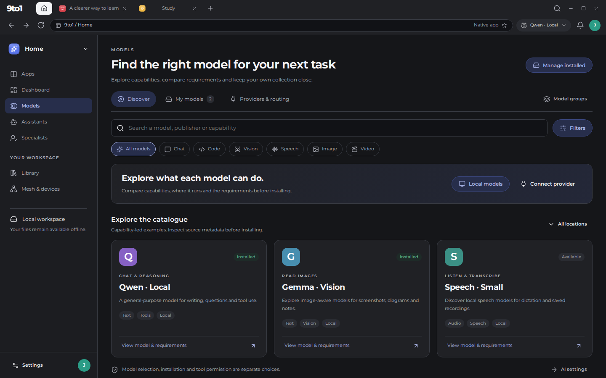
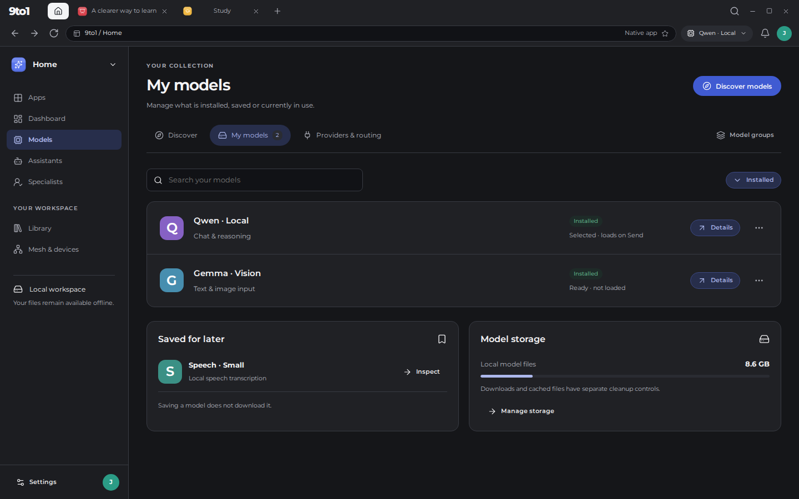
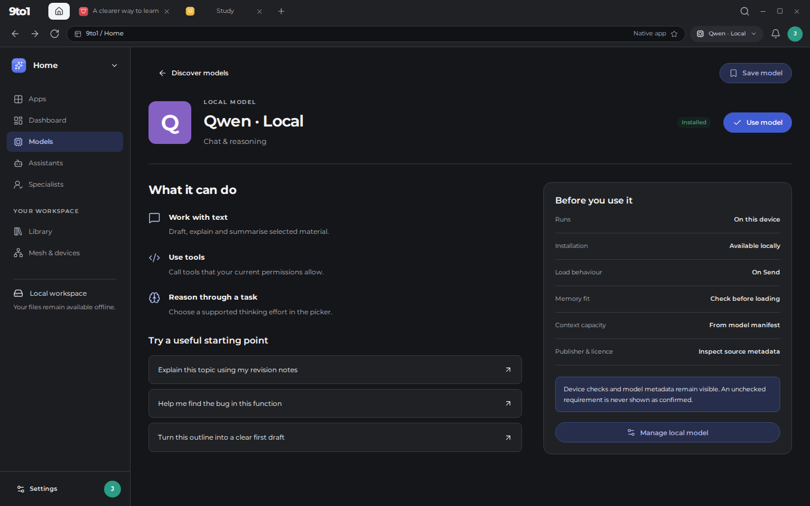
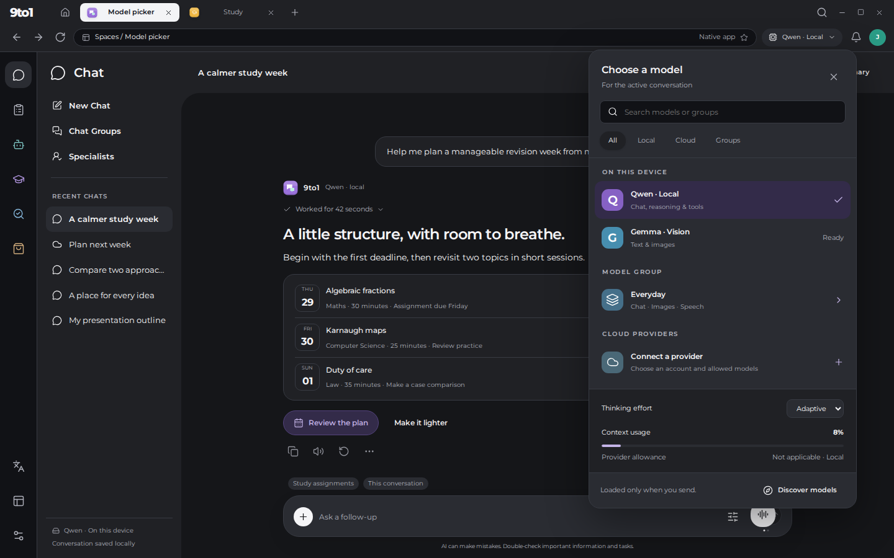

# Models, discovery and universal model routing

Module ID: `models` · 9to1 Development Specification v3

## Prerequisites

- **CUI, themes and shared interaction system** — Typed UI components, theme tokens/materials, layout, focus, motion, accessibility and shared control states.
- **Account, identity and resource entitlements** — Canonical CAKE account identity, secure sessions, server entitlements and resource allocation state.
- **Permissions, approvals and execution scope** — Effective scoped grants, action approvals, policy intersections, revocation and audit.
- **Dulche runtime, requests and execution services** — Canonical AI broker, capability-aware routing, durable Task/Runs, action execution and lifecycle.

## Overview

Models combines discovery and comparison with local installed-model management. The Universal Model Picker is the same canonical routing control in Home, Spaces and editors, with truthful capability, provider, limit and hardware information.

Current owner overrides: V3-OWNER-007, V3-RECON-001.

## Layouts & visible states

- **V3-MODELS-LAY-01** — Use discovery as the main Models experience, with search/filter, modality and capability metadata, hardware fit and a distinct Installed view. Model detail exposes source, provider, variants, limits and management actions.
- **V3-MODELS-LAY-02** — The shared picker separates Active and Background ordered routes. Chat/Image/Voice are primary groups; Audio/Video advanced groups appear when supported. Voice routes name actual voices.
- **V3-MODELS-LAY-03** — Display reasoning effort as supported discrete levels, independent from context consumption and provider usage. Unknown metrics read unknown/N/A; local routes hide inapplicable cloud allowances.

## Features & behaviour

- **V3-MODELS-FEA-01** — Install, verify, load, unload, update, remove and recover/rollback local models through actual lifecycle services. Show download/verification failures and storage requirements before committing.
- **V3-MODELS-FEA-02** — Resolve provider identity and model variant by stable IDs. A display-name match is not capability equivalence.
- **V3-MODELS-FEA-03** — For effort tiers, use canonical labels 35/70/100 for three levels, 25/50/75/100 for four and 20/40/60/80/100 for five. Bind each option bijectively to the provider’s real level ID/ordinal; do not pass these labels through the obsolete floor formula.
- **V3-MODELS-FEA-04** — Model/provider limits support explicit windows, units, reset times and user-pinned display selection. Estimates and time-to-block must be labelled and grounded in measured evidence; do not fabricate throughput or allowance.

## Canonical entities & persistence

- **V3-MODELS-ENT-01** — Keep provider/model/voice IDs, manifests, installed artifacts, capabilities, route order, active/background assignment and limit records canonical. Model weights are references managed once, not copied into each conversation.
- **V3-MODELS-ENT-02** — Account/device defaults and request/conversation overrides have explicit lifecycles and inheritance. Changing model validates inherited effort and capability settings.

## Permissions & recovery

- **V3-MODELS-PER-01** — Secure credentials; distinguish provider consent from 9to1 app grants. An installed model may be unavailable because of hardware, policy or runtime state.
- **V3-MODELS-PER-02** — Do not remove weights used by an active run without the required lifecycle handling; show real partial-install and rollback states.

## Acceptance checks

- **V3-MODELS-ACC-01** — Verify discovery→detail→install→verify→load→picker eligibility; simulate insufficient disk, incompatible hardware and failed verification.
- **V3-MODELS-ACC-02** — Test each effort mapping, mixed provider limits, no-capability models, unknown counters and local-only fallback restrictions.

## Exact mock-up and state map

- **Models · Discover** — screen `home-models`. Model discovery.
- **Models · Installed and saved** — screen `home-models-installed`. Model management.
- **Models · Capability and requirements** — screen `home-model-details`. Model details.
- **9to1 · Model picker** — screen `host-model-picker`. Anchored dropdown.

## Source clause IDs

LE-06, SPUI-133, SPUI-134, SPUI-135, SPUI-136, SPUI-137, SPUI-138, SPUI-139, SPUI-140, SPUI-141, SPUI-142, SPUI-143, SPUI-144, SPUI-145, SPUI-146, STUDY-UI-201, STUDY-AC-201, LE-08, LE-09, LE-10, LE-11, LE-12

## Technical reading map

- Models, discovery and universal model routing — Discover; Universal Model Picker (part 01) — `technical/models-01.md` (2,349 words; V2-B0441, V2-B0442, V2-B0443…).
- Models, discovery and universal model routing — Usage data contract; MODEL REASONING EFFORT DISPLAY (part 02) — `technical/models-02.md` (2,364 words; V2-B2203, COMPANION-B0015, COMPANION-B0016…).
- Models, discovery and universal model routing — CONTEXT AND USAGE PRESENTATION; MANDATORY ACCEPTANCE (part 03) — `technical/models-03.md` (1,668 words; COMPANION-B0024, COMPANION-B0025, COMPANION-B0026…).

Technical clauses retain APIs, data models, platform, recovery, donor and acceptance details. The technical files are part of this module, not optional background reading. Shared prerequisites mean stable service/interface contracts must be available; they do not require every dependent app UI to be complete. Use the named chunk for the relevant subtask or the complete module file for its full retained contract.

# Exact designs and implementation rules

These figures are the exact current atlas compositions. Their stable screen IDs match the Word specification and editable source. Open the atlas for full-size theme and interaction inspection.

## Models · Discover

Screen ID: `home-models`. Source: Owner revision 28 October; Home Discover / Universal Model Picker; UX27-SPACES-009–011.

- Models opens on discovery: search, capabilities, local/cloud choices and model requirements are first-class. Installed models and provider management remain one step away.
- Model metadata, context capacity, thinking effort and provider allowance remain distinct. Entries shown here are illustrative fixtures, not live recommendations.
- Selecting, saving, downloading, loading and granting tool permissions are separate actions.

## Models · Installed and saved

Screen ID: `home-models-installed`. Source: Owner revision 28 October; Home model manager; UX27-SPACES-009–011.

- Discovery and management share one model catalogue and canonical model identity.
- Installed, loaded, downloading and available are distinct states. Selecting a model does not load it until Send.
- Storage, model updates, removal and provider account access have independent controls. Model files can be removed without deleting conversations.

## Models · Capability and requirements

Screen ID: `home-model-details`. Source: Owner revision 28 October; Universal Model Picker / model capability metadata.

- Model details retain the selected canonical model identity from Discover and My models. Capability, local resource needs, source metadata and install state appear before selection.
- The numbers and model identities in this mock-up are fixtures; production values come from the actual model manifest and device checks.
- Context capacity, conversation usage, thinking effort and provider allowance are different fields. An unknown check stays unverified.
- Use model selects an installed model without loading it; saving and downloading are separate actions.

## 9to1 · Model picker

Screen ID: `host-model-picker`. Source: Owner revision 28 October; Universal Model Picker; UX27-SPACES-009–011.

- The host model control opens an anchored picker, rather than navigating to the model manager.
- Local models, cloud providers and model groups are searchable in the same control. Selecting a member stays lazy until Send.
- Thinking effort, context usage and provider allowance remain distinct. Cloud connection is an explicit account action.
- The Discover models link opens the catalogue without losing the current conversation.
