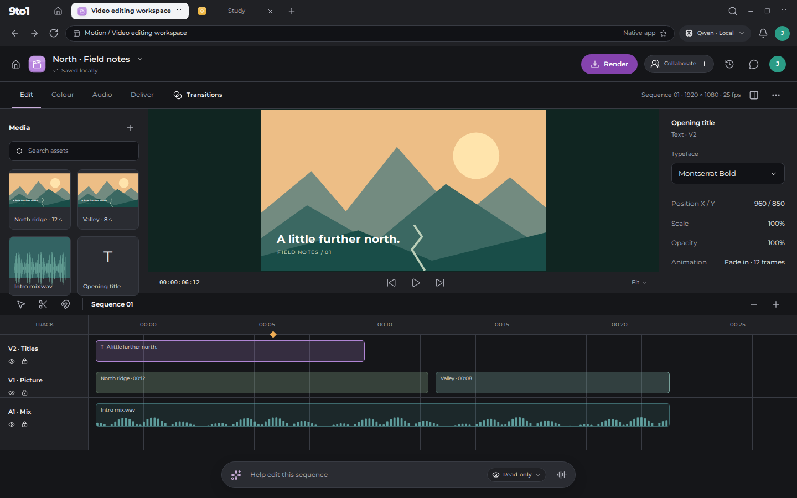
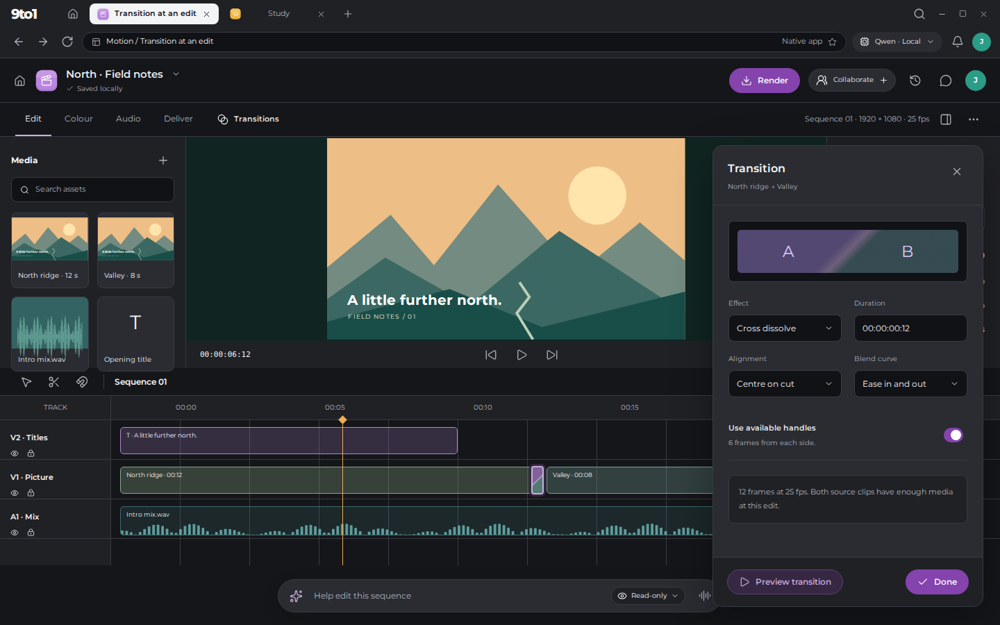
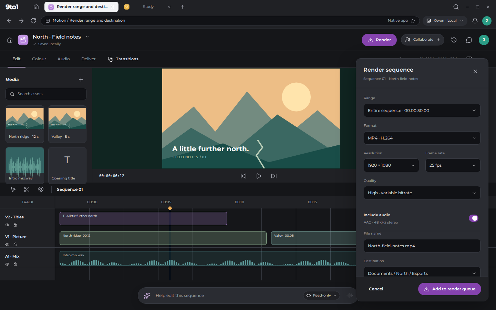

# Motion — video, composition and animation

Module ID: `motion` · 9to1 Development Specification v3

## Prerequisites

- **CUI, themes and shared interaction system** — Typed UI components, theme tokens/materials, layout, focus, motion, accessibility and shared control states.
- **Artifacts, local persistence and recovery** — Canonical artifacts, revisions, typed edits, local saves, derived exports, sync and recovery.
- **Permissions, approvals and execution scope** — Effective scoped grants, action approvals, policy intersections, revocation and audit.
- **Shared AI controls and artifact collaboration** — Contextual AI bars, shared model/permission controls, global collaborators and typed artifact proposals.

## Overview

Motion is the video/compositing and animation editor, retaining real media, timeline, keyframe and render semantics. UI polish must not reduce it to a static video preview.

## Layouts & visible states

- **V3-MOTION-LAY-01** — Use source/media bin, composition preview, layered timeline/tracks, selected clip/keyframe properties and transport with readable frame/time units.
- **V3-MOTION-LAY-02** — Show proxy/source availability, active selection, trim/keyframe editing and export queue/error states.

## Features & behaviour

- **V3-MOTION-FEA-01** — Support source-defined clip editing, compositing, effects, transitions, animation/keyframes, audio alignment and media management.
- **V3-MOTION-FEA-02** — Preview resolution/proxies and final export are distinct; render selected range with known project/frame settings.
- **V3-MOTION-FEA-03** — AI-generated/modified media is added through inspectable canonical edits and preserves original resources/provenance.

## Canonical entities & persistence

- **V3-MOTION-ENT-01** — Persist ProjectID, media/clip/layer IDs, timeline positions, frame/timebase, keyframes/effects, composition/revision and export jobs.
- **V3-MOTION-ENT-02** — Proxy/render caches are derived and replaceable; they must not become the only copy of original media.

## Permissions & recovery

- **V3-MOTION-PER-01** — Respect source/resource access and current project revision. Missing media, unsupported codec and interrupted render are recoverable states.
- **V3-MOTION-PER-02** — Reconnect render jobs without duplicating finished outputs or claiming an incomplete file is ready.

## Acceptance checks

- **V3-MOTION-ACC-01** — Test timeline trim/move, keyframes/effects, source/proxy switch and output from the exact selected range.
- **V3-MOTION-ACC-02** — Verify native project recovery, missing-media relink, playback alignment and honest failed-export handling.

## Exact mock-up and state map

- **Motion · Video editing workspace** — screen `motion`. Timeline.
- **Motion · Transition at an edit** — screen `motion-transition`. Interaction state.
- **Motion · Render range and destination** — screen `motion-export`. Interaction state.

## Source clause IDs

UX27-OTHER-009

## Technical reading map

- Motion — video, composition and animation — Motion; Product role and native project principle (part 01) — `technical/motion-01.md` (3,524 words; V2-B1669).
- Motion — video, composition and animation — Motion video editing (part 02) — `technical/motion-02.md` (93 words; V2-B2309, V2-B2310, V2-B2311).

Technical clauses retain APIs, data models, platform, recovery, donor and acceptance details. The technical files are part of this module, not optional background reading. Shared prerequisites mean stable service/interface contracts must be available; they do not require every dependent app UI to be complete. Use the named chunk for the relevant subtask or the complete module file for its full retained contract.

# Retained technical requirements

# Motion — video, composition and animation — Motion; Product role and native project principle (part 01)

Reading status: active retained clauses, subject to the v3 owner overrides listed in the primary module. Historical process instructions and replaced original wording are stored separately.

### V2-B1669 · v2 lines 8036–8209

Motion
Product role and native project principle
9-1 Motion is the native CUI video editing, compositing, animation and motion-graphics application. It combines professional non-linear editing, layered visual composition, animation, titles/graphics, colour, audio production, AI-assisted editing and generative-video workflows while keeping the default editing experience approachable.
The canonical result of work in Motion is a structured MotionProject, not a rendered video. Normal edits such as trimming, crop, speed changes, transforms, masks, effects, colour changes, captions, keyframes, procedural animation and AI-assisted mutations MUST remain inspectable editable project state. Rendering, proxies, previews, caches and exports are derived outputs and MUST NOT silently replace canonical project state.
Shared engines and dependency boundaries
Motion MUST reuse shared 9to1 engines aggressively wherever the underlying capability belongs to more than one product. Shared capability MUST live in the appropriate shared engine/library rather than requiring another app UI process or duplicating private implementations.
Motion reuses the Wave/shared-media engine for audio clips, tracks, waveform/spectrogram analysis, effects, mixing, generated speech/music/SFX and audio rendering; Picture/shared visual primitives for compatible raster/vector composition, masks, paths, still-image effects and object-level image manipulation; Present/shared animation primitives for compatible easing, interpolation and timing concepts; the Shared Productivity Engine for compatible text, vector shape, drawing/ink and transform primitives; Rnote-derived drawing/path primitives for annotation, matte/mask drawing and rotoscoping assistance; Files for canonical asset identity; Dulche/model infrastructure for analysis and generation; the shared Node Graph Framework for advanced graphs; and CUI for the shell/navigation/interaction system.
Dependency direction MUST remain acyclic and engine-oriented. Motion MUST NOT require the Picture or Wave UI processes merely to crop an image or adjust audio. Picture, Wave and Motion consume compatible shared implementations. If Motion needs a capability that Picture, Wave, Present or another surface also materially needs, the implementation SHOULD be placed in the owning shared engine rather than copied.
Canonical project model
MotionProject has stable ProjectID, Sequences[], AssetReferences[], GeneratedComponents[], GlobalSettings, ColourSettings, ProxyCacheSettings, CreatedAt, ModifiedAt and Revision.
Sequence has stable SequenceID, Width, Height, PixelAspectRatio, FrameRate/timebase, Duration, VideoTracks[], compatible AudioTracks[], Markers[], Guides/safe-area state where used, colour/HDR state and Revision.
VisualTrack has stable TrackID, name, ordered Elements[], visibility, lock state, compositing state where applicable and Revision. Audio tracks use compatible Wave/shared-media track primitives rather than a second incompatible audio model.
MotionElement has stable ElementID, ElementType, SourceAssetID or GeneratedComponentID where applicable, TrackID, TimelineStart, Duration, SourceRange, Transform, Crop, Opacity, BlendMode, Masks[], Effects[], ParameterAnimation[], graph references where applicable and Revision.
Masks, EffectInstances, AnimationTracks, Keyframes, Titles/TextObjects, CaptionTracks, CaptionCues, analysis records and Motion node-graph objects MUST have stable identity and revision-aware state where they are addressable/editable. AI, Automations, collaboration and undo/redo address canonical object IDs and properties rather than screen coordinates.
Main workspace and contextual editing
The default Motion workspace consists of Media/Assets, Viewer/Canvas, contextual Inspector and Timeline. Panels MAY be docked, resized, collapsed, moved or hidden, but the initial workspace MUST avoid exposing an unnecessarily large professional-panel wall to a new user.
The Inspector is selection-sensitive: selecting video exposes video/transform/effect controls; text exposes typography/layout/animation; masks expose mask/path controls; audio exposes Wave-compatible controls; generated objects expose generation/provenance controls; and no selection exposes sequence/project controls.
Direct manipulation in the Viewer/Canvas MUST mutate the same canonical properties and typed actions used by the Inspector, keyboard operations, APIs and AI. The viewer MUST NOT maintain a separate UI-only transform or mask state.
Timeline and non-linear editing
Motion MUST provide a professional multi-track NLE timeline with accurate frame/timecode semantics, in/out ranges, source/sequence viewing, snapping, multi-selection, markers, grouping, linked audio/video, track controls and nested sequences.
Minimum typed editing operations include insert, overwrite, append, blade/split, trim, ripple trim, roll, slip, slide, ripple delete, lift, extract, move, duplicate, group/ungroup, link/unlink audio and video, track lock, video visibility, audio mute/solo where applicable, range selection and nested-sequence creation/use.
Transport MUST support ordinary play/pause, frame stepping and efficient shuttle/scrub control, including keyboard-first operation such as J/K/L-style transport where appropriate. Editing operations MUST be deterministic at the sequence timebase and MUST NOT depend on pixel coordinates in the timeline UI.
Video tracks may contain video, images, Picture assets, titles/text, vector graphics, shapes/ink, generated media, adjustment/effect layers, nested sequences and other registered compatible visual elements. Timeline editing remains non-destructive by default.
Source media, proxies, preview and cache
Motion MUST separate canonical source media from proxy media, decode caches, analysis caches, preview renders and final render output. Editing against a proxy MUST preserve the same canonical source identity, timing, ElementID and project semantics.
Motion MUST support automatic proxy generation, user-requested proxies, configurable proxy resolution/codec where supported, per-asset proxy state, background generation, lower-resolution viewer playback and render/pre-render caching.
Final render/export MUST use canonical source media at requested output quality unless the user explicitly chooses a proxy-derived or otherwise lower-quality source path. Missing or stale proxies/caches are recoverable derived-state problems and MUST NOT make the canonical project invalid.
Viewer, transforms and visual composition
The Viewer doubles as an interactive composition canvas. Users can directly inspect and edit position, scale, rotation, anchor/pivot, crop, opacity, masks, alignment/guides, text bounds and compatible shape/path properties.
Transform and visual-property edits MUST be represented by canonical property mutations. Source pixels/frames remain unchanged unless the user explicitly performs a destructive source-operation workflow outside normal Motion project editing.
Motion MUST support layered compositing with opacity, blend modes, alpha, masks, mattes, track mattes, chroma/luma keying, nesting/precomposition, adjustment layers and explicit compositing order where supported.
Animation and keyframes
Suitable numeric, vector, colour, mask, effect, text and generated-component properties MUST be animatable through a common parameter-animation system rather than each feature inventing incompatible keyframe storage.
Keyframes have stable identity and support create, move, copy, duplicate, delete and value editing. Supported interpolation includes at least hold/step, linear and smooth/eased interpolation, with Bézier/value curves where meaningful. Motion MUST provide easing presets and a graph/curve editor for advanced editing.
Shared Present animation/timing primitives SHOULD be reused when semantics are compatible, while Motion remains authoritative for timeline/frame-based video state.
Advanced node editor
Motion MUST include a full visual node editor for advanced compositing, effects, transitions, motion graphics and procedural animation. It reuses the shared 9to1 Node Graph Framework for GraphID/NodeID/PortID identity, pan/zoom, selection, grouping, comments, typed ports, connection validation, copy/paste/duplicate, undo/redo, graph revisioning, AI graph mutation and execution-state visualisation.
Motion registers a rich Motion-specific node catalogue. Minimum families include media/sequence inputs, transform, crop, masks/mattes, compositing/blending, chroma/luma keying, colour processing, blur/sharpen, distortion/displacement, tracking data, procedural shapes, text/title generation, time offsets, retiming, parameter maths, curves, interpolation/easing, switching/conditions, generators and compatible particle/procedural systems where implemented.
Node graphs are structured project state. Branching graphs MUST NOT require destructive intermediate renders merely because an operation is non-linear. Render/cache intermediates MAY be produced for performance, but graph topology, parameters and inputs remain canonical.
The normal Motion UI MUST remain usable without nodes. Common effects and animation can be edited directly. Where an advanced representation is appropriate, Open in Node Editor/Advanced exposes or creates the structured graph without silently replacing unrelated project state.
Motion graph types and reusable graph assets
Motion defines native reusable graph objects including MotionEffectGraph, MotionTransitionGraph, MotionAnimationGraph and MotionCompositionGraph. Each has stable identity, revision state, typed inputs/outputs, internal NodeGraph identity, exposed user parameters and provenance/origin metadata where applicable.
Graphs may be embedded in one project or saved as reusable presets/components. Shared-definition instances MUST have explicit semantics for edit-this-instance, detach/copy or update-shared-definition; editing one instance MUST NOT unexpectedly rewrite every use.
Registered custom node types MAY be supplied through the broader 9to1 extension system subject to capability, trust and permission rules. First- or third-party node providers MUST participate in typed graph contracts rather than injecting arbitrary UI-only behaviour.
Custom transitions
Transitions MUST support ordinary built-in transitions and reusable MotionTransitionGraph assets. A custom transition graph receives at least outgoing visual input, incoming visual input, normalised transition progress from 0 to 1, frame/time context, sequence dimensions and any declared exposed parameters.
Transition graphs can therefore implement animated masks, zoom/whip transitions, blur, displacement, glitch/RGB treatments, procedural reveals and other advanced effects. The resulting transition remains editable and reusable rather than being permanently rendered into replacement clips.
Transition duration, alignment and exposed parameters remain ordinary structured timeline state and can be animated where compatible.
Procedural animation and property drivers
MotionAnimationGraph can drive compatible properties without baking every frame into ordinary keyframes. Minimum useful node families include constants, vectors, arithmetic, clamp, map/remap range, curves, noise, oscillators, frame/time, velocity, distance, interpolation, easing, deterministic seeded random, tracking data, audio amplitude/frequency analysis and safe formula/expression nodes where supported.
Keyframes, procedural graphs, tracking and linked values MUST interoperate through one canonical parameter-source model. A property can have a base/static value, keyframed value, procedural contribution and/or tracked/linked contribution only where the combination semantics are explicitly defined. The Inspector MUST make it clear what currently drives a property.
Example: a title may follow tracked subject position, retain hand-authored keyframed movement and add a small procedural noise offset without baking thousands of frame values.
Masks, tracking and rotoscoping
Masks are native editable objects supporting compatible path geometry, feather, opacity, expansion and animation. Manual drawing/path editing SHOULD reuse shared Picture/Rnote-derived primitives where semantics match.
Motion SHOULD support point, planar, subject or object tracking according to configured backends. Tracking data is structured and may drive transforms, masks, effects, text or procedural graphs.
Model-assisted subject/object segmentation and rotoscoping MAY initialise or update masks, but users MUST be able to inspect and correct results. Frame-by-frame/manual correction remains possible. Tracking or segmentation MUST NOT silently destroy source media.
Colour pipeline
Motion MUST include first-party colour correction/grading suitable for normal production. Minimum controls include exposure, contrast, highlights/shadows, temperature/tint, saturation and curves, plus channel/colour-wheel or equivalent advanced controls where implemented.
LUT import/use, histograms/scopes and per-clip or adjustment-layer grading SHOULD be supported where the backend permits. Sequence/project colour-space state MUST explicitly represent SDR/HDR and managed-colour configuration where supported rather than relying on hidden backend defaults.
Effects, titles and graphics
Effects are structured EffectInstance objects with stable identity, provider/type identity, ordered placement, parameters, bypass state and animation references. Core families include colour, blur/sharpen, transform, keying, distortion, stylisation and utility effects. Effect stacks remain reorderable, bypassable, editable and removable.
Titles and graphics MUST remain native structured objects rather than pre-rendered video. Text/title state includes text content, font/style, paragraph/layout, fills/strokes, backgrounds, transforms, shapes/images, effects and compatible animation.
Lower thirds, callouts, captions and reusable title compositions can therefore remain editable. Complex title/graphic systems MAY use Motion node graphs while retaining the same canonical object identity.
Captions and transcript-based editing
Motion MUST support time-aligned transcription and first-class CaptionTrack/CaptionCue objects. Capabilities include transcript correction, generated captions, editable cue timing/text, split/merge, styling, multiple caption tracks/languages where supported and import/export of maintained subtitle formats such as SRT/WebVTT.
Export MUST support appropriate sidecar, embedded and burned-in caption output according to chosen container/backend capability.
Transcript-based edits such as deleting a spoken phrase or removing long pauses MUST translate into ordinary native timeline edits after preview/validation. Transcript state is a semantic editing view over the canonical timeline, not a parallel hidden authority.
Audio and Wave interoperability
Motion audio tracks/clips use compatible Wave/shared-media primitives. Motion directly exposes normal video-production audio controls such as gain/volume, pan, fades, waveform display, effects, normalisation, automation and applicable dialogue cleanup.
Where supported, Motion can invoke the shared Enhance Audio, Denoise, Custom Censorship and Split Stems capabilities defined by Wave/shared media without creating incompatible private versions.
Open/Edit in Wave MUST preserve canonical asset/clip/timing references so advanced audio work can return to Motion without a lossy export-edit-import cycle. Wave remains the full audio-production surface; Motion provides the subset appropriate to video workflows.
AI-assisted editing
Dulche operates Motion through typed Motion/shared-engine actions and NodeGraph actions, never by pretending to drag timeline or canvas UI when semantic actions exist.
Examples: 'remove long pauses' performs transcript/time analysis and native ripple edits; 'make this vertical for a short' creates or adapts an appropriate sequence and uses structured reframing/crop/tracking; 'add animated subtitles' creates caption/title objects and animation; 'make this shot warmer' changes colour parameters; 'create a 30-second highlight reel' creates a new sequence referencing selected source ranges.
AI-generated edits MUST remain inspectable, undoable/revisioned project state. AI MUST NOT render an opaque replacement video and declare the structured editing task complete when Motion can represent the requested result natively.
Generative and model-backed video workflows
Subject to installed/configured provider capability, Motion MAY provide video generation, image-to-video, generated B-roll, object/background removal, semantic segmentation, smart reframing, scene/shot detection, motion/subject tracking, video restoration/denoise, enhancement/upscaling, frame interpolation, slow-motion generation, generative fill, temporal inpainting and frame/outpainting/extension.
When a generated result can be represented as editable native Motion structure, that representation remains canonical. When the model inherently returns raster/video frames that cannot reasonably be decomposed into lower-level Motion objects, Motion may create a GeneratedVideoAsset with stable identity, model/provider provenance, generation parameters, source references and revision metadata.
Native-generation rules MUST NOT be misinterpreted as requiring generated video pixels to be decomposed into fake editable vectors. The requirement is to preserve genuine structure where it exists and preserve provenance/editability around sampled/generated media where it does not.
Media analysis and indexing
Motion MAY maintain source/revision-aware analysis metadata for cuts/scenes, transcript/speech, silence, audio peaks, motion, tracked subjects/objects, semantic tags and other useful signals supported by configured analysis backends.
Analysis results are cacheable derived metadata tied to source identity/revision. Unchanged media SHOULD NOT be repeatedly reanalysed merely because a project was reopened. Stale analysis is invalidated or refreshed explicitly when its source assumptions change.
Files, asset identity and offline media
Files remains authoritative for source/export asset storage identity, move/rename/delete/recover/share and cloud/provider hydration. Motion projects reference stable FileID/AssetID identities rather than absolute paths.
Moving or renaming an underlying File MUST NOT detach a Motion reference. Unavailable source enters an explicit offline-media state and retains timeline/project identity. Relink resolves the existing reference rather than silently creating a new unrelated element.
Generated, proxy, cache and rendered assets MUST be distinguishable from canonical source identity and carry appropriate provenance/derivation metadata.
Import, export and render queue
Motion import MUST support maintained video, image and audio formats exposed by the approved shared media backend. GStreamer/GStreamer Editing Services or an explicitly documented equivalent production-capable backend is approved for decode/encode/playback/timeline primitives. Backend-specific IDs MUST NOT leak into the canonical public Motion project contract.
Export MUST support sequence/project render, selected range, frame stills, audio-only output, caption/subtitle output and appropriate individual-clip/component exports. Options include maintained container/codec choices, resolution, frame rate, quality/bitrate, audio codec/rate/channels, hardware encoder selection or automatic acceleration and SDR/HDR/colour-space options where supported.
Motion MUST provide a render queue/background-job model with stable job identity, progress, cancellation, typed failure state and safe retry. Export/render MUST be pinned to the intended project/source revision and MUST NOT silently switch to newly edited state mid-job.
Persistent AI bar
Motion hosts the global persistent Dulche AI bar. Semantic context includes ProjectID, SequenceID, selected TrackIDs/ElementIDs/GraphIDs, selected timeline range, playhead, viewer selection, masks/effects/keyframes, transcript/caption selection, source assets, colour state, analysis state and project revision.
Write-capable AI changes Motion only through typed Motion/shared-engine/NodeGraph actions and respects normal permission, trust, revision and undo/audit contracts.
Motion API
Motion's first-party API catalogue is exhaustive under the global API-parity rule. Minimum canonical entry points include:
9to1.Motion.CreateProject(config);
9to1.Motion.Open(projectOrFileID);
9to1.Motion.CreateSequence(projectID, config);
9to1.Motion.AddAsset(projectID, fileOrAssetID, options?);
9to1.Motion.AddTrack(sequenceID, type, config?);
9to1.Motion.AddElement(sequenceID, trackID, source, placement);
9to1.Motion.Insert(sequenceID, source, placement);
9to1.Motion.Overwrite(sequenceID, source, placement);
9to1.Motion.Split(sequenceID, elementID, time);
9to1.Motion.Trim(sequenceID, elementID, sourceRange);
9to1.Motion.RippleTrim(sequenceID, elementID, edge, time);
9to1.Motion.Roll(sequenceID, leftElementID, rightElementID, time);
9to1.Motion.Slip(sequenceID, elementID, sourceRange);
9to1.Motion.Slide(sequenceID, elementID, placement);
9to1.Motion.Move(sequenceID, elementID, placement);
9to1.Motion.Delete(sequenceID, target, mode?);
9to1.Motion.Nest(sequenceID, elementIDs, config?);
9to1.Motion.SetProperty(projectID, targetID, property, value);
9to1.Motion.AddEffect(projectID, targetID, effect, config?);
9to1.Motion.SetEffectParameter(projectID, effectID, parameter, value);
9to1.Motion.SetKeyframe(projectID, targetID, property, keyframe);
9to1.Motion.CreateMask(projectID, targetID, config);
9to1.Motion.UpdateMask(maskID, patch);
9to1.Motion.Track(projectID, target, mode, options?);
9to1.Motion.Transcribe(projectID, target, options?);
9to1.Motion.CreateCaptions(sequenceID, source, options?);
9to1.Motion.CreateGraph(projectID, graphType, config);
9to1.Motion.AssignGraph(projectID, targetID, graphID, slot?);
9to1.Motion.Generate(projectID, generationType, promptOrInputs, options?);
9to1.Motion.Render(projectID, target, options);
9to1.Motion.Export(projectID, target, format, options);
All node mutation uses the shared 9to1.NodeGraph.* contract where Node Graph Framework is canonical. Shared media, Files, Picture and other shared-domain operations SHOULD use the owning shared API namespace when that is canonical. First-party UI capabilities MUST NOT exist only as inaccessible private UI commands.
Automation and integration events
Automations, Spaces, Dulche and other authorised clients can use the exhaustive Motion action catalogue. Long proxy, analysis, tracking, generation, render and export jobs expose stable progress, cancellation, retry/idempotency where relevant and typed result/error state.
Motion emits meaningful typed events such as project/revision changed, source offline/relinked, analysis completed, proxy ready, tracking completed, render/export completed/failed and graph/generated-component changed. It MUST NOT flood Automations with raw frame, pointer or realtime preview events.
Collaboration and revision conflicts
Project/sequence/track/element/mask/effect/keyframe/graph/caption mutations are revision-aware. Independent object edits MAY merge when safe; incompatible concurrent edits to the same canonical object or property MUST surface conflict rather than blind last-write-wins.
Running proxy, tracking, generation, render and export jobs are pinned to their required source/project revisions. Their results MUST record which revision/input produced them.
Accessibility
Motion MUST be keyboard-operable for transport, timeline selection/editing, track controls, inspector properties, captions, keyframes, render jobs and graph editing. Pointer-only gestures cannot be the sole route for required editing operations.
Screen-reader users can inspect project/sequence/track/element identity, source/offline state, time positions, duration, transform/effect values, keyframes, captions, graph nodes/ports and render/job state. Visual states such as lock, disable, offline, clipping, selection and errors MUST NOT rely on colour alone.
Viewer/canvas operations that normally use direct manipulation MUST expose equivalent numeric/semantic controls.
Performance and realtime preview safety
Motion MUST decode/render frames on demand using bounded caches rather than loading entire long-form or high-resolution sources into memory. Thumbnail, waveform, proxy, analysis, tracking, generation and render work runs outside latency-sensitive interactive paths.
GPU acceleration and hardware decode/encode SHOULD be used where safe and available, with explicit capability fallback. 4K/8K and otherwise heavy media remain workable through proxies, reduced preview quality, caching and tiling according to available hardware rather than an architecture that assumes full-resolution residency.
Interactive editing MUST remain responsive while background jobs run. Preview quality MAY adapt under load, but canonical time/frame calculations and final requested render quality MUST remain deterministic and source-based.
Recovery and failure behaviour
Project saves/autosaves MUST be crash-safe and preserve canonical project integrity. A crash or termination during proxy generation, analysis, tracking, generation, render or export MUST leave the project valid and the derived job recoverable/retryable where feasible.
Partial derived output MUST NOT be reported as complete. Failures expose typed state such as ProjectNotFound, SequenceNotFound, ElementNotFound, AssetOffline, CodecUnsupported, ProxyFailed, AnalysisFailed, TrackingFailed, GraphInvalid, NodeUnavailable, GenerationFailed, RenderFailed, ExportFailed, RevisionConflict, PermissionDenied and CapabilityUnavailable plus shared backend/model errors.
Undo/redo and revision history MUST restore structured project changes without requiring source media to be rewritten.
Platform capability behaviour
Windows, 9to1-OS and web preserve the same canonical Motion project/graph/generated-component model while capability-negotiating codecs, GPU/hardware acceleration, camera/device access, model availability and performance differences.
A platform may disable an unavailable codec, hardware encoder, node provider or model-backed feature with explicit CapabilityUnavailable state, but MUST NOT silently create an incompatible project schema.
When Home is absent at process start, Motion follows the global Install Home/bootstrap contract rather than launching an incompatible private runtime.
Acceptance requirements
Motion is implementation-complete only when acceptance coverage verifies at least:
* A multi-track project containing video, image, title and audio elements can be edited, closed/reopened and exported while preserving stable project/sequence/track/element identity.
* Insert/overwrite, split, trim, ripple trim, roll, slip, slide, ripple delete, lift/extract, linking and nested-sequence operations produce deterministic structured timeline state and remain undoable.
* Normal transforms, crop, masks, effects, colour and speed changes remain non-destructive and survive save/reopen.
* Proxy editing retains canonical source identity and final export uses original source quality unless explicitly configured otherwise.
* Keyframed animation persists stable property/keyframe state and the graph/curve editor reproduces the same rendered motion after reopen.
* A MotionCompositionGraph can branch/composite multiple visual inputs without flattening the canonical graph; graph edits remain inspectable after restart.
* A custom MotionTransitionGraph receives outgoing/incoming inputs and normalised progress, renders between clips and remains reusable/editable.
* A MotionAnimationGraph can procedurally drive a property and can coexist with explicitly defined keyframe/tracking contributions without baking per-frame values.
* Registered graph nodes enforce typed-port validation; an invalid connection is rejected without corrupting the graph.
* Masking, chroma/luma keying, tracking and manual correction create inspectable editable state rather than rewriting source frames.
* Titles/text remain editable native objects after animation/effects and do not require pre-rendering for ordinary editing.
* Transcript/caption workflows create first-class timed caption state; transcript-based deletion maps to ordinary timeline edits; maintained subtitle import/export round-trips representative content.
* Motion and Wave share compatible audio identity so advanced Wave editing returns to the same Motion audio reference without an unnecessary export/import duplicate.
* Shared Enhance Audio, Denoise, Custom Censorship and Split Stems can be invoked from Motion where capability is available without creating an incompatible private audio model.
* AI editing examples such as pause removal, vertical reframing, animated subtitles and highlight-sequence creation execute through typed Motion actions and leave inspectable native state.
* Generated video that cannot be represented structurally is stored as a provenance-bearing GeneratedVideoAsset rather than misrepresented as a fully editable native composition.
* Offline source media preserves timeline/project identity and relink restores the existing reference.
* Render queue jobs expose progress/cancellation/failure and remain pinned to the intended project revision; interrupted derived jobs do not corrupt the project.
* Large/high-resolution projects remain responsive through proxies, bounded caches, background analysis and adaptive preview rather than full-media RAM loading.
* Keyboard and assistive-technology paths can perform required timeline, property, caption, graph and render-queue operations without pointer-only dependency.
* Windows, 9to1-OS and web preserve the same canonical project model while capability-negotiating backend/hardware/model differences.
* When Home is absent at process start, Motion follows the global Install Home/bootstrap contract.
Data Apps

# Motion — video, composition and animation — Motion video editing (part 02)

Reading status: active retained clauses, subject to the v3 owner overrides listed in the primary module. Historical process instructions and replaced original wording are stored separately.

### V2-B2309 · v2 lines 13451–13451

### UX27-OTHER-009 — Motion video editing

### V2-B2310 · v2 lines 13453–13453

**B/D.** Media bins, source/program viewer, timeline tracks/clips, inspector and effects have clear ownership and selection. Scrubbing updates the corresponding actual frame/timecode; move/trim/ripple/roll operations show their effect before commit and preserve sync relationships. Snapping is a visible setting, not an always-on hidden constraint.

### V2-B2311 · v2 lines 13455–13455

Transitions/effects/keyframes remain editable structured state. Proxy quality and dropped preview frames are disclosed and do not redefine final output fidelity. Export identifies sequence/range, codec/settings and actual completed artifact; an interrupted render never appears finished. Relink/recovery and save/reopen preserve the project independently of temporary preview caches.

# Exact designs and implementation rules

These figures are the exact current atlas compositions. Their stable screen IDs match the Word specification and editable source. Open the atlas for full-size theme and interaction inspection.

## Motion · Video editing workspace

Screen ID: `motion`. Source: UX27-OTHER-008–009; Motion media/viewer/inspector/timeline baseline; CUI-PREF-203.

- Media bin, program viewer, contextual inspector and multitrack timeline form the default workspace.
- Source frame is original geometric illustration, not a photograph or real video preview. Production frame and audio must align with the current playhead.
- Sequence source, trim and effects stay nondestructive. Authored titles remain editable text objects.
- Export range, resolution and missing-media validation are explicit before rendering.

## Motion · Transition at an edit

Screen ID: `motion-transition`. Source: Owner revision 28 October; Motion sequence edits and nondestructive effects.

- A transition belongs to a specific cut between clips and exposes its handles, duration and alignment.
- The selected cut remains visible on the sequence while the full-height properties panel keeps effect, duration, alignment and source-handle availability together.
- Preview uses the same sequence timebase and source media. Missing handles produce a scoped warning before the edit is applied.
- The effect is editable and undoable; it never rewrites the original clips.

## Motion · Render range and destination

Screen ID: `motion-export`. Source: Owner revision 28 October; Motion render and missing-media validation.

- The render sheet distinguishes sequence range, format, resolution, frame rate and audio settings.
- Validation checks the chosen revision and media dependencies before the render starts.
- Render queue status is separate from project save state. A completed job reports its actual output path.
