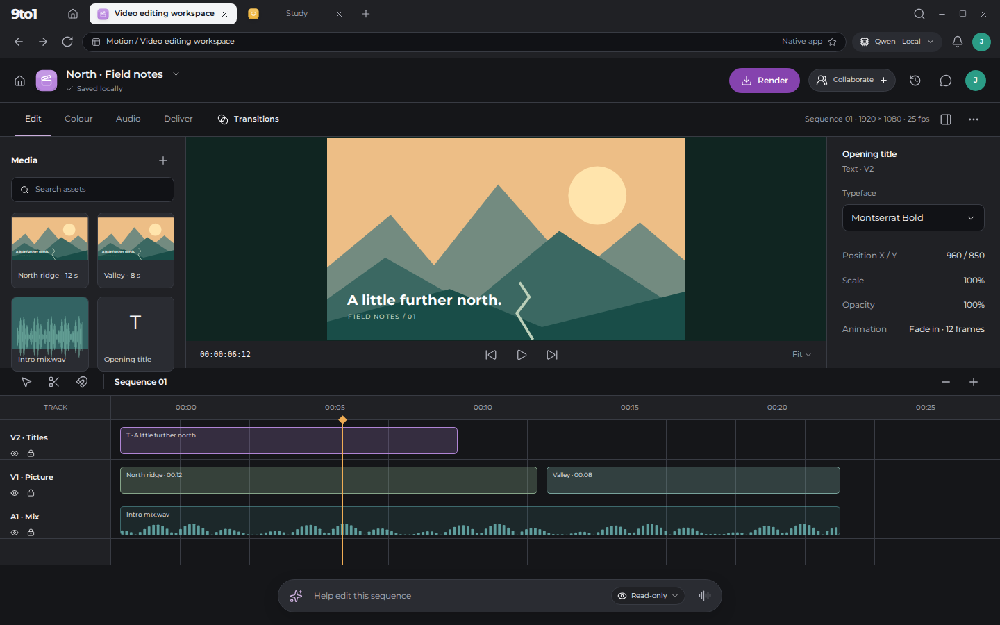
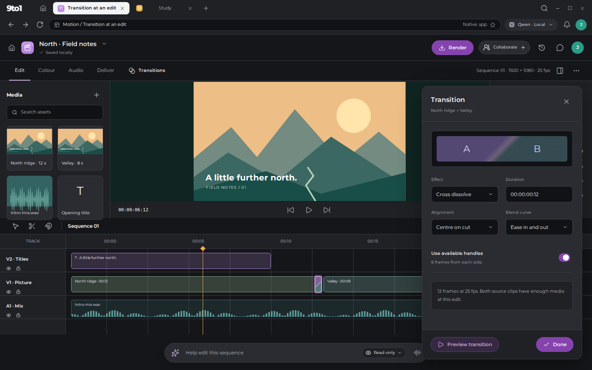
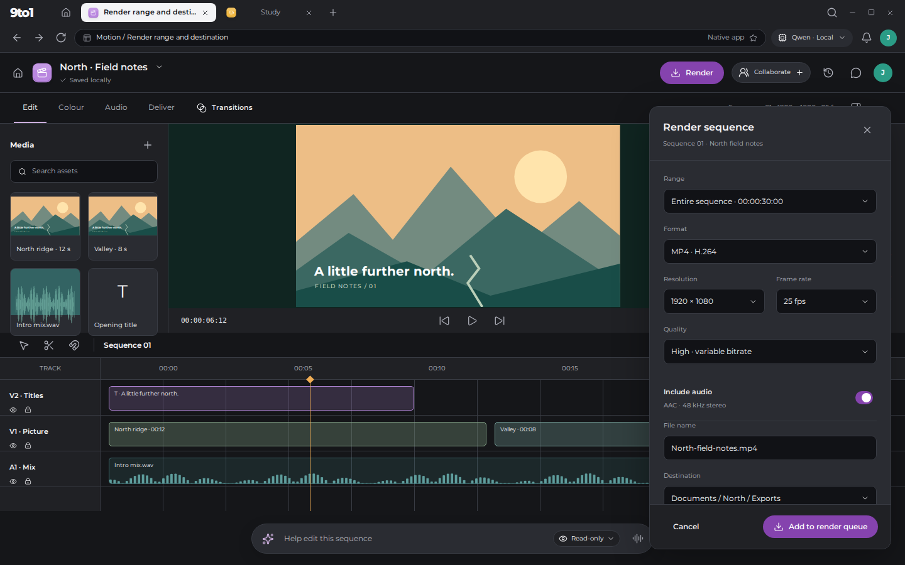

# Motion — video, composition and animation

Module ID: `motion` · 9to1 Development Specification v3

## Prerequisites

- **CUI, themes and shared interaction system** — Typed UI components, theme tokens/materials, layout, focus, motion, accessibility and shared control states.
- **Artifacts, local persistence and recovery** — Canonical artifacts, revisions, typed edits, local saves, derived exports, sync and recovery.
- **Permissions, approvals and execution scope** — Effective scoped grants, action approvals, policy intersections, revocation and audit.
- **Shared AI controls and artifact collaboration** — Contextual AI bars, shared model/permission controls, global collaborators and typed artifact proposals.

## Overview

Motion is the video/compositing and animation editor, retaining real media, timeline, keyframe and render semantics. UI polish must not reduce it to a static video preview.

## Layouts & visible states

- **V3-MOTION-LAY-01** — Use source/media bin, composition preview, layered timeline/tracks, selected clip/keyframe properties and transport with readable frame/time units.
- **V3-MOTION-LAY-02** — Show proxy/source availability, active selection, trim/keyframe editing and export queue/error states.

## Features & behaviour

- **V3-MOTION-FEA-01** — Support source-defined clip editing, compositing, effects, transitions, animation/keyframes, audio alignment and media management.
- **V3-MOTION-FEA-02** — Preview resolution/proxies and final export are distinct; render selected range with known project/frame settings.
- **V3-MOTION-FEA-03** — AI-generated/modified media is added through inspectable canonical edits and preserves original resources/provenance.

## Canonical entities & persistence

- **V3-MOTION-ENT-01** — Persist ProjectID, media/clip/layer IDs, timeline positions, frame/timebase, keyframes/effects, composition/revision and export jobs.
- **V3-MOTION-ENT-02** — Proxy/render caches are derived and replaceable; they must not become the only copy of original media.

## Permissions & recovery

- **V3-MOTION-PER-01** — Respect source/resource access and current project revision. Missing media, unsupported codec and interrupted render are recoverable states.
- **V3-MOTION-PER-02** — Reconnect render jobs without duplicating finished outputs or claiming an incomplete file is ready.

## Acceptance checks

- **V3-MOTION-ACC-01** — Test timeline trim/move, keyframes/effects, source/proxy switch and output from the exact selected range.
- **V3-MOTION-ACC-02** — Verify native project recovery, missing-media relink, playback alignment and honest failed-export handling.

## Exact mock-up and state map

- **Motion · Video editing workspace** — screen `motion`. Timeline.
- **Motion · Transition at an edit** — screen `motion-transition`. Interaction state.
- **Motion · Render range and destination** — screen `motion-export`. Interaction state.

## Source clause IDs

UX27-OTHER-009

## Technical reading map

- Motion — video, composition and animation — Motion; Product role and native project principle (part 01) — `technical/motion-01.md` (3,524 words; V2-B1669).
- Motion — video, composition and animation — Motion video editing (part 02) — `technical/motion-02.md` (93 words; V2-B2309, V2-B2310, V2-B2311).

Technical clauses retain APIs, data models, platform, recovery, donor and acceptance details. The technical files are part of this module, not optional background reading. Shared prerequisites mean stable service/interface contracts must be available; they do not require every dependent app UI to be complete. Use the named chunk for the relevant subtask or the complete module file for its full retained contract.

# Exact designs and implementation rules

These figures are the exact current atlas compositions. Their stable screen IDs match the Word specification and editable source. Open the atlas for full-size theme and interaction inspection.

## Motion · Video editing workspace

Screen ID: `motion`. Source: UX27-OTHER-008–009; Motion media/viewer/inspector/timeline baseline; CUI-PREF-203.

- Media bin, program viewer, contextual inspector and multitrack timeline form the default workspace.
- Source frame is original geometric illustration, not a photograph or real video preview. Production frame and audio must align with the current playhead.
- Sequence source, trim and effects stay nondestructive. Authored titles remain editable text objects.
- Export range, resolution and missing-media validation are explicit before rendering.

## Motion · Transition at an edit

Screen ID: `motion-transition`. Source: Owner revision 28 October; Motion sequence edits and nondestructive effects.

- A transition belongs to a specific cut between clips and exposes its handles, duration and alignment.
- The selected cut remains visible on the sequence while the full-height properties panel keeps effect, duration, alignment and source-handle availability together.
- Preview uses the same sequence timebase and source media. Missing handles produce a scoped warning before the edit is applied.
- The effect is editable and undoable; it never rewrites the original clips.

## Motion · Render range and destination

Screen ID: `motion-export`. Source: Owner revision 28 October; Motion render and missing-media validation.

- The render sheet distinguishes sequence range, format, resolution, frame rate and audio settings.
- Validation checks the chosen revision and media dependencies before the render starts.
- Render queue status is separate from project save state. A completed job reports its actual output path.
