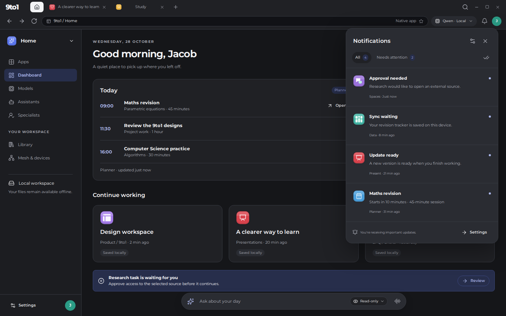

# Notifications and ecosystem activity

Module ID: `notifications` · 9to1 Development Specification v3

## Prerequisites

- **Platform, app registry and host integration** — Canonical app registry, artifact routes, native/browser embedding, lifecycle and semantic UI/API parity.
- **CUI, themes and shared interaction system** — Typed UI components, theme tokens/materials, layout, focus, motion, accessibility and shared control states.
- **Artifacts, local persistence and recovery** — Canonical artifacts, revisions, typed edits, local saves, derived exports, sync and recovery.
- **Permissions, approvals and execution scope** — Effective scoped grants, action approvals, policy intersections, revocation and audit.

## Overview

Notifications owns user-visible notifications and ecosystem activity history. It replaces the separate Events destination while preserving EventID, provenance, audit, source routing and read-state backend contracts.

Current owner overrides: V3-OWNER-003.

## Layouts & visible states

- **V3-NOTIFICATIONS-LAY-01** — Open Notifications from the global anchored control. Provide useful unread/all/activity grouping, time/source labels, actionable task states and safe empty/error states.
- **V3-NOTIFICATIONS-LAY-02** — Settings controls notification preferences, channels and quiet periods; it is distinct from the notification feed itself.

## Features & behaviour

- **V3-NOTIFICATIONS-FEA-01** — Deep links open the canonical task, conversation, app artifact or approval target. Read/unread and dismiss operations change notification state, not source task completion.
- **V3-NOTIFICATIONS-FEA-02** — Preserve typed event ingestion, deduplication, priority, action affordances and audit provenance. A failed background action must not be concealed by dismissing its notification.
- **V3-NOTIFICATIONS-FEA-03** — Keep events used in backend logs/data models; only the old user-facing Events navigation is removed.

## Canonical entities & persistence

- **V3-NOTIFICATIONS-ENT-01** — Maintain NotificationID/EventID, source entity IDs, timestamp, severity/category, read/dismiss state and permitted action targets.
- **V3-NOTIFICATIONS-ENT-02** — Retain history according to account/org policy; render only authorised event details.

## Permissions & recovery

- **V3-NOTIFICATIONS-PER-01** — Recheck target permission on open; redact revoked source details and offer safe unavailable status.
- **V3-NOTIFICATIONS-PER-02** — Do not replay consequential actions from a stale notification without validating current state and approval.

## Acceptance checks

- **V3-NOTIFICATIONS-ACC-01** — Test unread/read/dismiss/deep-link, duplicate ingestion, revoked targets, failed task notification and quiet-period settings.
- **V3-NOTIFICATIONS-ACC-02** — Verify Notifications behaves consistently from Home, Spaces and an editor and no visible Events destination remains.

## Exact mock-up and state map

- **9to1 · Notifications** — screen `host-notifications`. Anchored dropdown.

## Source clause IDs

Named baseline section(s) retained in the technical-source chapters below.

## Technical reading map

- Notifications and ecosystem activity — Notifications — activity history; Notifications (part 01) — `technical/notifications-01.md` (193 words; V2-B0437, V2-B0438, V2-B0439…).

Technical clauses retain APIs, data models, platform, recovery, donor and acceptance details. The technical files are part of this module, not optional background reading. Shared prerequisites mean stable service/interface contracts must be available; they do not require every dependent app UI to be complete. Use the named chunk for the relevant subtask or the complete module file for its full retained contract.

# Retained technical requirements

# Notifications and ecosystem activity — Notifications — activity history; Notifications (part 01)

Reading status: active retained clauses, subject to the v3 owner overrides listed in the primary module. Historical process instructions and replaced original wording are stored separately.

### V2-B0437 · v2 lines 2244–2244

V3 editorial amendment: V3-OWNER-003. Original wording is preserved in the replacement ledger.

Notifications — activity history

### V2-B0438 · v2 lines 2247–2247

V3 editorial amendment: V3-OWNER-003. Original wording is preserved in the replacement ledger.

Notifications includes Home’s ecosystem activity/timeline surface. It is not Planner’s calendar. Activity history MUST aggregate authorised typed activity from apps/services such as Agent/Automation runs, package/update events, permission/trust decisions, important artifact changes, Mesh/device events, notifications and other meaningful system activity.

### V2-B0439 · v2 lines 2250–2250

V3 editorial amendment: V3-OWNER-003. Original wording is preserved in the replacement ledger.

Each Event MUST have a stable EventID, timestamp, source app/service, event type, actor/caller identity where relevant, object/entity references, severity/category, human-readable summary and typed deep-link/action references where available. Activity history MAY reference RequestID/ActionGraphID for AI/agentic activity.

### V2-B0440 · v2 lines 2253–2253

V3 editorial amendment: V3-OWNER-003. Original wording is preserved in the replacement ledger.

Activity history MUST preserve source provenance and MUST NOT invent event history from generated summaries. Home MAY generate a concise natural-language digest of events, but the underlying event records remain the authority.

### V2-B0505 · v2 lines 2521–2521

Notifications

### V2-B0506 · v2 lines 2524–2524

Home owns the native 9to1 notification service/centre. Apps publish typed notifications containing NotificationID, source app/service, category/severity, title/body, created time, read/dismissed state, related entity references and typed actions/deep links. Notifications MUST NOT encode consequential behaviour only as arbitrary executable callbacks.

### V2-B0507 · v2 lines 2527–2527

Home MUST support notification history, read/unread state, dismiss/clear subject to retention policy, per-source/category preferences and deep-link actions. Where Windows/9to1-OS system notifications are available, Home MAY bridge eligible notifications to the OS while retaining the canonical 9to1 notification record/state.

### V2-B0508 · v2 lines 2530–2530

Shared search and Go indexing

# Exact designs and implementation rules

These figures are the exact current atlas compositions. Their stable screen IDs match the Word specification and editable source. Open the atlas for full-size theme and interaction inspection.

## 9to1 · Notifications

Screen ID: `host-notifications`. Source: Owner revision 28 October supersedes separate Home Events destination; canonical run / permission / package feeds.

- Notifications is the single owner-facing entry for these activity updates. The redundant Events destination is removed.
- Each notification retains its origin, timestamp, state and a link to the actual object or run.
- Marking a notification as read never approves an action, completes a task or hides a pending permission request.
- Notification preferences open the dedicated settings page.
