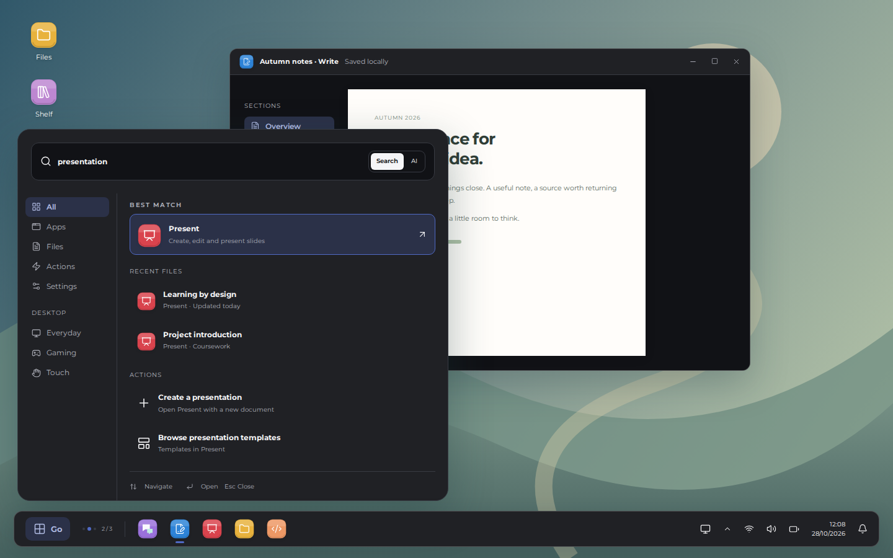

# 9to1OS — desktop, Go and native system surfaces

Module ID: `os` · 9to1 Development Specification v3

## Prerequisites

- **CUI, themes and shared interaction system** — Typed UI components, theme tokens/materials, layout, focus, motion, accessibility and shared control states.
- **Platform, app registry and host integration** — Canonical app registry, artifact routes, native/browser embedding, lifecycle and semantic UI/API parity.
- **Go, universal search and entity navigation** — Permission-aware typed search, command/entity resolution and shared Go presentation.
- **Permissions, approvals and execution scope** — Effective scoped grants, action approvals, policy intersections, revocation and audit.
- **Artifacts, local persistence and recovery** — Canonical artifacts, revisions, typed edits, local saves, derived exports, sync and recovery.

## Overview

9to1OS is the desktop host with the source-defined Ubuntu/GNOME foundations and CUI replacement shell. Its desktop, taskbar, Go and system utilities are native operating-system surfaces, not browser pages.

## Layouts & visible states

- **V3-OS-LAY-01** — Use desktop, taskbar/dock, windows and Go overlay without browser chrome. Preserve the source-defined one-to-five taskbar layer choices.
- **V3-OS-LAY-02** — Distinguish Desktop Spaces, Virtual Desktops, pages and LLM Spaces by their real meanings; do not collapse them into one navigation type.
- **V3-OS-LAY-03** — Quick Settings/system utility views show actual devices/resources and availability rather than decorative status values.

## Features & behaviour

- **V3-OS-FEA-01** — Retain system settings, file/device/disk/log utilities, window management, resource controls and supported runtime capabilities from the technical source.
- **V3-OS-FEA-02** — Use canonical package/app registry and Go. Native and web apps share identity without pretending they share an identical engine/runtime.
- **V3-OS-FEA-03** — Wine/WinBoat/Android compatibility uses explicit environment/version/capability and permission contracts. Unsupported compatibility must remain visible.

## Canonical entities & persistence

- **V3-OS-ENT-01** — Persist desktop/user configuration, workspace/window identities, package references, runtime environments and applicable snapshots/resource settings.
- **V3-OS-ENT-02** — Window close, app exit, VM detach and machine stop have separate lifecycles.

## Permissions & recovery

- **V3-OS-PER-01** — Require the correct system/device authority for privileged operations. AI cannot acquire elevated authority merely through the desktop UI.
- **V3-OS-PER-02** — Recover disconnected runtimes, failed app launch and missing resources without hiding the underlying state or losing unrelated windows.

## Acceptance checks

- **V3-OS-ACC-01** — Test Go, window/workspace switching, taskbar layout persistence and native app launch without browser chrome.
- **V3-OS-ACC-02** — Verify supported compatibility environment truthfulness, close-versus-stop semantics and permission denial.

## Exact mock-up and state map

- **9to1OS · Desktop and Go** — screen `os-go`. Desktop.

## Source clause IDs

Named baseline section(s) retained in the technical-source chapters below.

## Technical reading map

- 9to1OS — desktop, Go and native system surfaces — 9to1-OS; Platform foundation and donor authority (part 01) — `technical/os-01.md` (3,272 words; V2-B2152).
- 9to1OS — desktop, Go and native system surfaces — Wine/WinBoat Framework; Compatibility backends (part 02) — `technical/os-02.md` (1,482 words; V2-B2155).

Technical clauses retain APIs, data models, platform, recovery, donor and acceptance details. The technical files are part of this module, not optional background reading. Shared prerequisites mean stable service/interface contracts must be available; they do not require every dependent app UI to be complete. Use the named chunk for the relevant subtask or the complete module file for its full retained contract.

# Retained technical requirements

# 9to1OS — desktop, Go and native system surfaces — 9to1-OS; Platform foundation and donor authority (part 01)

Reading status: active retained clauses, subject to the v3 owner overrides listed in the primary module. Historical process instructions and replaced original wording are stored separately.

### V2-B2152 · v2 lines 12307–12438

9to1-OS
Platform foundation and donor authority
9to1-OS is derived from the latest appropriate maintained Ubuntu/GNOME stack. The project forks/adapts the complete relevant desktop/system stack rather than treating Ubuntu merely as a kernel image, then rebuilds the 9to1 user-facing desktop environment and first-party system interfaces in CUI.NET while preserving mature non-replaced functionality underneath.
The governing donor rule is preserve unless replaced: applicable Ubuntu/GNOME behaviour, hardware support, accessibility, session management, networking, Bluetooth, audio, displays, power, notifications, multi-monitor support, virtual desktops, filesystem/system integration and other mature platform behaviour MUST remain available unless this specification explicitly replaces or supersedes it.
Where 9to1 requires a CUI.NET replacement for functionality already supplied by Ubuntu/GNOME and that 9to1 product does not already have a different authoritative donor, the latest appropriate corresponding Ubuntu/GNOME application becomes its donor. The replacement preserves applicable donor functionality and rebuilds/extends its GUI in CUI.NET. Existing explicitly assigned donors take precedence; Files, for example, retains its existing donor rather than switching to the Ubuntu file manager.
Once an authoritative 9to1 app fully replaces a donor graphical application, the duplicate donor user-facing app SHOULD be removed from the default OS image. Required lower-level libraries/services remain installed where technically necessary. The objective is functional preservation without parallel competing GUIs.
Desktop shell and Windows-style interaction model
The default 9to1-OS shell uses a familiar Windows-like desktop interaction model while retaining Linux/Ubuntu capabilities. Conventional minimise, maximise/restore and close controls, taskbar representation, window switching, context menus, system tray/status, desktop workspaces and predictable mouse/keyboard behaviour are first-class rather than hidden or intentionally omitted.
Window management and quality-of-life
* Drag windows to edges/corners to preview and snap them into supported layouts.
* Support built-in and user-defined snap layouts, including half, thirds, quarters and custom rectangular regions with configurable gaps/margins.
* Provide smooth configurable window movement, open/close, minimise/restore, maximise, snapping and desktop-transition animations, with reduced-motion/disabled options.
* Support conventional app/window switching, previews, multiple windows per app, virtual-desktop awareness, task-view/overview and keyboard-first operation.
* Support user-configurable per-app/window rules such as initial monitor, desktop, size, snap region, maximised/fullscreen and always-on-top where compatible.
Linux/GTK/Qt and other compatible desktop applications remain runnable even when they are not CUI-native. They participate in the taskbar, window switching, snapping, desktops and supported system integration to the extent the underlying platform permits.
Taskbar framework
The taskbar is a first-class highly customisable shell framework, not a fixed strip of running applications. The default layout places Go at the left/start position and system/status controls toward the end, but supported regions/items can be rearranged.
Users can configure edge/position, floating versus edge-attached presentation, width, thickness, margins, corner radius, padding, item spacing, alignment, opacity, blur/material, borders, shadows, icon size, labels, grouping/combining, auto-hide/intelligent hide, animations, per-monitor behaviour, clock/tray content and compatible multi-row or multiple-taskbar arrangements.
Taskbar Layers
A taskbar instance supports between one and five independently configurable Taskbar Layers. Scrolling or a configured vertical gesture while the pointer/focus is over the taskbar moves discretely between adjacent layers and snaps to a complete layer; layers are not an infinitely scrollable strip.
Every layer has stable identity, name/order, item layout, presentation and visibility settings. Layers may differ in item size, alignment, grouping, height and visual presentation where supported. A visible accessible layer-position indicator shows the current position and number of available layers; its presentation can be configured but must not rely on colour alone.
A layer can contain typed items such as pinned/running apps, individual windows, Go, system controls, quick actions, settings, files/folders, Shelf items/collections, 9to1 routes, Dulche Agents, Agent runs, Automations actions, widgets, status indicators, media controls, spacers and authorised extension-provided modules.
Examples are illustrative rather than hard-coded: one user may create Running Apps, Quick Actions, AI Agents, Development and Personal layers. No layer type is reserved to a specific category.
Desktop Spaces, Virtual Desktops and Desktop Pages
Naming and conceptual separation
The OS-level mode system is named Desktop Spaces. The existing conversational/AI product is named LLM Spaces. Documentation, APIs and UI MUST use these distinct names to avoid ambiguity.
Virtual Desktops organise sets of windows within the current shell experience. Desktop Spaces redefine the surrounding shell/interaction experience. Desktop Pages are multiple pages of desktop icons/widgets within a desktop surface. These are separate orthogonal concepts.
Desktop Spaces
A Desktop Space is a versioned shell/behaviour profile that may change taskbars, taskbar layers, Go layout, quick settings, notification presentation, window rules, widgets/overlays, input model, theme, animations, performance/resource profile, default actions and Dulche behaviour without requiring applications to restart where avoidable.
First-party examples include a Gaming Desktop Space that can replace the standard taskbar with a lightweight floating gaming pill showing configurable telemetry such as FPS/frame time, CPU/GPU/RAM/VRAM, temperature, battery/power and latency, with an expandable quick menu; and a Touch Desktop Space that increases targets/spacing and adapts window controls, Go, quick settings, gestures, keyboard integration and snapping for tablet use.
Users can create, duplicate, rename, reorder, import/export, sync and delete custom Desktop Spaces. Optional triggers may suggest or activate a Desktop Space based on convertible posture, controller connection, application launch, display configuration, schedule or other supported state; automatic activation behaviour is user-controlled.
Virtual Desktops
Virtual Desktops support create/delete, names, ordering, keyboard/touchpad switching, window movement between desktops, configurable transition, task-view overview, optional per-desktop wallpaper and configurable taskbar visibility across current/all desktops.
Desktop Pages and Widgets
Each desktop surface can contain multiple ordered Desktop Pages that users may add/remove, rename, reorder and navigate by configured gesture/scroll. Pages may contain icons, files/folders, Shelf collections, shortcuts and native CUI widgets and may be global or Desktop-Space-specific according to configuration.
Desktop widgets are first-class CUI entities with resizing, grid/free placement where enabled, ordering, transparency/background material, interaction, update policy and per-page/per-Desktop-Space presence. First-party apps can expose widgets such as Planner, Maps, Files folders, Shelf collections, media, system resources, battery, clock/calendar, quick actions, Dulche Agents and Agent-run state.
Customisation Framework
Customisation is an architectural property of 9to1-OS. The requirement is not satisfied by wallpaper, accent colour and taskbar-position options. Stable shell behaviour and presentation that can reasonably be represented as configuration SHOULD be configurable unless doing so would materially compromise security, accessibility, compatibility or system integrity.
The OS MUST expose substantially deeper supported first-party customisation than stock Windows or stock GNOME without requiring registry hacks, shell patches, unsupported extensions or third-party Start/taskbar replacements. Configuration uses versioned typed schemas and transactions so Settings, Dulche, Automations and authorised extensions operate on the same underlying state.
Configuration scopes and precedence
Applicable settings can be scoped globally, per device, display, Desktop Space, Virtual Desktop, application/window class or input mode. The implementation MUST define deterministic precedence so a Desktop-Space/display/app override cannot unpredictably conflict with global defaults. Device/display-specific state must not be blindly synced to incompatible hardware.
Visual and behavioural scope
* Mouse pointer/cursor theme, colour, size, outline/high-visibility behaviour and supported custom pointer packs.
* Window button order/side, visible controls, button size/spacing/shape, title alignment, titlebar height, icon/title visibility and compatible extra window actions.
* Window corner roundness, borders, shadows, glow, transparency, active/inactive treatment and user-selectable numerical/preset radius where supported.
* Theme profiles covering light/dark/automatic mode, colours, gradients, accents, glow, blur, transparency, shadows, borders, roundness, spacing/density, typography, icons, control shapes and animation character.
* Built-in visual personalities such as clean/minimal, glow, playful, glass/classic or other first-party presets act as editable starting profiles rather than locked themes; users can create custom profiles.
* Icon packs, per-app icon overrides, icon scale/shape/treatment and notification-badge presentation.
* Global and per-category animation enablement, speed, reduced-motion and presets/custom timing.
* Rebindable keyboard shortcuts, supported mouse/touchpad/touch/controller gestures and conflict detection.
* System tray/status ordering, visibility policy, overflow, icon size/spacing, clock/date/seconds/time-zone presentation, battery percentage/remaining-time presentation and network/audio/Bluetooth/VPN indicators.
Safe application and recovery
Large shell changes SHOULD support preview/keep/revert flows. Configuration mutations are transactional where practical and the shell maintains last-known-good recovery paths including reset current element, reset taskbar, reset Desktop Space, reset appearance, restore previous configuration and safe/default shell mode.
Configuration schemas are versioned and migrations MUST preserve supported user state across OS updates rather than silently discarding a highly customised desktop.
Quick Settings and system flyouts
Quick Settings combines Windows-style desktop system controls with Android-style customisation. Users can add/remove/reorder tiles, choose supported sizes, resize tiles, use multiple pages, configure layout/density/panel placement and install authorised custom tiles.
First-party tiles should cover relevant controls such as Wi-Fi, Bluetooth, airplane mode, brightness, volume/audio output, microphone, battery saver/performance mode, night light, accessibility, hotspot, VPN, display/casting, input, focus/do-not-disturb, location, screenshot/recording and Dulche/AI state.
Tiles are typed CUI modules that may expose live state, icon, primary/secondary labels, toggle/action, slider and expanded view. Apps/Plugins may register tiles through a permissioned contract with declared supported sizes/actions; arbitrary shell code injection is not a tile API.
Related flyouts such as audio, network, Bluetooth, calendar, battery and notification centre must provide friendly direct controls and the expected Windows-class QoL, including optional battery percentage, output-device switching, tray overflow, date/calendar, power/session controls and useful status detail.
Dulche and AI-native OS integration
Dulche is an always-available OS assistant, not merely another application. 'Always available' does not require a large model to remain permanently resident: users control model residency/background behaviour while the lightweight service remains integrated with Go AI mode, shortcuts, voice where enabled, context menus, selections, taskbar layers/widgets, notifications, Settings and first-party apps.
AI settings
Settings contains first-class AI areas for Models/Universal Model Picker, Dulche service/background behaviour, Always-active AI, Persistent Memory and Memory Frequency, Background Learning, Agents, MCP servers, Skills/Plugins, privacy and resource policy. Built-in MCP management includes add/remove, transport/endpoint configuration, authentication, capability inspection, enable/disable, Agent/app permission assignment, health and logs/errors.
Always-active AI is a configurable service mode and MUST NOT grant blanket access to microphone, files, external services or other sensitive capabilities. Those remain separately permissioned.
AI-aware RAM optimisation
The default OS must be aggressively memory-efficient without sacrificing specified functionality or quality so local models can use more of the machine. 9to1-OS should lazy-load non-critical services/surfaces, suspend or trim eligible inactive apps, reclaim caches, use appropriate compression/zram and memory mapping, avoid duplicated runtime state and unload inactive models/compatibility environments when policy permits.
Users can configure a managed System Memory Budget/profile such as Minimum, Balanced, Performance, AI/Maximum model capacity or Custom. This is a target for reclaimable/non-critical OS consumption rather than an unsafe hard cap on kernel/critical services.
An optional Prioritise AI memory policy may reclaim eligible caches/background apps/models more aggressively to make room for a requested local model. Dulche/runtime should report what can be reclaimed and coordinate with the OS resource manager rather than simply failing at the first memory-pressure condition.
GUI-first administration
Common useful system-administration operations that Ubuntu frequently exposes primarily through Terminal SHOULD have first-party CUI.NET workflows wherever they can be represented safely and coherently. Terminal remains fully available for advanced/unrestricted workflows, but ordinary maintenance must not require memorising shell commands.
* Software/package install, removal, update and repository/source management.
* System updates, recovery, backups/snapshots and repair.
* Drivers, devices, displays, audio, networking, DNS, VPN, firewall and hotspot.
* Disk/partition/filesystem management, mounts, storage cleanup and health information.
* Users/groups, permissions/ownership, startup/background services, scheduled jobs and environment/PATH management where appropriate.
* Logs/journal/crash diagnostics, process/resource management and compatibility/runtime management.
Friendly GUIs should call stable typed system services/APIs rather than merely concatenate opaque shell strings. Where a shell tool is the only practical backend, arguments must be structured, privilege requirements declared and output/errors/progress handled safely.
Terminal safety and privileged destructive operations
9to1 Terminal Command Mode includes a Dangerous Command Guard that parses known commands/arguments/targets and classifies risk rather than relying only on substring matching. Potentially major irreversible operations such as destructive recursive deletion, filesystem formatting, partition-table mutation, mass permission changes or dangerous system/boot-path modification require OS-mediated protection.
For a Dangerous operation the mandatory sequence is consequence-specific warning -> trusted user authentication -> second consequence-specific confirmation -> execution. Authentication is never treated as final consent. The warning should identify resolved targets and expected consequence where feasible.
Terminal AI Mode, Dulche, Agents, Plugins and Automations cannot type the password, approve their own warning or bypass the final confirmation. Script/program execution cannot be perfectly predicted; recognised dangerous privileged operations should still pass through the system safety broker where technically possible, without claiming semantic proof over arbitrary executable code.
Multiple users and administrator policy
9to1-OS supports multiple isolated user accounts/profiles with standard and administrator roles, secure per-user data/settings/secrets, fast switching/sign-out and clearly scoped system-wide versus user-specific configuration.
Administrators can create managed policy profiles for family, school, organisation or kiosk-style deployments. Policies can control application allow/deny lists, package/app installation, external providers, Plugins/MCP, Terminal/admin access, removable storage, networking/VPN, Desktop Space/customisation options, web/content controls where supported, update policy and other security-sensitive capabilities.
A School profile can, for example, block launching unapproved applications and prevent the restricted user from disabling that policy without administrator authentication. Enforcement MUST occur below the normal app UI so renaming a binary, launching through Go/Terminal/Shelf or invoking an Agent does not trivially bypass policy.
Managed restrictions must be visible and attributable ('Managed by administrator/school policy') rather than presented as broken UI. Administrators require auditability of policy changes and clear recovery controls; administration must not silently expose another user's private content unless an explicit policy/capability legitimately grants that access.
First-party apps and deep OS integration
All release-scope first-party 9to1 applications are installed by default as part of the complete 9to1-OS experience, while application updates are independently deliverable from full OS updates. A central update/package service handles discovery, automatic/manual updates, integrity checks, history, repair and supported rollback instead of every app shipping a private updater.
First-party apps MUST behave as native OS components and register applicable typed integration with Go, Automations, Dulche, notifications, taskbar/layers, Desktop Spaces, widgets, system search/indexing, Files/open-with/default apps, share/clipboard/drag-drop, URI routes, permissions, External App Integrations, background tasks, crash/System Log, updates, backup/recovery, theming/accessibility and resource management.
Automations is a particularly strong integration requirement: apps should expose supported typed triggers/actions/events through the shared Automation framework rather than implementing incompatible private automation engines.
First-party apps should expose lifecycle information allowing safe trim/suspend/resume under memory pressure without losing unsaved work. Desktop Spaces own shell layout/presentation; apps contribute declared widgets/actions/status rather than taking arbitrary control of the shell.
Setup and first-run experience
9to1-OS MUST provide a friendly graphical CUI.NET installer and first-run/OOBE experience. A normal installation MUST NOT require interacting with the traditional Linux text/terminal installer or memorising shell commands. Advanced/technical options may be exposed through expandable UI without making them mandatory for ordinary users.
The setup flow should cover applicable language/region, keyboard, accessibility from the first screen, networking, installation target/disk choices, encryption, timezone, user creation and administrator role, optional managed school/organisation setup, privacy/telemetry choices, update preferences, restore from an existing 9to1 backup/profile, initial appearance/Desktop-Space choices and optional Dulche/model/provider onboarding.
Installation progress is staged and truthful. Failures expose actionable explanation, retry/back navigation where safe, logs/technical details and recovery rather than dropping users into an unexplained terminal. Critical-stage failure MUST NOT be presented as successful installation.
Recovery environments
9to1-OS provides a custom CUI recovery environment designed for ordinary users. It should expose Continue/boot normally, automatic startup repair, restore a previous healthy snapshot, undo the latest system update, safe mode, package/system repair, filesystem/disk checks, disable problematic drivers or shell extensions, recover/reset shell configuration, inspect System Log, backup/restore, advanced Terminal and supported repair/reinstall-with-data-preservation flows.
The custom 9to1 Recovery environment supplements rather than replaces the underlying Ubuntu/Linux recovery environment. The stock/default recovery path MUST remain available as an emergency fallback if the custom CUI recovery environment is damaged or cannot launch.
The custom and stock recovery paths must obey the existing boot-safety contract: ordinary snapshot restore, repair and rollback do not rewrite firmware or bootloader code. Any bootloader/firmware update is a separate tightly guarded operation.
Setup/recovery acceptance requirements
* A normal user can install, create an account, configure basic hardware/privacy choices and reach the desktop without Terminal.
* Accessibility and technical details are available during setup rather than only after installation.
* 9to1 Recovery provides friendly repair/rollback tools, while the lower-level Ubuntu/Linux recovery environment remains independently reachable.
* Installer/recovery failures preserve diagnostic information and do not falsely report success or silently perform bootloader/firmware rewrites.
System updates, recovery and backups
System maintenance has a first-party CUI Settings workflow for checking, downloading, scheduling and installing OS updates, viewing changelogs/details, restart requirements, progress, failure/retry and update history. Terminal/package-manager commands remain optional advanced interfaces, never the required normal update path.
Consequential system updates use verified recoverable system snapshots/rollback state where technically feasible. The system should confirm successful boot/health before retiring rollback state and provide a friendly recovery environment with restore previous snapshot, repair OS/package database, safe mode, diagnostic logs and extension/driver disablement.
Ordinary backup/snapshot restoration and update rollback MUST NOT overwrite or restore firmware or bootloader code as part of the rollback transaction. Bootloader/firmware updates, if ever necessary, are separate tightly guarded operations with their own compatibility/recovery process so a normal failed OS update is not turned into a bricked device.
Software and package management
9to1-OS includes a friendly CUI graphical package manager with search, categories, source/publisher, version, architecture, size, installed/update state, screenshots/metadata where available, dependency/permission information and install/update/uninstall/repair workflows.
The package manager uses typed PackageProvider adapters for applicable Linux package ecosystems such as Ubuntu/Debian packages, Flatpak, Snap if retained and coherent AppImage handling, plus Winget for supported Windows/Wine scenarios and 9to1 package sources. It may show multiple sources for the same product and explain meaningful differences instead of silently choosing an arbitrary provider.
PackageProvider contracts define search, metadata, versions, install/update/uninstall, dependencies, progress, source trust, errors and capability limitations so additional providers can integrate without rewriting the package-manager UI.
System diagnostics and storage management
System Log and crash diagnostics
9to1-OS includes a CUI System Log surface that translates underlying journal/service/app events into useful searchable/filterable diagnostics while retaining advanced technical detail. Events can expose timestamp, component/process, severity, subsystem, version/build, crash ID, stack/debug data where available and related logs/actions.
Crash records should group repeated failures, support export/diagnostic bundles and permit user-authorised Dulche analysis such as explaining why a component repeatedly crashed. Diagnostic information MUST NOT be silently uploaded.
Disk Management
Settings includes CUI Disk Management covering physical disks, partitions, filesystems, mounts, labels, free/used space, removable storage, format/partition operations, encryption state, filesystem checks and SMART/health data where supported. Destructive operations require clear device identification and appropriate confirmation/authentication.
Task Manager and other donor-backed utilities
Task Manager is rebuilt in CUI.NET using the appropriate Ubuntu/GNOME system-monitor tooling as donor baseline unless another donor is explicitly assigned. It preserves mature process/resource functionality and extends it with Windows-style usability plus 9to1-specific visibility for models, Agents, containers/compatibility environments and relevant GPU/RAM usage.
The same donor fallback rule applies to Settings and other required CUI system utilities when an appropriate Ubuntu/GNOME app exists and no different donor has already been assigned.
9to1-OS acceptance requirements
* Ubuntu/GNOME mature non-replaced functionality is preserved while the authoritative user-facing shell/system GUIs are CUI.NET and duplicate replaced donor apps are removed from the default image.
* The taskbar is deeply customisable and supports one to five discrete snapping layers with a visible accessible layer indicator.
* Desktop Spaces, Virtual Desktops, Desktop Pages and LLM Spaces remain explicitly separate concepts.
* The shell supports deep first-party customisation of taskbar, Go, Quick Settings, pointer, window chrome/roundness, themes, widgets, desktops, gestures, tray/status, animations and scoped per-device/display/Desktop-Space/app behaviour.
* Dulche, MCP, models and AI-aware memory/resource controls are first-class OS settings and Dulche is always available without requiring a heavyweight model to remain loaded.
* Common administration has friendly CUI workflows and Dangerous Terminal operations use warning -> authentication -> final confirmation.
* Multiple users and enforceable administrator-managed profiles can restrict unapproved apps and other capabilities without trivial bypass through alternate launch surfaces.
* All first-party 9to1 apps ship installed by default, update independently and integrate deeply with shared OS services including Automations.
* System updates have GUI installation, verified recovery/rollback mechanisms and ordinary rollback does not rewrite firmware/bootloader code.
* A friendly multi-provider package manager, System Log/crash diagnostics, Disk Management and donor-backed Task Manager/Settings are present as first-class CUI system utilities.

# 9to1OS — desktop, Go and native system surfaces — Wine/WinBoat Framework; Compatibility backends (part 02)

Reading status: active retained clauses, subject to the v3 owner overrides listed in the primary module. Historical process instructions and replaced original wording are stored separately.

### V2-B2155 · v2 lines 12481–12537

Wine/WinBoat Framework
The Wine/WinBoat Framework is the unified 9to1-OS compatibility platform for non-native application packages. It provides one coherent installation, routing, execution, lifecycle, permissions, diagnostics and shell-integration model across Windows applications and Android APK applications rather than exposing Wine, VM/container tooling or an Android runtime as unrelated expert-only subsystems.
Compatibility backends
A CompatibilityBackend is a typed implementation capable of installing/running one or more foreign application formats. Required backend classes include a Wine-compatible Windows runtime, a WinBoat-style Windows environment for applications needing a fuller Windows VM/container context, and an APK/Android compatibility layer for Android applications. Additional compatible backends MAY be registered later through the same framework.
The compatibility manager owns stable entities such as CompatibilityApp, CompatibilityPackage, CompatibilityBackend, CompatibilityEnvironment, CompatibilityRoute, AppRoutingRule, CompatibilityPermissionSet, CompatibilityHealth and CompatibilitySnapshot or equivalent contracts. Applications are identified by stable package/application identity rather than by the pathname of the installer that originally created them.
Automatic package routing
Opening or double-clicking a supported foreign application package MUST route through the compatibility framework automatically. Executable/package type should be determined from trusted file metadata/signature/MIME inspection where available rather than relying only on filename extension.
Windows .exe/.msi and equivalent supported installers are routed to an eligible Windows backend. Android .apk packages are routed to an eligible APK/Android compatibility backend. The normal user experience is Install/Open application, not manually invoking wine, configuring a prefix, running Docker/Podman/QEMU/RDP commands or issuing Android runtime commands in Terminal.
The router evaluates package type, known application identity, architecture, backend capability, existing environments, administrator policy, resource requirements, compatibility knowledge and user defaults. When there is one clear eligible default, routing should proceed without unnecessary questions. When multiple viable frameworks exist or the user requests control, the UI may ask which framework/backend to use.
Per-application framework defaults
Users can set a preferred/default CompatibilityBackend for each installed application or recognised application identity. A chooser can provide an explicit 'Always use this framework for this app' action. This preference is stored against stable app/package identity and survives moves/renames of the original installer.
A per-app default does not override hard incompatibility, missing backend capability, administrator policy or unavailable hardware. If the selected backend cannot satisfy the app, the framework reports why and may offer other eligible backends rather than silently executing through an unrelated path.
Users can change/reset the backend association later from the application's compatibility settings. Global defaults may exist for Windows packages and APK packages, but per-app rules take precedence where valid.
Windows: Wine path
The Wine backend manages Wine runtime/version, isolated prefixes/environments, application architecture, DLL/runtime dependencies, graphics/DirectX translation, environment variables, registry integration, drive mappings, fonts, file associations, launch arguments and per-app overrides through CUI.NET management surfaces.
Ordinary users MUST NOT need to manually run winecfg, winetricks, edit registry state or construct WINEPREFIX environment variables. Advanced views may expose equivalent controls and raw technical details when useful.
Applications SHOULD normally use isolated managed Wine environments so dependency/runtime changes, repair, backup and uninstall do not corrupt unrelated apps. Applications may deliberately share an environment when required, but that relationship must be explicit.
Windows: WinBoat-style environment path
The WinBoat-style backend provides a managed Windows VM/container environment for applications that need or work better with a fuller Windows installation. It may expose configurable CPU, RAM, storage, hardware acceleration, networking, shared folders, USB/device passthrough, graphics configuration and individual-app/RemoteApp-style window integration where supported.
The management experience hides Docker/Podman, QEMU, VM orchestration and RDP implementation details during normal use while retaining advanced diagnostics. Individual Windows applications should appear as normal 9to1-OS windows where technically possible; a full Windows desktop remains available as a fallback/advanced mode.
Android/APK compatibility path
9to1-OS MUST support Android APK applications through the same Compatibility Framework using an Android/APK compatibility layer. Installing an APK creates/registers a normal CompatibilityApp backed by the Android runtime rather than placing Android apps in a disconnected secondary launcher.
The APK backend is responsible for Android runtime/container lifecycle, package installation/update/removal, Android package identity, architecture/ABI compatibility, graphics acceleration, display/window integration, storage mappings, networking, clipboard, audio, microphone/camera, notifications, input, orientation, intents/file associations and other host bridges where supported.
Android applications should participate in Go, taskbar/taskbar layers, window switching, Desktop Spaces, notifications, Files/open-with/share flows, Shelf and other applicable 9to1-OS integrations. The Android compatibility layer MUST NOT require the user to launch a separate Android desktop merely to start an installed APK unless a full Android environment is explicitly requested.
If multiple APK-compatible runtimes/backends are available, the same automatic eligibility and per-app default framework rules apply. The user may choose a backend and persist it for that Android app; otherwise 9to1 selects the highest-priority eligible configured default.
Unified installation experience
Opening a supported .exe, .msi, .apk or other registered foreign package invokes a single compatibility installation flow showing detected application/package identity, recommended backend, destination environment, required permissions, storage/resource estimate and relevant compatibility warnings. Advanced settings expose backend-specific controls without requiring them for a normal install.
The GUI package manager may also install Windows software through Winget or other approved Windows sources and Android packages through approved configured package sources where supported. Package-source discovery does not bypass administrator policy, signing/trust requirements or compatibility permissions.
Native-feeling OS integration
Foreign applications remain subject to the same shell/platform integration expectations as native applications wherever technically possible: Go search/launch, taskbar and layers, Desktop Spaces, snapping, app switching, tray/status integration, Files/open-with, default associations, clipboard, drag/drop, audio/microphone, printing, notifications, shortcuts, recent items, System Log/crash diagnostics and resource management.
Compatibility apps may expose Automations/Dulche actions only through typed supported bridges. Running inside Wine, a Windows VM or an Android runtime does not give an application unrestricted access to the host Automation framework or other 9to1 capabilities.
Filesystem and host permissions
Host folder exposure is explicit and revocable. Compatibility environments receive only user/admin-authorised Files locations rather than unrestricted access to the entire Linux home directory by default. Shared-folder mappings identify the canonical host location and the guest-visible mapping.
Clipboard, microphone, camera, USB/devices, network modes, location and other sensitive bridges use the normal 9to1 permission/policy system where applicable. A locally running foreign application is not automatically trusted with unrestricted host resources.
Graphics, gaming and input
The framework exposes backend-appropriate GPU acceleration, Vulkan/DirectX translation, discrete/integrated GPU preference, fullscreen, controller/input support and relevant compatibility/performance settings. Windows or Android games can integrate with Gaming Desktop Space telemetry/controls where the backend exposes the required data.
Resource and lifecycle management
CompatibilityEnvironment lifecycle states include at least Starting, Running, Suspended, Stopped, Degraded/Error and backend-specific transitional states. The framework reports allocated and actual RAM/CPU/storage/GPU usage where available and participates in 9to1-OS memory/resource policy so idle VM/container environments can be suspended or stopped according to user policy.
Compatibility environments must preserve application/user state safely across suspend/resume and OS memory pressure. The OS MUST NOT simply terminate a managed environment and discard unsaved guest/application state to satisfy a memory target.
Snapshots, repair and updates
Backends supporting snapshots/checkpoints should expose them through the unified manager, particularly before major guest/runtime changes. Compatibility snapshots are separate from 9to1-OS system snapshots.
The framework manages or coordinates updates for Wine/runtime components, WinBoat-derived host integration, Android compatibility/runtime components and guest-integration tooling. Guest Windows/Android update behaviour remains explicit and must not be confused with host OS updates.
Repair/reset operations should be scoped to the selected app/environment and preserve unrelated environments. Destructive reset/uninstall flows explain whether app data, shared environment state or snapshots will be removed.
Diagnostics and recovery
The CUI compatibility manager normalises common failures such as missing Wine dependency, application crash, graphics translation failure, Windows guest boot failure, RemoteApp disconnection, Android runtime failure, incompatible APK ABI, insufficient RAM, unavailable hardware acceleration, broken shared folder or package-install failure into actionable health states.
Advanced diagnostics expose underlying Wine/runtime/VM/RDP/Android logs and environment details through System Log integration. Dulche may analyse these diagnostics and invoke typed repair/configuration APIs but should not replace a supported manager operation with arbitrary host shell automation.
Managed-user policy
Administrator policies can disable foreign-app compatibility entirely, restrict allowed backends, block arbitrary .exe/.msi/.apk installation, allowlist approved applications/package identities, restrict package sources such as Winget/Android sources, constrain host-folder/device/network bridges and lock per-app backend choices.
Launching through Go, Files, Shelf, Terminal, Dulche or another app MUST NOT bypass the same compatibility policy. Policy enforcement occurs in the routing/install/execution broker below the launch surface.
Compatibility Framework acceptance requirements
* Double-clicking/opening a supported Windows installer/executable or Android APK automatically enters the unified compatibility routing flow rather than requiring Terminal.
* Wine, WinBoat-style Windows environments and APK/Android compatibility are represented as typed backends under one manager.
* The user may choose among eligible frameworks and can persist a default framework per application; valid per-app defaults are remembered and editable.
* Installed Windows and Android applications integrate with Go, taskbar/window management, Desktop Spaces, Files, notifications, diagnostics and resource policy wherever technically possible.
* Host files/devices and sensitive bridges remain explicit permission boundaries, not blanket compatibility-environment access.
* Administrator policy applies regardless of which launch surface or compatibility backend is used.
* Backend-specific complexity remains available for advanced users but is not required for ordinary installation, launch, repair or troubleshooting.

# Exact designs and implementation rules

These figures are the exact current atlas compositions. Their stable screen IDs match the Word specification and editable source. Open the atlas for full-size theme and interaction inspection.

## 9to1OS · Desktop and Go

Screen ID: `os-go`. Source: 9to1-OS: desktop shell, Taskbar Layers, Desktop Spaces, Quick Settings; Go: search and typed actions.

- The default shell uses conventional window controls and a taskbar with Go at the start.
- Taskbar Layers are discrete, with one to five layers and a visible position indicator. They are separate from virtual desktops and Desktop Spaces.
- Go is a shared Search / AI and typed-action surface. Results retain canonical source and permission checks.
- Go is the active shell popup; opening Quick Settings dismisses unrelated transient surfaces. This mock-up is intended layout, not OS implementation evidence.
