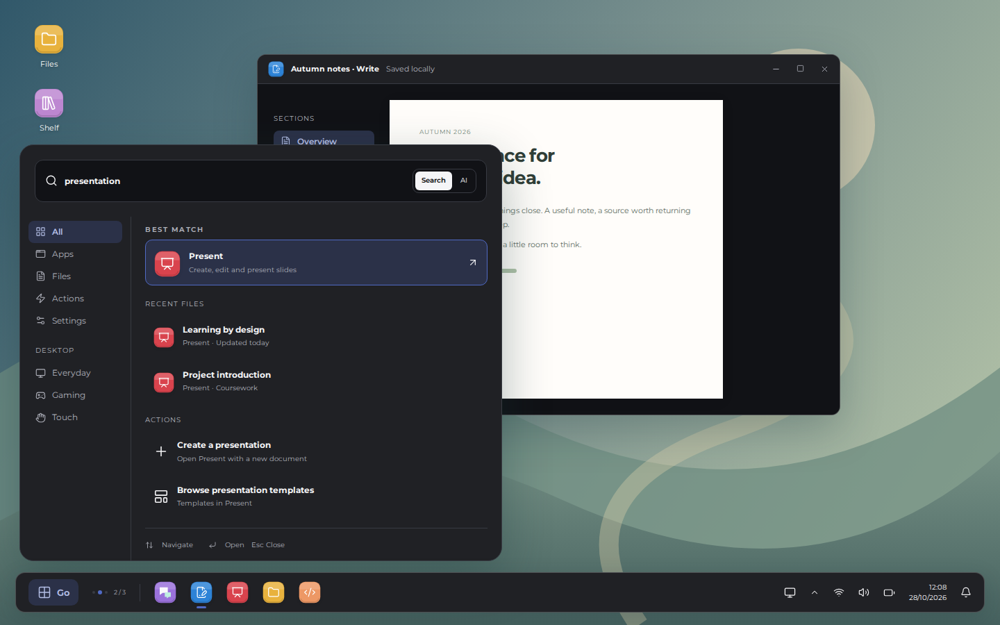

# 9to1OS — desktop, Go and native system surfaces

Module ID: `os` · 9to1 Development Specification v3

## Prerequisites

- **CUI, themes and shared interaction system** — Typed UI components, theme tokens/materials, layout, focus, motion, accessibility and shared control states.
- **Platform, app registry and host integration** — Canonical app registry, artifact routes, native/browser embedding, lifecycle and semantic UI/API parity.
- **Go, universal search and entity navigation** — Permission-aware typed search, command/entity resolution and shared Go presentation.
- **Permissions, approvals and execution scope** — Effective scoped grants, action approvals, policy intersections, revocation and audit.
- **Artifacts, local persistence and recovery** — Canonical artifacts, revisions, typed edits, local saves, derived exports, sync and recovery.

## Overview

9to1OS is the desktop host with the source-defined Ubuntu/GNOME foundations and CUI replacement shell. Its desktop, taskbar, Go and system utilities are native operating-system surfaces, not browser pages.

## Layouts & visible states

- **V3-OS-LAY-01** — Use desktop, taskbar/dock, windows and Go overlay without browser chrome. Preserve the source-defined one-to-five taskbar layer choices.
- **V3-OS-LAY-02** — Distinguish Desktop Spaces, Virtual Desktops, pages and LLM Spaces by their real meanings; do not collapse them into one navigation type.
- **V3-OS-LAY-03** — Quick Settings/system utility views show actual devices/resources and availability rather than decorative status values.

## Features & behaviour

- **V3-OS-FEA-01** — Retain system settings, file/device/disk/log utilities, window management, resource controls and supported runtime capabilities from the technical source.
- **V3-OS-FEA-02** — Use canonical package/app registry and Go. Native and web apps share identity without pretending they share an identical engine/runtime.
- **V3-OS-FEA-03** — Wine/WinBoat/Android compatibility uses explicit environment/version/capability and permission contracts. Unsupported compatibility must remain visible.

## Canonical entities & persistence

- **V3-OS-ENT-01** — Persist desktop/user configuration, workspace/window identities, package references, runtime environments and applicable snapshots/resource settings.
- **V3-OS-ENT-02** — Window close, app exit, VM detach and machine stop have separate lifecycles.

## Permissions & recovery

- **V3-OS-PER-01** — Require the correct system/device authority for privileged operations. AI cannot acquire elevated authority merely through the desktop UI.
- **V3-OS-PER-02** — Recover disconnected runtimes, failed app launch and missing resources without hiding the underlying state or losing unrelated windows.

## Acceptance checks

- **V3-OS-ACC-01** — Test Go, window/workspace switching, taskbar layout persistence and native app launch without browser chrome.
- **V3-OS-ACC-02** — Verify supported compatibility environment truthfulness, close-versus-stop semantics and permission denial.

## Exact mock-up and state map

- **9to1OS · Desktop and Go** — screen `os-go`. Desktop.

## Source clause IDs

Named baseline section(s) retained in the technical-source chapters below.

## Technical reading map

- 9to1OS — desktop, Go and native system surfaces — 9to1-OS; Platform foundation and donor authority (part 01) — `technical/os-01.md` (3,272 words; V2-B2152).
- 9to1OS — desktop, Go and native system surfaces — Wine/WinBoat Framework; Compatibility backends (part 02) — `technical/os-02.md` (1,482 words; V2-B2155).

Technical clauses retain APIs, data models, platform, recovery, donor and acceptance details. The technical files are part of this module, not optional background reading. Shared prerequisites mean stable service/interface contracts must be available; they do not require every dependent app UI to be complete. Use the named chunk for the relevant subtask or the complete module file for its full retained contract.

# Exact designs and implementation rules

These figures are the exact current atlas compositions. Their stable screen IDs match the Word specification and editable source. Open the atlas for full-size theme and interaction inspection.

## 9to1OS · Desktop and Go

Screen ID: `os-go`. Source: 9to1-OS: desktop shell, Taskbar Layers, Desktop Spaces, Quick Settings; Go: search and typed actions.

- The default shell uses conventional window controls and a taskbar with Go at the start.
- Taskbar Layers are discrete, with one to five layers and a visible position indicator. They are separate from virtual desktops and Desktop Spaces.
- Go is a shared Search / AI and typed-action surface. Results retain canonical source and permission checks.
- Go is the active shell popup; opening Quick Settings dismisses unrelated transient surfaces. This mock-up is intended layout, not OS implementation evidence.
