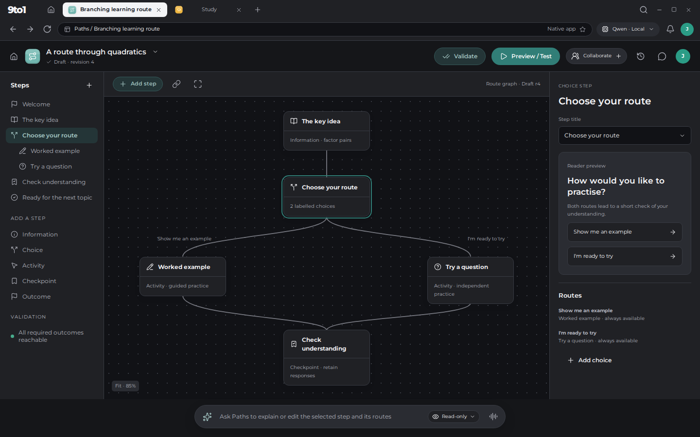
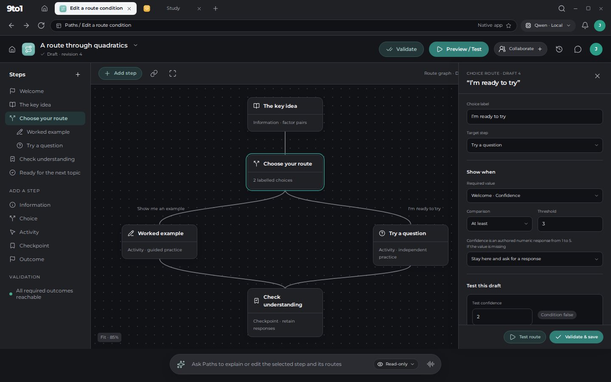

# Paths — branching guided experiences

Module ID: `paths` · 9to1 Development Specification v3

## Prerequisites

- **CUI, themes and shared interaction system** — Typed UI components, theme tokens/materials, layout, focus, motion, accessibility and shared control states.
- **Artifacts, local persistence and recovery** — Canonical artifacts, revisions, typed edits, local saves, derived exports, sync and recovery.
- **Permissions, approvals and execution scope** — Effective scoped grants, action approvals, policy intersections, revocation and audit.
- **Node Editor — shared graph framework** — Shared typed graph schemas, editing/validation, draft activation and runtime presentation.

## Overview

Paths authors and runs guided sequences with steps, choices, activities, checkpoints and outcomes. Branch logic is explicit, versioned and testable; reader progress is a durable attempt against a known route revision.

## Layouts & visible states

- **V3-PATHS-LAY-01** — Show step outline, selected step content, branch/route properties and preview/run controls. A branch rule exposes condition, target, priority/fallback and missing-value handling.
- **V3-PATHS-LAY-02** — Reader view shows the current step and available choices without inventing progress percentages for nonlinear routes.

## Features & behaviour

- **V3-PATHS-FEA-01** — Create/reorder steps and configure typed conditions/targets, default/fallback routes and supported loops with validation.
- **V3-PATHS-FEA-02** — Preview is disposable author testing; real reader attempts persist separately. Restart creates or resets according to explicit attempt semantics, not silent history deletion.
- **V3-PATHS-FEA-03** — Activities call canonical app/tools with current grants and idempotency; returning to a checkpoint must not repeat an external effect automatically.

## Canonical entities & persistence

- **V3-PATHS-ENT-01** — Persist PathID/revision, StepID, rule/edge IDs, checkpoint/outcome definitions and reader AttemptID, inputs and traversed events.
- **V3-PATHS-ENT-02** — Keep source authoring, preview state and durable reader progress distinct.

## Permissions & recovery

- **V3-PATHS-PER-01** — Validate unreachable/missing destinations, ambiguous branches and unsafe cycles before activation. Revisions do not silently remap existing attempts.
- **V3-PATHS-PER-02** — Recover interrupted attempts/checkpoints and denied activity actions while preserving completed evidence.

## Acceptance checks

- **V3-PATHS-ACC-01** — Test branch condition true/false/missing, priority/fallback, invalid destination and preview reset.
- **V3-PATHS-ACC-02** — Reopen a durable attempt, resume checkpoint and verify no duplicated consequential action.

## Exact mock-up and state map

- **Paths · Branching learning route** — screen `paths`. Authoring.
- **Paths · Edit a route condition** — screen `paths-branch-rule`. Route rule · test input.

## Source clause IDs

TF-H01, TF-H02, TF-H03

## Technical reading map

- Paths — branching guided experiences — Paths; Authoring, steps and route UI (part 01) — `technical/paths-01.md` (717 words; V2-B2167).

Technical clauses retain APIs, data models, platform, recovery, donor and acceptance details. The technical files are part of this module, not optional background reading. Shared prerequisites mean stable service/interface contracts must be available; they do not require every dependent app UI to be complete. Use the named chunk for the relevant subtask or the complete module file for its full retained contract.

# Retained technical requirements

# Paths — branching guided experiences — Paths; Authoring, steps and route UI (part 01)

Reading status: active retained clauses, subject to the v3 owner overrides listed in the primary module. Historical process instructions and replaced original wording are stored separately.

### V2-B2167 · v2 lines 12685–12698

Paths
TF-H01 — Authoring, steps and route UI
Paths authors guided, repeatable interactive experiences with steps, choices, activities, checkpoints and branching routes. It is not a fixed presentation, an open-ended Binder overview or a sequence improvised afresh by AI. A Path may provide a guided process, exploration route or overview towards an outcome, with the available routes determined by its authored structure.
The authoring editor MUST provide a step library/outline, a route graph, a selected-step content editor, a condition/action inspector and Preview/Test. Add step offers information, choice, activity, checkpoint and outcome/end behaviour through typed step definitions. Steps can contain supported shared content and authorised embedded artifacts. Authors can reorder outline entries, connect or disconnect routes, label choices, designate the starting step, edit conditions, add checkpoints and define explicit completion outcomes. Graph position is not route identity or step order.
Each choice MUST have a human-readable label and stable target. Conditional routing MUST expose its condition, required values and fallback/error behaviour. No eligible route MUST show a recoverable blocked state rather than select a random next step. Multiple eligible automatic routes require an explicit authored priority/selection rule and MUST not depend on incidental storage order. Deliberate loops/retries are allowed when explicitly authored and controllable; accidental automatic loops, missing targets and unreachable required outcomes MUST be detected in validation.
Preview/Test MUST run against an identified draft revision with disposable test progress, offer reset and route inspection, and show the choice/condition responsible for each transition. Authors MUST be able to test alternative inputs and inspect unreachable/missing routes without modifying real users' progress. Updating the shared authored Path uses a deliberate validated revision commit; a preview session is not automatically the published reader revision.
TF-H02 — Reader experience and durable progress
The reader surface MUST show the current step, its content, available choices/actions, relevant checkpoint/completion status and a route/overview affordance when allowed by the authored Path. Continue appears only when its conditions are satisfied. Back/previous navigation, where permitted, MUST not repeat external side effects or silently clear completed work. Branch-dependent length MUST not be presented as a fictitious fixed percentage; show meaningful visited/checkpoint status instead.
Progress MUST be durable and separate from authored content, with stable PathID, authored RevisionID, UserID or clearly scoped guest-session identity, AttemptID, current StepID, visited route, responses, checkpoint states, completion outcome and timestamps. A signed-in reader can resume their authorised attempt after restart or on another compatible device. Guest/local-only progress MUST be labelled honestly and MUST NOT be represented as cross-device account sync.
Readers can restart/reset and complete the same Path more than once. Restart creates a new attempt with clean progress while preserving previous completed attempts under the declared retention policy. Clearing saved progress is a separate confirmed deletion operation. Checkpoints persist sufficient state for safe resume. An interrupted save or duplicate transition request MUST not create duplicate completions or repeat an externally consequential action. Sensitive responses and progress are not automatically exposed to every person who can read the authored Path.
Active attempts remain bound to their authored revision by default. When a newer revision is available, the reader MUST be told; switching/restarting requires an explicit action and a validated mapping or fresh attempt. Deleted/changed steps MUST not cause silent jumps into a different route. Opening an embedded file or Prototype obeys its own permissions, and completion MUST depend on an explicit typed result, not a fragile guess from visible pixels.
TF-H03 — Integration and acceptance
Paths owns step/route semantics and progress. Its graph reuses the shared graph editor, and embedded content reuses the shared object/owning-app systems. Activities that call another app or Automation remain subject to the user's actual permissions and the action's risk; a teacher/author cannot grant those rights merely by embedding the activity. AI can help author or explain a Path through typed operations but MUST not silently replace committed routing during a reader attempt.
Paths acceptance MUST create a branching experience with two outcomes, a required activity and checkpoint; preview both routes; detect a missing target and an automatic loop; resume a real attempt after restart; complete it twice with separate AttemptIDs; update the authored revision without corrupting an existing attempt; revoke a source permission; and prove that retrying a transition does not repeat an external action. Keyboard, screen-reader and narrow-screen users MUST be able to complete the same authored route.

# Exact designs and implementation rules

These figures are the exact current atlas compositions. Their stable screen IDs match the Word specification and editable source. Open the atlas for full-size theme and interaction inspection.

## Paths · Branching learning route

Screen ID: `paths`. Source: TF-H01–03: step outline, route graph, preview and durable reader progress.

- Path authoring combines the step outline, route graph, content and conditions over stable step IDs.
- Each choice names its destination. Conditions, fallback routes and invalid routes remain inspectable.
- Preview has disposable test progress and identifies its draft revision; it never changes a reader attempt.
- Reader progress is durable and separate from authoring. A branching path must not invent a fixed completion percentage.

## Paths · Edit a route condition

Screen ID: `paths-branch-rule`. Source: TF-H01–03; TF-X02.

- Each choice has a stable target, human-readable label, explicit condition and defined missing-value behaviour. Graph position does not identify a route.
- This draft condition reads the authored Welcome confidence response. Required type, comparison and threshold are visible, with an always-available alternative route.
- Preview uses disposable test inputs bound to the draft revision. It must not change real reader progress or publish a new authored revision.
- A false condition does not randomly choose another route. Missing values produce the configured recoverable state; validation detects missing targets, unreachable outcomes and uncontrolled loops.
