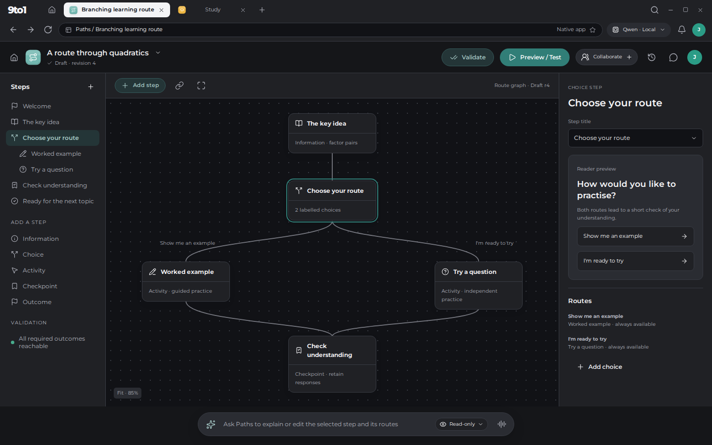
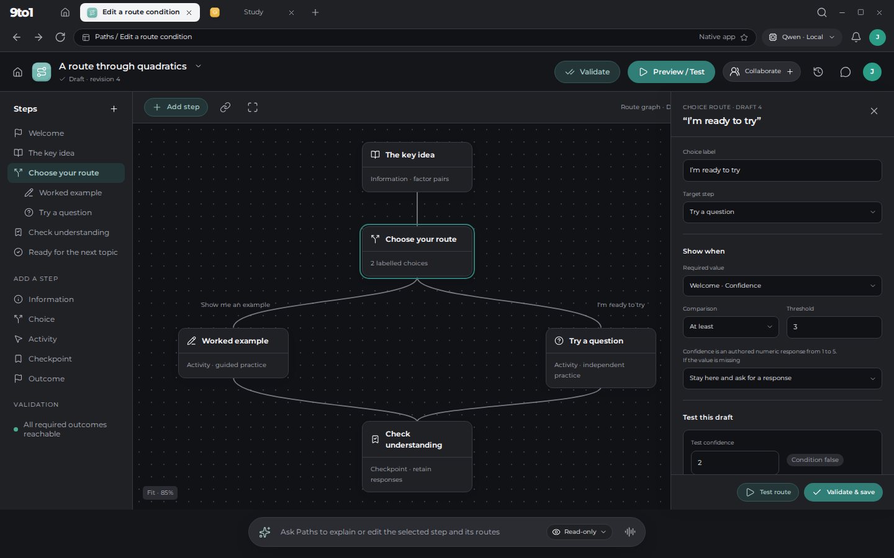

# Paths — branching guided experiences

Module ID: `paths` · 9to1 Development Specification v3

## Prerequisites

- **CUI, themes and shared interaction system** — Typed UI components, theme tokens/materials, layout, focus, motion, accessibility and shared control states.
- **Artifacts, local persistence and recovery** — Canonical artifacts, revisions, typed edits, local saves, derived exports, sync and recovery.
- **Permissions, approvals and execution scope** — Effective scoped grants, action approvals, policy intersections, revocation and audit.
- **Node Editor — shared graph framework** — Shared typed graph schemas, editing/validation, draft activation and runtime presentation.

## Overview

Paths authors and runs guided sequences with steps, choices, activities, checkpoints and outcomes. Branch logic is explicit, versioned and testable; reader progress is a durable attempt against a known route revision.

## Layouts & visible states

- **V3-PATHS-LAY-01** — Show step outline, selected step content, branch/route properties and preview/run controls. A branch rule exposes condition, target, priority/fallback and missing-value handling.
- **V3-PATHS-LAY-02** — Reader view shows the current step and available choices without inventing progress percentages for nonlinear routes.

## Features & behaviour

- **V3-PATHS-FEA-01** — Create/reorder steps and configure typed conditions/targets, default/fallback routes and supported loops with validation.
- **V3-PATHS-FEA-02** — Preview is disposable author testing; real reader attempts persist separately. Restart creates or resets according to explicit attempt semantics, not silent history deletion.
- **V3-PATHS-FEA-03** — Activities call canonical app/tools with current grants and idempotency; returning to a checkpoint must not repeat an external effect automatically.

## Canonical entities & persistence

- **V3-PATHS-ENT-01** — Persist PathID/revision, StepID, rule/edge IDs, checkpoint/outcome definitions and reader AttemptID, inputs and traversed events.
- **V3-PATHS-ENT-02** — Keep source authoring, preview state and durable reader progress distinct.

## Permissions & recovery

- **V3-PATHS-PER-01** — Validate unreachable/missing destinations, ambiguous branches and unsafe cycles before activation. Revisions do not silently remap existing attempts.
- **V3-PATHS-PER-02** — Recover interrupted attempts/checkpoints and denied activity actions while preserving completed evidence.

## Acceptance checks

- **V3-PATHS-ACC-01** — Test branch condition true/false/missing, priority/fallback, invalid destination and preview reset.
- **V3-PATHS-ACC-02** — Reopen a durable attempt, resume checkpoint and verify no duplicated consequential action.

## Exact mock-up and state map

- **Paths · Branching learning route** — screen `paths`. Authoring.
- **Paths · Edit a route condition** — screen `paths-branch-rule`. Route rule · test input.

## Source clause IDs

TF-H01, TF-H02, TF-H03

## Technical reading map

- Paths — branching guided experiences — Paths; Authoring, steps and route UI (part 01) — `technical/paths-01.md` (717 words; V2-B2167).

Technical clauses retain APIs, data models, platform, recovery, donor and acceptance details. The technical files are part of this module, not optional background reading. Shared prerequisites mean stable service/interface contracts must be available; they do not require every dependent app UI to be complete. Use the named chunk for the relevant subtask or the complete module file for its full retained contract.

# Exact designs and implementation rules

These figures are the exact current atlas compositions. Their stable screen IDs match the Word specification and editable source. Open the atlas for full-size theme and interaction inspection.

## Paths · Branching learning route

Screen ID: `paths`. Source: TF-H01–03: step outline, route graph, preview and durable reader progress.

- Path authoring combines the step outline, route graph, content and conditions over stable step IDs.
- Each choice names its destination. Conditions, fallback routes and invalid routes remain inspectable.
- Preview has disposable test progress and identifies its draft revision; it never changes a reader attempt.
- Reader progress is durable and separate from authoring. A branching path must not invent a fixed completion percentage.

## Paths · Edit a route condition

Screen ID: `paths-branch-rule`. Source: TF-H01–03; TF-X02.

- Each choice has a stable target, human-readable label, explicit condition and defined missing-value behaviour. Graph position does not identify a route.
- This draft condition reads the authored Welcome confidence response. Required type, comparison and threshold are visible, with an always-available alternative route.
- Preview uses disposable test inputs bound to the draft revision. It must not change real reader progress or publish a new authored revision.
- A false condition does not randomly choose another route. Missing values produce the configured recoverable state; validation detects missing targets, unreachable outcomes and uncontrolled loops.
